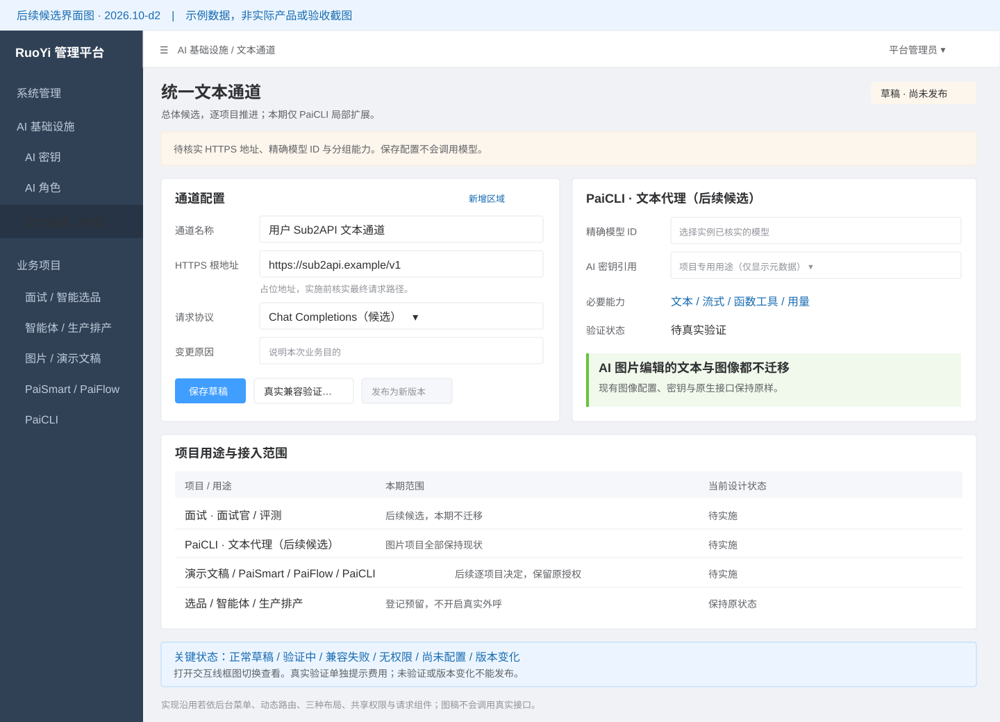
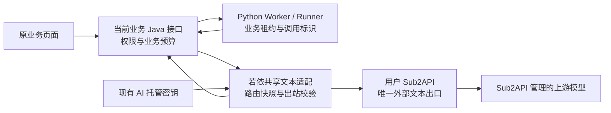

# Sub2API 统一文本通道总体方案

> 文档类型：共享基础设施增量设计；所属功能：FEAT-RUOYI-001  
> 版本：2026.10-d2；方案状态：Draft，待评审；owner：用户决定范围和实施，Codex 负责调查与设计  
> 创建：2026-10-03；更新：2026-10-04  
> 需求依据：用户要求统一使用自建 Sub2API，先给总体方案；随后明确逐个项目推进，本期仅 PaiCLI 扩展，新增其具体实现文档。AI 图片编辑的文本规划与图像生成均不迁移；其他项目和专用能力本期不动，Codex 配置另行处理。  
> 上游：[平台密钥、AI 密钥与 AI 角色设计](设计方案.md)；[共享功能控制页](README.md)。本文是统一文本通道的唯一设计正文，补充原三模块设计，不替代其加密、轮换或业务角色规则。  
> 授权边界：本期只调查和设计；未授权修改运行配置、真实模型调用、录入/轮换凭据、服务器部署、数据库迁移或 Git 写入。

**当前落点：**本文件保留总体原则和后续候选架构，不是九项目同时实施授权。PaiCLI 本期复用已有供应商配置、托管密钥和 Runner 调用机制做局部扩展，唯一具体实施顺序见[PaiCLI Sub2API 扩展实现文档](../../../项目/PaiCLI智能编码项目/Sub2API扩展实现文档.md)。共享通道新页面、共享出站代理与其他项目切换都属于后续候选，不作为 PaiCLI 首次可用的前置重构。

## 1. 需求与业务逻辑

### 1.1 用户得到什么

平台管理员在若依后台维护一个 Sub2API 文本通道，各业务管理员为自己的用途选择已核实的模型。业务用户继续在原页面面试、问答、生成大纲或发起智能编码，文本模型请求最终统一到用户的 Sub2API。Sub2API 管上游供应商接入，若依继续管账号、权限、业务配置、托管密钥与调用归属；各业务继续管任务、审批、数据和费用规则。

后续跨项目收敛可评估“**若依共享通道配置与出站适配 + 现有业务授权入口 + Sub2API 文本出口**”。共享配置和适配器随当前业务的 Java 进程装配，沿用现有 MySQL 和 Redis；不为了本功能另启一个装配所有业务的中心服务。将长期密钥进一步收敛到共享出站代理属于后续安全设计，不要求本期替换 PaiCLI 已批准的任务作用域凭据派发机制。

统一的是访问通道，不强制所有业务选同一个模型。面试官、评测、代码代理、大纲生成等仍需分别确定模型、上下文限制和参数；截图里的 `gpt-5.5` 只是候选线索，不设为九项目默认值。

### 1.2 分阶段边界

| 范围 | 本期处理 |
|---|---|
| PaiCLI 智能编码 | 本期新增 Sub2API 供应商扩展的实现文档；具体代码、模型选择和验证按该项目文档实施 |
| 面试、智能选品、智能体桌面端、生产排产、AI 演示文稿、PaiSmart 知识库、PaiFlow 工作流 | 仅作为后续逐项目评估对象，本期不实施、不改配置、不启停服务 |
| PaiCLI 文本对话、计划、团队角色、代码生成、函数工具回合及沿用当前模型的辅助分类/压缩 | 本期扩展覆盖；用户显式选择 Sub2API 配置后使用，不批量替换其他供应商 |
| AI 图片编辑的文本规划和图像生成/编辑 | 用户明确要求全部不迁移，保留现有 DashScope 配置与调用链 |
| 其他项目图像生成/编辑 | 按原已批准配置运行，本期不迁移 |
| ASR、TTS、Embedding、Rerank、OCR、视觉输入、实时多模态、视频等专用能力 | 本期不迁移；面试已批准的语音识别、朗读和音频写入继续保留；PaiSmart 索引模型及维度不变 |
| 模型内置联网搜索或业务调用 LLM 做搜索/总结 | 后续逐用途确认；本期仅 PaiCLI 沿用所选模型的辅助调用覆盖扩展，独立搜索供应商不迁移 |
| Codex 客户端、其他个人 AI 客户端 | 单独处理，不写入本方案实施范围 |
| Fake、Demo、Disabled、纯算法排产求解 | 明确标为离线/无模型外呼；不计入真实通道通过数，也不以迁移名义开启真实外呼 |

### 1.3 允许、拒绝与故障规则

1. 新文本调用必须来自已启用业务及有效用户/服务身份，具有当前资源权限、固定业务配置和模型路由版本；检查通过才允许发送。录入密钥、发布通道或角色不会自动启用业务外呼。
2. 一个逻辑文本调用固定 `project + purpose + businessRun/operation + routeVersion + channelVersion + model + credentialVersion`。重放已完成业务结果不再向 Sub2API发送收费请求；语义修复、下一工具回合为新的子调用，仍受原预算限制。
3. 模型功能按“协议 + 精确 model ID + 实例版本 + 凭据分组”验证。不能凭模型名字、`/models` 列表或一个 Hello 响应认定流式、工具和 JSON 结构都兼容。
4. 通道不可用、权限撤销、密钥失效、协议不支持、预算不足时给出明确失败或待处理状态，不自动换供应商直连，不输出假成功。已发送而结果未知时保持“结果待核对”，禁止自动重发。
5. 取消后禁止启动后续文本/工具回合，关闭本地出站请求并记录实际取消回执。关闭连接不能证明 Sub2API 上游已停止生成或不会计费，不能标记已撤销费用。
6. 新运行采用发布版本；已有运行保持原业务快照。切换期间旧版本运行只可在明确批准的短期排空窗口内完成，后台显示仍未纳入的新旧边界；未完成排空不宣布全面统一。

### 1.4 已核实的现状与真实缺项

以下结论来自 2026-10-03 活跃工作树静态调查，没有读取真实凭据、查询业务数据库、探测用户实例或验证当前运行包。源码事实与部署事实分开。

| 对象 | 核实事实及来源 | 对统一通道的影响 |
|---|---|---|
| 共享托管密钥 | `ManagedSecretService` 已有元数据、AES 密文版本、固定用途校验、并发行版本和无值审计；平台密钥与 AI 密钥分类独立 | 复用 AI 密钥入口，不把 Sub2API token 放平台参数或另造密钥库；新增固定用途需补服务端允许规则 |
| AI 角色 | `AiRoleService` 已有不可变角色版本；模型配置带供应商、model、密钥别名，发布检查供应商；现有页面明确面试/选品运行尚未接入 | 后续可评估文本路由引用；本期不修改共享 AI 角色或其他业务人设 |
| 面试 | `ManagedInterviewProviderAdapters.DeepSeek` 每次调用从 `ai.interview.deepseek` 读取；`DeepSeekChatModelAdapter` 使用 Chat Completions 与 DeepSeek 参数；固定用途限定 `interview/deepseek/chat/api-key` | 不能把 Sub2API token 写回 DeepSeek 用途；新增通道别名和通用文本适配，保留 `ChatModelPort` 及原结构校验；ASR/TTS 适配保持原样 |
| 智能选品 | Python `ProviderMode` 只有 `DISABLED/DEMO`，既有 `fq_agent`/版本与 Java↔Python HMAC 边界存在 | 登记需求解析、方案等未来文本用途；不假称已有真实模型可切换；真实启用需所属业务批准 |
| 智能体桌面端 | Agent Runtime 的配置固定 `offline_fake/provider_disabled`；有 `ModelAgentPort` 与 Fake/Disabled 实现 | 预留受控文本适配；不放开 Runner 工具权限、UIA 或任意外部动作；桌面以后按安装版要求构建同步 |
| 生产排产 | 在 APS Java 活跃源码定向搜索中未发现文本模型 HTTP/SDK 消费者；求解 Worker 与大模型是不同能力 | 当前登记“未发现文本调用”；实施前补查插件与运行包；不改求解算法、数据库或启动范围 |
| AI 图片编辑 | `agent/llm.py` 用 `ChatOpenAI.bind_tools` 做文本规划，读取 DashScope 配置；图像 Provider 另有 DashScope 原生实现 | 用户排除整个迁移；文本规划、图像生成/编辑和配置保持原样 |
| AI 演示文稿 | `app/llm/client.py` 用 ChatOpenAI、JSON mode 和 Pydantic；Worker `Settings` 持有 LLM key/base URL，设置 SDK 重试；`execution.py` 已有调用数和真实 usage 摘要 | 保留 LangChain/LangGraph 和业务校验，接入任务作用域中心文本适配；取消本地长期文本密钥来源，防止 SDK 与中心重复重试 |
| PaiSmart | `ProviderService` 分 LLM/EMBEDDING/RERANK；`IntelligenceSettings` 核对项目托管用途与 provider/capability；`ModelGateway` 有 Chat Completions、流式工具、模型调用账本、Embedding/Rerank | 仅改 LLM 的出口解析与文本输送；保留正式业务账本、配额和索引边界；保留 Embedding/Rerank 的现有配置 |
| PaiFlow | `ModelRuntimeCatalog` 要求批准的 `ProfilePort`，固定模型权限/版本，仅允许 openai/chat，运行地址要求 HTTPS/443；Python 有中心模型帧桥及受控 producer；Java Worker 有模型出站授权 | 必须复用现有授权、租约、预算、帧提交及终态，不绕过 ProfilePort；用户 HTTP 示例不满足这一运行限制；不能直接替换原帧格式 |
| PaiCLI | 中心 `PcConnectionService` 管工作区、模型与托管用途；`secretGrant` 当前会向 Runner 交付 Provider key；Factory 只有 deepseek/glm/hunyuan/kimi/step/freellmapi/xfyun/agnes 等具体实现，并有供应商回退扫描 | 首期新增 `sub2api` 供应商及选定 API 的 client，沿用中心配置与受控 Runner；主模型及沿用该模型的辅助分类/压缩一起适配，独立搜索不迁移；不伪装成 DeepSeek，显式选择失败不自动回退 |

关键差异是现有各消费者持有的协议、参数和出站权限不同，不是把九份 `base_url` 改成同一个值就结束。完整源码定位见[调查与文档检查记录](证据/2026-10-03-Sub2API文本模型设计/调查与文档检查记录.md)。

### 1.5 Sub2API 与协议证据

用户提供的非秘密线索为 `http://39.102.215.183:8080`、Responses 协议和候选 `gpt-5.5`；它们来自客户端示例，不是已核实的业务入口、兼容模型或健康状态。未保存原截图或其中凭据，后续应通过 AI 密钥入口录入新的有效凭据。

公开候选上游 [Wei-Shaw/sub2api](https://github.com/Wei-Shaw/sub2api) 的 [endpoint 定义](https://github.com/Wei-Shaw/sub2api/blob/main/backend/internal/handler/endpoint.go) 和 [gateway 路由](https://github.com/Wei-Shaw/sub2api/blob/main/backend/internal/server/routes/gateway.go) 包含 `/v1/responses`、`/v1/chat/completions` 等路径；路由还受 API key 分组及平台类型影响。因此可优先评估其 Chat Completions 兼容入口，不能据此认定用户部署同一仓库、同一版本或拥有同样能力。实施前需确认实际上游、版本和分组。

OpenAI 的 [流式协议说明](https://developers.openai.com/api/docs/guides/streaming-responses) 区分 Responses 语义事件与 Chat Completions delta；[工具调用说明](https://developers.openai.com/api/docs/guides/function-calling)定义工具调用及结果关联；[结构化输出说明](https://developers.openai.com/api/docs/guides/structured-outputs)区分 JSON mode 与 schema 约束。这些是适配和验证基准，不能证明第三方中转完全实现。

## 2. 前端界面设计

### 2.1 入口与操作

沿用若依后台“AI 基础设施”授权菜单，在已有 AI 密钥、AI 角色旁增加“文本通道”。复用后台菜单、动态路由、三种 `navType` 布局、`v-hasPermi`、共享 request、Element Plus 表单与表格，不自建主导航或权限 store。

平台管理员先保存 Sub2API 草稿及 HTTPS 地址，再在已有 AI 密钥页安全录入项目专用 token。通道页选择项目用途、精确 model ID 和协议，进行本地校验；单独的“真实兼容验证”明确提示会发送合成请求和发生费用，只在取得目标与预算授权后开放执行。通道发布要求验证记录与当前候选哈希一致，发布仅影响后续运行，界面展示受影响项目及尚未迁移的消费者。

本节共享通道页为后续候选界面，本期不建设。PaiCLI 首期只在已有“连接与模型”页面扩展供应商选择与 API 协议字段，具体图稿见其实现文档。AI 图片编辑整条文本规划与图像链均保持现状，不新增通道路由；其他业务页面等到逐项目授权后再决定。

[打开交互线框图](统一文本通道线框图.html)可查看后续共享通道的关键状态。图稿版本 2026.10-d2，为后续候选示意，不是本期 PaiCLI 改动或实际产品验收截图。

| 区域 | 字段/动作与反馈 |
|---|---|
| 通道基本配置 | 通道名称、HTTPS API 根地址、允许协议、超时和并发上限；地址规范化后展示最终请求路径；禁止凭据出现在 URL |
| 项目用途绑定 | 项目、中文用途、协议、精确模型 ID、只显示元数据的 AI 密钥引用、能力要求、单次输出与总预算；不同用途可选不同模型 |
| 版本与验证 | 当前版本/候选哈希、验证时间和覆盖能力；草稿不生效；编辑模型、协议、地址、密钥版本或分组后验证失效 |
| 发布/停用/恢复 | 显示新任务与在途任务影响、原因和确认；恢复创建新版本并重新检查依赖，不能覆盖旧版本；紧急停用另影响在途调用 |
| 调用明细 | 业务归属、模型、版本、终态、用量可用性、耗时和关联标识；默认不展示提示词、工具参数、响应正文或密钥 |

### 2.2 前端拟改范围

| 新增/修改位置 | 目的与关键逻辑 |
|---|---|
| 拟新增 `frontend/admin-web/src/views/ai/channel/index.vue`、`src/api/system/aiChannel.js` | 平台管理员管理通道与项目路由；复用已有请求/错误/分页与权限；不在浏览器调用 Sub2API |
| 已有 `src/views/ai/secret/index.vue`、`src/components/ManagedSecretPage/index.vue` | 登记 Sub2API 固定用途与项目范围，只录入不回看；沿用敏感请求不进入 sessionStorage 的措施 |
| 已有 `src/views/ai/role/index.vue`、`src/api/system/aiRole.js` | 新版本选择文本路由；旧供应商/密钥版本只读展示；不批量改写旧角色 |
| PaiSmart `src/views/paismart/operations/providers/index.vue`；PaiCLI `src/views/paicli/`；PaiFlow 模型页；其他业务所属文本设置页 | 消费已发布路由，不复制主通道配置；实施时先定位真实组件，不推测尚不存在的设置页 |

界面适用于本机桌面管理端，代表视口 1440×900 和 1280×800；表格允许局部滚动，字段标签和关键拒绝原因完整可见。表单取消保留原生效版本，加载防重复提交，权限撤销由后端拒绝，键盘可进入和退出弹窗。通道测试不与保存动作合并，防止用户保存配置时无意发送资料。

## 3. 后台处理设计

### 3.1 请求流与所有权

业务接口从真实登录/租约身份推导项目与资源，不能相信调用方传来的 `projectCode`。业务编排决定 Prompt、工具白名单、任务状态和费用预算；共享适配只负责通道解析、协议映射、网络限制、出站生命周期和无值调用元数据。共享层不建立另一套任务、审批、Agent 人设或用户计费真相。

同一共享通道可由多个当前业务 Java 进程装配。共用平台 MySQL 配置；分布式调用并发/额度若需要全局控制，复用已有 Redis 并按通道与项目设置原子额度，不新起 Redis。不因通道统一复制业务库或跨库 JOIN。

### 3.2 配置和数据

以下为拟新增的数据语义，表名实施时核对已有迁移和 ID 冲突；本期不创建真实表。

| 对象 | 唯一所有者及建议字段 |
|---|---|
| 文本通道及不可变版本 | `ruoyi-system` 平台 MySQL；建议 `sys_ai_channel` / `sys_ai_channel_version`：通道 ID、HTTPS 根地址、协议路径、网络允许规则、预算上限、状态、版本、配置哈希、rowVersion |
| 项目用途路由及版本 | 同一平台 MySQL；建议 `sys_ai_text_route` / `_version`：项目、用途、channel/version、精确 model ID、协议、能力、允许参数、secretAlias、版本和验证引用；项目/用途唯一 |
| 兼容验证记录 | 平台元数据；候选哈希、部署版本、model ID、凭据版本/分组标识、测试类型、时间、真实回执摘要、结果和操作者；不含凭据/请求正文 |
| Sub2API 访问 token | 复用 `sys_managed_secret*`，`kind=AI`、`provider=sub2api`、`capability=chat`、`authMode=api-key`，建议 `ai.<project>.sub2api.text`；不同项目可用不同 token/分组，网络通道相同 |
| 调用关联元数据 | 共享层留出站事实：call ID、业务关联、route/channel/keyVersion、providerRequestId、发送时间、usage 状态、终态；业务账本仍为正式费用、任务和审批源 |
| Prompt、人设、知识库、业务输出 | 各业务原有版本与数据库；共享 AI 角色只保存 route 引用，不保存秘密，不再维护第二份 URL/model/key 生效配置 |

密钥用途的供应商和能力在现实现中不可变，因此新增 Sub2API 用途，不把已有 DeepSeek/DashScope 用途改名复用。后续新 token 由用户通过现有安全入口录入，不在聊天、SQL、配置文件或版本库保存明文。主库连接及密文根密钥继续沿用原自举设计。

路由版本绑定通道版本和能力证据。运行开始固定配置版本；每次出站仍检查当前停用/权限与预算。一次子调用取同版密钥元数据和值；后续子调用遇密钥轮换时重新取当前版、重新校验允许分组并记录实际版本，不能声称全任务密钥始终不变。若业务要求固定旧密钥版本，必须采用已有受控凭据版本机制并限定排空期限，不能任意解密历史密钥外呼。

### 3.3 协议选择及模型能力

后续总体方案可优先评估 **Chat Completions**，因为当前面试、PaiSmart、AI 演示文稿和 PaiFlow 的主要消费形态接近此协议。PaiCLI 本期协议选择以其实现文档为准，提供显式 Responses / Chat Completions 适配，不把跨项目推荐当作其实例已兼容的证据。

| 实例核实结果 | 处理决定 |
|---|---|
| Chat Completions 满足该用途的所有必要能力 | 发布该用途 `chat_completions` 路由，复用现有消息和工具语义 |
| 实例仅支持 Responses，或业务必需能力只在 Responses 有 | 在共享出站层实现独立 Responses 适配；用合成契约测试和真实限定验证通过后发布；不把 `/responses` 返回体送给原 Chat decoder |
| 两者都不满足用途所需能力 | 该用途不能切换；展示缺项，用户可补齐 Sub2API 支持或另行决定业务/能力范围；不默认删工具、改评测或直连其他厂商 |

两种协议分别保存路径配置，由适配器构造最终 URL；规范根地址不包含 `/chat/completions` 或 `/responses`，不重复拼接 `/v1`。通常候选根为 `https://<已核实域名>/v1`，实际以用户实例部署路径为准。端口、路径、模型名称和大小写不得猜测。

共享业务调用语义最少包括消息、允许的工具 schema、模型路由、输出格式、参数和调用预算；输出分正文增量、完整工具调用、usage、完成/拒绝/失败/取消。Responses 的工具 `call_id`、Chat 的 `tool_call_id` 和流式片段索引须准确关联；工具参数完整且经业务校验后才交给业务执行。内置搜索/托管工具不是任意函数工具的等价替代，只在明确能力批准后发送。

模型能力登记 `text/stream/function_tools/json_object/json_schema/reasoning/usage` 等独立证据；尚未验证记未知。拒绝、截断、空结果、无终帧不转成成功；业务原来的 schema 校验继续执行。`thinking`、`reasoning_effort`、`temperature`、`max_tokens/max_completion_tokens/max_output_tokens` 按协议与模型逐项允许，不把 DeepSeek 扩展原样发给所有模型。不支持且业务非必需的参数可在有记录的模型配置中省略；必需参数不兼容则阻止发布。

图像输入不在本期默认能力中。若现有某文本流程携带截图或图片，登记为“视觉输入依赖”，单独核实或排除在本次切换范围，不能静默丢弃附件后宣称行为兼容。

### 3.4 Java、Worker 与 Runner 的接法

Java 业务沿用原 port/service，调用拟新增的 `ruoyi-system` 共享 `AiTextGateway`。`ruoyi-common` 只放必要请求/结果类型，避免把网络客户端和业务编排塞进公共工具包；共享类型不携带密钥。`ruoyi-admin` 通过既有模块开关装配，不启动无关业务。

Worker/Runner 优先通过现有中心请求、帧回执和租约链路转发。增加的是任务作用域文本调用能力，不能提供“传任意 URL、模型、密钥名就代理”的通用 HTTP 代理。

| 消费者 | 拟改位置与行为 |
|---|---|
| 面试 | `ProviderConfiguration`、`ManagedInterviewProviderAdapters` 增加统一文本适配；保留 `ChatModelPort`、`StructuredChatExecutor` 及业务结果类型；将文本模型名/协议从通道路由解析；语音 Adapter 不变 |
| 智能选品 | Java Runtime adapter 保留 HMAC 与运行快照，Python 模型 port 未来增加中心文本实现；继续 disabled/demo，直到真实业务启用获准；`fq_agent` 版本只增加路由映射，不强制 Prompt 迁移 |
| 智能体桌面端 | 将来在 `ModelAgentPort` 增加中心文本 adapter；审批、工具能力与正式状态仍在若依；当前 Fake 配置不改 |
| 生产排产 | 登记未来文本用途即可；没有已核实消费者时不新增伪模型 SDK，也不改求解 Worker |
| AI 图片编辑 | 用户已排除迁移；文本规划、图像生成/编辑和所有相关配置保持现状，不实施本总体草稿的通道适配 |
| AI 演示文稿 | `app/llm/client.py` 用中心文本 `BaseChatModel` 适配现有 LCEL/LangGraph；`handlers.py` 按任务创建模型避免缓存凭据；`config.py` 去除已迁移文本用途的长期 key/base URL；保留 JSON/Pydantic、修复回合上限和 usage callback |
| PaiSmart | `ProviderService` 的 LLM 配置映射到 route；`ModelGateway` 的文本 complete/stream/streamTurn 改用共享输送；原 `ModelCallService` 正式账本与重放语义不变；Embedding/Rerank 方法和索引模型不变 |
| PaiFlow | 中心已有 `ProfilePort`、model operation、producer 与帧契约接共享出口；Python 模型帧桥继续回读中心终态；Java Worker 的出站授权仍绑定真实调用。新增适配必须输出原消费协议要求的合法帧，保留 finish/usage/序号/取消确认；没有通过逐项验证不得关闭旧 producer |
| PaiCLI | 首期按独立实现文档新增 `sub2api` 供应商和协议适配，复用现有受控凭据及预算机制；不先重构为共享代理。未来改为仅发代理授权需另行评估和批准。正式评测原暂停状态不变 |

如现有业务没有可用的受控文本接口，在该业务 API 增量增加 `invoke/readFrames/cancel`，复用其 Runner/Worker 认证、租约、幂等和 ACL。请求至少带运行/操作、节点/回合、固定配置版本、消息和输出要求；服务端从有效租约解析用户及项目，比较冻结快照，再解析共享路由。通道 ID 不能由 Runner任意改写。

幂等键由业务运行、节点/回合和输入哈希构成；回读使用已有游标与序号语义。重连仅回读原调用结果；SDK 自动重试设为 0，由中心判断确未发送的失败可否有限重试。结构化修复调用是新的计预算子调用，不是隐藏自动重试。

拟新增平台管理 API `/ai/channel`、`/ai/textRoute` 及版本/验证/发布/停用动作，沿用 AjaxResult、DTO 校验、`@PreAuthorize` 和无值 `@Log`。业务内模型接口保留业务原信封、错误码和终态，不以平台返回结构覆盖它们。已有接口先增字段兼容旧读取，再切消费者，最后拒绝已迁移用途的自由 URL/内联密钥。

### 3.5 鉴权、网络与安全边界

1. 后续共享代理候选可将长期 token 收敛到 Java 出站适配。PaiCLI 首期继续使用现有受控 Runner 凭据 Grant，具体有效期、版本和不落盘规则以其实现文档为准；不把本条后续目标当成本期新前置要求。所有前端仍不接收长期 token。
2. 平台新增建议权限 `ai:channel:list/query/write/validate/publish/disable/audit`；路由同样核对项目归属，平台管理员与业务管理员权限不混用。现有全局密钥页面不是已实现的项目 ACL；本次新增接口必须实施服务端作用域校验，不能用下拉筛选假装隔离。
3. 用户示例为公网 HTTP，实际会传 token、题目、文档或代码；推荐先为自建实例补齐可信 HTTPS 域名/证书或既有受保护网络入口，候选请求最终仍到同一 Sub2API。PaiFlow 当前固定运行路径要求 HTTPS/443，本方案保持这个要求，不通过删除校验接纳该示例。
4. 地址必须为管理员批准的规范根地址：限制 scheme/host/port/path，禁止 userinfo/query/fragment，校验 DNS 结果和出站目标，禁止重定向、环境代理注入或连接外部非批准目标。出站网络策略仅允许文本模型到 Sub2API；共享进程仍可访问已批准的语音、图像、对象存储等非本期通道，不一刀切封网。
5. 运行 Prompt、知识材料、源码以及工具结果可能经若依、Sub2API 和它选择的上游处理。上线前确认 Sub2API 的分组路由、上游账号、请求日志、数据保留/清理与存储策略；设置 `store=false` 等请求项只能作为需验证的协议选项，不能保证中转或上游不记录数据。
6. 日志默认只记业务关联、模型/版本、耗时、状态及 usage 元数据；禁记 Authorization、原始异常响应、Prompt 或完整工具参数。原业务需保存的正文继续按其已批准数据权限处理，不复制到共享审计。新增 token 输入继续禁用请求/响应正文审计、重复提交正文缓存和持久化浏览器存储。

### 3.6 用量、失败与恢复

Sub2API 用量/计费回执与本系统用户费用不是一个对象。保留业务已有预算/正式账本，避免共享层再扣一遍用户余额；共享层负责全通道出站预算预占与实际 usage 元数据关联。价格从用户实例的实际规则确定，不套 OpenAI 公价或硬编码截图模型价格。

`usageStatus` 区分 available/partial/unavailable；缺失不写成 0。区分上游实际 token、估算额度、工具回合和 Sub2API 实际金额；现有 PaiSmart 估算账本保留原语义，页面明确是否估算。取消/超时且已发送时不能自动退还未知费用；预占资源按业务账本的未知结果处理，而非长时间占用无限并发槽。

| 场景 | 系统行为与恢复 |
|---|---|
| 未配置、模型未核实、401/403 | 拒绝新调用；展示通道/权限原因，管理员修复托管用途或配置后重新验证；不切厂商 |
| 429、额度不足、排队超时 | 未发出的可在预算/总期限内受控等待；已发出的不因 HTTP 状态猜测安全重试；保留关联标识 |
| 响应丢失、流断开、中心/Worker 崩溃 | 已发送调用记结果未知或原业务对应状态；回读本地已保存帧/结果；上游查询能力未经验证时人工核对，不补造终帧 |
| 工具参数/结构无效、模型拒绝、截断 | 保留错误和部分结果，按原业务规则允许显式修复子回合或失败；工具不执行不完整参数 |
| 取消/权限撤销/紧急停用 | 阻止后续调用与工具；关闭本地连接，记录上游停止是否已确认；有真实 usage 才按该值结算 |
| 通道版本回退 | 从历史有效配置创建新发布版本；验证地址/密钥有效性，禁止改旧快照或自动返回直连供应商 |

切换后的常规恢复只恢复先前已验证的 Sub2API 路由或暂停相关新任务。若业务必须临时恢复旧供应商，需要用户另行批准对象、时限和影响，并显示为统一通道例外；原旧版本保留为恢复资料不代表具有长期直连授权。

## 4. 实施步骤

本节为后续跨项目实施候选顺序，不是本期任务清单。当前只按 PaiCLI 项目实现文档落地；用户明确排除的 AI 图片编辑不进入迁移步骤。

### 1. 核实实例与冻结兼容清单

先取得非秘密部署事实：实际 Sub2API 项目/版本、HTTPS 入口、可用协议路径、按分组可见的精确模型和必需能力、费用规则、限流和数据保留。由用户在现有 AI 密钥入口安全录入新 token；本方案不索取秘密。执行真实验证前明确目标环境、模型、合成输入、次数/预算与失败停止条件。

优先验证 Chat Completions；若只支持 Responses，先完成独立适配的合成协议验证。每个模型分别检查非流式、流式终态、工具参数片段/结果回传、JSON 结构、拒绝/截断、usage、取消及出站日志。网络和基础兼容通过再实施消费者切換，不使用真实业务材料做 Hello。

### 2. 增量建立共享配置和适配

在已有 `ruoyi-system` 增加通道/路由版本、共享出站适配及项目作用域权限，在 `ruoyi-admin` 与管理端增加后台菜单/API/页面。复用密钥加密服务，不改原托管用途。先用合成凭据和可控假服务验证越权、并发发布、无值日志、错误、重试与取消；不迁移真实业务库。

真实平台增量迁移与菜单 ID 检查另需指定目标及授权。发布通道配置不自动打开消费者，必须具有匹配的真实兼容记录。权限与长期密钥、跨进程授权及失败恢复属于高影响变更，实施前按现有流程完成所需独立复核；本期只设计，没有安排或冒称已完成独立复核。

### 3. 按实际消费者切换

先完成 PaiCLI 局部扩展和定向验证，再由用户选择下一项目。面试、PaiSmart、演示文稿和 PaiFlow 等各自核实实际消费者、原业务要求和切换范围后制定自己的实现文档，不在本期直接迁移。AI 图片编辑全部保持现状。

智能选品、Aden 和 APS 当前无已核实的真实文本消费者，先登记预留。新增真实 AI 功能应由业务原设计决定，不为“九项目齐全”开启空调用。每个真实消费者包括辅助分类、总结、搜索、模型发现、探活及批准的 CLI/Worker 分发路径；`_reference`、历史目录只作对照，不改第三方基线。

### 4. 兼容排空与分发验证

切换前冻结旧配置、运行包和在途任务清单，新增运行选 Sub2API 路由；旧任务在批准窗口完成或明确停止，不重写历史。已迁移用途拒绝旧环境变量、自由 URL、内联 key 与 Factory 供应商扫描回退，并补静态扫描和运行期出站观测。保留旧凭据只用于明确的历史/排空恢复，不继续作为新任务源。

按所属项目范围构建并更新真正运行包、Python Worker、CLI/Runner 分发组件。Aden 如涉及桌面源码必须同步用户已安装 `Aden Local Test.exe`，重新核对文件与地址；不能只构建工作区 `out/` 就交付。保护其他对话验收环境，不复用本设计动作重启 PaiCLI 的当前验收通道。数据库、Redis 和其他基础服务保持共享，只有当前业务 Java/Tomcat 开启。

### 5. 完成定向验收与出口核对

技术检查按改动模块运行定向 Maven、Python 与管理端检查。真实业务验收前在本功能既有证据目录保存并展示中文业务清单，逐项采集页面截图并回读、核对业务数据与出站目的地，交付 `verification-report.html`。未切消费者和专用能力明确标记；只有真实业务文本出站都符合本期通道政策，才能称本期统一完成。

实施前必须补齐：实际 HTTPS 地址及部署版本；模型/协议/能力表；token 用途与分组；真实验证预算和授权；在途任务窗口；网络访问条件；分发清单与恢复负责人。以上是实施准备条件，不妨碍评审本设计，也不是本期已执行动作。

## 5. 业务验收方法

本节是后续共享通道候选验收方法，没有实际执行结果；本期只执行 PaiCLI 实现文档的文档/图稿检查，不执行这里的跨项目业务项。内部沿用本功能既有验收标识，新通道条目使用 `SUB2-TEXT-01…09`，实施时与既有条目建立映射，不清零原通过基线。

### 1. 配置通道与安全录入

- 前提：测试环境已获准，平台管理员、无权限账号及项目专用合成/限定凭据已准备；依据第 1.3、2.1、3.2、3.5 节。
- 步骤：进入 AI 基础设施→文本通道，保存草稿；在 AI 密钥页录入；返回选择元数据引用；无权限账号直访 API 并尝试跨项目引用。
- 预期：草稿不触发模型；秘密不回看、不进日志/导出/浏览器持久存储；越权拒绝，原生效版本不变。截图通道表单、密钥元数据与拒绝反馈，安全核对日志/数据库只检查密文存在及归属，不输出秘密。

### 2. 模型兼容验证与发布

- 前提：精确 model ID、协议、预算和合成输入已获准；依据第 1.3、3.3 节。
- 步骤：运行该用途的必要能力验证，核对终帧、工具关联、schema、usage；尝试发布未验证候选，或验证后改变地址/model/keyVersion。
- 预期：只发布匹配候选的完整通过记录；未知/缺项明确显示，版本变化要求重新验证；只通过 Hello 不可发布工具用途。截图能力结果和发布拒绝/成功版本，核对 Sub2API 关联回执及已发布配置哈希。

### 3. 业务文本请求统一出口

- 前提：选定本轮迁移消费者及旧通过基线，各业务原始输入/独立预期已冻结；依据第 1.2、3.1、3.4 节。
- 步骤：后续按各项目独立授权与实现文档执行其文本用途；AI 图片编辑不纳入迁移。本期 PaiCLI 的具体步骤以独立实现文档为准，不制造跨项目通过项。
- 预期：业务结果满足原规格；每次真实文本子调用可关联到 Sub2API 地址、固定路由和模型；浏览器/Runner 不获得长期 token。逐项截业务结果页面，核对业务数据、网络目的地与调用账本；无真实消费者项登记预留，不计真实联机通过。

### 4. 工具调用与结构化生成

- 前提：合法/非法工具参数、拒绝、截断、schema 不符的可控样例；依据第 1.3、3.3、3.4 节。
- 步骤：执行正常工具回合，模拟碎片参数、未知工具与结构不符；查看原业务审批和修复回合。
- 预期：完整参数才可提交审批/执行；通道配置不提升工具权限；业务 JSON 校验仍生效，修复消耗显式预算；缺关键内容记失败。截图业务审批、结构错误及回合明细，核对工具执行/副作用次数。

### 5. 取消、断线与未知结果

- 前提：可控长流、断线样例和两端日志关联，不使用正式长任务演练；依据第 1.3、3.6 节。
- 步骤：生成中取消；模拟发送后丢响应、Worker 重启；用原调用 ID 回读。
- 预期：不发起后续工具或文本，不重复收费请求；部分结果和未知终态真实保留；不能把断开本地连接写成上游已停且免费。截图停止/待核对反馈，核对出站次数、帧序号、取消事实及实际费用状态。

### 6. 预算、用量与业务费用

- 前提：限额内、超额、缺 usage/部分 usage 的样例；依据第 3.6 节及业务原计费规格。
- 步骤：连续多工具/修复回合，重复同调用，查看业务账本与共享调用明细。
- 预期：超预算不外呼；重放不重复扣费；共享层不再扣一份用户费用；实际与估算分开，缺用量不写零。截图额度/用量状态，核对原正式账本、Sub2API 账单关联和请求数。

### 7. 版本切换、停用与恢复

- 前提：旧运行、新运行、两个已验证路由版本和可用恢复材料；依据第 1.3、3.2、3.6、4 节。
- 步骤：发布新路由，启动新任务；对在途运行紧急停用；恢复已验证 Sub2API 配置为新版本，核对旧运行。
- 预期：不篡改旧快照；发布不自动启用业务；停用阻止后续出站；恢复不自动直连旧供应商。截图影响提示和新旧运行明细，核对版本/密钥引用与网络目的地。

### 8. 排除项目及专用能力保持原行为

- 前提：原已通过且未受影响的 DashScope 图像、面试 ASR/TTS/音频写入和 PaiSmart Embedding/Rerank 基线；依据第 1.2 节及所属业务规格。
- 步骤：本期先静态核对 PaiCLI 变更不涉及这些项目；后续只有实际改动影响对应边界时，按原项目清单定向复验。
- 预期：AI 图片编辑文本规划和图像生成/编辑全部继续使用原链路；其他专用能力保持原配置。本期不为总体方案重跑其他项目验收，静态范围核对不能冒充业务结果。

### 9. 分发组件与出口遗漏

- 前提：真实运行包、Worker、Runner/CLI/安装版组件清单和适用检查命令；依据第 3.4、4 节。
- 步骤：从实际运行入口执行代表文本用途，覆盖辅助 LLM 搜索/分类/总结；尝试已迁移用途的旧自由 URL/本地 Provider 配置；核对最终包版本与出站允许规则。
- 预期：实际运行版本和源码范围一致；遗漏消费者明确保留未完成；已迁移用途不能绕过 Sub2API。保存业务入口截图及分发/请求关联；静态扫描、构建、真实业务结果、用户接受分别记录。
