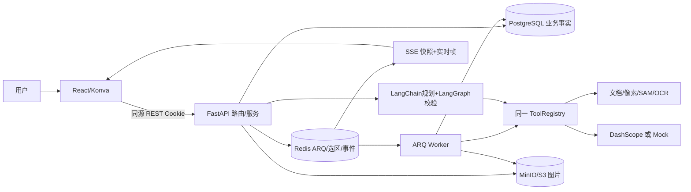
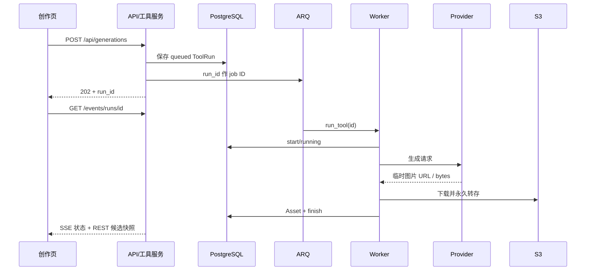

# AI 图片编辑原项目复现与学习设计

> 文档类型：源码调查、复现与学习资料；版本：2026.10-r1；负责人：本次调查执行者；日期：2026-10-04  
> 来源：本地 `参考项目/ai-picture-editor-main` 源码、依赖锁文件、迁移文件及测试；不以网上最新版代替本地版本。  
> 适用性：解释原项目的真实实现，指导复现、理解、迁移核对和扩展。本次只读调查及文档新增，没有启动服务、调用模型、写数据库或执行业务验收。  
> 与既有文档关系：[完整迁移设计](完整迁移设计.md)继续维护已批准的目标行为和实施步骤；[实施记录](开发记录/2026-10-03-完整迁移实施.md)继续维护真实实施与检查；[验收记录](证据/2026-10-03-完整迁移验收/业务验收记录.md)继续维护业务结果。本资料不另建迁移状态，也不宣布“全部迁移完成”。  
> 源码基线：[源文件及哈希清单](证据/2026-10-04-原项目复现调查/源文件清单.csv)、[基线说明](证据/2026-10-04-原项目复现调查/源码基线.json)、[逐文件目标候选](证据/2026-10-04-原项目复现调查/源文件目标候选对照.csv)、[依赖声明清单](证据/2026-10-04-原项目复现调查/依赖声明清单.csv)。根目录：[项目控制入口](README.md)。

## 1. 业务定位与完整复现目标

该项目面向电商素材制作，把“提示词生成 → 选择图片 → 会话精修 → 营销变体 → 投放尺寸 → 导出”串成一条创作流程。它有两类编辑：一类只改变画布文档中的图层属性，另一类改变实际像素并产生新素材。自然语言 Agent 将用户目标转成同一套工具调用；它不直接拥有图片、权限或最终画布。

学习时应能回答五个问题：当前图、图片墙和图层文档为什么不是同一事物；哪些工具同步改 JSON，哪些工具排队执行；选区为什么绑定修订号；分层画布为什么不能随意被整图结果替换；失败后哪些状态已经持久化、哪些第三方副作用无法撤销。能运行首页和完成一次生图不足以复现这些机制。

原项目没有多人协作、团队角色、计费、模板市场、任意矢量绘图、完整图层锁定系统或 Web 评测后台。目标仓库补充的若依授权、完整迁移导入、评测管理、透明导出、批量恢复等属于目标能力，应与原行为分开核对。

### 1.1 页面及入口

路由以 [App.tsx](../../../参考项目/ai-picture-editor-main/frontend/src/App.tsx) 为准。受保护页面由 `RequireAuth` 包裹，共用 `WorkbenchLayout`；用户身份来自服务端 Cookie，页面内跳转由 React Router 管理。

| 页面 | 原地址 | 用户操作与下游 |
|---|---|---|
| 宣传及创作入口 | `/` | 输入提示词草稿、观看能力示意、跳转登录/创作；`components/landing` 是静态展示，示意图不能证明算法效果 |
| 注册登录 | `/auth` | 注册、登录；成功进入工作台；原独立账号在迁移中由若依替换 |
| 创作 | `/create` | 提示词、比例、数量、高级参数、参考图、上传和历史素材分组；生成返回任务 ID |
| 候选 | `/candidates/:runId` | 查看进度、失败、候选；采用一张并把同批候选加入新会话图片墙 |
| 编辑 | `/editor`、`/editor/:sessionId` | 空态、会话侧栏、Agent、工具栏、Konva 画布、图层面板、图片墙、历史/撤销/对比/导出 |
| 营销 | `/marketing`、`/marketing/:sessionId` | 选择会话、四类营销、比例与文案；生成结果只入图片墙 |
| 批量 | `/batch`、`/batch/:runId` | 多图上传/选择、配置处理步骤和格式、查看逐项结果、ZIP 下载 |
| 未知路由 | `*` | 重定向首页；`PlaceholderPage.tsx` 未接入路由 |

页面源码：[页面目录](../../../参考项目/ai-picture-editor-main/frontend/src/pages)、[编辑组件目录](../../../参考项目/ai-picture-editor-main/frontend/src/components/editor)、[原 API 适配目录](../../../参考项目/ai-picture-editor-main/frontend/src/api)。本次无界面改动，学习布局直接使用已有[逐菜单图稿](图稿/界面设计.html)；图稿说明目标布局，原路由表说明原入口。

### 1.2 全部注册工具及规则

注册表 [tools/__init__.py](../../../参考项目/ai-picture-editor-main/backend/app/tools/__init__.py) 共 **22 项**。其中 9 项文档命令加投放尺寸同步执行，其他 12 项走 ARQ。接口返回 202 不能据此判断一定异步：统一 `/tools` 路由在同步执行完后也返回 202。

| 工具 / 中文能力 | 输入与作用范围 | 原处理和结果去向 | 核心源码 |
|---|---|---|---|
| `generate_image` 生图 | 提示词、五比例、1–6 张、反向提示词、seed、最多 3 参考图 | Provider 出图后转存；创作页没有会话，不自动建立图片墙 | [generate.py](../../../参考项目/ai-picture-editor-main/backend/app/tools/generate.py)、[generation.py](../../../参考项目/ai-picture-editor-main/backend/app/services/generation.py) |
| `replace_background` 换背景 | 非空描述≤500字、1–4张 | 单图单层写回；多候选或分层画布只上墙；分层时按整图生成 | [enhance.py](../../../参考项目/ai-picture-editor-main/backend/app/tools/enhance.py) |
| `expand_canvas` 扩图 | 比例、描述 | `cover_size` 保住原图；单层采用，分层仅上墙 | 同上 |
| `upscale_image` 增强 | scale 整数 2–4、默认2 | 拍平送 Provider；单层采用，分层上墙；实际尺寸受模型限制 | 同上 |
| `remove_background` 去背景 | 图层 ID/名称，可省略 | 默认顶层可见图像；rembg 或四角算法；生成透明素材并替换目标层 | [retouch.py](../../../参考项目/ai-picture-editor-main/backend/app/tools/retouch.py) |
| `adjust_image` 调色 | 图层及11参数 | 改目标层 RGB，保留原 alpha；其他图层不改 | 同上 |
| `erase_region` 消除 | 图层×遮罩、可选描述 | 没选区则整层 alpha；生成后本地遮罩合成；替换该层 | [region.py](../../../参考项目/ai-picture-editor-main/backend/app/tools/region.py) |
| `replace_region` 替换 | 同上，描述1–500字 | 没选区可改整层；指定无交集则失败 | 同上 |
| `split_layers` 拆层 | `include_text=false` | 主体抠图、原位置修补、可选 OCR；背景+主体+文字；已拆层跳过 | [layers.py](../../../参考项目/ai-picture-editor-main/backend/app/tools/layers.py) |
| `promote_object_to_layer` 对象成层 | 必须有效选区，名称≤40字 | 截取对象、修补原处；按 mask hash 避免重复；分层时更新原受影响像素层 | 同上 |
| `generate_marketing` 营销图 | product/scene/model/poster，文案≤200字，1–4张、比例 | 拍平+类型提示词，resize 到固定尺寸；只上墙，kind=marketing | [marketing.py](../../../参考项目/ai-picture-editor-main/backend/app/tools/marketing.py) |
| `prepare_delivery_sizes` 投放尺寸 | 1–5比例，默认1:1/4:5/9:16 | 去重、完整容纳、居中白底 letterbox；只上墙，kind=export；prompt未使用 | 同上 |
| `batch_process` 批量 | 1–20图、1–6步骤、png/jpg | 白名单六种像素工具流水线；逐项结果；不用于局部/拆层/营销 | [batch.py](../../../参考项目/ai-picture-editor-main/backend/app/tools/batch.py)、[services/batch.py](../../../参考项目/ai-picture-editor-main/backend/app/services/batch.py) |
| `crop_canvas` 裁剪 | 比例或归一化矩形恰选一种 | 校验不出界，最短边≥32；缩画幅、平移各层，资产不换 | [canvas.py](../../../参考项目/ai-picture-editor-main/backend/app/tools/canvas.py)、[document.py](../../../参考项目/ai-picture-editor-main/backend/app/edits/document.py) |
| `flip_layer` 翻转 | horizontal/vertical、图层 | 翻转缩放符号，保留位置 | 同上 |
| `set_layer_opacity` 透明度 | [0,1]、图层 | 修改文档 opacity，不改原像素 | 同上 |
| `set_layer_visible` 显隐 | boolean、图层 | 隐藏不删除 | 同上 |
| `set_layer_text` 文字 | 文案≤500字、字号8–400、#RGB/#RRGGBB | 仅文本层；无指定时顶层可见文字；更新 text/name/样式 | 同上 |
| `reorder_layer` 排序 | top/bottom/up/down、图层 | 修改 layers 顺序 | 同上 |
| `scale_layer` 缩放 | factor或绝对scale_x/y，(0,8]；UI可传x/y | 保留翻转符号；可同时补偿中心位置 | 同上 |
| `rotate_layer` 旋转 | 相对angle或绝对rotation，[-360,360] | 顺时针正值；渲染围绕图层中心 | 同上 |
| `move_layer` 移动 | 绝对x/y或相对dx/dy | 文档坐标更新；无新像素资产 | 同上 |

11 项调色：brightness、contrast、highlights、shadows、temperature、tint、saturation、vibrance、sharpness、clarity 为 [-1,1]，vignette 为 [0,1]；未指定取0。比例及尺寸由 [ratios.py](../../../参考项目/ai-picture-editor-main/backend/app/ratios.py) 唯一维护：1:1=1080×1080、4:5=1080×1350、3:4=1080×1440、9:16=1080×1920、16:9=1920×1080。

### 1.3 容易漏掉的辅助能力

| 能力 | 真实实现与范围 |
|---|---|
| 账号退出及身份恢复 | register/login/logout/me；HttpOnly Cookie；JWT过期后401；退出删除Cookie，不是服务端撤销全部令牌 |
| 上传防伪 | 实际解码格式而非扩展名；JPEG/PNG/WebP；≤20MiB、短边≥32、≤5000万像素；完整解码识别损坏 |
| 素材分组 | 按会话收拢，内部mask/subject/background不平铺；孤立生成/上传单独一组；列表limit1–200 |
| 会话维护 | 创建、列表、详情、改名、切当前图；无删除会话API；创建候选墙最多12个附加ID |
| 选区预热 | 切点选模式请求prepare，预先算embedding；失败被前端静默忽略，正式点击仍处理 |
| 选区编辑 | 正向点、笔刷、闭环、多笔合并、清除；本地撤销/重做通过重放点/笔画恢复，不是画布数据库历史 |
| 画布交互 | 平移、滚轮/组合键缩放、适应窗口、1:1、拖动/缩放/旋转、双击文字；Esc、Ctrl/Meta+Z/Y/Shift+Z、0/1/+/- |
| 前后对比 | 对比本次操作之前的文档；不是永远对比上传原图 |
| 即时预览 | 浏览器低分辨率调色、透明度预览；结束提交；不等同服务器高分辨率最终结果 |
| 状态恢复 | 页面任务快照+SSE，Agent running 时800ms轮询；切任务过滤旧帧；进度有视觉平滑 |
| 任务取消/重试 | Agent计划有confirm/cancel/retry；普通单工具和批量没有独立取消/重试API |
| 导出 | 原素材签名URL、前端画布保存、会话ZIP含manifest、批量ZIP；会话合成默认白底 |
| 评测 | 本地CLI六任务五指标、样例三组；没有原Web入口 |
| 运维入口 | `/api/health`检查Pg/Redis/S3；`/api/docs`及OpenAPI；ping队列任务；Docker多阶段+同源静态托管 |

## 2. 技术栈、依赖与运行条件

版本以锁文件为准，声明范围不等于实际锁定值。[前端声明](../../../参考项目/ai-picture-editor-main/frontend/package.json)、[前端锁](../../../参考项目/ai-picture-editor-main/frontend/package-lock.json)、[Python声明](../../../参考项目/ai-picture-editor-main/backend/pyproject.toml)、[Python锁](../../../参考项目/ai-picture-editor-main/backend/uv.lock) 应成组保存。

| 层 | 本地锁定版本 | 用途 |
|---|---|---|
| UI | React/ReactDOM19.2.8、React Router7.18.2、Zustand5.0.15 | 组件、路由、本地交互状态 |
| 画布 | Konva10.3.1、react-konva19.2.5 | Stage/Layer/Image/Text/Transformer、事件和预览 |
| 服务端状态 | TanStack React Query5.102.4 | 缓存、mutation、刷新、轮询 |
| 编译与样式 | TypeScript6.0.3、Vite8.2.2、plugin-react6.1.0、Tailwind/@tailwindcss/vite4.3.3、oxlint1.80.0 | build=tsc-b+vite，lint=oxlint；声明TS~6.0.2、oxlint^1.79.0 |
| Python | >=3.13；Docker3.13-slim | 语言与运行环境；uv锁版本不锁Python补丁号 |
| HTTP/配置 | FastAPI0.141.1、Starlette1.6.0、Uvicorn0.52.4、Pydantic2.13.4、pydantic-settings2.15.0、httpx0.28.1、multipart0.0.32 | API校验、ASGI、环境配置、第三方请求 |
| 数据 | SQLAlchemy2.0.52、asyncpg0.31.0、Alembic1.19.1 | Pg异步ORM及7次schema迁移 |
| 队列 | ARQ0.28.0、Redis客户端5.3.1 | 提交任务、Worker、缓存及事件 |
| 对象存储 | boto3 1.43.80 | S3兼容、签名URL；Compose MinIO使用latest未固定镜像 |
| 账号 | bcrypt5.0.0、PyJWT2.13.0 | 原密码和HS256 Cookie令牌 |
| 基础图像 | Pillow12.3.0、NumPy2.5.2 | RGBA、合成、几何、滤镜与评测 |
| 可选CV | rembg2.0.81、ONNX Runtime1.29.0、OpenCV headless5.0.0.93、RapidOCR1.4.4 | 抠图、SAM分割、修补及OCR |
| 可选Agent | LangChain core/openai1.6.0、LangGraph1.2.11、checkpoint4.2.0、checkpoint-postgres3.1.2 | 规划、工具签名与两节点图；Postgres checkpointer未接入 |
| 检查 | pytest9.1.1、pytest-asyncio1.4.0、ruff0.16.4 | Python定向检查和原测试 |
| 容器 | Node22-alpine、postgres17-alpine、redis7-alpine、uv镜像latest | 镜像标签不是不可变digest；前端README的Node18+不能代替Vite实际兼容校验 |

`uv sync --all-extras` 会安装CV与Agent两组可选依赖；Docker `--frozen --all-extras --no-dev` 不安装dev组。CV权重和字体不是 Python 代码文件，必须另外记录下载版本、可用性及许可证。原Docker安装文泉驿字体，渲染代码优先Mac/Linux字体路径；Windows原环境缺少这些路径时会回退Pillow默认字体，中文效果需专门验证。

### 2.1 原架构

层次分工是：routers做身份、资源归属、输入和HTTP错误映射；services做业务协调、历史和状态；tools定义参数、功能说明及handler；edits做纯像素/文档算法；providers隔离外部图像模型；agent只产出及校验计划。`services/tools.py`是同步按钮和Agent共同的执行外壳，负责start/report/finish、会话采用和继续计划。

### 2.2 原数据表、字段及所有权

表的准确DDL以[迁移目录](../../../参考项目/ai-picture-editor-main/backend/migrations/versions)为准，当前模型见[models](../../../参考项目/ai-picture-editor-main/backend/app/models)。除`session_assets`外均有UUID主键`id`及TIMESTAMPTZ `created_at`；枚举使用VARCHAR存值，没有Pg原生enum。

| 原表 | 业务字段 | 约束与含义 |
|---|---|---|
| `users` | username(32)、password_hash(128) | username唯一；原独立账号，不是若依用户 |
| `assets` | user_id、kind、source、storage_key(255)、image_format(8)、width、height、size_bytes、has_alpha | storage_key唯一；user外键；图片字节在S3，数据库只存元数据；kind=original/generated/subject/background/mask/marketing/export；source=upload/generate/tool |
| `tool_runs` | user_id、可空session_id、tool(48)、status、progress、stage(64)、params JSONB、result JSONB、error、retries、started_at、finished_at | 单工具/生成/批量共用；run.id亦队列job ID；retries字段本身不证明已实现普通工具重试接口 |
| `edit_sessions` | user_id、title(80)、original_asset_id、current_asset_id、revision、history_seq、document JSONB、updated_at | original/current资产RESTRICT；document为权威画布，不由浏览器或S3决定 |
| `session_assets` | session_id、asset_id、position | 复合主键，图片墙关联；position稳定排序；没有每资产独立长期文档列 |
| `edit_history` | user_id、session_id、seq、action(48)、params JSONB、result JSONB | `(session_id,seq)`唯一；params.before保存操作前快照，result保存后快照；最多20条 |
| `agent_runs` | user_id、session_id、revision、goal、reply、plan JSONB、status、error | 一轮自然语言及步骤断点；计划由数据库JSON存储，非LangGraph Pg checkpointer |

外键主要随用户/会话CASCADE，但数据库删除不自动删除S3对象。没有完整素材删除、垃圾回收API，不能从`storage.delete`函数存在推断产品已有清理功能。`create_from_bytes`先写S3再提交资产，二者不是分布式事务：失败可留下对象或已保存的部分候选，学习和目标恢复必须明确这一窗口。

**画布JSON。** `LayerDocument={width,height,layers[]}`；层有id、kind(image/text/shape)、name、width/height、asset_id、transform{x,y,scale_x,scale_y,rotation}、opacity、visible、locked、source_hash、text、font_size、fill。数组顺序从下到上。新会话仅建立`base`图像层，locked=true；锁主要影响前端拖动，不阻止后端像素工具。shape是枚举，渲染及创建路径不完整。

**Redis。** `selection:{session_id}`保存revision、mask_asset_id、markers，TTL=24小时；正式mask字节仍存S3且有资产记录。ARQ保存队列/任务结果；Pub/Sub保存实时通知而非可重放事件日志。SAM embedding是单进程LRU=4，以源图片SHA256键控，重启消失。不同进程不共享该cache。

**状态。** 工具queued→running→succeeded/failed；Agent计划取消时，尚未执行的queued工具也可进入canceled，running第三方调用不会因此撤回。Agent还可canceled。步骤pending/waiting/queued/running/succeeded/failed/canceled；多步整轮先queued等待确认。失败依赖不会启动后续步骤，但`settle`只要仍有pending就可能维持running，不能把每种故障都说成整轮立即failed；应在目标状态机检查失败依赖汇总。批量items另有pending/running/succeeded/failed，部分成功最终外层succeeded。

## 3. 可追到代码的业务链路

### 3.1 注册登录、素材上传与生成

身份：[auth路由](../../../参考项目/ai-picture-editor-main/backend/app/routers/auth.py) → [auth服务](../../../参考项目/ai-picture-editor-main/backend/app/services/auth.py) → [security](../../../参考项目/ai-picture-editor-main/backend/app/security.py) → [deps](../../../参考项目/ai-picture-editor-main/backend/app/deps.py)。注册先校验用户名/密码，bcrypt散列，提交用户；重复用户名回滚并返回冲突。登录统一拒绝不存在用户/错误密码；签JWT，Cookie HttpOnly、SameSite=lax、生产Secure，TTL来自配置。CurrentUser每请求校验JWT并读取现存用户。目标必须改接若依认证，禁止为了复现保留第二套正式账号。

上传：[assets路由](../../../参考项目/ai-picture-editor-main/backend/app/routers/assets.py) → [images.probe](../../../参考项目/ai-picture-editor-main/backend/app/services/images.py) → [assets服务](../../../参考项目/ai-picture-editor-main/backend/app/services/assets.py) → [storage](../../../参考项目/ai-picture-editor-main/backend/app/storage.py)。输入multipart file；先CurrentUser，再完整读文件、大小和解码校验；按`users/{user_id}/{asset_id}.{extension}`写对象并提交元数据；输出短时签名URL和真实尺寸/alpha。空/坏/伪格式422，超限413。原先完整读取再检查大小，应认识其内存边界；目标可在流读取阶段限流，不改变文件业务规则。

生成：[GenerateIn](../../../参考项目/ai-picture-editor-main/backend/app/schemas/run.py)去首尾空白，限制prompt1–1500、count1–6、seed0–2147483647、references≤3 → 校验参考资产属于本人 → 保存ToolRun → ARQ入队 → Worker从同一个数据库加载 → Provider → 下载临时结果 → 每张校验、转存、自有资产 → succeeded+事件 → 候选页面选择。参考图不存在拒绝；Provider未配置、非JSON、未返回任务ID、超时/下载失败/无图片均失败，不能将外部成功等同于已转存成功。

ARQ `_job_id`和终态跳过能防部分重复；原实现没有持久Provider任务ID、租约/原子claim、请求幂等键及明确的付费恢复账本。运行中Worker崩溃后重新执行可能重复模型调用，不能宣称exactly-once。保存run与入队分开提交也可能留下queued未入队任务。恢复练习应覆盖这些窗口。

### 3.2 会话、当前图、图片墙、文档和历史

[sessions路由](../../../参考项目/ai-picture-editor-main/backend/app/routers/sessions.py)先本人会话/素材过滤；创建current进入画布，其他候选只上墙；标题归一空白、截断80字，空值“未命名会话”。[sessions服务](../../../参考项目/ai-picture-editor-main/backend/app/services/sessions.py)负责`apply_edit`：比较新文档/当前资产、挂墙去重；无变化无新增不记历史；真正变化先删除指针之后的重做分支，再写params.before和result，修订按工具类型递增，最多留20条。

返回详情包含当前文档、上一文档、图片墙、can_undo/can_redo；撤销恢复before、history_seq减1，重做恢复下一entry.result、seq加1。只上墙时保留编辑记录但不增加revision。切图在最近历史中寻找该资产文档；历史被截断后可能无法恢复较早资产的拆层结构。点回裁过的同资产会重建原始画幅，并非无条件保持裁剪。

历史指针在保留窗口边界的`can_undo`计算仅看seq>1，实际entry可能不存在；必须分别验证按钮状态和后端拒绝。原未提供多用户并行会话编辑冲突的通用CAS/锁机制；revision用于选区/计划上下文，不等同于每个文档提交均有乐观锁。

### 3.3 文档命令、画布预览与最终渲染

UI：[CanvasStage](../../../参考项目/ai-picture-editor-main/frontend/src/components/editor/CanvasStage.tsx)、[LayerPanel](../../../参考项目/ai-picture-editor-main/frontend/src/components/editor/LayerPanel.tsx)、[editorUi store](../../../参考项目/ai-picture-editor-main/frontend/src/stores/editorUi.ts)、[canvasView](../../../参考项目/ai-picture-editor-main/frontend/src/stores/canvasView.ts)。视口缩放/平移仅本地，图层属性才是正式文档；拖动期间预览，结束发送单次工具请求。画布前后对比、待图片加载时保留旧画布、切图过渡等也是原交互，不应在移植时被丢掉。

后端：[tools/canvas](../../../参考项目/ai-picture-editor-main/backend/app/tools/canvas.py)校验参数 → [edits/document](../../../参考项目/ai-picture-editor-main/backend/app/edits/document.py)解析层和变更副本 → 统一`_record/apply_edit`持久化 → 输出新文档。图层不存在、文本工具作用于图像层、空缩放/旋转/移动参数、越界裁剪均拒绝；原base锁仍允许这些服务命令。

导出/AI输入：[render.flatten](../../../参考项目/ai-picture-editor-main/backend/app/edits/render.py)按文档顺序绘制可见层，处理翻转、缩放、透明度、绕中心旋转、边缘裁切和文字；`include_text=false`供对象提取，避免文字重复进入像素层。浏览器预览与Pillow渲染需要用同一几何样例交叉验证，不能仅看其中一端截图。

### 3.4 选区与区域编辑

[SelectIn](../../../参考项目/ai-picture-editor-main/backend/app/schemas/session.py)归一化点[0,1]、radius0.005–0.12、revision → 本人会话 → 检查revision → 拍平当前画布 → 点选SAM或笔刷栅格化 → 存mask资产 → Redis当前选区 → 返回mask URL/markers。若同时传points与strokes，路由优先points。点选只有正向label=1，没有负向排除点。笔刷一个点为圆、两个点为带、超过两个点填多边形并描边；不要求原始轨迹端点已闭合。

[segment.py](../../../参考项目/ai-picture-editor-main/backend/app/edits/segment.py)使用rembg SAM量化session，先encoder后decoder；auto捕获SAM异常降级圆形选区，corner直接圆形。圆形只证明点选管道能运行，不证明模型识别对象边界。rembg显式模式失败则抛出。OCR auto异常返回空，rapidocr显式模式异常抛出。目标应展示实际算法，而非把无报错都当成AI成功。

区域输入可含layer_id、mask_asset_id、revision；图层与遮罩独立，指定图层时取交集，没指定则选区下顶层可见图像，没有选区改整层alpha。读取本人资产 → Provider生成整张编辑结果 → [mask.apply_masked](../../../参考项目/ai-picture-editor-main/backend/app/edits/mask.py)本地合成 → 新资产替换目标层 → 清选区 → 历史和revision更新。保护依赖像素合成，不能仅靠提示词。

两项原缺口必须用于学习和迁移核对：[target.py](../../../参考项目/ai-picture-editor-main/backend/app/tools/target.py)的命中检测只用未变换矩形；mask_for_layer只减x/y，未逆变换缩放/旋转/翻转，也没有逐像素alpha命中。`apply_masked`对遮罩GaussianBlur(1.2)，原硬选区边缘外会发生羽化影响；“所有硬mask外像素完全不变”比原实现更强，验收须明确保护区是否排除羽化带，或按已批准目标算法补齐严格保护。显式遮罩多步复用仅核对所属用户和尺寸，不是完整每次修订关联校验。

### 3.5 拆层、OCR与对象提升

拆层先`already_split`防重 → flatten → rembg去背景得主体alpha → 扩张主体遮罩 → 本地修补挖空区域 → Provider提示只衔接修补区 → 本地遮罩合成背景 → 如include_text=true则RapidOCR文字框 → 从主体/背景像素移除文字 → 存subject/background资产 → 建背景、主体、文字文档 → 清选区 → 统一提交历史。OCR框记录text/x/y/width/height，原文字颜色和字体不完整还原，建立的是可编辑文字近似层。

提升对象先要求选区 → hash判重 → 拍平（不含文字） → 截取bbox透明对象 → 修补原位置；未拆层建立背景+对象；已拆层更新背景和其他图像层挖空结果再加入对象。仅创建一个新对象叠在原图上会形成重复残影，是迁移时必须避免的业务错误。变换过图层的挖空仍受原平移简化限制，目标需要几何修复。

### 3.6 Agent规划、确认、取消与重试

入口POST会话messages，文本校验、本人会话 → describe生成画幅/有序图层/当前格式/alpha/选区/revision摘要 → [llm.py](../../../参考项目/ai-picture-editor-main/backend/app/agent/llm.py)向OpenAI兼容接口绑定22工具签名 → [graph.py](../../../参考项目/ai-picture-editor-main/backend/app/agent/graph.py)只有plan→verify两个节点 → [plan.py](../../../参考项目/ai-picture-editor-main/backend/app/agent/plan.py)校验参数、≤8步、补ID/顺序依赖、未知依赖与环检查 → 钉住mask → 保存AgentRun → 单步直接推进，多步等待确认。

提示词规则包括：颜色/材质替换用replace_region而非调色；图层×选区；一句多层拆多步；拆文字显式include_text；营销只上墙；投放尺寸不裁主体；六白名单批量。提示词只是规划约束，服务端校验是执行依据。素材ID、seed、mask/revision、缩放中心x/y等通过agent_hidden从模型schema移除，避免模型伪造server-only上下文；直接工具API仍须独立验证归属。

确认将waiting标记approved、运行ready步骤；queued工具由Worker完成后continue_plan推进依赖。取消pending/waiting并尝试把尚queued的ToolRun改canceled；running的第三方调用继续，不能说已撤回。重试最后failed步骤，清run_id创建新运行；已成功前置步骤保留。供应商不可用或未捕获规划异常写failed轮次；`graph._verify`捕获非法工具、参数或依赖后返回空计划和拒绝文案，`respond`通常将此类零工具轮次记succeeded，与普通纯答复一样不执行工具；succeeded不能据此解释为用户修图要求已完成。

原限制：不传历史对话，仅本轮goal+画布摘要；`compile()`无checkpointer；断点是AgentRun.plan JSON。计划revision存了但confirm没有通用画布版本一致性拒绝。assemble没有独立“重复ID”错误检查，拓扑检查可能附带拒绝部分重复情况，不可据此声称完整ID规则。`_turn_of_run`仅最近20轮，turns_of按升序limit50，不是完整无限会话。失败依赖汇总、同时多条指令及Worker重启后的自动调度均需针对性验证。

### 3.7 Provider、营销、批量与导出

[DashScope](../../../参考项目/ai-picture-editor-main/backend/app/providers/dashscope.py)：文生图POST原生image-generation异步接口，X-DashScope-Async，3秒轮询，300秒超时；编辑POST multimodal同步接口180秒；下载60秒；规划走`/compatible-mode/v1`。参考/原图base64内联，避免模型不能访问本机S3。编辑尺寸适配到512–2048；极端比例可能变化，原超分实际不保证请求整数倍。HTTP错误、code字段、非JSON、task失败/取消/未知/无图均ProviderError。模型默认名称来自配置，不是验证过的供应商可用性结论。

[Mock](../../../参考项目/ai-picture-editor-main/backend/app/providers/mock.py)是提示词hash的几何占位图，生成不真实理解参考图/seed/反向提示词；编辑缩小并放到彩底；增强是Lanczos放大。`IMAGE_PROVIDER=mock`不会模拟Planner；没有DASHSCOPE_API_KEY时自然语言仍不可用。复现前先明确测试范围，不能用Mock证明营销文案、语义替换或真实SAM/OCR能力。

营销按四种固定提示词加工现有画布，caption追加“文案”，Provider结果resize_to固定尺寸，variants保存kind/ratio/width/height/asset_id。海报传入文案不保证模型正确拼写。投放尺寸是确定性letterbox，prompt未用于生成；完整保留主体，与裁剪/AI扩图分别核对。

批量先全部本人素材校验并保存单个batch_process ToolRun，逐源资产串行运行operations；一个操作可产生多个frames，后续步骤对每个frame执行；最后每frame×formats生成资产。换背景在批量中强制count=1，即使传count>1。失败只标记该item并继续其他；全部失败抛ToolError，部分失败最终整体succeeded；没有源端取消/单项重试API。参数内部校验主要在执行时，不是所有操作参数都在提交时完整校验。formats可重复，需在目标决定中明示去重策略。

[exports.py](../../../参考项目/ai-picture-editor-main/backend/app/services/exports.py)：显式资产必须在当前会话墙；未指定优先marketing/export类，没有则当前合成画布。显式current_asset依然导出当前图层合成，不是该原资产字节；其他资产原样取S3。ZIP含images及manifest(title/session_id/created_at/items[file/kind/ratio/width/height/asset_id])；UTF-8文件名、标题安全化。批量ZIP只含成功输出images，无manifest。PNG资产可透明；JPG白底quality92；会话flatten默认WHITE，即使底层渲染支持透明参数也没有原会话透明导出选项。

### 3.8 SSE与评测

[events路由](../../../参考项目/ai-picture-editor-main/backend/app/routers/events.py)位于`/events`而非`/api`。先验本人run，再先订阅后读最新快照以防丢终态；发送data JSON、无event id；心跳和最多600秒连接，终态关闭；Cache-Control=no-cache、X-Accel-Buffering=no。重连用快照恢复状态，不重放所有过程事件。前端[useRun](../../../参考项目/ai-picture-editor-main/frontend/src/hooks/useRun.ts)合并SSE进度与REST候选，终态刷新签名URL；[useAgent](../../../参考项目/ai-picture-editor-main/frontend/src/hooks/useAgent.ts)轮询整个计划，以免下一步未及时出现。

[eval/tasks](../../../参考项目/ai-picture-editor-main/backend/app/eval/tasks.py)支持remove_background/adjust_image/letterbox/prepare_delivery_sizes/encode/resize；[runner](../../../参考项目/ai-picture-editor-main/backend/app/eval/runner.py)支持alpha_iou≥0.8、MAE≤12、PSNR≥20、contain≥0.99、size=1默认阈值，cases可覆盖。expect可图片/目录；size需目标尺寸或expect；错误保留案例失败；CLI退出0全通过、1指标失败、2数据集读取错误。三组内置数据只覆盖抠图、亮度、投放尺寸，不能证明生成、OCR、区域编辑、Agent或完整生产业务。

## 4. 全部HTTP契约入口

下表原地址均以main.py挂载为准。除health/docs/openapi及auth注册登录退出外，业务资源均要求CurrentUser；本人资源不存在/越权按404处理，不泄漏他人资源信息。

| 方法与原路径 | 输入/输出、失败或边界 | 原模块 |
|---|---|---|
| POST `/api/auth/register`、`/login`；POST `/logout`；GET `/me` | Credentials→User/Cookie；退出204、认证401、重复用户名冲突 | routers/auth + schemas/auth |
| POST `/api/assets`；GET `/api/assets`、`/library`、`/{id}` | multipart→Asset；limit1–200；上传413/422、未知资产404 | routers/assets |
| POST `/api/generations`；GET `/api/runs/{id}` | GenerateIn→RunOut；202队列；候选重新签名 | routers/runs |
| GET `/events/runs/{id}` | Snapshot及Pub/Sub SSE；终态断开、无历史重放 | routers/events |
| POST/GET `/api/sessions`；GET/PATCH `/api/sessions/{id}` | current_asset_id+wall→Session；patch标题/当前图；无删除API | routers/sessions |
| POST `/api/sessions/{id}/selection/prepare` | 预热embedding，204 | 同上 |
| POST/GET/DELETE `/api/sessions/{id}/selection` | SelectIn→mask/revision/markers；旧revision409、空422；删除204 | 同上 |
| POST `/api/sessions/{id}/tools` | tool/params→run及session；未知tool404、参数422 | 同上 |
| POST `/api/sessions/{id}/undo`、`/redo`；GET `/history` | 会话详情/历史；不可撤销/重做409 | 同上 |
| POST `/api/sessions/{id}/exports` | asset_ids→ZIP；会话外素材422 | 同上 |
| GET/POST `/api/sessions/{id}/messages` | 轮次列表/文本→Turn；模型不可用保留失败轮次 | 同上 |
| POST `/api/sessions/{id}/messages/{turnId}/confirm`、`/cancel`、`/retry` | Turn；不存在404、状态不允许409 | 同上 |
| POST/GET `/api/batches`；GET `/api/batches/{id}`、`/{id}/export` | BatchIn→Run/Batch/ZIP；未知素材422、任务越权404、未完成/空结果不能导出 | routers/batches |
| GET `/api/health`、`/api/docs`、`/api/openapi.json` | 健康、Swagger、机器契约；health不检查模型权重/Planner/Worker消费能力 | main + routers/health |

所有路由源码可从[routers目录](../../../参考项目/ai-picture-editor-main/backend/app/routers)进入；前端调用与字段类型从[api目录](../../../参考项目/ai-picture-editor-main/frontend/src/api)进入。复现应同时核对两侧契约和真实错误响应，不能只数接口路径。

## 5. 怎样复现、学习并扩展

### 5.1 原版复现实验条件

原运行资料：[Compose](../../../参考项目/ai-picture-editor-main/docker-compose.yml)、[Dockerfile](../../../参考项目/ai-picture-editor-main/Dockerfile)、[config](../../../参考项目/ai-picture-editor-main/backend/app/config.py)、[Vite配置](../../../参考项目/ai-picture-editor-main/frontend/vite.config.ts)。原开发前端7301、API7302，Pg7311、Redis7312、S3 API7313、console7314；本资料只说明原版，不授权在共享工作区启动另一套数据库/Redis。当前迁移工程启动必须使用[已有本机启动说明](开发记录/2026-10-03-完整迁移实施.md#2026-10-04-本机查看环境启动说明)及[多项目启动指南](../../若依框架/多项目并行开发启动指南.md)。

原环境配置名包括APP_ENV、API_PORT、DATABASE_URL、REDIS_URL、S3_ENDPOINT、S3_PUBLIC_ENDPOINT、S3_ACCESS_KEY、S3_SECRET_KEY、S3_BUCKET、S3_URL_TTL、JWT_SECRET、JWT_TTL_HOURS、IMAGE_PROVIDER、DASHSCOPE_API_KEY、DASHSCOPE_BASE_URL、TEXT_TO_IMAGE_MODEL、IMAGE_EDIT_MODEL、PLANNER_MODEL、MATTING_PROVIDER、OCR_PROVIDER。只记录名称/用途，真实账号、连接串和密钥从授权配置取得。原`.env.example`不是本机真实配置。

在已授权独立实验环境中，按顺序准备依赖与权重/字体、`uv sync --frozen --all-extras`、配置、`uv run alembic upgrade head`、API、`uv run arq app.worker.WorkerSettings`、前端`npm ci && npm run dev`（命令分别执行）。模型mock/corner/none只证明基础链路；真实算法另测。Docker profile deploy启动app及worker，镜像前端位置与`frontend_dist`应核对，直接访问SPA深层路径的刷新也要验，不能假定StaticFiles具备所有history fallback行为。

### 5.2 学习顺序与动手练习

| 顺序 | 阅读入口与要理解的点 | 可以独立完成的练习/完成证据 |
|---|---|---|
| 1 | App、页面、schemas、layers、ratios | 手绘三对象关系“当前图/墙/文档”；用同一资产构造两个文档，说明为何不是文件编辑 |
| 2 | auth/deps/assets/storage/images | 列正常、伪扩展、坏图、越权四路径；输出元数据和归属检查，不访问其他用户真实素材 |
| 3 | canvas/document/render | 造2图像+1文字文档，移动/翻转/旋转/alpha；比较Konva与Pillow像素落点 |
| 4 | sessions/history | 验撤销→新编辑截分支、无变化不增历史、21次后窗口；说明can_undo与实际可撤销差异 |
| 5 | runs/tools/queue/tasks/events | 暂停Worker观察queued，恢复后终态；SSE断开刷新；分析“入队前失败/运行中重投”的恢复窗口 |
| 6 | pixels/mask/segment/target | 固定合成图试抠图/11调色/点/笔刷；对缩放旋转层推导逆坐标；比较硬mask外和羽化带 |
| 7 | split/ocr/tools.layers | 提取后移动对象，看原位是否补齐；含文字拆层再编辑，确认没有双重字影 |
| 8 | provider.base/mock/dashscope | 在stub响应中覆盖非JSON/无task/超时/无图/下载失败；先测协议后在授权额度内测真实质量 |
| 9 | llm/graph/plan/services.agent | 构造合法多步、环、未知依赖、重复ID、失败恢复；画真实状态变化，辨别计划JSON断点和LangGraph持久化 |
| 10 | marketing/batch/exports/eval | 多尺寸×格式计算产出数；故意使单图失败；核对ZIP/manifest与alpha，不把外层succeeded等同全部成功 |

### 5.3 变成自己的项目：沿用已经批准的方案

本仓库已经确定React编辑器保留、Python图像算法保留、若依Java/MySQL持有正式业务事实。学习完成后扩展应沿[完整迁移设计](完整迁移设计.md)，无需重新争论Vue重写或第二套认证。现有候选入口均实际存在；下表仅帮助追溯，不能据此证明实现行为等价。

| 原业务/源入口 | 本仓库现有目标候选 | 必须核对的迁移行为 |
|---|---|---|
| 原Auth、Cookie、users | 若依共享登录/权限 + [HostContract](../../../frontend/aipicture-workbench/src/host/HostContract.ts) | 若依权限菜单进入；未经授权直调API失败；React不另持认证真相 |
| App/WorkbenchLayout、主导航 | [若依业务页](../../../frontend/admin-web/src/views/aipicture)、[React嵌入入口](../../../frontend/aipicture-workbench/src/embed.tsx) | Layout、navType、TagsView、共享request/store；挂载卸载不残留监听 |
| assets/storage | [AssetService](../../../ruoyi-backend/ruoyi-aipicture/src/main/java/com/ruoyi/aipicture/service/AssetService.java)、[AiPictureStorage](../../../ruoyi-backend/ruoyi-aipicture/src/main/java/com/ruoyi/aipicture/storage/AiPictureStorage.java) | 归属、元数据、对象字节、签名过期、失败清理 |
| sessions/history | [SessionService](../../../ruoyi-backend/ruoyi-aipicture/src/main/java/com/ruoyi/aipicture/service/SessionService.java) | 原撤销/重做/上墙语义+目标逐资产长期文档；20条边界 |
| canvas/document commands | [DocumentCommandService](../../../ruoyi-backend/ruoyi-aipicture/src/main/java/com/ruoyi/aipicture/tool/DocumentCommandService.java) | 9命令逐参数、翻转符号、中心、文本、裁剪；浏览器与服务渲染一致 |
| registry/schema/权限 | [ToolRegistry](../../../ruoyi-backend/ruoyi-aipicture/src/main/java/com/ruoyi/aipicture/tool/ToolRegistry.java)、[ToolPermissionGuard](../../../ruoyi-backend/ruoyi-aipicture/src/main/java/com/ruoyi/aipicture/tool/ToolPermissionGuard.java) | 全22工具、server-only字段、参数范围、工具权限与归属 |
| runs/queue/worker | [RunService](../../../ruoyi-backend/ruoyi-aipicture/src/main/java/com/ruoyi/aipicture/service/RunService.java)、[WorkerClient](../../../ruoyi-backend/ruoyi-aipicture/src/main/java/com/ruoyi/aipicture/worker/AiPictureWorkerClient.java) | 所有权移到Java；租约、签名回调、断线与付费恢复按目标契约核验 |
| mask/segment/pixels/split/ocr/render | [Python算法目录](../../../python/aipicture-runtime/aipicture_runtime/edits)、[geometry](../../../python/aipicture-runtime/aipicture_runtime/geometry.py) | 逐算法保留/修复，真实权重、alpha、逆仿射、字体及并发 |
| generation/dashscope/mock | [Python providers](../../../python/aipicture-runtime/aipicture_runtime/providers) | 请求、输出尺寸、候选转存、真实与Mock分别验 |
| Agent plan/confirm/cancel/retry | [PlanService](../../../ruoyi-backend/ruoyi-aipicture/src/main/java/com/ruoyi/aipicture/service/PlanService.java)、[PlanValidator](../../../ruoyi-backend/ruoyi-aipicture/src/main/java/com/ruoyi/aipicture/tool/PlanValidator.java) | Java唯一步骤事实，重复ID、旧版本、共享遮罩、失败依赖和重试 |
| marketing/batch/export/eval | [BatchExportEvaluationService](../../../ruoyi-backend/ruoyi-aipicture/src/main/java/com/ruoyi/aipicture/service/BatchExportEvaluationService.java)、[Python runtime](../../../python/aipicture-runtime/aipicture_runtime) | 四营销/六批量/全部导出及六评测；新增部分成功/透明选项单列 |
| models/migrations/Pg import | [MySQL schema](../../../ruoyi-backend/ruoyi-aipicture/src/main/resources/db/migration/aipicture/V001__aipicture_schema.sql)、[导入工具](../../../ruoyi-backend/ruoyi-aipicture/src/main/java/com/ruoyi/aipicture/migration/AiPictureImportTool.java) | UUID→目标ID/用户映射、时间/JSON/引用完整、字节哈希和恢复；导入尚须实际授权 |

保留的技术是React/TypeScript/Konva、专业图像函数、Provider、SAM/OCR和评测能力；等价替换的是FastAPI公共业务路由→若依控制器、PostgreSQL业务事实→共享MySQL所属表、原账号Cookie→若依认证、ARQ正式协调→Java任务协调/私有Worker协议。等价替换必须说明输入输出/状态/副作用/错误是否保留，不能要求所有原依赖仍在目标生产环境以证明“技术全部迁移”。未装配checkpointer、占位组件等可列保留资料或明确不启用，不能计入已实现业务。

### 5.4 扩展落点

扩展一个工具至少同步：Python参数/算法handler、Java注册schema与权限、server-only上下文、React入口/计划中文摘要、失败恢复、技术测试、业务验收。仅在注册表加一行不代表UI/正式权限/Worker分发自动完成，原“登记即可全生效”也需要区分Agent schema自动绑定和手工UI按钮。

建议按真实目标选择：增加色彩预设可复用adjust并存正式预设，不重复11滤镜；增加智能模板可把图层文档参数化并引用已有素材；增加负向选区点需同时扩Point协议/SAM prompt/历史；增加供应商需实现ImageProvider并保持超时、转存、费用恢复语义；增加协作应先设计版本冲突、文档所有权及共享授权，再改提交，不直接允许任意用户读同一session。正式数据、审批、审计仍在Java/MySQL；Python不能另建任务/会话库。

## 6. 如何证明功能、代码、技术和资产迁移完整

“完整”应有可审核边界：源代码和运行资源都能解释去向；原已实现功能在目标行为中逐项对应；替换技术有等价依据；原缺口与目标新增能力另列；当前运行版本与证据一致。文档、同名文件、工具数量和构建通过只能证明各自范围。

### 6.1 源文件闭环

使用[源文件清单](证据/2026-10-04-原项目复现调查/源文件清单.csv)作为冻结来源，每个文件（包括dotfiles、锁文件、脚本、迁移、测试、字体/模型依赖说明、public与评测图片）核对五种去向之一：原样保留、修改保留、等价替换、仅保留学习资料、明确不适用并说明依据。修改/替换关联目标实际文件及变更理由、检验方法；不能用目录名称猜去向，也不能以新文件的存在替代原文件内容核对。

原约210个文件，包括108个.py、37个.ts、38个.tsx、6个.png和1个.svg；最终数量/字节/哈希以机器清单为准，文档不另维护动态状态。哈希能识别原样资产或算法，修改后哈希不同应提供语义和回归证据，不能当成漏迁的直接结论。

### 6.2 依赖、运行资源与许可

依赖锁和Python extras必须逐项归入“目标继续使用/被等价机制替换/只属开发测试/未接入”。原schema和数据不是同一事物：schema映射正确之后仍要核对用户、资产、session关联、history快照、plan里run_id及mask引用、时间时区、文件字节和签名访问。模型权重、中文字体、MinIO对象、样例PNG/public图标应列来源和指纹；README远程宣传图片不是已随仓库归档的本地资产。

本地原根目录没有LICENSE文件。README教程/公开源码、npm package的许可证声明及可读取仓库均不能代替项目再分发授权；将项目作为自己对外发布的产品前，需查明原代码、教程图稿/商标、模型权重、字体及依赖的各自授权。当前学习资料保留来源；不能把未核实许可写成“MIT”或“全部自由商用”。此结论来自本地缺少许可文件，未作在线版权调查。

### 6.3 功能与业务验收方法

实际执行必须沿[已有业务验收清单](证据/2026-10-03-完整迁移验收/业务验收记录.md)，补充受影响范围，在操作前展示并保存步骤、前提、独立预期、核对方法。下表是后续执行设计，不是本轮执行结果。

| 中文业务点 | 前提与步骤 | 独立预期及核对证据 |
|---|---|---|
| 登录与隔离 | 两个授权测试账号；分别上传/建会话；另一账号访问asset/session/run/export/selection/turn | 只看本人；被拒绝；保存界面及HTTP证据，不用错误文案代替归属事实 |
| 上传与草稿 | 正常3格式、伪扩展、坏图、超限、小图；草稿跳转/退出 | 实际格式和尺寸正确，违规拒绝；目标草稿按用户隔离；截图+元数据 |
| 生成与候选 | 固定提示词/参考/seed/五比例/count边界；mock和真实分别执行 | 候选数量/实际尺寸、全字节转存、失败提示；选一张后其他上墙，不覆盖画布 |
| 完整画布命令 | 多图层文字样本；依次9文档工具、快捷键/预览/对比/刷新 | 层结构、顺序、变换、alpha、文案、上一版本保持；截图+JSON+合成输出 |
| 历史恢复 | 无变化操作、撤销后新操作、20条以上、长间隔切图 | 原线性历史规则；目标补齐长期文档和窗口边界；前后JSON/截图 |
| 11项调色与抠图 | 固定透明测试图片，逐参数边界及真实rembg | alpha保留、只改目标层；真实抠边质量；像素/alpha指标与视觉证据分开 |
| 换背景/扩图/增强 | 单层及已拆层，1/多候选，极端尺寸 | 原上墙/采用规则，不丢拆层；报告模型真实尺寸，不误称固定倍数 |
| 点与笔刷选区 | 真SAM/降级分别；单点、2点带、闭环、多笔、撤销重做、过期revision | 边界正确、模式可识别、过期拒绝；截图及遮罩图 |
| 区域保护 | 平移/旋转/缩放/翻转的透明多层；图层×选区无交集 | 目标逆仿射和alpha命中正确；保护区像素差，羽化口径明确；无交集拒绝 |
| 拆层/OCR/对象成层 | 有主体、文字和多对象样图；提取后移动、重提、刷新/切图 | 无原物重复、背景补齐、文字可编辑；真实OCR结果；图层JSON/截图/合成 |
| Agent完整计划 | 单步、多步确认、未知工具/非法参数/环/重复ID、取消、故意失败重试、旧画布 | 权限/输入拒绝、依赖顺序、已成功不重复、running不假撤回；步骤/任务/费用恢复证据 |
| 四营销与投放 | 四类各比例，poster文案；默认/去重投放 | 只上墙、真实文案人工复核、主体不裁；variants/像素尺寸/截图 |
| 六批量与部分失败 | 全六白名单组合，多尺寸×png/jpg；一项失败及全部失败 | 产出数及格式，原/目标状态区别；目标新增取消/单项重试按批准规则核验 |
| 所有导出 | 素材、当前合成、默认/显式物料、外会话、批量、目标透明选项 | 文件数、解码尺寸/alpha、manifest来源、越权拒绝；实际ZIP/截图/字节检查 |
| CLI及目标评测 | 内置3组+新增区域/OCR/SAM/生成样例，阈值事先独立设定 | 六任务五指标原能力；新增评测另列；报告与人工接受分别记录 |
| 运行与恢复 | 当前渠道API/Worker/存储；SSE断线、Provider超时、回调/Worker重启 | 健康不替代模型/Worker就绪；无丢状态、无重复正式副作用；日志脱敏+恢复轨迹 |

原测试存在不表示已经运行：[conftest](../../../参考项目/ai-picture-editor-main/backend/tests/conftest.py)强制Mock、corner、none，使用Pg/MinIO并清理测试前缀用户、Redis DB1；不能在共享数据环境未经核对直接执行。`test_auth/assets/generation/sessions/tools/agent/batch/exports/edits/eval/health`是行为设计依据，不覆盖真实供应商质量与所有故障窗口。原前端没有独立自动测试目录，构建/lint不覆盖交互。

最终证明应由“源文件去向闭环 + 契约和数据完整性 + 原22工具及辅助能力业务证据 + 替换机制等价检查 + 新增补齐独立验证 + 许可/运行资源说明”共同组成。真实迁移状态及用户接受仍从既有实施、验收记录读取，本学习设计仅给核对路线。
