# AI 图片编辑项目完整迁移设计

> 版本：2026.10-r2；状态：待用户审核；日期：2026-10-02  
> 当前实施依据：用户于 2026-10-03 批准按本设计多智能体编码，并要求原项目全部功能迁移。数据库沿用现有 MySQL 新增业务表，图像供应商先沿原项目；实际实施、偏差和检查见[实施记录](开发记录/2026-10-03-完整迁移实施.md)。下文“本轮仅设计”是本设计原交付时的范围事实，不能覆盖本次新增授权。
> 文档类型：整体迁移重构设计；负责人：本任务执行者；业务决定与接受：用户  
> 依据：用户要求完整迁移 `参考项目/ai-picture-editor-main`；本轮仅授权设计。用户在本对话明确选择保留 React 编辑器作为若依内部业务画布，并补充“前端最好与原项目使用相同技术栈，不强制 Vue”。  
> 范围：本项目全部已实现功能、原占位及真实能力缺口的识别与补齐设计；拟新增 Java 模块 `ruoyi-aipicture`。本文件是当前唯一设计与实施步骤正文。  
> 关联：[源码核查附录](源码核查附录.md)、[界面图稿入口](图稿/界面设计.html)、[共享若依开发参考](../../若依框架/若依框架前后端开发规范参考.md)、[项目规范索引](../../规范/README.md)。

## 1. 需求与业务逻辑

### 1.1 交付目标与已经确定的边界

用户通过若依统一登录，进入 AI 图片业务页面，完成提示词生成、候选选择、完整画布编辑、自然语言工具计划、智能选区、局部修补、分层与文字编辑、营销图、批量处理、导出及评测。迁移保留复杂图像能力，不缩减为上传图片与聊天。

采用三个相互配合的工程：若依 Java 负责正式业务和权限；原 React/TypeScript/Konva 前端经改造后作为业务组件库，挂载在若依页面内部；Python 负责图像算法、模型推理及规划。若依无法替代 SAM、OCR、像素渲染、图像生成和 Konva 的专业交互，不把这些能力强行改成 Java 或 Vue。

本轮只交付方案、源码对应关系和设计图。未迁移源码，未启动参考项目，未安装依赖，未操作数据库或真实模型，未做业务验收。代码存在表示有实现，测试文件存在表示有测试设计，都不表示运行成功。实施须在用户审核该方案并明确授权后进行；数据导入、模型付费调用、实际部署及 Git 写操作还须覆盖相应对象和环境。

下列决定已经明确，审核时无需重新选择：

1. 前端保留 React 19、TypeScript、react-konva/Konva、原画布交互和业务页面；按需要改造代码，不强制 Vue 重写。
2. 保留独立 Python 图像 Worker，复用原算法和 Provider。Python 不拥有另一套正式账号、业务数据库、会话、任务或审计真相。
3. 若依为唯一中心：登录、注册、账号、角色、部门、授权菜单、权限、审计、字典、分页、共享 request/store 使用现有实现。服务器授权菜单决定主入口，保留 `navType=1/2/3`、Layout、TagsView。
4. MySQL 持有本项目正式业务表；原 PostgreSQL 仅作为经授权的数据迁移来源，不作为目标运行依赖，不建立跨库 JOIN、外键或事务。
5. 五个项目同时设计时，本轮只写本目录。不修改根规范、共享索引、其他项目或参考源码。后续实施涉及的共享文件仅在下文列为拟改路径。

### 1.2 用户流程和业务规则

**创作与候选。** 有创作权限的用户输入 1–1500 字非空提示词，选择五种画幅之一、1–6 张候选（默认 4 张），可填反向提示词、非负 seed（上限 2147483647）和最多 3 张属于自己的参考图。Java 校验后登记任务并派给 Python。候选图永久转存到本项目存储，用户点选满意的图创建会话，其余候选进入图片墙，不自动覆盖当前画布。可上传 JPG/PNG/WebP 进入同一编辑流程。提示词草稿按用户作用域保留，退出登录清除。原产品介绍和示例能力展示可作为若依内部“创作指南”保留，删除原独立登录入口与宣传账号外壳。

**素材与会话。** 所有素材、遮罩、会话、任务和导出均绑定若依 `user_id`；默认只允许本人访问。列表可按会话分组展示，孤立素材单独分组。会话可以改名、打开、刷新、切换图片墙资产；资产及图层快照不能因切换而丢失。原实现只在最近 20 条历史中寻找该资产的最近图层文档，目标增加每个会话资产的当前文档记录，解决长时间编辑后切回资产丢层的问题。此处是需要补齐的迁移差距，不声称原项目已有该保证。

**画布。** 支持滚轮缩放、平移、适应窗口、实际像素、快捷键、自由/比例裁剪、水平与垂直翻转、图层缩放/旋转/移动/显隐/透明度/顺序、文字双击编辑、即时预览和服务端提交。拖动期间只更新本地预览，操作结束提交一次业务命令；失败恢复服务端最新文档并保留待重试参数。前后对比以当前操作的上一版本为依据，不能悄悄改为始终对比原图。保留原 20 条线性撤销历史及“撤销后新编辑截断重做分支、无变化不增加历史”的行为，同时保证历史窗口边界可正确拒绝撤销。

**像素工具。** 11 项调色独立支持亮度、对比度、高光、阴影、色温、色调、饱和度、自然饱和度、锐度、清晰度、暗角，前十项沿用 [-1,1]，暗角沿用 [0,1]。预览是低分辨率近似，最终结果由 Python 高分辨率算法计算，保持透明通道；只有用户提交才写新资产和历史。去背景必须显示实际使用 rembg 或测试四角算法，正式能力验收使用真实模型。换背景可生成 1–4 张；单图单层结果可采用，多候选或已拆层画布只进图片墙。扩图和增强在已拆层/多图像层画布同样只进图片墙，保留原图层结构，用户明确采用整图后才切换文档。

**选区与区域编辑。** 点选只包含正向点（原代码没有负向点）；笔刷支持线段、闭环区域、与已有选区合并、清除和本地选区撤销重做。归一化坐标限定 [0,1]，笔刷半径 0.005–0.12。选区绑定会话画布修订号。工具的 `layer_id` 与遮罩是两个维度：同时给出时取交集；未点名图层时选择选区下最上层可见图像；没有选区时区域工具允许改整个目标图层，并在 UI 与计划卡片明确提示作用范围。指定图层不存在、选区为空、遮罩与图层无交集、旧选区或旧画幅均拒绝。

区域消除/替换由 Provider 生成后，使用本地遮罩重新合成，保护遮罩外像素与透明度；不能只用提示词要求模型保护。原 `tools/target.py` 的遮罩转图层仅减去x/y，命中检测也用未变换矩形，没有完整处理缩放、翻转与旋转；目标必须补齐以图层中心为基准的逆仿射变换、真实像素alpha交集和可见层命中检测。修补背景用于消除、语义拆层和对象提升，不新增一个不存在的独立 `inpaint` 工具。多步计划固定同一张选区遮罩；尺寸或坐标系发生变化后禁止错误拉伸旧遮罩，要求重新选择或重新规划。

**语义分层。** 图片拆成背景、主体；仅勾选“识别文字”时拆出 OCR 文字层。拆层前先挖空主体并修补背景；文字被识别后从图像层去除并建立可编辑文本层。点选对象提升为独立层时修复原位置，按遮罩 hash 避免重复提取；已拆层时维护所有受影响图像层，不能重复叠放原物体。可单独移动、缩放、旋转、调色、调透明度、改文案/字号/颜色、排序和显隐；刷新或切图后恢复相同文档。`shape` 仅是原模型枚举，没有完整创建/编辑入口；`locked` 原来主要限制前端拖动，没有解锁工具，不作为“完整矢量绘图/锁定系统”宣称。底图锁定只限制交互拖动，允许对底图使用原工具；不擅自改成所有编辑一律禁用。

**自然语言计划。** 用户在会话内说明目标，Python LangChain/LangGraph 仅提出候选计划，Java 根据同一工具清单重新校验工具、参数、归属、权限和依赖，补充 server-only 参数，最多 8 步。默认后一步依赖前一步；拒绝重复步骤 ID、未知依赖、环和非法参数。原代码检查环但未显式拒绝重复 ID，目标补齐。单步合法计划沿用直接执行，多步先展示中文步骤、作用图层/选区、输出去向和模型费用影响，用户确认后执行；用户确认按钮不授予额外权限。失败显示具体步骤，允许重试失败步骤，不重做已成功步骤；取消尚未开始的后续步骤，不把运行中的第三方请求标为已经撤回。计划、步骤、执行记录和恢复点都在 Java/MySQL。

**营销和批量。** 营销支持白底商品主图、场景氛围图、模特展示图、促销海报，文案最多 200 字、每次 1–4 张、五种比例；结果只进入图片墙。海报文字是生成模型内容，需人工复核，不能把“传入 caption”视为必然准确排版。投放尺寸沿用居中留白、完整容纳主体、无裁切的确定性 letterbox，默认 1:1、4:5、9:16；原参数 `prompt` 没有用于该算法，兼容保留但明确不调用 AI 扩图。

批量 1–20 张图片、1–6 个串行处理步骤，仅允许去背景、换背景、调色、增强、扩图、投放尺寸六类；输出 PNG/JPG 可同时选择。单图失败不阻断其他图片。原任务在部分成功时仍显示 succeeded；目标增加“部分成功”汇总标签和逐项成功/失败数，避免误导，底层旧状态通过协议适配兼容。批量支持重复提交防护、取消未开始项和单项重试，这是目标补齐项，原批量没有这些完整 API。每张图按流水线顺序执行，尺寸分支与格式分支均记录来源；局部编辑、拆层和营销不能挪用批量工具。

**导出与评测。** 支持素材原文件下载、当前画布合成 PNG、会话物料 ZIP（含 `manifest.json`）、批量成功项 ZIP；批量JPG以白底去透明，批量/原资产PNG保留其alpha。源 `flatten_session` 的会话画布导出默认白底，目标默认继续白底，并新增“保留透明背景”勾选（`backgroundMode=white/transparent`），这项补齐须随设计审核；不把原默认白底说成已经透明导出。未指定会话导出资产时优先营销/投放物料，没有这些资产才导出当前合成画布；显式资产须属于当前会话。保留原确定性评测 CLI，支持去背景、调色、letterbox、投放尺寸、encode、resize 六类任务及 alpha_iou/MAE/PSNR/contain/size 五类指标；目标增加真实 SAM、区域保护、OCR、增强和生成内容的专项评估。原 CLI 没有 Web 评测页面，目标提供管理员评测入口和报告下载，作为补齐项单独实施。评测结果不代替用户业务接受。

### 1.3 原功能、代码出处、目标与验收对应

“已实现”均指静态核查有处理逻辑，未运行核实。以下路径以参考项目为根；[附录](源码核查附录.md)提供可点击的 API、测试名、代码清单及文件指纹。目标接口统一以 `/aipicture` 为前缀，验收方法见第 5 节。

| 原功能与出处 | 源码状态与边界 | 目标业务/模块/接口 | 实施与验收 |
|---|---|---|---|
| 首页、提示词草稿：`pages/LandingPage.tsx`、`components/landing/*`、`lib/promptDraft.ts` | 有完整展示；示例图片是宣传素材 | React 创作指南与草稿；若依授权入口 | 步骤 3；验收 2 |
| 注册、登录、退出、身份：`routers/auth.py`、`services/auth.py`、`security.py`、`AuthPage.tsx` | 自有 JWT Cookie/bcrypt/用户表 | 改接若依现有 `/login`、`/register`、`/getInfo`、`/logout`；不搬旧账号栈 | 步骤 2、3、10；验收 1、20 |
| 素材上传/列表/分组/详情：`routers/assets.py`、`services/assets.py`、`AssetLibrary.tsx` | 解码探测、签名 URL、孤立素材分组 | Java 素材服务；`/assets`、`/assets/library`、`/assets/{id}` | 步骤 2、3；验收 2 |
| 生成/候选：`services/generation.py`、`tools/generate.py`、`CreatePage.tsx`、`CandidatesPage.tsx` | Mock 与 DashScope；默认四张，服务允许 1–6 | 生成服务 + Provider Worker；`/generations`、`/runs/{id}` | 步骤 4；验收 3 |
| 任务/SSE：`services/runs.py`、`routers/events.py`、`hooks/useRun.ts` | 快照+Redis Pub/Sub；原 SSE 无持久重放 | Java 任务/事件服务；`/events/runs/{id}` | 步骤 4、9；验收 16 |
| 会话、改名、图片墙：`services/sessions.py`、`SessionSidebar.tsx`、`ImageWall.tsx` | 保存文档；图片切回依赖最近历史 | Java 会话服务 + 资产文档快照；`/sessions`、`/sessions/{id}` | 步骤 5；验收 4、12 |
| 画布、快捷键、预览、对比：`CanvasStage.tsx`、`EditorToolbar.tsx`、`stores/canvasView.ts`、`stores/editorUi.ts`、`lib/adjustPreview.ts` | 完整 Konva 交互；对比上一版本 | 原 React 组件复用；Java 文档命令和历史 | 步骤 5；验收 5、6 |
| SAM/笔刷/选区历史：`edits/segment.py`、`edits/mask.py`、`services/selections.py`、`hooks/useSelection.ts`、`lib/selectionHistory.ts` | 模型 embedding LRU=4；auto 会圆形降级；原选区 Redis TTL 24h | Java 选区持久记录 + Python 分割缓存；`/selection[/prepare]` | 步骤 6；验收 10 |
| 区域合成、保护：`tools/region.py`、`tools/target.py`、`edits/mask.py` | 有本地遮罩合成；图层遮罩映射仅处理平移，缩放/旋转/翻转需补齐 | Python 逆仿射区域算法，Java 修订/图层/遮罩校验 | 步骤 6；验收 11 |
| 图层拆分/OCR/对象提取：`tools/layers.py`、`edits/split.py`、`edits/ocr.py`、`LayerPanel.tsx` | 有语义拆分；OCR auto 可能空结果 | Python 算法 + Java 文档原子采用与保存 | 步骤 7；验收 12、13 |
| Agent 计划/确认/取消/重试：`agent/*`、`services/agent.py`、`AgentConversation.tsx`、`hooks/useAgent.ts` | 有多步处理；规划仍需 API key，不随 IMAGE_PROVIDER=mock 自动模拟 | Python 规划器 + Java 计划状态机；`/messages[/confirm/cancel/retry]` | 步骤 8；验收 14、15 |
| 营销、投放、批量：`tools/marketing.py`、`tools/batch.py`、`services/batch.py`、`MarketingPage.tsx`、`BatchPage.tsx` | 功能已实现；部分成功/取消/单项重试需补齐 | Java 营销/批量协调 + Worker；`/batches` | 步骤 9；验收 17、18 |
| 画布/物料/批量导出：`services/exports.py`、`schemas/export.py`、`services/batch.py` | 会话 ZIP 含清单且画布默认白底；批量 ZIP 无清单 | Java 权限/导出记录 + Python 渲染/打包；补可选透明画布导出 | 步骤 9；验收 19 |
| 评测：`eval/tasks.py`、`metrics.py`、`runner.py`、`__main__.py`、`tests/test_eval.py` | CLI 有六任务五指标；样本仅三组；没有 Web 评测入口 | Python 保留 CLI，Java 评测任务、报告；`/evaluations` | 步骤 9；验收 21 |
| 健康、配置、打包：`routers/health.py`、`config.py`、`worker.py`、`Dockerfile`、`docker-compose.yml` | 健康检查 Pg/Redis/S3；部署使用独立 PostgreSQL、MinIO latest | 新运行包，复用共享 MySQL/Redis 与中心健康；Worker 私有健康/能力 | 步骤 1、4、11；验收 22 |
| `pages/PlaceholderPage.tsx`、`LayerKind.SHAPE`、checkpoint-postgres 依赖 | 占位组件未被 App 路由使用；shape 无完整入口；图编译未装配 Pg checkpointer | 不把未接入代码当成原功能；文档明确保留为资料，不启用第二 Pg 状态源 | 步骤 1；验收核对范围 |

注册表实际为 **22 个工具**，不是 README 的 21 个。UI 与 Agent 都使用同一版本的工具契约；Java 建命令与校验入口，Python 只实现指定的计算。下面全部纳入步骤 5–9 和对应验收，不能遗漏 API 不直接表现为按钮的工具。

| 工具标识 / 中文能力 | 原定义 | 目标执行与约束 | 验收 |
|---|---|---|---|
| `generate_image` / 生图 | `tools/generate.py` | Worker 生成；1–6 候选、参考图/seed 由 Java 注入 | 3 |
| `replace_background` / 换背景 | `tools/enhance.py` | Worker；1–4；多图或分层画布只上墙 | 8 |
| `expand_canvas` / 扩图 | 同上 | Worker；cover_size 容纳原图；分层只上墙 | 9 |
| `upscale_image` / 增强 | 同上 | Worker；原校验接受 2–4 整数，UI 默认 2；报告真实尺寸 | 9 |
| `remove_background` / 去背景 | `tools/retouch.py` | Worker；明确实际 matting 模型、目标图层 | 7 |
| `adjust_image` / 11 项调色 | 同上 | Worker；透明度不丢、其他图层不变 | 7 |
| `erase_region` / 区域消除修补 | `tools/region.py` | Worker；图层×遮罩交集；无选区为整层 | 11 |
| `replace_region` / 区域替换 | 同上 | Worker；必填描述；本地保护外部像素 | 11 |
| `split_layers` / 语义分层 | `tools/layers.py` | Worker；include_text 默认 false；重复拆层跳过 | 12、13 |
| `promote_object_to_layer` / 对象提取 | 同上 | Worker；有效选区必需；遮罩 hash 幂等 | 12 |
| `generate_marketing` / 营销图 | `tools/marketing.py` | Worker；四种类型、文案≤200、1–4 候选 | 17 |
| `prepare_delivery_sizes` / 投放尺寸 | 同上 | Python 确定性计算；目标改异步以免 Java 请求阻塞；不改变结果规则 | 17 |
| `batch_process` / 批量处理 | `tools/batch.py` | Java 协调、Worker 单项流水线；六种操作白名单 | 18 |
| `crop_canvas` / 裁剪 | `tools/canvas.py` | Java 文档命令；比例或矩形二选一、矩形不出界、结果最短边≥32像素 | 5 |
| `flip_layer` / 翻转 | 同上 | Java；保留缩放符号；horizontal/vertical | 5 |
| `set_layer_opacity` / 透明度 | 同上 | Java；[0,1] | 5 |
| `set_layer_visible` / 显隐 | 同上 | Java；不删除层 | 5 |
| `set_layer_text` / 文案样式 | 同上 | Java；仅文本层；文案≤500、字号8–400、十六进制颜色 | 13 |
| `reorder_layer` / 图层顺序 | 同上 | Java；top/bottom/up/down | 5 |
| `scale_layer` / 缩放 | 同上 | Java；相对/绝对倍率 >0且≤8，拖角位置同次提交；保留翻转符号 | 5 |
| `rotate_layer` / 旋转 | 同上 | Java；相对/绝对角度 [-360,360] | 5 |
| `move_layer` / 移动 | 同上 | Java；绝对坐标或相对偏移；输入必须有限数值 | 5 |

### 1.4 必须补齐的差距与待审核决定

原配置可离线运行一部分流程，但不等于全部真实 AI 能力可用：`IMAGE_PROVIDER=mock` 输出占位图，增强是 LANCZOS；`MATTING_PROVIDER=auto` 可能四角抠图/圆形选区降级；OCR auto 可返回空；Agent 即使图像采用 mock 仍需真实规划 key。源测试强制 mock/corner/none，并用 fake planner，原 SAM 权重和真实模型质量不由这些测试证明。本轮未发现随包提供 SAM/rembg/OCR 权重；未核实用户环境缓存是否已有权重，不自动下载。

目标必须显式展示“真实模型、测试算法、能力不可用”；正式模式 rembg/SAM/OCR 缺依赖或权重时返回可诊断错误，保留用户图片与输入，不悄悄换圆形选区或把 OCR 故障写成“未检测到文字”。可继续使用笔刷、画布、调色、确定性尺寸等可用能力。模型能力清单包含模型/权重 hash、算法版本、加载状态、Provider、实际输出尺寸和测试标记。

| 待审核决定 | 建议及其影响 | 未决定时的范围 |
|---|---|---|
| 模型与费用 | 沿用原 DashScope Provider 与模型配置名称作为候选；实际可调用模型、地域、限额、价格和图像外发条件由用户指定。真实模型验收使用单独限额和样本 | 不做付费调用；生成、替换、修补、营销与自然语言真实质量不能通过 |
| 增强质量与尺寸 | 源 DashScope 编辑限制会把边长压到 [512,2048]，不能宣称任意 4 倍超分。建议独立 `UpscaleProvider` 接真实超分模型，支持整幅分块合成；模型/权重/许可及 CPU/GPU 资源先批准。保留一般增强与请求/实际倍率显示 | 沿用源 Provider 可实现增强，但严格倍率与细节重建作为未完成项；不得用插值“补足像素”冒充神经超分 |
| 运行资源和文件存储 | 使用独立 Python≥3.13 环境，专属 Redis key/队列，复用已批准的 MySQL 与对象存储。新项目库名/账号、共享或独立 bucket 前缀、端口和 GPU/CPU 预算须明确，不初始化第二个参考库 | 设计可完成；实际启动与数据写入等待环境授权 |
| 原数据与身份映射 | 如用户已有正式素材/会话，执行有清单的 Pg→MySQL 导入；旧 UUID 用户显式映射若依用户 ID，未知用户隔离等待处理，不自动建账号 | 本轮未查询源库，不推断存在待导入数据；不复制密码/JWT |
| 复用代码与权重许可 | 参考树中未找到 LICENSE；教程可访问不证明允许再分发。核实源码取得方式及项目/模型/字体/宣传图片的许可范围，未经授权的宣传资产换成自有示例 | 先完成设计；发布和模型分发须有许可依据 |
| 质量与保留基线 | 建议采用第 3.7 节资源上限与第 5 节质量基线；资产默认不自动删除，临时文件 24h 清理，事件保留 7 天，模型上传前提示外发 | 这些是拟定的产品/运行规则，须审核后才固化配置；不能由 Agent 代签 |

React 同栈复用已获本对话明确选择。上述审核针对模型、资源、数据和新增行为，不把“保留 React”解释为可改写若依主导航或安全设施。

## 2. 前端界面设计

### 2.1 入口、画布与可查看图稿

后台菜单新增“AI 图片编辑”，下设创作、图片编辑、营销与导出、批量处理；管理员另有“能力与评测”。这些都由若依 `/getRouters` 下发，显示名、顺序、角色分配由后台菜单管理。候选/会话/批量详情采用现有隐藏详情路由机制与 `activeMenu`，不在 React 再建立主菜单。布局仍由用户现有 navType 和 TagsView 偏好控制。

React 接收宿主的当前业务页、route params、身份摘要、权限判断函数、请求/下载函数、提示反馈和导航回调；只处理业务页内容。会话侧栏是“当前编辑业务的会话列表”，并非第二主导航。画布在 AppMain 的剩余高度内显示，不覆盖若依 Navbar、不强制隐藏 Sidebar/TagsView。可以使用若依已有折叠侧栏来获得空间，保留用户偏好。

全部菜单图已补齐为**设计图 2026.10-r2**。首版将多个菜单合成总览，不能证明逐菜单界面完整；本版按用户反馈补齐独立页面，保留原五章、原业务边界和首版图稿。所有商品、状态与指标均为示意，并非原项目运行截图或业务验收证据。

[逐菜单图稿总入口](图稿/界面设计.html)提供目录、全部完整图与原尺寸图片入口。五个授权菜单逐项对应如下：

| 授权菜单 | 独立完整界面图 | 本菜单内的详情或弹层 | 关键状态与入口 |
|---|---|---|---|
| 创作 | [创作页](图稿/创作页.png) | [候选选择](图稿/候选选择页.png)、[创作指南与素材库](图稿/创作指南与素材库.png) | 表单、参考图、生成任务、上传；失败保留输入；采用候选进入编辑 |
| 图片编辑 | [图片编辑页](图稿/图片编辑页.png) | [工具参数](图稿/工具参数与导出.png)、[计划与异常](图稿/计划与异常.png) | 会话、完整画布、22 工具入口与计划、选区、图层、历史和图片墙；参数展开见补充图 |
| 营销与导出 | [营销与导出页](图稿/营销与导出页.png) | [物料导出清单](图稿/物料导出页.png) | 四类模板、文案、数量、画幅、投放尺寸、物料墙、采用与 ZIP 清单 |
| 批量处理 | [批量处理页](图稿/批量处理页.png) | [批量任务详情](图稿/批量任务详情.png) | 源素材、六类流水线、输出格式、逐项结果、部分成功、单项重试与取消 |
| 能力与评测（管理员） | [能力与评测页](图稿/能力与评测页.png) | [评测报告详情](图稿/评测报告详情.png) | 真实 / 测试 / 不可用、模型权重版本、样本集、任务列表、技术指标与人工复核 |

**创作菜单完整页**

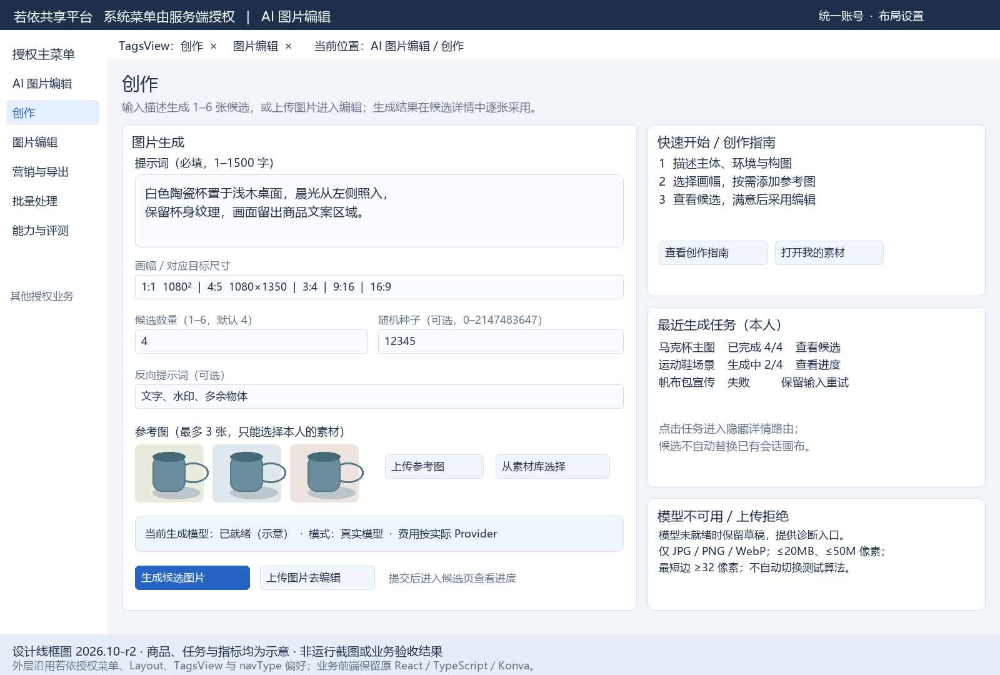

**图片编辑菜单完整页**

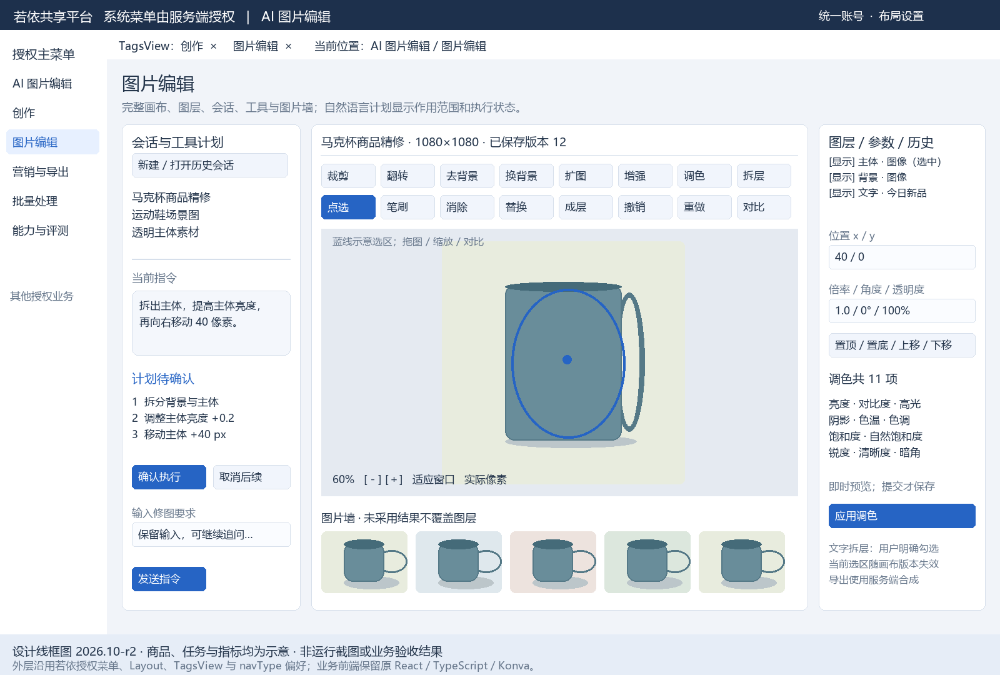

**营销与导出菜单完整页**

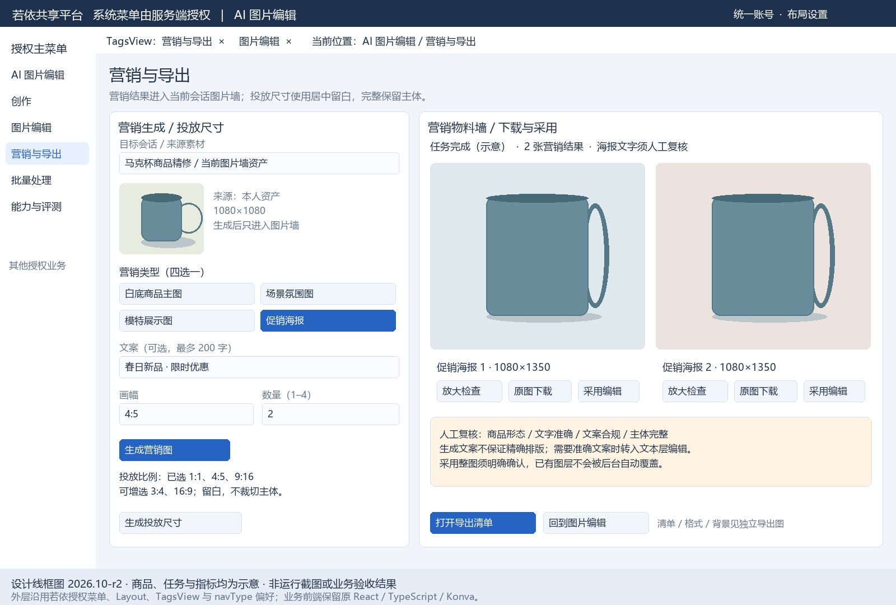

**批量处理菜单完整页**

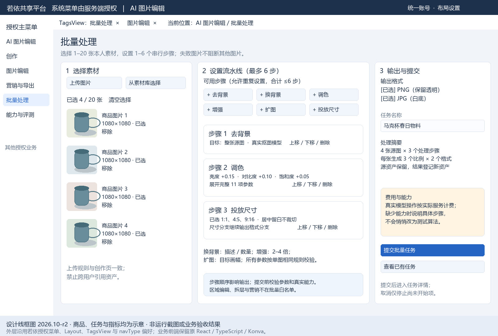

**能力与评测菜单完整页（管理员）**

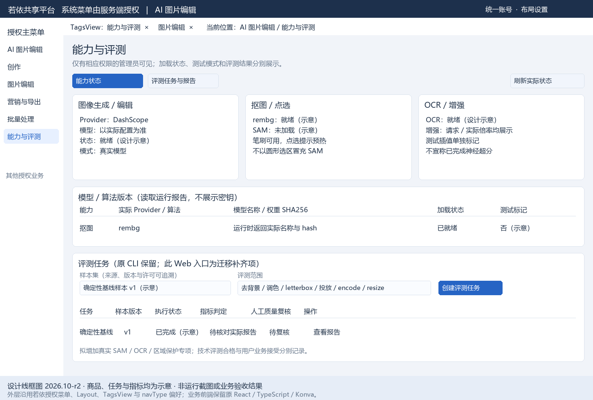

候选、批量详情、导出清单、评测详情均是所属菜单的业务详情；创作指南与素材库是业务内页/选择弹层，不增加第二主导航。原登录、注册、账号与平台设置接现有若依页面，不重复设计自有账号系统。评测 Web 管理仍为目标补齐项，图稿不改变原实现状态。

**业务详情与选择界面**

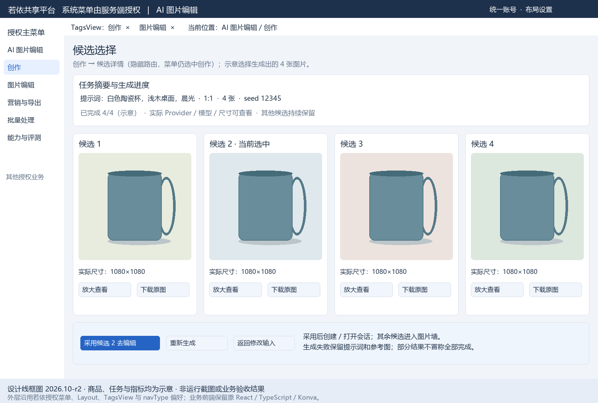

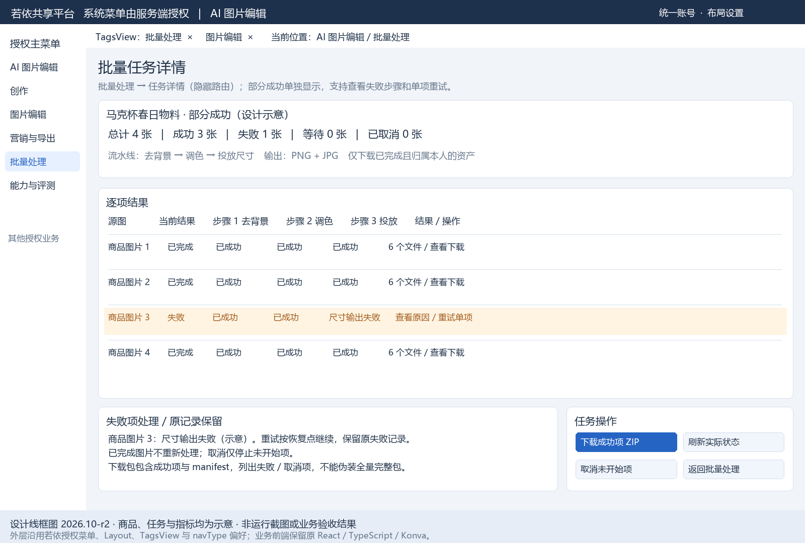

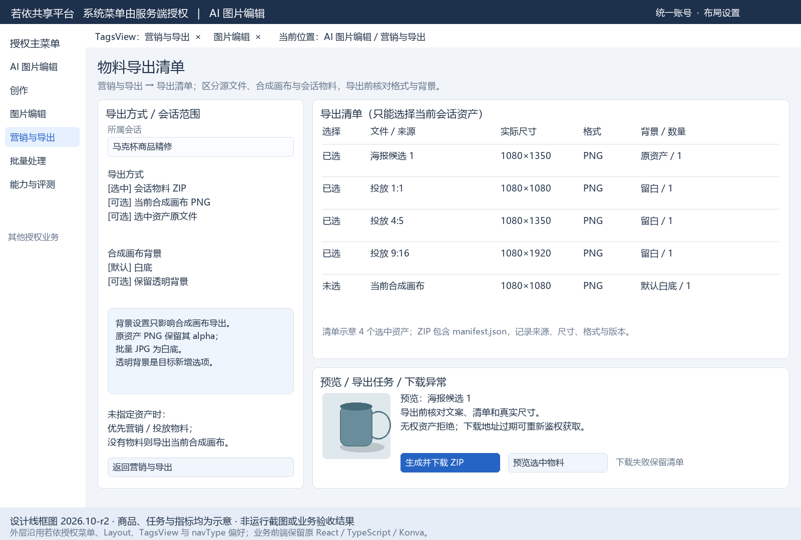

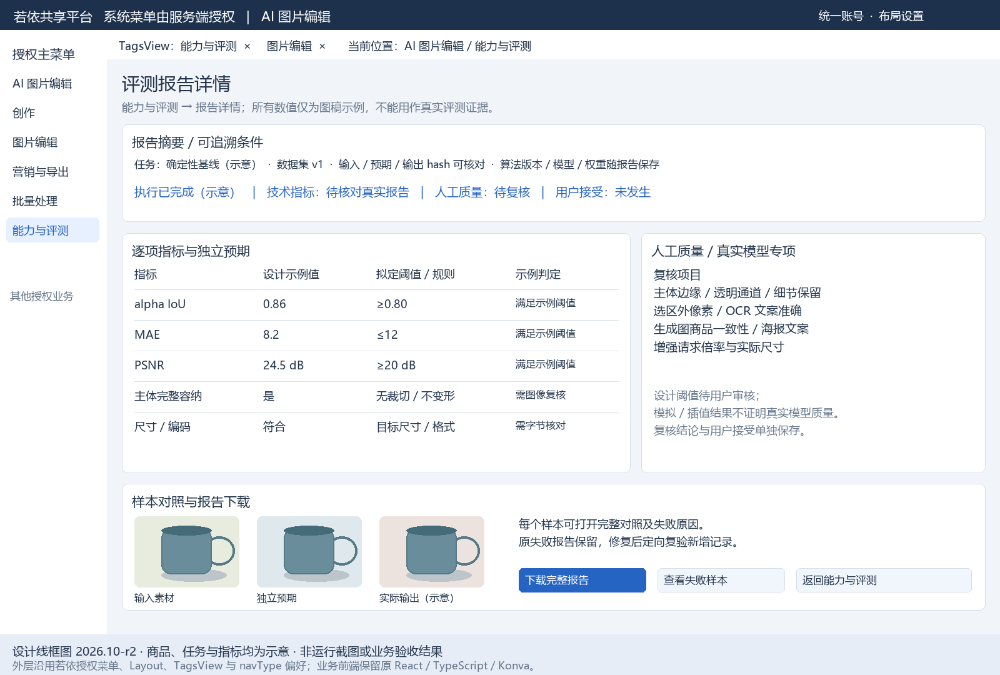

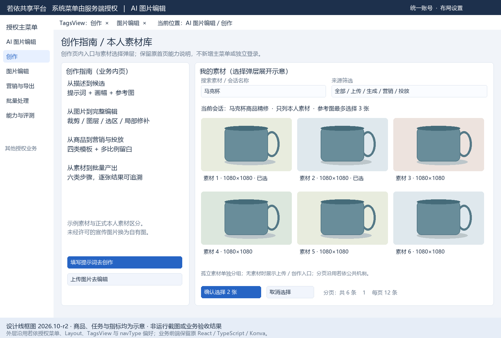

**工具参数与关键异常补充图（沿用首版）**

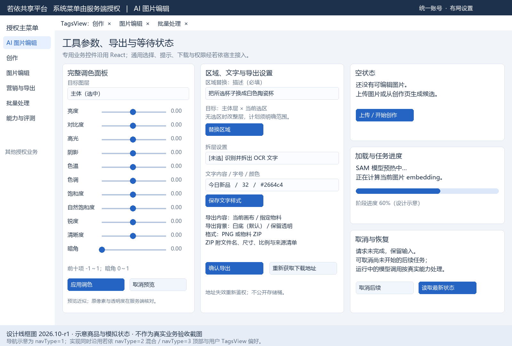

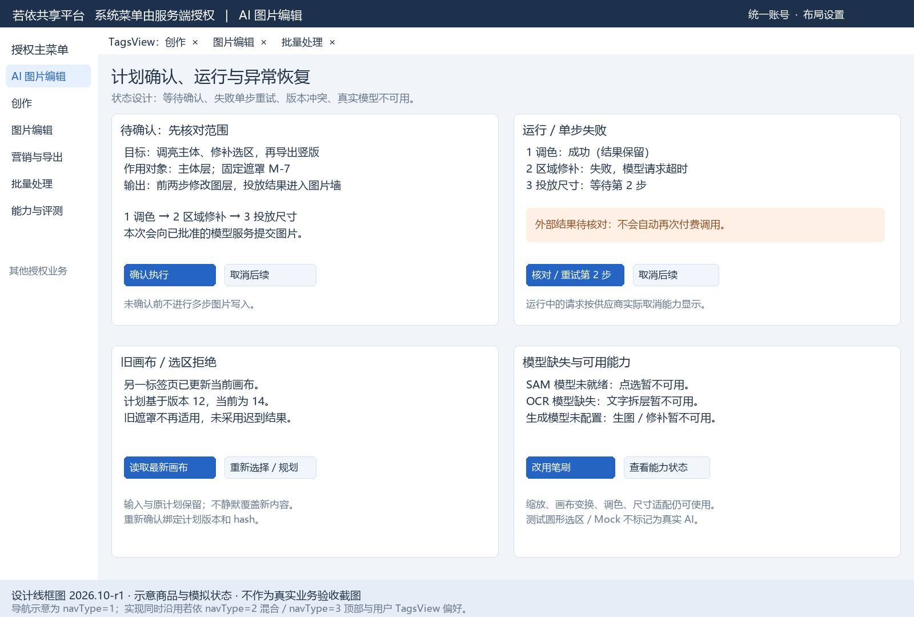

首版 [创作/候选总览](图稿/创作与候选.png)、[编辑工作台](图稿/编辑工作台.png)、[营销/批量/评测总览](图稿/营销批量与评测.png)仍保留以便追溯。菜单布局以本版独立页面为准；这些合并总览不再作为菜单完整覆盖依据。

创作页明确标注候选数量、比例、参考图、反向提示词、seed、提交及失败保留输入。候选页可放大、下载、重新生成、采用，不自动替用户决定满意图。编辑页展示会话/计划、工具栏、画布、图层参数和底部图片墙；右栏切换“图层、调色、背景/扩图、区域替换、编辑记录”。11 项调色完整保留。计划卡片说明等待确认、运行、失败可重试、取消后续及旧画布拒绝；真实模型不可用时显示当前算法模式和恢复建议。

营销页展示四类图像模板、文案/数量/比例、投放尺寸和 ZIP 清单；批量页展示 20 张上限、六类流水线、PNG/JPG、单图状态、部分成功与单项重试；评测页仅管理员可见，展示数据集来源、模型/权重版本、确定性指标和人工质量判定，不把技术绿灯画成用户验收通过。

### 2.2 前端复用与重接方法

新工程拟设 `frontend/aipicture-workbench/`，沿用原 React 栈独立锁文件和构建工具。以库模式产出 `mount(container, host)`、`update(host)`、`unmount()` 与静态 CSS/资源清单，业务内容内部渲染 React。`frontend/admin-web` 仅通过 Vue 薄包装挂载这个库，普通页面与公共对话框仍复用 Element Plus、若依分页、字典、上传/下载与反馈机制。复杂 Konva 控件继续使用原 React 组件。

独立库编译隔离 Vite8/TS6 与共享 Vite6/TS5.9；管理端只消费已编译 ESM，不让 React 插件、Tailwind 或新 TypeScript 覆盖共享工具链。React/ReactDOM 打进业务库单独 chunk，以一致版本只加载一份；业务画布依赖按需加载，不增加其他页面首屏开销。后续实施需用实际锁文件核对浏览器包里没有双 React 实例。

原 BrowserRouter 删除，React 使用宿主传入的页标识/参数和 `navigate` 回调；若需保留原 hooks，用业务范围的受控路由上下文适配，不再独立操作浏览器历史。宿主刷新/前进/后退/切换 TagsView 都要与 React 页面一致，React 不生成认证重定向。

原 `api/client.ts`、上传原生 fetch、EventSource 及 Cookie 认证不能直接复用。JSON、multipart、blob 全经宿主现有 `utils/request.js`/download；适配 Java `AjaxResult.data`、`TableDataInfo.rows/total` 和统一错误。SSE 原生 EventSource 不能携带若依现有 Bearer header，目标使用宿主 `subscribeRun` 适配器：先通过共享 request 获得短时、绑定用户与 run 的订阅凭证，再同源 EventSource；凭证不等于第二登录令牌，不赋予业务写权限，日志必须去除查询串。备选方案为所有进度使用共享 request 轮询，开发阶段可先验证；若需要扩展共享流式请求机制，单独说明范围并获确认后实施，不能在 React 私建认证 fetch。

Pinia 继续持有平台账号、权限、菜单与布局；React 不复制其正式状态。保留原 Zustand 仅用于缩放/平移/选中层/临时面板/草稿预览；TanStack Query 仅缓存本业务 API 快照，缓存 key 包含若依用户和会话，不能决定正式任务状态。注销、账号切换、权限撤销、unmount 时清理 cache、Zustand、事件连接与未完成本地请求。不要把 JWT、Cookie、对象存储或 Provider 密钥传给 React。

Tailwind4 原样式必须去掉全局 preflight，并作用域限定于 `.aipicture-root` 或使用 ShadowRoot；推荐先做样式前缀与 token 隔离，以避免 Element Plus popper、字体和焦点问题。原 `index.css` 中 body/:root、全局标签、scrollbar、动画名需改为业务作用域；新增 CSS 不改变共享 Navbar、Dialog 或其他业务组件。图标、通知、通用按钮尽量调用宿主公共设施，保留原专用工具按钮和 Canvas。

### 2.3 页面状态、交互与适配

| 场景 | 页面反馈与允许动作 | 恢复或拒绝 |
|---|---|---|
| 空会话/素材库 | 说明“还没有图片”，提供上传/创作入口 | 不展示伪造历史或示例当正式素材 |
| 模型预热/排队/运行 | 阶段、实际进度、请求倍率与模式；有限禁用受影响按钮 | 允许查看会话，取消未开始任务；平滑进度不提前到 100% |
| 同一画布有在途编辑 | 锁定提交操作，保留浏览/缩放能力 | 其他标签提交由 Java 拒绝，显示“画布已更新，刷新后重试” |
| 选区模型不可用 | 说明 SAM 未就绪，提供笔刷与重新预热 | 不显示圆形假选区为识别结果 |
| 图层/画幅变化 | 清除失效选区，告知重新选择 | 多步固化遮罩仅在坐标系相同的情况下继续 |
| 计划待确认/失败/取消 | 中文步骤和作用范围、确认/单步重试/取消后续 | 用户输入保留；不能再次执行已成功步骤 |
| 部分成功批量 | 成功与失败数、每张原因、成功项下载 | 重试失败单项，不重新付费处理已成功项 |
| 401/403/404/模型错误 | 共享若依过期/权限反馈；业务区显示可行动原因 | 注销清缓存；无权资产不显示预览签名 |
| 导出 URL 过期/下载失败 | 保留清单，重新获取下载地址 | 重新鉴权，不公开长期对象地址 |

建议初版目标为 Windows 桌面 Edge/Chrome、1366×768 和 1920×1080，并检查 1024px 宽和 200% 缩放；这是拟验收矩阵，不是已验证兼容声明。窄宽度右侧面板抽屉展示，工具栏局部滚动，会话侧栏可折叠，不让整个页面意外横向溢出。保留键盘 Ctrl/Cmd+Z、Shift+Z/Y、Esc、0/1/+/-；监听必须限当前挂载且有焦点的业务区，输入框/contenteditable 内不劫持。缩放、图层属性、点选/笔刷切换均提供可见按钮，不只依赖手势。对比滑杆提供键盘移动与数值标签。TagsView 关闭/缓存切换时保存草稿、释放事件及画布资源；页面重新激活重新读服务端快照。

### 2.4 拟新增和修改的前端文件

表中路径均为实施计划，当前未创建这些工程文件。

| 类型与路径 | 用途与关键变化 |
|---|---|
| 新增 `frontend/aipicture-workbench/package.json`、`package-lock.json`、`vite.config.ts`、`tsconfig*.json` | 沿用源 React/Vite/Tailwind/TS 栈；锁版本，库模式，不启动独立业务站点/登录服务 |
| 新增该工程 `src/embed.tsx`、`src/host/HostContext.tsx`、`src/host/HostContract.ts` | mount/update/unmount；共享 request/权限/导航/提示/订阅接口；隔离异常和资源释放 |
| 迁改 `src/pages/{LandingPage,CreatePage,CandidatesPage,EditorPage,MarketingPage,BatchPage}.tsx` | 保留业务；Landing 变创作指南，移除原账号外壳；React 路由改宿主控制 |
| 迁改 `src/components/editor/{CanvasStage,EditorToolbar,LayerPanel,SessionSidebar,AgentConversation,ImageWall,SelectionOverlay,MessageComposer,GenerateEdits,CanvasHint}.tsx` | 完整画布、计划、选区、图层和历史；补模型模式、权限、部分失败和版本冲突反馈 |
| 迁改 `src/components/{GenerateForm,ImageDropzone,AssetLibrary,AssetCard}.tsx`、`src/components/landing/*`、`src/components/ui/*` | 复用原业务展示，通用部分接宿主组件与下载；宣传资源许可核对后替换 |
| 迁改 `src/hooks/use{Agent,Assets,Batch,CanvasImage,ElementSize,HeldCanvas,MountTransition,PointPreview,Run,SelectStroke,Selection,Sessions,SmoothedProgress}.ts` | 继续业务 hooks；修订 API/cancel/event 契约；保存缓存作用域，取消与过期恢复 |
| 迁改 `src/lib/{tools,layers,brush,floodPreview,adjustPreview,selectionHistory,runPacing,promptDraft,marketing,batch,format}.ts`、`src/stores/{canvasView,editorUi}.ts` | 工具语义与画布算法继续复用；平台权限不存 Zustand；预览与最终结果区分 |
| 改写 `src/api/{client,assets,sessions,runs,agent,batches}.ts`；不迁 `auth.ts`、`hooks/useAuth.ts` 认证部分 | 只调用宿主请求；错误格式、分页、blob、订阅重接；必要 errorMessage 提取为业务工具 |
| 不迁运行入口 `App.tsx` 的 BrowserRouter、`main.tsx` 的独立挂载、`AuthPage.tsx`、`RequireAuth.tsx`、`WorkbenchLayout.tsx` | 原独立账号/主导航/认证生命周期由若依负责；不是删除原业务能力 |
| 新增 `frontend/admin-web/src/components/AiPictureHost/index.vue`、`src/api/aipicture/{bridge.js,event.js}` | 复用 request、auth、user store、router、提示、下载；装载 React 库与 SSE 短时订阅 |
| 新增 `frontend/admin-web/src/views/aipicture/{create,editor,candidates,marketing,batch,evaluation}/index.vue` | 后台菜单可解析的 Vue 薄入口；评测与配置使用现有表格/字典/分页/对话框 |
| 修改 `frontend/admin-web/package.json`、拟新增 `scripts/sync-aipicture.mjs`，必要时 `vite.config.js` | 顺序构建并复制带 hash 的业务库到 `public/aipicture/`；无 React 插件进入共享 Vite；开发代理只沿用中心后端 |
| 修改 `frontend/admin-web/src/router/index.js` 的隐藏详情路由部分 | 仅候选/会话/批量详情按现有 permissions、activeMenu、name 机制接入；主菜单仍来自服务端 |
| 新增业务库 `tests/{canvas,selection,plan,batch,host-lifecycle}.test.tsx`、管理端业务定向类型/测试配置 | 不沿用只覆盖选品/APS 的现有 typecheck 结果冒充本项目；检查跨框架桥、快捷键、事件卸载、缓存隔离 |

## 3. 后台处理设计

### 3.1 业务处理顺序与组件职责

用户操作 → 若依鉴权和权限检查 → 本项目资源归属/输入校验 → MySQL 事务创建命令、任务和派发记录 → 独立 Python Worker 领取并计算 → Java 校验结果并登记资产/原子采用文档 → 事件进度/快照返回 React。只有 Java 可改变正式业务状态。若依通用菜单、账号、组织、权限、审计属于平台；图片资产、会话、遮罩、图层、计划、批量、评测属于本项目，不读写选品、面试、桌面端或 APS 业务表。

Python 保留 `edits/pixels.py`、`mask.py`、`segment.py`、`split.py`、`render.py`、OCR、Provider、规划提示和 LangGraph 图。重写所有接收 SQLAlchemy AsyncSession/ToolRun 的工具 handler 和上下文读取，改为纯输入 DTO + 素材读取权限 + 结果 DTO；不能只搬 Python 后端并保留 PostgreSQL 写入。文档裁剪/变换/撤销、计划校验/调度、正式保存和批量汇总移入 Java；Python document helper 可用于对照测试或渲染，不决定正式修改。LangGraph 只进行“plan→verify”推理，不安装 checkpoint-postgres 建第二状态库，运行断点由 Java 提供。

对象存储保存不可变图片字节，不是状态真相。Java 持有 object key、hash、尺寸、来源、owner、引用关系和提交状态；Worker 通过每次任务的短时 GET/PUT 权限读取输入和写临时输出，不能用任意 bucket/key。Java 校验结果大小、实际格式、hash、尺寸与预期后将临时输出提升为可引用资产。禁止 Browser 直连 Python、Redis、MySQL、MinIO 控制台和模型供应商。

### 3.2 技术栈、复用和依赖

| 范围 | 已核实声明 | 目标安排与新增依赖 |
|---|---|---|
| 共享 Java | Java17、Boot4.0.6、RuoYi3.9.2、MyBatis4.0.1、PageHelper4.1.0 | 新模块继承父 POM，复用 common/framework/system；Jackson/Jakarta/Spring SSE 等用已装配版本；不另引 Boot2/3 |
| 共享管理端 | Vue3.5.26、ElementPlus2.13.1、Pinia3.0.4、Vite6.4.3、TS5.9.3；共享代码仍有 JS | 仅薄入口与宿主 bridge；不把管理端改成全 TS 或覆盖主依赖 |
| 图片前端 | React19.2.8、react-konva19.2.5、Konva10.3.1、Query5.102.4、Zustand5.0.15、ReactRouter7.18.2、Vite8.2.2、TS6.0.2、Tailwind4.3.3 | 保留原栈与独立构建，ReactRouter 使用范围适配或去掉，平台 store 不迁入；版本为源 package 声明，安装状态未核实 |
| Python | requires-python≥3.13；FastAPI/httpx/Pillow/arq/Redis/Pydantic 等，uv.lock 已有锁定 | 独立 `python/aipicture-runtime/`；cv/agent extras 显式按能力安装；纯服务接口与生命周期保留 FastAPI；不连接正式业务数据库 |
| AI/CV | rembg、onnxruntime、opencv-headless、rapidocr-onnxruntime、LangGraph、LangChain | 锁依赖、模型/权重与字体版本；numpy 原依赖为间接引入，目标直接声明算法必需项；upscale 新 Provider 需选型审核 |
| 基础设施 | 源 Pg17、Redis7、S3/MinIO；源 compose 用 MinIO latest | 使用批准的共享 MySQL/Redis/对象存储；目标制品固定版本/digest，不复用教学密码、不创建旧容器堆栈 |

原代码未包含足够的许可证明；实施前记录可复用源码许可、模型许可证、字体许可和新增包版本来源。锁文件中有版本不证明 Python3.13/目标 CPU/GPU 上 ONNX/torch 等可安装，先做有限兼容验证，再定运行镜像和资源。高风险或不兼容依赖只阻塞对应能力，保留可工作的确定性工具。

### 3.3 数据模型、权限与并发

建议使用经批准的本项目 MySQL schema 和 `aip_` 前缀。资产/会话/任务沿用 UUID 字符串以便源数据映射；平台 `user_id` 使用若依现有整数类型；时间统一 UTC 毫秒、页面按用户时区显示，业务查询日期明确时区。JSONB 改 MySQL JSON，不把字段名或顺序差异误当文档变化；金额/调用成本按确定性精度保存，不用浮点估算。数据源、Mapper扫描和 `aipictureTransactionManager` 显式绑定本项目连接；迁移history独立，启动只有schema guard，不能自动建表、clean或猜baseline。菜单/角色写入位于平台库，与业务schema迁移分别授权和记录，不宣称跨库事务。以下是候选 schema，实施时机器契约与 DDL 为唯一字段正文。

| 表 | 主要字段、约束和归属 |
|---|---|
| `aip_asset` | id、user_id、kind/source、object_key、sha256、format、width/height、size_bytes、has_alpha、provider/model、created_at、status；object_key 唯一；(user_id,created_at) 索引；原对象不可覆盖 |
| `aip_session` | id、user_id、title≤80、original/current_asset_id、document JSON、revision、row_version、history_seq、history_floor、updated_at；按用户+更新时间索引 |
| `aip_session_asset` | session_id+asset_id 唯一；position、latest_document JSON、document_version；保证切回资产后图层仍在；asset引用必须同 owner |
| `aip_history` | id、session_id、user_id、seq、action、params/result、before/after_document；(session_id,seq) 唯一；保留原20条窗口和最低可撤销 seq |
| `aip_selection` | id、session_id、revision、mask_asset_id、markers/strokes、expires_at、state；每会话有效选区唯一；固定给计划的 mask 不因 Redis 丢失而消失 |
| `aip_run` | id、user_id、session_id可空、tool、status、progress/stage、params/result、input_revision/version、attempt、provider_task_id、error_code/message、lease/heartbeat、created/started/finished；幂等 key+user+命令唯一 |
| `aip_agent_turn` / `aip_plan_step` | goal/reply、base revision、确认状态、plan_hash/version、工具/参数、依赖、run_id、step status；(turn_id,step_id) 唯一；不使用模型提供的 owner/mask/revision |
| `aip_batch` / `aip_batch_item` | parent run、流水线、格式、source asset、单项 status/output IDs、失败原因、attempt；每项独立 commit，支持部分成功/单项重试 |
| `aip_export` | owner、session/run、revision、manifest、object_key/hash、created_at；下载重新鉴权，不存长期签名 URL |
| `aip_dispatch` / `aip_run_event` | 事务派发记录与 task lease；event_seq、run/version、事件快照；(run_id,event_seq)唯一；Redis仅通知，不作唯一日志 |
| `aip_evaluation` | dataset manifest/hash、model/algorithm versions、指标/阈值/输出、人工评语、状态、执行身份；原样本和新增真实样本分组 |
| `aip_import_map` | source dataset/version、旧实体/新实体 ID、owner 映射、hash、校验状态；导入幂等，恢复能定位本次导入记录 |

平台角色建议配置“图片编辑用户”和“图片业务管理员”，角色名不是第二授权系统。菜单按钮权限拟为 `aipicture:asset:list/upload/query`、`session:list/query/edit`、`image:generate`、`tool:execute`、`plan:confirm/retry/cancel`、`batch:list/execute/retry/cancel`、`export:download`、`evaluation:list/execute`、`capability:query`，均带 `aipicture:` 前缀并使用若依 `@PreAuthorize` 与菜单按钮绑定。

功能权限之外每条查询/下载/事件都验证 owner。管理员默认可看能力、任务运行统计和脱敏错误，不能因有部门/管理员角色自动看到其他人的图像与提示词；若需代管资产，增加明确权限和审计并单独批准。部门继续使用若依身份组织信息，本设计不引入第二租户表。审计复用 `@Log` 与平台操作日志，额外业务事件仅记命令/版本/结果关系，不重复维护账号审计真相，不记录密钥或图片 base64。

同一 session 的文档修改使用 MySQL 行锁/乐观版本与一次在途像素编辑租约；不用 Redis 锁独自决定真相。画布 `revision` 用于坐标和选区失效，`row_version` 用于每次正式写入冲突；undo/redo 恢复内容但目标 revision 单调递增，防止旧遮罩因旧值恢复而重新有效。图片墙只增加候选可不改坐标修订，但仍改 row_version。请求带 `expected_version`，不匹配返回冲突与最新版本；客户端不得静默覆盖。不同会话及批量不同图片可并发。

### 3.4 API、工具与 Worker 契约

后台列表复用 `BaseController.startPage/getDataTable`；普通响应用 AjaxResult，multipart/blob/SSE 按实际内容类型返回。业务错误保留稳定 errorCode、中文 message、retryable、currentVersion；适配共享 request 的 HTTP/业务 code 行为，不另设认证拦截器。请求创建任务返回可读取的 runId 和状态，耗时接口不等待 Provider。以下全量路径替代源 `/api` 与 `/events`，不保留原 Python 面向浏览器的业务路由。

| 源接口组 | 目标接口与主要输入输出 | 权限、失败边界 |
|---|---|---|
| `/api/auth/register/login/logout/me` | 使用现有若依注册、登录、退出、getInfo，删除原认证 API | 若依现有规则/验证码/注册开关；不迁密码与 Cookie |
| `/api/assets`、`/library`、`/{id}` | POST/GET `/aipicture/assets`；GET `/assets/library`、`/assets/{id}`；追加 GET `/assets/{id}/download` | 真实解码；20MB、50M像素、最短边32；禁止跨 owner、伪扩展/损坏/空文件 |
| `/api/generations`、`/api/runs/{id}` | POST `/generations`；GET `/runs/{id}`；新增 POST `/runs/{id}/cancel` | 幂等 key、来源图片归属；模型不可用/超时/未知外部结果分别反馈 |
| `/api/sessions`、`/{id}` | POST/GET `/sessions`；GET/PATCH `/sessions/{id}` | 选中的 current asset、初始候选最多12；title规范化；switch需expected_version |
| selection prepare/create/read/delete | POST `/sessions/{id}/selection/prepare`；POST/GET/DELETE `/sessions/{id}/selection` | 返回 preparation run 或选区 DTO，空/过期/容量拒绝；服务端注入mask ID |
| invoke、undo、redo、history | POST `/sessions/{id}/tools`；POST `/undo`、`/redo`；GET `/history`；GET `/tools` 为工具清单 | 工具schema版本、参数、权限、owner、文档version；同步文档命令返回最新session |
| messages与确认/取消/重试 | GET/POST `/sessions/{id}/messages`；POST `/messages/{turnId}/{confirm,cancel,retry}` | 确认绑定plan_hash/version、revision；不允许跨会话turn；只重试失败步骤 |
| `/api/batches`、`/{runId}`、`/export` | POST/GET `/batches`；GET `/batches/{id}`、`/export`；追加 POST `/items/{itemId}/retry`、`/{id}/cancel` | 全部输入归属验证、六工具白名单、单项状态、无成功结果拒绝导出 |
| `/api/sessions/{id}/exports` | POST `/sessions/{id}/exports`；GET `/exports/{id}/download` | 固定revision，选择asset必须在该会话图片墙；ZIP清单回读 |
| `/events/runs/{id}` | POST `/runs/{id}/subscription`；GET `/events/runs/{id}?ticket=…` | 共享request申请短时票据；run/用户绑定；过期申请新票据；禁止长期token入URL |
| 原CLI评测、health | POST/GET `/evaluations`、GET `/{id}/report`；GET `/capabilities`、`/health`（业务管理员） | dataset manifest限定目录/对象，不接任意路径；能力缺项可独立失败 |

接口 schema 包含 `schemaVersion`、`toolRegistryVersion`、`idempotencyKey`、`expectedVersion`，UUID/数值/枚举严格校验。服务端从当前身份、文档和选区注入 `owner`、`mask_asset_id`、`revision`、参考图和 seed 等原隐藏参数；模型无法选择其他用户或任意存储地址。冲突 409、无权403、资源不可见404、非法输入400/422、超过上限413、能力未配置/不可用503、Provider拒绝/超时502/504需提供可操作反馈。

工具唯一机器正文拟维护在 `contracts/aipicture/v1/tools.schema.json` 与 `document.schema.json`。由源 Pydantic 导出初始参数，再审查并锁定版本；Java 校验相同 JSON Schema，Python计算签名与 Agent工具函数由同一清单生成/加载，React下载 `/tools` 生成说明和能力提示。JSON Schema 校验库如共享工程未有，需要在实施前核实 Boot/Jackson兼容和许可，禁止在两端手写第二套漂移规则。Java 再加归属、当前修订、工具权限和状态规则，Python也验证输入，不能以 Java已查过跳过边界校验。

Worker 私有接口拟为 `/internal/v1/capabilities`、`/plan`、`/prepare-selection`、`/compute`；任务取得/心跳/结果提交由 Java 内部执行端点提供。内部请求使用独立最小权限服务凭据、时间戳/nonce、run/attempt绑定和版本；不接受用户 JWT作Worker权限，不暴露公开网。输入包含任务 ID、attempt、工具版本、冻结文档、mask、有限输入asset引用、短时读取/输出授权、取消状态；结果包括实际 Provider/模型、artifact hash/尺寸/格式、文档候选/采用意向、elapsed与错误。Worker不能携带owner更改或SQL。

建议由 Java MySQL `aip_dispatch` 事务记录+私有领取API作为唯一派发来源，Redis用于唤醒和缓存；不直接让 Java拼接Python ARQ的内部序列化格式。Python可保留ARQ作为本机计算调度包装，但runId/attempt与租约都由Java登记，ARQ结果不是恢复真相。队列命名加 `aipicture:`，不抢其他项目任务。

SSE 先登记订阅再读快照，带递增 event_seq。重新连接先鉴权、回读最新 MySQL 快照，再从 Last-Event-ID 补发保留期内事件；超出保留期返回重新同步标识，UI重新读快照。事件至少一次传输，客户端按run/version/seq去重，终态不会被迟到running覆盖。进度可合并，终态/错误必须持久化；每用户限制连接数，断开与取消读取不停止后台任务。若采用订阅票据，安全链仅为精确的事件GET路径接入 `RunSubscriptionFilter`，其凭据绑定既有若依LoginUser与run，检查账号有效性/当前权限，不对 `/aipicture/**` 放行；内部Worker路径仅匹配指定私有方法和地址，由 `WorkerAuthFilter` 验签。缺失/失效票据或服务凭据在进入业务Controller前拒绝，不使用全局匿名白名单。票据允许TTL内同run重连，不允许跨资源复用，注销时撤销。

### 3.5 状态、重试、取消及失败恢复

任务有排队、运行、成功、失败、取消及“外部结果待核对”。计划另外有规划、待确认、执行、失败暂停、部分完成与取消后续。等待确认不能混用排队造成调度误执行。步骤依赖成功才放行；同一画布即使计划有独立依赖也顺序执行写操作，避免并行结果相互覆盖。

每次执行先原子领取租约并分配 attempt，保存冻结输入和外部请求指纹；计算不持有MySQL长事务。提交结果核对lease/attempt/取消与input_version，登记新asset、图片墙、会话文档、history、计划步骤和终态在单一事务完成。迟到或旧attempt结果只隔离为未采用产物，不覆盖新画布。对象上传成功、Java写入失败时重交同一回执，unique(run,attempt,artifact_index)防重复；无正式引用的临时对象按保留规则清理。

Worker崩溃由心跳租约过期发现。确定性本地算法可有限重试，建议最多2次自动重试、1s/5s退避并记录原因。真实生成若已取得provider_task_id，只查询/下载原外部任务，不再次提交；原DashScope同步编辑没有可靠任务查询时，超时只能进入“外部结果待核对”，不得自动重复扣费。用户明确重试展示潜在重复费用与新attempt；这比源终态检查更严格，源非终态重复消费不能证明只扣费一次。

取消排队项原子停止派发；运行中的本地算法在分块/阶段边界检查取消；远端请求按供应商能力取消，能力不足时允许请求结束但隔离结果，页面说明可能产生原调用费用，不写“已撤回”。取消计划只停止后续，已经成功的修改保留且可撤销；撤销是新文档版本，不删除已生成素材、不退款。失败恢复先续读当前状态，禁止重启服务后所有running无条件变queued。

batch母任务保存流水线hash；单项输出与失败独立持久化，全部失败为失败，有成功有失败为部分成功，全部成功才成功。单项retry只生成该item新attempt、保留失败和成功证据。格式分支和投放比例产生数量必须在费用/存储限制内，批量输出记录到清单，不能内存无限倍增。

### 3.6 拟新增和修改的后台、契约及运行文件

| 类型与路径 | 用途与关键逻辑 |
|---|---|
| 新增 `ruoyi-backend/ruoyi-aipicture/pom.xml` | 继承共享父POM；业务模块依赖common、必要平台接口，不启独立HTTP中心 |
| 修改 `ruoyi-backend/pom.xml`、`ruoyi-backend/ruoyi-admin/pom.xml` | 新模块reactor/dependencyManagement与admin显式装配；不改四业务依赖边界 |
| 新增模块 `src/main/java/com/ruoyi/aipicture/controller/{AiPictureAsset,Session,Run,Tool,Agent,Batch,Export,Evaluation,Capability}Controller.java` | 全部公开API、PreAuthorize、分页/AjaxResult、Log、owner验证；Controller不直接调算法 |
| 新增同目录 `domain/{AiPictureAsset,Session,History,Selection,Run,AgentTurn,PlanStep,Batch,BatchItem,Export,Dispatch,RunEvent,Evaluation,ImportMap}.java`、`dto/*` | JSON文档、冻结输入、任务状态、版本、幂等、错误与内部回执契约；同步生成的schema引用 |
| 新增 `mapper/*Mapper.java`、`src/main/resources/mapper/aipicture/*Mapper.xml` | owner过滤、行锁/CAS、唯一约束、分页、事务派发与租约；禁止跨项目SQL |
| 新增 `service/{Asset,Session,Tool,Plan,Batch,Export,Evaluation}Service.java` 与对应 `impl/*ServiceImpl.java` | 文档命令、历史窗口、采用规则、计划依赖、批量单项、导出/评测归属；沿用若依分层 |
| 新增 `execution/{DispatchService,WorkerLeaseService,ResultCommitService,RunRecoveryService,RunEventService}.java` | 事务派发、领取、心跳、结果commit、重放/恢复、限流；不自动重试未知外部副作用 |
| 新增 `worker/{AiPictureWorkerClient,WorkerContract,WorkerAuthFilter}.java`、`execution/RunSubscriptionFilter.java`、`controller/internal/AiPictureExecutionController.java`；定向修改 `ruoyi-framework/src/main/java/com/ruoyi/framework/config/SecurityConfig.java` | 私有调用/领取回执，服务凭据与replay保护；订阅票据还原若依用户，仅精确匹配事件/Worker私有端点，不新增第二登录栈；不放行整个业务前缀 |
| 新增 `tool/{ToolRegistry,DocumentCommandService,DocumentValidator,PlanValidator}.java` | 22工具版本绑定；JSON Schema+业务校验；裁剪/翻转/文字/变换在Java保存 |
| 新增 `config/{AiPictureProperties,AiPictureConfiguration,AiPicturePersistenceConfiguration,AiPictureSchemaGuard,AiPictureMigrationConfiguration}.java`；拟新增 `ruoyi-admin/src/main/resources/application-aipicture.yml` | 参数绑定、专属数据源/Mapper/事务、独立migration history与guard、连接健康、存储/模型服务引用、额度开关；secret只引用托管配置 |
| 新增模块 `src/main/resources/db/migration/aipicture/V001__aipicture_schema.sql`、`V002__aipicture_menus.sql` | schema与菜单候选迁移；沿用项目现有专属schema迁移机制，实际应用需授权；菜单ID先核对占用 |
| 新增模块 `src/test/java/com/ruoyi/aipicture/{ToolContract,PlanValidation,SessionHistory,AssetOwnership,WorkerCommit,BatchRecovery}Test.java` | 参数/22工具对齐、无权、旧版本、重复结果、撤销边界、费用重试边界 |
| 新增 `contracts/aipicture/v1/{aipicture.openapi.yaml,worker.openapi.yaml,tools.schema.json,document.schema.json,run-event.schema.json}` | 用户API、Worker、工具、文档、事件的唯一机器定义；本轮仅拟设，未写入共享目录 |
| 新增 `python/aipicture-runtime/pyproject.toml`、`uv.lock`、`app/{main,config,worker}.py` | 独立Python≥3.13运行；明确cv/agentextras；移除正式SQLAlchemy/Pg/认证和旧public路由 |
| 迁改Python `app/edits/{pixels,mask,segment,split,render,ocr}.py`、`app/ratios.py`、`app/layers.py`；新增 `app/edits/affine.py` | 保留算法、增强模型缓存/错误，渲染字体一致；补画布↔图层逆仿射遮罩映射、对象提取挖空的变换一致性；输入/结果脱离正式ORM |
| 迁改Python `app/providers/{base,mock,dashscope}.py`、新增 `upscale.py` | 模式声明、能力/尺寸限制、外部请求指纹、费用不确定态；真实超分Provider待模型选型 |
| 迁改Python `app/agent/{graph,llm,plan}.py`、`app/tools/{base,canvas,retouch,region,layers,enhance,generate,marketing,batch,target,context}.py` | 保留规划提示/签名和算法，不保留DB状态；移除canvas正式写入，handlers改DTO；plan建议供Java再验证 |
| 新增Python `app/contracts/*`、`app/runtime/{dispatch,callbacks,capabilities,artifact_io,model_cache}.py` | schema版本、Java领取回执、短时对象访问、LRU与资源预算、取消/心跳 |
| 迁改Python `app/eval/*`、`tests/{test_edits,test_eval,test_generation,test_tools,test_agent,test_batch,test_exports}.py`，新增runtime契约/模型专项测试 | 纯算法与fake可离线回归；原DB API测试改Java契约测试，不能原样运行删除账号fixture |
| 新增 `python/aipicture-runtime/{Dockerfile,运行说明.md}`、`scripts/{启动图片Worker.ps1,检查图片能力.ps1}` | 固定运行镜像、无教学Pg堆栈；脚本只运行该项目进程，模型预装与检查、不自动下载或修改他项目 |
| 新增 `ruoyi-aipicture` 模块 `migration/{AiPictureImportTool,ImportManifest,ImportVerifier}.java`（仅一次性工具） | 用户/UUID/JSONB映射、hash回读、幂等导入；不作为目标服务的Pg运行依赖 |

### 3.7 运行、资源、安全与数据恢复

日常入口仍是已批准的共享管理端/Java通道。本项目新增Worker私有端口需启动时检查占用，建议从未占用端口规划，不预先占用原7301/7302。运行中四项目端口/数据库遵守现有启动指南，不能因新对话隔离复制数据库。当前没有本项目已批准的连接环境；应先指定schema/账号和存储，不能拿教学账号自动初始化。

候选配置包括Worker私有地址与服务身份、Redis key/queue前缀、对象存储前缀/授权TTL、模型与Provider、model cache目录/限额、并发/内存/超时/外发限额、临时文件与事件保留。运行版不含旧JWT_SECRET、旧Pg DATABASE_URL、源S3默认密码，不让Python主进程启动时自动create_bucket。Secrets由已有托管配置/环境注入，管理端仅显示“已配置/缺项”和模型名称。

拟定初始预算：普通CPU计算并发2、真实模型请求并发2（总任务并发≤4，参考源max_jobs=4）；embedding LRU保留4且增加字节上限/模型hash，模型初始化与同一图embedding计算防并发重复；GPU进程数按显存实测设置，不预先承诺毫秒级响应。SAM缓存key使用输入像素hash+模型/权重版本，与用户业务状态分离；缓存丢失只影响预热时间，不丢已存选区。图像入口沿用20MB/50M像素/32最短边，并在完整解码前读取header做像素/解压炸弹检查；批量估算输出总像素、分支数和ZIP体积（建议1GB硬上限，需审核），超限明确拒绝或拆批，不静默降清晰度。

真实AI任务设阶段超时，不能照搬源ARQ300s覆盖“生成300s轮询+结果下载”后错误强杀。建议配置生成/编辑整体600s、确定性120s、预热180s，按Provider实际上限与资源验证调整；硬超时进入对应失败/结果待核对状态，不能无限loading。目标监测排队时间、心跳、每工具成功/部分失败率、模型模式、调用次数/额度、存储孤儿、事件重连和旧attempt拒绝；日志以run/session/attempt关联且脱敏，不记录完整图片、用户token或全提示词。

图像可能包含肖像、产品资料和文字，上传后默认私有；签名URL短时可刷新，同源预览与Canvas跨源读取设置必须核对，禁止通过放开公共bucket解决画布污染。Provider外发的图片/提示词在提交前可见说明，真实模型环境范围由用户审核。模型输出重新解码检查类型、大小、尺寸；供应商结果URL下载限定HTTPS与已批准域名，阻止SSRF、内网/metadata/文件路径及重定向越界。评测/导入路径限定manifest根，ZIP禁止路径穿越，不接受任意服务端文件路径。规划提示注入只能影响建议，不能越权注入工具参数或直接写库。

数据迁移只在用户确认有源数据并授权后执行：

1. 获取只读源Pg与对象存储清单，先保存当前源导出、对象hash和目标备份，暂停该源写入形成一致切换点；不得删旧源文件/库或用Git HEAD替代当前原文。
2. 显式映射旧users UUID到已存在若依user_id；用户名仅辅助人工核对，不自动绑定。拒绝复制密码hash、JWT或建立新认证账号。
3. 按assets→sessions/session_assets→history→agent/tool_runs→导出/评测顺序导入；UUID保留或映射，JSONB→JSON校验图层/遮罩/引用；TIMESTAMPTZ转UTC；枚举在契约表中一一映射。选区Redis若缺失，标为“需要重选”，不造假恢复。
4. 对进行中的任务按provider_task_id和实际外部结果核对，未知任务保持待核对，不能自动重跑；历史20条窗口计算可撤销下界，资产独立文档能恢复者回填，缺信息列入隔离记录。
5. 回读每个owner数量、资产hash/尺寸、会话文档、图层坐标、history顺序、计划依赖与ZIP清单；在若依真实页面抽样切图、撤销、下载，源与目标快照独立比对。失败的条目隔离，不跳过后宣称完整迁移。
6. 只在校验完成后切换入口。每次导入保留import_batch_id及反向清单，重复运行幂等。目标产生新编辑后，回滚不能只恢复旧库：先冻结并导出新增资产/会话差异，再选择保留目标数据修复或用户批准反向导入，防止丢失切换后的工作。

制品发布顺序为数据库/契约兼容变更→Java中心→Worker→React业务库→管理端入口/菜单。兼容上一版契约至少一个发布窗口，以版本拒绝不兼容Worker；不得同时替换不可恢复schema和前端入口。发布失败关闭本项目新提交、保留查询/导出，回退静态库/Java/Worker的版本组合；新数据保持可读，不自动DROP表/删除对象。新项停止与恢复只针对本项目。正式发布前权限、契约、原数据和恢复方案需独立复核，当前同一执行者自审不能代替该复核。

## 4. 实施步骤

以下覆盖全部原功能与必要补齐，按依赖交付，不能把早期可运行切片宣布为完整迁移。路径范围见第2.4/3.6节；实际进展将在本项目后续唯一实施记录维护，本设计不填写完成状态。

| 顺序 | 实施内容、依赖及交付 | 定向检查与停止条件 |
|---|---|---|
| 1 | 核实源码/资产许可、Python3.13/CV依赖兼容、权重与字体、真实Provider/超分方案；锁源指纹与22工具契约，确定目标环境 | 不下载模型/安装依赖前先核实授权；缺项只标相应真实能力受阻，不降级充通过 |
| 2 | 建ruoyi-aipicture、schema/菜单候选SQL、正式API/DTO和owner校验；装配到admin；建立素材/会话最小数据链 | Java17/Boot4编译；权限与归属拒绝测试；未授权实际DDL不得应用 |
| 3 | 原React工程迁到aipicture-workbench并改库模式；完成Vue薄入口、host bridge、原认证/导航替换、CSS隔离；迁创作指南/素材库/上传与草稿 | React自身typecheck/build及host生命周期测试；管理端定向检查/build；navType1/2/3、TagsView、注销清缓存；有主导航冲突即停止该改动 |
| 4 | Worker纯DTO、短时对象权限、派发/心跳/回执；迁Provider、生图/参考图/候选页、任务进度；版本与幂等 | 用fake验证协议/队列，不计真实功能；真实生成需模型授权；上传下载hash回读、延迟事件和重连 |
| 5 | 完整React Canvas、所有9个文档工具、快捷键/对比/11调色预览；Java正式文档、历史窗口、资产快照；Python去背景/调色 | 源document算法对照、22工具schema覆盖、翻转符号/拖角位置、undo/redo/noop/切图恢复；旧版本冲突不能被覆盖 |
| 6 | SAM预热/点选缓存/笔刷/选区历史；区域擦除/替换保护；补平移/缩放/翻转/旋转的逆仿射遮罩映射与alpha交集，真实模式错误 | 真实权重和带人工mask样本；缓存冷/热、超容量、旧revision、交集为空、变换层定位和遮罩外像素比较；圆形替代不得通过SAM项 |
| 7 | 主体/背景拆层、OCR可选文字层、对象提取与背景修补；全部层变换/保存/切图；字体资源配置 | 不使用none/mock证明OCR或修补；重复拆层/提取幂等，中文文字导出、图层hash与坐标回读 |
| 8 | LangChain/LangGraph规划移植；Java8步/DAG/工具与隐藏参数校验、确认/重试/取消；计划断点恢复 | fake规划覆盖非法/重复ID/环；真实模型覆盖中文目标；单步/多步、多图层同遮罩、改变画幅后旧选区拒绝、未知外部结果重试隔离 |
| 9 | 四类营销、五比例投放、六操作批量及PNG/JPG分支、部分成功/单项retry/cancel；所有导出；保留评测CLI，补评测页面与真实AI指标 | 逐类型/工具可执行业务验收；zip清单/尺寸/透明度/源owner；全失败/部分失败、重试不重复成功项；技术指标与人工判定分开 |
| 10 | 若存在源数据，在批准环境执行只读清单、映射、备份、导入、核对及恢复演练 | 源/目标数量/hash/JSON/时区/依赖与身份必须可追溯；未映射owner、缺图或未知费用任务隔离；不销毁原数据 |
| 11 | 按版本组合构建Java、Python、React库和admin；准备能力/健康/日志/限额/启动恢复说明；获部署授权后定向启动 | 不启动原教学compose，不覆盖其他进程/配置；应用入口与实际制品/模型版本回读；失败关闭本项目提交并恢复兼容版本 |
| 12 | 独立复核权限、契约、迁移和恢复；保存中文业务清单后逐项真实操作、截图回读、数据核对与HTML报告，交用户接受 | Mock技术检查单列，缺权重/必需截图不得通过；原失败和复验保留；只重验受影响项，未通过项不降低标准 |

原backend测试拆分而非原样搬运行：Pillow/document/mask/ratio/eval的无副作用测试迁Python，涉及账号/Pg/会话/历史/API/权限的测试迁Java及端到端契约测试，Provider请求和回执用受控fake模拟。原`tests/conftest.py`会建bucket、写测试账号并按test_前缀删除，不在目标真实库执行该fixture；本轮没有运行这些测试。

拟定技术入口：Java按实际测试类执行 `mvn -pl ruoyi-aipicture -am ... test` 并装配编译；React库执行自身 `npm run build` 和新增host/画布测试；管理端执行业务专属定向类型/单测与 `build:prod`；Python执行迁改后的纯算法/契约测试和评测CLI。新测试配置/脚本需实施时实际创建，现有选品/APS脚本不能证明本项目通过。技术结果、真实业务结果、用户接受及实际发布分别记录。

## 5. 业务验收方法

本节是用户审核的完整验收设计，尚未执行。规则依据为第1.2节及1.3节对应源码，目标补齐差距另见1.4节。执行前将本节业务点转成项目当次清单并保存，给每项记录角色、数据集/文件hash、模型/权重版本、前提与独立预期；页面截图逐张回读，API/数据库核对不代替页面操作。真实能力所需环境缺失只阻塞相关项；已经观察到不符预期保留未通过。最终按中文业务点交付`verification-report.html`，沿用基线与本轮执行分开，不由Agent填写用户接受。

### 1. 统一登录、菜单与权限

准备若依普通图片用户、无图片权限用户及业务管理员。普通用户登录后分别在navType1/2/3打开创作/编辑/营销/批量，切换TagsView与刷新深链接；无权用户用相同URL和API访问，管理员撤销权限后刷新。预期主导航全部来自后台菜单，原React登录页不出现；按钮与服务端权限一致，无权用户看不到资产/事件/下载；注销后重新登入另一账号没有前一用户会话或草稿。截图三种导航、无权限提示与注销恢复；核对菜单/角色权限、拒绝API及审计，不仅看隐藏按钮。

### 2. 创作指南、素材上传与历史库

准备带hash的JPG/PNG透明图/WebP、损坏文件、伪扩展、20MB以上、最短边31px和超50M像素样本。从创作指南输入草稿进入创作页、上传合法样本、打开历史分组和孤立素材，再提交拒绝样本。预期草稿按用户保留、格式以实际解码为准、三种合法图片尺寸/透明信息正确；错误清晰且不建正式资产。截图上传/分组/错误；核对源与存储hash、元数据和owner。大像素样本不得导致Worker内存失控。

### 3. 生图、参考图与候选采用

准备真实生成Provider和有使用权的三张参考图。输入中文描述，依次测试默认4张、1张、6张、五种比例、反向提示词及seed；空提示词、7张、4张参考和他人参考必须拒绝。查看进度、放大/下载候选、选择第二张进入编辑。预期请求与候选元数据可回读，比例为1080×1080/1080×1350/1080×1440/1080×1920/1920×1080或明确显示Provider实际约束，未达到约定尺寸判失败；当前图是用户选中图，其余同批进墙。重新生成不丢旧结果。截图进度、全部候选与采用后的画布；独立检查真实语义符合描述，Mock不计通过，seed仅保证传递不承诺供应商确定性。

### 4. 会话改名、图片墙与持久恢复

创建含候选的会话、改名、切图、刷新并重新登录。预期会话名规范化且长度≤80；图片墙顺序稳定、切换不覆盖候选，revision随画布变化，其他用户无法打开。连续编辑超过20步再切回已拆层资产，文档、层顺序/坐标仍恢复；同时另查20条历史窗口。截图切换前后与刷新恢复，按asset文档、session/position/version回读核对，不能只检查图片表行数。

### 5. 完整画布与九项文档工具

准备非对称图像、背景/主体/文字多层文档。在画布执行滚轮缩放/平移/适应/实际像素、自由与五比例裁剪、水平/垂直翻转、移动绝对和相对、缩放绝对/相对及拖角、旋转绝对/相对、透明度0/0.5/1、显隐、top/bottom/up/down顺序和文本修改。预期九工具均能通过手动与Agent调用入口使用，变换正确且其他层不变，缩放保留翻转方向、位置和倍率同次保存；拒绝越界裁剪、缺倍率/角度、非有限值、未知层与给图像层改文字。截图关键前后画布/属性和拒绝；回读document并用Python合成独立比对，底图锁定拖动与可执行工具语义一致。

### 6. 撤销重做、对比与快捷键

在同一画布连续移动/调色/裁剪后用按钮和Ctrl+Z、Ctrl+Shift+Z/Y撤销重做；撤销后提交新编辑，再测试相同参数无变化提交，拖对比滑杆。在输入框/contenteditable及其他TagsView按快捷键。预期还原文档/当前图/坐标，redo分支仅真实新编辑截断；noop不新增历史也不截断redo；超历史窗口明确拒绝；对比对应上一版；快捷键只作用当前业务画布，选区撤销优先。截图历史/对比/窗口边界；核对seq、revision单调变化、before/after快照与分支。

### 7. 去背景与完整11项调色

准备白底商品、复杂背景、毛发/透明边缘和带alpha素材，启真实rembg。在指定主体层去背景；前十项参数分别调负值/零/正值，暗角调0/0.5/1，再组合并提交。预期真实主体mask合理，透明区域不被填白；预览可取消，最终提交生成新asset；仅目标层改变，其他层hash相同。独立人工mask的alpha_iou≥0.8作为初始质量门，真实复杂样本需人工看边缘；确定性亮度样本MAE≤12、PSNR≥20，其他10项用预先计算的样本与变换方向核对。截图模式、预览、结果和拒绝超范围；四角算法只验证其技术行为。

### 8. 换背景与分层保护

在单层未拆图输入新背景出1张，再出4张；在已拆层文档重复操作。预期单图按规定采用，多候选/分层结果只上墙，不改原document和主体层；指定画面主体、颜色和边缘保真由独立人工标准检查，不只看提示词。截图全部候选与分层前后；核对层hash/文档/asset_ids和adopt规则，供应商改变主体要记质量未通过。

### 9. 扩图、增强和真实尺寸

准备非方形1024图及超过Provider2048限制的样本。分别扩到五比例、增强2/3/4倍率，在单层/分层两种状态测试；超模型尺寸、缺超分权重时观察提示。预期扩图完整容纳主体、边缘自然，实际宽高符合批准规则；分层结果只上墙；严格倍率通过真实超分Provider实现并回读像素尺寸/模型模式/细节，无法达到必须拒绝或标未完成，不能插值充通过。截图原图/扩图/增强细节和能力错误，按源主体bbox、尺寸、hash及人工细节评估核对。

### 10. SAM点选、笔刷与缓存

准备真实SAM权重和有人工mask的多物体图。进入点选等待预热，连续点同物体，再点其他物体；关闭/重开会话、装入第5张图触发LRU淘汰，关闭模型验证不可用；笔刷画闭环、两点线段、与已有选区合并，清除并撤销重做。预期归一化坐标映射准确，热embedding复用、淘汰后重新计算；真实点选alpha_iou初始≥0.8且边缘人工复核；模型故障清楚显示，笔刷仍可用，不出现伪SAM圆形结果。改图/裁剪后旧revision被拒绝。截图mask/标点/预热/故障；回读maskhash、cache计数与耗时，性能据实记录，不承诺源宣传毫秒级。

### 11. 区域消除、替换与遮罩外保护

在带颜色标记的多层图做SAM和笔刷选区，分别消除、替换为指定物体/材质；测试点名层+遮罩交集、无选区整层、空交集、过期mask和不存在图层。将目标层先平移、缩放2倍、水平/垂直翻转、旋转45°再选实际显示位置，确认逆映射选中同一对象。预期选区内自然修补/符合描述，遮罩外在合成原尺寸下像素逐字节相同（羽化边界若采用需先固定允许带）；透明区与非目标层不变，变换后没有错位擦除；失败不采用结果，整层操作卡片明确范围。截图选区、计划作用范围、结果与拒绝；独立像素差分及人工坐标标注不以模型自评为正确答案。

### 12. 语义拆层、对象提取及长编辑保存

在复杂商品图拆出背景/主体，重复拆层；点物体提升为独立层，重复提取，在已拆层状态再次提取另一物体。移动对象检查原位置修补，单独调色/旋转/缩放/排序，切到别图再切回、刷新，超过20次编辑后再恢复。预期背景中没有重复主体、对象透明边缘正确，重复调用幂等，其他层正确挖空/更新，最新asset文档不依赖已淘汰history。截图层列表、移动后背景、重开恢复；回读source_hash、文档与所有asset，真实修补质量不足判未通过。

### 13. OCR文字、文案样式与导出一致性

准备包含人工标注中文/英文价格、标题的图，启真实OCR及批准的中文字体。默认拆层不取文字，再开启文字拆层，编辑文案/字号/颜色、双击修改/取消；隐藏文字导出；故意停止OCR模型。预期识别文字在人工标注集上逐框/逐字符核对（建议初始字符准确率≥95%，阈值需审核），图像层没有残留重复文字；服务端导出与Canvas字体/坐标/变换一致；没有文字是正常空结果，模型故障则明确报错。截图识别框、文字属性、导出/故障；用人工标注与实际导出像素回读，none模式不计通过。

### 14. 自然语言计划、确认与全部工具注册

准备真实规划模型和22工具registry版本。先发单步“水平翻转”，再发“拆主体、提高主体亮度、移动主体”的多步目标；分别指定背景/主体/文字以及同一选区多层操作。预期单步合法即执行，多步确认前无图像写入，卡片清楚显示中文步骤、依赖、作用范围和费用模式，确认按顺序执行。通过受控非法规划输入测试未知工具/参数、9步、重复ID、缺依赖和环，均拒绝且无副作用。截图计划确认前后与拒绝，核对22工具元数据、Java校验与模型签名一致、hidden字段只能由服务端注入。

### 15. 失败步骤重试、取消和版本冲突

在多步计划第二步受控失败，重试后继续第三步；在排队和运行时取消后续；两个标签页同画布分别编辑和确认旧计划；让步骤改变画幅后尝试旧遮罩。预期重试只跑失败步骤，保留第一次失败记录；取消不撤销成功步骤，运行中的外部请求显示真实限制；旧版本/旧坐标拒绝，不覆盖新文档；每轮确认绑定plan_hash。截图失败/重试/取消/冲突和最终画布；核对run/attempt/依赖、付款调用次数与document版本。

### 16. 异步进度、重连和Worker恢复

运行真实任务时断开SSE、刷新、模拟Redis通知中断、Worker重启/租约过期、重复提交同一回执、乱序事件和超时外部响应。预期MySQL快照和终态可恢复，重连按seq去重，进度不退回且未完成不显示100%；旧attempt结果隔离，同一图像不重复采用；已取得provider_task_id只查询原任务，未知同步结果进入待核对且不自动重复付费。截图重连/恢复/待核对，核对事件/派发/租约/回执唯一约束、Provider调用记录。故障注入须在明确授权测试环境进行。

### 17. 四种营销图与五种投放尺寸

准备有授权的商品图及中文促销文案。逐次生成product/scene/model/poster，数量1/4、五比例；按默认三个及全五个比例生成投放尺寸，传重复比例。预期营销保留商品特征且海报文案由人工复核，结果只上墙；投放尺寸去重，原主体完整居中，无裁切且不调用生成模型，尺寸严格对应比例表。截图每类营销、投放列表和当前画布；独立核对图像内容、size、contain与调用记录，不能把letterbox宣传成AI扩图。

### 18. 六种批量流水线、部分成功与单项恢复

选20张不同图片、设置六操作的合法串行流水线与PNG/JPG双格式；再试21张、他人图片、非法拆层步骤。注入一张失败、全失败、运行中取消和失败单项重试。预期输入上限/白名单/owner服务端拒绝；流程顺序正确，比例分支×格式分支数量可回读，JPG白底/PNG透明；部分成功独立展示，成功项可下载，重试只增加失败项attempt，取消未开始项不影响成功项。截图流水线、逐项结果、部分失败及重试；按每图输入/输出hash和数量核对，不能以母任务succeeded判所有图片通过。

### 19. 原图、当前画布、物料与批量导出

准备有变换/文字/透明层的会话、营销/投放结果和部分成功批量。下载原asset、合成当前画布、默认/显式会话ZIP和批量ZIP，分别测试画布默认白底与勾选保留透明背景，再测试无结果、跨会话asset及过期URL。预期原图hash不变，合成包含当前版本图层；默认导出优先营销/投放，无物料时导出当前画布；两种backgroundMode按选择输出正确alpha；manifest的文件名/尺寸/ratio/asset_id一致；批量成功项与清单对应，空/越权明确拒绝；过期重新鉴权获取地址。截图导出选择/清单和实际打开图片，逐文件回读ZIP及真实图像、透明度、中文字体，不能仅查下载HTTP200。

### 20. 原数据迁移、身份映射与恢复

仅有实际导入授权时，准备源一致性备份、对象清单、已确认若依owner映射及目标备份。按3.7顺序导入，在若依打开每类源会话/分层/计划/历史与素材；重复导入一次，模拟一项缺对象/缺owner，做恢复演练。预期已映射资料数量/hash/文档一致，无重复账号/密码迁移，无第二Pg正式状态源；缺项隔离、进度如实显示；回滚保护切换后新增数据。截图旧资料在目标打开及隔离反馈；核对独立导出清单与回读，任何关键缺项阻塞“完整数据迁移”接受。无源数据时明确记不适用并给用户确认依据。

### 21. 确定性评测与真实AI质量评估

先用原三组数据及独立参考图跑六类确定性任务，修改一条阈值使它确实失败，测试缺expect/未知任务/越界路径；管理员在新评测页执行并下载报告，无权用户拒绝。再用独立人工mask、文字标注、区域保护及内容评审集测试真实SAM/OCR/修补/营销/超分。预期五指标方向/阈值准确，CLI成功返回0、指标失败1、加载错误2；Web报告包含dataset/hash、模型版本、真实/测试模式和逐项错误；contain仅检查几何容纳，不能证明主体语义保真。截图指标与失败报告，独立复算尺寸/MAE/PSNR/IoU和人工评语；原三个样本不证明全部AI质量。

### 22. 运行能力、资源边界与停止恢复

在批准的目标环境检查实际Java/React/Worker制品、cv/agent依赖、SAM/OCR/字体缓存、私有端口、Provider和存储。执行最大约定输入、缓存淘汰、额度不足、模型缺失/错误、临时对象回收和本项目版本回退。预期能力按真实状态展示，缺模型不阻断可用确定性工具，内存/并发/尺寸/额度受控；没有源JWT/Pg控制面或教学默认密钥，没有他项目任务被领取/进程被停止；回退后既有asset/会话可读。截图能力页、拒绝与恢复；核对版本/权重hash、配置引用、任务namespace和回退清单。只有构建成功不足以通过运行项。

<!-- 内部状态：仅设计草案，未授权实现；权限/契约/原数据/恢复属后续独立复核范围。界面检查与源码指纹见源码核查附录，不在此维护第二套实际验收状态。 -->
