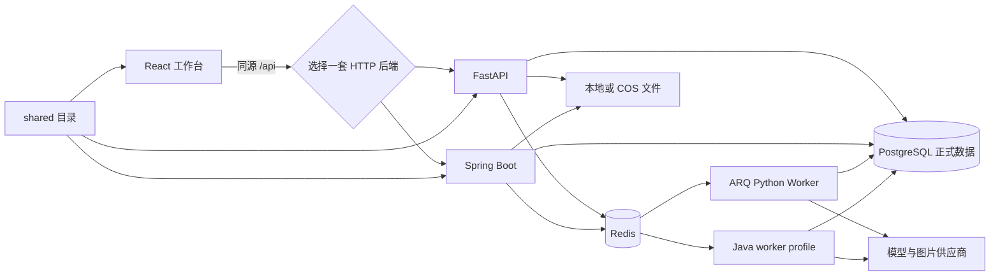
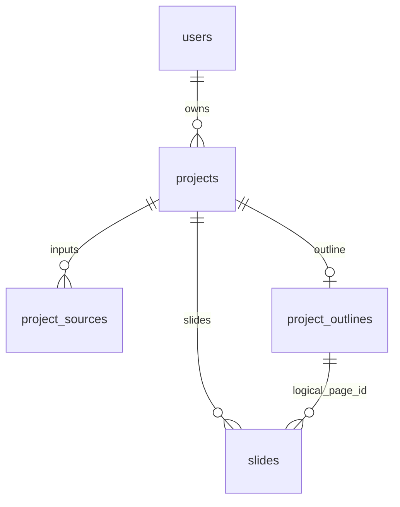
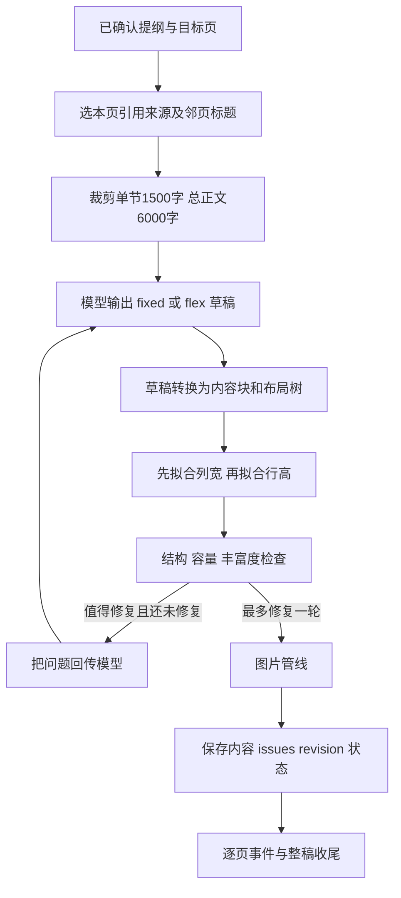
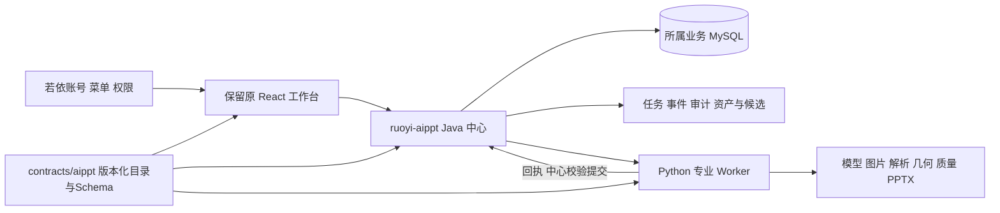

# AI 演示文稿原项目复现与学习设计

> 文档类型：原项目源码调查、架构复现与学习参考；版本：1.0；负责人：本次调查执行者；日期：2026-10-04。  
> 来源：本工作区 `参考项目/ai-ppt-generator-main` 的本地代码、依赖锁、共享资源、测试和部署文件；适用范围仅限本地快照，不代表上游最新版本。  
> 方案承接：[完整迁移设计0.4](完整迁移设计.md)，特别是2026-10-03保留原React、若依Java/MySQL中心与Python算法Worker的决定。实际进度、历史检查、业务差距唯一见[完整迁移实施记录](开发记录/完整迁移实施记录.md)，本文件不建立另一套实施状态。  
> 复查基线：[源文件清单](证据/2026-10-04-原项目复现调查/源文件清单.csv)、[源码基线](证据/2026-10-04-原项目复现调查/源码基线.json)、[逐文件目标候选](证据/2026-10-04-原项目复现调查/源文件目标候选对照.csv)、[依赖声明清单](证据/2026-10-04-原项目复现调查/依赖声明清单.csv)。本文是代码阅读结果与后续复现方法；未启动原服务、未连接正式数据库、未调用真实模型、未执行业务验收。

## 1. 先理解它解决什么问题

这个项目把“把材料变成可以继续编辑的演示文稿”拆成可检查的步骤：用户提供主题或材料，AI先规划逐页提纲，用户确认后逐页生成结构化内容，再用固定槽位或灵活布局树排版，最终生成原生PPTX。用户可以在中间修改提纲、补救失败页面、人工改内容、微调版面、让AI提出局部修改，而不是只能拿到一份无法干预的成品。

最值得学习的设计是**内容、布局、主题、正式状态分开**。模型输出内容和结构建议；布局算法决定矩形；主题决定颜色、字体和装饰；数据库决定谁拥有项目、哪版已保存、哪些页完成。Web预览和PPTX导出都消费同一份结构化内容及共享目录。迁移时只复制页面或只移植模型调用，会遗漏这个闭环。

正常用户链路是：注册登录 → 创建项目 → 添加材料 → 生成提纲 → 修改/确认提纲 → 并行生成页面 → 在线编辑 → 导出前检查 → PPTX导出与回读。浏览器放映可以从已生成页面进入。图片获取是生成的辅助链路，失败可降级占位；质量告警贯穿生成、编辑和导出。

| 可见能力 | 代码中实际范围 | 学习时应识别的边界 |
|---|---|---|
| 智能生成 | 主题、长文本、TXT/Markdown/DOCX/文本PDF → 提纲 → 固定/灵活页 | 没有查到扫描PDF OCR、联网研究、知识库检索或事实核验闭环 |
| 在线编辑 | 八类内容块、四类图表、按页串行保存、撤销重做、主题与灵活布局 | 不是任意HTML/矢量绘图编辑器；不等价于PowerPoint所有编辑能力 |
| 模板 | 4套主题、11种固定布局、18份灵活预设与共享样例 | 不存在上传任意PPTX模板后自动识别/复用母版的完整入口 |
| 图片 | OpenAI兼容生图或百炼生图 → Unsplash → 占位；人工上传替换 | 没有独立图库搜索页面；成功占位不表示真实生图成功 |
| 导出 | 原生文字、表格、图表、图片、形状组成PPTX；普通项目导出回读 | 没有产品级PDF/视频导出入口；PDF在本项目主要是输入材料 |
| 来源 | 材料小节ref、页码/段落locator、来源提示块、图库credit | ref存在只说明引用可定位，不证明模型结论与数字真实 |
| 放映 | 翻页、首页/末页、全屏、退出 | 没有独立演讲者备注编辑、双屏演讲者视图、分享协作入口 |
| 异步 | 提纲任务、整稿/单页生成、进度SSE、取消/续跑 | 原SSE不保存完整事件历史；原任务系统不等价于可靠中心任务审计 |

[README](../../../参考项目/ai-ppt-generator-main/README.md)把项目概括为八大模块，这是一种产品介绍口径。学习与迁移需要按下文细分到账户、模型契约、生成任务、编辑算法、资产、字体、质量、导出、回归和运维，不能以“八个页面都能打开”作为全功能标准。

## 2. 技术栈与三个实现之间的关系

### 2.1 实际依赖版本

下面把声明与锁定结果分开。版本来自本地文件，不推断工具在当前机器已经安装，也不把`^`/`>=`声明写成精确运行版本。

| 层 | 本地可复现基线 | 用途和入口 |
|---|---|---|
| 前端运行 | React/ReactDOM 19.2.8、React Router 8.3.0、Zustand 5.0.14、TanStack Query 5.101.4 | 路由、登录状态、服务端数据缓存；[package.json](../../../参考项目/ai-ppt-generator-main/frontend/package.json)、[package-lock.json](../../../参考项目/ai-ppt-generator-main/frontend/package-lock.json) |
| 前端界面 | TailwindCSS 4.3.3、Recharts 3.10.1、Lucide、clsx、tailwind-merge、Manrope/Instrument Serif字体包 | 布局、图表和编辑面板；字体包版本声明为5.3.0系列 |
| 前端构建 | TypeScript 5.9.3、Vite 8.2.0、锁中oxlint 1.77.0 | `build=tsc -b && vite build`；oxlint声明`^1.75.0`与锁版本并不矛盾 |
| Python运行 | Python声明≥3.12；镜像3.12-slim；FastAPI 0.141.1、Uvicorn 0.52.1、Pydantic 2.13.4 | 异步HTTP及Schema；[pyproject.toml](../../../参考项目/ai-ppt-generator-main/backend/pyproject.toml)、[uv.lock](../../../参考项目/ai-ppt-generator-main/backend/uv.lock) |
| Python持久化/任务 | SQLAlchemy 2.0.51、asyncpg 0.31.0、Redis客户端5.3.1、ARQ 0.28.0、Alembic | PostgreSQL异步事务、任务与事件；不是MySQL实现 |
| Python模型 | langchain-core 1.5.3、langchain-openai 1.4.3、LangGraph 1.2.10 | JSON结构化输出、内存工具会话、生成/校验/修复流程图 |
| Python文档/图像/字体 | python-pptx 1.0.2、pdfplumber 0.11.10、python-docx声明≥1.2.0、markdown-it-py声明≥4.2.0、fonttools 4.63.0、httpx | 文档解析、PPTX原生对象、远端图片和文字度量；全部锁版本应随uv.lock保留 |
| Java替代后端 | Java21、Spring Boot3.5.9、MyBatis Plus3.5.17、LangChain4j1.12.1、LangGraph4j1.8.24 | 独立HTTP与worker profile；[pom.xml](../../../参考项目/ai-ppt-generator-main/java_backend/pom.xml) |
| Java专业依赖 | JJWT0.12.6、Argon2 2.12、PDFBox3.0.5、POI5.4.1、COS SDK5.6.227、spring-dotenv4.0.0 | 独立认证、PDF/DOCX/PPTX、对象存储；此处是POM声明值，传递依赖仍需dependency tree |
| 原基础设施 | compose中的PostgreSQL16-alpine、Redis7-alpine、Nginx | 开发暴露39432/39379，前端39173，API39800；镜像tag未锁digest |

Java没有Maven依赖锁文件；Python镜像从`uv:latest`复制工具，Nginx也没有精确镜像版本。若要复现全部技术版本，还必须记录Node/JDK/Python/uv/Maven的实际版本、Maven解析树、镜像digest、操作系统与字体清单，源码声明本身不够。

### 2.2 两个后端是替代路线

图中的Python/Java路径表达替代实现，**不表示两种Worker可以混用同一队列协议**。Python使用ARQ；Java的[JobQueue](../../../参考项目/ai-ppt-generator-main/java_backend/src/main/java/com/aippt/shared/redis/JobQueue.java)与[WorkerRunner](../../../参考项目/ai-ppt-generator-main/java_backend/src/main/java/com/aippt/worker/WorkerRunner.java)使用自己的阻塞出队、JobPayload和重入队逻辑。选Java API通常对应Java Worker；原Makefile仍用Python Alembic执行数据库迁移。

Python目录按`api → services → models`组织正式操作，`workflows → llm/domain`组织专业生成，`render/ingest/images/storage`负责适配。Java用`project/outline/deck/media/design`对应业务，用`domain/content/domain/flex/render`对应算法，用`shared`承载配置、数据库类型、身份、队列、存储和异常。Java21虚拟线程、全局snake_case Jackson、UUID/JSONB TypeHandler和独立JWT是原后端的环境选择，不能直接搬进共享若依全局配置。

### 2.3 共享目录的业务意义

[shared](../../../参考项目/ai-ppt-generator-main/shared)包含4个主题JSON（ivory、obsidian、midnight、scholar）、11个固定布局JSON（cover、toc、section、bullets、two-column、image-left、image-right、kpi、chart、table、summary）、18份灵活预设、灵活归一化fixture、氛围层fixture和sample-deck。主题约束字体、颜色、字号、卡片等样式；固定布局约束槽位矩形、类型与容量；预设表达可展开的布局树。它们是应用契约与运行资源，不能当成文档素材而漏迁。

前端通过共享目录和渲染模块形成预览；后端从同目录读主题/布局，在校验、几何求解和PPTX构造时使用。共享资源改变必须使三端版本一致；否则“浏览器看着正常，导出溢出”会成为必然风险。

## 3. 数据模型、状态与数据所有权

### 3.1 原项目数据库

[project.py](../../../参考项目/ai-ppt-generator-main/backend/app/models/project.py)、[slide.py](../../../参考项目/ai-ppt-generator-main/backend/app/models/slide.py)、[user.py](../../../参考项目/ai-ppt-generator-main/backend/app/models/user.py)是权威字段依据；[Alembic版本目录](../../../参考项目/ai-ppt-generator-main/backend/alembic/versions)有10个迁移文件，包含主题覆盖、layout_mode/tree和文字量演进。

| 表 | 主键/关联 | 关键字段与职责 |
|---|---|---|
| users | UUID；email唯一 | password_hash、created_at；只用于原独立账号 |
| projects | UUID；user_id→users | title、audience、tone、page_count、theme_id/overrides、layout_mode、content_density、status；正式项目设置与归属 |
| project_sources | UUID；project_id→projects | kind、filename/content_type/size_bytes、storage_key、sections/warnings JSONB、char_count；原材料与解析结果 |
| project_outlines | UUID；project_id唯一 | status、pages JSONB、revision、job_id、input_signature、error；一项目一提纲，pages内部页ID稳定 |
| slides | UUID；project_id→projects | outline_page_id、position、layout_id/mode/tree、title、blocks JSONB、speaker_notes、issues/error、revision/status；正式页面 |

`(project_id,outline_page_id)`唯一约束是生成幂等基础，不能按页号作为页身份。position仅用于排序。表级外键级联清理数据库行；原`remove_project`直接删行，不能由此推断本地/COS对象、Redis状态和在途任务也被可靠清理。

最后一条是JSON页ID到`outline_page_id`的业务关系，不是数据库对JSON字段的外键。

### 3.2 三种状态不要混淆

项目status为`draft/outline_ready/generating/ready`；提纲status为`generating/draft/confirmed/failed`；单页status为`pending/generating/ready/failed`。整稿`deck_status`为`idle/generating/ready/partial`，见[deck.py](../../../参考项目/ai-ppt-generator-main/backend/app/services/deck.py)。项目回到`outline_ready`可能已经有多页成功，不能把它理解为“生成结果清空”。任务完成进度100%也可能包含failed页面，不能等同整稿ready。

提纲生成成功先进入draft，仍需用户确认；确认前校验版本、页数、来源和材料指纹。生成成功页的ready表示工作流已经产出并保存，不表示没有error级质量问题；单页修复一轮后残留issues会交给导出质量门禁处理。

### 3.3 统一内容结构

[content.py](../../../参考项目/ai-ppt-generator-main/backend/app/domain/content.py)定义八类块：text、bullets、image、chart、table、kpi、cards、callout。所有块有id、slot_id、locked和style。image带url/alt/source/credit；chart带bar/column/line/pie、categories和series；table带header/rows；callout分note/source。`speaker_notes`存在于页面数据和导出链，界面没有独立完整备注编辑流程。

fixed页面由layout_id查槽位；flex页面由layout_tree决定结构。[flex_layout.py](../../../参考项目/ai-ppt-generator-main/backend/app/domain/flex_layout.py)定义row/column容器、block叶子、gap/ratios/grow、text_style、offset、bleed，以及solid_boxes、outline_boxes、side_line、numbered_steps、timeline五种组皮肤。布局树必须引用真实块且关系一致；增删内容块同时改树，不能只改blocks。

### 3.4 原系统的数据责任

原API及Worker都可读写PostgreSQL；Redis承载任务、latest进度、pub/sub和取消标记；本地/COS承载原文件和图片；浏览器Query/Zustand与撤销历史是客户端缓存。原系统没有独立中心任务表、租约、Outbox、文件所有权登记及全套审计，这些是本仓库迁移设计增加的可靠性要求，不能误写成原项目已有。

原材料引用按`S1:1`这种“第几个材料:第几个小节”构造，正文保留heading、level、text、locator。它适合当前材料顺序中的定位，后续材料增删和导入映射需要稳定ID保护。原指纹包含title/audience/tone及材料id/sections，不含page_count，也遗漏content_density；页数另行校验，文字量遗漏是已批准迁移设计要修正的差异，见[outline_inputs.py](../../../参考项目/ai-ppt-generator-main/backend/app/services/outline_inputs.py)。

## 4. 从页面入口到正式结果的业务链路

### 4.1 账户、项目与材料

前端[App.tsx](../../../参考项目/ai-ppt-generator-main/frontend/src/App.tsx)有`/login`、`/projects`、`/create`、`/projects/:projectId`；详情页在提纲/编辑工作台之间切换。普通列表/新建用AppShell，提纲与编辑器有自己的全屏外壳。

原[auth.py](../../../参考项目/ai-ppt-generator-main/backend/app/api/v1/auth.py)接受邮箱和密码，校验邮箱、密码和唯一性后保存Argon2 hash，登录校验后签发JWT；access token默认7天，没有refresh token。`OwnedProject`按用户归属加载项目，越权不是靠前端隐藏按钮解决。[projects.py](../../../参考项目/ai-ppt-generator-main/backend/app/api/v1/projects.py)支持列表、详情、创建、更新、主题修改、删除和来源增删；原列表返回数组而非分页协议。

新建输入由[CreatePage.tsx](../../../参考项目/ai-ppt-generator-main/frontend/src/pages/CreatePage.tsx)组织。创建目标5–20页，编辑正式页面允许1–40页；名称/API最多200字，受众100字，主题/长文本API最多200000字，原React表单主题500字/文本20000字，文件10MiB/图片8MiB。前端限制和接口限制要分别保存，不能只摘一个数。

材料链路：输入topic/text或上传文件 → 校验大小、后缀、魔数/内部结构 → [解析器注册表](../../../参考项目/ai-ppt-generator-main/backend/app/ingest/registry.py)选plain/markdown/docx/pdf → 提取sections/locator/warnings → 文档原件写存储 → 保存project_sources。失败返回明确错误，不把模型调用放进解析器。DOCX按标题/段落切节、Markdown按结构保留标题、PDF按文本页定位；扫描PDF没有文字时提示补材料。上传校验见[upload.py](../../../参考项目/ai-ppt-generator-main/backend/app/ingest/upload.py)，业务写入见[sources.py](../../../参考项目/ai-ppt-generator-main/backend/app/services/sources.py)。

已确认提纲锁住影响内容的设置和材料；外观可调整。解除确认前要确保生成任务已停止。多个文件部分失败时保留成功材料，修正失败项，而不是将已创建项目视为不存在。

### 4.2 提纲生成、保存与确认

[outlines.py](../../../参考项目/ai-ppt-generator-main/backend/app/api/v1/outlines.py)提供GET、generate、PATCH、confirm、unconfirm、events。生成请求先检查材料和当前状态，创建/更新提纲、设置job_id、revision和generating，再入队；入队失败必须回收生成态。Worker读取时验证job_id/status，计算输入快照和指纹，然后运行[outline workflow](../../../参考项目/ai-ppt-generator-main/backend/app/workflows/outline.py)。

处理顺序：清理空白 → 每小节最多2000字、整体约12000字（含标题预算） → [DeepSeekOutlineGenerator](../../../参考项目/ai-ppt-generator-main/backend/app/llm/deepseek.py)组织系统/用户提示词 → 结构化JSON输出 → Pydantic校验 → 精确页数/合法布局/角色/来源ref校验 → 事务检查原job_id、状态和revision → 保存draft并revision+1 → 发布完成事件。迟到任务结果不覆盖新任务；这一步是理解异步幂等的重点。

提示词要求中文、每页2–5个具体要点、准确页数、合法source_refs，规划page_role和visual，并避免所有页同一种单栏布局。visual只是配图意图，生成封面/目录/章节时不自动等同每页都有图。来源裁剪保证ref和正文仍对应，但被截断材料不会神奇进入模型，需要在迁移版本中展示预算与警告。

原提纲失败允许最多两次任务尝试、间隔3秒；缺凭证不重试，见[retry.py](../../../参考项目/ai-ppt-generator-main/backend/app/worker/retry.py)。终局错误对用户隐藏供应商响应与材料正文。前端[OutlineWorkspace](../../../参考项目/ai-ppt-generator-main/frontend/src/features/outline/OutlineWorkspace.tsx)编辑页序、标题、目标、要点等，保存后确认；确认时核revision、页数、来源和输入指纹。确认与开始生成必须按依赖执行，不能启动尚未保存的提纲。

### 4.3 并行页面生成、失败、取消与续跑

[generation.py](../../../参考项目/ai-ppt-generator-main/backend/app/api/v1/deck/generation.py)接受整稿生成、单页重试、取消及events；[sync_slides](../../../参考项目/ai-ppt-generator-main/backend/app/services/deck.py)以提纲页ID同步正式页：创建缺页，删除不在当前提纲的旧页，保留ready页，只有明确整份重做或相应重建条件才重置。

[deck_tasks.py](../../../参考项目/ai-ppt-generator-main/backend/app/worker/deck_tasks.py)一次加载项目、提纲、来源和邻页标题形成只读DeckContext，用Semaphore限制单稿并发，默认3页。每页获取信号量后先看取消，再锁行写generating并发`slide_started`，随后调用同一个单页workflow。单页重试和整稿生成共享算法，不能只给整稿路径增加修复而漏单页重试。

单页[slide workflow](../../../参考项目/ai-ppt-generator-main/backend/app/workflows/slide.py)先列宽后行高，因为宽度决定换行、换行决定高度。结构error、内容过瘦/空话可触发一轮自修复；单纯容量/溢出warning不自动删块重写。修复用尽仍有问题可以保存ready和issues，之后质量门禁仍可能拒绝导出。模型异常则保存failed，其他页继续，不把某页失败变成整个任务全量重做。

跨页节奏在并发前由[page_rhythm.py](../../../参考项目/ai-ppt-generator-main/backend/app/domain/page_rhythm.py)分配skeleton_hint和callout规则，配合[content_density.py](../../../参考项目/ai-ppt-generator-main/backend/app/domain/content_density.py)的concise/medium/detailed与page_role；不是让各页等前页生成后再决定布局。

取消是软取消：未开始的页不再启动，在途页完成后保留结果；取消标记原TTL30分钟。收尾按真实页状态设项目ready或outline_ready，发cancelled/completed事件；completed可有failed计数。续跑默认保留ready页。原行锁与ready短路不足以证明具备跨进程租约、可靠断电回收或全套过期结果隔离，迁移中心需补这些边界。

### 4.4 事件与重连

[api/sse.py](../../../参考项目/ai-ppt-generator-main/backend/app/api/sse.py)先发latest或fallback，再订阅Redis pub/sub，15秒空闲发心跳注释，终态退出并unsubscribe/aclose。服务端使用no-cache及`X-Accel-Buffering:no`；Nginx关闭proxy buffering。前端[useEventStream.ts](../../../参考项目/ai-ppt-generator-main/frontend/src/hooks/useEventStream.ts)和[sse.ts](../../../参考项目/ai-ppt-generator-main/frontend/src/lib/sse.ts)负责消费、重连与状态刷新。

原代码不使用持久事件序号与历史重放；latest发出到订阅完成之间存在空隙，不能承诺断线时每一事件都不丢。学习时区分“界面最终恢复到正确状态”和“事件完整投递”。迁移设计中的持久事件、游标与鉴权续检解决的是后者及中心权限边界。

### 4.5 人工编辑、队列和页面管理

编辑器[EditorWorkspace.tsx](../../../参考项目/ai-ppt-generator-main/frontend/src/features/deck/EditorWorkspace.tsx)组合左Filmstrip、中SlideStage、右AI/主题/布局/图片面板，内部页面由SlidePage与BlockView负责。人工改八类块要保持类型正确；chart有专用ChartDataEditor，不能把图表当一段字符串保存。[blocks.py](../../../参考项目/ai-ppt-generator-main/backend/app/api/v1/deck/blocks.py)检查归属、ready和revision后执行patch；人工编辑或换图将块locked，校验后revision+1。图表元素级style接口明确拒绝，图表数据仍可编辑。

[useSlideSaveQueue.ts](../../../参考项目/ai-ppt-generator-main/frontend/src/features/deck/useSlideSaveQueue.ts)把同页content/style/flex/structure/mutate串行化，每次消费成功回执的新revision，维护50条内存撤销历史。保存态有idle/saving/saved/conflict/error。409不能解释为网络临时重试，也不能用旧revision自动覆盖；应保草稿并明确重基。撤销/重做属于新写入，历史不是服务器备份；刷新不会恢复全部客户端历史。

[pages.py](../../../参考项目/ai-ppt-generator-main/backend/app/api/v1/deck/pages.py)支持插入、复制、删除、排序，服务[deck_pages.py](../../../参考项目/ai-ppt-generator-main/backend/app/services/deck_pages.py)同步提纲页、slide和project.page_count。不能删除最后一页，正式编辑上限40页。复制应生成新页/块标识，排序必须保持提纲页关联；单独改position会让后续重试错页。

### 4.6 布局、主题与字体

固定布局切换先用[layout_switch.py](../../../参考项目/ai-ppt-generator-main/backend/app/domain/layout_switch.py)做类型/容量匹配；不兼容时拒绝并说明原因，不能丢块以强行适配。fixed解锁flex由原槽位几何构造树，首次预览应尽量保持原矩形。flex支持拖分隔线、调整边缘、比例、偏移、跨容器移动、两/三列插入、增删块、留白容器、组皮肤和换排布。

后台[layout.py](../../../参考项目/ai-ppt-generator-main/backend/app/api/v1/deck/layout.py)分别处理flex-layout、flex-state、relayout候选/应用、unlock-flex和固定布局切换；领域算法见[flex_solve.py](../../../参考项目/ai-ppt-generator-main/backend/app/domain/flex_solve.py)、[flex_normalize.py](../../../参考项目/ai-ppt-generator-main/backend/app/domain/flex_normalize.py)、[flex_width.py](../../../参考项目/ai-ppt-generator-main/backend/app/domain/flex_width.py)、[flex_fit.py](../../../参考项目/ai-ppt-generator-main/backend/app/domain/flex_fit.py)、[flex_edit.py](../../../参考项目/ai-ppt-generator-main/backend/app/domain/flex_edit.py)。浏览器对应[flexLayout.ts](../../../参考项目/ai-ppt-generator-main/frontend/src/render/flexLayout.ts)及[编辑几何目录](../../../参考项目/ai-ppt-generator-main/frontend/src/features/deck/flex)。一致性需要共享fixture，不能仅逐行抄算法后宣称三端等价。

四主题支持颜色、字体对、字号、圆角、要点符号等有限覆盖；单块可覆盖样式并重置。主题字号8–72pt，圆角0–48pt；块边框0–6pt、内边距0–48pt、字重300–900等以[block_style.py](../../../参考项目/ai-ppt-generator-main/backend/app/domain/block_style.py)校验为准。[ambient.py](../../../参考项目/ai-ppt-generator-main/backend/app/domain/ambient.py)构造背景装饰氛围；Web和导出必须一致使用。

画布960×540pt，比例16:9。后端[text_metrics.py](../../../参考项目/ai-ppt-generator-main/backend/app/domain/text_metrics.py)优先读取NotoSans-Regular.ttf和NotoSansSC-Regular.otf，缺失或缺字时退回字符宽度估算并标记used_estimate。仓库fonts只有.gitkeep，字体获取脚本不是字体资产已经迁完的证据。浏览器字体包、后端度量字体、用户Office安装字体是三件事；导出指定字体名称不代表字体被嵌入或不同机器绝对同像素。

### 4.7 AI局部改稿与换排布

[ai_edit.py](../../../参考项目/ai-ppt-generator-main/backend/app/api/v1/deck/ai_edit.py)先校验owner、ready和revision，选可编辑且未locked的块，构造SlideEditInput。生成器[slide_edit.py](../../../参考项目/ai-ppt-generator-main/backend/app/llm/slide_edit.py)通过bind_tools最多4轮操作内存副本；六个替换工具是text、bullets、kpi、table、cards、callout，flex才增加add/delete/change_type三个结构工具，见[edit_tools.py](../../../参考项目/ai-ppt-generator-main/backend/app/llm/edit_tools.py)。图表和图片不是上述文字替换工具。

工具先检查块存在、类型、locked、树合法性，再产生前后差异。[slide_edit workflow](../../../参考项目/ai-ppt-generator-main/backend/app/workflows/slide_edit.py)校验候选，必要时修复一轮；仍有blocking issue则拒绝，不写正式库。响应给出operations、discarded、warnings和基准revision。原提案主要由浏览器持有，不能当成持久提案审计。

用户在AiEditPanel逐项采纳/撤回/丢弃后调用apply，后台再次检查revision及结构；side=before可恢复删除/类型转换的原内容。历史最多5轮用于上下文，不是永久会话。两人或手工编辑使revision变化时原候选过期，不能跳过冲突复用。换排布[relayout.py](../../../参考项目/ai-ppt-generator-main/backend/app/llm/relayout.py)生成候选树并排除同构重复，不负责凭空改业务文字；用户选择后才应用。

### 4.8 图片与文件

[images/pipeline.py](../../../参考项目/ai-ppt-generator-main/backend/app/images/pipeline.py)依次尝试已配置的OpenAI兼容或百炼主图源，再Unsplash图库；全部失败返回None，由[slide_images.py](../../../参考项目/ai-ppt-generator-main/backend/app/services/slide_images.py)使用占位。供应商支持URL/base64等差异在generated/bailian中适配，bytes校验后存储；原图片source记录generated/stock/upload/placeholder，图库作者credit与内容一起保存。

人工换图入口在ImagePanel和`PUT slides/{slide_id}/blocks/{block_id}/image`；校验8MiB上限、图像格式和块类型后写项目图对象并锁定块。Web与PPTX均按cover裁剪，alt/credit不是只用于装饰的可丢字段。

[storage/base.py](../../../参考项目/ai-ppt-generator-main/backend/app/storage/base.py)定义抽象，[local.py](../../../参考项目/ai-ppt-generator-main/backend/app/storage/local.py)/[cos.py](../../../参考项目/ai-ppt-generator-main/backend/app/storage/cos.py)实现存取。本地媒体经[media.py](../../../参考项目/ai-ppt-generator-main/backend/app/api/v1/media.py)提供文件；原媒体没有迁移中心那样完整的私有资产权限体系。Python COS代码依赖的SDK不在基础pyproject依赖中，不能只设置driver=cos就承诺运行。Java POM明确列COS SDK，这也是两后端差异之一。

### 4.9 质量检查、原生PPTX与回读

[quality服务](../../../参考项目/ai-ppt-generator-main/backend/app/services/quality.py)汇总结构、槽位容量、溢出、边界、内容丰富度、重复/空话、数字来源、图源/清晰度与字体估算等问题，形成error/warning分级。[export_check.py](../../../参考项目/ai-ppt-generator-main/backend/app/domain/export_check.py)决定export_allowed。数字来源提示是启发式检查，没有外部事实数据库与结论核验。

普通项目[export.py](../../../参考项目/ai-ppt-generator-main/backend/app/api/v1/deck/export.py)顺序为：全部页ready → 当前版本质量检查 → error阻断409 → 把ORM转统一Deck → [render/pptx.py](../../../参考项目/ai-ppt-generator-main/backend/app/render/pptx.py)构造PPTX → [verify.py](../../../参考项目/ai-ppt-generator-main/backend/app/render/verify.py)回读页数、文字、原生表格图表与几何 → 回读不通过422且不返回文件 → 成功返回PPTX流、UTF-8文件名。渲染异常500、回读异常500。原接口同步执行，迁移中心改为快照任务属于批准的技术差异。

text/table/chart专业模块构造原生对象；图片是原生picture；KPI/cards/callout用文本/形状组合；不是整页截图。[Java渲染目录](../../../参考项目/ai-ppt-generator-main/java_backend/src/main/java/com/aippt/render)使用POI实现对应构造与回读。应保留两套实现的对照知识，但目标路线已选择Python权威专业算法，不能因“所有技术都要迁”同时注册两套正式导出入口。

[design.py](../../../参考项目/ai-ppt-generator-main/backend/app/api/v1/design.py)提供layouts/themes、sample-deck、issues和sample-deck/pptx。样例直接渲染导出，**未调用普通项目导出的同一套quality和verify流程**；React原版没有完整独立样例页面。这一差异必须在迁移覆盖中单列，不能用样例导出成功证明用户项目门禁成功。

### 4.10 按契约定位API

原Python统一前缀是`/api/v1`，下表省略该前缀；`P=/projects/{project_id}`、`D=P/deck`、`S=D/slides/{slide_id}`。真实请求Schema由[schemas](../../../参考项目/ai-ppt-generator-main/backend/app/schemas)与[前端生成类型](../../../参考项目/ai-ppt-generator-main/frontend/src/api/schema.d.ts)维护，本表解释职责，不另写一套字段协议。Java相同功能接口须对照Controller/DTO验证细节，不能仅凭路径相同认定完全兼容。

| API族 | 方法/路径 | 请求/回执及拒绝边界 |
|---|---|---|
| 账户 | POST auth/register、auth/login；GET auth/me | 邮箱/密码→token或本人；无效身份拒绝、重复邮箱拒绝 |
| 项目 | GET/POST projects；GET/PATCH/DELETE P；PATCH P/theme | 项目设置/主题覆盖→详情/列表/204；owner、主题和字段校验 |
| 材料 | POST P/sources、P/sources/upload；DELETE P/sources/{source_id} | 文本或multipart→小节/警告/原件元数据；确认锁、坏文件拒绝 |
| 提纲 | GET/PATCH P/outline；POST P/outline/generate、confirm、unconfirm；GET P/outline/events | revision/pages→正式提纲；generate→202/job_id，事件→状态；过期指纹/版本/页数拒绝 |
| 整稿与生成 | GET D；POST D/generate、D/cancel、S/retry；GET D/events | 状态与逐页内容；regenerate_all显式覆盖，202只表示接收不是生成成功 |
| 页管理 | PUT D/slides/order；POST D/slides、S/duplicate；DELETE S | 页ID/锚点/排序→正式页列表或DeckPageResult；生成中、非法集合/边界拒绝 |
| 内容块 | PATCH S/blocks/{block_id}及其/style；PUT其/image；POST S/blocks；DELETE S/blocks/{block_id} | revision与类型化内容/样式或multipart→SlidePublic；CAS、类型、锁定/结构校验 |
| 布局 | PUT S/flex-layout、S/flex-state、S/layout；POST S/unlock-flex；GET S/layouts | revision/树/布局→正式页或兼容候选；缺树/非法叶引用/不兼容拒绝 |
| 换排布 | POST S/relayout、S/relayout/apply | 候选最多3个，模型请求2个且可补预设；模型非法输出可退预设，缺凭证503；应用时再次校验 |
| AI改稿 | POST S/ai-edit、S/ai-edit/apply | 指令/历史/基准版→候选operations；逐项apply→正式SlidePublic；无模型503、非法候选422、过期409 |
| 质量与文件 | GET D/quality、D/export | 报告或PPTX流；未ready/quality error409，回读不通过422，渲染/回读异常500 |
| 设计目录 | GET design/layouts、themes、sample-deck、sample-deck/issues、sample-deck/pptx | 样例可指定theme_id；未知主题404；独立辅助接口不等于真实项目验收 |
| 媒体与健康 | GET media/{key:path}、health | 仅media前缀公开图片，原文档uploads不开放；健康顶层200同时看组件字段 |

原API多处409表示业务冲突（生成中/版本不符/候选过期/未达导出条件），422表示上传/模型/结构或回读不合法，503表示模型配置不足；不同族的具体detail类型有字符串和结构化对象之分。前端client必须保留业务detail，不能把全部错误统一为网络异常并盲目重试。

## 5. 前端界面怎样复现

本次没有界面改动。已有[界面设计HTML](图稿/界面设计.html)与[图稿总览](图稿/界面图稿总览.png)帮助理解已批准目标，最终样式/行为还需以原React和迁移React实际页面为准；图稿不是原项目运行截图，也不证明已迁业务通过。

| 原界面 | 操作与关键状态 | 主要源文件 |
|---|---|---|
| 登录注册 | 表单、提交中、错误、成功后回列表；恢复token | [AuthPage](../../../参考项目/ai-ppt-generator-main/frontend/src/pages/AuthPage.tsx)、features/auth |
| 项目列表 | 项目卡片、搜索/状态筛选、继续、删除、新建 | [ProjectsPage](../../../参考项目/ai-ppt-generator-main/frontend/src/pages/ProjectsPage.tsx)；原API不分页 |
| 新建 | 居中单栏，主题/文字/文档，页数/密度/模式；部分材料失败 | [CreatePage](../../../参考项目/ai-ppt-generator-main/frontend/src/pages/CreatePage.tsx) |
| 提纲工作台 | 左侧页卡、右侧设置/主题、保存/确认/生成及失败恢复 | [OutlineWorkspace](../../../参考项目/ai-ppt-generator-main/frontend/src/features/outline/OutlineWorkspace.tsx) |
| 编辑工作台 | 左缩略图、中16:9画布、右面板；生成中、failed、保存中、冲突、AI候选 | [EditorWorkspace](../../../参考项目/ai-ppt-generator-main/frontend/src/features/deck/EditorWorkspace.tsx)、[SlideStage](../../../参考项目/ai-ppt-generator-main/frontend/src/features/deck/SlideStage.tsx) |
| 主题/布局/图片 | 即时预览、有限覆盖、兼容布局与换排布候选、换图 | [ThemePanel](../../../参考项目/ai-ppt-generator-main/frontend/src/features/deck/ThemePanel.tsx)、LayoutPanel、RelayoutPanel、ImagePanel |
| 放映/导出 | 翻页/全屏、退出回原页；质量error阻断与warning确认 | [PresentMode](../../../参考项目/ai-ppt-generator-main/frontend/src/features/deck/PresentMode.tsx)、[ExportDialog](../../../参考项目/ai-ppt-generator-main/frontend/src/features/deck/ExportDialog.tsx) |

前端恢复顺序建议是路由/请求 → 服务端数据类型 → 提纲 → 内容渲染 → 保存队列 → flex交互 → AI候选 → 放映/导出。Query缓存存正式回执，Zustand存身份等客户端状态，编辑草稿由已有hook管理；避免再加一个全局“全部项目状态”store与后端争夺真相。

## 6. 原项目运行与部署条件

这些命令用于理解原实现，不是本次已执行动作，也不是批准在共享工作区启动独立基础服务的指令。本仓库后续开发沿用[多项目启动指南](../../若依框架/多项目并行开发启动指南.md)，不得照搬compose新建另一套数据库/Redis。

原[Makefile](../../../参考项目/ai-ppt-generator-main/Makefile)流程：`install`运行`uv sync`和前端`npm install`；`migrate`运行`uv run alembic upgrade head`；`dev-api`在39800运行uvicorn；`dev-worker`运行ARQ WorkerSettings；`dev-java-api/dev-java-worker`先依赖Python迁移，再分别运行Spring及worker profile；`dev-web`运行Vite39173。精确复现优先使用现有锁定方式而不是重新解算依赖，安装与真实迁移必须先核实际目标及授权。

原[Dockerfile](../../../参考项目/ai-ppt-generator-main/backend/Dockerfile)用Python3.12、uv sync --frozen --no-dev，并尝试下载字体；下载失败被`|| true`吞掉，构建成功不能证明字体齐备。[生产compose](../../../参考项目/ai-ppt-generator-main/docker-compose.prod.yml)编排API/Worker/PostgreSQL/Redis/Nginx，shared只读挂载，frontend/dist外部预构建后挂载；local存储未见独立持久卷，不能承诺容器重建后保留对象。COS路径应核权限/桶、SDK和外部费用。[nginx.conf](../../../参考项目/ai-ppt-generator-main/nginx.conf)代理`/api/`并关闭buffering，SPA回退index；原生产compose未提供Java替代后端制品编排。

| 配置组 | 配置名称（只列名称） | 就绪核对 |
|---|---|---|
| 环境/数据库/Redis | APP_ENV、DATABASE_URL、REDIS_URL、CORS_ORIGINS | 数据库Schema版本、Redis连接、共享环境命名空间与端口 |
| 原独立身份 | JWT_SECRET、JWT_ALGORITHM、JWT_EXPIRE_MINUTES | 非默认密钥、时钟；迁移目标改平台身份，不继续使用旧签发 |
| 文本模型 | LLM_API_KEY、LLM_BASE_URL、LLM_MODEL、LLM_THINKING_ENABLED、LLM_TIMEOUT_SECONDS | 有效供应商协议、模型支持JSON/tools、超时/额度，不能因字段有值就认定可调用 |
| 生成并发 | SLIDE_CONCURRENCY | 与真实限流、单页耗时、整稿任务时限匹配；ARQ max_jobs=3、job_timeout=15分钟 |
| 图片 | IMAGE_PROVIDER、IMAGE_API_KEY、IMAGE_BASE_URL、IMAGE_MODEL、IMAGE_WORKSPACE_ID、IMAGE_TIMEOUT_SECONDS、UNSPLASH_ACCESS_KEY | 生图和图库各自配置/各自失败路径，不能共用文本模型密钥假定有效 |
| 文件 | STORAGE_DRIVER、STORAGE_LOCAL_DIR、COS_BUCKET、COS_REGION、COS_SECRET_ID、COS_SECRET_KEY、MAX_UPLOAD_MB、MAX_IMAGE_MB | 写入/回读/删除补偿、所有权、持久目录、上传限制 |
| Java启动 | SERVER_PORT、worker profile | HTTP服务与Worker分开，application-worker.yml设web-application-type=none |

原[health.py](../../../参考项目/ai-ppt-generator-main/backend/app/api/v1/health.py)即便数据库/Redis down仍返回顶层status=ok，以component字段区分。健康200不证明Schema、模型、图源、字体、文件或Worker就绪。

## 7. 迁成自己的项目：保留什么，替换什么

本项目已有批准路线，不能因本次学习文档另改前端或数据库。候选实现存在只表明有代码；运行、旧数据、制品、用户接受分别在既有实施记录维护。

| 原实现 | 目标候选与批准取舍 | 等价性必须证明什么 |
|---|---|---|
| 原React前端 | [frontend/aippt-web](../../../frontend/aippt-web)保留React/路由/Query/Zustand/Tailwind/Recharts；若依菜单外链进入同源工作台 | 原页/模块无遗漏，平台登录回跳、API错误/权限、保存与算法保持；复制文件不代替操作验证 |
| 独立users/JWT/AuthPage | 若依平台账号与getInfo；原旧用户映射平台owner，登录页变平台引导 | 每一旧项目有明确owner，越权/失效/撤权拒绝；独立JWT被替换应记录退役理由 |
| Python或Java正式控制面 | [ruoyi-aippt](../../../ruoyi-backend/ruoyi-aippt)装配进ruoyi-admin，复用授权、事务、公共错误与现有请求机制 | 全部业务命令及校验迁入中心；不带入旧应用主程序/全局Jackson/独立安全配置 |
| PostgreSQL/JSONB/UUID | 本项目MySQL权威业务数据，保留稳定外部标识和版本语义 | JSON序列化、时区、唯一键/事务、页关系/owner/来源映射与核账；不能只改连接串 |
| 原ARQ/Java自建任务队列 | 中心持久任务、租约、取消、Outbox、事件与Worker回执 | 重复入队、重启、超时、过期回执、取消、部分失败、恢复和权限边界 |
| Python专业算法 | [python/aippt-worker](../../../python/aippt-worker)保留domain/workflows/llm/ingest/images/render等能力 | 专业输入/输出版本、原fixture、锁定块、质量与PPTX对象语义，Worker不直接持正式业务库 |
| shared | [contracts/aippt/catalog](../../../contracts/aippt/catalog)及Schema/manifest唯一目录 | 4主题/11布局/18预设、全部fixture和样例逐文件核hash/版本，三端消费者一致 |
| 公开媒体及本地/COS | 中心私有资产登记、短期下载及Worker临时访问许可 | owner校验、路径/URL限制、上传验证、补偿、删除及留存，保留图源credit |
| 同步质量/导出 | 中心版本快照/任务，Python返回质量与PPTX回读结果 | 检查、渲染、回读和下载同一快照；error拒绝、warning可确认；失败不返回文件 |
| 原Java算法镜像 | 保留源码基线、对照和迁移处置表；权威专业执行按既有Python路线 | 每个Java功能能映射目标业务/算法；“等价替换”不是宣称复制了所有Java技术依赖 |

目标DDL候选见[V1脚本](../../../ruoyi-backend/ruoyi-aippt/src/main/resources/db/aippt-migration/V1__create_aippt_tables.sql)：project、source、source_section、outline、slide、task、proposal、export、asset、event、audit、outbox、idempotency、snapshot等14张业务表，另有dispatch_gate。它们说明责任收敛方向，不证明已对真实MySQL执行。Worker协议见[contracts/aippt](../../../contracts/aippt)，接续步骤和批准边界以完整迁移设计第4节为准。

## 8. 全功能覆盖矩阵与验收设计

下表按可观察能力列原入口、候选目标和独立验收方法。目标列是覆盖候选，不写“已完成”；实际结果必须回到现有41项业务清单与实施记录。矩阵的细分项可映射同一既有业务点，不重新分配历史验收编号。

| 功能 | 原入口/核心实现 | 目标候选 | 后续必须取得的证据 |
|---|---|---|---|
| 注册、登录、本人/归属 | auth.py、AuthPage、Java AuthController | 平台身份适配 | 登录回跳、过期/越权拒绝、旧owner映射，不保留旧JWT签发 |
| 项目列表/筛选/详情 | projects.py、ProjectsPage | 中心项目API+原React | 多用户隔离、筛选实际数据、分页兼容、继续打开同一项目 |
| 项目创建/更新/删除 | projects.py、ProjectService | 中心project | 字段边界、失败保留、删除后任务/文件/下载阻止与补偿 |
| 主题/长文本输入 | sources.py、CreatePage | 中心source+解析Worker | 表单与API独立上限、空值/超长拒绝、原文及小节核账 |
| TXT/Markdown/DOCX/PDF解析 | ingest各解析器、Java ingest | Worker ingest | 四格式标题/页码/段落、坏文件/扫描PDF、10MiB、部分失败 |
| 文件原件与来源增删 | storage、sources.py | source/section/asset | 原件hash、稳定引用、确认后拒改、孤儿对象补偿 |
| 材料指纹与确认锁 | outline_inputs.py、outlines.py | 中心outline | 改文字量/材料使候选过期；仅外观不失效；legacy兼容明确 |
| 提纲生成/裁剪 | workflows/outline、llm/deepseek | Worker outline | 12000/2000预算、准确页数、合法ref/布局/角色、裁剪提示 |
| 提纲人工改/增删排序 | OutlineWorkspace、outlines.py | 原React+中心 | 保存回读所有字段、5–20页、版本冲突、排序关联保持 |
| 确认/解除/生成依赖 | confirm/unconfirm、useConfirmAndGenerate | 中心原子命令 | 保存未结束不能启动；确认版本固定；在途任务时拒解除 |
| 提纲/整稿SSE | sse.py、events.py、前端sse | 持久事件/原hook适配 | 断线重连快照、游标、15秒心跳、撤权后停止输出 |
| 并行整稿生成 | deck_tasks.py、DeckGenerationService | 中心任务+Worker单页 | 并发限制、逐页即时状态、准确成功/失败计数 |
| 单页生成/自修复 | workflows/slide、SlideWorkflow | Worker slide | fixed/flex、一次修复、剩余issues、失败隔离 |
| 文字量/页面角色/跨页节奏 | content_density、page_rhythm、llm/slide | 原算法/契约 | 三密度/不同角色、邻页标题、并发预分配、多样性语料 |
| 重试/续跑/整份重做 | generation.py、sync_slides | 中心任务 | 保ready、单页同算法、新结果不重复页、重做覆盖明确 |
| 软取消/异常回收 | cancel、Redis标记、Worker | 中心租约/取消 | 未开始不再调用；在途允许收尾；重启后终态/恢复明确 |
| 页插入/复制/删除/排序 | deck/pages、deck_pages、Filmstrip | 中心页命令 | 页/提纲/页数同事务，1–40页，新ID、不删最后页 |
| 八类块人工编辑 | blocks.py、BlockView/EditableText | 原React+中心 | 每类实际保存/刷新、类型校验、锁定、revision增长 |
| 四类图表与原生表格 | ChartDataEditor、render/chart/table | 原React+Worker | 四类类别/系列/单位保存，重名系列不覆盖，PPTX原生数据回读 |
| 单块样式/重置 | block_style、ElementToolbar | 中心+原渲染 | 合法范围、主题继承、重置、图表元素样式明确拒绝 |
| 保存队列/冲突/草稿 | useSlideSaveQueue/mergeBlockCommit | 原队列/中心CAS | 连续输入串行、409不覆盖、失败保草稿、离页等待 |
| 撤销/重做 | 队列MAX_HISTORY=50 | 原历史 | 内容/样式/结构一致回读、上限、刷新历史边界 |
| 四主题/外观微调 | themes、ThemePanel、themeOverrides | 唯一catalog+中心 | 四主题Web/PPTX一致、字体对/字号/圆角/颜色边界 |
| 背景氛围层 | ambient、TS ambient、shared fixture | 原算法/catalog | fixture一致、主题切换与PPTX形状保持 |
| 11固定布局/兼容切换 | layouts、layout_switch、LayoutPanel | 原目录/Worker+中心 | 每布局可渲染/导出，兼容保内容，不兼容明确拒绝 |
| fixed解锁flex | unlock-flex、flex_presets | 中心/Worker | 首帧矩形接近原槽位、内容/locked/样式保持 |
| flex求解/归一化 | flex_solve/normalize、TS、Java | Python权威/TS预览 | shared黄金语料、树引用完整、比例/边界一致 |
| 列宽/行高/文字度量 | flex_width/fit、text_metrics | Worker | 长中文/拉丁、图表/图片、缺字体降级标记，先宽后高 |
| 拖分隔/边缘/偏移 | FlexEditLayer、flex编辑几何 | 原React/中心校验 | 实际拖动后保存刷新、边界、比例、撤销 |
| 跨容器/两三列/留白 | flex_edit/tree/BlockInsertRail | 原React/Worker | 不丢块/ID、空容器规整、spacer接管、叶子唯一 |
| 组皮肤/出血 | flex_skin、bleed、presets | 原算法 | 五种皮肤、图片/图表出血、文字不越安全区 |
| 换排布候选/应用 | relayout.py、RelayoutPanel | Worker提案/中心 | 候选非同构、内容不改、过期拒绝、用户应用后回读 |
| AI文本替换 | slide_edit/edit_tools | Worker+中心proposal | 六工具、最多4轮、locked不改、before/after可审查 |
| AI结构改/采纳撤回 | ai_edit.py、edit_ops、AiEditPanel | Worker+中心proposal | flex三工具、固定页拒结构、逐项采纳/还原、CAS |
| 生图/图库/占位 | generated/bailian/unsplash/pipeline | Worker图源 | 两主供应商协议各测、URL/base64、失败顺序、占位明确 |
| 人工换图/裁剪/署名 | ImagePanel、blocks image | 私有asset+原React | 8MiB/坏图/权限、source/alt/credit保留、Web/PPTX裁剪 |
| 本地与COS存储 | storage、Java Storage | 中心StoragePort | 两驱动写/读/删、持久化、私有下载、补偿和过期访问 |
| 导出前质量/门禁 | quality/validation/export_check | Worker+中心snapshot | 独立坏语料逐类error/warning、warning确认、error拒绝 |
| 原生PPTX构造 | render/pptx/text/table/chart | Python导出Worker | 页数、文字、表格、图表工作簿、形状/图片/备注保持 |
| PPTX回读/失败诊断 | render/verify | Worker+中心下载 | 注入缺页/坏图表/越界，422/任务失败且无文件、定位明确 |
| 缩略图/缩放/可见页 | Filmstrip/SlideStage/ZoomControls | 原React | 40页、缩放/滚动、选页/草稿保持，不把只读缩略图当编辑页 |
| 浏览器放映 | PresentMode | 原React | 键盘/点击/全屏/首页末页、退出恢复选页和焦点 |
| 主题/布局目录与样例 | design.py、sample-deck | 中心私有样例入口 | 四主题/11布局、目录版本、样例专用检查/导出、普通命令拒改 |
| 健康/回归/字体脚本 | health、regression、scripts | 中心health+Worker脚本 | DB/Redis/Worker/字体分别核，语料指标与坏例保留 |
| OpenAPI/前端类型/部署 | Makefile gen-api、schema、Docker/nginx | contracts/同源制品 | Schema消费者兼容、生产文件hash、SSE代理、共享服务不复制 |

## 9. 学习路径：每一步做出一个能检查的结果

| 顺序 | 先读与练习 | 独立完成标志 |
|---|---|---|
| 1. 建立领域语言 | content.py、layout.py、theme.py和sample-deck；手写一页含text/table/chart的Deck JSON | 能解释块ID/槽位/树/主题区别，渲染时不用模型也能呈现 |
| 2. 学会原生导出 | render/pptx、text/table/chart/verify；把上一步导出并回读 | 可在Office/WPS分别编辑文字、表格、图表；记录真实兼容差异 |
| 3. 理解材料到提纲 | ingest、source sections、outline workflow、DeepSeek提示词；构造带页码/标题的材料 | 根据独立预期检查裁剪预算、ref合法、准确页数，坏材料有明确错误 |
| 4. 理解单页生成 | slide_draft、slide workflow、质量、宽高适配；用固定返回的模型替身 | 能展示非法结构→一次修复→保存issues；替身练习不声称真实AI通过 |
| 5. 掌握异步状态 | generation、tasks/deck_tasks、数据库唯一键、events；模拟重复/迟到/取消 | 解释已成功页保留原因，失败/100%/ready区别，旧任务不能盖新提纲 |
| 6. 学会React编辑 | App/client/Query类型、BlockView、保存队列；连续改两块再撤销 | revision按序回读、409保草稿、重载正式数据与草稿区分 |
| 7. 学会flex算法 | shared fixtures、flex_solve/fit/normalize和TS编辑几何 | 同fixture三端矩形可比较；拖动不丢块，宽度变化导致折行可解释 |
| 8. 学会受控AI工具 | edit_tools、slide_edit workflow、apply；提出改文本/删块建议 | 模型只改副本、locked被保护、候选前后可审查、用户采纳才落库 |
| 9. 理解中心迁移 | 中心controller/service/persistence、contracts和Worker协议 | 可画出谁持正式状态、Worker能访问什么、错误/任务/下载完整路径 |
| 10. 做自己的扩展 | 从下一节选一个有限能力，先写字段/规则/独立预期 | 路由、Schema、渲染、质量、导出、兼容和证据同步，而不是只加按钮 |

遇到不懂的算法，先固定一个输入并记录每一步中间结构，例如列宽拟合前后、行高拟合前后、求解矩形、最终PPTX形状；再换一个反例。只读所有文件但没有可观察输出，很难形成可扩展的理解。

原后端[tests](../../../参考项目/ai-ppt-generator-main/backend/tests)覆盖认证、项目、解析、提纲、生成、编辑、flex、图片、主题、质量、PPTX等；[Java测试](../../../参考项目/ai-ppt-generator-main/java_backend/src/test/java/com/aippt)可用于对照语言实现；前端scripts含flex黄金、归一化、氛围层、编辑几何、要点检查。回归目录/脚本是技术学习入口，不是已经执行过的业务验收报告。

## 10. 扩展时应该改在哪里

| 扩展目标 | 业务设计先确定什么 | 必须联动的模块 |
|---|---|---|
| 企业主题 | 品牌色/字体授权、允许覆盖范围、版本兼容 | 唯一catalog、Theme Schema、ThemePanel、ambient、文字度量、PPTX、样例与fixture |
| 新布局 | 支持哪些块/容量、何时兼容切换、页面角色 | layout/预设JSON、模型合法集合/提示词、求解/切换、预览、质量、导出；保留旧layout_id |
| 新内容块 | 输入字段、锁定/编辑规则、AI工具、无效状态 | content Schema、Java校验、React BlockView/编辑器、workflow草稿、布局容量、质量、原生PPTX与回读 |
| 新图表 | 系列/类别/单位、空值/负值、多系列与名称规则 | chart Schema、ChartDataEditor/ChartView、Python/Java语义对照、原生图表和工作簿回读 |
| 新模型供应商 | JSON/tools能力、超时/重试/用量、用户可见失败 | Provider适配/StructuredChatClient、机器身份、执行摘要；业务提示词与正式状态仍共用 |
| 新材料/OCR | 数据来源、页码定位、置信度、收费和失败恢复 | ingest接口、section契约、资产与解析器版本、裁剪提示；OCR不是直接丢给提纲提示词 |
| 新图片供应商 | 许可/署名、URL与base64、大小/SSRF/费用 | ImageProvider、校验/私有asset、pipeline排序、credit/source、质量与导出 |
| 协作/分享 | owner以外谁可读/写、权限期限、候选与保存冲突 | 中心权限/审计/私有下载、SSE鉴权、revision/版本快照；这是新的产品范围，不能默开部门共享 |
| PDF/模板导入 | 页面可编辑程度、母版保留、转换质量定义 | 新独立处理契约/解析/渲染链和验收；不得把已有PDF输入或PPTX输出称为已经支持 |

扩展采用业务模块/协议适配，复用若依账号、菜单、权限、请求与错误处理；不自建另一套中心控制面。专业算法留在既有Worker职责内，中心决定正式写入与权限，React负责交互和预览。模块职责/数据库/外部调用或费用变化按现有批准边界另作决定，本学习文档不授予这些动作。

## 11. 怎样证明“全部功能、代码、技术都迁完”

应把这句话分成五条可独立审查的结论：原功能覆盖、源文件处置完整、技术等价/保留完整、真实数据与资产完整、运行及业务验收完整。任何一条缺证据，都只能说明那一条尚未被证明。等价替换独立JWT/旧PostgreSQL/旧Java控制面，可以满足批准的功能迁移，但不能写成仍然保留了全部原技术实现。

### 11.1 每个源文件都必须有去向

以本次[源文件清单](证据/2026-10-04-原项目复现调查/源文件清单.csv)作分母，在已有迁移来源记录中逐文件给出：原相对路径/大小/SHA256 → 保留或复制到目标路径、适配、等价替换、工具/测试保留、只读参考、明确退役、缺失待处理 → 理由/对应功能 → 目标hash/差异 → 验证链接。不能把`backend/app`移植完便排除Java、shared、锁文件、迁移脚本、前端字体、图标、回归语料、Docker/Nginx和测试。

一个原文件可拆到多个目标文件，一个目标也可整合多个原文件；必须保存多对多关系，不能只按文件数量比较。已批准的替换不算“漏复制”，但处置理由及等价功能证据不能为空。原目录中的隐藏配置模板与.gitignore也须核对；真实.env/运行文件/缓存/依赖目录如不属于源基线，应按基线排除规则明确分开，不能把机器缓存记作业务代码覆盖。

候选现有来源记录：[React来源清单](../../../frontend/aippt-web/source-migration-manifest.json)、[Worker迁移来源](../../../python/aippt-worker/迁移来源.json)、[catalog manifest](../../../contracts/aippt/catalog-manifest.json)。它们需要与本次固定基线对照，本文不以历史数量宣称当前无遗漏。

### 11.2 每种技术都要有保留或替换解释

React/Query/Zustand/Tailwind/Recharts及TypeScript纯布局、Python/LangChain/LangGraph/python-pptx专业算法属于保留路线；原FastAPI/SQLAlchemy/asyncpg/ARQ正式控制面、PostgreSQL、独立JWT/Argon2账号系统和Java21独立Boot后端按批准架构有等价替换/退役。要列接口行为、事务、时区、错误、重试、并发、JSON类型、原生PPTX语义的差异及反例测试，不能以“改成若依了”概括全部变化。

依赖证明至少包括原package-lock/uv.lock/POM及目标锁、差异和理由、安装解析结果/SBOM、实际工具链版本；部署证明至少包括构建输入hash、制品成员/hash、同源静态路径、后台装配、Worker包、共享目录、运行版本与真实入口。构建成功不能证明用户运行的制品已经更新。

### 11.3 资产与许可也在范围内

主题/布局/预设/fixture/样例、图标、字体包、原文件和图片均需独立核账。字体目录只有占位，本次没取得字体下载许可/文件的运行证据，不能写“所有字体迁完”。图片迁移保存bytes/hash、source、credit、alt、原键到新私有键映射，不能只保留可能过期的外部URL。

本地根目录未发现项目级LICENSE文件；README包含教程/推广内容，不能据此推定整个源码允许商业再分发。应保留原作者/来源与项目授权依据，核每个依赖、字体及Unsplash/供应商图片的许可和署名要求；缺项目许可依据时单列待确认，不捏造MIT或Apache许可。本次未在线调查上游授权条款，后续对外分发前需要补充来源核实。

### 11.4 真实数据迁移的核账方法

冻结源数据和对象快照 → 映射旧用户到平台owner → 保持项目/提纲页/slide稳定标识 → 转JSON与时区 → 登记来源section映射、输入指纹、字体/目录版本 → 对对象按hash复制及回读 → 行数与关联核账 → 各用户抽样打开/编辑/重试/导出 → 保留失败对象与可执行恢复方案。不能新建空MySQL业务表后称所有旧数据已迁。

至少核项目数、每项目材料数/sections/char_count、提纲页数与ID、slides和position、blocks数量/类型/locked/style、speaker_notes、issues/revision/status、原件/图片bytes/hash/credit、孤儿引用、时间戳及所有者。生成中历史任务需明确如何转换为可恢复终态；旧JWT不导入。数据库计数和对象hash要独立于被测迁移程序计算。

### 11.5 业务完成证明

沿用已有41项业务清单，不建立第二份“全部通过”表。真实运行前保存每项前提、独立预期、页面操作/截图位置和数据核对；真实模型/图源、平台权限、MySQL/Redis/Worker、字体、私有下载及有效Office/WPS文件逐链路取证。技术单测、Mock接口/截图、源码扫描、构建与生产文件同步分别说明范围，不能计入真实业务通过数。

全部覆盖矩阵行都有明确映射且无未解释源文件，只证明迁移范围闭合；真实失败与未执行仍不能变为通过。用户接受、上线就绪、发布是各自独立事实，只有相应证据才填写。最终的完整迁移结论应链接固定版本、源文件处置账、技术差异账、数据/资产核账、真实业务HTML报告及用户明确接受依据。

## 12. 阅读后的关键判断

这个项目适合深入学习“受控生成系统”：模型只负责建议与结构化内容，算法负责可编辑排版，事务/版本负责正式结果，质量与回读负责交付边界。复现顺序应先打通不依赖模型的内容→预览→PPTX，再加入材料、模型、异步和编辑；扩展时继续维护这条责任链。

本文件已把源码中的产品能力、专业算法、两套后端、共享资源和运行设施放入同一复现视图。它可以作为迁移检查依据和学习路线，但它本身不证明迁移已经完成；当前真实状态仍只由[完整迁移实施记录](开发记录/完整迁移实施记录.md)及其原始证据维护。
