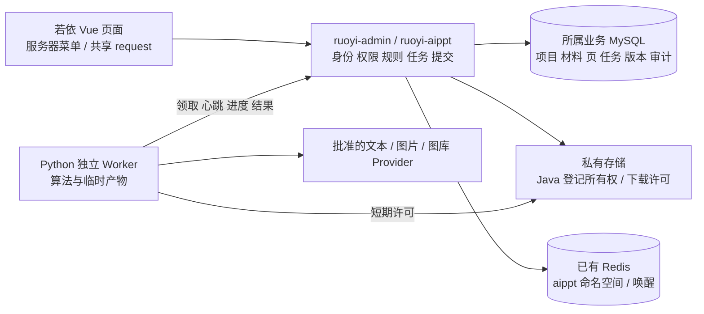

# AI 演示文稿项目完整迁移设计

> 版本：0.1；方案：用户已同意编码实施；负责人：本任务执行者；设计日期：2026-10-02；实施授权：2026-10-03  
> 需求依据：用户要求将 `参考项目/ai-ppt-generator-main` 全部实际功能迁入共享若依，成为独立业务模块 `ruoyi-aippt`，本轮先交付完整方案。  
> 当前事实：2026-10-03 用户同意按本设计并行编码，本地实现和技术检查进行中；真实数据迁移、模型调用与发布尚未发生。实际实现、检查及未完成项唯一记录于[完整迁移实施记录](开发记录/完整迁移实施记录.md)。方案批准、功能实现、验证通过和用户接受分别记录。

## 1. 需求与业务逻辑

### 1.1 用户目标与完整范围

用户通过现有若依账号进入“AI 演示文稿”，从一句主题、长文本或多个文档整理出可确认的提纲，生成完整 16:9 演示文稿；在若依页面内部逐页编辑内容、图表、图片、主题和布局，先处理质量问题，再下载原生可编辑 PPTX，也可以直接浏览器放映。

迁移覆盖原项目的项目管理、来源解析、提纲确认、并行生成、单页自修复、在线编辑、主题与布局、结构化 AI 编辑、图片管线、保存队列、并发冲突、进度推送、取消续跑、质量门禁、PPTX 构造和回读、样例设计目录及本地/COS 存储。分步骤实施不减少最终范围，不把未完成能力计为完整迁移。

原项目的独立注册登录入口、用户表、JWT、PostgreSQL 正式状态、React 主外壳与独立网络实例由现有若依能力承接。Python 的生成、解析、几何、字体与导出算法保留为独立 Worker；其原 API/数据库/账户控制面不作为新系统正式入口。该模块与智能选品的演示文稿功能分别拥有数据；以后跨项目调用只能通过批准的服务契约，不直接读对方业务表。

### 1.2 完整用户流程

1. 用若依登录，拥有演示文稿菜单权限后打开“我的演示文稿”。查看、筛选、分页、继续编辑和删除自己的项目；无权限菜单隐藏，直接访问 API 仍拒绝。
2. 点击“新建”，选择主题、粘贴文字或多文档上传，设置名称、受众、语气、目标页数、固定/灵活排版、文字量和主题。逐份显示解析结果、章节/页码、字数和警告；部分文件失败保留项目与已成功材料，允许替换或补传，不自动删除已创建项目。
3. 材料有效后生成提纲。显示排队、整理材料、规划提纲、保存及失败状态。用户逐页编辑标题、目的、2–5 条要点、来源、版式、页面角色与配图意图，增删和排序提纲页；先保存，再确认，再开始生成。
4. 确认绑定提纲版本和材料指纹。确认后材料及影响内容的设置锁定；主题外观仍可调整。需要修改材料时先取消确认；有生成任务时先取消并等任务结束，再取消确认。
5. 逐页并行生成，已完成页即时预览。整份生成和单页重试使用同一算法。默认续跑保留已就绪页；整份重新生成明确展示将覆盖哪些页面，并保存旧内容快照。取消为软取消：停止尚未开始的页，在途页可以完成，保留成功页，最终显示部分完成。
6. 停止生成后进入编辑：改文字、要点、KPI、卡片、来源提示、表格和图表；换图片；插入/复制/删除/排序页；灵活页拖分隔线、边缘与内容块，跨容器移动、插入两/三列、增删块及换排布。每页保存串行执行，明确显示保存中、已保存、失败或冲突。
7. AI 修改先返回逐项前后对照，不直接修改正式内容。用户采纳、撤回已采纳内容或舍弃建议；已手工修改的锁定块受到保护，固定页仅使用允许的文字替换，灵活页才可结构增删和类型转换。候选过期后重新生成建议。
8. 切换四套主题并微调颜色、字体对、字号、圆角和要点符号；单块可微调文字与容器样式，重置后回到主题样式。固定页可在兼容版式间切换，或解锁为灵活布局；不兼容操作显示具体原因并保留内容。
9. 放映已就绪页面，键盘/点击翻页、首页末页、全屏与退出；退出恢复编辑焦点和若依导航。导出前等待所有保存完成，以同一版本运行质量检查；错误阻断、警告展示后允许继续。生成 PPTX 后回读页数、文字、原生表格图表和边界；通过才提供下载。

### 1.3 业务规则与边界

| 规则 | 原代码依据与拟采用行为 |
|---|---|
| 项目字段 | `schemas/project.py`：名称 1–200 字、受众最多 100 字、三种语气、三种文字量，默认 10 页、flex、medium、ivory。Vue 使用相同最大范围，原 React 名称推导截取 60 字/受众 80 字是界面选择，不作为后台新限制 |
| 创建与提纲页数 | 创建目标 5–20 页；提纲编辑维持 5–20，并同步项目页数；保存提纲时必须与目标数一致。正式编辑器允许 1–40 页，不能删除最后一页，不能因新增第 21 页而套用创建上限拒绝 |
| 输入 | 主题/长文本接口原上限 200,000 字，原 React 主题 500 字/文字 20,000 字。新界面保留快捷主题 500 字，文字入口支持后台完整上限并展示实际送模型的裁剪范围；单文档 10 MiB，单图片 8 MiB |
| 文档类型 | TXT、Markdown、DOCX、文本 PDF；校验后缀、魔数、DOCX 内部结构。扫描 PDF 提示“未能提取文字，请补充文本或其他文件”；不承诺 OCR。保留标题层级、页码/段落定位及解析警告 |
| 材料指纹 | 原 `outline_inputs.py` 当前公式含 title/audience/tone/材料 id 与 sections，不含 page_count，也遗漏 content_density；迁移版本增加文字量和解析器版本，页数单独校验、外观不使内容过期。旧指纹只用于导入兼容，不静默确认已有过期提纲 |
| 提纲字段 | `domain/outline.py`：标题 ≤100、目的 ≤300、要点 2–5、来源最多 10、配图意图 ≤120，source_refs 必须存在。材料编号的显示保留，但正式引用使用稳定 source/section ID，删除材料后不能让编号指向另一来源 |
| 页面内容 | 八类块：text、bullets、image、chart、table、kpi、cards、callout；图表四类 bar/column/line/pie；备注随生成与导出保留。原产品没有独立演讲者备注编辑/演讲者视图，不把它写成已支持 |
| 样式 | 原主题/块字号 8–72 pt、圆角 0–48 pt；块边框 0–6 pt、内边距 0–48 pt、字重 300–900，颜色令牌或合法十六进制；字体对在四主题白名单内。图表元素级样式原 API 明确拒绝，保留该限制，图表数据仍可编辑 |
| 手工内容保护 | 人工内容编辑与换图写入 `locked`；模型不能覆盖/删除锁定块。整页重做属于显式覆盖操作，不伪装为普通 AI 改稿；重做前提示并保存原内容。布局变化保留锁定和文字 |
| 几何与质量 | 960×540 pt；内容、布局、主题分离。固定槽位容量与灵活树校验并用；文字溢出槽位通常警告，内容越过画布、非法结构/缺失资源等错误阻断。数字无来源、重复页、空话、内容偏瘦、低清图、字体估算是提示，不等于事实核验 |
| 私有数据 | 项目默认仅所有者访问；平台角色权限决定可做的动作。部门信息用于归属与审计，默认不扩大为部门共享。管理员管理他人数据须有独立 `aippt:project:manage` 权限并显式进入管理查询，所有访问审计 |
| 删除 | 项目先标记删除、阻止新任务和下载，再异步清理所属文件；记录删除清单与补偿，避免原项目直接删行留下对象或在途 Worker 回写。保留期见第 4 节待审核决定 |

### 1.4 原功能、代码与目标的完整对应

“已有实现”表示查到可追踪代码和/或测试，不表示本轮运行成功。表中路径以参考项目根为前缀，完整代码入口和端点清单见[源码核对附录](源码核对附录.md)。验收号对应第 5 节普通业务顺序号，实施号对应第 4 节。

| 业务能力与原功能出处 | 原项目状态 | 目标业务/模块/接口 | 实施 / 验收 |
|---|---|---|---|
| 注册、登录、本人：Python `api/v1/auth.py`；Java `auth/AuthController.java`；React `pages/AuthPage.tsx` | 两后端已有独立身份；不能复制 | 若依 `/login`、注册开关、`/getInfo`、user store、角色部门；旧账号只映射 owner | 1、10 / 1、2、31 |
| 项目增改查删与继续：`api/v1/projects.py`、`models/project.py`；Java `project/ProjectService.java`；React `ProjectsPage.tsx`、`ProjectDetailPage.tsx` | 两后端已有；原列表不分页 | `ProjectService`、`/aippt/projects`、若依分页与工具栏、删除补偿 | 2、3、10 / 3、4、30 |
| 主题/长文本/多文件创建：`services/sources.py`、`ingest/{plain,markdown,docx,pdf,upload}.py`；Java `ingest/`；React `CreatePage.tsx` | 已有，扫描 PDF 无 OCR | `SourceService`、解析 Worker、`sources`/`sources/upload`/`sources/{id}`；显示章节定位 | 3 / 5、6、7 |
| 材料指纹与锁定：`services/outline_inputs.py`、`api/v1/projects.py`；Java `OutlineInputFingerprint.java` | 已有当前/legacy 指纹；须修正文字量遗漏 | Java `InputFingerprint`，材料版本、确认保护、导入校验 | 3、4、10 / 8、31 |
| 提纲生成/来源裁剪/结构校验：`workflows/outline.py`、`llm/deepseek.py`、`worker/tasks.py`；Java `outline/` | 两套已有；Python 12,000/单节 2,000 字预算 | `OutlineService`、Worker outline workflow、生成任务/快照 | 4、5 / 9、10 |
| 提纲编辑、增删排序、确认/取消：`api/v1/outlines.py`；React `OutlineWorkspace.tsx`、`useConfirmAndGenerate.ts` | 已有，保存需页数对齐 | Vue OutlineEditor、串行提纲保存、原子确认与启动 | 4 / 8、10、11 |
| 提纲与整份 SSE、恢复：`api/sse.py`、`services/events.py`；Java `SseSupport.java`；React `useEventStream.ts`、`lib/sse.ts` | 快照+pub/sub，15 秒心跳，无历史重放 | Java 持久事件序号与快照，共享 request 流扩展，SSE 游标恢复 | 5 / 12、13 |
| 并行生成、续跑、整份重做、逐页重试、软取消：`api/v1/deck/generation.py`、`worker/deck_tasks.py`；Java `DeckGenerationService.java` | 两套已有；Worker 直接改原库，页结果隔离需增强 | `GenerationService`、持久任务/租约、Python 单页 workflow，中心回写 | 5 / 12、14、15 |
| 单页生成→校验→修复：`workflows/slide.py`、`slide_draft.py`、`page_rhythm.py`、`content_density.py`；Java `SlideWorkflow.java` | 已有，修复最多一轮，跨页节奏预分配 | Worker 保留 fixed/flex、邻页标题、来源预算 6,000/单节 1,500 字及文字量/页面角色 | 5、7 / 12、16 |
| 页面插入/复制/删除/排序：`deck/pages.py`、`services/deck_pages.py`、`slide_pages.py`；Java `DeckPagesService.java`；React `Filmstrip.tsx` | 已有三处同步；排序需检查提纲对齐 | `DeckPageService`、项目锁+deckRevision、同事务同步提纲/页序/页数 | 6 / 17 |
| 八类块人工编辑：`deck/blocks.py`、`schemas/deck.py`；React `BlockView.tsx`、`EditableText.tsx`、`ChartDataEditor.tsx` | 已有类型受约束编辑，非自由 HTML 编辑器 | Vue BlockView/EditableText/ChartDataEditor、`BlockService`、内容 PATCH | 6 / 18、19 |
| 单块样式/重置：`block_style.py`；React `ElementToolbar.tsx` | 已有，图表样式拒绝 | 样式 PATCH、确定性样式合并、与主题/导出共用；不增加图表元素样式 | 6、7 / 20 |
| 按页保存、冲突、撤销重做：React `useSlideSaveQueue.ts`、`blockSnapshot.ts`、`mergeBlockCommit.ts`、`slideSaveBridge.ts` | 已有队列，50 条内存历史；跨动作统一性须补 | Vue composables/useSlideSaveQueue.ts；所有页动作共用队列、失败保留草稿、离页等待 | 6 / 21、22 |
| 四主题与微调：`domain/theme.py`、`shared/themes/*.json`；React `ThemePanel.tsx`、`themeOverrides.ts` | 已有 ivory/obsidian/midnight/scholar，含图表主色联动、字体对、氛围层 | `ThemeService`、themeRevision、ThemePanel、共享版本化目录 | 7 / 23 |
| 11 固定布局及兼容切换：`shared/layouts/*.json`、`layout_switch.py`；Java `LayoutSwitch.java`；React `LayoutPanel.tsx` | 已有 cover/toc/section/bullets/two-column/image-left/image-right/kpi/chart/table/summary | `/layouts`、`/layout`；类型容量匹配、不丢块；flex 转 fixed 须明确重建树 | 7 / 24 |
| fixed 解锁 flex：`deck/layout.py`、`flex_presets.py`；React `RelayoutPanel.tsx` | 已有，按原槽位矩形构造树 | `/unlock-flex`；保持首次解锁几何、锁定和内容 | 7 / 24 |
| flex 拖分隔/边缘/移动/增删/两三列：`flex_layout.py`、`flex_edit.py`；React `FlexEditLayer.tsx`、`flex/*.ts`、`BlockInsertRail.tsx` | 已有树、留白、比例、偏移、出血和分组皮肤 | Vue FlexEditLayer、TreeOperations；flex-layout/flex-state/blocks；服务端再校验 | 6、7 / 25 |
| 换排布提案/应用：`deck/layout.py`、`llm/relayout.py`、`flex_presets.py`；React `RelayoutPanel.tsx` | 已有候选，避免布局同构重复 | `ProposalService`、Worker relayout、候选预览/用户应用、候选基准版本 | 7、8 / 26 |
| 确定性布局、字体、宽高适配：`flex_{solve,normalize,width,fit,skin}.py`、`text_metrics.py`、`slide_geometry.py`；对应 Java domain/flex；React render/flexLayout.ts | 三端算法已有，字体目录只有占位保留文件；非所有用户字体精确度量 | Python 权威求解；Vue 同公式预览，共享 fixture/版本，Worker 返回几何校验；字体准备与估算标记 | 7 / 25、27 |
| AI 修改、历史、过滤、修复与用户采纳：`deck/ai_edit.py`、`workflows/slide_edit.py`、`llm/{slide_edit,edit_tools}.py`、`edit_ops.py`；Java `SlideEditTools.java`；React `AiEditPanel.tsx` | 已有 6 替换工具+flex 3 结构工具，最多 5 历史轮次；无任意工具注册平台 | `ProposalService`、内存工具会话、持久候选、逐操作采纳/撤回，后端锁定与 CAS | 8 / 28、29 |
| 生图→图库→占位、图源校验：`images/{generated,bailian,unsplash,pipeline,validate}.py`、`services/slide_images.py`；Java media/pipeline | 已有 OpenAI 兼容、百炼、Unsplash；图库为自动管线 | Worker 保留图源顺序、URL/base64 适配、署名、失败降级、受限获取与中心登记 | 9 / 32 |
| 手动换图、来源署名、裁剪渲染：`deck/blocks.py`；React `ImagePanel.tsx`；render/pptx.py | 已有上传换图及 cover 裁剪；无独立搜索页面 | 私有资产上传接口、块 revision、来源与 credit；不把占位视为真实图 | 9 / 33 |
| 本地/COS、文档与图片存取：`storage/{base,local,cos}.py`；Java `shared/storage`；`services/media.py` | 两套已有驱动，Python COS SDK 未列入基础依赖；原媒体公开 | Java StoragePort 所有权登记、签名短链、Worker 临时读写许可，对象补偿和保留期 | 3、9、10 / 30、34 |
| 质量报告与门禁：`quality.py`、`validation.py`、`export_check.py`、`services/quality.py`；Java `DeckQualityService.java`；React `ExportDialog.tsx` | 已有结构、容量、数字来源、重复、密度、边界、图源、字体检查 | `QualityService`、Worker report、qualitySnapshot，error 阻断、warning 明示可继续 | 11 / 35 |
| 原生 PPTX 构造/回读：`render/{pptx,text,table,chart,verify}.py`；Java render/Pptx*.java；tests/test_pptx_export.py、test_export_verify.py | 两后端均有代码；实际文件导出仅 PPTX | Python 导出 Worker、Java 快照任务、native text/table/chart/picture/shape、回读后下载 | 11 / 36、37 |
| 缩略图、缩放、可见页渲染：React `Filmstrip.tsx`、`SlideStage.tsx`、`ZoomControls.tsx`、`useSlideVisibility.ts` | 已有，16:9 同源渲染 | Vue Stage/Filmstrip/ZoomControls，可见性懒渲染与结构缓存 | 6、7 / 38 |
| 浏览器放映：React `PresentMode.tsx` | 已有翻页/进度/全屏/退出，明确不含备注视图/聚光灯/分享 | 若依页内 PresentOverlay、退出恢复焦点，不改主菜单 | 6 / 39 |
| 主题/布局目录、样例查看/检查/导出：`api/v1/design.py`、`shared/sample-deck.json`；Java DesignController.java | 两后端已有辅助 API；React 无独立样例页 | 受权“样例与主题”页、设计目录 API 和样例 PPTX 导出 | 7、11 / 40 |
| 健康、回归、度量比较、字体获取与部署：`health.py`、`regression/`、scripts/、Dockerfile、compose、nginx、Makefile；Java HealthController/WorkerRunner | 已有入口；本轮未运行；原 compose 拉起独立 PostgreSQL | 模块健康/Worker 就绪、移植纯算法语料回归、独立 Worker 制品；沿用若依运行通道，不照搬原数据库部署 | 1、7、12 / 41 |

### 1.5 Python 与 Java 实际差异及资料不足

| 核对主题 | Python 实现 | Java 实现 | 迁移处理 |
|---|---|---|---|
| 版本与控制面 | Python ≥3.12、FastAPI/Pydantic2/SQLAlchemy/asyncpg/Alembic、ARQ | Java21、Boot3.5.9、MyBatis Plus3.5.17、PostgreSQL；`.env` 处理器与全局 snake_case | 新 Java17/Boot4 模块重写中心适配，不搬旧主程序、认证、全局 Jackson、数据库类型处理器；不直接依赖 Java21 虚拟线程 |
| AI 工作流 | LangChain/LangGraph，outline/slide/edit 三条路径 | LangChain4j1.12.1、LangGraph4j1.8.24、StructuredChatClient/各 Workflow | 以 Python 算法作为唯一执行实现；Java 作为逻辑对照和测试样例来源，不再部署两套同职责生成器 |
| 队列 | ARQ 注册 generate_outline/generate_deck；max_jobs=3、15 分钟超时、最多 2 次 | Redis list + claim TTL + blockingPop，WorkerRunner 分派；页生成虚拟线程+Semaphore | 新中心 MySQL 任务/租约+Redis 唤醒，不假设两队列兼容；Worker 不直读业务库 |
| 字体 | FontTools 字形宽度+估算路径 | FontBox/PDFBox 度量+估算，Java char 逐字符实现 | 保留 Python 度量，补 Unicode/emoji 与缺字 fixture；两套都有度量代码，不能把 Java 写成纯估算 |
| 导出 | python-pptx + verify.py 原生对象与回读 | Apache POI PptxRenderer/PptxVerify 原生对象与回读 | 保留 Python 导出与回读；对照 Java 渲染差异，不能宣称两套视觉一致；不重复新增 POI 导出依赖 |
| 测试 | Python API、领域、工作流、图片、PPTX、回归测试；部分 API 测试使用数据库/Redis | Java 已有领域、ingest、image、outline、PPTX 与安全单测，未发现完整控制器/联机 E2E 套件 | 原测试需要分类迁移；API 用新中心测试替代，纯算法留用。React 未发现正式测试套件，新增 Vue 编辑交互测试 |
| 存储 | 本地、惰性导入 COS；公开 media key 访问 | 本地、COS SDK，MediaController 有公开标记 | 两端都不能沿用公开私有媒体语义；中心鉴权/限时许可统一处理 |
| 资料 | README 自称完整教学项目；本地无教程全文、部署实证或用户数据快照 | Java 目录无独立完整迁移覆盖说明 | 依据本地源码设计。未取得运行参数、用户映射、实际源库/对象清单、真实模型可用性、原项目许可证明；不凭 README 宣称已通过 |

未发现已注册的 PDF/PNG/HTML 文件导出、PPTX 导入编辑、OCR、协作分享、实时多人协同、公开演示链接、聚光灯或演讲者视图。它们不是本次功能删减，而是源码未提供的能力；不建立空接口假装完整。样例 deck JSON 是读 API 数据，不作为新增“用户 JSON 导出”宣传。图片占位、flex spacer 和“图表不支持元素样式”是明确降级/限制，不是待实现功能；COS SDK、字体缺失、资源鉴权、旧数据完整性和任务恢复属于完整迁移必须解决的差距。

## 2. 前端界面设计

### 2.1 页面与可查看图稿

[打开界面设计图册](图稿/界面设计.html)。图册是**拟实现的静态设计图**，不连接 API，不属于产品验收截图。包括我的演示文稿、新建与材料、提纲确认、内部编辑工作台、质量与导出、异常恢复六幅实际 SVG/PNG 图；可直接查看[六图总览](图稿/界面图稿总览.png)；图中保留若依主菜单/页签，标出业务画布内部操作及关键状态。

1. **我的演示文稿**：若依搜索区、表格、Pagination、RightToolbar；状态、页数、更新时间、继续/删除；空态提示创建。项目管理者切换本人/管理查询须单独授权，不能默认看到所有材料。
2. **新建与材料**：同一若依页面中选择输入方式、填写参数、逐文件解析反馈。材料区可查看章节/定位与裁剪提示；按钮区显示保存材料、生成提纲。失败按文件定位，允许继续补传。
3. **提纲确认**：中部逐页卡片，右侧材料小节索引；标题、目的、要点、来源、页面角色、配图意图、布局均可改；自动保存明确反馈。页数变化先更新目标数，再保存；“确认并生成”等待队列清空并携带最新 revision。
4. **编辑工作台**：上部业务工具栏，左侧缩略图，中间画布，右侧 AI/主题/版式/图片面板；工具栏提供继续生成、重做、放映、导出。块样式工具靠近选中块；灵活页拖拽在画布内工作，不变成第二套主导航。
5. **质量与导出**：Drawer 列错误与警告、定位到第几页/块、修复入口、字体估算和快照版本；错误时禁用导出，只有警告时点击“查看警告并继续”。导出任务失败显示重试，同一快照可重新下载。
6. **异常恢复**：排队/生成页不可编辑、部分失败可单页重试、断线恢复状态、版本冲突、保存失败保留草稿、无权限和文档空解析。状态文字说明实际下一步，不靠颜色区分。

桌面工作基准 1440×900；1280×800 时收窄两侧栏，画布保持比例。1024 宽度改抽屉面板，缩略图可收起；手机只保证项目查看、输入与基本预览，不承诺复杂拖拽体验。局部画布缩放允许局部滚动，外层页面不横向溢出。输入法组合输入期间不提交；保留光标、纯文本粘贴及粘贴换行，不能把任意 HTML 写入模型。撤销/重做不抢输入框原生快捷键；拖拽另提供方向/尺寸字段与移动按钮。焦点、键盘操作、可读提示及 200% 缩放纳入验收。

### 2.2 若依框架复用

菜单由服务器 `/getRouters` 授权树产生，“AI 演示文稿”目录下配置“我的演示文稿”“新建”“样例与主题”，详情/提纲/编辑作为隐藏菜单子路由，`activeMenu` 回到项目列表。组件名、route name 和 menu id 在接入时去重；项目标题通过路由 meta 与现有动态标题工具呈现。navType=1 的 Sidebar、2 的 TopNav+侧栏、3 的 TopBar，以及 Layout、TagsView、用户布局偏好均保留，不在 shared Layout/ Navbar 以 `isAipptPath` 隐藏主导航。

登录、注册可用性、Token、角色、部门、账号设置、字典缓存、会话过期和退出全部复用平台。常规动作以 `v-hasPermi`/平台 auth 控制可见性，后台再次 `@PreAuthorize`。项目状态等固定协议枚举由契约维护；语气和文字量中文展示可注册平台字典，不能允许字典编辑改变后端合法状态迁移。

API 模块调用 `src/utils/request.js` 唯一实例；业务 adapter 只做路径、信封、错误字段、版本头和类型转换，不 `axios.create`，不复制 auth store。原 React `api/client.ts`、Zustand token、React Query 与外壳不迁入。业务 Pinia 只缓存页面草稿、选择、队列、候选和放映位置，正式数据以中心响应为准。

SSE 需要持续读取流，当前共享 request 的 10 秒超时和普通 JSON 拦截器不能直接满足。拟**兼容扩展共享 request**：使用同一 Axios 实例的 fetch adapter/stream 响应，新增显式 opt-in 的流分支，沿用 baseURL/Token/取消和会话过期处理；普通 JSON/Blob 请求保持现有行为。先验证当前安装 Axios 支持矩阵，流的 401/403 和帧内业务错误均走现有会话处理。该扩展不是新认证栈；如果兼容性验证失败，先提出同一设施下的替代扩展设计供审核，不用独立 fetch+Token 实现绕过。EventSource 的 query token 不采用。

### 2.3 拟新增/修改前端文件

下列均为审核后拟实施路径，目前没有创建。

| 变化与路径（相对工作区） | 用途与关键逻辑 |
|---|---|
| 新增 `frontend/admin-web/src/views/aippt/projects/index.vue`、`create/index.vue` | 标准若依列表、参数、逐材料反馈、分页/字典/权限与失败恢复 |
| 新增 `frontend/admin-web/src/views/aippt/detail/index.vue` | 项目详情、材料、提纲/正文状态切换；使用服务器隐藏路由，保留 Layout |
| 新增 `frontend/admin-web/src/views/aippt/components/SourceList.vue`、`SourceSections.vue`、`OutlineEditor.vue` | 来源查看/删除、定位、提纲字段、自动保存与确认等待 |
| 新增 `frontend/admin-web/src/views/aippt/editor/index.vue`、`Filmstrip.vue`、`SlideStage.vue`、`SlidePage.vue`、`FlexEditLayer.vue` | 页级操作、可见页渲染、缩放、块选中、drag/pointer 会话、树编辑 |
| 新增 `frontend/admin-web/src/views/aippt/editor/BlockView.vue`、`EditableText.vue`、`ChartDataEditor.vue`、`ElementToolbar.vue`、`BlockInsertRail.vue` | 八类块编辑/四类图表、纯文本与输入法、样式、增删和多列插入；图表预览复用现有 ECharts |
| 新增 `frontend/admin-web/src/views/aippt/editor/AiEditPanel.vue`、`ThemePanel.vue`、`LayoutPanel.vue`、`RelayoutPanel.vue`、`ImagePanel.vue` | 候选前后比较、采纳/撤回、主题微调、兼容提示、候选布局、换图及署名 |
| 新增 `frontend/admin-web/src/views/aippt/editor/ExportDrawer.vue`、`PresentOverlay.vue`、`RecoveryBanner.vue` | 质量定位、导出任务/下载、放映/键盘/焦点、冲突与恢复 |
| 新增 `frontend/admin-web/src/views/aippt/design/index.vue` | 原样例 deck 的主题预览、质量提示与样例 PPTX 下载 |
| 新增 `frontend/admin-web/src/composables/aippt/useOutlineSaveQueue.ts`、`useSlideSaveQueue.ts`、`useTaskEvents.ts`、`useSlideVisibility.ts` | 串行、合并待保存意图、50 步本地历史、flush/暂停/恢复、游标与资源释放；无第二登录状态 |
| 新增 `frontend/admin-web/src/store/modules/aipptEditor.ts`、`src/api/aippt/{projects,sources,outlines,decks,slides,proposals,design,exports}.ts` | 草稿缓存与平台 request 业务适配，服务端版本失效后暂停，不覆盖正式值 |
| 新增 `frontend/admin-web/src/types/aippt/generated.ts`、`src/views/aippt/render/{geometry,flexLayout,flexNormalize,flexSkin,theme,blockStyle,ambient,treeOperations}.ts` | 契约生成类型、从原纯 TS 函数移植算法、共享 JSON；不复制平台全局 store |
| 修改 `frontend/admin-web/src/utils/request.js`，必要时 `src/types` 下现有声明 | opt-in SSE 流响应和结构错误保留；所有旧调用做定向兼容检查，不能改变默认 JSON 行为 |
| 新增 `frontend/admin-web/tsconfig.aippt.json`、`vitest.aippt.config.ts`、`playwright.aippt.config.ts`；修改 package.json 的 scripts | AI 演示文稿局部 TS/单测/E2E；现有 typecheck 主要覆盖选品，不能当作新模块已检查 |
| 新增 `frontend/admin-web/tests/unit/aippt/`、`tests/e2e/aippt/` | 队列/冲突/输入法/八类编辑/布局 fixtures、菜单三模式与用户流程 |
| 视实际菜单支持情况修改 `frontend/admin-web/src/router/index.js` | 只注册已有机制需要的受权限隐藏详情路由；优先服务器菜单，不硬编码主导航 |

## 3. 后台处理设计

### 3.1 处理组件与数据所有权

用户操作进入 `ruoyi-admin` 装配的 `ruoyi-aippt`。Java 校验身份、角色、归属、输入版本和状态，提交 MySQL 正式变更及任务。Redis 只用于唤醒、短期缓存与进度广播。独立 Python Worker 经内部契约领取任务快照，执行解析、提纲、单页生成/自修复、AI 提案、布局/字体检查、图源获取或导出；返回结构化候选和文件清单。Java 校验契约、任务令牌、版本、对象清单后事务提交，生成进度与审计；模型输出不能自行获得正式写入权限。

此模块 MySQL 库名、已有业务连接及目录在实施前核定，不能因为新对话创建或初始化空库。推荐在用户批准的 MySQL 业务库中以 `aippt_` 表前缀隔离逻辑所有权，复用已批准的数据源连接；若需独立 schema/连接，应作为明确数据库对象授权核定。Worker 无 MySQL/PostgreSQL 凭据、不运行 Alembic、旧 API 不对外服务。Worker 可以读取版本化模板与临时任务文件，不成为第二任务/审计真相。

### 3.2 业务提交、并发与失败恢复

| 触发 | 中心处理顺序与失败逻辑 |
|---|---|
| 建项目/加材料 | 名称、枚举、权限校验→创建草稿；上传流量限额与魔数校验→临时私有对象→解析任务→结构/字数/定位回传→事务登记材料。解析失败记录可见状态，清理未引用临时对象。文档内存、页数、压缩展开量/时间限制与进程隔离补齐，避免 zip bomb |
| 生成提纲 | 读取材料稳定版本→构造输入指纹→项目锁/CAS 建任务和 outbox→Worker 领取→裁剪预算/模型结构输出/来源引用校验→确认 job+inputRevision 未变→落 draft、revision+1。模型失败两次上限；缺凭证不重试 |
| 确认并生成 | 串行保存完成后携带 outlineRevision、inputRevision、Idempotency-Key；Java 原子校验页数、来源、指纹并确认，创建生成批次和页面任务。可分开“确认”与“生成”；事务 outbox 防止确认成功但入队丢失。重复请求回原任务，不重复收费 |
| 并行生成 | 每批次先分配页面角色、邻页标题、骨架节奏与配图意图；中心租约分配页任务，Worker 生成→布局适配→结构/密度校验→最多一轮修复→图源解析→候选结果。中心按 batchId+attempt+fencingToken+expectedSlideRevision 接受结果；已删除/失效/终态/旧租约结果隔离，不覆盖人工内容 |
| 取消/续跑/重做 | `cancel_requested` 停止新领取和未启动任务；在途租约允许交付其本次结果，超时后落取消/失败并拒绝迟到。续跑只选择未 ready 页；单页重试/整份重做先保存旧快照并创建新批次，不能复用旧 cancel key 和旧 attempt |
| 编辑内容与结构 | 归属、动作权限、ready/任务空闲检查→行锁或 `UPDATE ... WHERE revision=?`→验证块类型/长度/锁定/树一致性→Worker 纯校验/几何结果（若必要）→短事务 CAS 正式提交。不能在数据库事务内等待模型或对象网络请求。页面增删排序同事务维护页行/提纲/页数/deckRevision；完整 ID 集合校验防止丢页 |
| 主题与质量 | ThemeService 校验预设/字体白名单/覆盖；themeRevision+1，质量报告失效。页修改使 slideRevision 与 deckRevision 更新；质量缓存键为内容版本向量+themeRevision+catalogVersion+fontManifestHash。不同版本的迟到质量报告不能覆盖当前报告 |
| AI/换排布提案 | 创建提案任务→Worker 在副本工具会话工作→结构过滤/最多一轮修复→中心保存基准版本与 before/after/警告/丢弃理由；用户逐项采纳时验证最新版本与剩余候选，CAS 后更新候选基准。撤回是新的受版本检查操作，不把历史 revision 倒退 |
| 图片 | Provider 先生成、再 Unsplash、最后形状占位；下载只允许批准 HTTPS 域名、重定向再次校验，阻断内网/回环/元数据地址；响应流限长、校验字节与实际解码尺寸。临时对象→Java 审核并登记 assetId→块引用；上传换图走同校验+同保存队列，冲突时清理新孤立资产，保留旧图 |
| 导出 | flush 所有页/主题保存→持久不可变 ExportSnapshot→质量门禁→Worker 依相同 snapshot/catalog/font 生成 PPTX→回读验证→Java 核对页数/文件 hash/快照版本→登记 ready 制品。改稿不影响已创建的旧快照，界面标出版本；错误/验证失败不返回部分文件；文件下载再鉴权 |
| 删除/Worker 故障 | 标记删除与取消任务→清理器按资产引用计数删除对象→写业务审计。Worker 崩溃租约到期回收；最多重试上限后页失败、保留成功页。Redis 中断 outbox 保留待派发；MySQL 不可用停止接受新写入，不能回到 Worker 自己落库 |

前端同页内容、样式、树、增删块、换图、布局、AI 采纳全部经过同一队列；在途请求完成前后续动作等待最新 revision。合并相同块尚未发出的编辑意图，不能把两次需保留的结构动作随意合并。页间可并行；主题独立队列；整页增删排序/重做与导出先 flush。保存失败保留内存草稿和可复制文本；冲突暂停、不自动盲重试，展示服务器版本与未保存草稿，用户选择重新加载或以新版本重新应用。退出/切页/TagsView 关闭时等待或提示未保存；页面销毁不能让请求回应写入下一项目缓存。原 50 步撤销重做只在本页会话中有效，不承诺跨刷新历史协同。撤销/重做经人工编辑命令提交，服务端对实际改动的块设置 locked=true，未改动块保留当前保护标记；客户端快照中的 locked=false 不作为解除保护的依据。AI 提案和 Worker 不得调用人工 flex-state 恢复接口；人工恢复仍须校验本人权限、当前 revision、资产归属与树结构。

### 3.3 正式数据设计

业务 ID 沿用 UUID 字符串 `CHAR(36)`（可在验证后选统一二进制存储适配，前端保持字符串）；若依 user_id/dept_id 为平台 long 的字符串传输。JSONB 转 MySQL JSON，不保留 PostgreSQL UUID/JSONB/ILIKE/RETURNING 语法。下表每表带创建/更新审计；UTC `DATETIME(3)` 存储、ISO8601 对外、页面按用户时区显示。

| 表与所有权 | 关键字段/约束/用途 |
|---|---|
| `aippt_project` | id、owner_user_id、owner_dept_id、title/audience/tone/page_count/content_density/layout_mode、theme_id/theme_overrides、input_revision/theme_revision/deck_revision、status、deleted_at；owner+updated_at/id 索引；页数按不同命令上下文校验 |
| `aippt_source`、`aippt_source_section` | source id/project id/kind/filename/content_type/size/hash/asset_id/parse_status/warnings/char_count/parser_version；section id/source id/order/heading/level/text/locator；稳定引用和生成快照，source(project,created,id) 排序 |
| `aippt_outline` | id、project_id 唯一、status/pages JSON/revision/input_signature/job_id；pages 中保留稳定 outlinePageId 与 sectionRefs；确认/编辑 CAS |
| `aippt_slide` | id/project_id/outline_page_id/position/layout_id/layout_mode/layout_tree/blocks/speaker_notes/issues/error_code/revision/status/active_task_id；(project_id,outline_page_id) 唯一；页序在项目锁内连续；块 id 和树叶引用集合必须一致 |
| `aippt_task`、`aippt_task_event` | job id/project/slide/type/batch/attempt/state/input_snapshot_hash/expected_revisions/cancel_requested/lease_until/fencing_token/provider_version/error_code；事件(job,event_seq) 唯一、进度计数和快照；正式任务不依赖 Redis TTL 存活 |
| `aippt_outbox` | 唯一任务派发 key、payload_version、available_at、attempts、dispatched_at；事务内写，派发成功可重复但领取幂等，连续失败隔离告警 |
| `aippt_proposal` | id/project/slide/kind/base_revision/theme_revision/catalog_version/status/operations/discarded/warnings、expires_at；用户采纳/撤回审计及最新基准，过期拒绝 |
| `aippt_asset` | id/project/owner、storage_key/hash/mime/size/width/height/source/credit/provider/object_state/reference_count；存储路径服务器生成，下载不接受任意 key；源文档、图片与制品归属区别 |
| `aippt_export` | id/project/snapshot JSON 或受控快照对象/hash/content_revision_vector/theme_revision/catalog_version/font_hash、quality_report/verify_report、state/asset_id/created_by；snapshot 永不变，重试派生 attempt |
| `aippt_audit` | operator/project/action/object/version/correlation_id、摘要、结果；不保存 Token、密钥、完整文档或 Provider 原始响应。@Log 记录平台动作，业务审计记录正式采纳、重做、导出/删除事实 |
| `aippt_import_map` | source_system/source_type/source_id→target_id、source_hash、import_batch、checkpoint、owner mapping 结果；同源唯一、幂等续跑和精确回退 |

身份引用不迁移原密码/Token，不建跨库事务。source section 与快照中正文属于敏感业务材料，按资产相同授权处理；模型调用只提供本任务必要的小节。数据库提交与对象存储非原子，先 staging 后登记、失败补偿，已提交引用对象禁止临时清理器误删。

### 3.4 状态与跨进程契约

用户可见项目保持草稿、提纲已确认、生成中、可编辑；deck 状态由页面与活跃批次派生为 idle/generating/partial/ready。提纲 generating→draft/failed，draft→confirmed，confirmed→draft（空闲且取消确认）；页面 pending→generating→ready/failed；重试创建新 attempt。新持久任务使用 queued→leased→running→succeeded/failed/cancelled，running 可进入 cancel_requested；soft cancel 期间成功页照常保留，批次结束再计算汇总。导出 queued→checking→rendering→verifying→ready/failed；质量不通过记 rejected，不能混成渲染成功。

未来新增 `contracts/aippt/aippt-v1.openapi.yaml`、`schemas/{content,layout-tree,theme,worker}.schema.json`、`events-v1.schema.json` 作为机器事实源；本轮只是字段与接口设计，没有创建可执行契约。版本 `v1`，JSON Schema 中 `additionalProperties`、递归深度、块/节点总数、payload 字节上限均限定。模板/主题/布局/算法/提示词与 Provider 参数版本记录在快照。

Worker 领取返回 taskId、attempt、leaseToken、fencingToken、输入快照、版本、截止时间、允许对象 id 和临时上传许可。Worker 只可 `claim`、`heartbeat`、`progress`、`complete`、`fail` 本租约任务；结果包括输出 hash、schemaVersion、warnings、资产 manifest/质量或回读报告。Java 每次验证服务身份、任务 owner/状态和租约，拒绝伪造资源、旧版本与越权任务。内部凭据独立于平台用户 JWT，经既有托管密钥设施配置、轮换，禁止写到浏览器。

已核对现有 `ruoyi-framework/.../config/SecurityConfig.java`：平台用户入口统一由 JWT 过滤器和默认认证链保护，当前没有可直接登记 Worker 身份的模块接口。拟在 `AipptWorkerSecurityConfiguration` 内按 Spring Security 既有机制登记高优先级 `SecurityFilterChain`，仅匹配 `/internal/aippt/**`，复用平台 CORS、无状态会话和拒绝处理；模块关闭时该路径仍由原默认链拒绝未认证访问。专用服务凭据过滤器只产生受限 Worker principal/scopes，不提供注册、登录、用户 JWT 或平台菜单权限。内部 Controller 同时检查 principal 类型、任务类型/租约；若依用户 Token 不可领取任务，Worker 身份不可访问用户 `/aippt` 或其他项目 API。过滤器关闭 Servlet 容器自动注册，只装入这条路径安全链，避免双重执行或全局污染；不在平台 permitAll 列表添加内部路径。现有用户安全链、`@ss.hasPermi` 和服务层本人归属判断保持原职责；实施时需定向核对平台 SecurityConfig 未设顺序的默认链与新增链匹配顺序，验证默认拒绝及身份串用。

SSE 只连接中心，带 taskId/batchId、eventSeq、业务状态、计数、时间、correlationId；事件提交后广播，客户端去重，不用事件到达顺序推断数据库结果。首帧发送 MySQL 当前快照（事件缓存可加速），支持 Last-Event-ID/afterSeq；游标过保留期发送 resync_required 并拉取状态。15 秒心跳、断线 1/2/4 秒至 15 秒退避、至多同时一条订阅/任务；完成/失败/取消或页面销毁停止重连。403/401 停止并进入平台流程。普通 API 请求成功不等于任务成功；业务失败在帧内有明确类型。

### 3.5 API 与权限规划

普通 REST 复用 BaseController、Jakarta Validation、AjaxResult（code/msg/data），项目列表复用 TableDataInfo 顶层 rows/total/code/msg 与 pageNum/pageSize。accepted 通过 `data.jobId/state` 表示；SSE 是流、下载是二进制，不塞入 JSON。业务错误加可定位 `errorCode/correlationId/currentRevision/retryable`，在专有 Controller Advice 范围内处理；版本冲突/状态冲突用 HTTP409、无权限403、未知/他人资源404、非法输入422、依赖不可用503，前端仍经共享 request 处理。现有不透明全局异常内容不作为泄露错误的理由。

所有变更命令带 Idempotency-Key 和预期版本；同 key+相同正文返回原结果，正文不同409，幂等保存期限不短于任务最长恢复窗口。查询不接受客户端 owner；服务端推导本人或受权管理范围。权限串由平台菜单按钮授予，以下前缀均 `aippt:`。

| 目标端点（统一 `/aippt` 前缀） | 权限与输入/输出重点 |
|---|---|
| `GET/POST /projects`；`GET/PATCH/DELETE /projects/{p}` | project:list/query/add/edit/remove；创建字段/项目版本；删除返回清理任务；管理他人另 manage |
| `POST /projects/{p}/sources`、`POST .../sources/upload`、`DELETE .../sources/{s}`、`GET .../sources/{s}/sections` | source:add/remove/query；上传返回 source+解析任务状态，逐材料失败；只操作本项目材料 |
| `PATCH /projects/{p}/theme` | theme:edit；themeRevision、合法主题与 overrides，返回正式项目及新版本 |
| `GET .../outline`、`POST .../outline/generate`、`PATCH .../outline`、`POST .../outline/confirm`、`POST .../outline/unconfirm`、`POST .../outline/confirm-and-generate` | outline:query/generate/edit/confirm；指纹、revision 与页数；原子确认+任务，不省略确认步骤 |
| `GET .../deck`、`POST .../deck/generate`、`POST .../deck/cancel`、`POST .../deck/slides/{s}/retry` | deck:query/generate/cancel；regenerateAll、预期 deckRevision、覆盖提示已确认；返回任务与目标页 |
| `GET .../outline/events`、`GET .../deck/events`、`GET /tasks/{id}`、`GET /tasks/{id}/events` | 各对应 query；读取本人受权任务，游标/快照/心跳，不能仅凭 taskId 获得访问 |
| `PUT .../deck/slides/order`、`POST .../deck/slides`、`POST .../deck/slides/{s}/duplicate`、`DELETE .../deck/slides/{s}` | slide:edit；deckRevision、完整页 ID/插入定位；返回 deck、邻页、新版本；更新提纲同事务 |
| `PATCH .../deck/slides/{s}/blocks/{b}`、`PATCH .../blocks/{b}/style` | slide:edit；revision+类型 discriminant；完整块类型校验；样式 null 重置；图表元素样式拒绝 |
| `PUT .../blocks/{b}/image`、`POST .../slides/{s}/blocks`、`DELETE .../blocks/{b}` | slide:edit、image:upload；revision、文件或 type/parent/index；增删仅 flex；返回整页正式结果 |
| `PUT .../slides/{s}/flex-layout`、`PUT .../slides/{s}/flex-state`、`POST .../slides/{s}/unlock-flex` | slide:edit；仅本人人工编辑，当前 revision、树/整页/资产校验；实际改动块重新锁定，忽略快照解锁请求；AI/Worker 禁用该人工接口 |
| `GET .../slides/{s}/layouts`、`PUT .../slides/{s}/layout` | deck:query/slide:edit；兼容候选及原因，切换返回整页；flex 转 fixed 重新建立一致性或拒绝 |
| `POST .../slides/{s}/relayout`、`POST .../slides/{s}/relayout/apply` | ai:edit/slide:edit；候选任务、proposalId/候选Id/revision；不接受客户端任意未登记候选 |
| `POST .../slides/{s}/ai-edit`、`POST .../slides/{s}/ai-edit/apply` | ai:edit/slide:edit；instruction≤500、历史≤5、proposalId/opId/side+revision；采纳、撤回、弃用/过期 |
| `GET .../deck/quality`、`POST .../deck/exports`、`GET /exports/{id}`、`GET /exports/{id}/download` | export:check/create/download；快照、warnings acknowledgment、任务状态，验证后私有下载；原同步 GET export 改中心异步出口 |
| `GET /assets/{id}`、`POST /assets/{id}/download-ticket` | project:query；原始文档须 source:query；下载许可短期、按所属项目，响应 no-store，禁止原公开任意 key |
| `GET /design/themes`、`GET /design/layouts`、`GET /design/sample-deck`、`GET .../sample-deck/issues`、`POST .../sample-deck/exports` | design:query/export:create；themeId/catalogVersion；样例走同导出门禁与私有制品，不提供原公开导出 |
| `GET /operations/health` | operations:query；仅状态/版本/容量，无 secret/内部地址；平台健康对外不新增敏感明细 |
| 内部 `POST /internal/aippt/tasks/claim`、`.../{id}/heartbeat`、`progress`、`complete`、`fail` | 受限 Worker 服务身份+租约，不设 permitAll；claim 本模块类型/版本，结果大小及对象清单校验 |

### 3.6 算法复用、AI 安全与输出确定性

原 `shared/themes` 四主题、11 fixed 布局、18 flex presets、flex normalize-grow fixtures、ambient fixtures、sample deck 整体移入 `contracts/aippt/catalog/` 作为唯一目录；Worker 和 Vue 构建从同一目录生成/复制只读包，包含 SHA256 manifest 与 catalogVersion，启动校验匹配，不能各自维护一个修改版 JSON。服务端和前端实际读取目录 API，预览与导出锁定同版本。

Python 保留 domain、ingest、llm、workflows、images、render、regression 纯业务算法。删除/改写原 Worker 中直接 SQLAlchemy 查询保存行为，以中心任务 payload 和 callback 代替；新 Worker 不载入 `models.user`、旧 Security、原数据库 Settings。Java 原 Project/Deck 服务只作规则对照，UUID、版本与状态逻辑迁入新领域；旧 MyBatis Plus、JWT、Argon2、PostgreSQL、LangChain4j/Graph4j、POI 和虚拟线程链路不整包复制。

布局求解仍以归一化树、固定槽位和 960×540 pt 为基础，保留 grow/ratio/gap/offset/spacer/bleed、group preset/skin、标题留白、自然宽/高适配、同构签名去重和跨页节奏。Vue 使用纯 TS preview solver，Python 返回权威几何和校验；相同 fixture 的坐标误差拟控制 ≤0.5 pt，结构/顺序/块 ID 必须一致。drag 预览与提交使用同 normalize 规则；取消 pointer 不保存，提交失败回到上个正式版本并保留操作草稿。

度量字体是 Noto Sans/Noto Sans SC 基准，原自定义主题只允许固定字体对，不等于用观众机器字体精确排版。记录测量字体 hash、缺字/估算标记；Web 显示、PPTX Latin/EastAsian/emoji runs 分别遵守主题声明。底层基准度量与实际 PowerPoint 字体渲染存在差异，界面必须显示限制。字体未就绪保留 warning，不宣称精确检测；部署安装字体与下载授权另核定，不能本轮运行 fetch_fonts.py。

原注册工具保留 `replace_text/replace_bullets/replace_kpi/replace_table/replace_cards/replace_callout`；仅 flex 开 `add_block/delete_block/change_type`。沿用原工具循环最多 4 轮、编辑历史最多 5 轮、修复最多 1 轮的基线；模型调用上限、工具轮数、单次 Token 与任务预算写入配置，工具仅修改副本、无数据库/文件系统/网络工具。材料中的提示指令不能改变系统规则；所有 source_refs/块 ID/类型/锁定/树/字段长度重新校验。来源提示、数字检查属于启发式风险提示，不承诺事实真实性。提示词/模型标识/参数版本与用量、耗时汇总由 Java 审计，日志不留正文和密钥。

### 3.7 技术栈、依赖与拟改文件

已核实目标声明为 Java17、Boot4.0.6、RuoYi3.9.2；管理端 Vue3.5.26、Element Plus2.13.1、Vite6.4.3、Pinia3.0.4、TypeScript5.9.3、Axios1.20.0，TS 为局部业务范围。以[父 POM](../../../ruoyi-backend/pom.xml)和[管理端 package.json](../../../frontend/admin-web/package.json)实际内容为准；实施时再检查是否变化，不据此升级全工作区。

Python ≥3.12 独立虚拟环境，迁移时沿用原锁文件中兼容版本并生成目标锁：python-pptx、pdfplumber、python-docx、markdown-it-py、FontTools、Pydantic、LangChain Core/OpenAI、LangGraph、httpx；确认 Pillow 等传递依赖用于实际图片解码。新 Worker 不需要 SQLAlchemy、asyncpg、Alembic、PyJWT、pwdlib 或用户身份包；FastAPI/uvicorn 仅确有内部健康服务需要时保留，ARQ 可不作为中心事实队列（领取循环替代旧 DB 耦合 deck job）。COS 统一中心驱动，复用现有依赖可用性核实后决定是否新增官方 SDK；不让 Python 每任务额外安装 SDK。

Java 沿用平台 MyBatis、校验、安全、日志、Redis 和事务设施；没有迁入 Java21/Boot3 或 MyBatis Plus 的必要。不新加模型 SDK、POI 导出库；数据导入工具可采用现有 JDBC+文件读取，避免新 PostgreSQL驱动进入日常制品，离线导入适配另隔离。Vue 使用现有 ECharts、vuedraggable、VueUse、Element Plus，复用原纯 TS 函数，不新增 React/Tailwind/Recharts/Zustand/React Query。可添加开发期 OpenAPI 类型生成工具时锁定版本，不因源码 package 声明最新版安装更新共享库。

每个新增依赖实施前登记精确版本/lock、来源、许可、已知漏洞、运行用途和升级恢复；原项目根未发现 LICENSE，源码与教学资产再分发权待用户证明，字体和图库署名/许可分别核查。参考项目阅读可继续，发布不得用仓库可读代替许可确认。

| 变化与路径（相对工作区） | 用途与关键修改 |
|---|---|
| 新增 `ruoyi-backend/ruoyi-aippt/pom.xml`；修改 `ruoyi-backend/pom.xml`、`ruoyi-admin/pom.xml` | Java17 业务模块、依赖管理及 admin 实际装配；不复制原 Boot 主入口 |
| 新增 `ruoyi-aippt/src/main/java/com/ruoyi/aippt/configuration/{AipptConfiguration,AipptProperties,AipptPersistenceConfiguration,AipptWorkerSecurityConfiguration}.java` | 条件装配、显式 DataSource/事务/Mapper qualifier、模块及副作用开关、限定 internal 路径的 Worker 安全链与服务凭据过滤器（`security/AipptWorkerAuthenticationFilter.java`），禁容器自动注册；不扩大平台 Mapper 扫描或修改用户认证链 |
| 新增同模块 `controller/{ProjectController,SourceController,OutlineController,DeckController,SlideController,ProposalController,DesignController,ExportController,TaskController,AssetController,WorkerTaskController}.java`、`AipptExceptionHandler.java` | 第 3.5 节端点与权限、Jakarta 输入校验、分页/信封、受限错误与 SSE/二进制输出 |
| 新增 `application/{ProjectService,SourceService,OutlineService,GenerationService,DeckPageService,BlockService,ThemeService,ProposalService,QualityService,ExportService,AssetService,TaskLeaseService,EventService,AuditService}.java` | 业务规则与事务中心，任务/版本/对象回写，模型不入 Controller/长事务 |
| 新增 `domain/{Project,Outline,Slide,Task,InputFingerprint,EditRules,ContentSchema,LayoutTreeValidator,ExportSnapshot}.java`、`infrastructure/worker/WorkerContractAdapter.java` | typed JSON 规则、CAS、输入指纹、契约兼容；算法在 Python，Java 只重校关键边界，不复制第二套 solver |
| 新增 `infrastructure/persistence/mapper/*Mapper.java`、`resources/mapper/aippt/*.xml`、`infrastructure/storage/{AipptStoragePort,LocalAipptStorage,CosAipptStorage}.java` | MySQL 正式表与对象 owner，读取白名单、引用计数和删除补偿；复用已有可用公共存储设施 |
| 新增 `resources/db/aippt-migration/V1__create_aippt_tables.sql`、`V2__add_task_and_asset_constraints.sql`、`AipptMigrationConfiguration.java` | 独立 history、禁 clean/自动 baseline、默认不执行；已应用脚本不改写；正式迁移授权后实施 |
| 新增 `ruoyi-backend/sql/ruoyi-aippt-menu.sql` | 目录、页面、隐藏路由、按钮权限与字典数据，审核角色授权后执行，menu id 动态分配避免碰撞 |
| 修改 `ruoyi-backend/ruoyi-admin/src/main/resources/application.yml`，新增 `application-aippt.yml` | aippt.enabled/worker/provider/migration 独立开关、现有连接引用和命名空间；不复制旧 datasource/jwt/cors 全局配置 |
| 新增 `python/aippt-worker/pyproject.toml`、锁文件、`src/aippt_worker/{main,settings,client,task_runner,results,storage}.py` | 独立算法进程、任务领取/心跳/版本结果、临时许可，禁止直连业务库 |
| 新增 `python/aippt-worker/src/aippt_worker/{domain,ingest,llm,workflows,images,render,regression}/`、`tests/`、`Dockerfile` | 移植原算法及纯测试、改路径与存储接口、保留所有块/布局/主题/导出算法；生成 CPU 密集任务受隔离并发控制 |
| 新增 `contracts/aippt/aippt-v1.openapi.yaml`、`schemas/*.schema.json`、`events-v1.schema.json`、`catalog/`、`catalog-manifest.json` | 唯一契约与设计目录、三端版本匹配、原 fixtures/sample；此轮不写共享 contracts |
| 新增 `ruoyi-aippt/src/test/java/com/ruoyi/aippt/{contract,application,controller,persistence,security}/` | 权限/归属、冲突、重放、租约、页事务、导出快照和对象补偿；两条安全链顺序、关闭时默认拒绝、用户/Worker Token 互斥与其他业务兼容检查 |
| 新增 `ruoyi-aippt/.../migration/AipptLegacyImportCli.java` 及导入 manifest schema | 经授权只读源快照→目标导入、UUID/owner/对象映射、哈希与断点、批次回退，禁自动建旧库 |

### 3.8 配置、容量与运行边界

`aippt.enabled`、`worker.enabled`、`provider.enabled`、`image.enabled`、`migration.enabled`、`import.enabled` 分开控制，初始默认关闭迁移、导入与外部调用。服务复用共享若依部署，Worker 只使用核定的内网端口/出站域名，不复用原 39800/39173/39432/39379 作为已批准目标。Redis 使用 `aippt:<environment>:` 独立 namespace，与其他项目队列/取消/快照键隔离，原两后端 Redis payload 不通用。

建议初始每项目同时 3 页、Worker 总页任务 6、每用户 1 个活跃生成批次、文档解析/导出 CPU 任务各最多 2 个；以现有主机容量与实际 Provider 限额调整，中心全局限额防止原 `max_jobs=3 × 每份3页` 隐含放大。文本单次 timeout 默认60秒、图片60秒、任务最长15分钟沿原基线；租约60秒/20秒心跳，超时回收最多两次尝试；不确定性 Provider 超时可造成供应商重复计费，记录 requestId/attempt 与用量，不承诺外部 exactly-once。

拟目标：常规查询在 100 项目/40页测试数据下 p95≤1秒，中心接受任务 p95≤1秒（不含模型）；SSE 15秒心跳、数据库完成后界面进度≤2秒；10页生成完成时间测量分别记录无图/生图，不能用本地 Mock 宣称真实性能。固定 deck 40页的编辑交互建议 p95≤100ms、导出在验收主机≤60秒，超限需明确 Worker 资源与算法瓶颈。这些是拟验收阈值，尚无性能证据。

日志与指标带 project/task/attempt/correlationId，监测积压、租约超时、Provider 限流、每页失败、保存409、导出回读失败、孤立对象、字体/catalog 不一致。原长文本/密钥/完整队列 payload 禁止写日志。Redis 故障可降级为状态查询并展示提示，不能显示假实时；Provider 缺配置时停止受影响生成，仍允许现有项目编辑/样例/离线导出。

## 4. 实施步骤

### 4.1 按依赖完成全量能力

以下为用户在2026-10-03批准编码的实施步骤；编号承接第1.4节全功能映射，不另建第二套任务事实源。实际完成范围与检查结果见[完整迁移实施记录](开发记录/完整迁移实施记录.md)，真实数据库、Provider和发布动作仍按各自授权执行。

1. **锁定迁移基线与若依接入**：保存参考代码清单/hash、实际原数据来源、许可及版本；定义契约、数据 owner、菜单与角色；装配 ruoyi-aippt 和独立 Python Worker 壳。复用现有身份与 request，完成共享流扩展的最小兼容验证，核对 navType 三模式。停止条件：需要替代既有导航/权限或升级共享栈时回到设计审核。
2. **MySQL 正式状态与恢复底座**：实现项目、材料、提纲、页、版本、资产、任务/outbox/审计及迁移守卫，模块独立事务管理器与 Mapper 扫描；中心 schema 检查与关闭副作用的装配测试。数据库授权到位后才执行已审脚本与备份。
3. **项目与全部输入解析**：完成项目 CRUD/分页/删除标记、三输入入口、多材料上传、四解析器、章节定位/警告、空文件/伪装/超限/扫描件、多文件部分失败、私有原文对象与指纹。并验证 input_revision 更新及已确认锁定。
4. **提纲完整闭环**：移植整理裁剪、结构生成与来源校验；Vue 编辑字段、增删排序、串行保存、确认/取消与原子确认生成；补字数密度指纹和竞态保护。用确定性 mock 验证规则，再在单独授权 Provider 环境定向验证模型输出。
5. **并行生成与可恢复任务**：移植全部 fixed/flex 页面生成、自修复、密度/节奏/来源上下文；任务租约/心跳/版本结果、SSE 重连和退避、页级失败/重试、软取消、续跑、整份重做及快照。故障注入验证队列不可用、Worker 崩溃和迟到结果。
6. **完整在线编辑与放映**：Vue 原 React 所有可操作能力、八类块/四类图表、样式、页增删复制排序、缩略图/缩放/懒渲染、输入法/粘贴/键盘/放映；所有页动作接同保存队列及50步撤销重做，冲突/失败保留草稿，关闭页签保护。
7. **主题、布局、字体与样例**：复制共享目录为唯一 versioned catalog，迁入四主题/11 fixed/18 flex presets、皮肤/氛围层/自然宽高/出血/留白/跨容器算法及两端 fixture；实现主题微调、固定兼容、解锁、换排布、样例预览。准备经批准字体并回归中英混排/emoji/缺字/溢出，拒绝 catalog 不一致结果。
8. **结构化 AI 修改全工具**：全部九工具、固定/灵活分工、历史限制、过滤、修复、候选前后对比、逐项采纳/撤回、锁定保护、版本冲突及候选过期；工具只改副本，中心权威提交。
9. **图片与存储全链路**：迁入 OpenAI 兼容/百炼/Unsplash、生成→图库→占位、署名/裁剪、PNG/JPEG/WebP 校验与换图；补 SSRF/解码限额、中心私有资源/短链、本地及经批准 COS 驱动；验证引用计数/删除补偿，不能仅凭占位图宣称真实 Provider 联机。
10. **原数据完整迁移与核账**：按第 4.2 节迁移源快照、账号映射、项目/来源/提纲/页/主题/对象及旧指纹；幂等续跑/校验/回退，保留源原文。没有实库与对象清单时先完成导入工具和脱敏 fixture，实际迁移如实受阻，不能用空库通过替代。
11. **全量质量与原生 PPTX**：迁入结构、容量、来源、重复、密度、边界、图片、字体门禁；导出不可变快照、原生八块渲染/文本runs/表格/四图表/图片/形状及回读。实现样例导出/中文文件名/失败不返回部分文件，真实办公软件检查可编辑性和视觉；只交付 PPTX 原有文件导出能力。
12. **定向集成与完整交付**：Java17定向测试+admin 装配编译，Vue aippt 局部类型/单测+管理端构建，Python 纯算法/固定语料回归；业务验收依第5节逐项实际操作/截图/数据回读，特别覆盖共享 request/三导航模式兼容。构建并按批准范围交付 Java、Vue、Worker、catalog/字体和迁移包，备份旧制品、配置 diff/hash、灰度/恢复；部署/发布及原库停写仍须明确授权。

### 4.2 原数据导入、兼容与恢复

1. 核实用户实际使用 Python 还是 Java 后端、原 PostgreSQL schema/版本、users/projects/project_sources/project_outlines/slides 数量、完整对象存储和字体/template 版本；两后端可能指向同一库，不把两套表当独立数据合并两次。当前只有源码，没有实库证据。
2. 经授权生成只读一致性数据库快照与对象 manifest（key、大小、SHA256、mime、来源、引用）。原账号 UUID→若依 user_id 由用户核对；无匹配 owner 的数据进导入待处理清单，不随意归管理员；密码、Token、JWT_SECRET、Provider 密钥不导入。计划不新建独立认证系统。
3. UUID 保留并加 source_system/import_batch；检查源外键/重复/非法 JSON/未知 theme/layout/missing tree/丢失图片/损坏文件，无法修复项记录原因并阻止“完整导入”判定。`sources.sections` 转稳定小节行，并在 source_refs 建完整旧 ref→新 sectionId 映射，材料排序以 created_at+id 确定，不能删/重排后错指来源。
4. project/theme_overrides/layout_mode/content_density；source 原文件、sections/warnings；outline pages/id/revision/旧指纹；slides blocks/tree/locked/style/notes/issues/revision/position 全部保留。旧 `/api/v1/media/<key>` 不字符串盲替换，用资产映射改写引用并保存旧 key/hash；复制页共享图片用引用计数，避免重复/误删。
5. 旧 generating、旧 job_id/Redis任务不直接恢复活跃：确认原进程停写后，将未完成页标记可续跑状态；就绪页/失败原因保留，生成可恢复中心批次。旧确认提纲重算新指纹并记录来源，材料内容不一致须重新确认；不假定“有签名”就是新规则已通过。
6. 在经批准目标数据库执行幂等导入，事务以项目为单位，先 staging 对象、再提交表/映射、再 finalize；按 source hash/checkpoint 续跑。每项目核对字段、页序、块数/type/ID、锁定/树、关键文本、原文件 hash/图片引用，不以仅总数相同通过。导入后生成质量报告，保留源本有错误，不能借导入删错误页或改文字。
7. 切换前批准源停写范围与窗口；至少两次清单差异核对和增量补录，保留源只读可恢复。数据库和对象存储分别备份，批准 RPO/RTO 与恢复演练；推荐切换窗口 RPO=0（源冻结后完成最后核账），目标恢复时间≤1小时为拟指标。
8. 未切换时按 import_batch 精确撤销目标导入及未引用对象，源不变；目标已有用户新写入后不能删除整个项目回退，先导出新增量/审计，再停写恢复批准快照并按 manifest 回放。应用回滚旧 Java/Vue/Worker/catalog 制品需保持已应用 MySQL schema 向后兼容，不能回滚代码同时直接执行 drop/clean。失败保留日志/hash/检查点与原文，按范围停止。

### 4.3 实质待审核决定

| 决定 | 推荐方案及影响 |
|---|---|
| 目标数据连接、旧数据规模与 owner 映射 | 使用批准的 MySQL 业务连接和 aippt 前缀；用户指定旧库/对象清单与账号映射。本轮不申请建库；不同选择会改变装配、导入和权限验收 |
| 外部 Provider 与真实费用 | 支持原有文本兼容接口、OpenAI兼容/百炼图像及Unsplash；用户选择实际启用组合、凭据来源、额度/并发/出站域名。未授权时仍可完成技术fixture，不能说真实生成已联机 |
| 源码与字体/图库使用权 | 核实原源码/教程资产再分发许可；保留图库署名，字体按许可提供manifest。缺许可不扩大为发布授权 |
| 资产与事件保留 | 推荐已删除项目7天恢复窗口、临时未引用对象24小时、任务事件7天、下载短链5分钟、导出制品30天后可重新生成；用户确认存储容量/敏感材料保留要求，再落实际配置 |
| 管理权限与默认私有范围 | 默认本人私有，部门不自动共享；管理他人需显式manage+审计。若需要团队共享，另明确成员/权限/撤销语义，不用平台管理员身份隐式扩权 |
| 完整迁移设计批准与实施窗口 | 批准本方案后才开始源码/契约/配置修改；真实数据库、Provider、源停写、部署和Git分别按明确授权执行。保留 Python 算法并重写 Vue/若依中心为推荐路线，不部署旧Java/Python双控制面 |

## 5. 业务验收方法

下列是实施后的可执行验收计划，尚未填写实际结果。通用判断依据为本设计第1.3节/对应功能行；技术检查另记录。正式操作前展示并保存清单，在项目同一功能证据目录采集页面截图逐张回读，使用独立准备的输入文本/版本/数据预期核对，HTML报告按中文业务点给出结果、业务影响和未完成原因，用户接受由用户决定。Mock技术测试和真实Provider结果分别列；原代码测试存在不算迁移通过。

| 顺序与业务点 | 前提与可执行步骤 | 独立正确结果与核对方法（含截图位置） |
|---|---|---|
| 1. 现有账号进入 | 若依用户甲有菜单，乙无菜单；登录并访问列表，再由乙深链接/API访问 | 甲无需再次注册或登录；乙菜单不可见且API拒绝；甲用户Token无法领取Worker任务，Worker凭据无法调用用户业务API，模块关闭后内部路径默认拒绝。截图甲入口、乙拒绝；核对平台身份、安全链与权限，无旧 users/JWT记录 |
| 2. 三种导航兼容 | 甲依次设置navType=1/2/3，打开项目详情、提纲和编辑，切换其他业务、TagsView返回 | 授权菜单/标题/页签/偏好正常，画布仅在内部；不能由路径强制隐藏导航。每模式截图与getRouters菜单核对 |
| 3. 创建与列表 | 各建主题、文本、文档项目，改名称，按状态筛选/翻页，再继续编辑 | 三项目字段/排序/分页总数正确，owner为甲，刷新保留；截图创建表单和列表，核对指定项目行 |
| 4. 参数边界 | 创建5/20页，API提交4/21、空名/201字、非法语气/主题；提交200000字有效文本及超限 | 合法范围成功，非法明确拒绝不留下错误项目；对照1.3规则而非响应自身；截图字段错误与返回项目 |
| 5. 文本与主题来源 | 添加主题与带空行中文长文本，进入来源章节，删除其中一份 | 文本切段、定位和字数可解释，删除只影响选中材料；来源指纹更新。截图来源/章节，核对原文和稳定小节ID |
| 6. 四类文档解析 | 准备人工标记页码/标题的TXT、Markdown、DOCX、文本PDF，多文件上传，其中一份损坏 | 各合法文件标题/层级/正文/定位与人工基准相符；损坏项失败、已成功项和项目保留，可补传。截图逐文件与章节 |
| 7. 上传与扫描件拒绝 | 上传空文件、>10MiB、改名ZIP为DOCX、伪PDF、扫描PDF和过大解压fixture | 前四类拒绝/失败且无正式孤立引用；扫描PDF警告且无文字时不可生成，可补充文本；截图警告并核对对象清单 |
| 8. 指纹和确认锁定 | 生成提纲后改受众/材料/文字量，再确认；重新生成后确认，再加材料/改语气，主题微调 | 旧提纲确认拒绝；确认后内容参数拒绝、主题允许；页数单独变更不误报材料过期。截图锁定与过期提示，核对revision/fingerprint |
| 9. 生成提纲与来源预算 | 固定标记的小节文本超过12000/单节2000，生成10页；插入伪来源模型fixture | 提纲10页合法、裁剪不混ref；非法引用拒绝，用户见裁剪提示；截图进度/提纲与原小节逐项核对，真实模型任务另记 |
| 10. 提纲字段/增删排序 | 改标题/目的/要点/来源/角色/visual/布局，新增到11页、再删回10，拖排序后刷新 | 内容/顺序/页数一致；要点<2/>5、空标题、非法布局拒绝；自动保存只有最新版本生效。截图编辑字段、刷新后提纲；核对目标页数 |
| 11. 确认并启动幂等 | 保存队列未结束时点确认并生成，同幂等key重复提交；生成中取消确认 | 等保存完再确认，只有一个批次；生成中拒绝取消确认，空闲后取消可改材料。截图按钮/任务；核对一个正式任务与页集合 |
| 12. 并发与即时预览 | 已确认10页，配置并发3；记录每页启动/完成/计数，生成中尝试编辑 | ≤3页/项目且受总限额；完成页即时可见、计数与正式页一致，生成期写入拒绝。截图进度和已完成预览；核对时间和页状态 |
| 13. SSE断线恢复 | 生成中断开浏览器连接再恢复，重复/乱序事件fixture；过期游标、会话到期 | 重连先恢复真实快照，去重不回退状态，终态不再重连，过期会话走若依流程；截图断线/恢复，核对事件seq和数据库 |
| 14. 单页失败重试/续跑 | 注入第3页失败，其余成功；单页重试；取消后默认续跑 | 只重做目标/未就绪页，其他页内容hash不变，失败原因可理解；截图失败卡/重试完成，核对slideId/attempt与收费任务数 |
| 15. 软取消/迟到结果 | 3页在途时取消，Worker崩溃/租约超时后重领，再发送旧结果；整份重做 | 未开始不启动、在途可完成，部分结果保留；旧fencingToken拒绝；重做有提示/旧快照。截图取消终态/恢复，核对页hash和审计 |
| 16. 单页质量自修复 | fixed/flex各生成，使用结构错误/偏瘦/空话/仅溢出警告fixture，三种文字量 | 需修复者最多1轮，纯容量警告不盲砍块；角色/节奏/视觉提示保留，剩余问题可在质量页看到；截图页/警告，核对workflow trace |
| 17. 页面增删复制排序 | 10页插空白、复制有树/锁定/图片页、排序、删末页；继续到1/40页测试边界 | 三处页数/提纲/position一致，副本块ID换新/内容锁定保留，图片引用正确；第41页和最后1页删除拒绝。截图Filmstrip，核对三数据集合 |
| 18. 七类文字/数据编辑 | 编辑text/bullets/kpi/table/cards/callout与chart数据，中文输入法、粘贴换行、连续字段更改 | 七类完整字段保存（图片由第33项核对）、刷新不丢字/不拼入HTML/光标稳定，手改锁定；表格列一致。截图编辑前后，按准备值逐字段回读 |
| 19. 四类图表 | 分别bar/column/line/pie，改categories/series/unit，提交维数不一致、非数/超限 | 合法数据预览/导出同值；非法拒绝且旧图保留。截图四类图表/校验；核对系列与准备数值 |
| 20. 块样式 | 调字号/颜色/加粗斜体对齐/填充边框圆角内边距，再重置；尝试图表元素样式 | 预览与质量/导出样式一致，重置回主题，非法值/图表样式拒绝；截图工具栏和前后页，核对style JSON |
| 21. 保存队列与撤销重做 | 同页快速编辑两块+样式+树+换图+AI采纳，撤销/重做到50步，另页同时编辑 | 同页串行revision连续，无无声覆盖；不同页独立；结构/样式/内容历史正确，本地历史不承诺跨刷新。截图保存状态，回读最终预期和版本 |
| 22. 冲突与失败草稿 | 双页签改同页；保存时断网，再关闭TagsView/切页；冲突选择保留草稿重新应用 | 409暂停、服务器值不被旧值覆盖、草稿可复制/恢复；离开有提示，网络恢复需明确重试；截图冲突/草稿与回读版本 |
| 23. 四主题与微调 | 四主题依次应用，改主色/字体对/字号/圆角/符号，重置并尝试非法字体 | 所有页同一themeVersion，图表首色联动、氛围层保留，非法字体拒绝；截图四主题及覆盖，核对catalog与PPTX样式 |
| 24. 固定切换与解锁 | 使用11布局样例测试兼容/不兼容切换，解锁含锁定内容fixed页；尝试flex转fixed | 不丢块/内容/锁定；不兼容有原因；解锁首帧几何保留；flex转fixed必须树/块一致或拒绝。截图候选/解锁前后；核对ID集合/坐标 |
| 25. 灵活树全部操作 | 分隔线/上下左右边缘、同/跨容器移动、留白填充、两三列/八类块插入、删除/取消pointer；刷新 | 尺寸与位置保留，spacer不误吞；至少一块、合法树深度/引用；取消不落库。截图关键操作前后；fixture比较Vue/Python≤0.5pt |
| 26. 换排布提案 | 有文字/图表/图片页生成候选，预览/放弃/应用，再用过期候选提交 | 候选内容/锁定保持、签名多样，未应用不改正式页、过期拒绝；截图候选与应用页，核对基准版本及块集合 |
| 27. 字体与溢出 | 中英混排/长词/emoji/缺字页；同字体manifest与缺字体环境；槽位/画布外溢fixture | 字体估算明确提示，槽位warning、越画布error；不会悄悄删文字；截图质量定位与预览，核对度量/几何独立fixture |
| 28. AI改稿全工具 | 固定页6替换工具，flex页再新增/删除/变类型；5轮历史、非法工具/ID/图表文字替换 | 只生成候选，逐项before/after/丢弃原因；固定不做结构修改、非法工具拒绝、最多一轮修复；截图建议对照，核对工具记录与正式页不变 |
| 29. 锁定与采纳撤回 | 手改/换图锁定块后AI提出覆盖/删除；采纳其他项、撤回；并发编辑使候选过期 | 锁定内容保持、采纳/撤回受revision检查，候选过期拒绝；AI/Worker不能调用人工flex-state；人工撤销的改动块重新锁定、未改动块保护保持。截图保护/撤回，核对正式块及审计 |
| 30. 删除与对象补偿 | 删除有源文档、共享图片副本和在途任务项目；注入对象删除失败并恢复 | 本人列表不可继续读、Worker旧结果拒绝，对象清理可重试不误删别项目/仍引用图；截图删除任务与恢复，核对引用清单/补偿 |
| 31. 旧数据完整导入 | 经授权源快照含四主题/两布局模式/锁定/备注/失败页/legacy签名；两次同manifest导入 | 无重复；owner映射明确，全部字段/页序/树/对象hash相符；未完成任务可续跑，过期签名须重新确认；截图导入项目与逐字段核账 |
| 32. 真实配图与三级降级 | 经授权分别配置OpenAI兼容、百炼、图库；主源失败/两源失败/超时、恶意URLfixture | 按生成→图库→占位，整页不因图失败丢失；署名/来源正确，恶意URL/坏字节拒绝；截图三来源页，核对Provider任务与asset manifest |
| 33. 上传换图 | 上传PNG/JPEG/WebP及伪图片、>8MiB、损坏图，上传期间另一编辑使revision变更 | 合法换图锁定且预览/裁剪/导出一致，非法/冲突旧图保留，新孤立对象清理；截图面板/错误与资产回读 |
| 34. 私有存储与授权 | 本地/COS各做源文件/图片/导出保存读取；乙拿甲assetId或过期短链，路径穿越fixture | 未授权不可读、短链有限期，日志无凭据；两驱动内容hash一致，不接受任意key；截图拒绝/正常预览，核对授权日志 |
| 35. 完整质量门禁 | 准备非法结构、丢图、越界、低清、重复页、无来源数字、偏瘦/空话与缺字体fixture | 错误阻断；警告可继续但可定位且不称事实已验证；修改后报告版本更新。截图错误/警告/修复入口，按独立fixture级别核对 |
| 36. 原生可编辑PPTX | 40页含八块/四图表/emoji/备注/占位形状，导出后用PowerPoint或已批准办公软件改字、单元格、图表数据 | 页数/顺序/关键文字/备注一致，文字/表/图原生可编辑，无全页截图正文，形状边界与主题可读；截图浏览器/软件编辑及回读报告 |
| 37. 快照与回读失败 | 导出过程中改主题/内容；注入缺页/整页图片/丢文本/坏文件，重复下载和重试 | 旧导出明确标旧快照，新导出新版本；回读失败无下载，幂等不会重复制品；截图版本与错误，核对snapshot/hash/verify |
| 38. 缩略图缩放与性能 | 40页滚动、缩放、切页，1280/1440/1024视口，200%文本缩放，键盘编辑 | 预览/缩略图同内容，懒渲染不丢草稿，外层不横溢，控件可读；截图各视口与选页，记录交互耗时不冒充模型性能 |
| 39. 放映 | 从第3页放映，点击/方向/空格/PageUpDown/HomeEnd/F/Esc，浏览器拒全屏再退出 | 翻页边界/进度正确、控件可恢复，无编辑副作用，退出回原页/焦点和若依导航；截图全屏/回编辑页 |
| 40. 样例与目录 | 打开样例与主题，查看全部四主题/11布局，查询issues，样例导出 | 目录版本一致、样例不冒充本人生成、主题切换只改外观；导出原生文件并门禁/回读；截图目录/样例与核对manifest |
| 41. 停用、故障与恢复 | 关闭模块/Provider，Worker停止、Redis不可用、catalog不匹配，重新启用；执行批准的恢复演练 | 关闭无外部副作用；旧项目可按能力边界编辑/导出，故障状态可定位，任务有终态、恢复不污染其他项目；截图业务提示，核对健康/租约/备份恢复清单 |

<!-- 内部元数据：本文件为本项目本轮唯一需求/设计/实施步骤/验收计划事实源；风险涉及整体迁移、身份/数据所有权/异步/文件隐私及旧数据恢复。状态：设计已获编码实施授权；实施事实见唯一实施记录。业务验收、用户接受、发布尚未发生；保护其他四项目及共享设施已有修改。 -->
