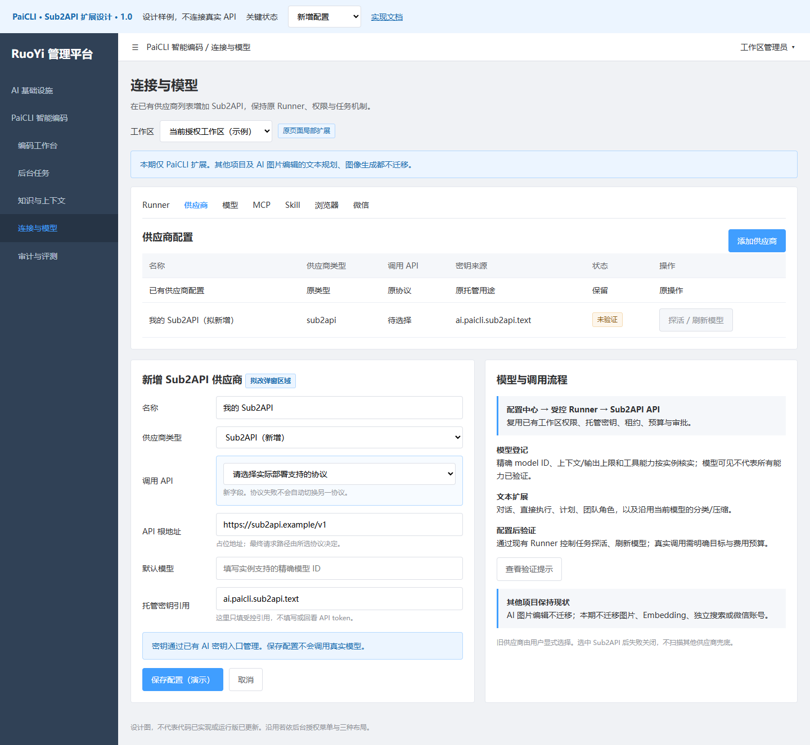

# PaiCLI 的 Sub2API 扩展实现文档

> 文档类型：项目增量实现设计；版本：1.3；状态：Approved，原本地代码实施范围已批准；多智能体本地实施、技术检查与独立代码审查已完成，实际结果见原实施记录；真实接入与运行包切换另行确定
> owner：用户决定接入范围与实施；Codex 核查现状并编制具体改动  
> 创建：2026-10-03；更新：2026-10-04  
> 需求依据：用户明确“PaiCLI 先做这个项目”，保留总体方案并单独维护本项目实现；2026-10-04 用户要求按此方案编码，承接已确定范围；同日要求规划使用多个智能体进行编码实现。
> 关联：[Sub2API 总体方案](../../若依框架/功能/FEAT-RUOYI-001-平台与AI基础设施/Sub2API统一文本模型接入设计.md)、[PaiCLI 完整迁移设计](完整迁移设计.md)。本文件唯一维护本扩展的实现范围、步骤和验收方法；完整迁移设计只增加入口，不复制本文任务。  
> 限制：不修改其他项目，不迁移 AI 图片编辑任何调用；不改 Codex 配置、不录入/使用截图密钥、不调用真实模型、不切换当前验收运行包、不部署或执行 Git 写入。

## 1. 需求与业务逻辑

### 1.1 本期要实现的结果

在 PaiCLI 现有“连接与模型”页面增加 **Sub2API** 供应商，配置用户实例的 API 根地址、明确的调用协议、托管密钥引用和模型 ID。用户在当前工作区选择这个供应商/模型后，PaiCLI 的文本对话、直接执行、计划、团队角色和沿用该模型的辅助分类/上下文压缩，通过 Sub2API API 请求完成。

文本模型本来就是通过 API 调用。本扩展改变所选供应商的 API 接口和适配，不新建模型，不改 PaiCLI 工具、审批或若依登录。Sub2API 是用户管理的中转通道，其具体模型和分组能力以实际部署核实结果为准。

**实施选择：新增供应商和协议适配，复用 PaiCLI 现有中心配置 → 受控 Runner → 模型 API 链路。** 首期不新建全项目通道表、共享通道页面或中央模型代理，不重构现有任务系统。其他供应商仍可由用户显式选择；选中 Sub2API 时失败不能偷偷改用其他供应商。

### 1.2 范围和操作流程

1. 工作区管理员进入原“PaiCLI 智能编码→连接与模型→供应商”，新增类型 `sub2api`，选择 API 协议，填根地址及 AI 托管用途引用；保存只写配置，不外呼。
2. 在原模型页添加实例支持的精确 model ID，设置经核实的上下文/输出上限和工具能力。只有非秘密元数据进入普通业务配置，token 由现有 AI 密钥模块管理。
3. 在明确目标与费用授权后，通过既有 Runner 配置任务执行探活/模型发现/兼容核对。模型列表只证明存在或可见，不自动认定工具、图片、思考或上下文上限。
4. 用户在工作台或终端选择 Sub2API 模型，新任务固定该供应商配置版本、API 协议、模型和托管用途版本；Runner 获取当前有效租约下的凭据能力，发送请求到该实例。
5. 结果转换为现有 `LlmClient.ChatResponse`/`StreamListener`，继续进入原工具审批、预算、事件和会话账本。协议错误、拒绝、截断或断线按真实状态显示；取消后停止后续回合。

本期不处理 PaiCLI 的 Embedding、独立搜索供应商、图像输入/生成、微信账号接入、正式评测执行；这些原配置和原暂停决定保留。辅助分类/压缩如果沿用当前文本模型，应获得 Sub2API 适配；有独立显式供应商配置的能力不被暗中迁移。所有其他项目均不改。

### 1.3 实施前核实的阻点

| 已有位置 | 当前源码事实 | 必须补什么 |
|---|---|---|
| `PcConnectionService.validateConfig` | 供应商允许列表仅含 8 个现实现，没有 `sub2api` | 新增类型与协议、地址和托管用途校验；不把 Sub2API 冒充 DeepSeek |
| `LlmClientFactory` | switch 构建厂商 client；`createFromConfig` 会扫描其他供应商回退；`attachManagedKey` 假定底层为 `AbstractOpenAiCompatibleClient` | 显式创建 Sub2API client；指定该供应商时不进入回退扫描；Responses 实现也要接得上受控动态取 key |
| `AbstractOpenAiCompatibleClient` | 已有 OkHttp、超时、SSE、工具、usage、取消和重试框架，消费 Chat Completions | Chat Completions 优先复用；Responses 用独立编解码，不向旧 SSE decoder 塞 Responses 帧 |
| `PcConnectionService.secretGrant`、`ManagedProviderGrant` | 中心从托管密钥解析，Runner 只在有效租约续取，核对引用/版本；当前会派发实际 API key | 沿用已批准机制；协议字段要参与冻结/续取比较；不落盘、不改为宿主环境取值 |
| `NativeTaskExecutor` / `NativeControlExecutor` | 模型执行、预算和配置探活使用中心 Context 与 Factory | 新类型贯通，探活/发现路径复用同一协议解析；不新增脱离租约的测试按钮直连 |
| 管理端 `connections/index.vue` | `providerNames` 为原 8 种；供应商/模型弹窗已有 base URL、用途引用、能力/预算及默认供应商 | 下拉增加 Sub2API，条件显示调用 API；保留原页面/权限与请求包装 |

上表保留实施前基线，具体完成情况进入原开发记录。源码和本地合成检查不能证明当前运行包或用户实例可用。用户例子给出的 HTTP 地址和 `wire_api=responses` 是协议线索；`gpt-5.5` 不自动认定为可用型号。截图内密钥不保存、不使用。

## 2. 前端界面设计

使用原“连接与模型”页和供应商弹窗，不新增后台主菜单。供应商类型新增 `Sub2API`；当选中时展示“调用 API：Responses / Chat Completions”，保留名称、API 根地址、默认模型、用途引用。对 `sub2api` 隐藏 LoRA/厂商专用提示，不能继承 DeepSeek DSML 或 thinking 扩展默认。

[打开交互设计图](图稿/Sub2API供应商扩展设计图.html)可查看新增配置、未录入密钥、验证中、兼容失败、权限拒绝和配置版本变化。图稿为设计样例，不连接真实服务。

| 字段 / 状态 | 交互和预期 |
|---|---|
| 供应商类型 | 新增 `Sub2API`，机器编码 `sub2api`；不改其他类型的默认值 |
| 调用 API | `responses` 或 `chat_completions`；当前未知，需显式选择；截图线索可显示建议核实 Responses，不自动切协议 |
| API 根地址 | 填规范根地址，例如占位 `https://sub2api.example/v1`；显示最终请求路径，防重复 `/v1` 或错误拼接 |
| AI 密钥引用 | 只引用当前工作区允许的 `ai.paicli.*` 用途；显示已配置/未配置，不能在此填写或回看 token |
| 默认模型 / 模型列表 | 完整精确 model ID，不能以昵称覆盖；“刷新模型”仍走原异步控制任务，没有发现端点可用时允许管理员手动登记 |
| 未验证 / 缺密钥 | 可保存配置草稿，但不显示真实可用；禁止发起需要有效模型的任务，给出配置入口 |
| 验证中 / 失败 | 防重复提交；失败显示能力缺项，不写“已连接”；原配置不被失败请求覆盖 |
| 版本变化 | 要求刷新配置/重新发起任务，不以旧验证结果覆盖新配置；旧任务保留固定版本 |

费用确认期间也阻止重复发起；确认仅针对当时的工作区、权限、供应商/API 和模型版本。确认后重新核对上述条件，变化时要求重新确认；迟到的原工作区回执不能进入新工作区的任务面板。取消或异常后允许再次发起。

模型表单沿用现有字段；文本扩展默认 `supportsImages=false`，工具、上下文和思考能力只采用核实值。`capabilityKnown=true` 不能来自 API 200 或用户填写的一个 model ID；验证回执需绑定供应商定义版本、协议、模型及凭据版本。没有联机证据时保留未知。

拟改管理端文件：`src/views/paicli/connections/index.vue`、`src/types/paicli.ts`、`src/views/paicli/model.ts` 与现有模型配置帮助；API 调用沿用 `src/api/paicli` 和共享 request。必要文字映射新增 Responses/Chat Completions 中文说明，不重写原 `protocol` 全局枚举或其他项目页面。

## 3. 后台与协议实现

### 3.1 配置、存储与鉴权

在现有 ProviderConfig 业务对象增加 `wireApi`，仅 `provider=sub2api` 时必填且只允许 `responses|chat_completions`。原 `protocol` 字段保留既有语义，不把新协议值塞入原 `NATIVE/OPENAI_COMPATIBLE` 字段造成旧客户端误解。

沿用原 PaiCLI Provider/Model 配置表和 JSON/version/hash，不新增九项目共享表。普通配置建议字段如下，均为非秘密：

| 字段 | 内容和校验 |
|---|---|
| provider | 固定 `sub2api`，不可用其他厂商 client 兜底 |
| wireApi | 明确 API 选择，参与配置哈希、版本、任务快照和 Grant 续取比较 |
| baseUrl | 精确规范 API 根地址，不含查询串、用户信息或密钥；拒绝尾部完整业务端点混淆；拼接逻辑统一 |
| secretRef | 建议 `ai.paicli.<workspaceId>.sub2api.text`，必须属于当前工作区；metadata 为 AI/paicli/sub2api/chat，认证为 api-key 或 bearer，状态 ACTIVE 且有效版本大于 0 |
| model | 实例允许的精确 ID，已有模型记录继续以 providerId 绑定 |
| capability / limits | 工具、usage、输出/上下文等核实元数据；不给未知模型套同厂模板 |

新增托管用途，不覆盖原 DeepSeek 或其他供应商用途，因为原密钥 provider/capability 不可随意更改。`PcConnectionService` 在保存与取 Context 时核对密钥类别、供应商、能力、项目/工作区和启用状态；模型选择、创建新任务及写入验证回执也核对当前有效托管版本，不能仅比较旧证明内的版本。上述规则复用 `PcSub2ApiPolicy`，现有归属限制不足时只在 PaiCLI 接口补充，不重构全局密钥系统。

Runner 沿用原设备能力声明，分别登记 `sub2api.responses.v1` 与 `sub2api.chat_completions.v1`。中心按选定 `wireApi` 核对设备能力；旧 Runner 缺少相应声明时，验证/业务任务的创建、领取与 Context 凭据发放失败关闭，升级 Runner 后再重试。能力声明只证明分发支持该协议，不能替代模型兼容验证证据。

Center API、Runner 租约、`ManagedProviderGrant`、有效期、版本检查、预算和审批继续沿用原机制。Runner 内存中的 token 仅限有效能力使用，不进入 CLI 用户配置、命令行、环境变量、日志、UI 或磁盘。Grant 本身到期不等于 Sub2API token 被上游撤销，这一点必须如实处理；首期不声称已实现每请求专用上游 token。

用户示例是公网 HTTP。实施前确认 HTTPS 或明确批准的受保护网络入口，保留 PaiCLI 原地址限制，不为接入随意放宽重定向和 SSRF 边界。若用户仍要求用公网 HTTP，需明确风险与对象后单独决定，本期文档不发送 token。实际网络策略/服务部署不是本扩展代码授权的默认附带动作。

Sub2API 的中心配置校验须拒绝未批准的回环、私有、链路本地等非公网字面地址，包含 IPv4/IPv6 与非规范数字 IPv4 表达，不能仅匹配 `127.0.0.1`。不为本扩展改变其他供应商/独立用途地址规则。公网域名的实际解析、DNS 重绑定及受保护网络策略仍须在真实环境接入前核实，字面地址校验不能证明全部网络边界已验证。

### 3.2 Chat Completions 适配

拟新增 `Sub2ApiChatClient extends AbstractOpenAiCompatibleClient`，供应商名返回 `sub2api`；地址只由本供应商配置解析，无公共厂商默认地址。消息、工具调用/结果、流式 delta 和 usage 沿用现有通用实现，避免复制整个 DeepSeek client。

请求仅发送本模型支持的参数，默认不传 DeepSeek `thinking`、DSML、LoRA 或厂商专用 reasoning 内容。关闭未核实的图片输入；遇图片附件在原业务层提示不可用并保留用户输入，不静默删附件。参数/上下文/输出限制从当前模型版本取得，不硬编码截图型号。

本请求只申请一个候选，终态必须属于实际消费的该候选；拒绝多个候选以及显式非法或非零候选 index，不能用另一候选的结束标记补足首候选终态。工具参数在两种协议中均严格解析完整 JSON 对象，尾随第二个 JSON 值、截断或数组不得进入工具执行。

### 3.3 Responses 适配

拟新增独立 `Sub2ApiResponsesClient` 与消息/事件 codec，实现现有 `LlmClient` 对外行为。Responses 支持与 Chat Completions 支持分别核实，两者不能自动互换。首期选定协议必须实现完毕；若实例只接受 Responses，Chat client 完成也不能交付“Sub2API 可用”。

关键映射如下，完整字段以实际实例和 [OpenAI 工具调用说明](https://developers.openai.com/api/docs/guides/function-calling)、[流式说明](https://developers.openai.com/api/docs/guides/streaming-responses)验证：

| PaiCLI 消息 / 结果 | Responses 处理 |
|---|---|
| system/user/assistant 文本 | 转为对应 input/instructions；明确历史顺序，保持原系统规则，不从正文猜角色 |
| assistant ToolCall | 转 `function_call`，保留稳定 `call_id`、名称和 JSON arguments |
| tool 消息 | 转 `function_call_output`，使用同一 `call_id`；原工具审批/执行流程不变 |
| 正文和工具参数增量 | 消费对应类型事件，按 output item/call ID 合并，不把参数碎片提前执行 |
| 结束、拒绝、失败、截断 | 核对真实终态并映射既有返回/错误；缺终态为失败或结果未知，不补假完成 |
| usage | 规范映射 input/output/cached/reasoning 等实际字段到当前预算与账本能表达的值；缺值保持未知，不置零 |

现有 `ChatResponse` 用整数计数及 `usagePresent` 表达用量。适配时只有已取得合法用量才设置 `usagePresent=true`；缺失时保留该标志为 false，由原预算估算处理，不能将兼容占位的 0 解释为实际零费用。缓存/reasoning 的计数包含关系按协议核对，避免重复累加；超过整数上限或非负校验失败应报告无效用量。

显式提供的 `total_tokens` 必须合法且等于输入与输出之和；`reasoning_tokens` 必须合法且包含于输出计数，不另行累加。Responses 协议项在中心原消息、派生压缩结果与 Runner Context 中使用同一 `responseItems` 字段传递，配置绑定摘要包含 `wireApi`，不能只在 Core 内部保留这些信息。

断流、失败或取消前已收到的合法用量不得丢弃。失败事件可附 `reportedUsage`，包含已报告的 input/output/cached/total 及 `FAILED|CANCELLED`，供账本保留证据；它不能证明最终收费已确定。顶层 `usagePresent=false`、预算预留和中心 `UNKNOWN` 保守计费继续保留，中心校验该可选字段的整数、计数包含关系和状态。保守计量至少取原预留与已报告总数中的较大值，中心同时保留策略最低预留；已报告量超过预留时补扣差额，不释放原预留。未收到合法计数时不生成已报告用量；该预算实例失败后停止后续调用。

第一版建议完整发送中心重建的会话历史，不依赖跨进程 `previous_response_id` 作为正式会话真相。若模型必须回传特定 reasoning item，要以明确可持久化的协议项及实例兼容证据实现；不能仅保留纯文本而声称多回合完全兼容。默认评估 `store=false`，但它不能证明中转没有日志，实际留存还需核实。

动态凭据在 PaiCLI LLM 模块内通过 `ManagedKeyAware` 接受现有 `ApiKeyProvider`，Factory 解包 profile 后挂接凭据接口，消除强制 cast。Responses client 可继承原传输设施复用 HTTP、动态凭据和 profile，但必须独立构建 Responses 请求并消费其语义事件，不能进入原 Chat 解码器。`withModelProfile`、审批分类器和预算包装均沿用原入口。

兼容验证增加原控制任务类型 `PROVIDER_VERIFY`，接口为 `POST /providers/{id}/verify`：请求携带供应商 `If-Match`、模型 `modelId/modelVersion`、`confirmCost=true` 和幂等键。中心核对管理员权限并冻结协议、定义、模型和密钥版本；Runner 使用原许可和预算，仅执行最多两次合成请求及内存回显工具，每次输出上限为中心允许值与 256 的较小值。验证必须取得真实文本、流式增量、工具回灌及 usage，成功回执绑定固定版本，普通表单不能写入验证证据。定义或密钥轮换后投影恢复为待验证，实际发放凭据的版本也须再次核对。

### 3.4 文件改动清单

下表为拟改，不代表已实现；相对路径从 `ruoyi-backend/ruoyi-paicli/` 起算。

| 模块 / 文件 | 具体变化 |
|---|---|
| `paicli-api/.../service/PcConnectionService.java` | Provider允许 `sub2api`；验证 wireApi/地址/托管归属；Context带新字段；保持幂等、版本和工作区授权 |
| `paicli-core/.../config/PaiCliConfig.java` | ProviderConfig增加可选 wireApi 与受控模型能力；Sub2API无协议/模型时明确报配置缺项，不能采用其他供应商默认 |
| `paicli-core/.../llm/LlmClientFactory.java` | 按 `sub2api + wireApi` 创建相应 client；显式 Sub2API 失败关闭；分类器/profile包装支持新客户端 |
| 拟新增 `llm/Sub2ApiChatClient.java`、`Sub2ApiResponsesClient.java`、协议 codec 与动态 key 小接口 | 复用既有通用设施；两种协议各自编解码、流终态/工具/usage和取消；不复制厂商扩展 |
| `llm/ModelDiscovery.java`、`ModelCatalog.java`、`ModelProfile` 及 `ProfiledLlmClient`（实际需要处） | 支持同一根地址/鉴权的模型发现；未知能力保留未知；不套 DeepSeek 的能力或 reasoning模板 |
| `paicli-runner/.../NativeTaskExecutor.java`、`ManagedProviderGrant.java` | 传递/冻结 wireApi；沿用动态凭据和预算；任务版本变化时停止而非自动换配置 |
| `paicli-runner/.../NativeControlExecutor.java` | Provider 探活/刷新按同一适配执行；没有 models端点可用时报告缺项；真实探活仍受控制任务和费用授权 |
| `paicli-cli/.../ModelCommands.java`、CLI 默认选择/模型显示的实际位置 | 扩展可见名称和协议；中心联机配置为正式来源，不要求用户另写明文 API key；不改其他独立搜索/Embedding配置 |
| `contracts/paicli/` 当前 operator/runner 契约及管理端类型 | 可选增加 wireApi；仅Sub2API服务端必需；新旧消费端兼容、旧Runner能力门禁；不修改其他业务契约 |

### 3.5 重试、取消和恢复

复用既有 `LlmRetryPolicy` 设施，Sub2API 首期统一单次尝试，不自动重放。网络响应不明、读取流中断、超时或 429/5xx 都不能自动假定可安全重复收费请求。Chat 工具回合必须携带真实 call ID 与完整 JSON 参数，不沿用旧厂商补 ID 的兼容行为；缺少真实终态、非法计数、拒绝或截断均失败，缺 usage 保留未知。

取消调用通过 client 的 `cancelInFlightCalls` 关闭自己的请求，禁止后续回合，仍记录实际上游 usage；不能声称本地断开就退款。密钥/配置版本变化继续按现有 Grant 逻辑使租约不可用，不悄悄续用新版本混入旧任务。

恢复通过用户显式选回已存在供应商/模型或恢复旧 PaiCLI 分发包，保留原配置和审计；不自动回退。恢复前检查在途任务，不能覆盖当前另一对话验收包或停止无关进程。本期没有数据库结构强制变更；如果实现中发现必须增加字段/迁移，应回到本设计补充真实迁移范围和恢复顺序。

## 4. 实施步骤与完成条件

本节为本扩展唯一实施顺序；实际代码进展和检查更新原[PaiCLI 完整迁移实施记录](开发记录/2026-10-03-完整迁移实施记录.md)，不在另一个任务文件复制状态。用户已授权本地编码；真实实例配置、付费联机、当前验收运行包切换和发布需各自明确范围。

1. **协议和配置切片**：增加 provider/wireApi、中心校验、管理端表单、配置快照与契约；合成测试验证缺项、越权、并发和旧配置读取。完成条件是配置能完整走到 Runner Context，秘密不进入网页，其他供应商行为保留。
2. **协议客户端切片**：实现选定协议，补工具多回合、流式增量、终态、usage、失败/取消和profile/分类器；如果要同时支持两种协议，逐种提供独立测试。完成条件是可控本地假服务走通真实 client 调用，而非只验证序列化函数。
3. **入口贯通切片**：Factory、模型发现/手动登记、工作台/CLI、Plan/Team与辅助分类/压缩接新provider，显式失败不扫描其他供应商。完成条件是用合成Runner链路验证配置版本、预算、审批和取消保持原规则。
4. **构建与分发切片**：对 `paicli-core/api/runner/cli` 定向 Maven 检查、管理端适用类型/测试/构建；核对实际admin包、Runner/CLI分发版本。当前原对话的验收进程和固定包保持原状；实际切换需明确更新窗口，不能用修改源码宣称运行版可用。
5. **真实接入切片**：核实 HTTPS根地址、实例版本、选定协议、精确模型、分组/托管新key引用及费用预算后，才运行合成Hello、工具两回合和流/取消验证，再进行原业务验收。完成条件包括真实可用证据、原业务定向复验和入口出口对应；本期不执行。

建议定向复用 `LlmClientFactoryTest`、`AbstractOpenAiCompatibleClientRetryTest`、`ManagedProviderGrantTest`、Runner原执行/控制测试及管理端原模型测试，新增具有真实边界价值的 Sub2API 请求/工具/SSE/取消测试。不要仅断言新增字符串常量。Maven目标以各实际POM与原项目脚本核对后确定，不把总聚合构建当功能通过。

实施前必要事实只有：实际入口/协议、可用模型和必需能力、托管用途/作用域、费用授权、运行分发窗口。无需先迁移其他八个项目，也无需先建设总体候选共享代理。

### 4.1 多智能体分工与文件归属

本安排用于协作完成本扩展的编码核查、必要补齐和独立复核。现有代码与已记录的本地检查作为基线，先核对已完成内容及缺口；不为分工重写已有实现。实际执行与检查状态只更新原实施记录。这里的智能体是开发协作者，不是新增 PaiCLI 产品内的团队功能。

当前最多同时运行四个智能体，采用一个主智能体加三个编码智能体。各编码智能体可独立读取关联实现，但只修改其负责的文件及相应测试；跨模块问题交给文件负责人处理。下表路径以仓库根目录为起点，省略号表示现有包路径，不表示可以扩大修改范围。

| 执行者 | 独占修改范围 | 核查及必要补齐内容 | 交接完成条件 |
|---|---|---|---|
| 主智能体：协调与集成 | `ruoyi-backend/ruoyi-paicli/paicli-runner/`、`paicli-cli/` 中本扩展受影响文件与测试；本实现文档、原实施记录及最终证据；构建配置有必要变化时统一处理 | 核对当前完整源码与未提交内容，确认共享字段；贯通 Context、动态凭据、控制验证、CLI 选择与显示；核对预算、审批、取消和旧 Runner 门禁；组织最终集成 | 中心配置到 Runner/CLI 的合成链路贯通；各模块交接可追溯，实际运行包状态明确 |
| 编码智能体一：Core 协议与调用链 | `ruoyi-backend/ruoyi-paicli/paicli-core/` 中第3节涉及的配置、LLM、Agent/SubAgent、计划、历史/记忆文件与相应测试 | 核对两种协议、终态、真实工具 ID、完整参数、usage、请求取消、单次尝试和动态 key；贯通 Responses 协议项、profile、分类器与压缩 | 可控本地假服务经真实 client 验证边界；历史和工具多回合不丢协议项；缺项不自动换供应商 |
| 编码智能体二：中心接口与契约 | `ruoyi-backend/ruoyi-paicli/paicli-api/` 中连接、会话、Runner Context/回执、Sub2API 策略及对应控制器/测试；`contracts/paicli/` 本扩展契约 | 核对工作区与托管归属、定义/模型/实际密钥版本、并发和幂等、验证证据写入、普通任务门禁；同步 operator/runner 契约 | 保存、发放、验证和回执使用同一版本语义；越权/过期/伪造验证拒绝；契约与消费者一致 |
| 编码智能体三：管理端界面 | `frontend/admin-web/src/types/paicli.ts`、`src/api/paicli/connections.ts`、现有连接页、相关测试与本扩展实际受影响的帮助映射 | 核对 API 必选、路径预览、托管引用、费用确认、取消提交、过期版本和验证反馈；保持其他供应商表单兼容 | 类型/适用测试通过；实际组件的新增、保存、取消及错误状态有本地可控检查，权限/request 沿用原设施 |

配置字段、公共 `LlmClient` 接口由 Core 负责人修改；HTTP/Runner 契约由中心负责人修改；前端类型由管理端负责人修改。主智能体在并行修改前确定字段及语义，各负责人按同一决定落实。出现不兼容调整时先协调消费者顺序，不让多个智能体同时修改同一个共享文件。

独立审查在编码交接后启动，由**未参与本实现编码的另一个智能体**只读执行。它占用已经释放的编码槽位，不与上述四个智能体组成五路并发；主智能体与编码作者的自查不计为独立复核。审查覆盖完整现有实现及本次差异，重点核对托管密钥、权限、版本绑定、验证证据、费用/重放、取消和恢复。发现问题交给原文件负责人修复，再由该审查智能体定向复查。

### 4.2 执行顺序与交接

1. **冻结现状与接口约定**：主智能体保存当前相关文件清单及摘要，保护未提交、新增及其他任务已有修改；引用原检查证据，不仅依据 `git diff` 判断本实现范围。核对实际 POM、脚本、API/DTO、协议和界面字段，向三个编码智能体交付同一版本约定、负责文件和检查范围。
2. **并行核查与必要编码**：三个编码智能体同时核查各自范围，按已确认缺口补实现和有边界价值的测试。主智能体在公共约定明确后处理 Runner/CLI 消费端。没有缺陷的部分保留原实现并交付核查依据，不要求每个智能体必须产生代码修改。
3. **交接与跨模块验证**：各负责人交付文件清单、问题依据、行为变化、执行过的命令及结果、未验证项。主智能体检查交接差异并运行真实客户端与合成中心/Runner 链路，核对配置版本、动态凭据、工具回灌、流式取消、usage 和预算传递；发现跨模块问题按文件归属回交修复。
4. **独立审查及定向修复**：释放一个编码槽位，启动独立审查智能体。问题须说明文件位置、触发条件和影响；涉及权限、安全、契约、重放或恢复的关键问题修复并复查后，才完成该范围的交接。未解决问题保留实际状态，不能以构建通过代替复核。
5. **统一构建与记录交付**：主智能体在最终源码版本完成适用模块的隔离构建、契约及前端检查，核对源码与制品一致性，把进展、日志、差异和独立复核结果更新到原实施记录及证据目录。真实实例接入、运行包切换与业务验收继续按本节原步骤及第5节执行条件安排。

每次派发至少提供目标、原设计入口、负责文件、共享约定、完成条件和禁止扩大事项。交接必须区分“本轮执行”“沿用原基线”“未执行/受阻”；智能体自报完成后，主智能体仍检查证据与消费者兼容。跨文件归属变更由主智能体明确交接，原负责人停止对应写入后再交给新负责人。

### 4.3 并行边界与验证重点

所有智能体共用当前工作区，按文件归属防止覆盖；不新建分支、提交或为分工复制业务数据库。构建和测试采用 `.runtime/paicli/` 下本次执行专用目录，各执行者使用独立输出/临时目录；共享 POM、契约生成输出和依赖准备由负责人串行处理，不并发覆盖同一 `target`、`dist` 或验收制品。需要启动检查服务时核对端口、进程及影响，只使用本次明确的隔离通道，不停止共享基础服务或其他任务进程。

验证在现有有意义的检查上补真实缺口，重点包括：

- **协议与历史**：Chat/Responses 的文本、流终态、工具碎片/非法参数/拒绝/截断、缺失 usage 和阻塞取消；Responses 协议项经过 Agent/SubAgent、Plan、账本历史和压缩后仍可正确回灌，不能只测 codec 序列化。
- **中心到 Runner**：工作区归属、旧消费者能力门禁、保存/验证/回执并发、实际密钥版本与冻结版本不一致、普通表单伪造证据、预算及撤销；验证控制任务最多两次合成调用及输出上限落实在真实执行路径。
- **管理端与 CLI**：新增配置、缺项拒绝、取消不提交、过期版本反馈、验证结果与能力投影、完整模型 ID/API 显示和旧供应商兼容；本地假接口检查不能证明真实 Sub2API 已兼容。
- **分发与范围**：定向测试、类型检查、适用构建和契约核对；最终制品对应实际源码，差异只属于本扩展。原检查结果可按未受影响范围沿用；本轮新增或修改部分需实际执行相应检查，不重复宣称历史检查为本轮运行。

编码结束的本地交付条件为：确认的缺口已处理，消费者一致，相关检查与独立复核有据可查，未完成项和运行包状态明确。真实业务通过仍须第5节的实际操作、截图和数据证据。多智能体协作不扩大本期对象：仍仅 PaiCLI 文本扩展，AI 图片编辑的文本规划及图像生成继续使用原 DashScope 配置。

## 5. 业务验收方法

验收前在本项目证据目录保存并展示清单，沿用原已通过基线、固定标识和用户接受记录；新增内部对应 `PAICLI-SUB2-01…06`。本节只写方法，尚未运行，不计通过。

### 1. 新增供应商与托管密钥引用

- 前提：管理员和无权限成员、有效工作区、合成用途；依据第1.2、2、3.1节。
- 操作：在连接与模型页选Sub2API，选择协议、填根地址和引用，保存；缺协议/跨工作区引用再提交。
- 预期：合法配置保存，非法和越权拒绝；保存不外呼，网页/API/日志不回显token，其他供应商保留。截图弹窗、保存结果和拒绝反馈，核对配置版本与元数据归属。

### 2. 选模型并完成文本对话

- 前提：实例/模型/预算已获准，Runner在线，原工作台验收基线已冻结；依据第1.1、3.2/3.3节。
- 操作：登记精确模型，选该模型发送合成问题；从CLI选择同一配置再执行代表文本回合。
- 预期：两入口均走Sub2API选定API路径，返回原会话格式；完整model ID可见，缺配置不自动换其他厂商。截图工作台、CLI和连接状态，核对实际目的地、配置哈希、usage与业务关联。

### 3. 工具回合、计划与辅助调用

- 前提：只读合成工具、非法参数样例、Plan/Team及分类/压缩代表流程；依据第1.2、3.3/3.4节。
- 操作：模型发起一个工具，执行后回传结果；验证计划/团队角色和辅助调用；模拟碎片、未知工具或拒绝。
- 预期：call ID正确、完整参数才执行、审批不被模型绕过；辅助client同样使用选定通道，错误保留未通过；正式评测不自动执行。截图工具/审批/计划状态，核对调用次数与原任务结果。

### 4. 流式、取消与失败

- 前提：可控长流、断线/拒绝/截断样例；依据第1.2、3.5节。
- 操作：生成中取消；模拟发送后断流和响应丢失；尝试同任务恢复。
- 预期：后续回合停止，终态不伪造，未知费用不写0、不重复发送；不直连其他供应商。截图部分输出及取消/错误提示，核对出站请求数、终帧与实际usage。

### 5. 版本、权限与预算

- 前提：两配置版本、限额样例、撤销权限账号；依据第3.1、3.5节。
- 操作：运行中变更协议/模型/密钥版本，撤销工作区权限，执行超预算回合。
- 预期：Grant不能混用新旧定义，旧租约不可继续调用；越权及超预算不外呼；回读不重复扣费。截图停止/限额反馈，核对租约、版本、正式账本。

### 6. 分发可用与范围保护

- 前提：源码、实际admin、Runner/CLI版本清单和原通过基线；依据第1.1、4节。
- 操作：从批准的实际包执行代表流程，核对旧供应商仍可显式使用；静态核对差异不涉及其他项目或图片/索引配置。
- 预期：实际运行包具有新provider；其他项目未被本扩展改动；旧配置行为保持，失败不自动回退。保存包版本、业务截图和差异范围，技术结果/业务结果/用户接受分开；业务HTML报告按原规范交付。
