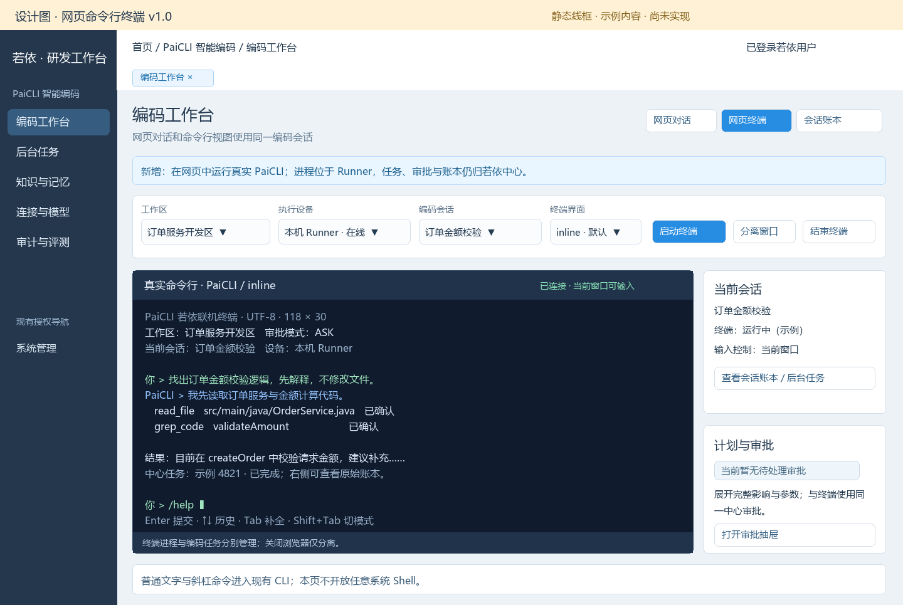
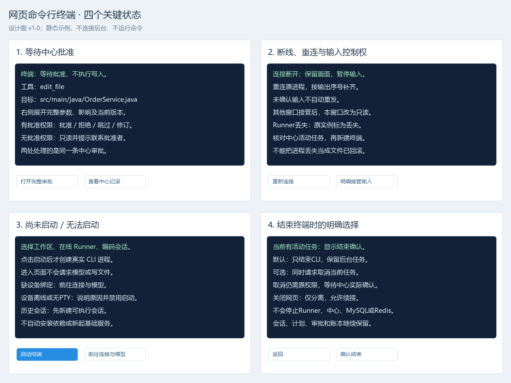
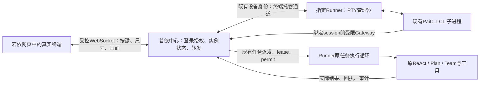

# 网页命令行终端设计方案

> 文档类型：功能控制页与设计方案；版本：1.0；状态：Draft，待评审  
> owner：用户维护产品决定，Agent 编制方案；创建时间：2026-10-03；更新时间：2026-10-04  
> 需求依据：用户要求在若依网页中启动命令行窗口，并直接通过该窗口与 PaiCLI 对话。  
> 上游：[完整迁移设计](../../完整迁移设计.md)，本方案补充其网页终端入口，不重复原算法、工具、审批和业务数据规则。  
> 当前范围：设计文档与界面图；未授权本轮安装依赖、修改运行功能、迁移数据库或更新服务。

<!-- 唯一功能控制入口：FEAT-PAICLI-002；需求与设计正文均在本页。新增PTY进程托管与双向输入信任边界，按高影响边界审查；当前为方案评审，批准依据尚未形成。进入实施后再建立唯一任务事实源，不在设计文件记录运行进度。 -->

## 1. 需求与业务逻辑

### 1.1 用户要得到什么

用户登录若依，进入“PaiCLI 智能编码 → 编码工作台”，选择“网页终端”，点击“启动终端”，随后就在网页中的命令行窗口输入文字、斜杠命令、查看流式输出、审阅计划和处理审批。用户无须另开本机命令行窗口。

推荐实现为：**网页终端组件 + 若依双向连接与授权 + Runner 伪终端 + 现有 PaiCLI CLI**。浏览器显示真正的终端画面并传递键盘输入；Java CLI 进程实际运行在选中的 Runner 设备；ReAct、Plan、Team、工具调用和状态回写继续使用既有中心接入。

这里的“完全集成到网页”指用户在若依页内完成启动、输入、输出、计划与审批、任务查看及重连。浏览器本身不会直接执行 Java 或访问任意本机目录；要操作哪台机器的仓库，就在那台机器上绑定已有 Runner。远程部署中心时，网页仍通过中心连接 Runner，不能把浏览器的 `localhost` 当作 Runner 地址。

### 1.2 本次选择

| 做法 | 能实现什么 | 选择 |
|---|---|---|
| 在现有聊天面板增加黑底、提示符和命令按钮 | 提供终端风格的网页对话，但JLine、ANSI画面与原TUI仍未在网页中运行 | 不作为本需求的交付方式 |
| 在Runner伪终端中启动现有CLI，网页承接键盘和画面 | 保留原命令分派、补全、历史、inline和Lanterna交互，真正运行原CLI | **推荐** |
| 网页开放任意Shell或通用SSH终端 | 可以执行系统命令，但改变产品和安全边界 | 本次不提供 |

前端拟用 `@xterm/xterm` 呈现终端，配合第一方尺寸适配组件；键盘、输出和尺寸通过WebSocket传输。xterm.js提供终端模拟与输入输出API，不能代替进程托管与鉴权；WebSocket鉴权和访问来源限制必须由应用实现。[终端API](https://xtermjs.org/docs/api/terminal/classes/terminal/)、[安全说明](https://xtermjs.org/docs/guides/security/)

Runner为Java工程，优先评估 `pty4j` 接入现有分发，不另起Node终端服务。Windows采用ConPTY，Linux/macOS采用系统PTY。PTY让CLI获取真实终端能力；简单重定向标准输入输出不足以保证全屏、光标控制和JLine交互。Windows ConPTY需要双向通道及尺寸管理；pty4j主线提供ConPTY选择，但存在回退路径，因此锁定版本、实际模式和原生库必须在实施时核实，不能仅凭开关声称Windows已支持。[Microsoft伪终端会话说明](https://learn.microsoft.com/en-us/windows/console/creating-a-pseudoconsole-session)、[pty4j源码](https://github.com/JetBrains/pty4j/blob/master/src/com/pty4j/PtyProcessBuilder.java)

### 1.3 主流程

1. 页面加载当前用户可访问的工作区、Runner、模型和编码会话；进入页面不自动启动进程或请求模型。
2. 用户选择工作区、在线且声明终端能力的Runner、现有或新编码会话，点击“启动终端”。默认inline，允许选择Lanterna；历史只读会话须先通过已有入口新建可执行会话。
3. 中心核对登录态、按钮权限、成员关系、会话owner、设备归属、模型配置、当前活动任务及终端配额，创建一个终端实例并向指定Runner发送固定启动请求。
4. Runner在独立托管通道中建立PTY，直接启动已核对的Java及CLI JAR，绑定中心已经确定的session/workspace/runner。进程参数由服务端生成；不接受用户传入可执行路径、命令行或Shell脚本。
5. 浏览器取得一次性连接票据，连接中心终端通道，获得输入控制权；PTY输出进入网页终端，按键写入该CLI。文字提交后，CLI经受限中心Gateway创建正常编码任务；原Runner任务循环继续领取和执行。
6. 计划和审批使用既有中心记录。网页侧边的计划面板、审批抽屉与CLI读取同一版本；用户在哪一处处理，另一处同步显示已处理或版本失效。
7. 刷新、切换网页视图或网络断开只分离浏览器连接。重新进入时附着原终端，补齐输出；不重复启动CLI，不自动重发文字、Enter或未确认按键。
8. 用户结束终端时选择只结束CLI，或同时请求取消当前编码任务。编码会话、正式消息、快照和审计继续保留；不停止Runner、中心、数据库、Redis或其他项目。

### 1.4 三种对象必须区分

| 对象 | 作用 | 正式归属 | 生命周期 |
|---|---|---|---|
| 编码会话 | 对话上下文、消息、模型选择、计划与审批关联 | 既有MySQL中心记录 | 可跨网页刷新、终端结束和Runner重启继续查询 |
| 网页终端实例 | 某个真实CLI进程、画面流及浏览器输入控制权 | 中心元数据；Runner持有实际PTY与进程 | 绑定一个编码会话，进程丢失后新建实例，不伪造原进程续接 |
| 编码任务 | 一轮ReAct/Plan/Team或控制任务及工具副作用 | 既有中心TASK/LEASE/permit/receipt | 不因网页切换或终端画布销毁而自动重交或标记完成 |

同一会话至多有一个非终态终端实例，同一实例同一时间只有一个浏览器输入者。其他同owner窗口可只读；主动“接管输入”提升控制版本并撤销旧窗口的写权。终端模式和网页对话模式可共用一个session，但活动轮次只能经同一个中心规则发起，不能各自并发提交一轮。

会话已有活动任务时，新终端启动后先跟随该任务的中心事件，显示输出、审批与取消入口；暂停新的普通文字提交，不能把“启动终端”当“再跑一遍”。模型沿用该会话当前配置；选“新会话”时复用已有新建会话表单选择模型，再启动终端，不在终端宿主中猜测模型或另建默认配置。

首版必需覆盖文本对话、原斜杠命令、补全/历史/多行、取消、计划和审批，以及inline真实运行；Lanterna按同一PTY通道适配。终端不能通过切换渲染方式静默重启进程。网页图片上传继续沿用既有工作台；`@image:`表示Runner侧授权路径，`@clipboard`不能读取用户浏览器剪贴板，更不能读取Runner宿主剪贴板。网页托管模式明确拒绝`@clipboard`并引导使用网页附件入口；浏览器剪贴板直送CLI如需加入，另设计用户主动授权和附件传输，不用PTY文本拼接冒充完成。

## 2. 前端界面设计

### 2.1 页面与关键状态

在现有编码工作台增加“网页对话 / 网页终端 / 会话账本”页内切换，继续使用既有若依菜单、Layout、TagsView、权限指令和navType，不新建另一套导航。入口路由沿用工作台；深链用`view=terminal`、`sessionId`和`terminalId`表示展示对象，不能作为授权依据，URL中不放凭据。

可查看的界面图：[主界面](../../图稿/网页命令行终端-主界面.png)、[关键状态](../../图稿/网页命令行终端-关键状态.png)；另保留[HTML图稿](../../图稿/网页命令行终端设计图.html)。静态图标注为设计，含以下五种场景：

1. **已连接与对话**：顶部选择工作区、设备、会话和界面；主区是真实终端画布，右侧复用会话、任务、计划与审批组件；底部显示输入控制权、尺寸和连接状态。
2. **等待批准**：终端显示摘要与等待原因；右侧打开完整参数/文件影响/版本的现有审批抽屉。无批准权限不能出现可执行批准按钮。
3. **断线与控制权**：保留已有画面，停用输入，显示重连进度、最后确认输出及未确认输入提示。另一窗口接管后明确显示只读和接管入口。
4. **尚未启动**：显示启动说明；设备离线、缺PTY能力、无权限或历史只读时给出对应原因与现有配置入口，不白屏、不自动安装依赖。
5. **结束终端**：当前有任务时展示“只结束终端，保留后台任务”默认项与“同时请求取消”可选项，分别核对权限和结果。

键盘焦点只在用户点击终端后进入画布，不能全页面捕获快捷键。Enter提交、上下键历史、Tab补全、Shift+Tab模式切换、Ctrl+C/ESC沿用原CLI；有选中文字时Ctrl+C按复制处理，另提供明确的“取消当前任务”按钮。中文输入法组合期间不提前提交；粘贴多行前展示确认，不自动添加Enter。1024像素下将右侧信息折叠，终端行列随实际可用区域调整；全屏仅扩大工作台内容区。

终端输出只送终端解析器，不能拼入HTML。禁用输出触发的剪贴板写入与不必要的终端扩展；链接只允许受控http/https、用户主动点击并在安全新上下文打开，不直接执行file/javascript协议。ANSI光标/颜色与备用屏幕保留；生产资源随构建打包，不在运行时从CDN拉取终端脚本。[xterm.js安全说明](https://xtermjs.org/docs/guides/security/)

### 2.2 拟改前端文件

以下均为方案中的拟新增/修改，尚不表示已实现。

| 操作 | 模块或文件 | 理由与关键变化 |
|---|---|---|
| 修改 | `frontend/admin-web/src/views/paicli/workbench/index.vue` | 加入页内终端入口，绑定已有workspace/session；切换视图不重复提交或重启 |
| 新增 | `src/views/paicli/components/WebTerminalPane.vue` | 托管xterm实例、IME/粘贴/焦点、resize、终端状态与控制权反馈；按需加载 |
| 新增 | `src/views/paicli/useTerminal.ts` | 管理实例、双向连接、输入确认、输出补齐、重连与分离；不维护另一份编码消息真相 |
| 新增 | `src/api/paicli/terminals.ts` | 复用现有request获取元数据/连接票据、接管、结束；WebSocket只处理终端协议 |
| 修改 | `src/types/paicli.ts` | 增加终端元数据、控制版本、连接与关闭原因类型，与拟新增机器契约对应 |
| 复用 | 既有`PlanPanel`、`ApprovalDrawer`、任务与账本组件 | 使用同一session/task/approval，不再从终端文字中解析审批真相 |
| 修改 | `frontend/admin-web/package.json`及锁文件 | 锁定xterm与fit组件；记录许可/依赖，终端资源仅在终端视图加载 |

## 3. 后台处理设计

### 3.1 职责与处理顺序

中心只管理授权、终端实例、传输与业务状态，不运行PTY或Shell。Runner同时保留两个职责：一个独立的终端托管通道维护CLI输入输出；既有任务循环处理编码执行。**终端托管不能作为长期CONTROL任务占用现有唯一任务槽位**，否则CLI提交任务后同一Runner无法领取，形成等待自身的死锁。两种通道共享同一已绑定Runner身份和工作区限制，终端能力不增加工具权限。

启动时先创建或确认编码session，再创建terminal实例和固定startNonce。Runner仅以受控Java可执行文件、已登记CLI制品、固定入口类和服务端参数数组启动子进程；禁止`cmd /c`、`powershell -Command`、`sh -c`与用户任意argv。环境变量采用白名单，不继承Runner设备凭证、Provider Key或平台JWT；工作目录核对批准仓库根，输入历史/缓存写独立私有实例目录，不新建业务数据库。

CLI必须在“网页托管”启动模式下，固定入口为CenterCli，拒绝改用`runner`、`serve`、`export-legacy`或旧native控制面。PTY仅提供交互能力，不是沙箱；工具shell仍受原REQUIRED隔离、路径、permit与审计规则约束。进程托管失败显示明确错误，不能暗换普通管道冒充完整TUI。

Windows优先使用核实后的ConPTY实现，不自动降为未知winpty模式；缺能力则拒绝启动并显示原因。Linux/macOS声明支持前也须做平台核对，不能由Java17编译成功推断TTY、中文宽度、快捷键和原生库已可用。pty4j版本、EPL许可与原生库分发在实施阶段固定；目前只是推荐候选，不安装或承诺已兼容。[pty4j项目与许可](https://github.com/JetBrains/pty4j)

### 3.2 浏览器、Runner与CLI的三种身份

| 通道 | 身份来源 | 允许范围 | 撤销与限制 |
|---|---|---|---|
| 浏览器REST及终端连接 | 既有若依登录态；REST签发一次性终端票据 | 当前owner的terminal，且须有工作区成员及相应按钮权限 | 注销、权限/成员撤销、票据过期、writerEpoch失效立即停止输入 |
| Runner终端托管连接 | 原短期设备凭证与`X-PaiCLI-Runner-Token` | 当前Runner自己绑定的终端实例及实际进程状态 | 不能冒充用户调用任意操作者API；保留现有设备认证协议 |
| 托管CLI访问中心业务 | 与若依登录会话关联的短期、单session终端能力 | 固定workspace/runner/session的Gateway操作，继续执行原操作者权限检查 | 不能访问其他session、系统管理、创建任意会话或把自身能力当设备凭证 |

现有HttpCenterCommandGateway从`PAICLI_USER_TOKEN`取平台JWT，**不能直接把该长期/完整凭据传给Runner或CLI子进程**。拟增加网页托管身份模式：中心签发90秒短期终端能力，绑定现有若依登录会话引用、owner、workspace、runner、session、terminal和hostEpoch；通过受控Runner通道下发到私有一次性文件，CLI读取后删除，只在内存保存。环境仅包含该文件路径，续期经同一绑定通道进行，凭据不出现在argv、终端输出、URL或日志。

中心为该能力提供有限Gateway接口；允许open固定会话、submit、command、events、taskEvents、cancel、readLedger、readArtifactText及已有图片上传操作。逐操作核对固定归属和既有若依权限；command仍由PcCommandService校验具体命令。不能提供客户端指定URL的通用HTTP转发。服务端从有效的原若依登录会话恢复相同LoginUser/SecurityContext，并通过现有权限服务与PcAccess核对，不能给能力加通配权限或建立第二套账号/角色判定。原登录失效或续期失败停止新输入与新请求，已提交任务继续按中心实际策略处理。

浏览器WebSocket无法像共享Axios请求一样随意设置Authorization，拟采用REST申请的30秒单次ticket，在`Sec-WebSocket-Protocol`请求头携带；握手消费ticket、校验Origin精确白名单、绑定登录会话及terminal，返回仅业务协议名。票据头须从代理日志及错误输出中排除。该业务专用握手适配只作用于终端路径，握手失败前不创建进程或分配输入权；不能全局放开原鉴权，不能以`permitAll`或query token绕过若依。部署网关须支持Upgrade及该协议头；若不能支持则报告部署条件缺失，不把平台JWT改放URL。

这两项为新的业务凭证适配，需在本方案评审中核对与若依认证机制的兼容；实现时沿用认证、权限和撤销事实源。原桌面CLI的JWT接入保持兼容，网页模式通过同一个HttpCenterCommandGateway选择受限身份，不额外注册一个会被ServiceLoader随机选中的Gateway实现。

### 3.3 中心数据与接口

拟新增一张正式表`pc_terminal_session`，沿用PcRecord/MyBatis/事务/version方式；不重建已有35张表，也不另起数据库。必要字段按项目已有公共字段复用：

| 字段组 | 内容与约束 |
|---|---|
| 归属 | terminalId、workspaceId、ownerId、runnerId、sessionId、原登录会话引用；创建后不可由客户端改归属 |
| 启动 | renderer、固定分发版本及sha256、startNonce、hostEpoch、cols/rows；同一非终态session仅一个实例，事务锁session核对 |
| 生命周期 | 状态、created/started/detached/endedAt、lastHeartbeatAt、expiresAt、exitCode、脱敏reason；不能由浏览器自报“已启动” |
| 输入控制 | writerEpoch、持有窗口的随机instanceId、writerExpiresAt；CAS接管使旧版本所有输入失效 |
| 派生画面 | 输出epoch、最后序号、私有产物引用；不保存Provider Key或平台JWT，不把画面当正式账本 |

终端能力复用已有凭据存储与加密设施，增加明确的能力用途和绑定校验；浏览器单次ticket使用已有共享Redis中的PaiCLI专属短期键，原登录会话仍由若依所有，不新增Redis服务。PTY输出为授权owner可访问的私有派生内容，24小时后清理；不默认向工作区所有成员开放原始终端画面。

以下为拟定契约，进入实施时写入既有operator/runner OpenAPI，并新增一份终端帧schema作为字段唯一来源；设计表只说明操作语义。

| 拟定入口 | 作用与确定性边界 |
|---|---|
| `POST /paicli/v1/terminals` | 幂等启动：workspaceId/runnerId/sessionId或新会话参数、renderer、cols/rows；中心生成terminalId；重复点击返回同实例，不重复起进程 |
| `GET /paicli/v1/terminals/{id}` | 读取owner可访问的实例状态及续接条件；不返回秘密 |
| `POST /paicli/v1/terminals/{id}/tickets` | 校验当前若依登录、成员与`terminal:read/use`后申请单次连接票据 |
| `POST /paicli/v1/terminals/{id}/claim` | 明确接管输入，If-Match版本核对后提升writerEpoch，通知旧窗口只读 |
| `POST /paicli/v1/terminals/{id}/stop` | 幂等结束目标CLI；请求同时cancel时另外检查原任务取消权限与task版本；两项结果分别返回 |
| `WS /paicli/v1/terminal-stream` | 已验票据的浏览器输入/输出/尺寸/ACK，逐帧核writerEpoch与当前归属，不从URL取长期token |
| `WS /paicli/runner/v1/terminal-stream` | 用原设备header鉴权；中心下发START/STOP/续期，Runner上报READY/OUTPUT/EXIT/FAILURE；独立于任务领取槽 |
| `/paicli/terminal-client/v1/gateway` | 托管CLI短期能力访问有限操作枚举；绑定当前session，复用既有服务及操作者权限，不接受任意路径代理 |

拟增加按钮权限`paicli:terminal:read/use`，查看和使用默认只允许实例owner；`use`不代替`session:write`、任务取消、connection管理或approval决定权限。审批与模型等沿用原权限。菜单仍是原工作台，仅补授权按钮；实际菜单/角色赋权和DDL需后续明确执行授权，本轮只提出差异。

HTTP错误按现有AjaxResult/PcException：401需重新登录，403无归属/权限，409状态或控制版本冲突，410票据/画面续接窗口已过期，413帧或缓存超限，429终端配额，503设备/PTY依赖不可用。重试启动必须使用原幂等键；错误不能触发自动重提交编码文本。

### 3.4 状态、顺序、重连与背压

终端进程状态与网页连接状态分开。中心进程状态拟为`STARTING → RUNNING → STOPPING → EXITED`；启动失败为`FAILED`，Runner丢失为`LOST`。网页可为“连接中、已连接、重连中、只读、已分离”。浏览器断线不把进程置FAILED；设备丢失不能冒称任务已失败或已回滚。

初始默认配置为每用户2个、每Runner2个非终态终端；启动等待20秒、连接鉴权30秒票据、托管通道15秒心跳/45秒失联判定、分离后10分钟结束CLI、闲置2小时结束、最长运行8小时。CLI结束前不给编码任务自动发cancel；后台任务在中心继续。参数为方案初值，实施时集中配置并度量，不作为已实现的性能承诺。

每帧固定terminalId、hostEpoch和streamId；输入另带writerEpoch及inputSeq，输出另带outputSeq。单个输入帧最大16KiB，输出分块最大64KiB；列数20–400、行数5–120，按服务器校验范围调整。输入ACK只在同一存活进程实际写入PTY后发出；重复inputSeq在同一进程去重，断线后不自动重放未确认输入。Runner崩溃使“写入与保存确认”无法原子保证时显示确认不明并核对中心任务，不宣称跨崩溃恰好一次。

UTF-8必须增量处理，不能每块独立解码切坏中文；ANSI控制序列同样不能按文本行删改。浏览器在xterm实际处理完块后ACK输出，中心/Runner按高低水位限制未确认缓存；建议未确认256KiB暂停普通输出发送，低于64KiB恢复，控制帧/心跳独立队列不被正文阻塞。这是有界传输设计，实施时核对PTY读阻塞对CLI事件消费的影响。[xterm.js流控说明](https://xtermjs.org/docs/guides/flowcontrol/)

Runner私有目录保留自终端起始的有序VT输出流，默认完整上限16MiB，不从中间任意截取ANSI尾段冒充完整画面。短暂重连保留浏览器现有屏幕时从最后确认序号续传；网页刷新后重新初始化画布，从该终端起始流有界分页回放，再接实时输出。回放期间禁止用户输入及自动终端响应发送，回放完成后协商最新尺寸和恢复控制权，避免历史DSR等查询生成重复输入。回放不会重新调用CLI命令。

完整画面流达到上限时，不静默删数据：中心标记显示缓存达上限，Runner结束这个CLI，保留后台任务和可查询账本，用户可新开终端连接原会话。PTY画面不足、缓存过期或Runner重启时，不能保证恢复原JLine未提交草稿或原Lanterna屏幕；页面明确说明，新实例通过中心账本恢复业务会话，活动任务先看状态，不能自动重交。

START重复投递以terminalId/startNonce幂等；Runner记录实际process handle、启动时间、制品hash及本次boot标识，不仅凭PID判断归属。重启后旧boot实例标LOST，不按旧PID杀进程或重放输入。STOP只作用于本实例已核实的CLI子进程树；审批/任务取消经原中心接口，不用强杀设备任务进程代替。

### 3.5 拟改后台、Runner与契约文件

| 操作 | 模块或文件 | 理由与关键逻辑 |
|---|---|---|
| 新增 | API的`PcTerminalController/Service`及`PcTable.TERMINAL_SESSION` | 启动/接管/结束/限额，复用事务和资源归属；只维护元数据，不执行PTY |
| 新增 | API的`PcTerminalWebSocketConfiguration/Handler`及握手适配 | 若依票据、精确Origin、设备身份、帧限制、背压、双向转发；不给其他业务开匿名通道 |
| 新增 | API的`PcTerminalClientController`及有限Gateway适配 | 短期能力恢复原若依登录主体；明确方法枚举与原权限/归属校验，不通用代理 |
| 局部修改 | `PcRunnerSecurityConfiguration`、设备凭据与`PcConnectionService`相关能力声明 | 增加终端用途和短期委托范围，保留现有JWT/设备/微信凭证隔离，声明PTY可用与实际平台模式 |
| 新增 | Runner的`RunnerTerminalHost/PtyProcessManager` | 与任务循环并行的独立托管通道；固定子进程、私有环境、输出流、进程归属与关闭 |
| 修改 | `CenterGateway`、`RunnerEngine`初始化及`HttpCenterCommandGateway` | 托管连接随既有Runner启动；网页CLI选择受限Gateway，桌面CLI保持原身份；不能占用runOnce槽位 |
| 局部修改 | CLI的`CenterCli`及托管启动适配 | 同一原命令/TUI，支持固定session、启动时跟随已有活动任务和明确托管模式；禁宿主clipboard、避免结束窗口误取消后台任务 |
| 修改 | Runner/CLI分发POM与清单 | 仅执行侧引入PTY及原生库；中心不加载PTY依赖；核CLI可执行制品、classpath和SPI |
| 拟新增 | 既有API迁移目录的下一份SQL | 仅pc_terminal_session、按钮权限与必要索引；顺序及版本在实施时核对，不重复V1–V5 |
| 修改/新增 | `contracts/paicli/operator-v1.openapi.json`、`runner-v1.openapi.yaml`、拟新增`terminal-v1.schema.json` | 描述新增操作、用途/身份、帧顺序、ACK、控制版本、错误与续接，原业务事件schema不混入PTY字节 |
| 修改 | admin-web的Vite代理及所属发布代理配置 | 同源WS Upgrade、协议头转发、超时/大小与日志脱敏；不改其他项目端口、数据库或共享Redis进程 |

现有工程依据：[CLI中心入口](../../../../../ruoyi-backend/ruoyi-paicli/paicli-cli/src/main/java/com/paicli/cli/CenterCli.java)、[身份与Gateway](../../../../../ruoyi-backend/ruoyi-paicli/paicli-runner/src/main/java/com/paicli/runner/HttpCenterCommandGateway.java)、[Runner循环](../../../../../ruoyi-backend/ruoyi-paicli/paicli-runner/src/main/java/com/paicli/runner/RunnerEngine.java)、[现有工作台](../../../../../frontend/admin-web/src/views/paicli/workbench/index.vue)、[设备认证边界](../../../../../ruoyi-backend/ruoyi-paicli/paicli-api/src/main/java/com/ruoyi/paicli/configuration/PcRunnerSecurityConfiguration.java)。这些是复用依据，不表示新增网页终端已实现。

## 4. 实施步骤

1. **确定启动与身份契约**：评审本方案的真实PTY、单session委托、窗口控制权及结束语义；在唯一机器契约中固定方法、状态和帧。核对部署同源/代理路径，不能把端口和库复制为新运行通道。
2. **接入中心元数据与授权**：实现终端实例、幂等创建、配额、owner/成员/权限、短期票据、受限Gateway及撤销。先形成可审查SQL与角色差异，取得对应实际写入范围后才能迁移/赋权。
3. **完成Runner托管与CLI适配**：PTY宿主在runOnce之外维护子进程；固定Java/JAR、环境和会话；打通授权启动、短期续期、实际退出/失联、单次输入、完整画面缓存与进程归属。Windows ConPTY为当前本机重点，其他平台按已声明矩阵处理。
4. **接入若依页内终端**：按图稿实现xterm、启动状态、resize、中文输入、粘贴、输入接管、分离与结束；复用计划、审批、任务和账本组件。聊天与终端切换不引入第二消息源。
5. **完成恢复及交付**：处理重连、输入确认不明、输出上限、过期、权限撤销和后台任务仍运行的状态；更新API/CLI/Runner/前端对应制品及版本清单，不能只更新页面。中心先提供兼容新增协议，支持新能力的Runner再声明终端可用；旧Runner/旧CLI继续按原方式使用，页面禁用不支持的设备。
6. **按实际授权验证与启用**：本轮仍是设计，已有“不运行测试和真实业务验收”边界继续有效。后续执行只按届时授权做编译、契约与必要验证；真实业务操作须先展示保存清单。功能通过开关默认关闭，启动失败、鉴权不匹配或PTY不可用时停止启用并恢复旧前端/Runner版本；新增表保留，不用删表回滚破坏记录；共享基础服务保持原状。

建议实施顺序不先做黑底聊天外观，先打通“网页按键确实进入现有CLI、输出确实来自同一进程、该CLI提交的任务能由同Runner正常执行”这条闭环，再接入完整交互与恢复。

## 5. 业务验收方法

以下是实施后的方法，不填写本轮执行结果，不增加当前实际操作授权。沿用[完整迁移设计第5节](../../完整迁移设计.md#5-业务验收方法)的数据、身份与证据规则，只覆盖网页终端新增影响。

| 中文业务点 | 前提与操作 | 正确结果与核对方法 |
|---|---|---|
| 真实命令行启动 | 已批准工作区、模型、支持PTY的在线Runner；在网页终端点击启动，输入/help、普通文本、↑↓、Tab | 实际只有一个固定CLI子进程；原命令/补全/历史/流式输出工作；核制品hash、进程身份、终端ID和中心session/task；截图入口与终端 |
| 同机任务可执行 | 用同一Runner启动终端并提交已授权无写入任务 | 托管不占用唯一任务槽，任务能领取并回写；核Runner loop、task/lease/receipt，而不是只看终端“已提交” |
| 网页与CLI共用会话 | 在终端完成一轮，切网页对话、账本再回终端 | 同一session与消息序列；切换不新建进程或重发；活动轮次不能再重复提交；截图两视图和账本 |
| 计划与审批一致 | Plan或需批准工具；分别在终端与抽屉处理同一个审批 | 参数/版本/决定一致，只消费一次；无权限者两处均不能批准；另一处显示已处理，硬拒绝不能放开 |
| 多窗口输入控制 | 同owner两个窗口附着同终端，第二窗口明确接管 | 初始第二窗只读；接管后旧writerEpoch输入拒绝；两个窗口不交错写入；截控制权提示 |
| 刷新及网络续接 | 保存独立预期的输出序号和中心task；刷新、断网再恢复 | 原PTY存活则有序续传/完整回放；中文与ANSI不损坏；未确认输入不自动重放，task数不增长；截恢复与核任务 |
| Runner丢失和输入不明 | 后续经授权的故障场景，Runner在输入确认前后退出 | 原实例LOST，不凭旧PID杀进程或自动重开重交；提示核中心账本/活动任务；新终端附着原业务会话 |
| 关闭窗口与结束终端 | 存在活动任务；先关闭网页再重新打开，后选默认结束和显式cancel | 关闭网页仅分离；默认结束只停止CLI，任务保留；显式cancel按中心实际结果，不能冒称副作用已撤销；共享服务保留 |
| 中文、粘贴和两种TUI | 中文IME、多行粘贴、1024/1440视口，inline与Lanterna分别启动 | 不提前提交，不自动加Enter，尺寸/备用屏幕/快捷键正确；界面切换不静默重启，焦点不抢其他页面 |
| 身份和权限拒绝 | 第三非成员、他人terminal、过期票据、错误Origin、撤销登录或设备 | 握手/REST/每帧/短期Gateway按对应边界拒绝；不能改workspace/session/可执行参数，不泄露token或他人画面 |
| 输出限额与旧设备 | 受控大输出、完整缓存超限、缺ConPTY或旧Runner | 有界背压，控制/心跳继续；超限明确结束显示进程并保留任务；缺能力明确不可启动，无假终端或静默降级 |
| 制品与恢复 | 指定获授权目标，核API/CLI/Runner/前端及原生库版本，启用再关闭开关 | 更新范围一致；旧CLI兼容；回退不删正式数据、不中断共享数据库/Redis，不更新其他项目安装目录 |

方案中的主要待评审取舍已给出推荐默认值：真实PTY、Runner托管、同owner单写窗口、短期单session委托、关闭窗口保留任务、默认inline。无需再盘点原项目功能；评审后即可按第4节推进对应实现。
