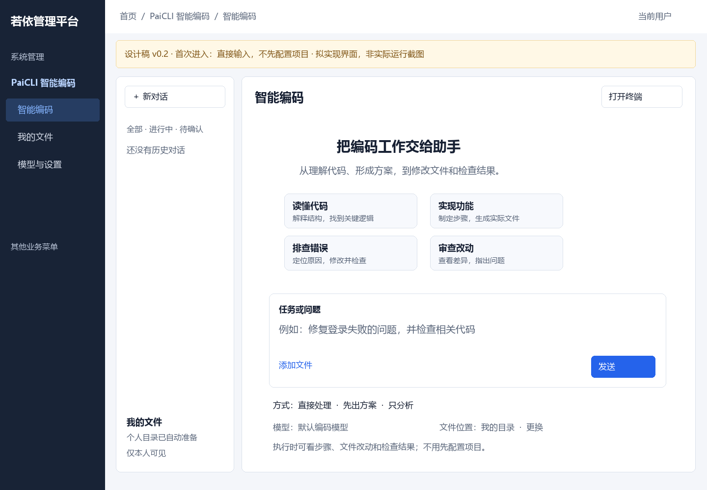
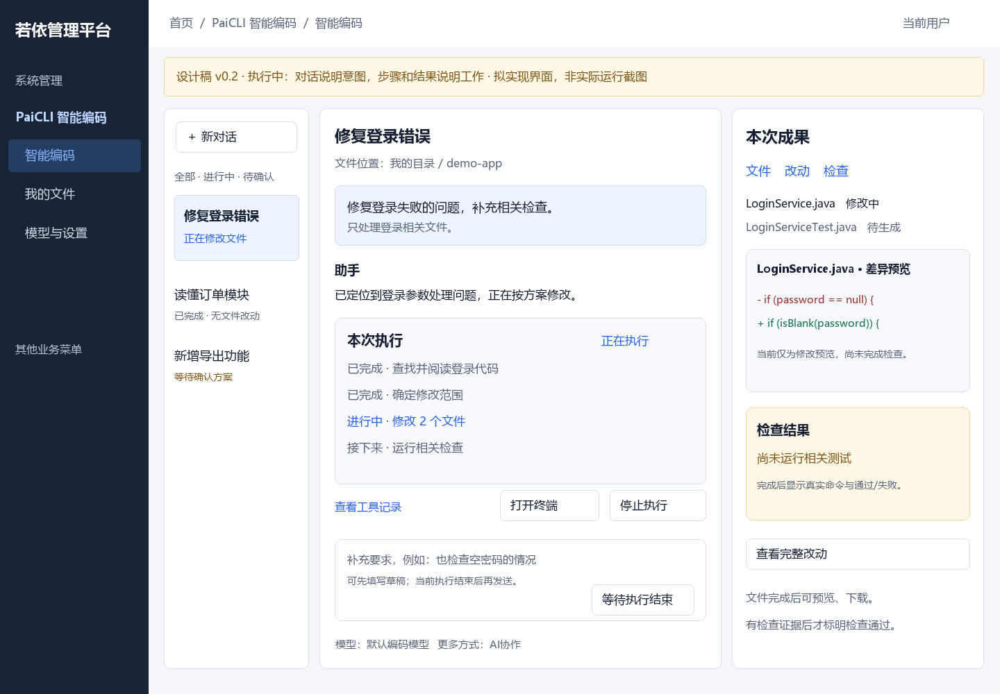
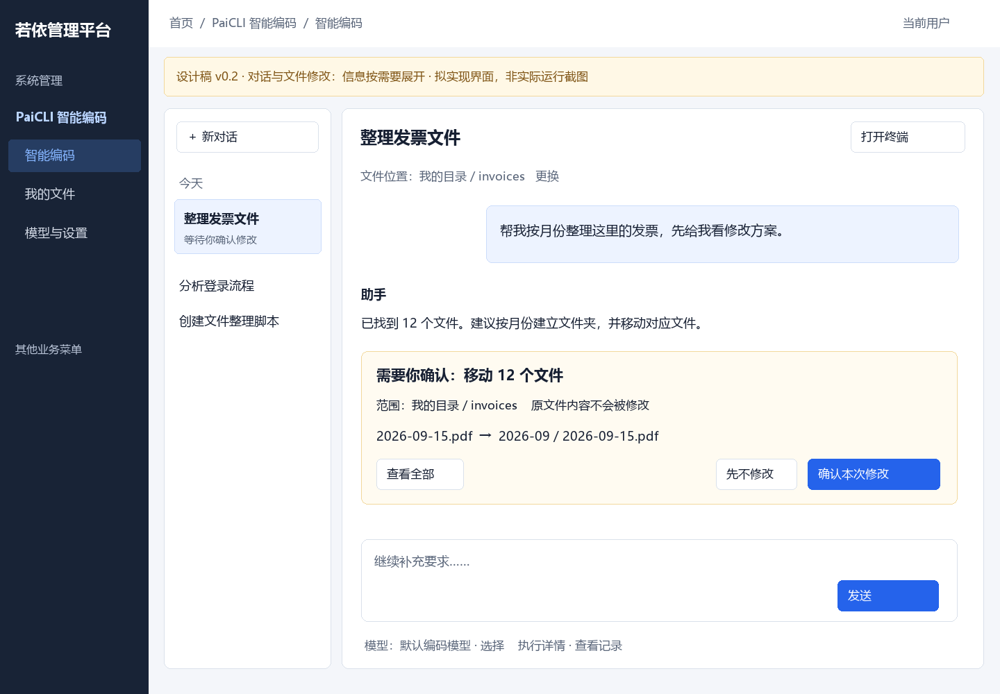
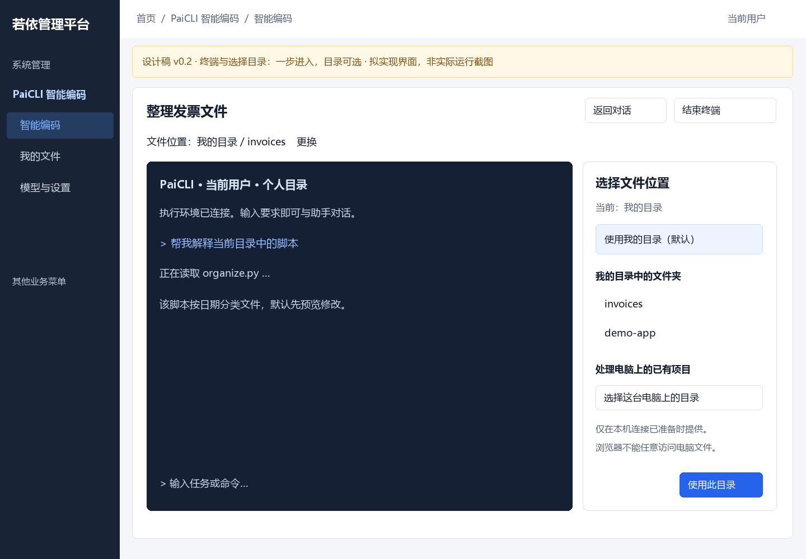
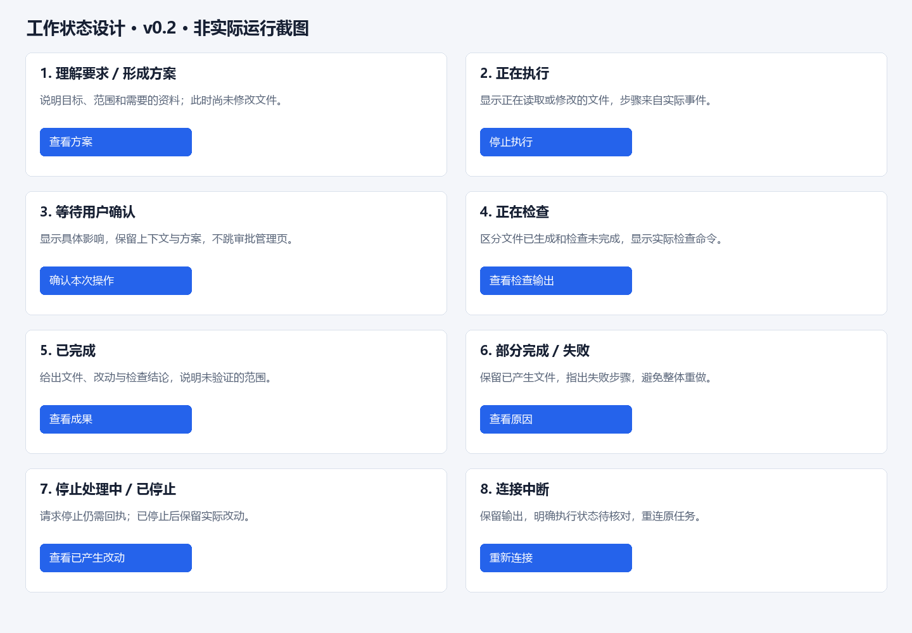
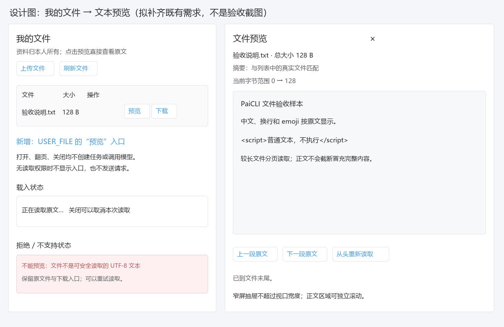

# PaiCLI 个人编码助手用户使用设计

> 文档类型：功能控制页与用户使用设计；版本：0.2；文档状态：Approved，已获准进入编码实现
> owner：用户维护产品决定，Agent 编制方案；创建时间：2026-10-04；更新时间：2026-10-05
> 需求依据：用户要求取消工作区与成员，每人自动拥有个人目录，模型可选可配置，对话与终端直接进入；后续反馈要求合并对话/任务并展示Agent实际执行与成果。2026-10-04 用户明确“好，那先按这个改吧”，本方案已获准编码；实际进展与授权边界见[实施记录](实施记录.md)。
> 上游：[整体迁移设计](../../完整迁移设计.md)、[网页终端能力设计](../FEAT-PAICLI-002-网页命令行终端/README.md)。本方案提出新的个人使用方式；旧批准设计与历史证据继续保留。本文维护要求和设计，实际实现及本机切换结果见[实施记录](实施记录.md)，不以方案正文代替验证结论。
> 范围：个人使用流程、页面与模块、数据归属、执行目录、接口兼容和后续实施/验收方法。属于产品交互、数据归属和执行接线重构，不是隐藏控件的界面微调。平台若依认证、菜单、权限、公共请求和密钥托管继续复用。
> 本次反馈：上一版对话与任务入口重复，过于接近普通聊天。此版合并主入口，增加实际执行、文件差异与检查成果的呈现；取消工作区/成员和默认个人目录的方向继续保留。原v0.1文档和四张图保存在本功能证据目录，不改写旧讨论依据。

<!-- 唯一功能控制入口：FEAT-PAICLI-003。需求和方案唯一正文在本页；当前批准编码实现，真实数据库/账号/外呼按实施包及相应授权。内部稳定关联：个人进入、直接对话、个人目录、直接终端、模型选择、模块清晰、所有权隔离、历史迁移。实施任务与实际结果唯一维护在本功能实施记录。 -->

## 1. 需求与业务逻辑

### 1.1 要解决的问题与推荐方案

现有页面把“工作区→成员→Runner→模型→会话”作为开始使用的前置步骤。普通用户进来看到多个灰色按钮，却不知道缺什么，也不能先表达需求。这些概念更像执行平台的管理配置，不能成为个人Agent的日常入口。

推荐把使用流程改成：**登录 → 输入要求 → 发送。需要处理已有代码时选择目录；需要命令行时打开终端。** 用户不用登记工作区、添加成员、挑选Runner、填写目录指纹，也不用先填会话标题。

取消工作区与成员业务机制；个人数据归当前若依登录用户所有，运行环境由产品提供，文件操作按当前目录执行。目录用于指定文件位置，不设置成员、角色、项目审批者和设备绑定表单，不建立换名后的工作区。团队执行仍可表示多个AI协作，不增加人类成员配置。

“直接能用”应作为安装交付条件：部署者准备默认模型、个人执行服务与终端能力，而不是让每个用户重新搭一遍环境。仅内置供应商选项不能算提供了可用模型；当前缺少模型与真实Runner的状态要通过实施解决，不能用图稿代替。

### 1.2 普通用户第一次进入

1. 登录已有若依账号，进入“PaiCLI 智能编码→智能编码”。
2. 页面立即展示输入框、读懂代码/实现功能/排查错误/审查改动四个能力示例、默认模型、当前文件位置和“打开终端”。用户可以直接输入，不经过初始化向导或登记表单。
3. 产品自动为本人准备“我的目录”，默认选择已可用模型和执行服务。纯文字问答不等待文件目录准备完成；涉及文件的任务才等待对应环境。
4. 点击发送时自动建立正式对话，用首条要求生成标题；对话草稿在发送前不创建任务、不调用模型、不发生费用。
5. 回复与本次执行进度出现在同一页面。生成的文件可从成果面板打开，也能在“我的文件”找到；长执行通过历史栏“进行中/待确认”跟进，点击回到原对话。

“新对话”只清空当前选择并进入新的输入草稿，不弹出标题、工作区、设备和模型登记窗口。未发送的草稿会保留；离开正在执行的对话不会隐式取消任务。

### 1.3 不选目录、默认目录和指定目录

**不指定目录就是使用个人默认目录。** 用户没有选目录也能问问题、生成代码、上传资料；生成文件不会散落到源码仓库或其他用户目录中。

| 使用场景 | 用户操作 | 目录处理与结果 |
|---|---|---|
| 普通知识或代码问答 | 直接输入并发送 | 不要求选目录；没有文件工具动作就不访问目录 |
| 从零生成文件或小项目 | 描述要生成的内容 | 默认保存到本人目录中的本次对话子目录，结果显示“查看文件” |
| 分析上传资料 | 点击“添加文件”或拖入文件 | 保存到本人目录中的上传区；是否加入当前任务由用户选择 |
| 修改个人目录中的文件 | 点击“文件位置→更换”，选择文件夹 | 当前对话使用选定位置；执行时展示具体文件影响 |
| 处理已有代码项目 | 点击“更换→选择已有项目目录” | 执行服务核对实际路径与访问范围；用户只选目录，不填指纹 |
| 暂不希望修改文件 | 在要求中明确“只分析” | 保持只读任务范围，不能把这句话当成任意文件访问授权 |

“我的目录”位于**Agent实际执行机器**，不是浏览器自己能任意访问的硬盘。如果Agent部署在服务器，就显示“服务器上的我的目录”；如果产品已经安装本机连接组件，才能显示“这台电脑上的目录”。浏览器选择上传文件只能提供文件内容，不能自动获得可在执行机使用的任意本机绝对路径。

本机项目建议把默认个人目录放在已配置的独立运行数据根下，例如 `<个人数据根>/users/<若依稳定用户ID>/files`。每次新对话的产物放 `conversations/<对话ID>`；上传与引用资料单独分类。该根属于产品运行数据，不能默认设成整个Java工作区、系统盘根或参考项目目录。账号改名不改变目录，服务重启也不重新分配空目录。

指定目录仅对当前对话生效，不影响其他对话。正在执行任务或使用终端时不能静默切换目录：先停止相关执行或新开对话，再改变位置；已经提交的任务冻结原目录与版本。取消目录选择保持原位置与输入内容。

### 1.4 模型选择与配置

用户首次使用默认选一个实际可调用的编码模型，普通对话只显示友好名称；展开选择器可查看完整模型ID、供应商以及图片/工具能力。切换模型是一个选择操作，不要求登记新会话或执行设备。

| 层次 | 谁准备 | 用户看到什么 |
|---|---|---|
| 产品默认模型 | 安装者/运营管理员准备服务地址、托管密钥和可用配额 | 可直接选择，默认选中；显示实际可用状态 |
| 用户个人模型 | 用户在“模型与设置”中配置 | 仅本人可见，配置后可作为本人默认模型 |
| 调用范围和用量 | 沿用中心计量和配额 | 设置中可看预算；达到上限时解释原因和下一步 |

不让普通用户在开始对话前选择协议、填写secretRef或核对Runner。个人模型设置可按供应商提供预填协议和地址，只有必要字段要求输入；完整模型ID与高级能力配置放展开区。密钥输入使用现有受控托管入口，保存后只显示“已配置”，不回显正文。

没有可用模型时，保留输入框、草稿和文件入口，在模型位置显示“暂时没有可用模型”，提供“选择或配置模型”。产品默认配置缺失同时通知有权限的管理员，不把基础准备推给普通用户。供应商不可用时保留原配置和任务记录，明确失败，用户可选择其他模型后重新发起；不静默切换供应商、扩大费用或重复已发生的工具操作。

### 1.5 对话、终端与确认

**对话是默认入口，终端是同一助手的另一种操作方式。** “打开终端”一步启动本人PaiCLI命令行交互，自动使用当前模型和目录，不让用户先登记设备。已有对话切换到终端时关联同一对话，不重复发送已有任务；空首页打开终端时自动建立本人终端上下文。

终端保留原PaiCLI已实现命令与渲染能力，不在这次简化中擅自扩展成任意管理员系统Shell。关闭终端面板与结束终端进程明确区分；结束进程不等于撤销已经发生的文件操作，关联任务仍需核对最终回执。

去掉首页“工作区待批准”和人类成员分工；需要确认时直接在当前对话显示一张卡：“将修改哪些文件”“完整差异”“确认本次操作”“先不修改”。由发起该任务的当前用户确认，平台硬拒绝仍不能由用户按钮越过。

不为每次读取和每个新文件重复询问。用户明确要求生成新文件时，在本人当前目录内按该要求执行；覆盖已有文件、批量删除、恢复、实际命令及对外动作要展示必要影响。批准绑定本次动作、目录、输入和版本，参数改变或授权过期就重新展示。纯问答和新对话无需弹批准窗口。

### 1.6 对话和任务的区别，以及为什么合并入口

对话是围绕一件事持续沟通的容器；执行记录是助手响应某次要求而完成工作的记录。以“修复登录失败”为例：用户先问原因、再要求修改、最后补充测试要求，这些讨论可以属于同一个对话；每次提交产生自己的执行与结果，其中复杂执行还可以包含正式计划步骤。用户不用去另一个菜单再建一遍任务。

| 层次 | 已有实现与产品含义 | 页面怎样展示 |
|---|---|---|
| 对话 SESSION | 保存消息、上下文、模型与相关执行的持续容器 | 一条历史记录、一处讨论页面 |
| 一轮输入 TURN | 用户本次发送的要求 | 一条用户消息 |
| 执行 TASK | 每次发送由中心登记和派发，包括普通问答；持有取消、批准、事件与产物记录 | 简短问答直接呈现回复；有实际动作/长过程时呈现“本次执行”卡，引用原taskId |
| 计划 PLAN / 步骤 PLAN_STEP | 计划/AI协作模式在本次任务内的拆解和依赖 | 可展开的正式步骤清单，不另建第二套任务 |

当前 `PcSessionService.submitRaw()` 为每次提交建立TURN、TASK、MESSAGE及派发记录，后台任务入口也复用该链路。因此不以“没有技术任务”定义普通聊天；区别在于用户看到的内容。直接执行展示实际工具活动，正式Plan才展示计划步骤，不能给每次问答伪造一套计划。

“我的任务”退出主菜单。多个对话正在执行时，历史栏的“进行中/待确认”筛选和按需执行概览汇总原中心记录，点击返回原对话；不增加另一套任务创建表单、人工状态或AI角色任务库。运行中的新要求先保留为草稿，当前执行结束或停止回执确认后再提交；本方案不承诺尚未交付的运行中插话和动态改计划。

“独立且清晰”体现在三个入口的用途，保留既有若依布局、菜单和权限：

| 用户菜单 | 用户来这里做什么 | 从哪里进入、完成后去哪里 |
|---|---|---|
| 智能编码 | 提需求、看执行、查看改动和检查、确认操作、打开终端 | 默认入口；同页完成沟通到成果检查 |
| 我的文件 | 浏览个人文件、上传、下载、预览、查看生成结果 | 从成果面板进入；选文件后可带引用回原对话 |
| 模型与设置 | 选默认模型、配置个人模型和可选扩展 | 日常无需先访问；配置后返回原草稿或对话 |

现有“知识与上下文”按用途归位：文件和代码索引在我的文件，长期记忆/规则在设置，当前上下文与会话账本在对话详情。审计执行记录在本次执行详情，正式评测仍在有权限的高级设置内并继续暂停。MCP、Skills、浏览器和微信的配置放在设置，但实际使用时在执行卡展示能力名称、动作和结果，不把这些特色完全藏在配置页。

### 1.7 PaiCLI应在使用过程中体现哪些特点

定位是能够围绕真实代码完成工作的个人编码助手。首次进入用具体问题表达能力，执行过程中用实际动作和成果证明能力：

| 项目特点 | 普通用户如何感知 | 结果与边界 |
|---|---|---|
| 理解代码与资料 | 添加代码/图片/文件或引用当前目录；回复可指出所依据的实际文件 | 显示已读文件和资料引用，不把模型猜测当成已经检索 |
| 直接处理与先出方案 | 输入区轻量选择“直接处理/先出方案/只分析”；复杂问题出现目标、范围和正式步骤 | 方案可以修改，先出方案不会自动写文件；直接执行不伪造Plan |
| 实际工具执行 | 就地显示读取、检索、修改、运行命令等活动，并可展开记录 | 摘要来自实际事件，不展示或要求模型内部思维链 |
| 文件与差异交付 | 成果侧栏展示文件、完整差异、下载及文件快照恢复预览 | 产物来自实际文件与正式回执，文件恢复不表示撤销外部动作 |
| 检查与复核 | 显示实际命令、退出码、诊断、失败和未运行项 | 模型复核、Java语法诊断、测试/构建、用户验收分别标明，不混为“通过” |
| 多个AI协作 | 按需选用，展开规划/执行/复核角色和步骤状态 | 不让用户配置人类成员；复核失败保留，不用装饰头像冒充协作 |
| 原生终端贯通 | 同页打开PaiCLI终端，保持本人模型、目录和正式会话 | CLI/三renderer及原命令保留，真实联机是否就绪另行验证 |

比如要求“修复登录失败并检查”，用户依次看见：目标与范围、找到的代码、正在修改的文件、实际差异、检查输出、最终产物和未完成部分。首次进入无成果时不摆空结果栏；产生工作后展开相关内容。这是逐步呈现能力的使用流程，不靠增加配置表单体现专业性。

## 2. 前端界面设计

### 2.1 首次进入：能看到输入框，能理解下一步

下图是拟实现设计稿，不是当前产品截图。左侧复用若依菜单，页内左栏列本人历史及执行筛选；主体以具体编码能力与输入区展开，发送为主操作。模型与文件位置作为轻量选项，终端作为右上角明确入口。删除首页工作区、Runner、成员、会话标题登记和全局批准栏。

标题改为“智能编码”，说明“从理解代码、形成方案，到修改文件和检查结果”。能力示例点击只填写输入，不自动调用模型。新用户没有历史时显示“还没有历史对话”，不隐藏输入区。模型有文字标签；文件位置显示“我的目录”，不要求用户读长路径或哈希。

### 2.2 对话和修改确认

普通问答以消息为主体；涉及实际工作时，在消息旁就地显示“本次执行”卡，呈现目标、真实活动或正式计划步骤、当前动作和停止。具体文件、差异和检查出现在成果侧栏，原始记录按需展开。不能用虚假百分比表示进度，也不能把预览或模型回答标成实际文件已改。需要确认时展示完整影响摘要与差异，用户无需跨页面找审批者。

这张执行稿展示“文件正在修改、检查尚未运行”的时刻，不表示任务已通过。读取/修改工具活动与正式计划步骤使用不同标签；无正式Plan时不显示虚构的DAG步骤。点击文件定位成果侧栏，点击完整差异打开原记录。当前执行未结束时可填写后续草稿，发送不可重复派发正在执行的动作。

默认直接处理，“先出方案/只分析”在输入旁可见，“多个AI协作”放更多方式；保留原算法能力。输入、附件与目录上下文独立保存，不因查看结果或切换菜单丢失。会话账本改为“查看记录”，快照改为“查看变更/恢复”，保留完整内容入口。

### 2.3 终端和选择目录

点击“打开终端”后显示连接进度，再进入同页终端；右上提供返回对话和结束终端。选择目录只在用户点击“更换”后展示，无需先登记一个业务实体。图中本机目录入口仅代表本机连接组件已准备的部署状态；服务器部署应显示服务器目录，不混淆两台机器。

目录选择器由执行服务提供已允许的目录；用户选定后服务内部核对真实路径、所有权及指纹。用户不能通过随便输入服务器路径获取其他账号代码。终端保留键盘、中文输入、粘贴、多行输入、滚动和重连体验；浏览器刷新连接原终端，不新开进程或重交任务。

### 2.4 关键状态与布局

关键状态用于说明“一项工作现在处于哪里、已产生什么、用户接下来能做什么”，不是功能模块或一个新增管理页面。上一版偏重环境错误，不能充分表达实际Agent工作；此版增加完整执行过程，并将环境异常作为对应能力的就地提示。

| 工作状态 | 当前事实与下一步 |
|---|---|
| 理解要求/形成方案 | 展示依据、目标、范围；尚未写入时明确说明，用户可查看或调整方案 |
| 正在执行 | 展示实际动作和已完成部分，可请求停止；请求停止与回执已停止分别显示 |
| 等待确认 | 原对话中说明具体影响、确认与拒绝；不把等待当成卡死 |
| 正在检查 | 区分文件已生成与检查未完成，呈现实际命令/诊断 |
| 已完成 | 交付文件与差异，标明哪些检查执行、哪些未验证 |
| 部分完成/失败 | 保留已有成果，指出失败步骤；不无条件整项重跑 |
| 已停止 | 保留已发生修改，说明尚待核对的副作用，停止不等于恢复 |
| 连接中断 | 页面保留输出，任务状态由中心核对；不能仅凭断线认定执行失败 |

环境异常仍须处理：

| 状态 | 页面反馈与可执行动作 |
|---|---|
| 个人环境正在准备 | 保留可输入草稿；标注准备阶段，短时间完成后继续用户原意图，不自动提交任务 |
| 模型缺失或不可用 | 就地解释并提供选择/配置；有权限的管理员处理产品默认配置 |
| 终端失联 | 保留已显示输出，提供重新连接和返回对话；说明关联任务可能仍运行 |
| 目录失效或不允许访问 | 指出问题，提供回到我的目录或重新选择；不清空输入，不扩大权限 |
| 等待文件操作确认 | 在原对话显示影响卡，确认后继续，拒绝后保留方案 |
| 任务部分完成、取消或失败 | 显示已有产物和未完成部分，分别提供查看结果、查看原因和安全恢复 |

布局围绕四件事组织：历史栏用于找回正在处理的事；中间对话用于表达目标和查看过程；右侧成果栏用于核对文件、差异和检查；按需展开的终端用于原生交互。首次进入或短问答不显示空成果栏，有真实执行/产物时再展开，避免恢复为一屏技术面板。

1440桌面可同时显示历史、对话和成果；1024折叠历史，成果按需打开；小屏将历史和成果作为抽屉。终端与成果展开遵循焦点切换，小屏不堆叠多个同时滚动的窄栏。表单有标签，禁用有原因，键盘焦点可见。复用Element Plus、共享色彩与Vue组件，不新增字体或框架依赖。

### 2.5 拟改变的前端文件

| 新增/修改 | 文件或组件 | 为什么改、怎样处理 |
|---|---|---|
| 修改 | `frontend/admin-web/src/views/paicli/workbench/index.vue`、`useSession.ts`、`page.css` | 一个主入口承接对话与执行；增加实际活动/正式步骤卡、成果面板和进行中筛选，首条发送建对话，保留原算法和事件续取 |
| 新增或复用 | 所属页内执行卡、成果面板与执行概览组件 | 复用现有任务、Plan、事件、产物/快照接口；只做查询与展示，不维护第二任务状态 |
| 新增 | 所属页内 `PersonalDirectoryPicker.vue`、`usePersonalContext.ts` | 显示当前目录、按需选择和个人准备状态；不接管共享用户store |
| 修改 | `components/WebTerminalPane.vue`、`useTerminal.ts` | 由本人当前对话自动启动终端，不要求用户提供RunnerID；保留重连、接管、图片和导出 |
| 修改 | `tasks/index.vue`、`knowledge/index.vue`及所属组件 | 原任务页改按需执行详情/汇总，不作为主菜单；我的文件承接文件、索引与产物，数据与任务仍由中心持有 |
| 修改 | `connections/index.vue`及所属组件 | 重组模型与设置；停止工作区/成员维护，设备诊断移至有权限管理员视图 |
| 修改 | `api/paicli/{sessions,tasks,connections,workspaces,terminals}.ts`、`types/paicli*.ts`、`useWorkspace.ts`消费者 | 切换个人目录契约、最终撤销工作区适配；沿用共享request和错误处理，不另封认证体系 |
| 修改 | 所属菜单迁移与按钮权限 | 在若依现有菜单树重组三个主入口，详情页与汇总沿用若依机制；保留权限，不用自建路由绕过菜单 |

### 2.6 个人文件原文预览

补齐第1.6节既定“我的文件→预览”需求：在本人上传资料行增加“预览”，直接打开同页抽屉，不要求先建对话或准备执行目录。沿用若依权限、Element Plus抽屉和共享请求。

抽屉显示文件名、总大小、与列表匹配的摘要及当前字节范围，原文按纯文本转义展示，HTML和脚本不执行。较长UTF-8文本分段读取，上一段、下一段和从头重读明确可见；加载时说明正在读取，失败保留已读页面并显示原因，关闭取消读取。窄屏抽屉宽度不超过视口，正文独立滚动。二进制或不符合安全文本要求的文件显示明确原因，下载入口保持；图片理解仍走已有对话附件能力。

新增`PersonalFilePreview.vue`负责此只读抽屉，在既有`PersonalFiles.vue`接入；API与类型沿用`files.ts`及`types/paicli.ts`。不改变工具产物、审批差异预览或助手分析入口的语义。上传允许的合规UTF-8文本可预览至50MiB，按字节分页、每次最多1MiB；助手分析原1MiB限制继续独立适用。不能以文件名或扩展名证明解码成功。

## 3. 后台处理设计

### 3.1 当前差异与处理顺序

当前后台不只用工作区做显示：成员检查参与资源判权，会话强制绑定工作区、Runner和模型，Provider、附件、任务、批准、索引、终端及凭据均携带工作区作用域。Runner与PTY还固定一个实际根目录。因此仅删下拉框会留下不可用接口，不能满足本方案。

新的处理逻辑如下：

1. 从若依认证主体取得稳定用户ID，读取或创建个人设置；前端不得声明自己是另一个用户。
2. 返回本人默认模型、文件位置、能力准备状态和历史摘要。个人设置创建采用用户ID唯一约束和事务幂等；执行机创建目录是独立可重试准备动作，失败不把准备标成成功。
3. 用户发送时确定本次是纯问答或文件任务。纯问答仍由原Agent运行链路处理，去掉目录准备依赖，不在中心另造第二套模型调用与记忆。文件任务解析本人目录上下文，内部选择受信执行宿主，冻结目录、模型、范围与版本。
4. 中心在事务内建立本人会话/任务及原dispatch记录；提交后交执行服务。默认目录先按用户稳定ID、再按对话ID创建，服务核对已有目录后复用，不覆盖或重置文件。
5. 执行服务按当前用户与目录取许可并回传原事件、产物、usage和收据；沿用租约、取消、幂等与不明副作用待核对机制。重新连接不会再次执行已消费许可。
6. 涉及已有文件修改或其他需确认影响时，由本人在当前对话确认冻结动作。完成后结果卡引用本人正式产物；页面和终端查询同一中心状态。

对话、执行卡、汇总和成果只投影中心同一SESSION/TURN/TASK/PLAN/PLAN_STEP和正式事件/产物。文件差异从实际快照/文件核对取得，检查结果引用实际命令与诊断回执，不从模型文字推定成功。纯问答沿用原技术TASK但不增加单独的用户任务管理步骤；页面关闭、历史筛选、查看文件均不重新派发。

### 3.2 个人所有权与目录上下文

| 对象 | 新归属与关键规则 |
|---|---|
| 个人设置 | 一位若依用户一份；默认模型、目录偏好与扩展配置归本人 |
| 对话、任务、消息、文件、批准、终端 | 归发起用户；所有读取、修改、下载与事件订阅核对owner，不依赖成员表 |
| 默认模型目录 | 平台提供的可用模型清单与个人模型合并显示；平台凭据不成为可下载的用户数据 |
| 目录上下文 | 记录受信执行机、真实目录、内部指纹、访问范围和版本；不含人类成员/角色，不成为长期项目协作容器 |
| 执行宿主 | 安装与运营登记的运行设施，用户界面自动分配；服务端仍校验身份与有效凭据 |
| 规则、记忆、索引 | 个人偏好归用户；与代码路径有关的资料按目录及源码版本匹配，不沿用其他目录的索引 |

利用现有 `ownerId` 的基础，明确统一为认证用户所有权；对原空owner或共享对象不能机械补成当前用户。接口返回与数据库索引都按个人范围更新，不能只依赖前端过滤。`directoryContext`只表示执行路径和受控版本，生命周期随对话/任务使用，替代workspaceId在任务中的目录作用，不替代owner。

个人目录、缓存、快照、上传、终端输出与索引全部隔离。不同用户猜测会话ID或文件ID不能读到内容，也不能操作他人终端。多个会话指向同一物理目录时，写入协调按执行机和真实目录处理，不能仅按用户ID或会话ID加锁。

多用户共用同一管理员OS账号，仅创建不同子目录不足以实现文件隔离；执行服务还需受控进程身份/沙箱与真实路径校验。任意系统Shell不能绕过目录边界。沿用现有REQUIRED隔离要求，Windows命令隔离缺项必须由产品部署方案解决并实证；本轮不据图稿声称所有系统命令都可运行。

### 3.3 运行环境如何从产品侧准备

执行服务随产品安装/部署运行，身份由现有中心认证扩展管理，在线心跳、自动路由与每用户执行上下文由中心处理。普通用户不填RunnerID、绑定码、状态目录和指纹。自动分配的是经过登记与验证的宿主能力，不是浏览器拥有任意电脑权限，也不是启动一个无身份替代Runner。

终端宿主需要从固定工作根模式改为本次本人目录上下文；原CLI入口继续分发。打开终端只启动PaiCLI交互，不自动运行编码、微信、MCP或正式Eval任务。终端创建幂等，重复点击只回到同一活动实例；短期连接授权绑定本人、终端、目录及有效期，刷新和过期按原机制恢复。没有模型时允许保留可见终端界面/历史，但涉及模型的命令应提示配置，不能伪造回答。

产品默认可用的发布前提是：默认模型和配额已验证、个人目录可创建与复用、执行服务在线、当前版本CLI/Runner分发一致、PTY真实可用、终端迁移和权限已装配。平台提供的默认模型使用范围与费用由安装/运营配置决定；不自动探测付费能力，不从其他业务借用托管密钥。

这些是管理员和产品交付职责，用户首次使用不需要理解。环境故障只阻塞依赖该能力的动作，聊天草稿、历史和文件浏览仍保留；给可执行的恢复动作和必要诊断，不让用户注册一个“工作区”修复环境。

### 3.4 后台、Runner和契约拟改文件

| 模块/文件 | 关键变化 |
|---|---|
| `paicli-api/.../service/PcAccess.java`、`PcWorkspaceService.java`、`PcDeviceService.java`及所属Controller | 用个人owner判权替换成员角色；最终撤销工作区/成员业务维护，设备登记归安装/运营 |
| `PcSessionService.java`、`PcRunnerService.java`、`PcRunnerContextService.java` | 会话输入只需用户任务、可选模型和目录引用；宿主自动路由，纯问答不依赖文件根准备 |
| `PcConnectionService.java`、`PcKnowledgeService.java`、`PcProjectRuleService.java`及扩展服务 | 从工作区配置改个人/平台默认配置；目录相关索引和规则维持版本一致，密钥用途同步改变 |
| `PcArtifactService.java`、`PcToolService.java`、`PcTerminalService.java`、`PcCrypto.java` | owner、目录和本次操作冻结绑定贯穿许可、确认、凭据、下载与终端，不放宽硬拒绝 |
| `PcRecord.java`、`PcTable.java`、`PcLedgerMapper`及SQL、功能字段清单/SchemaGuard | 新个人设置/目录字段与查询索引，替换workspace索引和必填约束；旧对象分类迁移，迁移仅显式执行 |
| 新个人上下文服务与Controller，放现有中心服务目录 | 承接首次进入、默认模型、本人目录和准备状态；尽量复用原store、idempotency与执行服务 |
| `paicli-runner/.../{RunnerEngine,RunnerTerminalHost,PtyProcessManager,CenterHttpClient,NativeControlExecutor}.java` | 一个受信宿主支持本人目录上下文和资源锁，PTY实际cwd核对；上下文、状态和证据按用户隔离 |
| `paicli-cli/.../CenterCli.java`及原命令/补全入口 | 支持本人默认上下文，不要求普通用户先填workspace/runner参数；旧终端能力、三renderer和控制协议保持 |
| `contracts/paicli/{operator-v1.openapi.json,runner-v1.openapi.yaml,events-v1.schema.json,terminal-v1.schema.json}` | 设计个人契约版本，取消现行入口workspaceId必填，加入可选目录和准备反馈；中心、CLI、Runner、Web同时兼容 |

这里列出的是拟修改范围；生产源码路径以 `ruoyi-backend/ruoyi-paicli/` 为根。具体字段、错误码与版本将写入原机器契约，不在多份Markdown重复维护一套字段表。当前方案不引入第二数据库、另一认证体系或独立任务真相。

### 3.5 历史数据与切换恢复

最终产品删除工作区和成员机制，旧机制仅在迁移窗口做兼容和历史保护。实施顺序必须避免把原共享资料错误归给某个成员：

1. 增加个人所有权、设置和目录契约，定义旧ID到本人目录/对象的唯一迁移映射；明确新旧协议版本，不能让旧客户端猜新语义。
2. 新用户和新对象走个人流程；只迁移能明确归属的旧会话、任务和配置，原审计及批准版本保留。
3. 共享或owner不明的旧对象保留只读档案；迁移时把已核实的原访问主体和允许的只读动作冻结为档案访问快照，按若依稳定用户ID判权，不再动态查询或维护成员关系。访问主体无法确认的档案由有权限的平台管理员隔离保管，不能自动分给某个用户。待明确归属后处理，不按成员人数复制密钥、共享项目与索引；个人索引按真实新目录重新建立。
4. 切换前处理未结束任务、活动PTY和租约：完成或明确停留旧通道核对，不直接翻译旧凭据重新执行副作用。
5. 新Web、中心、CLI、Runner全切换且消费者已核对后，关闭工作区/成员写入口并移除兼容逻辑。退出条件是现行接口与历史档案判权均不依赖workspaceId和成员表；旧标识与记录仅作为历史元数据保留，不参与运行判权，历史档案不成为新用户前置步骤。

迁移和删除前先保存当前真实数据/菜单与必要版本备份；具体目标库和执行授权另在实施包确定，本轮不做DDL或删除。回滚先停止新写入，保护新产生个人文件和任务，核对是否可安全恢复旧包；不能把新owner对象直接交给旧成员接口，也不能以代码回退当成文件副作用撤销。共享MySQL/Redis及其他业务服务保持原连接。

### 3.6 个人资料文本预览处理

增加只读`GET /paicli/v1/artifacts/{id}/preview-text`，以已有`paicli:artifact:read`权限和当前稳定用户身份处理，只接收产物ID及offset/limit。默认从字节0读取65536字节，limit限制4～1048576；实际页保持UTF-8字符边界，不丢失或重复跨页字符。返回真实artifactId、fileName、USER_FILE用途、sha256、size、offset、nextOffset、hasMore和text，无伪造sessionId。

处理顺序为本人资源/目录授权→用途与过期校验→私有路径、文件大小和摘要完整性核对→有界流式文本编码及控制字符校验→返回分页原文。任何权限、失效、文件变化或不支持格式保留现有明确错误；不能读其他用户、根外或不符合存储条件的文件。打开与翻页不创建会话、任务或审批，不写业务数据、不调用模型。关闭/切文件/卸载取消请求并使旧响应失效；每页摘要、大小、ID及范围须与列表一致，错误不得被当成文本。

在现有`PcArtifactController`、`PcArtifactService`及operator契约中增加专属USER_FILE响应，保留原`/text`对会话TOOL_OUTPUT的限制及审批`preview-text`冻结门禁，不用新入口绕过原用途规则。没有新增表、迁移或外部服务。

实施先做服务端权限、完整性和字节分页及契约，再接文件行与抽屉，定向验证本人/跨用户/失效/错误用途、中文与emoji边界、二进制/非法编码、脚本纯文本、晚到响应和原产物回归。构建与独立复核后按既有运行通道同步新中心；原库样本上传、预览、下载截图须使用明确获准的测试资料，实际进展仍归实施记录与第9点唯一验收记录。

## 4. 实施步骤

实施已获准，按下面顺序完成代码与检查。已明确的产品方向直接承接，不再逐个确认控件调整；实际执行进展写入实施记录，真实迁移、外部调用与费用仍按相应授权执行。

1. **先确定默认交付环境。** 核实当前本机执行方式、默认模型来源与配额；个人数据根选独立原运行范围。优先交付托管个人目录；选择本机现有项目作为可选能力，若本机连接未安装则清楚提示其准备方式。
2. **先切换所有权和个人契约。** 完成新个人设置、目录上下文及owner校验，在现有中心中承接；同时制定旧对象/活跃任务兼容映射，不提前移除原数据保护。
3. **交付首页直接问答。** 默认输入、新对话草稿、默认模型、历史与消息；无需目录或工作区登记。核对没有文件动作的问答不访问无关目录、不新建影子状态。
4. **交付个人文件与可选目录。** 自动本人目录、上传、生成、下载、目录选择、文件影响确认和资源锁；用户无需填写哈希，验证跨用户和越界拒绝。
5. **交付终端一步使用。** 改造执行宿主、动态受控cwd和CLI默认上下文；原PTY完整能力、三renderer、图片/导出、重连与停止不因简化丢失。满足真实隔离与终端前提后才能把该能力记为可用。
6. **整理统一主入口和三个用户模块。** 智能编码承接执行卡、成果和终端，我的文件/模型与设置各有清晰用途；执行概览按需汇总。平台管理功能保持权限，验证若依导航、菜单、共享request和认证兼容。
7. **按原分发范围构建和更新。** 定向检查中心、前端、契约和原生模块；共享主服务串行构建，固定运行包；CLI/Runner与中心同步更新，终端迁移和权限在明确授权后执行。只更新PaiCLI通道，不覆盖其他项目配置。
8. **定向业务验收、退出兼容。** 按下一章先保存清单、准备真实样本与独立预期、逐项截图/核对文件与数据；仅在新入口和消费者验证后移除旧写入口。实际结果进入本功能证据，不回写本设计为已通过。

需要讨论的是默认目录所在机器与默认模型的提供方式；本方案推荐“产品执行机器上的个人目录＋管理员提供可用默认模型＋用户可加个人模型”。本机产品由安装流程配套准备执行环境，普通用户不选择设备。是否提供用户电脑目录访问由安装能力决定，不影响默认目录和直接对话设计。

## 5. 业务验收方法

以下是后续可执行的验收要求，不是本轮实际结果。每项准备独立文件/身份预期，页面证据保存并回读，数据归属与文件结果需额外核对。

### 1. 新用户直接开始

- 前提：新若依用户具有PaiCLI使用权限，产品默认模型与执行服务已准备，无个人业务资料。
- 步骤：首次进入智能编码；不打开设置，不登记工作区/成员/设备，不填标题；输入一个明确问题并发送。
- 预期与核对：输入区从首次进入就可见，自动创建本人对话，收到实际模型结果；截图首页和回复，核对任务owner为当前用户，没有业务成员登记。对应第1.2节。

### 2. 不选目录也能问答和生成文件

- 前提：本人目录可用，准备有独立内容答案的问答和生成样本。
- 步骤：不改文件位置发送问答；再要求生成一个指定内容文件；打开我的文件并下载。
- 预期与核对：问答不要求目录选择；文件只出现在本人对应对话目录，内容与独立预期一致；截图结果卡与文件入口，核对实际路径与摘要。对应第1.3节。

### 3. 两位用户资料隔离

- 前提：两位有权限的用户，各有已知不同文件和对话。
- 步骤：分别登录查看文件/历史；通过另一用户资源ID尝试读取、修改、订阅事件和连接终端；在文件执行边界尝试引用另一用户目录。
- 预期与核对：界面只见本人资料，服务端及执行机均拒绝跨用户访问，没有文件变化或内容泄漏；核对日志中不泄露密钥。对应第3.2节。

### 4. 选择已有目录与执行中换目录

- 前提：本人允许访问的目录A、B，另准备越界/符号链接/无权限路径；记录原文件摘要。
- 步骤：选择A启动任务，过程中尝试换B；完成后在新对话选择B；尝试非法目录及取消选择。
- 预期与核对：用户不填指纹；实际cwd与选定目录一致，运行任务冻结A，非法路径被拒绝；取消选择不丢输入、不修改文件。截图选择与提示，并回读真实文件。对应第1.3、3.2节。

### 5. 新对话与模型切换

- 前提：两种已核实可用模型，当前有历史和未发送草稿。
- 步骤：点击新对话、选择模型、发送；再核对模型缺失/供应商失败时的输入保留。
- 预期与核对：没有初始化表单或标题登记；正式对话只在发送时建立，实际模型匹配用户选择；缺项有直接下一步，不静默调用其他供应商。对应第1.2、1.4节。

### 6. 一步打开真实终端

- 前提：当前版本中心/CLI/执行宿主、真实PTY和命令隔离已完成，默认目录与模型可用。
- 步骤：从空首页打开终端；从已有对话切换终端；连续点击、刷新、断线重连，输入中文及原PaiCLI命令，检查三renderer和图片/导出。
- 预期与核对：无需Runner/成员登记，真实进程cwd为本人当前目录；重复点击不多建进程，重连不重交任务；原能力仍可用，输出与进程/正式回执一致。保存页面、终端与实际进程证据。对应第1.5、3.3节及原终端设计。

### 7. 文件修改确认和安全停止

- 前提：现有样本文件和独立修改预期，记录原摘要。
- 步骤：请求覆盖或批量移动；先拒绝，再确认一项；修改批准参数或文件版本后尝试沿用旧批准；分别取消任务、返回对话和结束终端。
- 预期与核对：确认卡说明具体影响；拒绝不写入，确认只执行冻结范围，过期/变化拒绝；取消不伪称撤销已发生动作，结果保全。核对差异、摘要、许可与最终回执。对应第1.5节。

### 8. 统一入口、执行成果与故障恢复

- 前提：已有本人任务、文件、模型及可控断线条件，准备代表性桌面/窄屏视口。
- 步骤：在同一对话依次完成问题讨论、修改与检查；从历史筛选进入活动执行，打开成果/文件后返回原草稿；测试环境准备、无模型、终端离线、目录不存在与部分完成。
- 预期与核对：用户不再另建同名任务，执行卡引用原TASK，正式步骤引用原PLAN_STEP；文件/差异/检查对应实际回执，未运行检查不标通过。主入口逐步展开成果，草稿不丢；异常有原因和下一步，窄屏可读、键盘可操作。截图工作状态并核对没有自动重放副作用。对应第1.6、1.7、2.4节。

### 9. 旧数据与协议切换

- 前提：经批准的迁移演练环境，个人owner明确与共享owner不明的旧样本、旧活动任务及旧客户端。
- 步骤：执行所批准迁移方案，核对新用户使用、本人历史、共享旧档案、密钥范围、老客户端兼容和停止恢复。
- 预期与核对：可明确归属对象保留owner和历史证据，不把共享资源默认分给某成员；新入口不需要工作区和成员记录；旧凭据/任务不因映射重新执行。备份、查询和文件核对单列，只有退出条件成立才关闭兼容。对应第3.5节。

产品方向参考：[Anthropic关于Agent基于工具和环境反馈持续行动的说明](https://www.anthropic.com/engineering/building-effective-agents)、[OpenAI关于长时间Agent工作和改动复核的产品介绍](https://openai.com/index/introducing-the-codex-app/)。本文据此提出“过程、产物、检查同页”的设计判断，具体能力仍以本项目当前源码及真实部署验证为准，不照搬其他产品的工程或账号机制。
