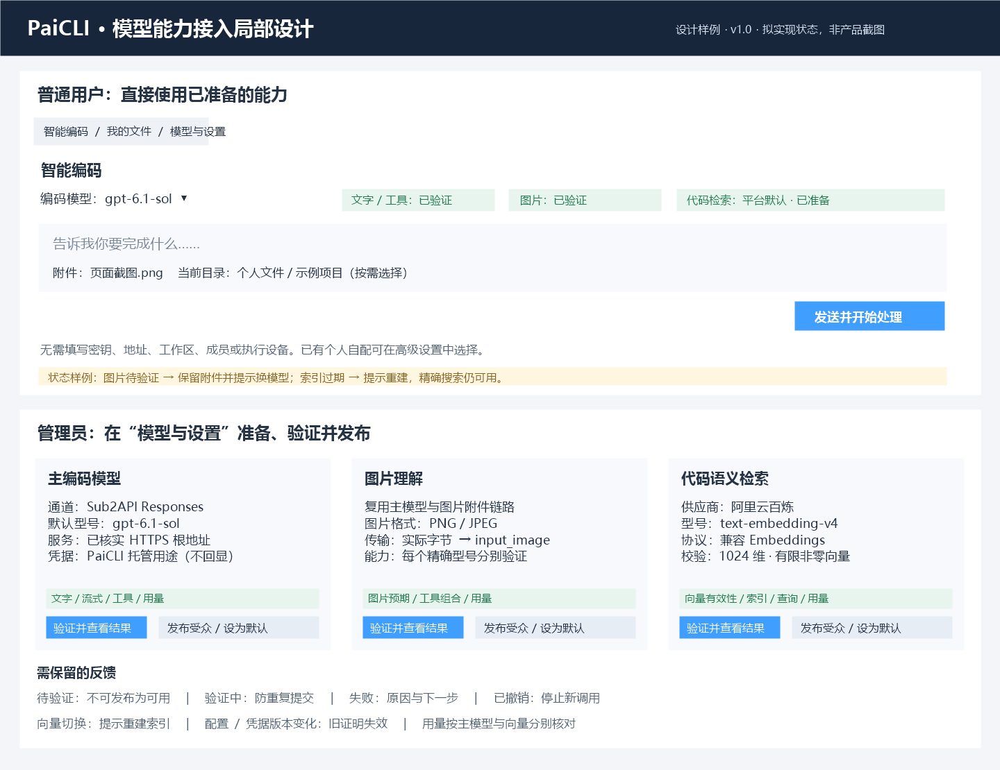

# PaiCLI 模型能力接入与分阶段实施方案

> 版本：1.0；方案：已批准本地编码实施；负责人：Codex 实施，用户审查业务结果；日期：2026-10-04。
> 需求依据：用户要求使用现有 Sub2API 文字/图片能力及阿里云向量能力接入 PaiCLI，并重点说明分阶段施工内容。
> 能力与凭据登记来源：[API密钥管理与测试文档](../../../PaiSmart知识库项目/设计附录/2026-10-04-主模块验收准备/API密钥管理与测试文档.md)。本文不复制完整密钥，不改变该来源的测试结论。
> 上游设计：[个人编码助手使用设计](../FEAT-PAICLI-003-个人目录与简化使用/README.md)、[已有Sub2API文字适配方案](../../Sub2API扩展实现文档.md)、[完整迁移设计](../../完整迁移设计.md)。本文唯一维护本次真实接入、图片增量、阿里云向量及平台默认能力的施工方案；旧文字适配细节继续引用原正文。
> 当前授权：2026-10-04用户明确“开多个智能体进行编码实现”，批准本方案对应的本地代码、契约、文档和定向检查。真实凭据登记、模型费用、HTTP有限例外、数据库业务写入、发布与Git写入仍按明确对象和范围处理；当前不外呼付费模型。实际施工和技术结果见[实施记录](实施记录.md)。

## 1. 需求与业务逻辑

### 1.1 完成后用户怎样使用

普通用户进入“智能编码”即可使用管理员已发布的默认编码模型，输入问题或编码要求；需要看图时添加截图；需要理解已有项目时选择目录并调用检索。用户无需登记工作区、成员、设备或密钥。

三项能力各有职责：

| 能力 | 接入来源与拟配置 | 用户得到的结果 |
|---|---|---|
| 文字与工具调用 | Sub2API，Responses；默认精确型号 `gpt-6.1-sol` | 分析、制定方案、读取代码、调用工具、修改与检查，显示真实执行结果 |
| 图片理解 | 同一 Sub2API Responses 通道；按精确型号分别验证 | 直接观察本次截图，结合代码回答或执行；不要求另配一个图片生成模型 |
| 代码语义检索 | 阿里云百炼 `text-embedding-v4`，OpenAI兼容 Embeddings；登记预期1024维 | 以自然语言找相关代码片段，再交由主模型分析 |

向量模型只接收文本代码片段与查询，不接收PNG图片。图片理解不生成图片；OCR、语音、视频、其他业务模型和正式评测不进入本次范围。基础编码不依赖语义索引；向量不可用时精确文件搜索仍可用。

### 1.2 能复用什么，哪些条件尚未满足

| 已核实依据 | 能用于本次方案的结论 | 施工中仍须完成的条件 |
|---|---|---|
| 来源文档中的模型列表、`gpt-6-sol`文字及图片直连结果 | 现有API可作为接入来源；该型号在清晰合成PNG样本上成功读图 | 默认 `gpt-6.1-sol`仅在列表，文字、工具、流式、图片都须按本型号验证；不得沿用其他型号结论 |
| 阿里云向量短文本直连返回1024维 | 已有账号与接口可复用，不需重新选择向量产品 | 经PaiCLI真实配置、租约、预算、索引和查询链路重新核对 |
| PaiCLI已有Sub2API Responses文字适配、托管凭据和模型发布 | 保留现有文字/工具/流式/usage及任务链路 | 正式用途、可用Provider、精确模型、执行宿主与发布配置须逐项核实 |
| PaiCLI已有图片上传、私有附件、下载授权与图片消息 | 图片增量可复用附件链路 | Sub2API目前强制文本、拒绝图片；必须补Responses图片编码和能力验证 |
| PaiCLI已有OpenAI兼容Embedding、SQLite索引和语义检索 | 阿里云可使用现有协议分支 | 补1024维校验、索引模型身份、检索失效处理、平台向量发布与调用用量标识 |

来源文档并不是可直接导入的完整模型管理服务。复用的是已登记的接口、型号、现有供应商凭据及测试依据；配置、权限和执行结果仍由PaiCLI现有中心管理，不依赖PaiSmart业务进程来转发请求。

### 1.3 接入参数及前置决定

| 项目 | 拟采用的参数与规则 |
|---|---|
| Sub2API根地址 | 来源为 `http://39.102.215.183:8080/v1`，与PaiCLI现有HTTPS校验冲突。推荐先取得该实例可用的HTTPS入口；不推测HTTPS端口已存在，不直接把HTTP改写成HTTPS并声称可用 |
| Sub2API最终路径 | 规范根地址只追加 `/responses`，避免重复 `/v1`；本次新增图片仅限Responses |
| 主模型 | `gpt-6.1-sol`保持用户指定默认；`gpt-6-sol`作为可选候选独立验证。默认型号失败时显示不可用，未经用户决定不自动替换 |
| 请求条件 | 沿用已有Responses适配的 `stream=true`、`store=false`；从 `reasoning.effort=low`小样本条件开始验证。实际历史协议项、工具续轮和输出限制也须通过；不能将原小样本输出上限当作正式编码上限 |
| 向量根地址 | `https://dashscope.aliyuncs.com/compatible-mode/v1`，只追加 `/embeddings` |
| 向量协议与型号 | 复用 `provider=openai`兼容分支，页面显示“阿里云百炼”；精确型号 `text-embedding-v4`，新增 `expectedDimensions=1024`校验；首版不发送 `dimensions`覆盖参数 |
| 托管用途 | 在既有若依密钥模块中登记PaiCLI用途：`ai.paicli.user.<管理员用户ID>.sub2api.chat`及 `ai.paicli.user.<管理员用户ID>.aliyun.embedding`。这是拟用别名，尚未登记；不直接读取 `ai.paismart.*`引用 |
| 账号与密钥复用 | 使用来源中同一组供应商账号/Key，不申请新Key、不把Key交给普通用户。由获授权的凭据管理动作登记PaiCLI项目用途；不覆盖PaiSmart用途、配置或数据 |
| 用量与金额 | 复用PaiCLI个人/任务Token预算，按能力与精确型号分别记调用用量。主模型Token与向量Token不得按同一单价折算；供应商金额和总预算尚待明确 |

HTTPS入口是主模型真实启用的前置条件。若用户决定继续使用上述公网HTTP地址，需另明确批准该特定目标的有限例外及凭据传输风险，再调整相应校验；本方案推荐路径保持现有限制。此项不阻塞向量和图片的本地代码施工与模拟接口验证。

### 1.4 谁准备配置，谁使用能力

管理员完成凭据登记、兼容验证、发布受众和默认能力选择。普通用户只选择可用主模型，使用已发布的默认向量能力；需要个人自配时才展开现有高级设置。

主模型继续使用已有平台模型发布。向量目前只有个人配置，须扩展同一发布机制：管理员显式发布本人已验证向量配置，普通用户按发布受众取得使用权。凭据归管理员托管，文件和索引归当前使用者；用量计入当前PaiCLI用户与任务，同时记录发布来源，不能把所有调用算成管理员个人任务。

个人自配向量优先于本人显式选择的平台向量发布；没有个人选择时解析管理员指定的有效平台默认。停用语义检索须使用明确停用状态，不能通过清空个人配置意外重新启用平台默认。切换或默认失效均显示状态，不偷偷改用另一个供应商。

## 2. 用户入口与界面配合

沿用已确定的“智能编码、我的文件、模型与设置”三个入口，不新增主菜单，不重新设计工作台。只在现有能力、配置和索引区域补齐可用状态、平台默认来源与管理员动作。

图稿是拟实现的局部界面，不是当前产品截图。上半部说明普通用户怎样使用，下半部说明管理员怎样准备能力。

| 入口 | 用户操作与反馈 | 拟调整的现有区域 |
|---|---|---|
| 智能编码 | 默认模型直接可选；添加图片后保留缩略图；图片能力未通过时说明原因并保留文字和附件 | 当前模型选择、`ImageAttachments.vue`与发送门控；图片与文字能力分开判断 |
| 我的文件 | 选择本人目录后建立代码索引、进行语义检索；索引过期显示“需要重建”，精确搜索仍可用 | 当前索引/检索与成果区域，显示有效索引型号、维度和失败原因 |
| 模型与设置：普通用户 | 查看主模型和代码检索是否可用，平台默认来源只读；高级个人配置按需展开 | `PersonalKnowledgeConfig.vue`与现有模型列表；不向普通用户显示管理员Key引用 |
| 模型与设置：管理员 | 登记非秘密参数，发起有预算的验证，查看各能力结果，发布给指定用户或设默认 | 当前供应商/模型配置与发布操作；向量发布采用相同权限设施 |

关键状态必须区分：未配置、待验证、验证中、可用、失败、版本变化、已撤销、需要重建。保存配置与模型出现在列表中均不能显示“可用”。文字与工具通过、图片失败时，文字编码仍可用，图片发送被明确阻止。验证中防止重复发起，迟到回执不能覆盖新配置版本。

## 3. 后台接入与处理设计

### 3.1 继续沿用当前调用边界

浏览器提交文字、图片引用和目录选择；若依中心核对用户、已发布能力、当前配置、任务和预算；受控执行宿主在有效租约下取得限定用途凭据并调用API；工具调用仍走原审批和执行边界；结果、用量、文件和索引状态回到同一中心。

不新建PaiSmart转发依赖、另一套任务中心或共享业务库。普通页面、消息、配置导出、日志及命令行均不出现完整Key。租约约束不等于上游Key已被撤销，停止后不再发起新请求，已发出的请求按真实回执保留状态。

### 3.2 主模型与图片接入

1. 主模型先完成原文字、工具、流式及usage兼容门。验证回执绑定精确model ID、Provider定义版本、协议、模型定义版本和密钥版本，经中心核对后才可发布。
2. 图片继续使用现有私有artifact：上传后实际解码、校验PNG/JPEG、大小与像素上限；任务只引用附件ID。Runner按有效租约和本人会话/任务授权下载实际图片字节，复核SHA、MIME和大小。
3. Responses编码器将同一用户消息按顺序装配 `input_text`与 `input_image`，图片采用 `data:<mime>;base64,...`。仅传本机路径不能替代传图。首版不引入远程图片URL或file_id。
4. 账本仍保存artifact引用，既有历史恢复和旧图片payload清理规则保留。工具结果、call_id和Responses历史协议项不因加入图片丢失。
5. 图片验证单独记录，不依靠手工勾选 `supportsImages`。只有当前版本图片证据通过，才使图片能力生效；编码模型发布时绑定该证据。文字验证成功不自动开启图片。
6. Chat Completions图片仍关闭；不同协议的证明不能通用。原DSML/厂商模板限制不随本次图片扩展放开。
7. 真实 `completed`终态、完整工具参数、流式一致性、拒绝/截断/断流与取消规则继续执行。取消后不继续工具动作，不把EOF当成功，不自动重放结果未知的收费请求。

当前附件、有效历史与有效摘要中的图片共同决定任务冻结的 `requiresImageInput`。不能因为本轮只有文字就省略历史图片的能力核对；清理历史或有效纯文字摘要已裁剪旧图后，普通文字任务不受图片验证修订影响。

模型定义版本与能力验证记录修订须分开：行版本继续用于乐观并发，能力证据、发布和任务配置绑定采用明确的定义版本。定义未变时，在中心同一事务合并图片证据，保留有效文字证据与文字发布；图片探针失败不能因模型行版本递增而意外撤销文字能力。型号、地址、协议、模型定义或密钥版本改变仍使对应旧证明失效；旧发布字段与定义版本的兼容映射须在施工时同步消费者，不能仅改写验证器。

### 3.3 向量接入与索引可靠性

1. 使用现有OpenAI兼容Embedding客户端调用阿里云，输入为文本；索引和查询使用同一配置。响应须含有效向量数组，严格核对1024维、所有元素为可表示的有限数值且非全零；维度异常明确失败。
2. 索引身份包含用户、真实目录指纹、规范化服务地址、精确型号、维度及分块规则版本。中心manifest和本地SQLite均记录身份；语义检索和结果缓存必须核对当前身份与索引版本。
3. 模型、地址、维度或分块规则变化，旧语义索引显示“需要重建”。同为1024维的不同模型也不能混用。仅密钥轮换不必重建数学向量，但能力验证、发布和进行中任务仍须按版本规则重新核对。
4. 新索引在临时版本建立并校验，全部成功后原子替换有效版本；失败或取消保留原有效索引，不发布半成品。不直接沿用原项目或PaiSmart的向量数据库。
5. 文件变化沿用当前版本失效规则。语义索引缺失或过期时明确提示，普通精确搜索继续；不能以维度不匹配后的零相似度伪装“未找到代码”。
6. 每次向量调用继续走有效凭据、预算预留和usage结算。中心事件补能力种类、供应商、精确型号及配置/发布版本，便于分别核对主模型与向量开销；缺usage保留未知或现有保守估计，不记录零成本。

向量校验失败仍保留已收到的合法输入用量，以预留与已知计数的较大值保守记账；计数不合法或 `prompt_tokens` 与 `total_tokens` 矛盾时标为未知。SQLite替换前及事务提交前核对取消和租约，末次向量调用返回后取消也保留旧有效索引。

### 3.4 平台默认向量的发布与数据变化

推荐扩展现有 `pc_model_release`，增加发布种类 `CHAT|EMBEDDING`，避免另一套平台能力表。旧记录缺种类时按CHAT兼容；所有旧主模型遍历/解析须显式过滤CHAT，防止把向量记录当主模型。

向量配置继续由管理员的个人设置持有。EMBEDDING发布绑定来源管理员用户ID、向量配置指纹、预期维度、验证证据、密钥版本、受众与发布版本；发布不复制Key。个人设置新增向量使用方式及 `embeddingReleaseId`，仅引用有效发布，不复制管理员secretRef。

中心按“当前使用者是否在受众 → 发布是否有效 → 来源配置指纹/凭据版本是否匹配 → 当前任务固定版本是否匹配”解析向量上下文。Runner续取凭据同时核对发布来源及版本，不能把管理员身份改写成任务用户身份以绕过归属校验。

发布撤销、受众移除或来源配置改变后，禁止新调用；运行任务停止后续向量请求并保留成果。有效默认唯一：发布时在同一事务中撤销同能力此前默认标记，防止两个默认并存。主模型发布不受向量发布影响。

并发发布按能力种类锁定同一默认选择记录，串行完成旧默认撤销和新默认发布，不能只依靠各发布行的局部事务。默认解析继续核对当前用户是否在受众；没有可用受众默认时显示未准备，不选另一个任意发布。个人显式选定的其他有效发布不受默认标记切换影响。

新增图片/向量发布字段、维度和用量身份要同步中心、Runner与CLI契约能力声明；旧执行宿主不能证明支持新增语义时明确拒绝相应任务。不能将向量新字段放进JSON后让旧客户端忽略它并继续执行。

基础文字任务在旧宿主缺少新增向量协议时不绑定可选向量，文字编码仍可继续；明确建索引或语义检索仍要求新增能力。普通向量选择按会话写权限，个人配置按管理权限；本人失效发布保留安全的并发行版本供重新发布，其他用户只能选择有效受众发布。

上述设计涉及现有JSON字段、发布解析与契约变化；不新增权威业务数据库。仅在本地SQLite派生索引中增加索引元数据。旧没有模型身份的索引按“需重建”处理，不猜测其来源。

### 3.5 主要文件与职责变化

以下路径省略仓库根目录；Java文件在所属现有模块中修改，新辅助文件仅在职责确实无法由原类清晰承担时增加。

| 所属模块与文件 | 施工内容与理由 |
|---|---|
| `paicli-api/.../PcConnectionService.java`、`PcSub2ApiPolicy.java` | 精确配置与用途校验；Responses图片能力按证据生效；向量维度、发布来源解析；保留HTTPS与项目归属边界 |
| `paicli-core/.../LlmClientFactory.java`、`Sub2ApiResponsesClient.java`、`Sub2ApiResponsesCodec.java`、`Sub2ApiVerifier.java` | 放开已验证Responses图片；编码真实图片块；增加图片探针，保留文字工具验证与流式协议处理 |
| `paicli-api/.../PcSessionService.java`、`PcRunnerService.java` | 当前图片证据与验证回执校验；用量按能力/型号归属，版本变化和迟到回执拒绝 |
| `paicli-core/.../rag/EmbeddingClient.java`、`CodeIndex.java`、`CodeRetriever.java`、`VectorStore.java` | 阿里云兼容分支、严格维度响应、索引身份、切换失效与原子替换 |
| `paicli-api/.../PcPersonalService.java`、`PcModelRelease.java`、`PcKnowledgeService.java` | 默认向量解析、CHAT/EMBEDDING发布分类与受众、索引状态/语义缓存失效 |
| `paicli-api/.../PcRunnerContextService.java`；`paicli-runner/.../ManagedProviderGrant.java`、`NativeControlExecutor.java` | 冻结维度/配置指纹/向量发布版本；验证与manifest回执；受控来源凭据续取 |
| `paicli-core/.../BudgetedLlmClient.java`；`paicli-runner/.../NativeTaskExecutor.java` | 调用用途与真实usage身份贯通，继续保留预算、附件与取消处理，不复制现有上传链路 |
| `frontend/admin-web/src/views/paicli/connections/index.vue`、`components/PersonalKnowledgeConfig.vue`、`workbench/index.vue`及 `src/types/paicli.ts` | 能力分别展示、阿里云友好名称、平台默认只读、发布与验证反馈、图片发送门控；复用若依权限与共享request |
| `contracts/paicli/operator-v1.openapi.json`、`runner-v1.openapi.yaml`、`events-v1.schema.json` | 本次能力证据、发布、向量使用方式、维度/索引身份、调用用途的契约同步；约束输入与消费者兼容 |

表中 `paicli-api/core/runner` 均位于 `ruoyi-backend/ruoyi-paicli/`。不修改PaiSmart业务代码或其主模块验收结论。

## 4. 分阶段施工计划

施工顺序为“明确接入条件 → 主模型可编码 → 图片可看懂 → 向量可检索 → 普通用户内置使用 → 完整交付”。图片与向量的本地实现可在主模型阶段接口冻结后并行；普通用户完整交付须统一核对，不能只汇总各模块构建成功。

### 第一阶段：确定接入条件与配置边界

**目标：** 明确真实接入对象、凭据用途和授权，后续不反复猜型号、协议或费用。

**施工内容：** 核对可用HTTPS入口；确定Responses、默认型号及候选；准备PaiCLI专属托管用途，核对metadata项目/供应商/能力和有效版本；确认发布受众、执行宿主、Token上限和真实调用费用授权。先冻结本次新增契约字段和旧客户端处理规则。

**产物：** 精确非秘密配置清单、用途登记、接口增量与有限验证范围。保存配置不触发调用。

**验收与下一阶段条件：** 配置可合法保存，服务路径拼接正确，Key不进入普通用户接口；执行宿主具备当前Responses协议能力。主模型联机须有可用网络入口及明确费用边界。网络未就绪时只进行模拟接口施工，不登记为真实接通。

### 第二阶段：主模型接通并能执行编码

**目标：** 用户先能进行实际文字编码，不等图片和向量全部完成。

**施工内容：** 通过已有中心→Runner→Responses链路登记并验证 `gpt-6.1-sol`；复用两次合成工具验证，核对文字、流式、工具调用、工具回灌、终态与usage；再在指定测试目录完成真实读文件、提出改动、修改及运行检查。验证后的模型才发布为平台默认。

**产物：** 当前版本有效的主模型证明、发布配置、实际编码结果及调用用量。默认型号失败时保留失败；候选 `gpt-6-sol`需独立验证且由用户明确决定是否改默认。

**验收与下一阶段条件：** 页面实际模型与所选精确ID一致；至少完成一次“工具调用→结果回灌→最终回复”，文件内容和检查回执可核对；缺权限、取消和断流不能继续工具动作。图片/向量未就绪不影响已通过的文字功能。

### 第三阶段：补齐截图与图片理解

**目标：** 用户添加截图后，模型能直接观察并结合代码处理。

**施工内容：** 修改Responses图片限制与编解码；复用现有附件授权、字节下载和历史；添加独立图片能力证据，贯通模型列表、发布与发送门控。保留Chat Completions图片关闭。

**产物：** 当前型号图片证明、网页上传/粘贴及截图辅助编码的实际结果。

**验收与下一阶段条件：** 使用不含答案的问题核对独立图片预期，并完成一次“图片＋工具＋最终回复”的组合流程；输入中实际传图片数据；文本模型、坏图、超限、越权附件明确拒绝并保留草稿。失败只关闭受影响图片能力，不把主模型文字功能一并关掉。

### 第四阶段：接通阿里云向量与代码检索

**目标：** 先让有权限的配置用户完成可靠的“建索引→语义检索→读代码”闭环。

**施工内容：** 登记 `text-embedding-v4`兼容配置及1024维；补向量严格校验、身份指纹、本地索引元数据、中心manifest与缓存检查；用量区分主模型和向量；模拟异常及重建失败。

**产物：** 实际向量验证、固定测试项目索引、自然语言查询结果、片段/文件证据和向量用量。

**验收与下一阶段条件：** 真正经过PaiCLI链路返回1024维有效向量；按预先定义的问题找到相关代码，主模型引用真实文件；更换向量身份后拒绝旧索引语义查询，重建失败保留原有效版本，精确搜索继续可用。

### 第五阶段：发布为普通用户内置能力

**目标：** 普通用户无需填地址和Key即可使用主模型、图片及代码语义检索。

**施工内容：** 扩展同一模型发布机制承载向量种类；默认唯一、受众、版本、撤销和续取校验；个人设置提供平台默认、个人自配及显式停用；现有页面补能力状态和管理员发布动作，不增加业务工作区或成员流程。

**产物：** 管理员已准备的能力发布；指定普通用户的真实使用入口与隔离结果。

**验收与下一阶段条件：** 无模型管理权限的普通用户可直接用已发布能力；看不到Key或管理员secretRef；两用户的文件、索引、任务及用量归属清晰。撤销、轮换和受众移除均阻止后续调用；不能误将Embedding发布列入编码模型列表。

### 第六阶段：统一验收、分发与运行交付

**目标：** 确认用户正在打开的版本可完成完整流程，交付明确可用范围。

**施工内容：** 定向Java测试、契约检查及管理端类型/构建；按既有通道更新中心、Runner/CLI和前端，核对实际运行版本；在指定通道执行普通用户文字编码、截图辅助、语义检索、错误恢复与真实终端中的模型使用。只更新PaiCLI运行通道，沿用共享基础服务。

**产物：** 按中文业务点组织的实际验收记录和HTML报告、可访问页面、已验证配置说明及停用方法。实际结果只在本功能后续建立的唯一实施/验证记录维护；本设计不提前填通过。

**完成条件：** 本方案第5节对应业务点实际操作、数据和截图证据齐备，技术检查与业务结果分别说明。未完成的型号/图片能力/终端条件明确保留缺口；最终用户接受由用户确认。

### 调用预算、停止及回退

本地模拟测试不使用真实Key。真实验证按每次批准的型号和请求数上限执行：主模型沿用每型号2次合成兼容请求；图片采用独立样本及工具续轮组合，先按每型号最多3次请求准备；向量按单次小项目预先确定代码块数及查询数。业务编码回合另行计入批准预算，不把前述探针数当作完整业务总数。

Token预留/日预算继续执行，但不等于已核定人民币费用。服务端可能有附加上下文，不能仅按短问题长度预测开销。任一结果未知、超时、用量记录失败、凭据/发布版本变化或额度不足即停止受影响调用，不自动重试收费请求。

回退优先停用或撤销新增能力，保留会话、文件、索引和原始证据；图片失败保留文字能力，语义失败保留精确检索。运行包回退前核对新契约/发布种类兼容性：旧中心无法识别EMBEDDING发布时不可直接混跑。模型配置回退不能撤销已发生的供应商费用或文件动作。

## 5. 业务验收方法

以下是施工后的验收标准，不是本次执行结果。页面操作前在本功能保存具体清单；实际页面与关键状态截图须逐张回读，数据和调用回执另行核对。

| 业务点 | 准备与操作 | 正确结果与核对方法 |
|---|---|---|
| 普通用户直接编码 | 指定用户在已准备执行宿主与默认模型下进入智能编码，发送文字，再处理测试文件 | 无配置向导或工作区/成员登记；真实模型回复、文件差异和检查结果一致；核用户、型号、任务及usage；截图入口、过程和成果 |
| 模型能力分开判断 | 仅文字验证通过的模型添加图片；再换同型号图片已验证版本 | 第一种保留附件并明确拒绝图片；第二种成功观察图片；不凭勾选/列表/另一型号证据开启；截图两种状态 |
| 图片验证失败保留文字 | 对已发布且定义未变的文字模型发起失败图片探针，再以普通用户发送文字 | 图片失败如实记录，原文字证据/发布仍有效；行并发版本更新不等于定义改变；改定义或密钥后旧证据则失效；核发布绑定和截图 |
| 截图辅助编码 | 上传有独立预期的PNG/JPEG，用不含答案的问题提问，再要求结合固定项目读代码 | 图片内容符合独立预期；实际图片字节传入Responses；工具记录与最终引用可核对；截图附件及执行成果 |
| 图片授权与异常 | 两用户交叉引用附件；坏图、超限、文本模型及附件版本变化 | 越权和非法内容拒绝；不凭本机路径/历史猜图；保留输入与原因；核私有下载和租约回执，截图拒绝反馈 |
| 向量与语义检索 | 固定小项目建立索引，使用预先确定的自然语言问题 | 1024维、有限非零向量；实际相关片段/路径可核对；主模型再读取文件，不以回复文字冒充已检索；截图索引和引用 |
| 索引切换与失败恢复 | 切服务/型号或模拟不同维数，查询旧索引，再制造重建失败 | 显示需重建或维度错误；不返回貌似正常的空结果；不覆盖原有效索引；精确搜索可继续；核manifest与SQLite版本 |
| 内置向量与个人设置 | 普通用户用平台默认，个人用户改自配，再显式停用 | 来源明确、优先级符合第1.4节；停用后不意外落回默认；Key不下发浏览器；两用户索引隔离；截图设置与使用状态 |
| 默认并发与受众 | 两管理员并发发布同类默认向量；分别以受众内外用户读取默认 | 同能力仅一个有效默认；受众外用户不会自动使用该发布；已有显式选择不被默认切换覆盖；核发布记录、锁语义及页面反馈 |
| 发布/版本与调用费用归属 | 改Key、改配置、撤销发布或移除用户；检查进行中与下一任务 | 后续调用拒绝，旧证据不套新版本；主模型/向量事件分别含型号和实际用户，usage未知不置零；核事件、预算与发布版本 |
| 断流、取消与恢复 | 模拟接口失败、缺终态、部分usage和取消；保留已有成果后重新发起 | 不伪报完成、不继续工具、不自动重放；合法部分用量保留，结果未知明确呈现；核回执及文件，截图状态与保留成果 |
| 实际运行版本与终端 | 更新本次PaiCLI分发组件后从真实网页及已准备终端调用模型 | 中心/Runner/CLI/前端版本与契约相符；终端使用受控同一模型配置；其他项目服务/配置保持原边界；核运行版本与截图 |

## 6. 实施决定与真实接入条件

1. 六阶段施工与平台默认向量的本地发布实现已获用户批准；使用多个智能体按模块并行，最后统一整合验证。
2. 代码保持HTTPS推荐路径；继续用指定HTTP实例时，需明确决定有限例外，不能按“原文已测试”自动放开。
3. 两份现有供应商Key登记为PaiCLI专属托管用途及实际发布受众尚需按凭据管理授权确定；本次不直接借用PaiSmart项目引用。
4. 默认主模型仍为 `gpt-6.1-sol`，候选不自动替换；本地实现不代表这个型号已经联机通过。
5. 真实调用的测试型号、受众、Token/金额上限和运行更新范围须明确后执行。代码批准不自动覆盖真实费用、凭据登记、外部发布或Git写入。

<!-- 内部维护：功能FEAT-PAICLI-004；文档状态Approved（本地实施）；需求与方案正文在本文件；规范采用用户级2026.10-r9与架构/ui-ux正文2026.10-r4。当前编码进行中；真实业务验收及用户接受未完成。 -->
