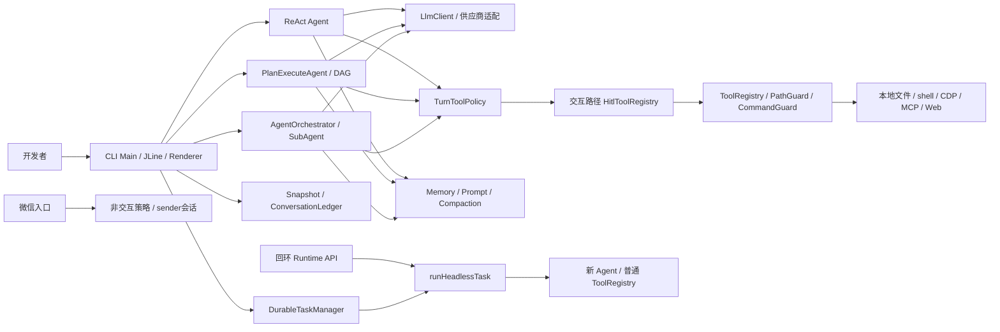
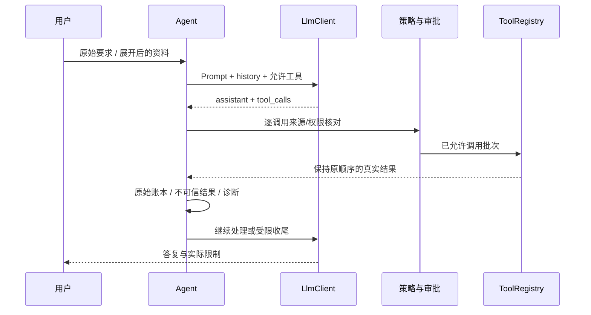

# PaiCLI 原项目复现与学习设计

> 类型：本地源码研究与复现设计；版本：1.0；负责人：Agent；日期：2026-10-04  
> 来源：[原项目](../../../参考项目/paicli-main/)、实际注册入口、实现与测试；未认证远端提交，也未执行真实模型或正式评测。  
> 本文解释原项目怎样工作、怎样学习和扩展；目标业务需求及迁移决定继续唯一维护在[完整迁移设计](完整迁移设计.md)，实际完成情况继续见[实施记录](开发记录/2026-10-03-完整迁移实施记录.md)。  
> 追溯：[全部能力、工具与命令对应表](设计附录/原功能与目标对应表.md)、[配置名称映射](设计附录/原配置入口映射.csv)、[本轮源文件清单](证据/2026-10-04-原项目复现调查/源文件清单.csv)、[源码基线](证据/2026-10-04-原项目复现调查/源码基线.json)、[逐文件目标候选](证据/2026-10-04-原项目复现调查/源文件目标候选对照.csv)、[依赖声明清单](证据/2026-10-04-原项目复现调查/依赖声明清单.csv)。

## 1. 产品目标与业务全貌

PaiCLI 是在开发者本机仓库内工作的 Java 编码智能体。用户用自然语言提出理解、修改或检查代码的要求，系统装配模型上下文，调用文件、命令、代码搜索等工具，再把结果交回模型继续处理。它同时提供直接执行、先制定计划再执行、产品内部多个智能体协作三种方式。交互式终端是主要产品入口；后台任务、回环 Runtime API、微信文本通道是另外的入口。

学习时要先理解四个不同问题：模型决定下一步做什么；工具实际读写什么；策略允许什么；账本、快照和报告记录了什么。模型输出“完成”不会自动证明修改正确，快照恢复也不会自动撤销 shell 或外部服务的副作用。

### 1.1 全部能力分组

以下是功能覆盖索引，逐命令参数与原测试的细目沿用[已有完整对应表](设计附录/原功能与目标对应表.md)，不以 README 的期数代替范围。

| 功能组 | 用户得到的结果 | 实际源码入口与必要边界 |
|---|---|---|
| 直接编码 | 查询、修改、检查、流式答复与部分完成说明 | [Agent](../../../参考项目/paicli-main/src/main/java/com/paicli/agent/Agent.java)、AgentBudget、RunawayGuard；默认无固定轮数上限 |
| 计划执行 | 可审阅和修改的任务依赖图，执行与失败汇总 | [PlanExecuteAgent](../../../参考项目/paicli-main/src/main/java/com/paicli/agent/PlanExecuteAgent.java)、Planner、ExecutionPlan；取消不按失败重规划 |
| 团队执行 | Planner、Worker、Reviewer 分工与轨迹 | [AgentOrchestrator](../../../参考项目/paicli-main/src/main/java/com/paicli/agent/AgentOrchestrator.java)、SubAgent；原审查失败处理有缺陷，见第3节 |
| 文件与命令 | 读、写、唯一替换、列表、glob、精确搜索、建项目、shell | [ToolRegistry](../../../参考项目/paicli-main/src/main/java/com/paicli/tool/ToolRegistry.java)；17内置工具还包括下列网络、Skill、记忆、回退工具 |
| 审批、路径和审计 | auto/plan/ask 模式、硬拒绝、批准/拒绝轨迹 | [HitlToolRegistry](../../../参考项目/paicli-main/src/main/java/com/paicli/hitl/HitlToolRegistry.java)、ApprovalPolicy、PathGuard、CommandGuard、AuditLog；批准不能覆盖硬策略 |
| 记忆与上下文 | 项目规则、长期事实、冲突处理、上下文状态、摘要 | [MemoryManager](../../../参考项目/paicli-main/src/main/java/com/paicli/memory/MemoryManager.java)、LongTermMemory、AutoCompactionManager、TokenBudget |
| 仓库语义搜索 | 类/方法分块、向量召回、代码关系图 | [CodeIndex](../../../参考项目/paicli-main/src/main/java/com/paicli/rag/CodeIndex.java)、CodeAnalyzer、CodeChunker、EmbeddingClient、VectorStore；不能取代 grep 的精确证据 |
| 多模型 | 8个原供应商、模型列表/能力/刷新/添加/切换、thinking与图片协议 | [LlmClientFactory](../../../参考项目/paicli-main/src/main/java/com/paicli/llm/LlmClientFactory.java)、ModelProfile、ModelCatalog、各Client；刷新不自动切换模型 |
| 联网与浏览器 | 搜索、正文提取、CDP连接/状态/标签页、敏感页面拦截 | [TurnToolPolicy](../../../参考项目/paicli-main/src/main/java/com/paicli/tool/TurnToolPolicy.java)、web/、browser/；URL来源有确定性限制 |
| MCP | stdio/Streamable HTTP、动态工具、资源、提示词、通知、手动生命周期、@引用 | [McpServerManager](../../../参考项目/paicli-main/src/main/java/com/paicli/mcp/McpServerManager.java)、McpClient、transport/、resources/、mention/ |
| Skills | 索引、查看、开关、重载、同一轮加载正文 | [SkillRegistry](../../../参考项目/paicli-main/src/main/java/com/paicli/skill/SkillRegistry.java)、LoadedSkillMessages；正文不能扩大工具权限 |
| 终端呈现 | inline、Lanterna、plain、补全、历史、状态栏、折叠、差异、中文表格 | [Main](../../../参考项目/paicli-main/src/main/java/com/paicli/cli/Main.java)、render/、tui/、TerminalTable；原Lanterna尚未接会话模式切换 |
| 写后诊断 | 将 Java 语法问题交回 Agent | [LspManager](../../../参考项目/paicli-main/src/main/java/com/paicli/lsp/LspManager.java)；实际为JavaParser能力，不是完整多语言LSP客户端 |
| 快照与原始账本 | 回合前后文件快照、列表、恢复、原始消息、导出 | [SnapshotService](../../../参考项目/paicli-main/src/main/java/com/paicli/snapshot/SnapshotService.java)、SideGitManager、ConversationLedger |
| 后台与Runtime | 任务排队/日志/取消、thread创建、turn执行、events查询 | [DurableTaskManager](../../../参考项目/paicli-main/src/main/java/com/paicli/runtime/task/DurableTaskManager.java)、[RuntimeApiServer](../../../参考项目/paicli-main/src/main/java/com/paicli/runtime/api/RuntimeApiServer.java) |
| 图片输入 | 文件/剪贴板识别、压缩、模型能力拒绝 | image/、ImageReferenceParser、ImageProcessor、LlmClient.ContentPart；50MB原输入与5MB输出限制分开 |
| 微信文本 | 二维码绑定、轮询、sender会话、控制命令、消息发送与白名单 | [WechatCommandMain](../../../参考项目/paicli-main/src/main/java/com/paicli/wechat/WechatCommandMain.java)、wechat/；没有人工审批面板 |
| Harness与评测 | 本地证据报告、LLM Judge、位置平衡比较、Native AgentBench设施 | harness/、eval/、benchmarks/、resources/benchmark；设施存在不等于正式榜单完成 |
| 打包与教学 | shaded JAR、受信评测Runner、文章、样例、演示及脚本 | [pom.xml](../../../参考项目/paicli-main/pom.xml)、docs/articles/、tools/、demo*/、landing/、ppt/、poster/；这些也须在文件处置中保留或说明 |

### 1.2 用户流程及业务拒绝

1. 启动时读取环境及项目/用户配置，选择模型和渲染器，建立工具、记忆、MCP/Skill与账本；操作范围绑定当前项目路径。
2. CLI先识别 `/` 命令。已知命令交给对应管理器；未知 `/xxx` 在CLI层报错，不应交给模型当自然语言执行。普通输入进入选定Agent。
3. 输入可以带文件、图片与MCP资源引用；扩展后的正文用于模型理解，用户原始输入用于授权来源判断。这两个字符串不能合并成“工具读到的内容也获得授权”。
4. Agent调用模型并处理结构化tool calls；每个工具经过当前通道策略、审批和路径/命令防护。工具错误作为失败结果返回，模型可以解释或调整任务，但不能绕过原拒绝。
5. 模型不再调用工具时交付答复；预算/停滞命中则停止工具，发起一次收尾请求，说明部分成果。用户取消另有取消语义。
6. 用户可查看差异、诊断、成本、原始账本和快照；测试结果、模型审查结果与用户决定分开保存。

## 2. 原项目技术栈与架构

### 2.1 从构建文件核实的版本

依据原[pom.xml](../../../参考项目/paicli-main/pom.xml)。以下是源码声明版本，没有运行Maven解析依赖树，也不代表已进行漏洞或许可证审查。

| 技术 | 原声明 | 用途 |
|---|---|---|
| Java / Maven | Java17；产物`1.0-SNAPSHOT`，终端banner另用`v16.1.0` | Java单工程、CLI入口，不依赖Spring Boot |
| Jackson / OkHttp / Logback | 2.16.0 / 4.12.0 / 1.5.18 | JSON、流式HTTP、日志 |
| JLine / Lanterna | 4.0.0（jdk11 classifier）/ 3.1.3 | 终端输入和两种交互呈现 |
| SQLite JDBC | 3.49.1.0 | 代码索引、后台任务、Runtime事件 |
| JavaParser / JGit | 3.28.0 / 7.6.0.202603022253-r | Java AST/语法诊断、Side-Git快照 |
| jsoup / jieba-analysis / ZXing | 1.18.1 / 1.0.2 / 3.5.3 | 网页正文、中文分词、二维码 |
| JUnit / Mockito / MockWebServer | 5.10.2 / 5.11.0 / 4.12.0 | 原测试设施 |
| Maven jar / shade / surefire | 3.3.0 / 3.5.1 / 3.2.5 | 可执行JAR、独立受信评测Runner、测试配置 |
| 外部可选工具 | rg、bash、Ollama/远程Embedding、CDP/MCP服务、隔离工具 | 版本由实际环境核对；原shell实现直接使用`bash -c`，不能假定原样兼容Windows PowerShell |

构建不是“Spring AI + LangGraph4J”项目：原Agent控制循环、DAG和工具层是自己的Java实现。路线图中的Pro分支不能当当前依赖迁移项。原POM默认`skipTests=true`，打包成功不证明任何测试已执行。

### 2.2 职责图

图中特意保留headless与交互的差别：原headless每次新建Agent和普通ToolRegistry，没有套交互HITL。不能仅凭三条Agent路径共享注册器，就声称所有入口具有同样审批和会话连续性。

### 2.3 正式数据、派生索引和本地记录

原项目没有MySQL业务表，也没有Web账号系统。不能把Runtime Key、模型Key和微信bot token解释为平台用户。

| 原数据 | 字段/结构与读取方式 | 生命周期及复现要点 |
|---|---|---|
| `code_chunks` | id、project_path、file_path、chunk_type、name、content、embedding_json、created_at；项目/文件/类型索引 | SQLite中存向量JSON，在内存算余弦相似度；不是Elasticsearch或原生向量数据库 |
| `code_relations` | id、project_path、from_file/from_name、to_file/to_name、relation_type、created_at | Java AST关系派生；可重建，按项目路径隔离 |
| `runtime_tasks` | id、status、prompt、result、error、created_at/started_at/finished_at/updated_at、duration_ms；状态/创建时间索引 | ENQUEUED→RUNNING→COMPLETED/FAILED/CANCELED；原重启把RUNNING改回ENQUEUED，有重放副作用风险 |
| `runtime_threads` | id、created_at | 仅thread身份，不能证明每轮模型history被保存或复用 |
| `runtime_events` | 自增id、thread_id、type、JSON data、created_at；(thread_id,id)索引 | `events(after)`读取现有事件；接口输出SSE格式后关闭，不是持续增量推送 |
| 长期记忆JSON | 项目/全局scope、事实、来源、时间、核实与冲突信息 | 跨进程storage lock，锁内重读与原子写回；global为原本机含义 |
| `conversationHistory` | system/user/assistant/tool消息、tool_call_id、reasoning与图片部分 | 当前Agent真正发送的短期上下文；不可再造一份影子history |
| ConversationLedger | 原始消息及事件JSONL | 压缩的发送视图和原始记录分开；清空上下文不等于抹除审计 |
| Side-Git快照 | JGit仓库、回合前后引用、工作区文件内容 | 回退文件不撤销已发请求、shell外部写入或费用 |
| Skill/MCP/配置 | 用户/项目配置及运行缓存 | 配置值可能含秘密；本文只给配置名称和文件入口，不复制运行值 |

表结构依据[VectorStore](../../../参考项目/paicli-main/src/main/java/com/paicli/rag/VectorStore.java)、[DurableTaskManager](../../../参考项目/paicli-main/src/main/java/com/paicli/runtime/task/DurableTaskManager.java)、[RuntimeThreadStore](../../../参考项目/paicli-main/src/main/java/com/paicli/runtime/api/RuntimeThreadStore.java)。学习时画出“可重建索引、不可丢的用户事实、会话视图、原始证据”四种所有权，迁移时逐一指定目标，不要把所有本机文件塞入中心数据库。

## 3. 关键业务逻辑逐链复现

### 3.1 ReAct：一次请求怎样完成修改

输入`userInput`与原始`submittedUserInput`进入[Agent.run](../../../参考项目/paicli-main/src/main/java/com/paicli/agent/Agent.java)。先建立工具曝光/URL来源策略，整理历史图片及引用，检索长期记忆并更新system prompt，再追加用户消息。

每轮先检查取消、注入写后Java诊断、压缩历史、检查预算。模型收到实际history和允许曝光的工具定义。返回tool calls时，先把含tool calls及reasoning的assistant消息保存，然后执行整批工具；按原tool_call顺序追加对应tool结果并以`ToolResultBoundary`包成不可信数据。图片工具结果及加载的Skill正文另行注入；RunawayGuard观察连续相同动作/错误，再开始下一轮。

无tool calls则返回最终文本、记录usage和原始完整答复，自动事实只从用户原话抽取。模型正文残留未执行的DSML工具文本会被提示；不能把它当真实工具执行。预算或停滞终止时先关闭工具再一次性收尾，保留已经产生的结果。

### 3.2 工具、审批与并发

17个内置工具为：`read_file`、`write_file`、`edit_file`、`list_dir`、`glob_files`、`grep_code`、`execute_command`、`create_project`、`search_code`、`web_search`、`web_fetch`、`browser_connect`、`browser_disconnect`、`browser_status`、`save_memory`、`load_skill`、`revert_turn`。动态MCP工具用`mcp__{server}__{tool}`注册，资源工具也要核对。每个输入、拒绝条件和原测试见[工具细表](设计附录/原功能与目标对应表.md#2-全部内置工具)。

`edit_file`默认要求old_text唯一匹配；精确失败后尝试逐行归一化，仍失败且每行带读取行号时剥一次前缀重试；`replace_all=true`才批量精确替换。原换行风格需保留，匹配失败不能偷偷新建文件。`grep_code`优先rg，缺失时Java回退；两者的golden set一致性比“都能搜到结果”更重要。

`executeTools`将连续只读工具组成最多4并发的批次，遇到写入/命令/MCP/记忆/快照/未知工具先等待只读段，再串行执行。只有read/list/glob/grep/search_code/web_search/web_fetch/load_skill在并行白名单；任何包含浏览器工具的批次整体串行。返回顺序与调用顺序一致，超时和异常也保留对应调用位置。这个机制只解决同一批次，不能推导跨会话同根写入安全。

交互入口的auto模式仅对shell调用分类器，分类失败/超时/非法输出拒绝。连续3次被拦才升级人工；新用户输入或成功放行清零。ask模式额外批准写工具。批准后的有效参数继续进入PathGuard/CommandGuard，不能由批准覆盖硬拒绝。微信非交互没有批准面板，受白名单限制。

命令实际通过`bash -c`或配置隔离器启动，原默认沙箱off；隔离required失败时拒绝宿主降级。目标Windows使用能力和审批限制应看既有迁移设计及当前Runner实现，不能通过把命令改成PowerShell就宣称隔离等价。

### 3.3 Plan与Team

Plan把目标交给Planner生成tasks JSON，解析时验证非空任务、唯一非空ID、依赖精确命中及无环；非法计划拒绝，不静默删边。用户可执行、取消或补充反馈再修订。执行时按依赖找就绪批次，各任务有自己的history/URL策略；只有声明的依赖继承上游结构化搜索URL。失败且完成度小于50%时可以重规划，默认最多2次；取消不重规划；达到上限停止新任务，完成度达到50%后的失败跳过传递下游。

Team原默认2个Worker池，Planner先拆步骤，同批独立步骤并行，输出各自缓冲后按步骤顺序展示。每步由Reviewer读取结果，判定只认JSON布尔`approved: true`，正常拒绝反馈可重试2次。

必须掌握原缺陷：`AgentOrchestrator.runStepWithPolicy`在首次Reviewer错误时直接`markStepCompleted`，重试Reviewer错误会设`approved=true`，耗尽重试后也调用`markStepCompleted`。这表示原“完成”不必然等于审查通过。复现学习要记录原事实，迁移按既有批准设计改为失败/未通过并阻断依赖；不要为了逐字一致重现错误放行。

### 3.4 记忆、提示词和压缩

[PromptAssembler](../../../参考项目/paicli-main/src/main/java/com/paicli/prompt/PromptAssembler.java)按base→personality→mode→approval→日期时区→项目/长期/外部上下文→Skill索引→context-management→handoff装配。规则正文位于resources/prompts；PAI项目记忆和个人事实有不同作用。提示词只引导模型，真正的路径与权限仍由确定性代码校验。

长期事实走去重、冲突检测、来源/核实判断和加锁写盘。相似但数字/版本不同不自动覆盖，replace/force由用户决定；超过30天未核实提示可能过时。自动提取最多3条、逐字来自用户原文、项目scope且待核实；读取Web/Browser/MCP等外部内容后暂停自动写记忆。

上下文先卸载超大工具输出，默认32000字符，将原结果保存成可回读资料；再清旧工具正文，保持tool_call_id；仍超摘要阈值才做四栏目完整摘要。实验Session Memory默认关。摘要栏目不完整、token没有下降或请求失败时保留原history。摘要阈值采用原上下文profile规则，而token是估算值，应与provider usage区分。

### 3.5 仓库RAG、精确搜索与诊断

CodeIndex枚举代码→CodeChunker/CodeAnalyzer按类/方法/关系提取→EmbeddingClient生成向量→VectorStore批量入SQLite。查询生成向量，在项目范围计算余弦相似度并格式化代码片段；graph走关系数据。向量JSON驻内存计算的实现不能包装成大规模ANN引擎。精确符号/路径先glob→grep→read，RAG用于不确定叫法的辅助定位。

Java文件写后由LspManager/JavaParser诊断，再在Agent下一轮注入；这证明语法诊断路径存在，不证明Java编译、依赖解析、类型兼容，也不证明TypeScript/Python受同样诊断支持。

### 3.6 模型、Web、MCP、Skill和图片

模型统一`LlmClient.Message/ChatResponse/Tool/ContentPart`，供应商差异在Client、ModelProfile和retry层。8个原Client是DeepSeek、GLM、Hunyuan、Step、Kimi、FreeLlmApi、XfyunMaaS、Agnes；thinking协议要求reasoning在后续工具回灌中保留。列表、刷新、添加、切换不能混为一次操作；新增未知能力按文本128k默认，不发推理请求“探测能力”。目标新增Sub2API是本仓库扩展，入口见[独立实现文档](Sub2API扩展实现文档.md)，不倒写成原项目第9个Provider。

WebSearch产生结构化discoveredUrls。WebFetch与导航只允许用户原文或本分支搜索发现的URL；网页正文中的命令或URL不能扩大许可。网络策略另管目标地址。浏览器支持isolated/shared和指定CDP，敏感页改写需要逐次批准，不得以工具换名绕过。

MCP配置合并用户和项目作用域；两transport调用JSON-RPC，动态注册工具、列/读/订阅资源、列/取prompts，通知触发缓存失效；@资源展开保留原用户输入供来源核对。OAuth、sampling与自动恢复仍是原未交付方向。Skill索引上限20个/4KB，load成功后工具结果之后同一轮注入独立user正文。

图片流程先解析路径/clipboard→实际解码→透明背景处理/缩放/压缩→能力校验→ContentPart。source大小、输出API大小、模型支持能力必须各自核对；微信媒体对象结构存在不代表微信图片/语音执行通道已经交付。

### 3.7 Runtime、后台任务、微信与评测

| 入口 | 真实处理与输出 | 失败/恢复边界 |
|---|---|---|
| `POST /v1/threads` | Runtime API Key校验，创建SQLite thread，200 | 非若依用户体系，绑定127.0.0.1 |
| `POST /v1/threads/{id}/turns` | 校验thread和非空input；写turn.started，异步runner，202 | 原请求/线程资源缺少生产级上限；一次runner返回后写message.delta与终态 |
| `GET /v1/threads/{id}/events?after=...` | 查现有事件，输出带id/event/data的SSE文本然后关闭 | 有after查询，不是长连接持续流；新Agent不自动继承thread历史 |
| `/task add/list/log/cancel` | SQLite排队，默认2worker，事务claim、更新结果和终态 | 原重启把RUNNING重排，未知副作用可能再执行；headless没套HITL |
| 微信iLink | QR绑定→账号保存→长轮询→sender队列/会话→文本输出分段 | control命令可绕队列优先处理；无审批面板、真实消息发送须另有授权 |
| Better Harness | 参数解析→采集上下文/工具证据→报告 | 本地辅助报告，不是正式benchmark分数 |
| Judge/Native AgentBench | 冻结题目生成、隔离worker、host relay、独立verifier、准入/评分/可发布门禁 | 原资料25/28生成器与缺D5/E3/E4需机器配方核对；formalScores/null、publishable/false不得改成正式榜单 |

原项目AGENTS明确正式评测因费用暂停；本文仅调查，不运行评测、Docker或真实Provider。测试目录中的已有失败也不能用“跳过测试默认打包成功”覆盖。

## 4. 怎样复现、学习并变成自己的项目

### 4.1 学习顺序与每步产物

| 顺序 | 阅读与动手练习 | 学会后的可检查成果 |
|---|---|---|
| 1. CLI和协议 | Main、CliCommandParser、LlmClient；用假的Client返回固定文本/一次read_file | 画出一轮消息序列；未知命令模型调用次数为0 |
| 2. 工具层 | ToolRegistry、TextEditMatcher、CodeSearchEngine及原golden tests | 对唯一/重复/CRLF编辑、rg/Java搜索写独立fixture；结果与手工期望一致 |
| 3. 策略与审批 | TurnToolPolicy、HITL、PathGuard、CommandGuard、BrowserGuard | 越界/外部正文假授权/分类器失败均拒绝；拒绝也在证据中 |
| 4. ReAct和预算 | Agent、AgentBudget、RunawayGuard，接确定性tool-call脚本 | 工具顺序正确，取消/收尾不再启动新副作用 |
| 5. Plan和Team | Planner/ExecutionPlan/PlanExecuteAgent/AgentOrchestrator | 无环计划可执行；非法依赖/取消/Reviewer异常按已知规则显示 |
| 6. 数据与上下文 | LongTermMemory、PromptAssembler、AutoCompactionManager、Ledger/Snapshot | 能解释用户事实、外部线索、压缩视图、原始账本的区别 |
| 7. RAG和模型适配 | CodeIndex、VectorStore、Client协议测试、ModelProfile | 搜索golden片段及thinking/tool-call重放用例可重复核对 |
| 8. 外部能力与分发 | MCP/Web/CDP/Skill/图片/微信/Runtime/Harness | 各入口共享核心但保留审批差异；生成配置与分发说明 |

练习先用明确隔离的临时fixture和Mock，真实Provider、MCP进程、微信、共享浏览器及命令隔离在独立授权环境验证。当前工作区已经有目标实现，不应再复制另一套控制面或运行数据库。

原项目技术复现前提是Java17/Maven、可选rg与bash等能力。原`mvn clean package`默认跳过测试；原回归用`mvn test -Pquick`或`mvn test -Dtest=<定向测试类> -DskipTests=false`，TUI用phase16-smoke。命令是在理解原工程时的入口，本文没有执行。构建前检查实际脚本和网络依赖，不能照搬Linux命令到Windows生产通道。

### 4.2 本仓库的迁移归属

沿用已有批准的“若依中心 + Java Runner + 原CLI/TUI + 独立Eval”。正式任务、审批、状态、记忆和审计在中心MySQL；Runner负责本机文件、shell、索引和快照内容。SQLite只保留可重建本地索引等批准用途。若依账号、菜单、按钮权限、共享请求和密钥服务继续复用。

| 原职责 | 目标候选与源码入口 | 保留/改造及独立验证 |
|---|---|---|
| 原Agent、tools、memory、prompt、llm、rag、MCP、Skill、诊断 | [paicli-core](../../../ruoyi-backend/ruoyi-paicli/paicli-core/) | 当前聚合POM及实际类路径采用paicli-core；保留算法与协议，逐原测试及三Agent路径复核，不以包名相同断言完成 |
| 本机副作用与接收任务 | [paicli-runner](../../../ruoyi-backend/ruoyi-paicli/paicli-runner/) | 加中心permit/租约/回执/路径与恢复规则；同根冲突和未知结果不重放 |
| 原CLI/TUI/Runtime/微信入口 | [paicli-cli](../../../ruoyi-backend/ruoyi-paicli/paicli-cli/) | 完整命令和交互分发；中心离线、认证/撤销和真实PTY/TUI另外验收 |
| 正式状态、审批、设备、身份、用量和秘密 | [paicli-api](../../../ruoyi-backend/ruoyi-paicli/paicli-api/) | 接若依MySQL/权限/密钥，不迁原个人Key为平台账号 |
| 原eval/benchmark | [paicli-eval](../../../ruoyi-backend/ruoyi-paicli/paicli-eval/) | 独立依赖与冻结资料，保持正式暂停及不可发布状态 |
| Web业务入口 | [管理端paicli](../../../frontend/admin-web/src/views/paicli/) | 新若依业务页，保留原终端产品；原项目本来没有这些页 |
| 教程、宣传、demo、脚本与基线 | [distribution](../../../ruoyi-backend/ruoyi-paicli/distribution/)、[reference-tools](../../../ruoyi-backend/ruoyi-paicli/reference-tools/) | 明确资料归属和许可；同字节资料副本不表示已进入业务运行 |
| 跨进程协议 | [contracts/paicli](../../../contracts/paicli/) | operator/runner/events机器契约；字段、权限、版本、错误及消费许可定向验证 |

这些是已存在目录的职责候选，活跃调用、功能完整度和实际结果继续查[唯一实施记录](开发记录/2026-10-03-完整迁移实施记录.md)。本次研究不改写它的通过/失败结论。

### 4.3 合理扩展点

| 扩展目标 | 应修改的核心位置 | 需要同时保持的规则与验收 |
|---|---|---|
| 新增Provider | LlmClientFactory、Client、ModelProfile/Discovery、配置适配与中心secret引用 | thinking回放、流式tool-call ID、图片能力、retry/usage、未知能力回退；Sub2API按现有独立文档 |
| 新增只读工具 | ToolRegistry schema/实现、曝光策略、三Agent提示、中心契约/permit适配 | 参数验证、路径、证据、超时、结果顺序；只有确认无副作用才入并行白名单 |
| 新增写工具 | ToolRegistry、中心提案/批准/回执、Runner副作用执行 | 参数/输入版本冻结、单次许可、未知结果保全、不重放；不能仅注册工具名 |
| 新增业务Skill | 原Skill目录/索引/LoadedSkillMessages及目标分发 | 索引大小、禁用/重载、同轮注入、外部正文不授权限 |
| 新语言分析 | CodeChunker/CodeAnalyzer/LspManager适配和原测试 | AST结果/关系/行号/version正确；完整LSP属于新能力，不冒称原诊断已经支持 |
| 大仓库索引 | VectorStore后面的索引实现及中心index manifest | 先量化当前内存余弦检索瓶颈，再替换派生索引；正式业务owner不改 |
| 运行恢复/更完整终端能力 | 中心sessions/tasks/events、CLI恢复视图、Runner账本 | 先明确最后已消费副作用及输入版本；原路线图的continue/fork/retry等须独立需求 |
| 新通道 | CLI/微信入口层与中心绑定 | 复用Agent和中心规则；无审批面板默认拒绝需要批准的副作用 |

先选一个完整业务目标，如“让用户在获批工作区查询某个类的依赖并导出证据”，再从入口到权限、算法、结果、异常和验证扩展。不要先全局改包名、换UI或替换所有依赖；保留来源追溯和原测试才能持续比较。

## 5. 怎样证明功能、代码和技术迁移完整

### 5.1 五种覆盖分别结算

1. **文件处置完整**：本轮[源文件清单](证据/2026-10-04-原项目复现调查/源文件清单.csv)每行都关联活跃目标/参考分发/等价重写/批准排除，且无未解释行。压缩包与目录差异另查基线。源测试、提示词、样例、字体/图片和脚本同样需要处置；缓存/真实秘密不直接搬入目标。
2. **功能完整**：[32组能力、全部命令、17工具及动态能力](设计附录/原功能与目标对应表.md)逐项关联入口、规则、目标活跃调用和业务证据。命令帮助、页面按钮、DTO存在都不能单独证明功能。
3. **技术完整**：依赖、协议、流式行为、图片、终端三渲染器、SQLite派生数据、快照、跨平台能力和分发逐项记录“保留/批准替换/不适用依据”；替换技术应保持明确语义而非声称原技术照搬。
4. **数据及恢复完整**：用户事实与历史、索引/任务/事件、权限归属、迁移幂等、失败补偿和未知副作用对账实际核验。文件hash不证明数据库迁移。
5. **运行和业务完整**：相关原/目标测试及真实用户流程、真实PTY、模型/MCP/CDP/微信等适用联机证据。静态相同副本或Mock通过不能代替用户实际入口。

逐文件候选CSV仅是本轮自动静态证据，处置与验收的实际结论必须回填或引用原唯一记录；不要从相同hash数量计算功能通过率。源项目独立根LICENSE未发现，POM许可不足，公开再分发前需核明来源授权；本轮只读调查和本地资料保存不推断已经取得发布许可。

### 5.2 可执行的复现与迁移核验场景

| 业务点 | 前提与步骤 | 独立正确结果与核对方法 |
|---|---|---|
| 文件工具 | 临时fixture含中文/CRLF/重复old_text；read/edit及replace_all | 读片段按手工行号；唯一替换准确；重复拒绝、原换行保留；前后hash和diff |
| 三执行路径 | Mock固定tool calls；直接、合法Plan、Team各一轮 | 工具顺序、依赖输出及原始消息关联正确；非法DAG零副作用；Reviewer错误不作为通过 |
| 并发与取消 | 连续读→写→读、浏览器批次、取消中的任务 | 只读≤4；写串行；浏览器批次串行；取消后无新工具，已发生结果保留 |
| 审批与越界 | 不同模式、分类器超时、外部文本伪授权、软链路径 | 拒绝无写入/无外部调用，人工批准仍不能越硬拒绝；拒绝完整入证据 |
| 记忆和上下文 | 相似数字冲突、两实例保存、超大tool结果、非法摘要 | 锁内更新无丢失，冲突等待选择，摘要失败保留原文，原始账本可回读 |
| RAG和诊断 | 已知Java小库、无索引、语法错误与合法Java | 期望代码片段/关系准确；无索引明确提示；语法与类型检查结论分开 |
| 模型协议 | 原Client的MockWebServer fixture，能力不足图片 | tool_call_id/reasoning回放、usage/重试和最终输出按协议；模型不支持时不发非法请求 |
| MCP/Skill/Web | 明确授权测试server与URL，加载禁用Skill | 动态工具/资源/prompts全覆盖；结构化来源正确；未信任配置拒绝，加载正文不增加权限 |
| Runtime与任务恢复 | 测试工作区+中心/Runner，事件after查询，租约中断 | 活跃目标增量连续、身份正确、历史可重建；未知副作用不重排执行，原SSE差异明确 |
| 快照与分发 | 受控文件变更，恢复前人为再修改；三终端形态 | 冲突拒绝保留后来修改；回退只覆盖允许文件；实际JAR/入口/渲染器与文件hash对应 |
| 微信与正式评测 | 只在另外明确允许的环境；微信sender绑定，正式评测暂停 | 未绑定sender和不可批准工具拒绝；暂停不执行真实Provider或Docker；无正式分数不展示榜单 |

上述是后续核验方法，不是本轮执行结果。页面或终端业务验收按项目现有清单、截图和HTML报告流程执行；技术检查、业务通过和用户接受继续分开记录。
