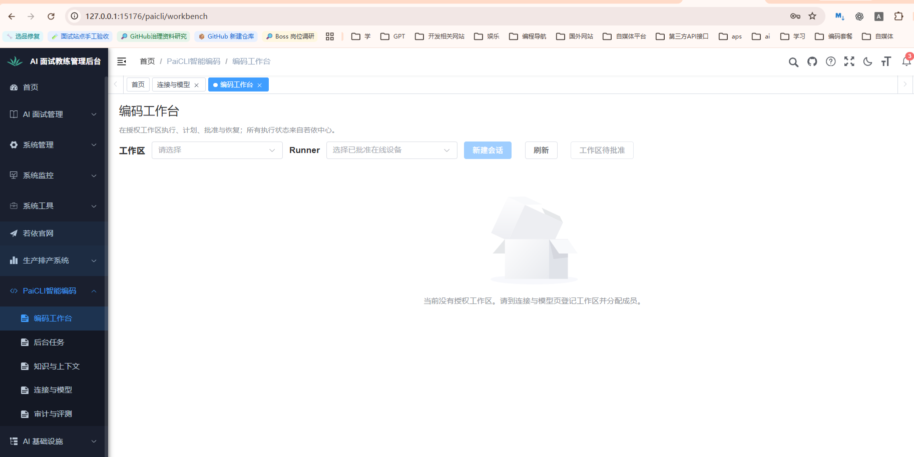
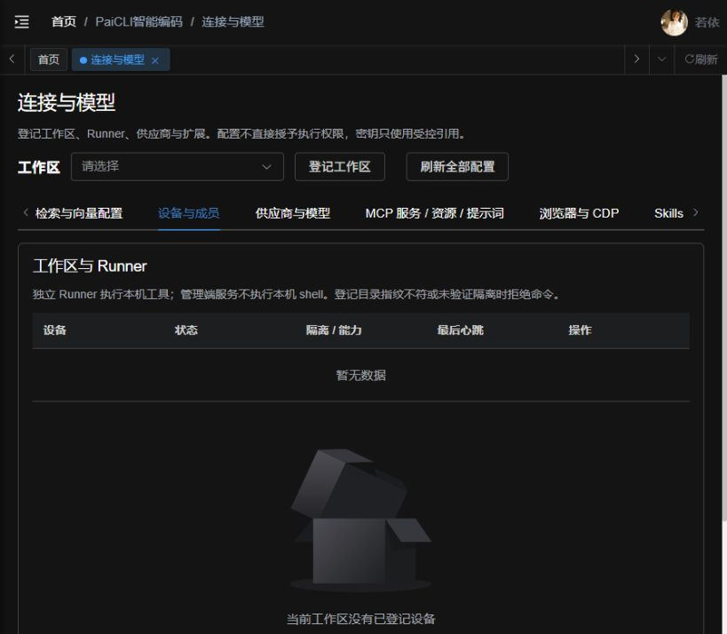
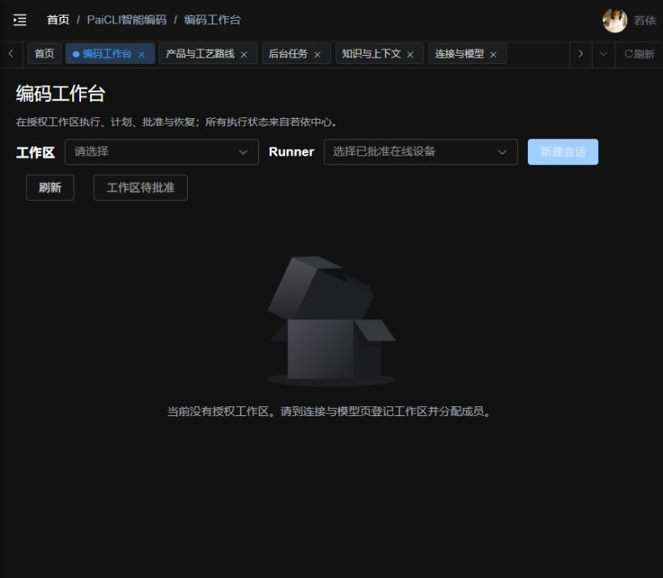
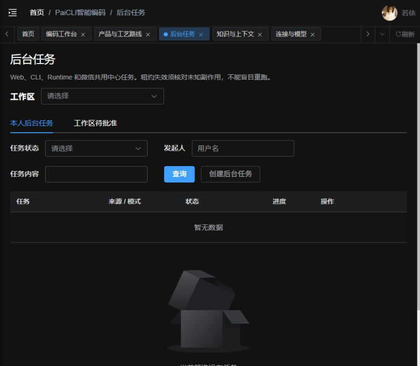
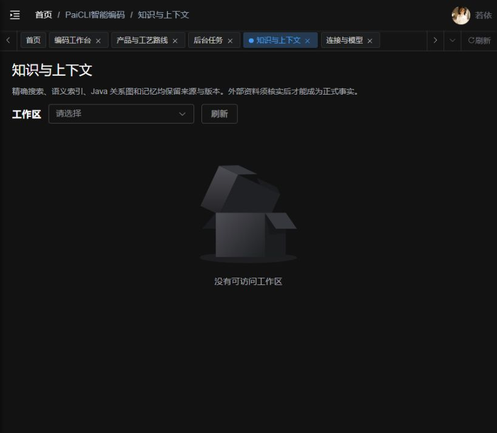
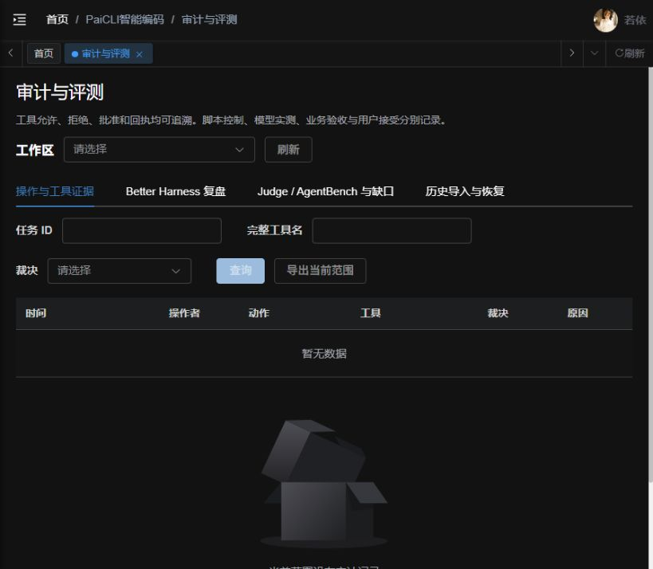

# PaiCLI 页面使用说明

> 文档类型：业务使用说明；版本：1.0；负责人：Agent；日期：2026-10-03。  
> 依据：[完整迁移设计](完整迁移设计.md)1.1，第1～3章；当前五页实现及本次只读页面观察。  
> 用途：解释模块、页面区域、准备顺序和操作方法，供用户审阅后安排完善与验收。  
> 验收要求与结果唯一维护在[完整业务验收记录](证据/2026-10-03-完整功能与数据库/完整业务验收记录.md)，本说明不另维护验收通过状态。

## 1. 为什么现在没有数据

截图中的“当前没有授权工作区”意味着当前用户尚不能选择业务工作根，也没有可用于执行的设备和会话。若依菜单权限使用户能进入页面，工作区成员关系决定用户能访问哪一份代码与资料；两者分别校验。

本次[原库只读核对](证据/2026-10-03-完整功能与数据库/页面说明业务前提只读核对.json)确认：工作区、成员、Runner、供应商、模型、会话、任务、记忆、代码索引均为0。因此这次空白不是现有业务数据被筛选隐藏；启动中心没有替用户创建这些配置。它也不能证明后续业务流程已经成功。

项目现状应理解为已有迁移代码、运行包、页面和技术检查成果，业务使用前提与完整联机验收尚未补齐。旧报告中的构建、单元或受控接口检查，不能代替真实账号、Runner、模型及文件流程。

最新[全链路逻辑验收报告](证据/2026-10-03-完整功能与数据库/全链路逻辑验收报告.html)另有私有制品交付，但该记录明确尚未同步到当前Tomcat。当前打开的页面与后续源码说明分别标明依据，不能把新制品构建成功说成本机运行已更新。



图片为用户提供的现场说明材料。下文其他图片为本次只读打开的空数据页面，已保存并回读；隐藏区域的描述来自当前页面源码，不是已经填好数据的实测画面。

## 2. 五个页面怎样协作

| 页面 | 解决的问题 | 数据从哪里来 | 什么时候开始有内容 |
|---|---|---|---|
| 连接与模型 | 谁能用哪份代码、由哪台设备执行、调用什么模型和扩展 | 工作区、成员、设备绑定及受控配置 | 完成明确范围的配置登记后 |
| 编码工作台 | 对话、发编码任务、看计划、批准影响和恢复文件 | 当前工作区、Runner、模型、会话与执行回执 | 有工作区、在线设备和启用模型，创建会话后 |
| 后台任务 | 查执行状态、日志、批准和异常恢复 | 与工作台、CLI、Runtime、微信共用的中心任务 | 实际提交编码或配置控制任务后 |
| 知识与上下文 | 查代码、看关系、保存事实、管理提示规则与上下文 | Runner派生索引、中心记忆/规则及实际会话 | 配置工作区后出现页内区域，执行相应业务后填充结果 |
| 审计与评测 | 核对允许/拒绝/执行证据，查看复盘和迁移资料 | 中心审计、真实任务、归档报告及导入批次 | 有实际操作和关联证据后 |

Runner是工作机器上的独立执行进程。Tomcat保存正式业务状态和裁决，Runner执行获准的文件工具；网页本身不代替Runner。CLI/TUI是另一种操作入口，Runtime是兼容接口，二者连接同一个中心；本次没有启动它们。

## 3. 从空系统到第一次可验收任务

以下是后续准备流程，不是本轮已经执行的动作。

1. **核对身份。**明确现有开发者、批准者、工作区配置管理员及无成员对照用户。若依按钮权限和工作区成员均须符合职责；管理员菜单可见不等于另一个工作区内容可读。不自动新建账号或扩大角色授权。
2. **选择样本根。**优先沿用[既有A/B样本与独立答案](证据/2026-10-03-完整功能与数据库/本机业务样本基线.json)，A用于正常编码，B用于越权拒绝。文件已准备不等于工作区已登记。首次流程使用独立样本，不把整个Java工作区或系统目录作为默认写入目标。
3. **登记工作区。**进入连接与模型，填写名称、明确的授权根目录、实际根指纹、描述。指纹来自目标Runner同一算法对真实根的核对，不是随便填写64位字符，也不能把路径字符串SHA当成实际文件根指纹。创建者按现有服务逻辑成为该工作区配置管理员；其他成员按若依用户ID和职责分配。
4. **绑定设备。**在设备与成员页登记设备名称及根指纹，生成短期一次性绑定码。交给明确的目标Runner，通过工程README的runner入口完成绑定。核对设备ONLINE、真实平台、发行版本、能力及最后心跳；仅登记一条设备记录不算已在线。
5. **配置模型。**先确定供应商协议、地址、模型ID、受控密钥用途及费用边界，再登记供应商和模型能力。刷新模型是控制任务，须等实际回执。保存配置不等于供应商可用；没有有效模型时不能伪造一个可选项。
6. **第一次任务先读。**在工作台选择A、已在线Runner和已启用模型，新建会话，先只读列目录、读已知样本。将文件内容、路径与独立样本答案核对，确认工作台、后台任务和审计能关联同一任务。
7. **再做有限写入。**后续获准后使用逐次询问，在样本文件上先看完整参数与diff，再批准唯一替换；回读实际文件，并核对拒绝、重复申请、取消及越界路径。
8. **最后拓展能力。**计划、团队、索引、MCP、浏览器、恢复、CLI/Runtime按各自前提推进。微信收发、付费模型及正式评测单独核对范围，不随这份文档自动执行。

本机Windows没有有效REQUIRED命令隔离时，命令执行应拒绝；可以在明确授权范围内检查可用的文件能力。不能为了把“执行命令”验成通过，换用无隔离shell。

### 3.1 Runner 与终端具体怎样接入

工程的[实际启动说明](../../../ruoyi-backend/ruoyi-paicli/README.md)规定：Runner配置`PAICLI_CENTER_URL`为本机中心`http://127.0.0.1:18095`，`PAICLI_WORKSPACE_ROOT`为刚登记的真实样本根，`PAICLI_RUNNER_STATE`为该工作根外的独占私有状态目录。一次性绑定码通过安全输入提供给`PAICLI_RUNNER_TOKEN`，五分钟有效；不贴进普通文档、脚本或命令行参数。后续凭证按中心与真实根指纹缓存。

核对适用冻结制品后，从`ruoyi-backend/ruoyi-paicli/`目录的原分发入口运行：

```powershell
java -jar paicli-cli/target/paicli-cli-3.9.2.jar runner
```

这是后续操作说明，本轮没有运行。当前后续制品位于私有交付目录，正式操作应使用核对后的实际包路径，不能默认旧target已更新。根指纹仍需按真实Runner算法取得；页面没有自动计算向导，这属于待完善的使用缺口。Runner启动报目录权限、根锁、隔离或凭证错误时应保留错误，不通过放宽目录保护继续。

CLI/TUI另用`PAICLI_USER_TOKEN`、`PAICLI_WORKSPACE_ID`、`PAICLI_RUNNER_ID`和`PAICLI_MODEL_ID`连接同一中心及设备；它不会因为网页已登录就自动继承凭证。`PAICLI_RENDERER=inline|lanterna|plain`选择终端形态。只在明确范围提供身份并启动，不能把CLI当成另一套本地任务数据库。

**Sub2API衔接：**统一AI通道设计已移到新对话。本页现有供应商选择为deepseek、glm、hunyuan、step、kimi、freellmapi、xfyun、agnes，没有明确的Sub2API选项；截图中的Responses端点也不能直接证明这些原生适配兼容。后续先完成协议接入决定与必要实现，再登记真实模型。本说明不使用前次截图的明文Key，也不把旧直连供应商作为默认替代方案。

## 4. 连接与模型：先把执行条件准备好

入口：`/paicli/connections`。这是配置页，登记资料后仍须核对执行设备、许可和实际回执。



### 4.1 顶部工作区与登记窗口

- **工作区选择**切换后，下方设备、模型、扩展和策略都属于所选工作区。
- **登记工作区**窗口包含工作区名称、授权根目录、根目录SHA-256、描述。根目录是允许访问的真实仓库边界；中心登记不读取服务器上同名目录，执行设备要重新核对实际根。
- **刷新全部配置**重新读中心数据，不是创建示例资料，也不是重启Runner。
- 登记成功后应刷新仍可读到名称、根、指纹和版本；再次登录对应成员仍能选择该工作区。无成员用户不能读取它。

### 4.2 设备与成员

设备表含设备、状态、隔离/能力、最后心跳、操作。ONLINE代表当前中心看到有效心跳；“命令执行不可用”提示隔离未确认，不代表所有文件工具都已禁用，也不代表文件工具已通过。

“登记Runner”窗口填写设备名称、登记根指纹；生成的一次性绑定码有期限、限定工作区，不能放入报告或聊天。实际设备进程完成绑定后，才能核对列表中的平台、分发版本、能力和心跳。“隔离核验”不能将Windows伪报为已隔离；“撤销”停止后续设备授权，已发生结果仍须对账。

选择工作区后，管理员看到成员表及若依用户ID/职责表单。职责有开发者、工作区批准者、工作区配置管理员。不能移除最后一个工作区管理员；成员变更要刷新回读。工作区批准者用于审阅获授权申请，不能因此读取任意其他用户会话或产物。

### 4.3 供应商与模型

供应商表展示名称、协议、服务地址、密钥状态、状态与操作。配置窗口含供应商、地址、默认启动模型、LoRA ID、受控密钥引用；Key正文只能通过已有托管密钥入口处理，不填在引用框中。默认供应商影响工作区默认选择，不应静默改变已有任务的冻结模型。

模型表展示完整模型ID、上下文Token、图片/工具/思考能力、启用状态和能力配置。添加或修改模型时，填写供应商、完整ID、上下文、输出上限、已核实模板及真实能力；思考强度、推理历史、DSML按该适配实际支持选择。未核实能力不能因为名称相似就勾选支持。

“刷新模型”须有真实控制任务及设备回执，失败保留旧列表。“添加模型”是登记配置；不能据保存成功声称模型完成了一次文本、视觉或工具调用。

### 4.4 检索与向量配置

网页搜索区域包含启用开关、供应商、服务地址、搜索模型、搜索引擎、中心密钥引用。代码语义索引区域包含启用开关、向量供应商、完整向量模型ID、地址及引用。它们分别支撑Web搜索和代码语义检索，不等同于编码模型。

实际查询和索引由授权Runner执行。修改向量模型后需要重建索引；停用配置保留已有索引和审计，但不能继续声称语义结果使用当前可用模型。没有embedding时，应说明语义能力缺项，不能把精确grep结果冒称语义结果。

### 4.5 MCP 服务 / 资源 / 提示词

MCP用于接入外部工具和资料。配置含服务名称、个人/项目范围、STDIO/HTTP传输及对应程序/参数或HTTP地址；环境凭证、请求头凭证均用托管引用，普通协议头单列。

先保存待信任配置，查看本次配置哈希与来源，再信任当前版本。信任不是工具调用许可：STDIO启动执行代码仍需隔离和批准。配置变更后旧信任失效。

详情内有工具、资源、提示词、日志：工具展示能力说明与输入协议；资源按URI请求读取；提示词按目录名称填写必填参数后请求，文字属于不可信任务资料；日志按实际运行结果查看。请求读取通常创建控制任务，要在任务页等待回执，不能只看按钮提示。OAuth、sampling及自动恢复等原未承诺能力不作为已实现能力介绍。

### 4.6 浏览器与 CDP

显示当前连接、错误及目标配置。模式分独立隔离浏览器、共享登录态、断开；根据选择指定受控MCP配置或已登记CDP地址。

“保存目标连接配置”只保存意图；“连接已登记目标”“探活当前连接”“查询实际标签页”通过Runner核对，返回任务不能当成连接成功。标签页表展示真实ID、标题、地址；空列表只有Runner确认后才表示没有页，否则是尚未上报。共享登录态会影响真实账号，须明确使用范围。

本对话用Codex浏览器查看页面，**不等于PaiCLI的browser工具已绑定该浏览器**。不要把两种连接混为一谈。

### 4.7 Skills

列表含名称、描述、来源、启停状态，提供重载、查看正文、启用/停用。同名来源按builtin→user→project覆盖；显示和任务加载要核对实际生效层及内容摘要。停用某名称不能因另一层同名存在而悄悄回退加载。

查看正文是读取资料，正文不能给自己授予文件、命令或外部访问权限。Runner负责加载与验证；没有Runner或实际来源文件时，“未加载可用Skills”不是重载已经通过。

### 4.8 微信 iLink 文本

区域展示通道状态、若依身份/sender、日预算、当前队列及错误；提供申请二维码、绑定用户与sender、启动/暂停/恢复/停止/重启及文本策略配置。

只有明确测试账号、收发对象、工作区及模型后才操作。扫码登录不等于允许收发任务；sender与身份要绑定，副作用仍遵守策略与额度。原能力为文本通道，不据媒体对象推断支持图片或语音任务。本轮不扫码、不发消息。

### 4.9 预算、策略与保留

字段含自动用户原话候选、自动压缩、会话记忆辅助、每用户活跃会话、队列上限、只读并行、写任务并行、命令/批准超时、每任务/每日Token预算、数据保留天数；下方列硬拒绝路径与可申请能力。

保存使用当前版本，过期版本应拒绝覆盖。当前服务边界最多4个只读、1个写任务；命令超时最多60秒、审批最多900秒、队列最多100。限制不能通过表单或人工批准取消。Token用量需区分供应商回执和估算，预算不是已扣费的账单。

## 5. 编码工作台：一次编码工作怎样推进

入口：`/paicli/workbench`。没有工作区时，当前仅显示顶部选择及空状态；下列三列区域要有可访问工作区才显示。



### 5.1 顶部工作区、Runner及新建会话

先选工作区，再选已在线且获准的设备；新会话还需要启用模型。缺任一前提按钮应禁用。新建窗口显示会话标题、工作区、Runner、模型和执行模式，确认后保存正式会话。已有会话绑定设备，不能在执行途中任意切换设备。

“工作区待批准”是授权批准者跨本工作区查看申请的入口；不是只显示自己会话。“刷新”重新读正式状态，不重跑任务。

### 5.2 左侧工作区会话

按标题、模式、状态选择会话，支持分页。历史导入会话只读，旧任务和批准不能复活；要继续工作需创建绑定当前设备与模型的新会话。

### 5.3 中部模型、模式与消息

完整模型ID区显示上下文Token与图片能力。执行模式有直接执行、计划执行、团队协作：直接执行按需逐步使用工具；计划执行先生成依赖步骤并审阅；团队协作由规划、执行、审查角色协作。批准模式另有自动、逐次询问、先计划，负责人工决策策略，不能与执行模式混为一项。

消息区显示用户要求、模型回复及工具结果；最近消息默认有显示范围，完整历史、工具和批准记录要分页查看。事件连接显示已确认位置；断线从该位置续取，游标过期要重新加载，不能把半截响应标成完整答案。

### 5.4 中部任务输入与操作

“任务与补充要求”填写目标、范围及可观察正确结果，支持已允许的@路径、MCP资源和图片。图片附件显示预览、大小和错误，文本模型不应自动接受视觉任务。

“发送任务”创建正式任务；“取消执行”进入取消流程，收到终态前仍可能是取消中。取消不等于恢复文件，也不撤销外部副作用。“工具能力与输入协议”展示中心实际能力快照，不因列出工具就代表已信任或可执行。

示例：后续在A的已知CRLF样本上要求“先读原文，只将唯一指定行替换，其他内容与CRLF不变；遇到重复匹配先停止”。正确答案来自样本原文和预期diff，而不是模型说“已完成”。

### 5.5 右侧计划与团队审查

显示计划版本、状态、重规划次数、步骤、依赖、角色、尝试、审查及保留产物。填写补充要求后修订会生成新版本，旧批准失效；“确认当前版本并执行”只对当前有效DAG生效。团队审查的模型结论与实际文件验证分别核对。

### 5.6 右侧待批准操作及完整影响

展开申请查看完整工具名、发起人、工作区/设备、根指纹、输入摘要、计划/策略/申请版本、有效期、完整参数、作用路径、diff和恢复预览。批准当前参数、拒绝、跳过或修改后重新审查都绑定本次申请；不能批准后偷偷换参数，也不能人工放开硬拒绝。

### 5.7 右侧上下文与诊断

显示估算Token/窗口、消息数、压缩次数及供应商usage来源。提供压缩上下文、清空模型上下文、清理输入历史、收齐导出证据；三种清理的作用不同，原始审计账本仍保留。

折叠区包括提示层/规则来源、超大工具结果及产物、文件诊断。完整产物需分页/下载核对字节与摘要；“没显示在首批”不等于不存在。Java语法诊断需要真实文件和行列；没有诊断不等于全工程通过，其他语言不能冒称完整LSP。

### 5.8 快照与恢复窗口

选择同会话快照，先请求恢复差异，再读取Runner已上报预览，核对文件路径、动作、当前与目标SHA、模式、完整diff及冲突，之后才提交恢复申请。有人在预览后改文件，应拒绝旧预览恢复。恢复只处理获准文件，不撤销已经执行的shell/MCP/外部操作。

## 6. 后台任务：看真实执行状态与异常

入口：`/paicli/tasks`。任务由中心统一保存，切换Web、CLI或Runtime不会形成另一套正式任务。



### 6.1 顶部与列表

选择工作区；“本人后台任务”按任务状态、发起人、任务内容筛选。“工作区待批准”供有决定权限者审阅获准申请，不等于可浏览工作区所有人的私有任务。

表格显示任务、来源/模式、状态及失败原因、进度、发起人、更新时间、Token及详情/取消。进度和用量未上报时应明确“等待上报”，不能伪造100%或0Token。查询无结果先检查工作区与筛选，之后核对是否确有任务。

“创建后台任务”填写标题、在线Runner、启用模型、执行模式、任务与验收。提交后保持同一任务ID，并可在详情再次读到输入；不用留在工作台对话也可查看进展。

### 6.2 任务详情抽屉

顶部看尝试、执行隔离令牌、租约有效期和最后确认事件；“刷新真实状态”重新读取中心。四个页签分别是：

- **工具与事件：**完整参数、实际结果/错误、事件顺序和完整产物，找到关联批准。
- **计划与团队：**步骤依赖、角色、产物及审查；导入历史只读。
- **人工批准：**申请状态与完整影响，进入批准窗口处理。
- **恢复核对：**仅未知结果需要，显示最后工具结果、当前文件diff、未知副作用、允许的核对结论、当前文件指纹与证据说明；提交不是“重试一次”。

### 6.3 重要状态怎样理解

| 页面状态 | 应怎样处理 |
|---|---|
| 排队 / 已租用 / 执行中 | 查看设备、进度和事件，不重复提交同一副作用 |
| 等待批准 / 等待审阅 | 先读当前申请或计划的完整版本 |
| 取消中 | 等停止及最终回执，不提前认定已取消 |
| 完成 | 仍需核对产物、文件和业务要求 |
| 失败 / 已取消 | 保留已发生结果及原因，不能当成自动回滚 |
| 租约失效待核对 | 先对账，再选择中心允许的处理；不能盲目重跑 |
| 迟到回执已归档 | 记录原执行证据，不推进新尝试 |

## 7. 知识与上下文：代码证据、长期事实及提示规则

入口：`/paicli/knowledge`。当前没有工作区，所以页内五个业务区域尚未展开。



### 7.1 仓库检索与关系图

显示索引状态、版本、文件数、向量模型和错误；建立/重建索引由Runner执行。填写函数、类型或调用关键词，选择精确代码搜索或语义辅助搜索，查看路径、行号、来源、摘要和片段。关系图展示Java AST节点及关系，同时保留完整节点/关系表。

图稿最多展示前80个节点，下表仍要保留完整返回内容；修改文件后旧结果应标失效，重建后再核对。查看图不等于证明extends、implements、imports或calls关系正确，须与原样本代码对照。

### 7.2 长期记忆与冲突

范围有当前工作区和当前用户个人偏好；分别决定项目成员可见或本人跨工作区可见。列表显示内容、核实状态、最后核实及操作。

“明确记住一条”填候选内容及可核对来源，先保存为待核实。“核实”要有来源依据；重复内容应关联原条目。冲突弹窗保留候选与真实冲突项，明确选替换当前版本、保留两条或取消；成功HTTP响应不等于冲突候选已入库。超过30天提示重新核实，不能擅自把旧事实改成新事实。

### 7.3 PAI 项目规则

登记与核对个人PAI、根PAI、.paicli/PAI、PAI.local、.paicli/PAI.local来源，展示原相对路径、版本、状态和原文SHA。登记原始规则时选择来源层、路径及正文/已上传原文产物，显式提供import资料；中心不会为了找import任意读取服务器目录。

原文与派生上下文分别核对；当前规则限制import最多3层、派生合计24000字符，保留完整原文与摘要。提示规则不能扩大执行权限，也不能代替用户批准。

### 7.4 提示词覆盖

个人或项目按原相对资源路径覆盖提示词，显示范围、版本、正文摘要、启停。添加时填范围、路径及完整正文；项目优先于个人，发行包builtin保留。提示词正文最多65536 UTF-8字节；更新不能变更已登记归属与路径。

只保存模板仍须在真实会话原始提示层核对实际生效来源及顺序，不能只凭模型复述它已读到某条规则。

### 7.5 会话上下文 / PAI / 提示层

选择当前工作区会话后，查看工作台同一上下文面板：估算和供应商用量、提示层来源、完整账本、压缩/清空的作用、产物和诊断。原始正文需要独立权限。历史、产物及事件分别分页，不能把默认显示范围当作全部记录。

## 8. 审计与评测：核对证据及历史迁移

入口：`/paicli/audit`。这页回答“系统为什么允许/拒绝、实际做了什么、证据是否完整”。



### 8.1 操作与工具证据

按工作区、任务ID、完整工具名、裁决筛选。列表显示时间、操作者、动作、工具、裁决、原因、证据；详情关联任务/会话、批准、事件序号、用量和获授权原始产物。

至少要看到允许、拒绝及实际执行的对应轨迹。同一工具调用的批准、许可消费、回执要能对上，不能只看一条“执行完成”。缺供应商回执应注明缺证据，不用估算冒充实际计费。

### 8.2 Better Harness 复盘

选择实际会话及quick/normal/inline，申请复盘，等待中心任务与Runner结果；列表显示方式、状态、摘要、时间与报告产物。它用已有结果与检查辅助解释，不等于工程已通过或正式模型成绩。是否调用模型及费用需按实际配置和授权核对。

### 8.3 Judge / AgentBench 与缺口

展示归档评测名称、方式、状态、能力/配方差距、缺失证据、控制项结果及报告。页面正式模型评测保持暂停；导入资料只归档，正式分数为空或不可发布时不显示正式总榜，也不把未评测写成0分。

### 8.4 历史导入与恢复

上传`export-legacy`生成的脱敏`paicli-legacy-v1` JSON，填写旧身份→若依用户ID映射，以及需要时的源附件SHA→中心产物ID映射；先看预检条数、秘密、未映射身份、冲突及版本，再明确提交本批。

预检前的上传会写私有资料产物，预检不等于业务记录已导入。禁止含秘密或未知身份资料直接提交；旧running任务暂停待核对，旧批准过期，历史会话只读。重复导入不能重复写，撤销只处理本批且保护后续编辑。原库恢复演练是另外的运维动作，不是按“撤销导入”已经完成数据库灾备。

## 9. 本次供用户检查的内容及待完善点

先检查页面用途、字段和操作顺序是否符合你的实际工作方式，然后按[同一17项详细验收清单](证据/2026-10-03-完整功能与数据库/完整业务验收记录.md#2-逐项业务验收)审阅正常、拒绝、异常、保存后回读与证据核对方法。

目前可指出的使用缺口是：页面需要工作区却没有登记引导流程；根指纹要求用户自行提供，缺少当前页面可直接取得的向导；设备绑定还要在独立进程完成；Sub2API协议未完成统一接入；没有可立即操作的已授权样本工作区、模型与会话。这些先作为用户审阅的完善对象，本轮不新增功能或预填假数据。

后续完善与验收宜按“工作区及身份→Runner→统一模型通道→第一次只读任务→样本批准写入→异常/恢复→其余扩展”的依赖推进。其他业务项目菜单来自共享若依权限，即使菜单仍可见，也不代表18095实例启用了它们；本说明只解释PaiCLI五页。

实际启动版本与源码差异继续以[运行核对](证据/2026-10-03-完整功能与数据库/用户自行验收共享环境启动核对.json)和[唯一实施记录](开发记录/2026-10-03-完整迁移实施记录.md)为准。启动时发现三个API源文件晚于固定包，后续另有ReAct、Skill许可、Runtime和微信私有制品修复，尚未同步；正式执行前应冻结适用前后端/Runner版本，不能用说明文档认定版本已更新。HTML阅读版从本说明和唯一验收记录生成，不是另一套业务要求或结果来源。
