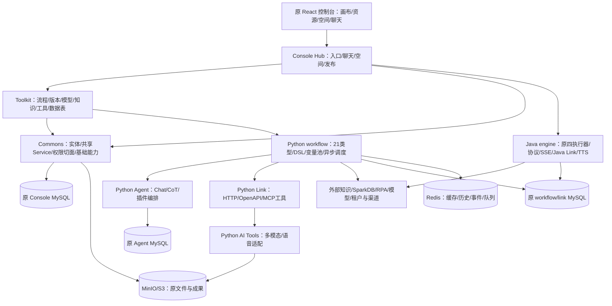

# PaiFlow 原项目复现与学习设计

> 类型：本地源码调查、架构与业务复现参考；版本：1.0；日期：2026-10-04；负责人：当前调查执行者。  
> 来源：本工作区 `参考项目/PaiFlow-main`，以本地实际源码为依据；本次没有拉取上游最新版、启动参考服务、连接业务数据库或调用供应商。  
> 适用范围：理解原项目、复现原行为、承接已批准迁移方案、学习与扩展、建立迁移完整性判定方法。本文不维护另一套开发状态。  
> 上游决定：[完整迁移设计](完整迁移设计.md)；实际实施和验证：[设计资料核对记录](设计资料核对记录.md)；完整定位：[源码覆盖索引](源码覆盖索引.md)。  
> 调查基线：[源文件清单](证据/2026-10-04-原项目复现调查/源文件清单.csv)、[源码基线](证据/2026-10-04-原项目复现调查/源码基线.json)、[原压缩包成员](证据/2026-10-04-原项目复现调查/压缩包成员清单.csv)、[源文件到目标候选](证据/2026-10-04-原项目复现调查/源文件目标候选对照.csv)、[依赖声明清单](证据/2026-10-04-原项目复现调查/依赖声明清单.csv)。基线的文件数量与哈希只证明调查对象，没有证明运行或迁移完成。

## 1. 业务目标、产品特点与复现边界

PaiFlow 面向需要把“大模型回答”转换为可编排业务过程的使用者。编排者先在空间里维护智能体、模型、知识、HTTP/MCP 工具与数据表，再把输入、检索、推理、判断、工具、交互和输出连成工作流；使用者通过聊天或应用接口触发已保存的流程，得到文字、引用来源、文件、图片、音频等成果。管理者管理空间成员、版本、发布渠道、执行历史与用量。它的核心学习价值是从画布配置到 DSL、节点调度、变量传递、流式事件和外部能力适配的完整结构，而非某个模型 SDK 的调用示例。

原项目有三项鲜明特点。第一，ReactFlow 画布与不同节点的属性编辑、变量引用、单节点调试、子画布、版本管理和聊天联动，覆盖了相当多的编排交互。第二，业务管理 Console 和实际运行 Core 分开，Python 引擎具有更多节点，Java 引擎提供一部分节点及语音集成。第三，同一个平台包含知识管理、工具市场、MCP、数据表、RPA、空间、聊天和渠道发布；这些功能的本地完成度不相同，部分功能只是外部服务客户端或占位代码。

本地源码允许作以下明确区分：

| 原项目介绍 | 2026-10-04 本地事实及对复现的影响 |
|---|---|
| 双引擎、支持多种节点 | Python `tool_classes` 注册 21 个类型，包括迭代开始/结束；Java 只有 Start、End、LLM、Plugin 四类执行器。Java 枚举包含其他类型不能证明其执行逻辑存在 |
| Java 使用 LangGraph4J、虚拟线程 | 当前 Java POM 没有 LangGraph4J 依赖；实际 `WorkflowEngine` 自建图和递归调度，`ParallelWorkflowEngine` 使用 `Executors.newCachedThreadPool()`，不是虚拟线程 |
| PostgreSQL 保存工作流 | Python 数据库工厂实际拼装 `mysql+pymysql` URL；当前 Compose 和 SQL 初始化使用 MySQL。`database` 节点通过 HTTP 调用 PG/SparkDB 服务，它与平台元数据库是两种职责 |
| Go 租户、独立知识库、记忆与 RPA 服务 | 本地没有 `core/tenant`、`core/knowledge`、`core/memory`、`core/plugin/rpa` 工程。存在表、客户端或节点，不能复现未提供的服务端算法 |
| OAuth2/企业级认证 | 本地 `SecurityConfig` 设置 `anyRequest().permitAll()`，注释了 Resource Server，并加入 `MockUserFilter`。空间权限切面存在，但不能据此认定身份真实性已验证 |
| 一键部署完整服务 | 当前 Compose 只有 MySQL、Redis、MinIO、Console frontend、Hub、Java workflow；没有 Python workflow/Agent/Link/AI Tools、PG 或租户/知识/RPA 服务 |
| 五渠道发布 | 市场、API、MCP、微信、飞书有策略/接口；部分 API/飞书为空实现、MCP 未实现、微信与外部租户/发布服务不完整，需以真实回执判断 |
| 多语言代码节点 | Python `CodeNode.codeLanguage` 实际限制为 `Literal["python"]`。local/ifly/langchain 是执行方式，不等于支持 JavaScript/Java 等语言 |

事实出处：[Java POM](../../../参考项目/PaiFlow-main/core-workflow-java/pom.xml)、[Java 并行引擎](../../../参考项目/PaiFlow-main/core-workflow-java/src/main/java/com/iflytek/astron/workflow/engine/ParallelWorkflowEngine.java)、[Python 数据库工厂](../../../参考项目/PaiFlow-main/core/workflow/extensions/middleware/database/factory.py)、[原安全配置](../../../参考项目/PaiFlow-main/console/backend/hub/src/main/java/com/iflytek/astron/console/hub/config/SecurityConfig.java)、[原 Compose](../../../参考项目/PaiFlow-main/docker/PaiFlow/docker-compose.yaml)、[已定位占位出处](源码覆盖索引.md#8-已定位的占位及缺口出处)。原 README 是产品意图与说明，以上结论以实际调用链、注册项和部署配置为准。

“复现整个项目”应分成两个可观察目标：本地具备实现的行为按原规则重建；只有客户端/缺失服务的能力补齐协议和真实依赖后完成业务闭环。不能把原项目未提供的部分称为已经照搬完成，也不能在迁移时静默删掉它们。

## 2. 原用户流程与前端结构

### 2.1 编排者与使用者怎样操作

编排者进入个人默认区域或具名空间，创建智能体并设置名称、头像、背景、开场白、推荐问题及流程关系。画布页添加节点，配置模型、提示词、变量、资源及边的分支 handle，保存后进行构建校验；可以先调试单节点，再调试整图，检查节点输入/输出、耗时、错误和流结果。确认行为后创建/选择版本，通过支持的渠道发布。使用者打开智能体聊天入口，输入文字或附件；前端展示正文、推理、工具过程、知识引用、文件和音频，问答节点需要补充时显示问题/选项并提交继续。历史、重新回答、收藏、分享与删除是独立操作，不能由一次 SSE 成功推定它们已持久化。

默认个人区域不是“第一个具名空间”：原空 `space-id`/NULL 空间与 UID 组合表示个人资源。迁移已经批准保留其语义，并映射中心的隐藏 `default_personal` 域，详情见[身份与默认个人域决定](完整迁移设计.md#32-权限数据所有权与公开调用)。学习时必须追踪空值语义，不能把空空间 ID 当成全空间权限。

### 2.2 入口、组件和状态职责

| 原入口 | 用户行为与关键实现 |
|---|---|
| `/login`、`/callback` | 本地登录/Casdoor 回调相关 UI、token 与用户展示；不能仅凭出现回调页认为生产 SSO 已接通 |
| `/space/*`、`/space/config/*` | 智能体列表/创建，空间与企业、成员、邀请/申请、权限、通知等配置 |
| `/work_flow/:id/arrange` | ReactFlow 画布、节点列表、属性面板、变量树、Monaco、构建/保存/调试、子画布、版本/发布 |
| `/chat/:botId/:version?` | 智能体聊天、文件预览、重新回答、推理/工具过程、音频及录音交互 |
| `/management/model*` | 官方/个人模型、详情、类别、参数配置和检测 |
| `/resource/*` | 知识库/文档/分段/命中测试、插件与 MCP、数据库/表/字段/行、RPA/助手 |
| `/sharepage` | 分享记录/对话展示；公开可见与登录态资源访问要分别判断 |

精确路由见[router/index.tsx](../../../参考项目/PaiFlow-main/console/frontend/src/router/index.tsx)。画布节点组件映射见[workflow/constant/index.tsx](../../../参考项目/PaiFlow-main/console/frontend/src/components/workflow/constant/index.tsx)，状态分别位于[全局 store](../../../参考项目/PaiFlow-main/console/frontend/src/store)和[工作流 store](../../../参考项目/PaiFlow-main/console/frontend/src/components/workflow/store)；它们保存选择、编辑态、画布和流展示，不应被迁移成第二份正式业务状态。请求消费者见[services](../../../参考项目/PaiFlow-main/console/frontend/src/services)及[直接请求索引](源码覆盖索引.md#10-服务目录之外的直接请求)。学习时同时查看 `services` 和组件中的 axios/fetch/WebSocket/SSE，不能只统计服务目录。

原 UI 包括语言切换、Markdown/GFM、公式与代码高亮、图片预览、上传压缩、头像/背景裁剪、音频播放器、录音、Lottie、ECharts 等配套。图片、SVG、字体、音频、JSON 动画、CSS、词条与 `public` 是交付的一部分，不能只复制 `.tsx`。Monaco 编辑器与 ReactFlow/布局组件的构建资源也需要核对。

本文没有新增或修改界面。可查看[已批准保留范围图稿](图稿/界面设计.html)与[画布图](图稿/02-画布编排与运行.png)、[对话图](图稿/05-对话与播客成果.png)。它们是原前端接入的范围示意，不是原系统运行截图，也不是重新设计原页面的依据。原视觉与组件直接保留，接入边界见[前端保留决定](完整迁移设计.md#2-前端保留与接入设计)。

## 3. 技术栈、工程职责与原数据模型

### 3.1 技术版本应怎样理解

| 层 | 本地明确声明/锁定的版本 | 依据与注意事项 |
|---|---|---|
| Console/Java engine | Java 21；Spring Boot 3.5.4；MyBatis-Plus 3.5.7；Fastjson2 2.0.51；OkHttp 4.12.0；Lombok 1.18.32 | 两份 POM 独立；不能直接混入共享若依父 POM |
| Console 配套 | SpringDoc 2.8.5、MapStruct 1.5.5.Final、Redisson 3.30.0、MinIO Java SDK 8.5.10、讯飞 SDK 2.1.5 | 来自 Console 父 POM 的版本管理；是否实际使用要沿 import 与调用判断 |
| Java engine 配套 | Spring AI BOM 1.1.2、DashScope SDK 2.22.3、TTL 2.14.5、MinIO SDK 8.5.7 | 与 Console 的 MinIO/Guava 声明不同，不能合并成一个未经验证的版本 |
| React 前端 | npm lock：React 18.3.1、TypeScript 5.9.2、Vite 5.4.19、ReactFlow 11.11.4、Ant Design 5.19.1、Recoil 0.7.7、Zustand 5.0.7 | package.json 使用部分范围声明，如 `react ^18.2.0`；这里是 `package-lock.json` 记录，不是现场已安装版本 |
| 前端路由/样式 | npm lock：react-router-dom 6.22.3、react-router 7.7.1；Tailwind声明3.3.5；Monaco声明0.52.0 | 两个路由包版本同时存在，要按真实 import/锁文件保留和检查，不推定统一升级为 v7 |
| Python workflow | Python≥3.11；FastAPI 0.111.1、Pydantic 2.9.2、SQLAlchemy 2.0.31、uvicorn 0.30.1、OpenAI 1.60.2、Redis Python 3.5.3 | pyproject 有明确 `==`，其他包还有范围/条件；SQLModel/PyMySQL、OTLP、Kafka、S3、视频等依赖以完整清单核对 |
| Python Agent | Python≥3.11；FastAPI≥0.115.12、OpenAI≥1.69.0、SQLAlchemy==2.0.30、uvicorn≥0.34.0 | 不能沿用 workflow 的版本声称 Agent 同版本；`uv.lock` 保存解析基线 |
| Python Link | FastAPI≥0.111.0、SQLModel≥0.0.18、Pydantic≥2.11.7、MCP==1.6.0、Redis==3.5.3 | OpenAPI验证、JSON Schema、SSE/MCP、HTTP、加密与计量等属于工具执行支撑 |
| Python AI Tools/common | AI Tools：Pydantic==2.9.2、FastAPI≥0.110.2、OpenAI≥1.40.6；common 项目版本9.9.9 | 包项目版本不是框架版本；语音、图像、OCR、S3、OTLP、审计/计量均须逐项保留或给等价替换依据 |
| 当前 Compose | MySQL 8.4、Redis 7、MinIO RELEASE.2025-07-23T15-54-02Z | Redis `:7` 是浮动主版本 tag，不是精确补丁锁；部署复现要记录镜像 digest |

版本依据：[前端 package.json](../../../参考项目/PaiFlow-main/console/frontend/package.json)、[npm lock](../../../参考项目/PaiFlow-main/console/frontend/package-lock.json)、[pnpm lock](../../../参考项目/PaiFlow-main/console/frontend/pnpm-lock.yaml)、[Console POM](../../../参考项目/PaiFlow-main/console/backend/pom.xml)、[Java engine POM](../../../参考项目/PaiFlow-main/core-workflow-java/pom.xml)、[workflow pyproject](../../../参考项目/PaiFlow-main/core/workflow/pyproject.toml)、[Agent pyproject](../../../参考项目/PaiFlow-main/core/agent/pyproject.toml)、[Link pyproject](../../../参考项目/PaiFlow-main/core/plugin/link/pyproject.toml)、[AI Tools pyproject](../../../参考项目/PaiFlow-main/core/plugin/aitools/pyproject.toml)。存在 npm/pnpm、common 的 uv/poetry 多份锁文件时，应选实际构建所使用的工具并留下决定，不同时宣称几套解析结果都等价。

### 3.2 组件与信任边界

图是源码职责全景，图中 Python 与外部服务并不表示当前 Compose 已部署。Hub 是 Spring Boot 装配入口，`commons` 和 `toolkit` 是 Maven 模块，不要把每个模块当成单独端口微服务。Java engine 同时有工作流和 `com.iflytek.astron.link` 工具相关代码；Python Link 不是唯一工具实现。Python common 提供设置、数据库/Redis/对象存储、HMAC、审计、计量、Kafka、OTLP，并不能凭包名认定它是独立服务。

### 3.3 表、关系与持久化职责

原 [schema.sql](../../../参考项目/PaiFlow-main/docker/PaiFlow/mysql/schema.sql) 有 145 个 `CREATE TABLE`。这些表包括活跃功能、配置、历史备份与未完整功能；145 不是“145 个已实现业务”。其他文件有 Agent `bot_config`、Link `tools_schema`、workflow `app/app_source/flow/license/workflow_node_history`、tenant `tb_app/tb_auth`。全表及保留/迁移归类沿用[SQL全表索引](源码覆盖索引.md#6-原-sql-全表覆盖与迁移归类)，不在此另建状态表。

| 数据聚合 | 主要表/关系 | 学习与迁移应保持的语义 |
|---|---|---|
| 身份、空间与企业 | `system_user/user_info`，`agent_space/agent_space_user/agent_space_permission`，企业、邀请、申请表 | 用户身份→成员关系→空间资源授权；默认个人 NULL 域和具名空间分开。迁移不复制旧账号/密码/角色权威 |
| 智能体与资源绑定 | `chat_bot_base/chat_bot_list/chat_bot_market`，`bot_flow_rel/bot_repo_rel/bot_tool_rel/bot_model_bind` | 智能体配置与引用不是资源实体本身；复制须重建关系和拥有者，不能把原主键/secret原样当新权限 |
| 草稿、版本、调试 | `workflow/workflow_version/workflow_comparison/workflow_node_history/workflow_dialog`，`flow_protocol_temp` | 草稿可以变，发布版本要固定；画布布局和执行 DSL 有转换；比较临时快照不能覆盖正式版本 |
| 聊天与成果 | `chat_list/chat_info/chat_req_records/chat_resp_records/chat_reason_records/chat_trace_source/chat_token_records`，附件/分享表 | 一次请求关联会话、请求、回答/推理、工具数据、引用、Token与附件；重新回答/分支关系必须保留 |
| 知识 | `repo/file_info/file_info_v2/file_directory_tree/knowledge/preview_knowledge/upload_doc_task/extract_knowledge_task/hit_test_history` | 文件→解析/分段任务→分段/预览→检索测试；源文件、任务状态和知识引用比索引文件更权威 |
| 模型与提示 | `model/model_category/model_common/model_list_config`，prompt/text config | 模型能力/参数/凭据与提示词模板分开；版本快照应引用准确资源配置 |
| 工具、MCP、RPA | `tool_box/tool_box_operate_history`，`mcp_data/mcp_tool_config`，`rpa_info/rpa_user_assistant/rpa_user_assistant_field`，`tools_schema` | 目录元数据、工具schema、调用协议和外部执行是不同事实；有RPA配置不代表有Runner |
| 数据表与发布 | `db_info/db_table/db_table_field`，`flow_db_rel/flow_release_channel/flow_release_aiui_info`，API/公众号表 | UI数据表元数据与外部SparkDB业务数据不能混淆；发布“标记”与外部可用回执分别迁移 |
| 通知、用量及遗留 | `notifications/user_notifications`，统计/计量/训练/声线/备份表 | 未消费/备份表先保全和认定，不能由表名推断训练、支付、克隆已完成或直接删除 |

平台元数据库实际 MySQL，节点中的 PG 客户端实际发往 `${PGSQL_BASE_URL}/xingchen-db/v1/exec_dml`。原知识节点发往 `${KNOWLEDGE_BASE_URL}/knowledge/v1/chunk/query`，专业知识节点发往 `${KNOWLEDGE_PRO_BASE_URL}/knowledge/v1/agent/achat`，RPA 发往 `${RPA_BASE_URL}/rpa/v1/exec`。这些配置名说明依赖位置，文档不记录真实地址或密钥。

## 4. 后台处理与核心业务逻辑

### 4.1 从画布保存到可执行图

Console 工作流入口覆盖列表/CRUD、复制、构建、单节点与代码调试、导入/导出、版本、对话记录、比较、反馈、模板、MCP环境参数及高级配置，见[原 WorkflowController](../../../参考项目/PaiFlow-main/console/backend/toolkit/src/main/java/com/iflytek/astron/console/toolkit/controller/workflow/WorkflowController.java)。画布节点与连线先转成运行 DSL，执行器不能直接把 ReactFlow 的视觉对象当业务图。

Python [workflow_dsl.py](../../../参考项目/PaiFlow-main/core/workflow/engine/entities/workflow_dsl.py) 定义 `nodes/edges`。节点 `id` 使用 `<类型>::<标识>`，`data` 包含 `inputs/nodeMeta/nodeParam/outputs/retryConfig`；输入的 `schema.type` 是 string/boolean/integer/number/array/object，`schema.value.type` 为 `literal` 或 `ref`，引用内容为 `nodeId/name`。连线用 `sourceNodeId/targetNodeId/sourceHandle`，handle 决定条件、意图或失败分支。Python `NodeFactory` 实际由 ID 前缀取类型并查 `tool_classes`，所以 nodeMeta、ID、表单类型不一致不是无害展示差异。

`flow_service.build` 构造引擎，`dsl_engine` 建节点、前后依赖、消息/结束依赖、迭代子图和分支；运行的 `VariablePool` 按节点和输出名保存变量，系统变量包括 query/files/conversation_id/user_id。节点从常量或引用读取输入，成功后输出写回池并沿选定边继续。控制台保存/版本记录与 Core `flow` 记录不应在迁移后保留两份可写真相。

源代码：[flow_service.py](../../../参考项目/PaiFlow-main/core/workflow/service/flow_service.py)、[dsl_engine.py](../../../参考项目/PaiFlow-main/core/workflow/engine/dsl_engine.py)、[node.py](../../../参考项目/PaiFlow-main/core/workflow/engine/node.py)、[variable_pool.py](../../../参考项目/PaiFlow-main/core/workflow/engine/entities/variable_pool.py)。复现要分别验证不存在的引用、类型错误、未知节点、断边、分支未命中、迭代内外非法引用及循环；“JSON 能解析”不是“图可执行”。

### 4.2 21 个 Python 节点的真实处理与学习练习

本表以[实际注册表](../../../参考项目/PaiFlow-main/core/workflow/engine/nodes/cache_node.py)为准，路径均相对于 `core/workflow/engine/nodes/`。Java 对应实际只有开始、结束、LLM、工具四种；其余应走完整 Python 能力或按批准方案补齐，不能静默跳过。

| 节点类型 | 原实现与输入→处理→输出 | 必须复现/验收的区别 |
|---|---|---|
| `node-start` | `start/start_node.py`：开始参数→默认/输入处理→系统与普通变量 | 必填/空值、文件与结构化输入，不把缺参数补成虚构用户输入 |
| `node-end` | `end/end_node.py`：变量/模板/流依赖→归集→最终回答 | Python outputMode 0变量、1提示、2旧提示；Java0直接、1变量。不能跨引擎直接按数字等价 |
| `spark-llm` | `llm/spark_llm_node.py`：提示、历史、文本/图像/视频、模型参数→Spark或OpenAI provider→正文/推理/用量 | 模型参数传递、历史scope、结构化输出、首帧/终帧、空回答与供应商失败 |
| `plugin` | `plugin_tool/plugin_node.py`：工具与版本/参数→Link执行→schema约定结果 | app/tool/version及必填字段一致，超时/坏结果与真实外部动作分别判断 |
| `knowledge-base` | `knowledge/knowledge_node.py`：query/repoId/docIds/topN/score/ragType→HTTP检索→命中片段及来源 | 无命中与依赖不可用分开；来源能定位源文档；本地未提供检索服务端 |
| `knowledge-pro-base` | `knowledge_pro/knowledge_pro_node.py`：策略、库/文档、模型、query→远端RAG问答→流式答案/来源 | CBG等策略参数预检、文档约束、流格式和失败；不是普通知识节点的别名 |
| `extractor-parameter` | `params_extractor/pe_node.py`：用户文本与字段描述→LLM提取→结构化输出 | 类型/必填/默认与输出schema；不能以合法JSON认定信息提取正确 |
| `decision-making` | `decision/decision_node.py`：query与分类提示→模型选择意图→source handle | 选中与回退分支、非法分类，不能让模型改变工具授权 |
| `if-else` | `if_else/if_else_node.py`：变量、操作符、AND/OR→确定性判断→分支 | 空值、数组/对象、数字/字符串、布尔比较；不运行未选择支路 |
| `message` | `message/message_node.py`：模板与变量/上游流→中间消息 | 中途消息不等于工作流结束；并发上游仍按依赖输出 |
| `iteration` | `iteration/iteration_node.py`：集合与子图→每项子执行→聚合 | 空集合、序号、变量隔离、结果顺序、异常处理；嵌套不是普通环 |
| `iteration-node-start` | 同上：迭代项和索引→子画布起点 | 只能处于合法容器；外部变量引用与本轮变量分开 |
| `iteration-node-end` | 同上：单项子输出→容器归集 | 上一轮输出不能串入下一轮，不由某一轮结束提前关闭外部流 |
| `text-joiner` | `text_joiner/text_joiner_node.py`：mode0模板拼接、mode1按separator分割→文本/数组 | 空分隔符/空项、数组顺序、换行与Unicode；不是只有字符串相加 |
| `node-variable` | `global_variables/global_variables_node.py`：set/get→Redis变量管理→读写值 | key涉及flow_id/uid/app_id/chat_id；会话、用户、应用、流程不能串数据 |
| `flow` | `flow/flow_node.py`：子flow及输入→调用子流程→合并流/结果 | 子版本、输入/输出映射、取消传播和递归边界；须防循环引用 |
| `agent` | `agent/agent_node.py`：策略/提示/工具/知识→Agent服务→推理/调用步骤/答案 | 轮数/工具选择、非法工具、知识引用、费用与权限，不把模型计划当授权 |
| `question-answer` | `question_answer/question_answer_node.py`：问题/选项/槽位→中断等待→resume/ignore/abort | 自由文本和选项分开；超时/重复恢复/错误eventId；等待不能标成功 |
| `database` | `pgsql/pgsql_node.py`、`pgsql_client.py`：mode0自定义、1增、2改、3查、4删→DML与HTTP服务→结果 | 测试/正式环境、过滤AND/OR/排序/limit、写入回读；PG语法不自动全部等价MySQL |
| `rpa` | `rpa/rpa_node.py`：助手/项目参数→HTTP SSE Runner→执行结果 | 外部动作是否发生、未知状态、取消、超时，副作用不能盲目重试 |
| `ifly-code` | `code/code_node.py`：Python函数与参数→local/ifly/langchain执行器→类型校验结果 | Python语言限制、输入注入、超时、结果类型；local模式不能直接当迁移后的安全沙箱 |

节点配置的完整机器集合沿用[目标节点目录](../../../contracts/paiflow/node-catalog.json)，原源码每个节点的精确路径见[节点索引](源码覆盖索引.md#节点与多模态工具源码)。表中验收目标不是已通过记录。

### 4.3 Python 运行、并发、SSE 与恢复

请求从 `/workflow/v1/debug/chat/completions` 或 `/workflow/v1/chat/completions` 进入；历史 `/sparkflow/v1` 与 `/v1` 是兼容路由，挂载关系见[router.py](../../../参考项目/PaiFlow-main/core/workflow/api/v1/router.py)。公开请求读取应用/流程、发布授权等信息后创建事件；调试使用草稿及调试上下文。原路径能否被当前部署调用取决于实际服务配置，不等于某个 Python 文件存在。

`chat_service.event_stream` 创建执行task和响应队列。`_run` 按缓存/更新时间获取或构建引擎，deepcopy 为本次运行实例，初始化普通/有序/结构化流队列、回调消费者、文件输入、历史与输入审计，再执行 `async_run`。成功经过结果与trace处理和结束回调，异常进入错误帧，finally上报并清理消费者。节点运行会把结果放回变量池、更新历史与节点日志；回调将正文/推理/节点状态/用量转成流帧。源码：[chat_service.py](../../../参考项目/PaiFlow-main/core/workflow/service/chat_service.py)、[callbacks](../../../参考项目/PaiFlow-main/core/workflow/engine/callbacks)、[response.py](../../../参考项目/PaiFlow-main/core/workflow/domain/entities/response.py)。

图执行采用 asyncio task 与节点 `Event` 协作，`NodeRunningStatus` 的 `start_with_thread/pre_processing/processing/complete/not_run` 表示调度过程；运行结果的 `running/succeeded/failed/cancelled` 与聊天协议的 `ping/running/interrupt/stop` 是不同层的状态，不能合并为一个成功字段。消息/结束节点先建立上游依赖，流式队列允许边生成边消费；问答锁用于串行化交互节点。复现并发时需要验证扇出、汇合、未命中支路、输出顺序与同名变量，不仅看两个任务同时启动。

`RetryConfig` 默认timeout60秒、shouldRetry=false、maxRetries=0，errorStrategy与customOutput决定中断、默认输出或失败支路。异常处理链区分超时、交互中断、可重试业务异常与一般异常；流节点一旦发出首token，错误处理会停止后续自动重试/回退，避免已展示内容重复。代码没有因此获得外部写入幂等保证，也不能说默认有指数退避；需要按供应商和动作类别补齐重试策略。学习建议用可控失败的纯节点检查“首次失败后成功”“重试耗尽”“首token后失败”“customOutput类型不匹配”四条路径。

问答节点把event置为interrupt，原[EventRegistry](../../../参考项目/PaiFlow-main/core/workflow/cache/event_registry.py)保存Redis事件及带TTL的恢复队列；event默认timeout180秒。resume请求核对事件存在、当前为interrupt，再把 `event_type/content` 写入节点队列，由等待执行task继续并回推后续流。事件种类是resume/ignore/abort；不是重新从开始节点执行。Redis事件/队列与仍存活的Python task不是耐久的全图检查点，因此不能声称原服务重启后自动从暂停点完整恢复。目标已批准把状态、检查点、seq与终态归中心持久化，见[运行与恢复设计](完整迁移设计.md#35-运行并发恢复和副作用)。

### 4.4 Java 引擎、工具与播客链路

Java `WorkflowEngine` 从Spring注入的 `List<NodeExecutor>` 建类型映射，预检每个节点可找到执行器，并以Kahn算法检测环；清空变量池、初始化回调与ThreadLocal上下文、建立起点/连线、写开始参数，然后递归执行。`ParallelWorkflowEngine` 用 cached pool、CompletableFuture、活动任务计数和节点state处理并发，但实际公开的四类 Controller 注入的是 `WorkflowEngine`；并行类存在不代表公开入口默认并行。源：[WorkflowEngine.java](../../../参考项目/PaiFlow-main/core-workflow-java/src/main/java/com/iflytek/astron/workflow/engine/WorkflowEngine.java)、[并行类](../../../参考项目/PaiFlow-main/core-workflow-java/src/main/java/com/iflytek/astron/workflow/engine/ParallelWorkflowEngine.java)、[controllers](../../../参考项目/PaiFlow-main/core-workflow-java/src/main/java/com/iflytek/astron/workflow/controller)。

Java 对外兼容入口包括协议 `/workflow/v1/protocol/*`、调试 `/workflow/v1/debug/chat/completions`、单节点 `/workflow/v1/node/debug`、`/api/workflow/chat`、`/api/v1/workflow/chat/stream`。SseEmitter设置600000ms，但这只是响应连接超时，不是持久运行期限或外部取消保证。`WorkflowEngine` 的结束回调使用空 `NodeRunResult`，源码也有“应该传实际结果”的注释；迁移必须用实际结果/错误和中心终态，不能延续空结束帧就记成功。

Java [AbstractNodeExecutor](../../../参考项目/PaiFlow-main/core-workflow-java/src/main/java/com/iflytek/astron/workflow/engine/node/AbstractNodeExecutor.java)另有明确的节点超时与重试：未配置retry对象直接执行，有对象且shouldRetry=false仍可做timeout控制；配置重试时读取maxRetries，失败后按retryStrategy 0固定、1线性、2指数及retryInterval等待，再执行下一次。该退避行为与Python重试代码不能合并成同一默认策略。测试还应覆盖无retry对象、timeout为空/接近零、最大尝试次数、睡眠中断及执行器返回失败；线程超时不证明外部调用已撤销。

Java LLM经过 `OpenAiStyleLlmIntegration/ModelServiceClient` 与Spring AI/OpenAI兼容模型通信，插件经 `PluginServiceClient/AiToolsIntegration` 或TTS适配。播客模板的主要过程为主题输入→LLM脚本重写→工具语音合成→上传对象存储→音频URL返回→前端播放；Spark/Smart TTS/Qwen TTS分支、角色/声线/格式与异常均应分别核对。原模板见[AI播客.yml](../../../参考项目/PaiFlow-main/docker/PaiFlow/AI%20播客.yml)，Java适配见[integration/plugins](../../../参考项目/PaiFlow-main/core-workflow-java/src/main/java/com/iflytek/astron/workflow/engine/integration/plugins)。工具ID、V1.0、appId与schema在配置/表/流程里必须一致，迁移采用稳定别名和版本映射，不能凭一个硬编码工具ID长期代表语音服务。

### 4.5 Agent、Link、知识与多模态能力

Agent API挂载openapi、workflow_agent与bot_config管理。Builder组合模型、提示、工具和知识插件，`WorkflowAgentRunner` 实际继承 `OpenAPIRunner`；无plugin走ChatRunner，有plugin走CotRunner。CotRunner构造工具列表与提示，解析Thought/Action/Action Input/Final Answer，核对插件名并调用Link/MCP/Workflow等，再把观察结果加入下一轮；默认 `max_loop=30`。输出转换为OpenAI式chunk的content、reasoning_content、tool_calls、usage、知识元信息与trace。原bot_config经MySQL存储，不能迁移为Worker再次持有智能体正式状态。源：[openapi_runner.py](../../../参考项目/PaiFlow-main/core/agent/service/runner/openapi_runner.py)、[cot_runner.py](../../../参考项目/PaiFlow-main/core/agent/engine/nodes/cot/cot_runner.py)、[builders](../../../参考项目/PaiFlow-main/core/agent/service/builder)、[plugins](../../../参考项目/PaiFlow-main/core/agent/service/plugin)。

Python Link `/api/v1` 挂载HTTP管理/执行、MCP、deprecated兼容和enterprise扩展。HTTP工具由OpenAPI/schema解析取得方法、路径、参数/请求体与响应约束，按tool/app/version读取配置并执行；MCP先建立连接发现工具，再使用schema描述与工具调用。MCP工具消费与“把工作流发布成MCP服务器”是两个独立功能，前者存在客户端不证明后者发布完整。源码：[Link router](../../../参考项目/PaiFlow-main/core/plugin/link/api/router.py)、[OpenAPI parser](../../../参考项目/PaiFlow-main/core/plugin/link/utils/open_api_schema/schema_parser.py)、[MCP service](../../../参考项目/PaiFlow-main/core/plugin/link/service/community/tools/mcp/mcp_server.py)。

知识界面与Java管理接口提供库、目录、文件、任务、预览分段、编辑和命中测试，但实际解析、embedding、召回及高级RAG多处调用外部服务，本地缺独立知识服务。学习可分别复现“管理状态与文档生命周期”和“RAG算法”，不能把空命中响应当成算法复现。目标采用独立Python知识Worker与可重建索引，正式文件/分段/版本仍归Java，见[知识和工具闭环](完整迁移设计.md#36-模型知识多模态工具和渠道闭环)。

AI Tools `api/route.py` 实际挂载拨测、图片理解、OCR、图片生成、smarttts、ISE语音评测、翻译七类入口；普通TTS客户端存在不代表有第八个已挂载接口。它们分别校验请求、组装供应商调用/签名、解析响应、保存文件并返回统一成功或错误信息。ISE处理音频base64和XML结果；翻译区分空文本/长度/语言组合/API响应失败；图像和OCR存在多步骤/文件处理。原代码：[route.py](../../../参考项目/PaiFlow-main/core/plugin/aitools/api/route.py)、[route_service.py](../../../参考项目/PaiFlow-main/core/plugin/aitools/service/route_service.py)。语音识别还涉及Hub `RtasrController` 与前端录音；自定义发音人/声线配置表与请求不证明已具备声线克隆训练服务。

### 4.6 发布、身份、错误与审计边界

发布触发策略选择及配置预检，绑定版本、修改渠道/上下架信息，并可能调用外部发布/租户服务。原源码部分函数返回null或留TODO；迁移要保留“准备/派发/未知/失败/可用/下线”的区别，用真实渠道回读确认可用。API应用凭据、微信签名/解密、飞书配置、MCP注册和市场可见范围须单独验证。入口：[BotPublishController](../../../参考项目/PaiFlow-main/console/backend/hub/src/main/java/com/iflytek/astron/console/hub/controller/publish/BotPublishController.java)、[publish strategies](../../../参考项目/PaiFlow-main/console/backend/hub/src/main/java/com/iflytek/astron/console/hub/strategy/publish)、[publish services](../../../参考项目/PaiFlow-main/console/backend/hub/src/main/java/com/iflytek/astron/console/hub/service/publish)。

原身份注入与 `SpaceAuthAspect/EnterpriseAuthAspect/PermissionValidator` 的资源权限是不同层。当前Mock身份使“管理员可操作”无法证明普通用户隔离；迁移改用若依真实主体、按钮权限与空间/资源归属，必须在Service和外部动作入口核验，不能只隐藏按钮。原日志/OTLP/Kafka/内容审计/计量用于运行观察，但记录内容可能含DSL/输入/提示，目标应脱敏并区分模型推断、知识引用和规则结论。供应商超时与本地节点失败不等于外部动作未发生；未知结果先回读，不能简单重跑。

## 5. 原环境复现与在本仓库中的迁移方式

### 5.1 原运行路径及必要条件

源码提供两条路径：本地IDEA先准备数据库，再Hub、Java Workflow、前端；Docker按Compose构建相同的主要Java链路。它们各自配置/端口/初始化目录不同，不能把Docker成功当IDEA验证，也不能混用源AGENTS的历史端口作为当前实际端口。Python全节点复现需要单独运行workflow及必要的Agent/Link/AI Tools，配置公共包、对象存储、Redis、元数据库与外部知识/RPA/数据服务；当前Compose不自动完成这些依赖。

需要核对的配置类别是数据库连接与字符集、Redis类型/连接、对象存储bucket/端点、引擎地址、模型Provider/公开描述和凭据引用、`KNOWLEDGE_BASE_URL/KNOWLEDGE_PRO_BASE_URL/PGSQL_BASE_URL/RPA_BASE_URL`、`CODE_EXEC_TYPE`、审计/计量/OTLP/Kafka以及渠道回调。配置名全集见[配置索引](源码覆盖索引.md#7-配置变量与版本依据)，凭据不进入本文/导出/图稿。源 `.env/config.env` 示例不能作为实际账号、费用或服务授权。

复现顺序应是：输入/文本/条件/迭代等无外部副作用节点→真实模型流→HTTP/MCP受控工具→知识解析/召回→问答等待恢复→播客/多模态成果→真实数据表/RPA→渠道发布。每步都验证输入校验、权限、状态和失败，而不是先一次启动所有服务。现有本机运行环境及状态仅引用[核对记录](设计资料核对记录.md#28-2026-10-04-本机查看环境准备与启动)。本文未执行这些步骤，也未授权复制/初始化新库或发送渠道消息。

### 5.2 已批准的迁移职责与候选落点

用户已批准保留原React前端与两引擎，若依作为唯一正式业务控制面、MySQL作为正式业务权威，Worker不拥有另一套状态；详细规则继续以[完整迁移设计](完整迁移设计.md)为准。

| 原实现 | 本仓库候选/已有落点 | 保留、替换与完成判断 |
|---|---|---|
| Console React/ReactFlow/Ant Design/store/路由 | [frontend/paiflow-web](../../../frontend/paiflow-web) | 保留原页面、资产和交互，局部适配身份/请求/事件；不是改写成Vue；目录存在不等于所有页面真实接通 |
| Hub/Toolkit业务管理与Commons正式实体 | [ruoyi-paiflow](../../../ruoyi-backend/ruoyi-paiflow) | 复用若依Controller/Service/Mapper、权限/日志/响应；迁移业务逻辑与legacy适配，不把旧独立认证/账号控制面搬进来 |
| Java engine四执行器与Link/TTS | [paiflow-worker-java](../../../ruoyi-backend/paiflow-worker-java) | 保留Java21/Boot3.5.4能力于独立Worker，按中心任务执行；显式并行能力需另核实际接线/限流/汇合 |
| Python workflow/Agent/Link/AI Tools/common | [python/paiflow-runtime](../../../python/paiflow-runtime) | 保留算法和SDK/协议适配；旧数据库、发布、auth/license真相改为中心受限请求；包导入成功只是最低技术门槛 |
| 外部知识、RPA、SparkDB | 同一runtime中的知识/沙箱与中心受控资源接口，外部Runner适配 | 补齐缺服务和资源协议，正式数据/状态归Java；任意PG SQL不是默认全部等价MySQL |
| 原workflow app/flow/license、agent bot_config、Link tools_schema等 | 原指定MySQL中批准的paiflow表与资源版本/身份映射 | 不克隆第二库；先备份、ID/UID映射、批次/关系/内容hash检查再切换；没获数据授权只设计 |
| 原API/SSE格式与旧路径 | [contracts/paiflow](../../../contracts/paiflow)、中心legacy兼容层 | 标准接口与legacy格式都调用同一Service；DSL、seq、snapshotHash、lease和checkpoint只维护一个契约源 |
| Docker/脚本/CI与许可证 | 对应目标工程的构建/运行入口、原LICENSE/NOTICE和来源清单 | 保留其用途或给替代入口及复验；不能照搬会建库/删卷/切镜像/发布的脚本执行 |

目标运行拟为：身份/权限→校验图和资源版本→中心保存run与不可变快照→Worker预检/verify→一次性execution/begin→节点/工具调用→带连续seq的事件和结果→中心保存终态/用量/成果。固定模型调用应按准确资源版本与逐次批准边界执行；ACK未知不得重复派发。问答恢复要校验checkpointRevision、所有者、运行状态与一次性恢复资格。协议字段以[任务schema](../../../contracts/paiflow/worker.schema.json)、[事件schema](../../../contracts/paiflow/events.schema.json)、[检查点schema](../../../contracts/paiflow/checkpoints.schema.json)、[内部OpenAPI](../../../contracts/paiflow/internal.openapi.json)为准，本文不另复制完整JSON定义。

这里的等价替换是职责等价：身份改由若依，不需把原Mock/Casdoor栈再次运行才能迁移完成；正式数据库改成一处权威，不需保留旧Core直接SQL写入；知识索引可重建，不需复制不可用的远端部署。但原业务输入/结果/权限/失败和可观察能力必须对应，技术取舍/未提供能力要明示，不用“架构优化”掩盖功能缺失。

## 6. 全业务覆盖矩阵与独立验收方法

矩阵描述需要证明的覆盖，不填写迁移通过状态。目标列为候选业务落点；现有精确控制器/前端函数/SQL/测试集合在[源码覆盖索引](源码覆盖索引.md)，实际完成事实在[核对记录](设计资料核对记录.md)。原索引所记365个前端实际导出函数为其调查口径，直接请求另列，不应当成全文件/全接口数量。

| 业务范围 | 原入口/执行路径 | 目标候选 | 证明完整迁移的方法 |
|---|---|---|---|
| 登录、回调、退出、个人信息与偏好 | login/callback、LocalLogin/UserInfo、login/user store | 平台身份适配/用户偏好 | 真用户登录与token失效；普通用户和管理员分别验证，不能用Mock管理员证明 |
| 默认个人区/具名空间/企业/成员/邀请申请 | Space/Enterprise/Permission/User/Invite/Apply controllers、space/config | Space/Membership | NULL默认域、最近访问、加入/撤权/转让；篡改space/uid不能越权 |
| 智能体创建/配置/复制/删除 | create-bot、BotCreate/Bot/WorkflowBot、bot relations | Agent/Template | 名称/头像/背景/开场/推荐/资源关系回读；旧`count>100`规则与跨空间本人计数不变 |
| 智能体广场/模板/收藏/分享/通知 | AgentSquare/MyBot/Favorite/Share/Notification、square services | Catalog/Favorite/Share/Notification | 列表筛选、复制资源权限、收藏幂等、分享期限/撤销/读权限、通知已读实际持久化 |
| 画布编辑/布局/变量引用/快捷操作/子画布 | workflow page/components/store | 原画布+Workflow编译 | 保存重开布局与参数不丢、分支handle/引用稳定，迭代子图边界正确 |
| 草稿CRUD/复制/导入导出 | WorkflowController/flow.ts | Workflow/ImportExport | 中文/Unicode/文件输入类型/完整DSL往返；版本/owner/secret转换；非法引用先拒绝 |
| 构建/单节点/代码/整图调试 | `/workflow/build`、node/debug、code/run、chat | Run/Debug | 构建不可调用外部能力；单节点与整图比较；错误精确到节点/字段；技术成功和业务正确分开 |
| 版本、恢复、比较与提示词管理 | VersionController、比较/Prompt/TextNodeConfig | Version/Comparison/Prompt | 发布快照不可变、恢复到草稿、比较不覆盖正式版本、分隔符版本有效 |
| 全21节点与引擎选择 | Python registry、Java四executors | Python全节点/Java四节点 | 每个类型执行有效用例和错误用例；Java不支持类型预先拒绝；输出模式显式映射 |
| 并发、分支、汇合、顺序与取消 | Python task/Events、Java ParallelWorkflowEngine | Run/Event/Worker | 扇出/汇合与未命中支路，结果顺序、无双执行；取消请求与实际终态分别观察 |
| 重试/默认输出/失败分支 | RetryConfig、error handlers | 节点策略+中心副作用控制 | 首token前后失败、耗尽、超时、坏默认输出；外部副作用幂等与未知ACK不自动重跑 |
| 问答等待/继续/忽略/终止 | QA/EventRegistry/resume | Checkpoint/Resume | 静态/动态选项/槽位、重复恢复、过期、错用户/event；Worker退出后的可恢复范围实测 |
| 全局变量、历史、跨轮上下文 | VariablesManage、history service、chat history | Memory/Chat/Run | flow/user/app/chat作用域隔离；撤权和版本变化后不可读他人历史 |
| 聊天历史/重新回答/删除/附件/推理 | ChatList/History/Message/Restart、chat-page | Chat/Message/Artifact | 同次请求关联、分支与reasoning、附件权限；刷新重开能回读真实结果 |
| SSE帧、正文/推理/工具/结构化输出 | fetch-event-source、callbacks/response、SseEmitter | Event/LegacyStream | 首帧/增量/心跳/错误/中断/终态顺序、断线/重复帧不重复业务、seq可定位 |
| 官方/个人模型、类别/参数/检测 | ModelController/model pages | Model/Provider/ModelOperation | 版本固定、能力/参数/上下文/多模态传递、凭据拒绝与真正调用结果；检测不等于费用批准 |
| 知识库/目录/上传/解析/分段/命中 | Repo/File/Knowledge、knowledge-detail | Knowledge/Document/IndexJob | 原文件与分段hash/offset、任务失败重试、来源、阈值/topK、无命中与不可用区分 |
| 专业知识/RAG策略/知识插件 | knowledge_pro、Agent KnowledgePlugin | RAG adapter | 每种策略输入/文档约束/引用/输出和失败；缺服务需要明确协议与真实实现 |
| HTTP工具创建/版本/调试/市场/反馈 | ToolBox、Python/Java Link、plugin pages | Tool/ToolVersion/Gateway | OpenAPI各参数位置/schema/异常/版本不漂移，收藏/反馈/热度来自实际数据 |
| MCP连接/目录/发现/调试/调用/环境变量 | McpServerHandler、Link/Agent MCP | McpConnection/ToolGateway | SSE会话、schema变更、环境引用、非法工具/地址拒绝；本地目录存在与执行分开 |
| 逻辑数据库/字段/测试正式数据/CRUD/导入导出 | DataBaseController、PGSql HTTP | DataTable/Operation | 字段约束、各mode/filter/sort/limit、CSV/Excel往返、测试域不污染正式域、写后回读 |
| RPA项目/来源/助手参数/执行 | RpaController/RpaHandler、rpa_node | RpaAdapter/受控Runner | 参数schema、位置权限、任务结果/取消、未知副作用、禁止无确认写入；外部Runner必要 |
| 播客脚本/多角色语音/对象与播放器 | AI播客模板、Java/Python TTS、chat tts | Podcast/Capability/Artifact | 脚本、各声线/模型、实际音频可解码/播放、mime/hash/存储权限、失败无虚构URL |
| OCR/图片理解/生成/翻译/语音评测/拨测 | AI Tools七入口 | Capability/Gateway | 逐能力真实输入/输出质量及坏输入/供应商拒绝；不能以smarttts通过代表全部能力 |
| 录音/识别/发音人与声线配置 | Rtasr、recorder/voice components、speaker tables | SpeechSession/Voice | 实际录音→识别、暂停/结束、权限/音频写入，配置与克隆训练区分 |
| Agent配置/Chat/CoT/工具与子流程 | bot_config API、builders/runners/plugins | Agent中心快照/Python算法 | 有/无工具两路径、max_loop、坏Action、工具权限、观察与推理流、Token记录 |
| 市场/API/MCP/微信/飞书发布与下线 | publish strategies/Api/WechatCallback | Publication/ChannelAdapter | 五渠道分别有可访问结果、签名/回放/撤销、版本hash、外部回执；占位无效 |
| 原AIUI/讯飞应用与渠道兼容 | release-management、flow/version发布调用 | 兼容ChannelAdapter | 每一真实消费者路径登记、资源绑定/回执，缺服务不返成功 |
| 调用记录/节点trace/统计/反馈/评测 | node_info/call_log/trace/eval endpoints | Trace/Usage/Evaluation | 关联run/版本/节点/attempt、真实Token/耗时/反馈；评测规则独立于模型输出 |
| i18n/Markdown/公式/裁剪/图像/音频/代码/图表 | locales、markdown-render、upload、Monaco、ECharts | 原前端组件/资产 | 中英文切换、危险链接/HTML、裁剪确认取消、附件mime、编辑器离线资源与响应式实测 |
| 配置/审计/计量/错误码/限额/运维 | common、config_info、error tables、license/auth calls | 中心配置/Secret/指标 | 同一个权限与错误语义、密钥不导出、用量去重、真实限额、无依赖明确不可用 |
| 遗留训练/套餐/克隆/备份与未消费表 | order/spark-common及SQL遗留 | 保全/明确范围决定 | 逐调用找到实现或登记缺失；逐表有数据认定；不能因未被主页面使用就消失 |
| 测试/构建/脚本/CI/静态与许可证 | tests、POM/lock、Makefile/scripts/docker、LICENSE/NOTICE | 对应目标构建与来源台账 | 保留、等价替换或有理由不适用；新原差异、定向测试与真实业务证据可定位 |

未来执行验收按[完整迁移设计第5节](完整迁移设计.md#5-业务验收方法)的中文业务清单和用户级证据规则：操作前保存前提/步骤/独立预期；页面逐项截图回读，数据/对象/渠道实际回读；已观察失败不能改成受阻；技术检查、业务验收、用户接受分别记录。本文没有填写任何新业务通过数。

## 7. 深度学习路线与可控扩展

### 7.1 按依赖学习，而不是按目录顺序看完

| 阶段 | 阅读主线 | 实践成果与完成条件 |
|---|---|---|
| 1. 理解业务对象 | router→space/agent/workflow页面→services→Controller→表关系 | 画出用户/空间/智能体/流程/版本/资源/会话关系；解释默认个人域与版本快照；不接真实外部动作 |
| 2. 理解图与变量 | constant/node component→DSL→NodeFactory→VariablePool→start/text/if/end | 用常量和引用构建确定性小流程；预测每节点输入/输出再验证；故意造错引用/类型并解释拒绝 |
| 3. 理解并发与流 | dsl_engine→node status→message/end依赖→callbacks/chat_service | 复现两支路汇合、未命中支路、顺序流与终帧；区分“连接结束”“节点成功”“业务终态” |
| 4. 理解两引擎差异 | Java WorkflowEngine/Parallel→四executor→Python等价节点 | 相同规范输入对比输出、错误、mode、Token与事件；Java不支持类型应预先失败；不凭字符串相近等价 |
| 5. 理解AI与工具 | LLM provider→Link OpenAPI/MCP→Agent builders/CoT | 固定模型、prompt和tool schema版本，做无工具/受控工具两条链，非法Action与供应商失败均有明确结果 |
| 6. 理解资源与成果 | 文件/知识管理→知识client→TTS/AI Tools→S3→前端展示 | 独立检索题集与来源检查；真实音频/图像可读；空命中、坏文件、凭据不足和对象缺失分别反馈 |
| 7. 理解长运行与外部写入 | QA事件→resume→中心checkpoint；数据/RPA/渠道 | 暂停/恢复/超时/重复请求/未知ACK/取消场景；每次真实外部动作有授权、幂等、结果回读 |
| 8. 理解工程化 | 锁文件、测试、docker、配置、License、目标边界 | 在既有证据里逐来源记录保留/替换/缺失与验证，解释一处中心的所有权，交付可继续扩展的基线 |

每阶段都先写一个可以独立推导的预期，如“集合三项应得到三个对应结果，第二项失败时按已选策略停止或回退，第一项结果不得串到第三项”。再对实际输出、状态和数据核对，避免把程序结果抄成正确答案。原测试含大量mock且Java engine仅有少量变量相关测试，测试存在不代表节点、UI或真实供应商已经覆盖，精确范围见[原测试索引](源码覆盖索引.md#5-测试真实范围)。

### 7.2 把它变成自己的项目的扩展入口

推荐先选一个真实业务场景串通已有能力，例如“资料检索→结构化提取→规则判断→报告/语音成果”，再扩展缺能力。业务所有权仍由若依中心和所属项目库维护，不能把PaiFlow当成可以直接操作其他项目数据库的通用管理员。

| 扩展方向 | 最小受影响位置 | 新增前必须明确的规则与验证 |
|---|---|---|
| 新纯计算节点 | 原React节点组件/类型与schema、中心编译/能力目录、Python registry/BaseNode | 输入输出类型、变量scope、错误/重试、引用与UI状态；一个成功和边界/失败用例 |
| 新模型Provider | 中心Model公开能力/固定配置版本、Worker provider/SDK桥、原模型参数表单 | 文本/图像/FC/流能力、成本授权、超时、参数白名单、输出校验；供应商失败与降级范围 |
| 业务HTTP/MCP工具 | ToolVersion/schema、Gateway、Link/Agent adapter、工具页 | 主体/对象/动作范围、副作用、幂等和审计；模型不能获得超过运行范围的权限 |
| 知识策略 | 文档/分段版本、IndexJob/检索adapter、知识页与来源展示 | embedding/rerank/query策略版本、评测题集、准确来源、隔离/删除与索引重建；引用质量独立验收 |
| 人工交互/审批 | 原问答UI、中心checkpoint/授权与Worker交互 | 问答内容与审批权分开；谁能恢复、期限、重复和取消、重启后行为；不让“选了同意”直接授予权限 |
| 排产/选品/面试接入 | 业务公开契约→受控工具→工作流资源引用 | 原项目仍持有业务权威；输入版本/授权/结果回读与费用；不跨库JOIN/事务、不直接复制业务规则 |
| 新渠道/共享方式 | ChannelAdapter、签名callback、发布版本与原发布组件 | 发布对象/范围、匿名是否允许、撤销/期限/限额、重放与外部回执；真实发送需要相应授权 |
| 可观察性与性能 | 中心run/event/usage、Worker限流/并发、原分析页 | 量化并发/等待/超时/资源上限、脱敏、幂等、输出顺序；压测不能证明业务内容正确 |

扩展既有UI用原React/Ant Design/CSS组件，新增业务规则先放所属中心Service；新增异构SDK留Worker adapter，跨边界字段同步 `contracts/paiflow`。不要为每个新节点创建另一套登录、任务表、工具schema真相或全局状态。

## 8. 怎样证明全部功能、代码和技术迁移完成

### 8.1 四层证据必须同时成立

“源码复制完成”“技术替换完成”“业务闭环完成”“用户接受”是四个不同结论。全项目结论需要每个范围都可从原来源定位到目标实现与证据，不能只用一份设计文档或目录存在证明。

本次全文件基线共有3747个普通文件/点文件，与本地原压缩包3747个成员逐文件一致；其中按基线口径分类代码或脚本2207、测试/评测211、媒体/字体1059、依赖/配置/数据或其他资产224、文档/页面40、许可/归属6。目标指定目录扫描找到2105个源文件的字节相同候选；这些可能是活跃源码，也可能是分发/参考副本。未找到相同候选可以是批准的重写，找到相同候选也不能证明真实调用，所以不能用2105/3747计算功能迁移率。哈希候选的逐项业务处置与验证关系仍由既有实施/验收事实源认定。

1. **来源覆盖。** 以本次[源文件清单](证据/2026-10-04-原项目复现调查/源文件清单.csv)的每一文件/哈希为输入，为源码、静态资产、测试、构建/配置、脚本、文档、SQL、锁文件与LICENSE/NOTICE指定保留、等价改写、历史保全、缺失或明确不适用。生成物/缓存按实际用途认定，不静默排除未知文件。未知项不算覆盖完成。
2. **技术覆盖。** 每个直接/间接关键依赖说明用途、原精确声明/解析版本、目标版本与保留或替代理由，保留锁文件/来源。相同功能使用另一框架可构成经过批准的等价替换，不能叫“所有原技术原样迁移”。需要检查序列化、SDK参数、协议、字符集、时区、包资源、镜像与平台差异。
3. **行为和数据覆盖。** 第6节每个业务范围、每个21节点/实际接口/直接请求/表/成果对象都关联正常、拒绝、失败/恢复及权限证据；数据迁移有UID/ID关系、源目标数量、关键JSON/hash、对象hash与孤儿/冲突处理；源占位要明确补齐或由用户认定范围，不能据原空成功认定新系统完成。
4. **交付与接受。** 构建实际目标并从相应运行入口验证；页面/成果/外部渠道可访问，必需截图和实际回读齐备；用户对明确版本和范围作接受决定。原历史结果只能按影响判断引用，不冒充本次新执行。

逐文件映射的完成比例可以衡量调查覆盖，但不能替代业务通过率。若所有文件都有处置，而某个知识/RPA/渠道能力缺实现，结论应是“来源已分类，业务闭环仍缺该项”。若等价替换身份/持久化架构，则应写“按批准目标架构完成对应能力”，不能写“原所有技术原样迁移”。

### 8.2 代码、依赖和资产具体怎样判定

| 对象 | 完成依据 | 常见假完成 |
|---|---|---|
| 页面与函数 | 原路由/组件/services与直接请求全部映射；相关交互、状态、权限及错误实际验证 | 页面能打开、按钮还在、365函数已列清单 |
| 后台Controller/Service/DAO | 路径/DTO/默认值/错误/数据与权限对应；消费者兼容；正式业务路径接到同一Service | 只搬接口声明、返回空成功、表结构已建 |
| Python/Java算法 | registry/executor/调度/变量/流/恢复实际用例；Worker无旧数据库正式读写 | import成功、枚举齐全、只测开始结束或播客 |
| 依赖与技术 | 声明和锁解析全清单、用途与替代说明、许可、目标构建和对应能力证明 | 复制requirements/pom、包数相同、只安装成功 |
| SQL与历史数据 | 逐表消费/保全决定、源/目标数据计数与关系/content/object校验 | SQL文件已复制、schema中同名表存在、旧发布标记导入 |
| 文件/图像/音频/字库/动画/CSS/i18n | 来源hash/目标路径、构建资源、权限/真实解码/展示核对 | 只复制src、缺public/font、音频URL存在但不可播放 |
| 测试与配置/脚本 | 原适用测试保留/修订说明；新目标检查；配置名/默认/secret引用迁接；危险脚本有替代用途 | 运行mock测试就宣称真实联机，照搬一键脚本擅自建库或删卷 |
| LICENSE/NOTICE与第三方来源 | 原Apache2.0 LICENSE及NOTICE、文件头/派生来源保留，依赖和资产授权逐项识别 | 改包名就删除原版权，根LICENSE等同所有依赖/素材的许可 |

原[LICENSE](../../../参考项目/PaiFlow-main/LICENSE)与[NOTICE](../../../参考项目/PaiFlow-main/NOTICE)明确Apache2.0与来自iFlytek/OpenStellar的派生来源；NOTICE还要求查看各源文件的其他开源来源。迁移应保留原许可/声明、标识修改来源与第三方依赖/素材出处；根许可证不自动覆盖供应商服务使用、外部商标或所有素材权利。本文只据本地文件说明保留目标，没有开展完整法律或供应链审计。

### 8.3 仍须由实施证据回答的问题

当前目标工程和契约已存在，本文只核对其候选位置，不重跑实现验收、不会据其文件存在写“全部完成”。原缺失的知识/RPA/租户/渠道服务端、真实旧库/对象数据、外部模型/语音账号与费用、渠道回调和签名、各引擎能力差异、旧PG语法转换范围都需要对应实施与业务证据。当前实际进展、已经做过的技术检查、真实受阻和运行入口继续从[唯一核对记录](设计资料核对记录.md)读取。

学习者完成本文的实践，可以解释从界面到DSL、从DSL到调度、从调用到数据/成果的因果链，并定位扩展点；只有上述来源、技术、业务/数据和交付证据齐备后，才具备支持“批准范围内完整迁移”的依据。
