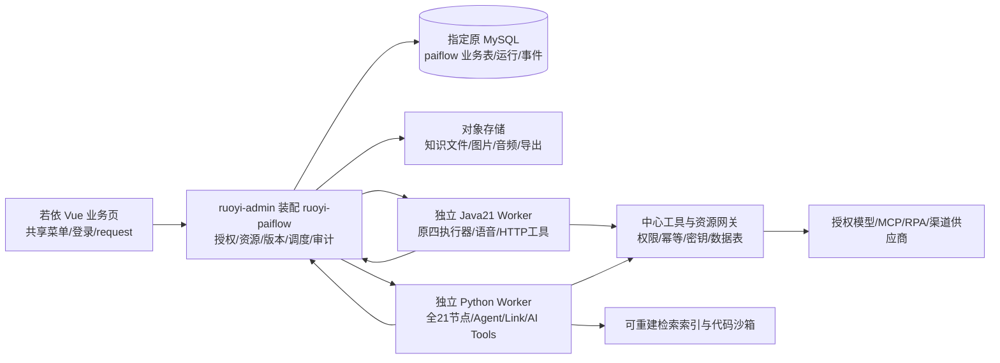

# PaiFlow 工作流项目完整迁移设计

> 类型：整体迁移重构设计；版本：1.0；方案：待审核；负责人：本次方案编制者；日期：2026-10-02。  
> 需求依据：用户要求完整迁入共享若依，形成独立业务模块 `ruoyi-paiflow`，本次先交付方案。当前授权仅含本项目文档和图稿，尚未授权源码、依赖、配置、数据库、发布及 Git 写操作。  
> 规范依据：[工作区协作入口](../../../AGENTS.md)、[若依实际机制参考](../../若依框架/若依框架前后端开发规范参考.md)、[文档组织规范](../../规范/文档组织规范.md)。原项目为只读设计依据，不以其 AGENTS 中的启动/初始化命令作为本轮执行指令。

## 1. 需求与业务逻辑

### 1.1 用户完成什么工作

用户在现有若依账号中进入“PaiFlow 工作流”，管理个人或团队空间中的智能体、流程、模型、知识和工具；通过可视化画布组合节点，调试输入和变量，查看逐节点执行情况，生成文字、结构化结果、图片或播客音频。调试符合预期后发布固定版本，供对话、API、MCP 和经授权的外部渠道调用。工作流、资源、运行及发布可以追溯到同一身份、同一版本和同一业务记录。

迁移范围包含原项目中具有页面、服务、执行器或可调用接口的全部业务能力，以及本设计明确列出的闭环缺口；分步骤建设只表示依赖顺序，不表示缩减为 MVP。原登录、权限、数据库控制面及 React 外壳进行职责重构，用户操作与数据意义保留。仅在 README、SQL、文档中出现而没有实现的训练、支付、Go Tenant 等不宣称原有已实现；其资料状态和处理办法单列。

本文描述**拟实现行为**。源码核对说明“有实现代码”“存在占位”或“缺资料”，均不代表实际运行通过。未启动参考服务，未核实旧库、供应商账号、模型效果及渠道权限，未发生迁移。

### 1.2 业务流程和允许条件

1. **进入与空间选择。** 使用若依登录、注册、用户、部门和角色；注册是否开放沿用平台配置。选择个人空间或成员所属团队空间，所有流程、资源、聊天和导出先检查资源归属。空间成员是业务资源关系，不产生第二套账号或平台角色。无权限时显示原因和返回入口，后台拒绝同一操作。
2. **创建与编排。** 从空白或原模板建智能体/流程，编辑名称、头像、说明、开场白、推荐问题与输入示例；节点输入可以是字面值或前置节点变量，文件类型和结构按节点契约校验。保存草稿不改变已发布版本；导入先预览资源映射、节点兼容和密钥缺口，不把包中的账号和凭据带入系统。
3. **调试与恢复。** 单节点调试显式填写前置变量；全流程调试固定草稿版本和模型/工具版本。问题回答节点可等待用户补充，恢复令牌只属于当前运行和用户。比较调试使用相同输入、不同快照，展示输出、耗时和用量。停止请求与真实执行终止分开呈现。
4. **发布与调用。** 发布前须通过结构、资源可用性、引擎能力和授权校验，并有该版本调试记录；调试记录仅为发布条件，不作为业务质量接受。发布不可变快照，恢复历史版本产生新草稿或新发布版本，禁止覆盖旧快照。渠道回读成功才显示已发布；失败、配置缺失和状态未知分别显示。
5. **对话与成果使用。** 对话支持历史、继续、重新回答、附件绑定/解绑、文件与音频播放、推荐问题和停止。下载、分享、API/MCP 调用均使用资源权限及有效发布版本。语音识别、语音评测、播报与播客合成保留各自输入和供应商失败提示。
6. **维护与删除。** 模型、知识、工具、数据表和 RPA 被发布快照引用时不可直接破坏引用；先停用新调用或建立新资源版本。删除空间需要显示成员、流程、发布和运行影响，停止新任务，归档资源；历史运行与审计按保留期处理，不连带删除共享平台账号。转让最后一个空间所有者须由当前所有者完成，不能留下无所有者空间。

### 1.3 原功能、代码出处、目标和验收对应

下表的源码位置均相对 `参考项目/PaiFlow-main/`，完整文件与接口位置见[源码覆盖索引](源码覆盖索引.md)，其中[365个实际前端服务函数对应表](源码覆盖索引.md#9-前端实际导出函数到目标业务接口组)逐一对应目标接口组与中文验收。符号“有代码”只表明处理逻辑存在；“部分”表示有页面/处理但闭环不完整；“占位”表示显式 TODO、空实现或假成功；“资料不足”表示只有调用/表/说明，缺服务或协议。验收编号指第 5 节中文业务点，实施编号指第 4 节步骤。

| 顺序 | 原功能和代码出处 | 源码事实与迁移处理 | 目标业务、模块与接口 | 实施 / 验收 |
|---|---|---|---|---|
| 1 | `pages/login`、`pages/callback`；Hub `LocalLoginController`、`UserInfoController`；原 Casdoor/OAuth 配置 | 有本地登录和外部身份代码；舍弃旧令牌与独立用户认证。资料中默认账号不导入；特殊 SSO 只在平台认证上扩展 | 平台 `/login`、`/register`、`/getInfo`；`IdentityMappingService` 只作旧 UID 对照 | 1、2 / 1 |
| 2 | `pages/space-page/agent-page`；`components/agent-creation`、`make-creation`；`BotCreateController`、`MyBotController` | 有创建、修改、删除、复制、模板、模型绑定、头像/文案生成代码 | `AgentController`，`/paiflow/agents`、`/templates`、`/assist` | 2、5、8 / 2 |
| 3 | Hub `AgentSquareController`、`BotFavoriteController`；`services/agent-square.ts`、`square.ts` | 广场、分类、收藏、复制代码存在；主路由未直接挂独立广场页，需在若依接入。来源、共享可见性重验 | `CatalogController`，`/catalog/agents`、`/favorites`，页内模板目录 | 2、5 / 3 |
| 4 | `Space/Enterprise/SpaceUser/InviteRecord/ApplyRecordController`；`components/space`、`services/enterprise.ts` | 空间、企业、成员、邀请/申请、接受/拒绝/撤销、退出、转让、最近访问有代码。旧企业/空间权限不得替代若依角色 | `SpaceController`、`MembershipService`，`/spaces`、`/teams`、`/invitations`、`/applications` | 2、5 / 4 |
| 5 | `pages/config-page` 的 overview/base；`components/config-page-component`；`services/api-key.ts`、`order.ts` | 配置页、密钥/套餐/资源用量调用存在；不少端点缺对应本地 Controller。补业务调用密钥、限额、用量和配置展示；真实订单/支付没有本地实现依据 | `ApplicationController`、`QuotaService`，`/applications`、`/api-keys`、`/usage`、`/limits` | 2、5、9 / 5 |
| 6 | `pages/workflow`、`components/workflow/store`、`hooks`、`utils`；Toolkit `WorkflowController/WorkflowService` | 画布、自动保存、节点增删、连线、拖动、批选、复制、布局、缩放/小地图、清空及离开保护有代码；React 状态与组件重写 | `views/paiflow/workflow/editor.vue`；`WorkflowController`，`/workflows`、`/draft`、`/validate` | 3、5、6 / 6 |
| 7 | `components/workflow/constant/index.tsx`、`nodes`；Python `cache_node.py`、`node.py`；Java `NodeTypeEnum`、`node/impl` | 前端和 Python 注册 21 种类型；Java 实际仅 4 种执行器。完整节点逐行见 1.4，不以枚举证明实现 | `NodeCatalogService`、`DslValidationService`，`/nodes/catalog`；两 Worker 能力清单 | 3、4、6 / 7 |
| 8 | `drawer/single-node-debugging`、`chat-debugger`、`chat-result`；Toolkit `/node/debug`；Java/Python debug | 有单节点与全流程调试、SSE、节点输入输出及错误；旧结束事件/停止语义需规范，前端测试文件为空 | `RunController`，`/runs`、`/node-debug`、`/events`、`/cancel`、`/resume` | 3、4、6 / 8 |
| 9 | `pages/workflow/components/btn-groups`、`drawer/version-management`、workflow store；Toolkit `VersionController`、`WorkflowController` comparison | 有比较调试入口、比较快照、版本列表、恢复、导入/导出及最新版本接口；旧内外版本映射不统一 | `VersionService`、`ComparisonService`，`/versions`、`/comparisons`、`/imports`、`/export` | 3、6、9 / 9 |
| 10 | `drawer/advanced-config`、prompt modal；`PromptController`、`TextNodeConfigController`；`services/prompt.ts` | 提示优化、AI 文案/代码、下一问题、提示库、分隔符、比较提示调用存在；提示词 CRUD 部分服务缺本地 Controller | `PromptController`、`AssistService`，`/prompts`、`/assist/*`、`/text-configs` | 3、5、6 / 10 |
| 11 | `workflow/workflow-analysis`；`bot-analysis`；发布统计；`services/trace.ts` | 有统计/错误/反馈 UI 和请求；ES trace 有明确 TODO，分析组件存在但当前独立路由不全。补真实运行事件聚合与可下载日志 | `RunQueryService`，`/runs`、`/statistics`、`/traces/export`、`/feedback` | 4、6、9 / 11 |
| 12 | `pages/chat-page`、Hub chat 系列 Controller、`WorkflowChatController`、Python agent/chat | 有会话创建/删除/历史、聊天、重新回答、清空、停止、继续、附件和工作流对话；恢复依赖引擎差异 | `ChatController`、`ChatSessionService`，`/chats`、`/messages`、`/re-answer` | 4、7 / 12 |
| 13 | `share-page`、`ShareController`、分享弹窗；`NotificationController` | 分享加入智能体、邀请通知、未读/已读/删除有代码；公用分享范围重验 | `ShareController`、`NotificationController`，`/shares`、`/notifications` | 2、7、8 / 13 |
| 14 | `pages/model-management` personal/official/detail；Toolkit `ModelController/LLMController` | 自定义、官方/本地模型、分类、校验、启停、详情有代码；官方模型独立页未直接挂载。旧 RSA/明文参数与密钥引用统一托管 | `ModelController`、`ModelService`，`/models`、`/model-providers`、`/validate` | 2、5 / 14 |
| 15 | `resource-management/knowledge-*`、upload-page；`Repo/File/KnowledgeController` | 知识库、文件夹/文档、URL/HTML、切分预览、分段编辑/启停/删除、索引/重试、召回历史有代码；抽取/检索服务未完整随项目提供 | `KnowledgeController`、`KnowledgeJobService`，`/knowledge-bases`、`/documents`、`/chunks`、`/retrieval-tests` | 2、5、7 / 15 |
| 16 | `resource-management/plugin-*`、`components/plugin-store`；`ToolBoxController`；Java Link/Python Link HTTP | OpenAPI 工具创建/临时调试/更新/版本/广场/收藏/反馈有代码；不搬旧独立 tool schema 数据控制面 | `ToolController`、`ToolVersionService`，`/tools`、`/versions`、`/debug`、`/catalog/tools` | 2、5、7 / 16 |
| 17 | Toolkit `McpServerHandler`、workflow MCP endpoints；Python Link `mcp_server.py`、agent plugin | 有 MCP SSE 客户端列工具/调用、注册和环境参数处理；本地MCP JSON目录加载/分类分页/详情是目录能力，不证明本机工具已执行；消费 MCP 与发布 MCP 是不同能力 | `McpConnectionController`、`ToolGateway`，`/mcp-connections`、`/tools/discover`、`/tools/call`、`/catalog/mcp` | 4、5、7 / 17 |
| 18 | `resource-management/database*`；`DataBaseController/DatabaseService/CoreSystemService`；Python PGSql | 元数据、字段、测试/正式数据、查询/增删改、复制、模板、导入/导出有代码；DDL/DML 依赖缺失 SparkDB HTTP 服务，不是本地完整 PG 数据库实现 | `DataTableController`、`DataTableService`，`/data-spaces`、`/tables`、`/rows`、`/imports` | 2、5、7 / 18 |
| 19 | `resource-management/rpa-*`；`RpaController`、`RpaHandler`；Python `rpa_node.py` | 有来源/列表/助手参数 CRUD 和 SSE 调用；`core/plugin/rpa` 不存在，RPA 执行依赖外部服务 | `RpaController`、`RpaAdapter`，`/rpa-projects`、`/assistants`、`/debug` | 4、5、7 / 19 |
| 20 | `docker/PaiFlow/AI 播客.yml`；Java plugin/TTS integrations；Python smarttts、chat audio renderer | 有主题→脚本→语音→对象 URL 链路，Java 支持 Qwen/Spark TTS 适配；原硬编码工具 ID 改稳定别名与版本映射 | `PodcastTemplate`、`ArtifactService`，`/templates/podcast`、`/artifacts`，两 Worker 插件 | 3、4、7 / 20 |
| 21 | Python aitools `api/route.py`、service clients；Hub Rtasr、speaker/voice-broadcast；`services/spark-common.ts` 自定义VCN调用 | 有图片理解、OCR、图片生成、smarttts、ISE、翻译、拨测 7 个挂载接口；普通 TTS client、图像 client 不等于独立挂载入口。文件视频处理/多模态 LLM 有代码；自定义VCN配置调用/表不证明声线克隆训练已实现 | `CapabilityController`、`ToolGateway`、`ArtifactService`，`/capabilities`、`/speech-sessions`、`/voices` | 4、5、7 / 21 |
| 22 | `BotPublishController`、Market/Api/Mcp/Wechat/Feishu strategies；`PublishApiController`、release-management.ts；flow.ts与version-management原讯飞渠道 | 市场有逻辑但标签/可见性未完整；API/飞书返回空成功，MCP抛未实现；微信授权回调/解密不全。五主渠道需补闭环；原AIUI/讯飞开放平台发布、应用同步与结果展示有调用/转发但路由服务不完整，单列兼容适配 | `PublishController`、五主渠道及讯飞兼容 `ChannelAdapter`，`/publications`、`/channels`、`/callbacks` | 8 / 22 |
| 23 | Python `core/agent` builder、chat/cot/workflow runner、workflow/link/mcp/knowledge plugins、bot_config API | 有 Agent 运行和配置 CRUD。保留推理/工具编排算法，移除直接 MySQL bot_config 正式读写，Java 下发快照 | `AgentRuntimeAdapter`；Python Worker agent package；`/agents/{id}/runs` | 4、7 / 23 |
| 24 | Docker、configs、common audit/OTLP、tenant/auth calls、license；训练/套餐/个性相关 SQL | 配置、日志、计量与认证代码存在；`core/tenant`、`core/knowledge`、`core/memory`、`core/plugin/rpa` 未提供；训练/支付不能仅凭表认定实现。详见 1.5 | Java 治理、密钥引用、运行指标；移除第二控制面；缺实现表保全并记录处置 | 1、2、9、10 / 24 |

### 1.4 全部节点与两引擎差异

Python 节点以 `core/workflow/engine/nodes/cache_node.py` 实际注册为依据；Java 以 `getNodeType()` 注册的执行器为依据。Java 的枚举列出更多节点，但 `node/impl` 只有 START、END、LLM、PLUGIN。`ParallelWorkflowEngine` 使用 cached thread pool；现有公开 Controller 注入 `WorkflowEngine`，不能声称公开调用默认已接入并行引擎，也不能从 README 推断使用 LangGraph4J 或虚拟线程。

迁移保留两引擎：Java 继续承担原四节点链路，Python 承担其注册的全节点。画布按所选引擎显示能力，已有复杂流程导入后推荐 Python；用户显式选择不兼容 Java 时拒绝构建/运行，不静默漏节点、不混合两引擎执行同一次图。Java 不支持的节点无需重复用 Java 重写才能算完整迁移，但 Python 全部能力必须接入中心且通过验收。Java 将有代码的并行执行器接入显式 `parallel` 模式并补限流和汇合测试；顺序模式兼容原链路。

| 顺序 | 节点类型 / 原 Python 实现（`engine/nodes/`） | 原 Java | 目标处理及必要边界 | 实施 / 验收 |
|---|---|---|---|---|
| 1 | 开始 `node-start` / `start/start_node.py` | 有 | 输入必填、默认、文件类型和对象结构校验；参数快照 | 3、4、6 / 7 |
| 2 | 结束 `node-end` / `end/end_node.py` | 有 | 变量/直接输出；统一终态与文件结果，不以空 NodeRunResult 当成功依据 | 3、4、6 / 7 |
| 3 | 大模型 `spark-llm` / `llm/spark_llm_node.py` | 有 | 流式文字/推理、模型参数、历史、图片/视频输入；模型配置版本固定 | 3、4、6 / 7、21 |
| 4 | 工具 `plugin` / `plugin_tool/plugin_node.py` | 有 | HTTP/MCP/语音能力适配；工具版本固定，输入输出 schema 校验 | 3、4、7 / 7、16、17 |
| 5 | 知识库 `knowledge-base` / `knowledge/knowledge_node.py` | 无 | 检索、TopK、来源与空结果；Java 发资源授权，检索索引为可重建派生物 | 3、4、7 / 7、15 |
| 6 | 专业知识库 `knowledge-pro-base` / `knowledge_pro/knowledge_pro_node.py` | 无 | 保留检索策略、参数、来源字段；缺原服务时落实适配协议或实现，不回空假成功 | 3、4、7 / 7、15 |
| 7 | 参数提取 `extractor-parameter` / `params_extractor/pe_node.py` | 无 | 结构化提取并按输出 schema 拒绝类型错误；默认值显式 | 3、4、6 / 7 |
| 8 | 意图决策 `decision-making` / `decision/decision_node.py` | 无 | 选定唯一意图/回退分支，模型不能修改权限或工具授权 | 3、4、6 / 7 |
| 9 | 条件 `if-else` / `if_else/if_else_node.py` | 无 | 保留比较运算、AND/OR、空值规则和分支 handle；非命中标跳过 | 3、4、6 / 7 |
| 10 | 消息 `message` / `message/message_node.py` | 无 | 中途输出与结束输出分开，按依赖序推送、不提前结束运行 | 3、4、6 / 7 |
| 11 | 迭代容器 `iteration` / `iteration/iteration_node.py` | 无 | 集合迭代、子画布、迭代变量隔离、结果顺序和最大次数 | 3、4、6 / 7 |
| 12 | 迭代开始 `iteration-node-start` / 同上 | 无 | 只能在容器内，绑定本次项与序号 | 3、4、6 / 7 |
| 13 | 迭代结束 `iteration-node-end` / 同上 | 无 | 归集每次结果，错误策略决定停止/回退；不跨迭代串变量 | 3、4、6 / 7 |
| 14 | 文本处理 `text-joiner` / `text_joiner/text_joiner_node.py` | 无 | 拼接/分割、分隔符版本、空项和数组输出 | 3、4、6 / 7、10 |
| 15 | 全局变量 `node-variable` / `global_variables/global_variables_node.py` | 无 | 保留set/get与原flow/user/app/chat作用域；持久记忆改由Java保存并追加空间授权，运行临时变量不共享 | 2、3、4、6 / 7 |
| 16 | 子流程 `flow` / `flow/flow_node.py` | 无 | 子版本及接口固定、递归深度上限、调用链取消、禁止循环引用 | 3、4、6 / 7 |
| 17 | 智能体 `agent` / `agent/agent_node.py` | 无 | 推理、策略、提示/工具与知识绑定，最大轮数/用量；输出不能授予副作用权限 | 3、4、7 / 7、23 |
| 18 | 问答 `question-answer` / `question_answer/question_answer_node.py` | 无 | 等待用户补充/槽位、继续执行、过期拒绝；运行上下文在 Java 可恢复 | 3、4、6 / 7、8 |
| 19 | 数据库 `database` / `pgsql/pgsql_node.py`、`pgsql_client.py` | 无 | 旧 HTTP PG 节点改接中心数据表服务；语法适配预检、参数化、测试/正式环境明确 | 3、4、7 / 7、18 |
| 20 | RPA `rpa` / `rpa/rpa_node.py` | 无 | 受控外部 Runner、项目/位置/参数映射、长任务/取消/副作用不自动重试 | 3、4、7 / 7、19 |
| 21 | 自定义代码 `ifly-code` / `code/code_node.py` 与 executor | 无 | 保留原语言/输出格式；local/ifly/langchain 执行方式改为隔离沙箱，无主机任意权限 | 3、4、6 / 7 |

21 行包括迭代开始/结束两种内部类型，原前端注册也覆盖它们。输出类型除 JSON 标量/对象/数组外，保留文件、图像、PDF、Word、PPT、Excel、文本、音频、视频、字幕及文件数组；采用 `artifactId` 表达文件引用，不把任意 URL 当可信本地文件。

### 1.5 需补齐与需审核的差距

**必须在实施中补齐，不能作为减范围理由：**API、MCP、微信、飞书与市场发布真实闭环；版本/渠道结果统一；真实运行追踪与用量；提示词与 API key 缺失端点；知识抽取、切分、索引、检索服务接入；数据库节点 Java/MySQL 数据服务；RPA 真实执行与停止适配；双引擎 Worker 契约；Python agent/Link/workflow 从旧直接业务库读写改为中心 API；前端重写和完整测试。服务缺失时该能力不得展示“成功”，完成授权数据/账号准备后再实施对应适配。

**只见资料或部分代码，须保全且不得冒称完整实现：**README/AGENTS 提及的 Go Tenant、memory、knowledge、RPA 独立服务目录并不存在；支付/订单、训练/微调、个性化角色/声线有 SQL 或前端调用但没有完整运行链路。提供的面试资料不是 PaiFlow 产品业务。原 API 中 eval、AIUI、开放平台同步、训练数据添加等有调用或部分转发，迁移须保持接口/能力提示，并明确由受控适配提供；在本地缺少评测任务服务时，补基于固定用例与模型/工具版本的流程评测、数据集与结果，不复制不明第三方训练系统。真实模型微调、付款和供应商套餐变更不凭空纳入授权；若用户要求补建，另明确规则、供应商和成本。

审核时需要确定四项实质选择，推荐方案已经按下列取值设计，无需重新编写另一份方案：

| 需要决定 | 推荐及替代 | 对完整迁移的影响 |
|---|---|---|
| 业务库目标和旧数据来源 | 使用用户指定的 PaiFlow 原有 MySQL 连接作为业务库，新增 `paiflow_` 业务表并由中心访问；若当前只有参考 SQL，则由用户指定目标库和备份来源后授权初始化。禁止因新端口擅建/克隆库 | 目前未核实真实旧库，不能给出实测迁移量和跨库差异；不影响文档设计，阻止真实导入 |
| 数据表节点的 PG 兼容范围 | MySQL 为正式数据唯一权威；自动转换经白名单证明等价的 PostgreSQL SQL/字段，其他语法导入列为冲突并提供改写；替代为经批准的外部 PG 业务资源适配，不能持有第二中心状态 | MySQL 与 PG 存在不可等价语法。不能承诺所有任意 SQL 无损；受影响旧流程须审核转换或外部资源方案 |
| 缺失外部服务与渠道 | 知识处理采用独立 Python Worker，派生向量索引用文件/对象存储重建；RPA 接用户选定的真实受控 Runner；五渠道按各官方协议实现；供应商模型/TTS沿用授权账号 | 没有协议、执行器、回调域名、账号和费用范围时，相应真实业务验收受阻，不删除功能或虚报闭环 |
| 分享和外部身份 | 默认分享给平台已登录、已获资源授权用户；公开匿名分享作为可选择模式，限期/限额/撤销/输出脱敏；默认不搬 Casdoor，必要 SSO 在若依认证上扩展 | 防止外部分享绕过账号和资源范围；如需匿名访问或特殊 SSO，须明确允许范围和身份绑定规则 |

## 2. 前端界面设计

### 2.1 入口、页面与关键状态

主入口由服务器授权菜单下发：“PaiFlow 工作流”下包含“工作流与智能体”“空间与成员”“对话与成果”“模型管理”“知识库”“工具与 MCP”“业务数据表”“RPA”“发布管理”“运行记录”“应用与用量”。后台菜单配置主导名称、排序、可见性和角色访问。页面内部允许空间选择、资源类别、编辑器节点分类和详情子页，不创建第二份主导航。

所有业务页位于既有 `Layout/AppMain` 内，保留 `TagsView`、面包屑、用户设置及 `navType=1/2/3`。画布“专注”只收起页内节点栏/配置栏，不改变共享 Layout。隐藏详情路由使用唯一 name、`activeMenu`、`noCache` 与业务权限，菜单 component 指向实际 `.vue`。不照抄工作树中选品的导航偏离。

图稿为 **1.0 设计线框图，不是运行截图或业务验收证据**。[打开全部界面图](图稿/界面设计.html)。图稿包含共享布局上下文、字段、按钮、资源列表和关键状态；示例数据仅用于布局。

| 界面图 | 用户操作、布局与关键反馈 |
|---|---|
| [工作流与空间](图稿/01-工作流与空间.png) | 共用菜单/页签；空间筛选、搜索、分类、表格/卡片、模板/导入/新建；成员/邀请入口；空列表引导 |
| [画布编排与运行](图稿/02-画布编排与运行.png) | 左节点库、中业务画布、右属性表单、下调试抽屉；保存、校验、比较、版本、导出、调试、发布；模型/变量/超时可见 |
| [调试失败与恢复](图稿/03-调试失败与恢复.png) | 无兼容执行器、变量缺失、保存冲突、运行排队/等待补充/取消待确认；定位节点、输入补充、重新加载/另存，不覆盖草稿 |
| [模型知识与工具](图稿/04-模型知识与工具.png) | 模型来源和密钥状态；知识上传/分段预览/索引/召回；HTTP/MCP schema 和调试；数据表测试/正式切换及 RPA连接状态 |
| [对话与播客成果](图稿/05-对话与播客成果.png) | 会话列表、发布版本、输入/附件、继续/停止/重新回答；脚本、音频播放器/下载、引用来源，失败可诊断 |
| [版本发布与渠道](图稿/06-版本发布与渠道.png) | 左版本和比较；右市场/API/MCP/微信/飞书五渠道状态、授权和回读；下方原讯飞兼容配置；发布预检缺口、下线影响可见 |
| [记录用量与权限](图稿/07-记录用量与权限.png) | 真实运行筛选、节点轨迹、费用/Token、错误/反馈、日志下载；成员邀请/角色范围、配额、API key脱敏与拒绝状态 |

常规 CRUD 用 `el-form/el-table`、若依分页、RightToolbar、DictTag、公共上传/预览和 `modal`。编辑表单标明名称、来源、输入输出、资源版本、必填与错误；列表有加载、空、失败和可重试反馈。无权限不靠隐藏按钮证明安全。运行中允许浏览快照，但修改产生独立草稿；发布/删除有影响说明和重复提交防护。

保留原 `components/language-switcher` 与 `locales` 的中文/英文业务文案切换，入口位于PaiFlow页内工具栏，偏好存入现有用户偏好设施；平台菜单和共享布局继续按平台配置生成。Vue业务组件使用本模块词条，不另建全局用户/导航store。原 `markdown-render` 的Markdown、数学公式与代码高亮改为安全Vue渲染，禁用不可信HTML、脚本和危险链接，长代码/公式在内容区滚动。原头像上传保留正方形裁剪、缩放、预览、取消和确认；背景上传保留横/竖两种预览及裁剪结果，通过公共文件设施登记，不能因React组件重写而丢失这些操作。

窄桌面视口将属性/调试面板改抽屉，画布可平移；画布本身局部滚动，页面不横向溢出。首轮支持桌面 1440×900 与 1280×800、浏览器 200% 缩放；移动端先提供列表与结果阅读，复杂画布编辑不宣称完整移动支持。节点添加、选择、属性编辑和执行通过工具栏/列表也能操作，键盘路径和焦点可见。缩放、连线和状态不只靠颜色识别。

### 2.2 画布技术与 DSL 兼容

推荐 Vue 业务页使用 `@vue-flow/core`，并按需要接 `background/controls/minimap`；原 ReactFlow、Ant Design、Recoil、Zustand、React Router 外壳重写为 Vue/Element Plus/页内 Pinia。Vue Flow 官方说明支持 Vue 3、自定义节点/边、选择、拖动、缩放和平移、嵌套图，适合作为画布交互基础；**此为适配判断，不是本项目已安装或验证的依赖**。[官方能力说明](https://vueflow.dev/)、[官方许可证](https://github.com/bcakmakoglu/vue-flow/blob/master/LICENSE)。不将库的图状态直接当业务 DSL。

原执行 DSL 保留 `id` 中 `type::uuid`、`data.nodeMeta/nodeParam/inputs/outputs/retryConfig`、变量 `ref/literal`、schema、边 `sourceNodeId/targetNodeId/sourceHandle` 及迭代关联字段；`targetHandle`等前端连线信息留在布局扩展，不能假定原执行器已经支持。新增版本封套 `schemaVersion=paiflow.dsl.v1`、`sourceFormat`、`engineProfile`、资源版本引用与 hash；布局 `position/viewport/parent` 是单独可持久化编辑视图，不参与执行含义。旧 `flowId/appId/uuid` 由映射表转换，不用包内 UID 决定归属。

原播客YAML包实际根字段是 `flowMeta` 与 `flowData`：前者含名称、说明、图标、advancedConfig、dslVersion；后者的ReactFlow节点含`position/type=custom/data`，边含`source/target`。导入适配须先把画布边转换为执行DSL边、保全视图属性，再沿Toolkit `buildWorkflowData`的规则处理引用、nodeParam、工具/模型配置；不能把该YAML直接交给执行器宣称兼容。旧平台导出包、原执行DSL和新版本封套分别识别格式。

导入分三步：解析 JSON/YAML → 生成完整差异预览/资源匹配 → 用户确认保存新草稿。未知字段保留在 `extensions` 并标不参与执行，未知节点禁止运行；不得静默删除。原包可能含工具/模型参数与header，必须扫描秘密并替换为待绑定引用，不能假定旧导出天然无秘密；新导出包含 DSL/布局/资源清单/必要非敏感模板，模型/工具/知识/数据/RPA引用可替换。同包导入导出比较业务语义及图布局，不要求字符串顺序完全相同。原 `getFixedUrl`、直接 fetch/axios 和独立 auth header 不沿用。

本项目新增的流式读取是共享 request 的业务协议适配：普通创建/查询/取消走 `utils/request.js`；浏览器用同一实例的支持流式适配器建立中心鉴权连接，校验是否支持 ReadableStream，复用现有 token、401/错误策略、Correlation-ID 和取消，不创建第二 token/store/axios 实例。若现有 Axios 浏览器适配器不能满足 SSE，先提交共享 request 的最小能力扩展设计，兼容普通 JSON/下载消费者；不得通过裸 fetch 重建认证。接口支持轮询快照作为断流/不支持流式的降级，不能重跑任务来恢复显示。

### 2.3 前端拟新增与修改文件

以下均为拟实施路径，尚未创建源码。表中路径相对仓库根；目录内列出的实际文件应在实施时落实，不把目录名当作已实现模块。

| 类型与路径 | 用途和关键变化 |
|---|---|
| 新增 `frontend/admin-web/src/views/paiflow/workflow/index.vue`、`editor.vue`、`versions.vue` | 工作流/智能体列表、页内画布、版本比较及恢复；分别使用查询、编辑、版本权限 |
| 新增 `src/views/paiflow/space/index.vue`、`members.vue`、`invitations.vue`（均在上述 admin-web 下） | 个人/团队、成员、邀请/申请、转让/退出；复用平台用户选择，不自行注册账号 |
| 新增 `src/views/paiflow/chat/index.vue`、`share/index.vue`、`agent/detail.vue` | 版本对话、附件/多模态/音频成果、分享授权；保持已有 TagsView |
| 新增 `src/views/paiflow/model/index.vue`、`detail.vue`；`knowledge/index.vue`、`detail.vue`、`upload.vue`、`chunks.vue`、`retrieval.vue` | 模型 CRUD 和本地/官方分类；知识文件、切分、清洗、索引与召回测试 |
| 新增 `src/views/paiflow/tool/index.vue`、`detail.vue`、`mcp.vue`、`catalog.vue`；`data/index.vue`、`table.vue`；`rpa/index.vue`、`detail.vue` | 工具版本/调试/市场与MCP；字段/数据/导入；RPA来源和项目/参数调试 |
| 新增 `src/views/paiflow/publish/index.vue`、`runtime/index.vue`、`runtime/detail.vue`、`application/index.vue` | 五渠道发布、轨迹/统计/反馈、应用密钥及资源/用量；无假统计、无伪发布 |
| 新增 `src/components/paiflow/WorkflowCanvas.vue`、`NodePalette.vue`、`NodePropertyPanel.vue`、`RunDrawer.vue`、`VersionCompare.vue`、`ArtifactPreview.vue` | 业务专用组件；21节点表单按目录定义，文件/音频安全预览；不搬原 Sidebar/Header |
| 新增 `src/components/paiflow/MessageContent.vue`、`ImageCropDialog.vue`；`src/locales/paiflow/zh-CN.ts`、`en-US.ts` | 安全Markdown/公式/代码、头像及横竖背景裁剪；保留中文/英文业务词条，与现有用户偏好对接 |
| 新增 `src/components/paiflow/nodes/registry.ts`、`schemas.ts`；`src/utils/paiflow/dslCodec.ts`、`graphValidation.ts` | 注册类型、图与业务 DSL 分离、导入错误定位与引用校验；服务端为最终校验方 |
| 新增 `src/api/paiflow/workflow.ts`、`run.ts`、`agent.ts`、`space.ts`、`resource.ts`、`publish.ts`、`application.ts` | 只适配若依 JSON/分页与业务参数，调用共享 request；保留结构化业务错误 |
| 新增 `src/store/modules/paiflow-editor.ts`、`src/types/paiflow.ts` | 页内临时编辑/版本冲突状态、生成契约类型；不复制用户、权限、导航、正式运行状态 |
| 修改 `frontend/admin-web/src/router/index.js` | 只增加确需隐藏的详情/编辑动态路由，校验 name/path 与后台菜单不重复；主入口由菜单生成 |
| 修改 `frontend/admin-web/package.json`、锁文件、`tsconfig.paiflow.json`（新增）、`vitest.paiflow.config.ts`（新增） | 增加画布/DSL解析/代码编辑依赖和本业务类型/测试范围；维持共享 JS，不将全管理端强制改 TS |
| 条件修改 `frontend/admin-web/src/utils/request.js` 及声明 | 仅经共享能力审核后增加 SSE/敏感请求缓存防护；普通信封/下载/401行为保持；密钥沿用现有托管接口以避免正文缓存 |

## 3. 后台处理设计

### 3.1 处理职责与框架复用

触发操作后，Java 依次取得平台身份、核对按钮权限/资源归属、校验输入/版本/限额、事务保存正式记录，再向运行器或外部适配派发受控请求。Worker 不接受浏览器请求、不提供独立登录、不直接拥有业务数据库、发布或审批真相。模型与工具的 SDK 留在独立进程；正式资源引用、结果登记和审计归 Java。

共享 Java 声明为 Java17、Spring Boot4.0.6、RuoYi3.9.2；父 POM 已包含 MyBatis4.0.1、PageHelper4.1.0，按现有模块装配。管理端声明 Vue3.5.26、Element Plus2.13.1、Vite6.4.3、Pinia3.0.4、TypeScript5.9.3 的局部业务岛，主体仍有 JS。原 Hub/Java engine 父 POM 为 Java21、Boot3.5.4；Java engine 声明 Spring AI1.1.2。原 Python workflow pyproject 声明 Python≥3.11，具体依赖以原锁定清单核验。README 的 PostgreSQL、LangGraph4J、虚拟线程不能覆盖代码事实：本地 workflow 数据工厂构造 MySQL URL，Java 并行实现是普通 cached pool。

`ruoyi-paiflow` 继承共享父 POM、包名 `com.ruoyi.paiflow`，以 Controller → Service → Mapper 的现有分层落地。复用 `SecurityUtils`、`@PreAuthorize`、`@Log`、`BaseController/startPage/getDataTable`、`AjaxResult/TableDataInfo`、平台校验/异常、Redis与现有 Secret 托管能力。`@DataScope` 只用于部门范围适用的查询；空间/资源权限必须追加业务归属检查。旧 MyBatis-Plus、OAuth2 Resource Server、独立认证过滤器、独立 UID store、tenant/license 服务和跨库事务不装入中心。

### 3.2 权限、数据所有权与公开调用

| 业务角色（映射平台已有角色/按钮权限） | 可执行范围 | 数据检查 |
|---|---|---|
| 使用者 | 查看授权智能体/流程、聊天、运行及成果 | 个人所有权或空间成员/明确共享；不能凭 ID 访问他人 |
| 编排者 | 创建/修改草稿、调试/导入/导出、资源绑定 | 权限如 `paiflow:workflow:edit/run/import/export`；空间资源版本同域 |
| 资源维护者 | 模型/知识/工具/数据/RPA管理与调试 | 各 `paiflow:<resource>:add/edit/remove/debug`；密钥读出禁止 |
| 发布管理者 | 固定版本、市场/API/MCP/微信/飞书发布与下线 | `paiflow:publication:publish/offline`，平台权限+空间内授权+渠道账号范围 |
| 空间管理者 | 邀请、成员变更、转让/归档 | `paiflow:space:manage`，不能提升自己的平台角色、不能绕过被移除状态 |
| 运维/审计者 | Worker状态、故障处理、日志与用量 | `paiflow:runtime:query/manage`，日志仍脱敏；管理员例外保留审计 |

按钮权限在 `sys_menu F`、前端 `v-hasPermi`、后端一致；主菜单与角色关系由平台维护。Java获取 `userId`，不相信客户端 `uid/deptId/spaceId/appId` 作为身份。空间成员只进一步收窄已有平台权限，不能给无平台发布权限的成员自行授予发布。

API key 是业务应用调用凭据，限制应用、空间、发布版本/操作、IP/域名、限额和期限，不是平台第二登录栈；只返回一次明文，保存 hash 与 keyId，可撤销/轮换，禁止通过 API key访问后台账号管理。第三方 callback 不使用平台浏览器 token，独立受限入口做签名/回放/渠道绑定校验后转换为业务命令；权限决策仍由中心。内网 Worker 使用短期服务身份和 runId/lease/scope，不能借用户 token长期持权。

### 3.3 数据实体、生命周期与迁移

正式业务 MySQL 唯一持有下列数据。采用 `BIGINT` 内部 ID、UTF8MB4、UTC存储/北京时间展示、`create_by/update_by/create_time/update_time`、软删除和 `revision` 乐观锁。用户关联平台 `sys_user.user_id` 稳定标识，不复制 `system_user/user_info` 账号表。MySQL 连接、账号和库名由用户指定原有环境后核验，不因 Worker 或通道隔离新建第二套数据库。

| 拟表/关系 | 字段与约束、索引/事务、保留与所有权 |
|---|---|
| `paiflow_identity_map`、`paiflow_migration_batch` | `(source,old_uid)` 唯一映射平台 userId，旧密码/token不保存；batchId、源hash、映射版本、计数/冲突/检查点；映射缺失不接到管理员 |
| `paiflow_space/team/member/invitation/application/visit` | ownerUserId、deptId、spaceId、成员状态/能力、邀请签名hash/期限、申请理由；活跃成员唯一；所有者转让与成员撤销事务处理，关联实体不跨业务项目 |
| `paiflow_agent/template/favorite/share`、`paiflow_notification` | 名称/头像/开场/推荐问/输入例、flowId、空间；共享visibility、授权列表、过期/撤销/访问用量；通知已读时间。收藏按用户/资源唯一 |
| `paiflow_workflow/draft/version/comparison/resource_binding` | DSL、布局、schemaVersion、engineProfile、hash、revision、资源配置/工具版本引用；`(workflow_id,version_no)` 唯一；保存冲突返回409，发布快照不可改；原比较临时版本有期限 |
| `paiflow_run/node_run/event/checkpoint/artifact` | runId、请求幂等键、owner、版本hash、状态、engine/version、lease、node/iteration/attempt、输出/错误码、Token/耗时；event(runId,seq)唯一；对象hash/mime/size、状态、存储引用；运行终态与usage同事务 |
| `paiflow_chat/message/attachment/memory` | 会话所属空间/用户、发布版本、消息分支/重新回答源ID、附件artifactId；局部记忆scope/version。清空记录标记历史与保留策略，不删除审计 |
| `paiflow_model/provider/category/config_version`、`paiflow_prompt/text_config` | endpoint、能力、上下文/参数、凭据引用、启停/版本；禁止明文 secret入 DSL/导出；提示模板来源和版本、separator配置；索引覆盖空间/启停/类别 |
| `paiflow_knowledge/document/folder/chunk/index_job/retrieval_test` | 原文件hash、版本、分段文本/来源offset、策略/embedding版本、任务状态/失败/attempt、索引引用；知识索引可重建，文档版本/分段为Java正式资源；删除须撤销检索访问并清理派生物 |
| `paiflow_tool/tool_version/mcp_connection/tool_feedback` | OpenAPI/schema/hash、版本、来源、敏感字段引用、副作用类别、allowlist；工具运行输入输出脱敏；MCP discovery快照记录，schema变化不能覆盖已绑定版本 |
| `paiflow_data_space/table/field/row` | 逻辑数据集而非物理数据库账号；field类型/约束/默认、env=test/prod、rowRevision；MySQL JSON行+类型校验/必要索引，SQL AST转操作；不允许用户 DDL直接作用平台表 |
| `paiflow_rpa_project/assistant/config_version` | 外部projectId、来源、受控执行位置、参数schema、凭据引用、策略；运行记录入统一run/node；旧RPA header原值不进导出 |
| `paiflow_application/api_key/quota/usage/publication/channel_binding/publish_job` | key hash、权限、有效期/限额；发布绑定version/hash、渠道目标、操作幂等键和外部确认ID；usage关联run/供应商事件用于去重；渠道状态与真实响应分开 |
| `paiflow_evaluation_set/case/task/result` | 原 eval 调用补齐固定测试输入、期望规则/来源、版本、评测任务、实际输出；AI评分仅辅助，确定性规则与人工质量判断分开 |

原 SQL **全表清单**和逐表归类位于[源码覆盖索引第6节](源码覆盖索引.md#6-原-sql-全表覆盖与迁移归类)。历史 `*_bak/*_copy/z-*`、无消费表不能当活跃事实源，先保全导出再确认；所有有真实数据的表必须映射、明确只读历史保留或经用户决定舍弃，不以未调用删除。表存在不证明训练、支付或外部服务已完成。

迁移拟按以下顺序执行，实施前另取得目标与数据授权：

1. 校验旧 MySQL/可能的外部 PostgreSQL实际位置与版本、字符集、时区、数据量、资源对象及拥有者；保存一致性备份和当前未提交源码/配置基线。只读采样脱敏，不把配置中的口令复制到文档。
2. 建 batch 和 UID/space/flow/tool/model/knowledge/app/object ID映射；同名账号不自动合并，孤儿 UID隔离为待认领。平台账号由已授权现有用户关联或按平台流程创建，密码/令牌全部重新签发。
3. 在指定原业务库建设增量 `paiflow_` 表；按身份映射→空间/成员→模型/工具/知识/数据/RPA→智能体/草稿→版本/发布历史→聊天/运行/对象顺序导入。每批保存源hash、源/目标计数、关系及JSON/对象hash对照，资源无法绑定进入冲突清单。
4. PG节点语法/字段、工具硬编码 ID和V1.0/appId、旧版本比较、文件URL、匿名分享和外部发布记录做显式转换。导入原“已发布”只作为历史声明，渠道重新回读并授权切换后才标当前可用；模型/语音密钥通过原托管引用迁接，不导出明文。
5. 停旧正式写入，最后增量导入并核对快照；切入口与运行派发后旧控制面只读。禁止两中心双写“同步一段时间”；Worker旧 DB用户撤权并验证无法读写正式表。
6. 回滚先停止新派发、冻结中心写入并导出切换后新增记录，再恢复指定旧快照/入口；若已产生真实外部副作用，先回读/补偿并由操作者确认，不靠恢复数据库假装撤销消息或RPA动作。新数据按差异合并方案恢复，不能整库回退覆盖其他项目。

建议保留运行元数据/脱敏事件90天、调试明细30天、分享7天可配置、正式文件随资源保留、审计按平台既有政策；需要用户审核数据保留和空间归档要求。备份频率沿用实际原业务库策略，切换前必须额外可恢复快照；建议发布切换窗口内 RPO=0（停写后最终校验）、控制面故障 RTO≤2小时，实际能力须用恢复演练证明，不能在设计中宣称已经达到。

### 3.4 中心 API 与 Worker 契约

公共接口根路径 `/paiflow`；标准 JSON使用 `AjaxResult`，列表用 `TableDataInfo.rows/total` 和 `pageNum/pageSize`。API表不延用原 `code=0` 信封而让共享拦截器误判。原地址若确有外部消费者，建立有限兼容适配并登记调用者/停止窗口；默认不复刻所有旧 HTTP根路径。

| 接口组（拟） | 主要请求、返回与拒绝语义 |
|---|---|
| `/spaces`、`/teams`、`/invitations`、`/applications` | CRUD/申请/接受/撤销/转让；用户及空间范围来自服务端；资源404避免泄漏、成员/角色无权403、版本冲突409 |
| `/agents`、`/templates`、`/catalog`、`/favorites`、`/shares` | 智能体配置/复制/市场/收藏/分享；输入例/开场白版本；分享到期410，不允许把模板中的secret和owner复制 |
| `/workflows`、`/{id}/draft`、`/{id}/validate`、`/imports`、`/{id}/export` | DSL/布局/revision；If-Match及hash；校验报告含nodeId/field/code；未知节点422，导入先预览再确认 |
| `/workflows/{id}/versions`、`/comparisons`、`/prompts`、`/evaluations` | 快照/恢复/比较、提示词库和固定用例评测；不可变版本，模型工具版本固定，比较不覆盖正式版本 |
| `/runs`、`/node-debug`、`/runs/{id}/events`、`/cancel`、`/resume` | 创建202返回runId/state/snapshotHash；events带seq；停止202表示请求已收；补充输入引用checkpointRevision，一次性恢复令牌 |
| `/chats`、`/{id}/messages`、`/re-answer`、`/attachments` | JSON消息和artifact引用；响应runId，流从同一事件链读取；重复提交返回同一run，不产生双条消息 |
| `/models`、`/knowledge-bases`、`/documents`、`/chunks`、`/retrieval-tests` | 分页、资源版本、索引任务；异步索引202，缺凭据/无索引明确不可用；没有命中不是系统故障 |
| `/tools`、`/mcp-connections`、`/rpa-projects`、`/capabilities` | 版本、schema和连接快照；tool call带run/node/attempt和effect policy；无权/不在白名单拒绝，依赖超时504 |
| `/data-spaces`、`/tables`、`/rows`、`/data-operations` | 测试/正式域与schema版本；操作用结构化过滤/参数，旧SQL解析白名单；无确认写入拒绝，注入/跨域表拒绝 |
| `/publications`、`/{id}/offline`、`/channels`、`/callbacks/*` | version/target/revision/idempotencyKey；配置预检；pending/failed/unknown/active/offline，签名不正确/重放拒绝 |
| `/api-keys`、`/limits`、`/usage`、`/statistics`、`/notifications` | 业务调用凭据、配额、真实用量/运行统计和通知；密钥写入复用托管API，列表只脱敏；无数据显示空而非模拟增长 |
| `/artifacts/{id}`、`/download`、`/traces/export` | 权限检查后短时签名地址/受控下载；mime/文件hash/size，禁止任意URL中转和目录穿越 |

跨运行器机器契约实施时放 `contracts/paiflow/openapi.yaml`、`dsl.schema.json`、`worker.schema.json`、`events.schema.json`，由它们生成类型与契约测试，本文只定义语义，避免手抄第二字段源。Worker网关拟使用 `/internal/paiflow/v1`：

- **任务提交/领取：** `runId, workflowVersionId, dslHash, engineProfile, input, resourceSnapshots, attempt, leaseId, deadline, effectPolicy`；带schema版本/服务身份。Worker回能力清单、引擎构建版本和接受结果；未知契约/不支持节点在执行前拒绝。
- **心跳/事件/结果：** `leaseId, seq, nodeId, iterationId, attempt, eventType, timestamp, payload`；中心校验租约与连续序号后落库、重复seq丢弃。结果类型包含文字delta、reasoning、节点状态、用量、artifact、等待补充、错误和终态。Worker成功不能直接写 publication 状态。
- **资源与工具：** Worker凭运行范围读取snapshot、授权文档/检索或请求数据操作，拿短期工具凭据；禁止读取完整空间的秘钥/账号。Java同一次资源策略校验适用于Python agent、Link和Java plugin，不复制第二规则。
- **断线/重连：** 浏览器按seq续读中心已落事件；SSE每15秒心跳、重连携最后seq，超保留返回快照与“部分流文本不可续读”。队列慢消费者按容量断开并可续读，不阻塞Worker。浏览器断开不自动取消真实任务。
- **错误：** 区分 `DSL_INVALID`、`ENGINE_UNSUPPORTED`、`RESOURCE_UNAVAILABLE`、`VERSION_CONFLICT`、`QUOTA_EXCEEDED`、`TOOL_POLICY_DENIED`、`DEPENDENCY_TIMEOUT`、`LEASE_LOST`、`EFFECT_UNKNOWN`；普通用户显示中文原因与恢复动作，日志保留关联ID而不泄露供应商secret。

### 3.5 运行、并发、恢复和副作用

运行状态：已排队→运行中→完成/失败/已取消；运行中可进入等待补充→运行中，取消请求先进入取消处理中。租约失联或外部副作用无法确认进入状态待核对，不能标成功/已取消。终态仅一次 CAS写入，重复回调不重复计费/注册成果；事件顺序与节点的并行完成顺序分别保存。

Java/MySQL保存队列与租约，Redis用于通知/短缓存，不另引入Kafka作正式任务源。原Kafka/OTLP日志链可保留为可选遥测输出，不依赖其决定业务成功。任务领取按 CAS锁定、租约心跳续期；崩溃超过租约期限后由中心核对节点/外部操作记录，纯计算可新attempt恢复，非幂等副作用转人工核对。持久队列重放有最大次数和隔离列表，不无限重试毒任务。

每次运行和迭代有独立变量池，引用必须来自可到达的上游与已声明输出，数组/嵌套访问路径校验；并行分支输出按节点命名空间隔离，禁止两个分支写同一全局键无冲突策略。汇合等待可执行上游完成，未命中分支标跳过，错误分支按DSL明示；条件与消息节点不能导致提前结束。迭代输出按输入次序，最大次数/递归深度、节点总数与子任务预算有上限；子流程固定快照且取消沿调用树传播。

原 `retryConfig` 有 timeout/shouldRetry/maxRetries/errorStrategy/customOutput，迁移保留字段，补退避/可重试错误类型和幂等分类。默认普通节点60秒、纯读取最多2次退避重试；模型/TTS费用调用需供应商幂等或显式接受重复费用策略；正式数据写/RPA/外部消息不自动重试。默认单用户同时2个任务、单空间10个、Worker按容量限流；排队有超时和位置反馈。RPA原24小时超时不能作为全局默认，单独长任务上限与心跳；具体容量在实施压测后审核，界面不写死成功承诺。

问题回答节点把checkpoint保存到Java：DSL/版本、变量、待回答字段、已执行节点、用量、effect记录与expiry；恢复校验用户、版本与revision，重复token拒绝，不重放已完成副作用。Java引擎没有等价恢复实现时报告不支持，不能调用空 resume端点假继续。

代码执行保留算法但改沙箱：独立受限进程/容器、只挂临时run目录、内存/CPU/时间限制、默认禁网与只读根目录；原 local executor不得在中心Java或用户主机直接exec。SQL通过解析与结构化操作、资源表映射和参数化，不允许任意拼接/平台表/多语句。RPA仅调度已登记位置与账号，不将节点中header全量写日志。

文件上传检查大小、真实mime、扩展名、病毒/内容规则按已有基线，URL导入在网关防SSRF、DNS重绑定、内网/本机访问及无限重定向；文件路径不接受任意磁盘位置。Markdown/HTML、OCR和模型结果经过安全渲染；检索文件/工具输出视为内容，不能改变权限或批准写入。模型输出类型校验失败记失败或明示回退。用户/空间配额由确定性规则扣用，模型推断不授予权限。

### 3.6 模型、知识、多模态、工具和渠道闭环

**模型与Agent。** 模型调用支持原OpenAI风格和Spark provider以及用户已有DeepSeek/Qwen等兼容配置，不假定全部参数兼容；能力目录标文字/图像/视频/工具调用/结构化输出。temperature/token/上下文参数按provider范围校验，密钥仅从托管引用解析。Agent保留OpenAPI runner、chat/cot/workflow runner、MCP/Link/知识/工作流插件，但bot_config由Java下发不可变快照。提示优化与模型生成头像/开场/代码/推荐问题都记录来源版本、成本和结果，用户确认后才写草稿。

**知识处理。** 原文件/HTML/URL→抽取→清洗/切分预览→用户调整→索引→检索测试，所有任务有Java状态/进度/重试记录。未提供外部知识服务时，Python处理Worker实现抽取及embedding接口，派生索引采用版本化文件/对象集合和manifest，可重建；不引入第二业务数据库。普通/专业知识库在同一资源权限下分别保留TopK、阈值、策略、重排/返回字段，不能因缺服务把专业节点别名成普通节点且不提示。来源片段、文档/offset可回查；被删除或撤权文档立即禁止检索，新索引完成前保持旧版本或显示待处理，不让半成品索引替换当前可用版本。

**HTTP/MCP。** 原工具OpenAPI解析、调试、临时版本、V1.0、appId与工具schema关联保留兼容映射；Java持有工具schema，Python Link不直接写tools_schema。消费MCP原SSE适配保留，目标新增传输按所选协议验证，环境参数通过secretRef、短期授权绑定；服务器工具schema变更列差异，已发布workflow不得自动跟随最新版本。原本地JSON MCP目录加载/缓存/分类/分页/详情迁为中心目录导入，逐条记录来源、协议、参数schema和可用性；不能把JSON中`authorized=true`当平台授权，也不能据目录内容自动在用户主机执行任意启动命令。HTTP工具公开/收藏/反馈由中心管理；临时工具不可发布引用。

**语音和播客。** 导入原AI播客模板，主题、听众、时长和风格→可编辑脚本→发音人/语速/供应商→生成MP3→播放器/下载/再合成。保留Qwen/Spark TTS、smarttts、RTASR、ISE、翻译、图片理解/OCR/生成的已挂载能力；未单独挂载的普通TTS client按统一能力网关暴露所需操作。发音人列表、speaker选择、自定义VCN绑定/启停纳入`/voices`，原无声线训练闭环时仅接受已获授权的供应商voiceId，不把配置CRUD写成已完成声音克隆。播报与合成成果分开；音频不是字符串URL就算成功，记录对象hash、mime、size、时长/可解码、权限与保存结果。生成失败保留脚本，可只重试语音节点，避免重新消费LLM。图片/视频/音频输入传artifact授权引用，视频帧/字幕处理保留原frame_processor算法并记录抽帧参数。

**数据表和RPA。** 原createDatabase/execDDL/DML HTTP依赖改为Java逻辑数据表，保留字段、默认、类型、测试/正式、复制、导入导出和查询。PGSQL字符串先解析，支持的SELECT/INSERT/UPDATE/DELETE映射到资源操作，任意DDL/函数/类型不等价时提示具体冲突；导入不可跳过失败行且记全部成功，返回行号/原因和原文件hash。正式写入先校验已批准effect policy、资源版本、行revision和幂等键。RPA接真实Runner协议：登记来源→导入项目/参数schema→配置执行位置→调试/正式运行→事件/结果/停止回读；项目不可用、认证失效和停止未知分别处理，不提供假执行器冒充原RPA完整实现。

**五渠道。** 市场发布写中心目录并验证分类/标签/visibility；API发布签发受限调用endpoint和凭据，速率/CORS/版本/撤销生效；MCP发布实际生成工具schema、登记endpoint、握手并调用验证；微信实现官方签名/解密、授权票据、appId绑定、回调/消息与下线；飞书实现app授权/事件校验/去重、绑定、真实调用回执及下线。所有外部动作需指定账号/目标/版本授权后实施，不在本轮发送或发布。校验通过不等于渠道生效，必须记录外部结果ID并回读；没有授权只能做预检，不改变发布事实。旧`McpPublishStrategy`抛未实现、`Api/Feishu`返回空成功必须替换，微信测试set-verify-ticket仅测试配置可用，不能暴露生产路径。

**原讯飞渠道兼容。** 原`flow.ts`的AIUI智能体列表、渠道公告/信息/状态与开放平台同步，以及版本抽屉的讯飞语音平台/讯飞云结果，不能因新版五渠道枚举而丢失。目标渠道配置额外支持`IFLYTEK_AIUI`和`IFLYTEK_OPEN`，由同一发布Service调用受控适配；原MAAS应用认证/发布/同步只保留作为外部资源协议，不迁第二tenant/license控制面。缺完整服务定义时先补协议及配置预检、固定版本同步、发布结果回读和下线；用户选择不使用时保留数据/历史并标未配置，而非声称已经可用。评测、trainable-nodes和历史训练集调用按1.5的固定用例评测实现；真正模型微调单列资料不足。

### 3.7 后台、运行器、配置与依赖拟变更

| 类型与路径（相对仓库根） | 用途与关键处理 |
|---|---|
| 新增 `ruoyi-backend/ruoyi-paiflow/pom.xml` | 继承共享Java17/Boot4/RuoYi；依赖system/common/framework适用设施，不引原Boot3中心栈 |
| 新增 `ruoyi-paiflow/src/main/java/com/ruoyi/paiflow/controller/WorkflowController.java`、`AgentController.java`、`SpaceController.java`、`RunController.java`、`ChatController.java` | CRUD/资源归属/乐观锁、中心调度/事件/停止恢复、会话；前端不直连原Hub |
| 新增同包 `ModelController.java`、`KnowledgeController.java`、`ToolController.java`、`DataTableController.java`、`RpaController.java`、`PublishController.java`、`ApplicationController.java`、`CatalogController.java` | 全资源/渠道/应用与缺失闭环，统一权限和信封 |
| 新增同模块 `service/DslValidationService.java`、`WorkflowVersionService.java`、`RunDispatchService.java`、`RunEventService.java`、`ResourceAccessService.java`、`MembershipService.java` | DSL能力校验、版本、队列租约、去重/终态、资源权限；不复制共享身份和导航 |
| 新增同模块 `service/KnowledgeJobService.java`、`ToolGateway.java`、`DataTableService.java`、`QuotaService.java`、`ArtifactService.java`、`EvaluationService.java` | 异步知识任务、受控工具/数据/副作用、确定性配额/用量、文件和评测 |
| 新增同模块 `adapter/JavaWorkerAdapter.java`、`PythonWorkerAdapter.java`、`RpaAdapter.java`；`adapter/channel/{Market,Api,Mcp,Wechat,Feishu,IflytekAiui,IflytekOpen}ChannelAdapter.java` | 引擎差异与渠道真实回执隔离，worker不能控制中心数据库；保留原讯飞兼容接入 |
| 新增同模块 `domain/*`、`dto/*`、`mapper/*Mapper.java`、`src/main/resources/mapper/paiflow/*.xml` | 按3.3实体落实DTO/校验/MyBatis；参数化与空间条件，不以原MyBatisPlus整包绕过规范 |
| 新增 `ruoyi-backend/ruoyi-paiflow/sql/001-paiflow-schema.sql`、`002-paiflow-menu.sql`、`003-paiflow-data-map.sql` | 增量schema/菜单按钮/版本化旧ID映射；只生成可审阅脚本，真实执行另授权；回退脚本不删除其他项目表 |
| 修改 `ruoyi-backend/pom.xml`、`ruoyi-backend/ruoyi-admin/pom.xml` | 聚合/依赖管理/HTTP装配新模块；Worker不加入admin进程 |
| 新增 `ruoyi-backend/ruoyi-admin/src/main/resources/application-paiflow.yml`；条件修改admin业务开关装配 | 默认功能关闭，逐项校验原库/secret/Worker/对象/渠道配置；启动缺项报告不可用，不覆盖其他业务配置 |
| 新增 `ruoyi-backend/paiflow-worker-java/` 的独立 POM、`engine/*`、`adapter/CenterClient.java`、`controller/WorkerTaskController.java` | Java21/Boot3.5独立构建进程；复用4执行器、变量、TTS/HTTP算法，移除WorkflowMapper、ToolMapper正式写库和旧管理Controller |
| 新增 `python/paiflow-runtime/pyproject.toml`、`worker/center_client.py`、`worker/task_runner.py`、`worker/events.py`、`workflow/*`、`agent/*`、`plugin/link/*`、`plugin/aitools/*`、`common/*` | 复用Python21类型节点及Agent/工具/多模态算法；旧repository/CRUD改center adapter，保留契约fixture，不向业务库直接连SQL |
| 新增 `python/paiflow-runtime/knowledge/processor.py`、`index_store.py`、`sandbox/executor.py` | 原缺服务的知识闭环与派生索引，隔离代码执行；schema/版本与中心契约一致 |
| 新增 `contracts/paiflow/*`、迁移器 `ruoyi-paiflow/migration/` | 契约schema/生成类型、可恢复批量导入/冲突报告；原数据只读采集，入口不开长期第二状态库 |
| 新增对应Java `src/test`、Python `tests`、admin-web本业务 `tests/paiflow` | 完整契约、权限、DSL、租约、双引擎、数据/渠道/附件测试，复用原有有断言测试而非空文件 |

依赖新增范围：中心优先用现有Jackson/MyBatis/Redis/HTTP/POI/Springdoc，不加入LangGraph4J/Spring AI Boot3 BOM；DSL YAML解析和SQL AST解析确需新增时锁定与Boot4/Java17兼容版本，不靠旧包名假定可用。前端Vue Flow候选MIT；Monaco编辑器候选沿用原0.52.0版本并核验Vite集成；YAML解析、安全Markdown和schema验证需按现有工具可复用性选最小集。Java Worker保留原Spring AI1.1.2、MinIO、Qwen/Spark SDK等声明；Python沿用原pyproject可用锁定基线，增加的知识索引/文档解析/沙箱依赖须逐项核验许可、安全与Python平台支持。实施前记录精确版本、lock/hash与许可，保留原Apache2.0 LICENSE/NOTICE及iFlytek来源，不直接复制未经说明的第三方品牌资产。此处不是安装授权或已验证依赖清单。

配置仅用新的 `paiflow.enabled`、`paiflow.worker.java/python.endpoint`、`paiflow.worker.leaseSeconds`、`paiflow.runtime.*`、`paiflow.storage.*`、`paiflow.secretRefs.*`、`paiflow.channel.*` 等命名空间；平台账号/库/密钥不再出现另一套默认管理员。Worker服务身份/对象签名TTL、节点/任务超时、限流、数据保留和外部allowlist须启动预检。新端口在共享启动指南核对后选空闲值，禁止沿用原两引擎同7880造成冲突；本轮不启动、不锁定现有端口为新占用。

## 4. 实施步骤

按依赖实施到全功能闭环。下表范围对应1.3与1.4所有能力；每步的技术检查只证明该步工程/边界，不能代替第5节页面业务验收。方案批准后仍按目标账号、数据库与发布影响补齐所需执行授权；本轮只设计。

| 顺序 | 实施内容、文件与交付边界 | 定向检查与停止/恢复 |
|---|---|---|
| 1 | 确认1.5决定；核对实际原环境与基线，锁定源码/许可/依赖；生成 `contracts/paiflow/*`、能力清单、全表映射和备份/恢复方案 | 对照源码索引所有服务/端点/节点/表；契约schema校验。源库/UID/PG转换/secret不明确只停止受影响导入，不动原数据 |
| 2 | 新模块装配、身份映射、MySQL实体/Mapper、空间成员/邀请/申请、模板/资源基础、菜单/按钮及迁移器预检 | 定向Maven权限与事务测试；平台登录/三种导航无冲突；映射计数/孤儿/字符集/对象hash预检。脚本先审核，不执行不明全库初始化 |
| 3 | DSL封套/兼容转换、21节点目录/schema、业务画布、草稿/布局、提示/变量、版本/比较/导入导出 | 新旧DSL语义往返、坏图/未知字段/资源引用/迭代及冲突fixture；Vue类型/构建/画布操作检查。未知节点保全并阻止执行 |
| 4 | Java21与Python独立Worker、统一任务/lease/events/checkpoint、Java四节点顺序/并行，Python全节点与Agent/Link/AI Tools去直接控制库 | Worker能力握手、四公共节点双引擎对照、Python21节点schema/分支/并发/失败/恢复；Worker旧库权限拒绝；失联/重复事件/终态/取消故障注入 |
| 5 | 管理页/Controller完整接入：智能体/模板/广场/收藏、个人团队/配置/邀请、模型、知识、HTTP/MCP工具、数据表/RPA、应用/配额/通知 | admin-web本业务类型/组件/构建；Maven定向Controller/资源权限；所有原服务函数有目标或缺口处置，不用Mock供应商确认真实可用 |
| 6 | 单节点/全流程/比较调试、变量/并发/条件/迭代/子流程/问答继续/代码隔离、高级参数/提示词/评测、真实轨迹和反馈 | 固定输入独立预期、双引擎支持拒绝、汇合不重复、恢复不重做副作用、沙箱越权、版本冲突和SSE续传定向测试 |
| 7 | 知识抽取索引/专业检索、工具版本/MCP、MySQL数据表/PG转换、真实RPA、Agent闭环、多模态/附件/语音/播客、对话历史/分支/分享 | 文件/文字/图像/音频fixture、供应商授权调用回读、RPA/正式数据写回核对；隔离账号/配额；缺真实依赖保留不可用原因，不声称全部功能通过 |
| 8 | 五主渠道及原讯飞兼容渠道发布/下线、不可变版本、应用API/MCP endpoint、微信/飞书真实callback、市场标签/visibility、共享范围和资产权限 | 每渠道授权预检→发布→外部调用回读→下线拒绝；签名/解密/重放与重复回调；任一假成功或未知状态阻止该渠道交付 |
| 9 | 原数据分批试迁/最终增量、版本/对象/所有权核对、真实统计用量、日志导出/清理、训练/套餐缺资料表保全，停止旧控制面写入 | 全表映射与批次核对、业务抽样/差异清单；迁移重跑幂等、切换后增量保护、恢复演练；不能恢复其他项目库或覆盖其配置 |
| 10 | 全范围技术检查与第5节业务验收、独立复核、安全/容量/恢复演练；批准版本的构建与指定环境发布计划 | `mvn -pl ruoyi-paiflow -am test`、Java Worker独立测试/构建、Python pytest、admin-web类型/单测/构建；业务按清单截图/数据核对，发布及Git仅在明确授权范围执行 |

实施的验收资料仍在本项目唯一记录中维护，不按引擎/对话再建一套长期状态。共享索引/AGENTS/启动指南如需增加新项目，在单独授权的统一文档任务中更新，本次不修改。

## 5. 业务验收方法

以下是后续可执行验收方案，**不填写实际执行结果或通过计数**。每项依据为第1节对应业务及第3节契约；执行前在本项目保存中文清单，逐场景截图并回读，涉及保存、运行、计费、发布和数据表写入时同时核对Java/MySQL正式记录/供应商回执。技术检查、实际业务结果、用户接受分别记录；真实供应商缺账号/权限/协议时记录受阻，已观察到错误记未通过。执行后交付按中文业务点组织的HTML报告，保留失败和定向复验基线。

| 顺序与业务点 | 前提与可执行步骤 | 独立预期、拒绝条件与核对/截图 |
|---|---|---|
| 1. 平台登录与主导航 | 两个平台账号分别授予PaiFlow查看/编辑权限；经平台登录进入模块；逐一切换navType1/2/3，打开画布/详情与TagsView；禁用注册时访问注册页，退出后重开受限URL | 沿用同一账号/会话/授权菜单；三种布局与页签有效，无重复路径；无权用户/退出用户后台拒绝。截图三布局、无权限和页签；核对getRouters及权限响应，无第二账号 |
| 2. 智能体、模板和内容生成 | 建空白与播客模板智能体，填写名称/头像/开场白/推荐问/输入示例；头像缩放裁剪、背景横竖预览分别取消/确认，保存并复制；绑定不同模型，调用AI生成文案后确认；删除副本 | 复制得到新ID/owner、资源归属有效、未带密钥；未确认AI内容不改正式草稿。刷新详情字段与裁剪成果一致，取消不覆盖原图、非法必填拒绝；截图创建/模板/裁剪/详情，核对 agent/flow/version关联 |
| 3. 广场、收藏与公开复制 | 有公开/私有各一个模板/工具，按分类和关键词检索，收藏/取消、复制公开资源；另一空间尝试读取私有资源 | 只有可见资源出现在目录；收藏唯一、复制不继承secret/原所有者；私有直接ID请求拒绝。截图分类空/有数据和收藏；核对favorites/visibility |
| 4. 团队空间与成员 | A为所有者B为普通成员C为非成员；建个人/团队空间、重名校验、邀请接受/拒绝/撤销/过期；申请加入并批准/拒绝、转让、退出/移除，浏览最近访问 | 成员权限不超过平台功能权限；移除即时阻止旧URL与新运行；最后owner不可直接退出；撤销/过期邀请不可复用。截图成员/邀请/申请/转让与拒绝，核对成员/审计/邀请hash状态 |
| 5. 应用、调用密钥、限额与配置 | 管理者建应用/调用key，查看脱敏列表、轮换/撤销；配置限额，运行至测试限额；查看个人/团队模型知识用量和基础配置 | key仅一次明文、不进日志/缓存/导出，不具后台账号权限；超额拒绝派发；usage来自同一run去重，不出现模拟订单成功。截图脱敏key/额度/拒绝，核对usage/quota；真实支付入口不得冒充实现 |
| 6. 画布编辑和保存 | 画布添加/删除/批选/复制节点、连线/断线、布局/缩放/小地图/子画布/清空；编辑字段、自动保存，开第二页修改同草稿，模拟网络失败并离开 | 节点ID/边/位置与字段刷新一致；非法连线定位到节点；409提示版本冲突且不覆盖；未保存离开可保全。截图画布/属性/冲突/保存失败；核对draft revision/DSL/layout |
| 7. 全21类节点与变量条件并发 | 依1.4逐类准备最小有效图和坏输入；Python全部21类型分别运行；Java START/END/LLM/PLUGIN运行，Java选其他类型预检；条件AND/OR/空值、提取类型、文本空项、迭代3项、子流程/变量作用域、问答补充、数据/RPA/代码参照对应专项 | 每种有效节点有正确输出与来源/输入schema；Java不支持在派发前明确拒绝；分支只运行命中、汇合执行一次、3项顺序固定且不串变量；并发用带不同输入的多运行核对隔离；代码越权被拒绝。逐类型截图输出/拒绝，核对node/iteration/attempt事件；不能合并一次播客当21类全通过 |
| 8. 调试、失败、停止和恢复 | 单节点填前置变量；全流程排队/运行；故意供应商超时/变量缺失；问答中断后补充、重复恢复；取消长RPA任务；断SSE重连，停Worker后再启动 | 输入/输出/错误定位准确；同seq不重复、终态一次；停止待确认不假已取消；问答只续剩余节点；副作用不因失联重做；纯计算按策略新attempt。截图运行/失败/等待/取消待核对/恢复；核对lease/checkpoint/events/真实RPA停止回执 |
| 9. 版本、比较、导入导出 | 以原AI播客YAML和含21节点类型的fixture导入，预览资源映射后保存；导出再导入，比较两不同提示快照，同输入运行；发布后编辑草稿，再恢复历史 | DSL业务含义/布局/引用保全、unknown字段提示且未知节点阻止运行、包无秘密；发布快照不被草稿覆盖；恢复产生新版本。截图导入差异/版本/比较，核对hash、资源版本及输出差异，原source对应可定位 |
| 10. 提示词与辅助生成 | 创建/修改提示模板与分隔符，提示优化、代码生成、头像/开场/下一问题；把生成内容确认写草稿；用固定评测集跑两版本 | 模型结果标来源/版本和成本，确认前不写入；分隔符可复用/删除被引用保护；评测保留独立预期与每例输出，模型评分不等于接受。截图提示/确认/评测结果，核对模板版本和usage |
| 11. 运行记录、统计与反馈 | 预置测试运行成功2/失败1/取消1，检索时间/用户/版本/引擎；查看节点耗时/Token、错误/反馈、下载trace；另一用户查记录 | 数量与正式run表一致，故障/取消不计成功；Token按供应商数据，不以页面展示猜消耗；trace有关联ID、脱敏、不伪造ES结果。截图统计/轨迹/反馈/空结果，回读导出与聚合SQL |
| 12. 对话与会话历史 | 选择发布版本建会话，文字/附件提问，停止、补充继续、重新回答，重开历史，清空/删除；同一用户不同会话/两个用户相同输入并行；在中文/英文间切换，查看含公式、长代码和恶意HTML的消息 | 中英文业务文案及刷新后的偏好一致、用户内容不被翻译改写，公式/代码可阅读、恶意HTML不执行；历史/附件/记忆隔离，重新回答形成可追溯分支，停止/继续与run一致；重复提交不双消息，清空不删审计；未授权智能体/文件拒绝。截图会话/分支/历史与拒绝，核对message/run/artifact关联 |
| 13. 分享和通知 | A生成指定成员分享，B加入/查看，C尝试未授权访问；撤销/到期；看邀请通知、未读数、标已读/删除；若批准匿名模式再单独验证 | 接收范围、权限、过期与配额生效；撤销后旧链接无法继续调用；通知计数一致。截图共享提示/拒绝/未读变化，核对share策略/notification状态，不把有链接当有权 |
| 14. 模型管理 | 登记官方兼容、自定义和本地模型，各填endpoint/凭据引用/能力/分类；校验、启停、绑定工作流；密钥失效/错误参数测试 | 有效模型可真实调用，禁用阻止新绑定/新运行并解释现快照影响；凭据缺失明确失败；不支持视频/参数拒绝。截图模型表单/校验/绑定，核对secretRef与模型配置版本、供应商请求回执 |
| 15. 知识文件与专业检索 | 上传已知文本/含表PDF及HTML/URL，建文件夹、修改、预览/清洗/分段编辑/启停/删除，索引/失败重试/召回与历史；普通/专业节点分别检索，移除用户权限 | 分段能定位原文offset、已知答案引用正确；未命中显示无结果；索引新旧版本明确，重试不双分段；撤权文档不可召回；专业策略参数真实作用。截图分段/索引/召回/错误，核对document/chunk/index job/来源文本及真实检索结果 |
| 16. HTTP工具与工具市场 | 导入确定输入输出的OpenAPI，临时调试、正式创建/改版、固定V1.0兼容映射、收藏/反馈/上架、复制；测试注入/无权副作用/超时/被引用删除 | 按schema验证，版本不自动漂移；临时版不可发布；外部写须授权且幂等、失败不假成功；被引用保护。截图schema/调试/版本/市场，核对tool version/app映射、实际外部请求回执 |
| 17. MCP消费与工具参数 | 登记测试MCP SSE服务，握手列工具/调用，配置env secretRef；导入原本地JSON目录并查分类/详情/分页；变更服务schema和模拟断线/本机URL；绑定Agent和流程调用 | 正确结果、文本/图片等返回类型保留；目录authorized字段不授予平台权限；schema变更差异可见、旧快照不漂移；secret不回显；未授权网络/工具拒绝。截图目录/discover/参数/调用/拒绝，核对握手/调用事件和连接版本 |
| 18. 数据表与数据库节点 | 创建逻辑库/表，字段/默认/必填/复制，测试和正式各写不同数据，导入含1坏行文件、下载模板/导出；用支持PG语法节点查询/写入，再试不兼容语法和平台表 | 测试/正式隔离、字段schema约束/行revision有效；导入逐行报告、导出一致；不兼容列明原因、SQL跨域/注入拒绝；正式副作用回读行值且不重复。截图表/字段/导入错误/节点结果，核对Java数据表/幂等审计而非Worker旧PG库 |
| 19. RPA资源与真实执行 | 接授权测试Runner、登记项目/来源/参数/执行位置、建助手/编辑/删除/调试；流程运行、停止、断线、认证过期；副作用用可回读测试对象 | project/位置/参数真实对应；输出和停止均有Runner回执，未知明确状态待核对；无权项目拒绝、不会在失联后重做动作。截图项目/运行/停止失败，核对外部对象和中心run/effect记录 |
| 20. 播客脚本、语音与播放 | 原播客模板导入，输入固定主题，生成/编辑脚本，Qwen/Spark在各自授权账号分别合成；播放/暂停/拖动/下载；模拟TTS超时再仅重试语音 | 脚本与实际音频内容匹配、文件可解码播放、mime/size/hash/时长有效；失败保留脚本、仅一次新增合成消费；无权文件/签名到期拒绝。截图脚本/播放器/失败恢复，回读下载文件及对象元数据，不能只看voice_url |
| 21. 多模态与语音能力 | 对7个aitools挂载能力逐项准备已知图文/文字/音频/健康检查fixture；另测普通TTS/RTASR播报、speaker与自定义VCN绑定/启停、图像视频LLM输入、frame/subtitle与文件数组；供应商失败/坏mime/超限测试 | OCR/理解能核原材料，图像生成真实保存、翻译/ISE来源清楚，RTASR文字与已知音频核对；voiceId必须实际授权可用；拨测仅诊断不作为业务成功；不把client存在算挂载成功。逐能力截图及原材料/成果核对，记录供应商版本/用量 |
| 22. 发布、原讯飞兼容与下线 | 对市场/API/MCP/微信/飞书分别授权测试对象，原AIUI/讯飞开放平台另准备授权列表/公告/同步和渠道状态fixture；选固定版本预检/发布→外部真实调用→下线→重复调用；坏签名/重复callback/过期凭据/发布中断测试 | 五主渠道与启用的原兼容渠道分别有真实可用/下线证据，API/MCP握手调用有效，微信解密/飞书去重；未配置兼容渠道如实不可用，不删除历史；配置缺失/空成功不记已发布；旧版不被草稿修改。逐渠道截图预检/状态/回执，核对publication版本和外部目标；外部写执行前仍须对象授权 |
| 23. Agent与嵌套工具运行 | 准备chat/cot/workflow/OpenAPI等策略fixture，分别绑定工作流、Link、MCP和知识插件，限制最大轮数/用量；恶意工具结果尝试指使跨空间读或真实写 | 原推理/插件能力有输出，资源版本与中心一致；达到上限停止、工具越权拒绝；旧bot_config直读写已不可用；思考记录脱敏。截图策略/工具轨迹/限额，核对中心snapshots和每次tool policy结果 |
| 24. 完整迁移、配置与恢复 | 脱敏旧备份全表/对象试迁，故意孤儿UID/同名/PG不兼容，批次重复导入；暂停旧写后切换，创建新记录后演练回退；Worker断库/崩溃、清理/权限撤销 | 源表每项有映射或保全决定、计数/引用/hash一致、冲突不吞；不导入密码/旧token/假发布；新记录不被回退覆盖，其他项目库/配置不受影响；Worker无正式数据库控制权。截图冲突/批次汇总/恢复入口，核对备份恢复、batch清单/新增差异和权限拒绝 |

完整交付条件：原功能对应表、21节点、原服务消费者和全表处置均有可追溯覆盖；两引擎分别完成适用项并解释拒绝范围；五主发布渠道、原讯飞兼容及缺失服务完成已批准范围的闭环，未启用/资料不足部分有明确处置而非消失；没有把占位/Mock/SQL表/构建当业务通过；第1.5节的数据、PG兼容、外部服务、分享与身份决定得到明确处理。用户审核方案只批准设计内容，真实实施、数据导入、外部动作、用户接受和发布分别保留实际事实。

<!-- 本文件是本项目本次完整迁移的唯一需求/设计/实施顺序/验收方法正文。当前方案 Draft，源码未实施，运行未验证，发布未发生。源码覆盖索引只维护出处，不维护另一份任务状态。 -->
