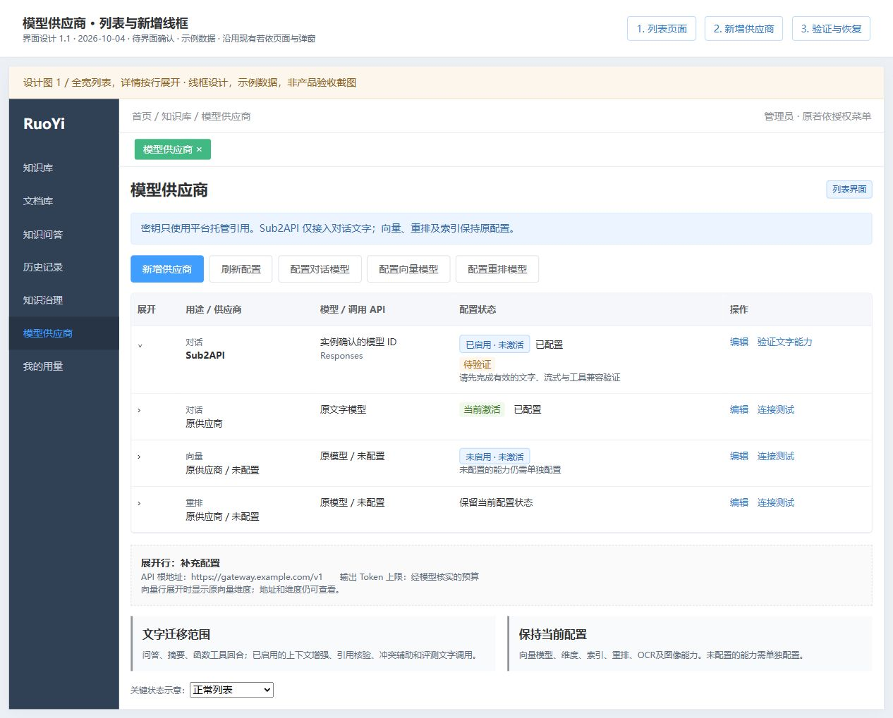
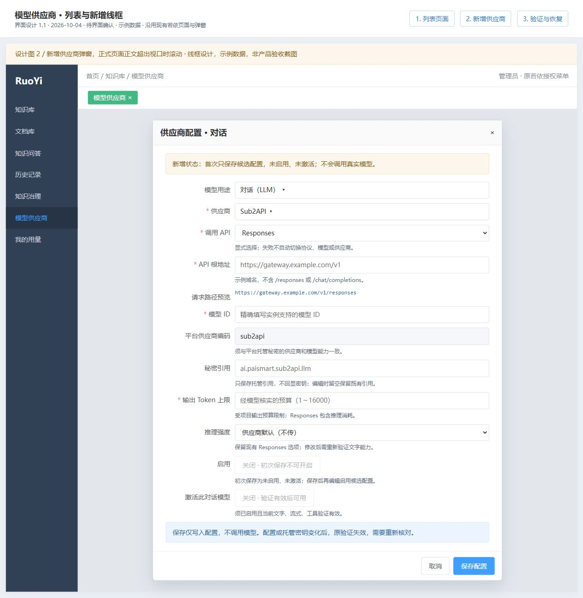
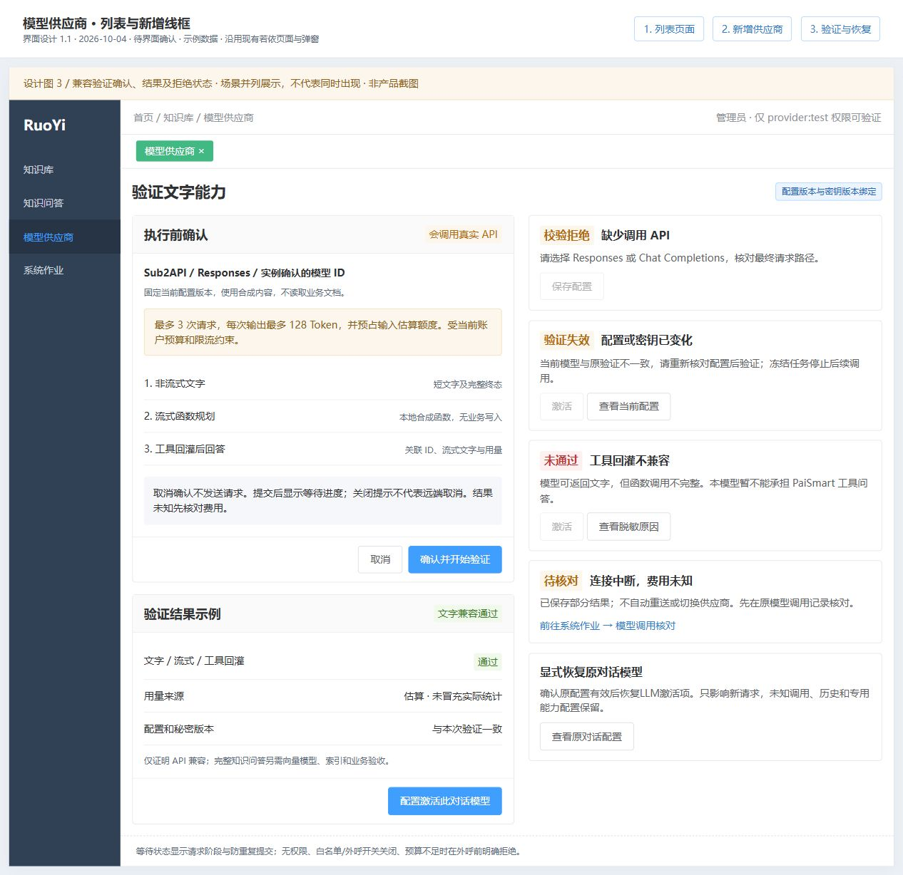

# PaiSmart 的 Sub2API 文字模型接入实现文档

> 文档类型：项目增量实现设计；版本：1.1；方案：已批准本地代码实施（Approved）；真实接入与运行切换另行处理
> 负责人：用户决定接入范围与实施；Codex 核查现状并编制方案  
> 创建、更新：2026-10-04  
> 需求依据：本轮用户要求 PaiSmart 接入所链接聊天中的 API，先写实现文档供审核；仅迁移文字模型，向量及图片等能力不迁移。参考聊天：`codex://threads/01a1025d-7008-7563-bbd5-8d1d47e1f07b`。  
> 关联：[总体统一接入设计](../../若依框架/功能/FEAT-RUOYI-001-平台与AI基础设施/Sub2API统一文本模型接入设计.md)、[完整迁移设计](完整迁移设计.md)、[开发环境启动指南](开发环境启动指南.md)、[若依开发参考](../../若依框架/若依框架前后端开发规范参考.md)。  
> 本文唯一维护本扩展的需求、设计、实施顺序和验收方法；原迁移设计维护项目整体事实，图稿和核查附录不另建任务状态。2026-10-04 用户要求多个智能体进入编码，并明确允许先完成离线源码实现、逻辑核对、类型检查和私有编译；原“不编写或运行单元/组件/集成测试及真实业务验收”的限定保留，不启用真实API、不写业务数据、不切换运行通道。实际进展见原完整迁移设计的实施记录及对应附录。
> 离线交付：源码实现、交叉逻辑复核、类型/静态契约检查及私有编译完成，详见[项目实施记录第6.6节](完整迁移设计.md#66-sub2api文字模型离线实施与私有交付)和[本轮核对报告](设计附录/2026-10-04-Sub2API文字模型实施/实施核对报告.html)；真实协议兼容、界面业务及切换未执行。

## 1. 需求与业务逻辑

### 1.1 本期要实现的结果

PaiSmart 管理人员在原“知识库 → 模型供应商”页面新增 **Sub2API 对话供应商**，配置 API 根地址、调用协议、精确模型 ID 和平台托管密钥引用。配置完成并验证后，显式激活该对话模型，PaiSmart 后续文字调用通过这个 API 完成，仍使用原若依登录、知识空间权限、任务、引用、额度和用量账本。

**建议采用项目内局部扩展：保留 `ProviderService → ModelGateway → ControlledHttp` 调用边界，增加独立 Responses 适配，并扩展 Chat Completions 适配。** 不以建设总体方案中的跨项目代理或共享通道页面为前置条件，不依赖 PaiCLI 的 Runner 或编码 Core。两种协议由配置显式选择，一次调用只使用所选协议，失败不自动换协议、模型或供应商。

你提供的聊天中，已有非秘密候选信息为 `http://39.102.215.183:8080`、Responses 和 `gpt-5.5`。它们作为后续核对线索，**不作为已验证地址、默认模型或已授权外呼配置**；最终根路径、实例版本、分组、可用模型及传输条件须在联机前明确。图稿使用示例域名与模型占位。

### 1.2 哪些文字调用进入本期

| 业务用途 | 拟接入方式 | 业务规则保持范围 |
|---|---|---|
| 知识问答、闲聊、最终回答 | `ChatService` 的规划回合及正文流式生成走当前对话 Provider | 资料可见范围、引用编号、历史读取、停止及断线回放不由模型决定 |
| 主题摘要 | `generate_summary` 工具内的文字生成走同一冻结的对话 Provider | 仅根据授权资料摘要，沿用事实及引用；不重新改写摘要流程 |
| 四工具规划及工具结果回灌 | 协议适配器将函数调用转换为 PaiSmart 原内部消息语义 | 工具仍由 Java 执行，保留当前最多四轮规划、八次工具调用及输入/权限校验 |
| 文档上下文增强 | 已启用时，原 `DocumentIntelligenceService` 的文字说明走 Sub2API | 原文与说明分存，沿用批次、长度预算和失败使用原文规则；不因接入开启该能力 |
| 引用核验 | 已启用时，原 `CitationService` 的文字判断走 Sub2API | 仍由业务解析并校验编号、布尔值和理由；失败保持未核验 |
| 冲突辅助确认 | 已启用时，原 `GovernanceService` 的文字判断走 Sub2API | 模型建议不代替正式冲突裁决与权限；失败按原业务规则处理 |
| 离线评测的答案生成与裁判 | 用户显式创建评测后，沿用评测任务冻结的文字 Provider | 检索指标、裁判指标、错误、人工复核及样本不足警示分别保留，不自动启动评测 |
| 对话供应商兼容验证 | 使用受控合成内容验证文字、流式、工具回灌与用量 | 单独计入原 LLM 用量账本，不读取业务文档，不冒充业务问答验收 |

### 1.3 保留的能力与数据

- `EMBEDDING` 的供应商、地址、秘密引用、模型、维度、向量缓存及活动索引全部保持原配置；不改 `/embeddings` 请求，也不安排索引重建或重新向量化。
- `RERANK` 保持原接口、配置和开关；即使当前重排使用 LLM 类额度，也不能按账务分类将它当文字生成迁移。
- 图片模型、视觉输入、OCR、图像生成/编辑、语音和其他专用能力不纳入接入。缺配置继续如实显示缺配置，不用 Sub2API 文字模型顶替。
- 不修改其他项目、Codex 客户端配置、数据库边界、登录菜单、支付和解析 Worker。保留原 MySQL、Redis、ES、MinIO、Kafka 及业务数据；不建库、克隆或初始化数据。

切换文字模型不触发历史说明重生成。若以后批准重新生成上下文说明，说明会改变向量化输入，需要单独审核重处理及索引影响；本次没有该动作。

### 1.4 用户操作流程

1. 在原平台 AI 密钥入口建立 PaiSmart 专属用途，元数据为 `projectCode=paismart`、`providerCode=sub2api`、`capabilityCode=llm`，按实例确认的认证模式录入密钥。业务页只保存例如 `ai.paismart.sub2api.llm` 的引用，不接收明文 token。
2. 在“模型供应商”新增用途为“对话”的 Sub2API 配置，选择 **Responses** 或 **Chat Completions**，填写根地址、模型和经核实的输出限制。Sub2API 初次保存默认为未启用、未激活；保存仅写配置，不外呼。
3. 在外部调用开关、主机白名单、有效密钥、测试权限及明确费用范围具备后，启用候选配置但保持未激活。管理员点击“验证文字能力”，核对测试次数/输出上限提示，再提交验证。
4. 文字、流式、函数工具回灌均通过后，显式激活这条对话配置。仅 LLM 范围切换，旧对话配置保留用于恢复。未配置向量模型时，可先验证闲聊/纯文字链路，但完整知识问答仍缺检索前提。
5. 新请求冻结当前 Provider 与密钥版本，并继续原问答、摘要、辅助调用和业务状态处理。已创建任务按原冻结配置继续；配置修改、停用或密钥轮换导致版本不符时，停止相关后续外呼，提示重新发起或核对，不混用新旧配置。

### 1.5 已核实的现状与接入差异

截至 2026-10-04 已只读核对当前源码：

| 已有实现 | 本次需要的增量 |
|---|---|
| `ProviderService` 按 LLM/EMBEDDING/RERANK 保存 `ps_provider`，含 `config_json`、版本和 active；页面允许创建供应商名 | 对 LLM 的 `sub2api` 增加服务端协议、参数及用途限制，页面增加明确选项；仅填写名字/URL还不能接入 Responses |
| `ModelGateway.complete/stream/streamTurn/text` 固定拼接 `/chat/completions`、读取 `choices`；有正式调用账本 | 保留业务入口，按显式协议编码/解码；Responses 使用独立请求体与终态判断 |
| `ControlledHttp.sse` 读取单行 `data:` JSON，依靠 `[DONE]` 成功结束 | Responses 按语义事件结束；完善有界 SSE 帧解析、取消和 EOF 判断，不能等待不存在的 `[DONE]` |
| `ChatService` 执行时读取 active LLM，评测已保存 Provider 快照 | 为新 Sub2API 请求补充创建时冻结及续行版本核对；评测沿用现有快照位置 |
| `IntelligenceSettings.modelSecret` 检查供应商/能力；平台托管秘密有 activeVersion 与 rowVersion | 复用原托管体系，将同一次解析返回的有效密钥元数据版本绑定验证和调用，防轮换错配 |
| `ModelCallService` 保存请求指纹、响应、实际/估算用量，未知远端结果禁止自动重送 | 两种协议都使用同一个正式账本；缺用量不伪写为实际0，Responses协议资料随响应保存 |
| 原“连接测试”发送“请回答OK”，非空结果返回 READY | Sub2API改为受限兼容验证，分别展示文字、流式、工具、用量结论；普通连接可用不等于业务可用 |

当前环境指南记录 `ps_provider` 和本项目模型秘密元数据尚未配置、完整运行环境尚未就绪。这是既有核查事实，本轮没有重新查询数据库或访问该 API；具体实施时重新核实。

## 2. 前端界面设计

### 2.1 原页面的调整

继续使用后台授权菜单进入 `paismart/operations/providers/index`，保留若依 Layout、三种 `navType`、权限按钮、Element Plus 表格/弹窗及共享请求链路。文字接入只调整模型供应商页，问答页继续消费原正文、工具、引用及终态事件，无需新增主导航或聊天协议选择器。

可查看图稿：[模型供应商列表、新增与验证线框图](图稿/Sub2API文字模型接入设计图.html)。图稿界面版本为1.1，分为列表、新增弹窗、验证与恢复三个场景，支持切换调用协议及查看列表空态/错误/验证失效示意；均为设计示例，不是产品截图。原图将初次新增示例画为已启用，现已与第1.4节的“初次保存未启用、未激活”要求对齐，业务门禁不变。

Sub2API 对话表单新增“调用 API”必选框及最终请求路径预览；API 根地址不含具体操作后缀，模型必须精确填写，不预填候选 `gpt-5.5`。平台供应商编码对该类型固定为 `sub2api`，秘密引用遵循现有不回显/留空保留规则。向量维度只在原向量用途展示，Sub2API 不出现在向量和重排的候选项中。

列表按“用途/供应商、模型/调用 API、配置状态、操作”组织；根地址、向量维度及文字输出上限可展开查看，保留原信息。分别显示启用/激活和当前兼容状态；历史验证通过但当前证据失效时显示“验证失效，需重新验证”。下方说明文字迁移范围及保留能力。新增表单依次展示用途、供应商、协议、根地址/预览、模型、编码、秘密引用、输出预算及对应协议参数，沿用现有 Responses 推理强度（供应商默认不传或 low）与 Chat Completions 输出参数。验证结果提供打开原编辑弹窗的配置激活入口；仍须显式打开激活开关并保存，不由快捷入口直接写入。

“启用”表示候选配置允许测试；“激活此对话模型”须验证有效、工具可用且启用。未验证、失败或配置/密钥已变化时按钮禁用并显示具体原因。服务端重复检查这些条件，不能靠禁用按钮授权。保存失败保留输入；版本冲突提示刷新配置，不自动覆盖。

验证前弹窗显示精确模型、协议、最多三次请求及输出预算。等待中防重复提交；取消确认不发送请求。请求已发送后，本期提示“等待服务端核对”，不提供仅关闭弹窗就声称远端取消的按钮。完成后逐项显示文字、流式、工具回灌及用量来源；用量缺失显示“估算”，保留不确定费用的核对入口。其他用途的原测试行为不因该弹窗改动而迁移。

布局沿用原迁移设计的1440×900、1280×800支持范围；表格允许局部滚动，弹窗限制在视口内并滚动正文，字段错误紧邻字段，键盘可操作。原若依三种导航仍须在后续实施验收中检查。

### 2.2 前端拟改文件

以下均为后续实施清单，本轮不修改这些业务文件。

| 类型与位置 | 为什么改 | 关键变化 |
|---|---|---|
| 修改 `frontend/admin-web/src/views/paismart/operations/providers/index.vue` | 扩展原模型页 | LLM专属 Sub2API 选项、协议/路径、输出限制、兼容验证、激活门禁和恢复提示 |
| 修改 `frontend/admin-web/src/types/paismart/index.ts` | 消费增量契约 | 对Provider配置及验证结果增加明确类型，保留旧Provider字段 |
| 修改 `frontend/admin-web/src/api/paismart/operations.ts` | 传递验证版本与限制 | 复用原 `/providers/LLM/test` 和 `Idempotency-Key`；配置保存仍走原客户端和服务端版本校验 |
| 条件新增 `frontend/admin-web/src/views/paismart/__tests__/sub2api-providers.spec.ts` | 用户另行扩大单元测试范围时采用 | 用途切换、协议必填、无效验证不能激活、确认取消不发请求及版本冲突；沿用原Vitest配置 |

不修改共享 Layout、权限store、登录、全局请求封装或向量/重排页面规则。问答页仅在实际发现新增脱敏错误无法表达时，沿原错误组件局部补文案，不增第二套流式状态。

## 3. 后台处理设计

### 3.1 调用顺序与职责

外呼仍发生在若依中心 Java 的受控智能调用边界，浏览器不直连 Sub2API，解析 Worker 不持模型密钥。

1. 原接口验证登录、资格、页面权限和资源范围，问答/作业验证租约与取消；取得当前任务冻结的 LLM 配置。
2. 校验用途、显式协议、API地址、模型和输出参数；检查外部开关、主机白名单、Provider启用、兼容证据以及当前托管密钥元数据。配置版本或密钥版本改变即拒绝续行；不读取其他项目秘密。
3. 适配器构造最终URL和规范请求，`ModelCallService.begin` 绑定模型配置/协议/密钥版本及实际请求内容，预占原LLM额度；相同调用已有完整结果时只重放，已发出/未知时拒绝自动重送。
4. `ControlledHttp` 发送 Bearer 请求，独立适配器逐帧解析正文、函数调用、用量和终态；工具参数全部完成并验证后，才能返回给 `ChatService` 执行。
5. 业务服务继续按原权限执行四工具，结果按协议关联回灌，再生成正文。结果进入原消息、引用与WS事件；协议资料只存在服务端，不进入前端事件。
6. 先校验响应及终态，再正式记录成功和结算。异常/取消保留部分答案；有可靠用量则依原停止语义结算，未知费用进入原待核对流程。业务层按现有失败/停止状态反馈。

### 3.2 供应商配置、验证与兼容

优先使用现有 `ps_provider.config_json`，不新建通道表或业务库。API增量字段由正式 [HTTP契约](../../../contracts/paismart/knowledge-v1.openapi.yaml)唯一维护；下表仅说明设计职责，不另立可执行Schema。

| 保存位置/字段 | 拟约束与兼容方式 |
|---|---|
| `scope`、`name`、`endpoint`、`model`、`secret_ref` | 复用现有列；Sub2API仅 `LLM`，名称采用 `SUB2API`，服务端匹配按规范化值判断；`config.providerCode=sub2api` |
| `config.apiProtocol` | `responses` / `chat_completions`；Sub2API必填。旧供应商缺省继续原Chat实现，不回填或重写原记录 |
| `config.maxOutputTokens` | 明确正整数输出预算，不能超过项目原方法上限及该模型经核实上限；Responses预算包含推理消耗，不能把正文长度当总输出额度 |
| `config.outputTokenParameter` | 仅Chat协议使用：显式白名单 `max_tokens` / `max_completion_tokens`，按实例/模型验证选择，不同时发送、不凭报错自动更换；旧供应商保持原参数 |
| 服务端验证资料 `config.compatibility` | 保存合成验证各项结果、配置指纹、密钥活动版本/元数据版本、时间、诊断及脱敏关联ID；客户端不能写成通过；只返回非秘密摘要 |
| `revision` / `rowVersion` | 沿用乐观锁；验证请求带expectedVersion，开始及写结果时检查同版。配置变更并发时不写入过时通过结果 |

兼容指纹包含外呼相关配置、模型/协议、秘密引用及活动版本；不包含激活标志、验证资料和验证操作自身的更新时间。激活仍递增行版本，但同一外呼配置的验证可继续使用；修改地址、模型、协议、参数、秘密或托管元数据即失效。验证资料不得混入调用快照指纹造成同一请求重放失败。该处理只针对新增Sub2API，旧账本快照及请求指纹保持可读。

验证结果的写入在校验版本后由服务端完成，不由表单提交；已有未知字段继续兼容，但新的Sub2API配置采用参数白名单，不接受任意headers、URL、工具、内联密钥或隐藏降级地址。模型列表发现不在首期范围，直接填写经实例确认的ID即可。

### 3.3 两种文字协议怎样适配

| 事项 | Responses | Chat Completions |
|---|---|---|
| 请求路径 | 规范根地址 + `/responses` | 规范根地址 + `/chat/completions` |
| 消息输入 | 将内部system/user/assistant/tool转为input消息与函数项；保留原消息顺序与系统约束 | 继续messages、tools、tool_call_id形态；只按已验证的参数组合发送 |
| 输出限制与保存 | `max_output_tokens`，`store:false`；不依赖上游持久conversation或previous_response_id | 使用显式选择的输出参数；Sub2API请求使用 `store:false`，其兼容性纳入验证 |
| 正文/函数 | 解析message的文字内容与function_call；映射为原content/tool_calls | 解析choices.message或delta，工具参数按index有界合并 |
| 工具关联 | `call_id`原样对应function_call_output；不能用item id代替 | 原样使用tool call id；新增适配禁止为缺失ID自造call编号 |
| 流式完成 | 解析typed events，只有有效completed可成功；failed、incomplete、error或提前EOF均不得成功 | `[DONE]`和完整合法finish_reason共同判断；拒绝、长度截断、残缺工具与提前EOF分别处理 |
| 用量 | input_tokens/output_tokens/total_tokens按非负整数归一化 | prompt_tokens/completion_tokens/total_tokens按非负整数归一化 |

Responses 返回的函数项及需要续传的推理加密项，由适配器保存为内部有界协议资料，保持顺序回传下一工具回合；不把其误当用户文字或展示推理内容。旧内部消息没有该字段继续可读。当前`ChatService`会把完整plan保留为assistant消息，可沿该扩展点传递资料；完成/停止回合在 `ps_model_call.response_json` 保存归一化结果及必要协议资料，旧Chat缓存仍按旧形态重放。重试不依赖不可回读的上游会话，未知请求不重新发送。

正文、拒绝、工具结束、长度不足和网络失败采用不同结果判断。Responses `incomplete` 或Chat输出截断即使有文字及用量，也只能保存部分结果及可靠用量，不能视为完整回答；结束帧后仍须校验工具ID/名称、JSON与已注册Schema，未完成工具不得执行。辅助JSON输出仍由原业务校验器检查，不假定API的JSON mode等于业务正确；本期不强制启用结构化输出或上游内置搜索/图像/托管工具。

原连接预算10秒、非流式默认90秒、流式120秒与响应大小上限继续作为上限，模型配置不能自行放宽。SSE解析以完整帧为单位处理多行data、注释及CRLF，Responses使用data内的type并检查event名一致性（若提供）；隔离Chat/Responses终态策略。保留取消响应头future、关闭响应体、超时和失租检查；旧Chat/ES等消费者做定向回归，不为Responses放宽主机校验或响应预算。

协议依据：[OpenAI流式说明](https://developers.openai.com/api/docs/guides/streaming-responses)、[函数调用](https://developers.openai.com/api/docs/guides/function-calling)、[Responses迁移与无状态回传](https://developers.openai.com/api/docs/guides/migrate-to-responses)、[Chat输出参数](https://developers.openai.com/api/reference/resources/chat/subresources/completions/methods/create)。这些是协议基准，不证明第三方兼容。公开候选 [Sub2API路由源码](https://github.com/Wei-Shaw/sub2api/blob/main/backend/internal/server/routes/gateway.go)具有两类入口，实际调用仍受部署版本、密钥分组和模型约束；本轮没有验证用户实例与此上游一致。

### 3.4 配置冻结、用量与失败恢复

**新任务的配置冻结。** 新Sub2API问答创建时，在原 `ps_chat_generation.request_json` 的服务端保留区域记录Provider快照、配置指纹和秘密版本，禁止客户端覆盖。评测沿用 `ps_eval_run.config_json`；文档增强/冲突作业在现有任务载荷或checkpoint中保存首次选定的文字快照，每批/回合续行检查版本。摘要和引用核验继承所属问答快照，不重新读active。旧排队任务缺新快照且当前仍为原供应商时保留原处理；当前已切Sub2API时拒绝自动采用新模型。切换前应排空或显式处置这类任务，不能批量补写快照或自动重放。

每次外呼解析同一份 `ManagedSecretService.Resolved` 的元数据及密钥值并核对冻结版本。密钥停用/轮换、配置变更或权限/租约失效时，后续调用停止；当前已发送请求仍按实际结果结算。文字Provider激活更新只修改LLM范围，并发激活须使用现有事务加LLM范围的串行化锁/CAS约束保证唯一，不新建第二配置真相。

**用量沿用业务账务。** 有可信供应商总量优先使用；仅有输入/输出完整分量时安全求和；缺失/非法/部分用量使用原回退估算并保留 `estimated=true`，不写成实际0。使用原 `ps_model_call` 和QuotaService预占/结算/核对流程。Sub2API费用与PaiSmart Token额度不是同一单位，不引入汇率或价格猜测；本期不新增金额账本。

**未知费用不自动重放。** 发送前校验失败不创建收费调用；账本开始后网络失败、取消或断线而缺可靠终态/用量时，保留STARTED/UNCERTAIN与部分响应，原核对入口处理。401/403提示密钥或分组问题，404提示路径/模型核对，429提示配额/限流，5xx及协议失败保留脱敏原因。均不自动改用原供应商、重试新协议或重新运行工具。

**恢复只影响新请求。** 记录切换前LLM配置/版本和运行包，停止新建相关请求，再通过原页面显式恢复原LLM active配置并核对其有效密钥。既有未知调用先核对；不删消息/账本、不改向量配置/ES别名、不恢复整库旧快照。若尚无可用原模型，则停用Sub2API并明确暂停文字服务。

### 3.5 网络、秘密与资料边界

保留 `ControlledHttp` 的批准主机、TLS、无重定向、无userinfo/query/fragment校验。默认HTTPS；候选HTTP地址不能在编码时顺手设置allow-http。若实际实例仍只提供公网HTTP，联机前需要用户明确该范围及传输条件，优先落实HTTPS；只读设计与离线适配不受影响。

发送内容限于原业务已授权的系统提示、提问、历史和相关资料；Sub2API属于新增资料接收边界，联机时确认允许外发的文档类别、提供方留存和测试样本。`store:false`只表达请求意图，不能证明中转无日志或无留存。文档/工具内容不能改写目的地址、模型、权限或扩展工具。日志、截图、错误不保存明文密钥、完整模型原报文或加密推理资料；仅记录脱敏配置标识、用量来源、耗时、终态与关联ID。

### 3.6 后端、契约及说明拟改文件

以下后端路径均相对 `ruoyi-backend/ruoyi-paismart/src/main/java/com/ruoyi/paismart/`。

| 类型与模块/文件 | 为什么改、关键逻辑 |
|---|---|
| 修改 `application/intelligence/ProviderService.java` | LLM专属Sub2API校验、根路径规范化、验证指纹/门禁、服务端验证资料及并发激活；旧用途保持原行为 |
| 修改 `application/intelligence/ModelGateway.java` | 保留complete/stream/streamTurn/text入口及账本owner；按文字协议调用适配器；embed/rerank保持原路径 |
| 新增 `infrastructure/intelligence/Sub2ApiTextAdapter.java`、`Sub2ApiResponsesCodec.java` | 本项目内有界编码、两协议分发与归一化；Responses独立消息/事件解码；不复制Quota/任务规则，不引入PaiCLI依赖 |
| 修改 `infrastructure/intelligence/ControlledHttp.java` | 增加完整SSE帧解析与可选择终态策略；保留HTTP安全、预算和取消；原方法兼容其他消费者 |
| 修改 `infrastructure/intelligence/IntelligenceSettings.java` | 提供同一次托管解析的元数据与值给文字调用边界；检查项目/能力/认证/活动版本，不把秘密返回客户端 |
| 修改 `application/intelligence/ChatService.java`、`DocumentIntelligenceService.java`、`GovernanceService.java` | 在已有request/config/checkpoint冻结文字配置；问答/评测/增强/冲突续行复核，不修改Embedding输入或索引选择 |
| 修改 `application/jobs/JobService.java`、`infrastructure/intelligence/PaismartChatWebSocket.java` | 新辅助作业由服务端标记文字冻结策略，旧作业幂等恢复保留原载荷；WS将已认证平台会话独立传入，客户端不能覆盖冻结资料或登录会话 |
| 条件修改 `application/intelligence/ModelCallService.java` | 若适配无法仅靠现有response_json保留必要资料，增加内部响应包装与旧形态兼容读取；保留账本状态、幂等键和结算规则，不执行历史账本回填 |
| 修改 `api/IntelligenceController.java` | 扩展原LLM/test的受限请求、版本/验证模式，沿用provider:test权限、幂等头及脱敏审计；其他用途原请求继续可用 |
| 修改 `contracts/paismart/knowledge-v1.openapi.yaml`及原契约检查 | 为Sub2API配置、兼容结果、测试限制、版本冲突补明确schema；前端消费同一契约，既有WS业务协议不变 |
| 修改工程 `README.md`、`src/main/resources/application-paismart.yml` 的说明 | 写明文字接入/允许主机/外呼开关/恢复条件；默认开关和主机空值保留，不写真实地址或密钥 |
| 条件修改/新增现有 `src/test/java/.../application/intelligence/` 中ProviderInputBoundaryTest、ModelGatewayBoundaryTest、ModelCallServiceTest、ControlledHttpTest及Sub2ApiTextAdapterTest | 仅在用户扩大单元测试范围后执行；验证用途拒绝、协议回合、终态、取消、未知账本、旧Chat及Embedding/Rerank回归，使用本地合成服务 |

优先利用现有JSON列和事务设施，本方案不需要DDL、菜单SQL或新增运行依赖。若实际开发发现现有列预算不能保存必要协议资料，先回本文说明持久化变更、消费者与恢复，再审核受影响范围，不能自动扩为建表迁移。

## 4. 实施步骤

### 4.1 建议按以下顺序落地

1. **确认本方案与接入目标。** 审核局部扩展、两协议显式选择、LLM范围及兼容门禁。实际接入前核实实例版本/分组、根地址、模型、密钥元数据、传输条件及费用；离线开发不凭候选信息启用外呼。
2. **准备当前业务环境并保护现场。** 承接[启动指南](开发环境启动指南.md#1-每次开发前必须先准备环境)，核查原共享服务/排队作业/开关、源码差异和当前固定包；只开启当前业务。缺必需环境先记录并处理；明确离线范围时才使用该指南的例外。
3. **先补契约与配置。** 完成服务端用途/协议校验、同版配置保存、密钥元数据绑定、验证结果结构及前端字段。新增默认禁用配置，不改原LLM及专用能力数据。
4. **实现文字适配与快照。** 先打通非流式、流式终态，再接工具回灌/Responses协议资料和原账本；落实问答、摘要、评测及辅助调用的冻结/续行检查。
5. **完成离线定向检查。** 沿用原接续记录中“源码逻辑核对、类型检查和私有编译；不编写或运行单元测试”的限定：逐项核对两协议、终态/取消、工具、重复请求、账本及旧Chat/Embedding/Rerank边界，运行 `typecheck:paismart`、既有契约检查和受影响私有构建。建议另外使用本地合成HTTP/SSE演练网络故障；单元/组件/集成测试与业务验收若要增加，需用户明确扩大原范围后再采用表中条件项及后续验收方法。编译或静态逻辑成立不能证明实际协议与异常处理通过，缺运行证据的项如实保留。
6. **完成限定联机兼容验证。** 在明确目标、密钥和费用范围后，执行下面的最多三次合成验证，不用用户业务文档。失败保留原因，不调整标准、自动切协议或额外试模型。
7. **同步当前运行通道并显式切换。** 使用新固定中心包和匹配管理端产物；记录原包/配置以便恢复，核对实际运行版本后才激活Sub2API。消费者启用前核对已有队列，不能因服务启动重放未授权收费作业。
8. **在用户明确扩大原业务验收范围后，执行业务定向验收。** 第5节先作为审核方法；后续获准执行时，首次操作前展示并保存中文清单，逐项操作、采集截图并回读，核对实际数据。实际结果仍写入本项目已有实施记录及对应证据；交付 `verification-report.html`，技术检查、业务结论与用户接受分开。

### 4.2 合成兼容验证的上限与门禁

- 单次验证固定同一个Provider版本、API协议和模型，使用原 `/paismart/providers/LLM/test`，新增 `mode=compatibility`、`expectedVersion`。同一Idempotency-Key恢复原验证操作；各子请求使用稳定派生operation_id，完成结果重放，未知子请求不重送。
- 服务端验证执行权固定六分钟，以 `attemptId/attemptExpiresAt` 保存；期限内重复请求只回读。到期且该键现有子调用全为COMPLETED或尚无调用时，可沿原键CAS认领执行权、重放完成结果并继续未发子请求，仍不超过原三次。STARTED/UNCERTAIN保留核账；已人工核账不沿旧键重发。核账后由只读 `canStartNewVerification` 提示管理员显式确认新一组预算与新键，客户端不能伪造执行权或门禁。
- 最多三次：一次非流式短文字；一次流式函数规划；一次回灌固定本地函数结果并流式生成文字。测试函数只返回合成内容，不调用真实知识工具。
- 每次最大输出预算建议128 Token，总预占最多三个“合成输入估算 + 128输出”上限；模型需更高预算时，结束本次并明确新范围再验证。还须受原用户/日预算、限流与HTTP时间预算约束。
- 核对完整非空文字、有效流式终态、精确函数名/参数/id关联、回灌后的回答及用量来源。返回Provider版本/配置指纹/秘密版本摘要和各项结果，不返回秘密或协议原报文。
- 文字、流式、工具任一失败均不能激活。用量缺失但业务估算可用时，显示“用量估算”并沿原估算政策；远端费用未知且未核对则不能记验证整体通过。第三个请求的结果未知时，保存待核对状态，不能整组重跑。
- 所有测试费用仍由原LLM账本记录；权限不足、配额不足、外部开关关闭或地址未批准时，在发请求前明确拒绝。

### 4.3 审核与联机前决定

| 需要审核/明确的内容 | 建议及影响 |
|---|---|
| 本项目的实现方式 | 采用上述原供应商页+项目内适配，先不建设跨项目代理；支持两协议，实例优先按聊天里的Responses核对，不默认宣称Chat可用 |
| 文字辅助调用范围 | 问答/摘要必须覆盖；增强、核验、冲突、评测仅在原业务已启用且用户触发时沿用，不因接入自动开启 |
| 向量与其他能力 | 全部保留；若没有可用Embedding/索引，完整知识问答验收对应项受阻，文字API兼容可单独验证 |
| 实际根地址、模型和认证分组 | 候选信息待核实；必须提供精确可用配置，不能把示例模型名称当产品默认 |
| 传输与资料外发范围 | 默认HTTPS；若仍公网HTTP，明确测试环境及接受范围后再接入；确认可发送的脱敏资料及中转留存条件 |
| 联机费用及配置切换 | 单独明确最多三次合成测试的预算、业务测试样本/预算及目标运行通道；设计审核不等于真实密钥录入、收费或激活授权 |

## 5. 业务验收方法

以下是后续执行方法，不记录本轮实际通过数。依据为本文1.2—1.4、2.1及3.2—3.5；原知识库规则继承[完整迁移设计的需求与业务逻辑](完整迁移设计.md#1-需求与业务逻辑)。费用相关操作仅在明确范围后执行。

### 1. 对话供应商配置与保存

- 前提：有Provider编辑权限，原模型页可用；使用未激活的Sub2API候选配置。
- 步骤：新增对话供应商，缺协议尝试保存，再补齐根地址/模型/秘密引用；保存，刷新并重新编辑。
- 预期：缺协议被拒绝；完整配置只写原LLM记录、正确预览目标路径；不发模型请求，不回显密钥；未经验证不能激活。截图保存列表、表单校验及回读状态，核对Provider版本和模型调用表未因保存增加收费记录。

### 2. 不迁移向量、重排与索引

- 前提：保存原配置/秘密引用/维度、活动索引版本及ES别名基线；没有配置的用途明确记录为空。
- 步骤：完成文字配置及激活后，回看向量、重排、索引页与实际对应记录。
- 预期：这些记录、维度、快照、ES别名与基线一致，无重建/重向量化作业；Sub2API专用能力用途在服务端被拒绝。截图与数据回读共同判定，不能因“没出错”认定保持不变。

### 3. 合成文字、流式与工具兼容验证

- 前提：目标协议/模型、有效密钥、Provider版本、权限、外呼开关、白名单和费用已明确。
- 步骤：先取消验证确认，核对无请求；再确认执行最多三次合成验证，查看逐项状态与用量。
- 预期：取消不发送；文字及流式合法完成；测试函数精确关联并回灌；用量如实为供应商统计或估算。截图确认提示、逐项结果，核对账本次数、幂等派生ID和结算；该结果单列技术兼容，不计为知识问答通过。

### 4. 文字问答与知识引用

- 前提：Sub2API文字兼容有效；闲聊用无资料固定问题；知识问答另需原可用Embedding/活动索引和已授权样本文档。
- 步骤：先发固定闲聊问题；再询问样本中有独立正确答案的事实及无证据问题，观察工具、文字与引用侧栏。
- 预期：请求实际走选定Sub2API协议/模型；闲聊不强制检索；知识答案与样本事实、引用位置相符，无证据明确说明；不可见空间无资料泄漏。截图保存完整回答、工具、引用页/锚点，回读消息/事件/脱敏请求元数据。缺向量前提只阻塞知识项，不把闲聊成功计为完整知识链路成功。

### 5. 摘要与多回合工具

- 前提：原摘要/检索工具可用；样本有可核对的主题与事实。
- 步骤：请求主题摘要，再使用需要检索/工具回灌的问答；观察工具执行及最终文字。
- 预期：摘要保留事实与引用；工具仍由原Java规则执行，回灌不丢关联；多个回合使用同一冻结模型，未完成工具或非法参数不能执行。保存工具过程、正文、引用及版本/账本记录。

### 6. 已启用的文字辅助功能

- 前提：分别明确增强、引用核验、冲突确认或评测的原开关、固定脱敏样本与预算；关闭的能力不为验收开启。
- 步骤：逐个触发其已有入口，按原业务规则查看说明、核验标识、冲突证据或逐例评测。
- 预期：文字生成实际走Sub2API且原校验/人工复核保持；失败如实为原文回退/未核验/诊断失败；不能变成自动接受裁决。保存该功能对应页面和输入/输出证据；未启用项说明原因，并记录其后续验证缺口。

### 7. 停止、断线与未知费用

- 前提：合成服务可控制响应头等待、半段流及无终态断线；真实测试使用批准样本。
- 步骤：等待响应头时停止、已有文字后停止；另做浏览器断线resume与上游提前EOF；同一请求重复提交/恢复。
- 预期：停止关闭本次请求，保存已生成文字；浏览器resume只重放原事件、不新收费；上游EOF/截断显示未完成，未知费用进入待核对；不执行残缺工具或自动换模型。保存状态截图和事件/账本/请求次数证据，区分客户端恢复与上游重新调用。

### 8. 配置变更、权限及恢复

- 前提：具备原有效LLM恢复配置、冻结中的合成任务和权限受限账号；真实密钥轮换只在明确授权后执行。
- 步骤：修改模型/协议或模拟密钥轮换，再尝试激活/续行；测试无权限访问；显式恢复原LLM配置后发新请求。
- 预期：旧兼容结果失效，旧任务后续外呼被拒绝，未授权不得配置或测试；恢复后的新请求使用原模型，历史与未知账本保留，向量/重排/索引基线不变。保存失效/拒绝/恢复界面及版本、调用和索引数据证据。

<!-- 内部维护：2026-10-04用户批准多个智能体本地编码、离线范围；本次离线交付完成。实际动作在既有完整迁移设计实施记录及设计附录中记录，不从链接聊天继承PaiCLI代码、费用或运行包授权。 -->
