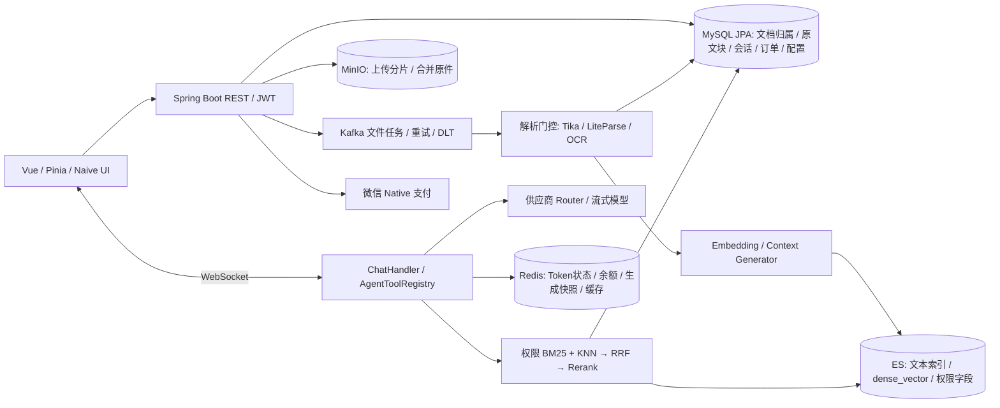
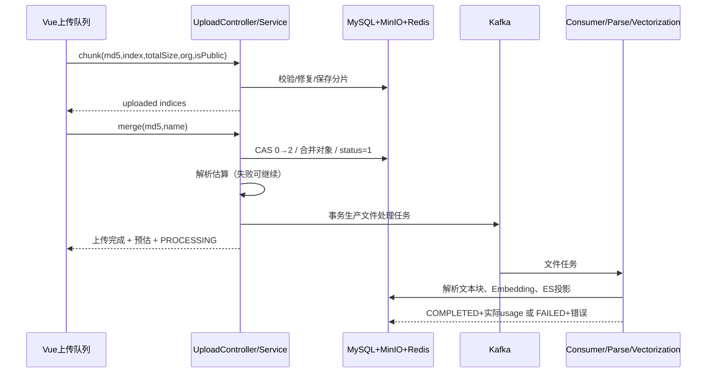

# PaiSmart 原项目复现与学习设计

> 文档类型：本地源码调查、复现与学习设计  
> 资料版本：2026-10-04  
> 负责人：本次调查执行者  
> 状态：设计与静态调查；不表示业务验收通过  
> 来源：`参考项目/PaiSmart-main` 本地代码与同目录压缩包；未认证远端提交  
> 维护边界：原实现事实、复现链路、学习练习与迁移追溯方法由本文维护；批准的目标方案、实施与验收事实仍以[完整迁移设计](完整迁移设计.md)及其所链接记录为准  
> 静态证据：[源码基线](证据/2026-10-04-原项目复现调查/源码基线.json)、[808 个源文件清单](证据/2026-10-04-原项目复现调查/源文件清单.csv)、[源文件目标候选对照](证据/2026-10-04-原项目复现调查/源文件目标候选对照.csv)、[依赖声明清单](证据/2026-10-04-原项目复现调查/依赖声明清单.csv)。声明清单不是 Maven 完整解析依赖树。

## 1. 项目要解决的业务问题

PaiSmart 将个人和组织文档变成可检索、可引用的知识问答系统。用户先获得注册资格和组织归属，再把文件上传到私人、组织或公开范围；系统异步解析、分块、向量化；用户提问后，Agent 调用有权限的检索工具，组织证据并流式回答。管理员维护成员、组织、邀请码、模型供应商、限额和充值套餐，并通过后台接口处理文档冲突、重建索引、运行评测与人工复核。

复现的关键成果不是出现聊天框，而是同一份资料从“有归属的文件”经“可靠可恢复的处理任务”成为“权限正确的检索结果”，最终产生“可追溯到原文的回答”；用量、支付、运维操作也是完整业务范围。原项目已经有这些链路的主要代码，同时存在跨存储一致性、支付幂等和生成持久化方面的缺口。本仓库的批准迁移方案在保留功能的基础上补齐这些边界。

本文区分三种结论：**源码事实**是已阅读实现能够证明的行为；**目标方案**是现有完整迁移设计批准的行为；**待验收**是必须在授权环境中实际操作后才能确认的结果。本次只阅读文件并新增本文，没有启动环境、连接业务库、调用模型、创建订单或执行运维接口。

## 2. 用户、功能和页面全景

| 业务角色 | 能完成什么 | 原页面或接口入口 | 要保持的边界 |
|---|---|---|---|
| 普通用户 | 邀请注册、登录刷新、退出当前/全部会话，查看个人资料 | `users/register/login/me/logout/logout-all`、`auth/refreshToken` | 原认证由 JWT+Redis 缓存支撑；目标复用若依认证 |
| 知识贡献者 | 选择上传组织、分片续传、合并、查看预估/实际 Token、重试向量化 | knowledge-base 页面、upload、documents 接口 | 上传完成与向量完成是两个状态 |
| 知识消费者 | 可见文档列表、混合搜索、下载、普通预览、PDF 指定页和引用详情 | knowledge-base/search-dialog、chat/reference-preview-page | 列表、召回、预览和下载都要校验归属 |
| 问答用户 | 多会话、归档/恢复/切换、历史、流式聊天、停止、断线恢复、点赞点踩、摘要 | chat 页面和 Pinia chat store | 恢复属于指定生成，不能串到其他会话 |
| 聊天审计管理员 | 查询全体持久化对话历史，按用户ID和开始/结束日期筛选、重置筛选 | ADMIN路由 `/chat-history`，GET `/api/v1/admin/conversation` | 管理查询与本人历史分开；后端验证管理员身份，不能只依赖前端角色隐藏 |
| 组织管理员 | 组织树、组织文件大小限制、用户组织分配、主组织选择、用户列表 | org-tag、user、personal-center | 标签树是业务空间，不等同于若依部门 |
| 平台运营 | 邀请码增删改禁用、创建管理员、模型配置与连通测试、限额、用户额度增加 | invite-code、model-provider、user、usage-monitor | 资格、配置密钥和账务需要审计 |
| 充值用户/运营 | 套餐/自定义金额、微信 Native 二维码、订单列表与状态查询、套餐管理 | recharge、recharge-manage | 支付回调和主动查询只能入账一次 |
| 知识治理人员 | 疑似冲突列表、保留新/旧文件/忽略；索引状态、全量重建与回滚 | 原后台管理接口，原前端没有完整对应页面 | 处置有正式删除副作用，不能凭模型直接执行 |
| 评测人员 | JSONL 数据集、异步评测、报告、人工判定、一致率/kappa | 原 `admin/eval` 接口 | 自动评委不是业务负责人接受 |
| 运维人员 | 系统状态、用户活动、旧对象路径迁移、数据清空、启动文档导入 | admin 接口、初始化器 | 隐藏维护功能也要迁移处置；危险接口不在本轮执行 |

功能还包括：文件类型白名单、旧数据向量化状态回填、旧 MinIO 路径兼容、上传 Redis 位图修复、Kafka 重试与死信、内存背压、解析并发门控、ES 初始化及映射兼容、供应商密钥加密、引用可疑状态、检索降级、工具调用上限、会话心跳和前端限流倒计时。它们是业务可用性的组成部分，不能只覆盖页面按钮。

原界面实现可从[chat/index.vue](../../../参考项目/PaiSmart-main/frontend/src/views/chat/index.vue)、[knowledge-base/index.vue](../../../参考项目/PaiSmart-main/frontend/src/views/knowledge-base/index.vue)、[model-provider/index.vue](../../../参考项目/PaiSmart-main/frontend/src/views/model-provider/index.vue)、[usage-monitor/index.vue](../../../参考项目/PaiSmart-main/frontend/src/views/usage-monitor/index.vue)进入。登录模板中有验证码、重置密码和绑定微信组件，但当前 [auth API](../../../参考项目/PaiSmart-main/frontend/src/service/api/auth.ts)只实现账号密码、注册、用户信息、退出和刷新；模板存在不能证明短信登录、找回密码或微信登录形成业务闭环。

管理端历史入口见[chat-history/index.vue](../../../参考项目/PaiSmart-main/frontend/src/views/chat-history/index.vue)和[ADMIN路由定义](../../../参考项目/PaiSmart-main/frontend/src/router/elegant/routes.ts)。页面发送 `userid/start_date/end_date` 查询条件，后台 `AdminController.getAllConversations`先验证管理员，再将目标用户ID解析为用户名查询历史；无用户筛选时可以查询全体记录。它不是普通用户的会话历史接口，也不能被“聊天页面可查看本人历史”替代。

本次无界面改动，沿用已批准的[界面图稿](图稿/界面图稿.md)、[知识库界面设计](图稿/知识库界面设计.html)；文档、问答、冲突、索引、评测、组织、供应商、账务和运维的九张图仍由该入口维护。

## 3. 准确技术栈与可复现条件

### 3.1 原项目依赖

| 层次 | 本地声明/锁定版本 | 作用与注意事项 |
|---|---|---|
| Java/框架 | Java 17；Spring Boot parent 3.4.2 | Web、Security、JPA、Redis、WebFlux、WebSocket、Validation；父 BOM 管理的版本须另保存 effective-pom/dependency-tree |
| ORM/数据库 | Spring Data JPA、Hibernate（父 BOM 管理）；MySQL runtime driver（未单独固定） | 15 个业务 JPA 实体，另有1个事务演示 TestEntity；H2 是测试依赖，不能当正式迁移数据库 |
| 消息/搜索 | `spring-kafka` 3.2.1；ES Java Client 8.10.0 | 显式 Kafka 版本覆盖父管理；Compose ES 为 8.10.4，应核对兼容而非写成同一版本 |
| 对象/文档 | MinIO SDK 8.5.12；Tika core/parsers 2.9.1；Commons IO 2.14.0；Codec 1.16.1 | LiteParse、OCR 命令和语言数据不由 Maven 自动包含 |
| AI/协议 | WebClient、HttpClient 4.5.14；Jackson Databind 2.15.2；Gson 2.10.1；HanLP portable 1.8.6 | 直接 HTTP 协议和自建工具循环，不依赖 LangChain/LangGraph |
| 安全/支付/OCR | JJWT api/impl/jackson 0.11.5；微信 SDK 0.2.17；阿里 OCR SDK `ocr_api20210707` 3.1.3 | 支付证书与密钥、模型 Key、OCR 凭据另行配置 |
| 日志/编译 | SLF4J API 2.0.16；Lombok property 1.18.30 | 以 Maven 实际解析和构建报告确认传递依赖 |
| 前端主栈 | Vue 3.5.13、TypeScript 5.8.3、Vite 6.3.5、Naive UI 2.41.0、Pinia 3.0.2、Vue Router 4.5.1 | frontend/package.json 与 pnpm-lock 对应；Soybean/ElegantRouter 模板 |
| 前端工具 | UnoCSS 66.1.1、ECharts 5.6.0、VueUse 13.1.0、Dayjs 1.11.13、Clipboard 2.0.11 | workspace `@sa/axios/hooks/materials/utils/color/scripts/uno-preset` 也属于工程依赖 |
| 文件/呈现 | SparkMD5 锁 3.0.2、PDF.js 锁 5.5.207、Markdown-it 锁 14.1.0、KaTeX 插件锁 3.6.0、Highlight.js 锁 11.11.1、QRcode.vue 锁 3.8.0、ws 锁 8.18.2 | 有些 package.json 使用范围；交付应保留 pnpm-lock 及 PDF worker/CMap/字体资源 |
| 环境声明 | Node >=18.20；pnpm >=8.7 | 只是 engines；运行 PDF.js、工具链还要用实际所选版本验证 |

事实来源：[pom.xml](../../../参考项目/PaiSmart-main/pom.xml)、[前端 package.json](../../../参考项目/PaiSmart-main/frontend/package.json)、[pnpm-lock.yaml](../../../参考项目/PaiSmart-main/frontend/pnpm-lock.yaml)。不把 BOM 管理版本、可变 Docker 标签、LiteParse 外部可执行程序伪装为已冻结依赖。

### 3.2 部署、配置与启动副作用

原 [docs/docker-compose.yaml](../../../参考项目/PaiSmart-main/docs/docker-compose.yaml)提供 MySQL 8、MinIO `RELEASE.2025-04-22T22-12-26Z`、Redis 未固定标签、Kafka `bitnamilegacy/kafka:latest`、ES 8.10.4；它部署基础依赖，不证明 Java/Vue 已装配运行。项目还有 [Nginx 配置](../../../参考项目/PaiSmart-main/docs/nginx.conf)。可变镜像应在真正复现时保存 digest；ES 分词分析器与 [knowledge_base 映射](../../../参考项目/PaiSmart-main/src/main/resources/es-mappings/knowledge_base.json)一起校验。

配置入口是 `src/main/resources/application.yml`、`application-dev.yml`、`application-docker.yml`、`application-prod.yml`，以及 `DotenvEnvironmentPostProcessor` 加载的环境文件。本文只列配置名称，不复制配置值：

- 连接：`spring.datasource.*`、`spring.data.redis.*`、`spring.kafka.bootstrap-servers`、`spring.kafka.consumer.*`、`spring.kafka.topic.*`、`elasticsearch.*`、`minio.endpoint/accessKey/secretKey/bucketName`。
- 认证/保护：`jwt.secret-key`、`app.auth.registration.mode/invite-required`、`security.allowed-origins`、`admin.bootstrap.*`、`model-provider.security.secret-key`。
- 模型：`deepseek.api.*`、`embedding.api.*`、`search.hybrid.*`、`search.parent-context.*`、`ai.citation-verification.*`、`knowledge.contextual-retrieval.*`、`knowledge.conflict.*`、`knowledge.index.rebuild.*`、`eval.*`、`usage-quota.*`、`rate-limit.*`；实际 property 前缀以各 Properties 类和 YAML 为准。
- 文件：`file.parsing.*`、`pdf.*`、`aliyun.ocr.*`、LiteParse 命令/超时/页数/DPI、`knowledge.bootstrap.*`；支付字段以 `WxPayConfig` 的绑定及配置文件为准。

[ProductionConfigValidator](../../../参考项目/PaiSmart-main/src/main/java/com/yizhaoqi/smartpai/config/ProductionConfigValidator.java)在 prod 校验必要连接和密钥，禁止 ES 全信任 TLS；这不等于检查了所有生产安全条件。初始化器会创建/检查组织、管理员、ES、导入内置 PDF，并可能调用模型与清理旧 bootstrap 数据；启动不是只读操作。[BootstrapKnowledgeInitializer](../../../参考项目/PaiSmart-main/src/main/java/com/yizhaoqi/smartpai/config/BootstrapKnowledgeInitializer.java)默认允许启动导入，需按环境明确开启范围。

在本仓库复现或开发时，先用现有[开发环境启动指南](开发环境启动指南.md)，沿用已存在的共享 MySQL、Redis、Kafka、MinIO、ES 和托管凭据，只启动当前业务 Java/解析进程/前端；不按项目新建、克隆、初始化业务库。本轮明确为文档离线调查，所以没有启动这些服务。

## 4. 架构和数据所有权

原工程是单个 Spring Boot 应用内的 Controller→Service→Repository 架构。解析、上下文生成、冲突核验、评测、重建与聊天使用线程/执行器；Kafka 消费者也在该应用内。LiteParse 是外部进程，Redis/ES/Kafka/MinIO 是基础服务；不是一个跨进程统一事务。Java 控制文件正式记录，ES 持有可重建搜索投影，MinIO 持有字节资产。

**特别注意原余额的事实来源**：[UserTokenService](../../../参考项目/PaiSmart-main/src/main/java/com/yizhaoqi/smartpai/service/UserTokenService.java)把剩余 LLM/Embedding Token 放在 Redis，MySQL 的 `user_token_record` 保存变动/聚合记录；不能说原项目的余额已由 MySQL 权威承载。已批准目标改为 MySQL 额度、预占、结算、订单和账本真相，Redis 只缓存/临时状态，是迁移的重要等价替换和修复。

### 4.1 原项目 15 张实体表

下表使用 Java 属性名表示字段，snake_case 列名和实际 DDL 以实体注解、命名策略及真实数据库为准。身份、金额、时间、状态和引用信息都在范围内，不能只迁移主要文本字段。

| 表 / 实体 | 字段和约束 | 业务语义 |
|---|---|---|
| `users` / User | id；username 唯一；password；role `ADMIN/USER`；orgTags CSV；primaryOrg；createdAt/updatedAt | 原账号与组织。目标映射稳定若依 userId，不复制原登录体系 |
| `organization_tags` / OrganizationTag | tagId 主键；name/description；parentTag；uploadMaxSizeBytes；createdBy 用户；createdAt/updatedAt | 组织/私人范围树与大小限制 |
| `invite_codes` / InviteCode | id；code 唯一；maxUses/usedCount；expiresAt；enabled；createdBy；createdAt/updatedAt | 注册资格，不是角色权限 |
| `chunk_info` / ChunkInfo | id；fileMd532；chunkIndex；chunkMd532；storagePath255；唯一(fileMd5,chunkIndex) | 上传字节片，不是检索文本块 |
| `file_upload` / FileUpload | id；fileMd5；fileName；totalSize；status；userId64；orgTag/isPublic；estimated/actualEmbeddingTokens；estimated/actualChunkCount；vectorizationStatus/errorMessage；createdAt/mergedAt；唯一(md5,userId) | 同内容不同上传者允许有记录，但处理/对象/ES 的 MD5 全局键需特别核对 |
| `document_vectors` / DocumentVector | vectorId；fileMd5/chunkId；textContent；pageNumber/anchorText；chunkContext；modelVersion；userId/orgTag/isPublic | SQL 保存文本与证据；向量数值在 ES，不在该表 |
| `conversations` / Conversation | id；user FK；question/answer；conversationId；referenceMappingsJson LONGTEXT；timestamp | 已完成问答和引用持久化 |
| `conversation_sessions` / ConversationSession | id；user FK；conversationId 唯一；title；status ACTIVE/ARCHIVED；createdAt/updatedAt | 逻辑会话与归档 |
| `document_conflicts` / DocumentConflict | id/pairKey；new/existingFileMd5/chunkId/fileName；similarity/maskedSimilarity；snippets/values；llmReason；status；createdAt；resolvedBy/At/Note | 疑似冲突及管理员处置，处置会删除整个文件 |
| `model_provider_configs` / ModelProviderConfig | id；configScope/providerCode 联合唯一；displayName/apiStyle/baseUrl/modelName；apiKeyCiphertext；embeddingDimension；enabled/active；updatedBy；createdAt/updatedAt | llm/embedding 两作用域，密钥密文 |
| `rate_limit_configs` / RateLimitConfig | configKey 主键；singleMax/singleWindowSeconds；minuteMax/minuteWindowSeconds；dayMax/dayWindowSeconds；updatedBy；createdAt/updatedAt | 单次/滚动窗口限制配置，不等于用户余额 |
| `recharge_orders` / RechargeOrder | id；tradeNo 唯一；userId；packageId；amount 分；llmToken/embeddingToken；wxTransactionId；status；description；payTime；createdAt/updatedAt | 服务对自定义充值用 packageId=0；实体注释“null”不能代替实现 |
| `recharge_packages` / RechargePackage | id；packageName/Price/Desc/Benefit；llmToken/embeddingToken；enabled/deleted/sortOrder；createdAt/updatedAt | 普通套餐、1 分内部比例套餐和逻辑删除 |
| `user_token_record` / UserTokenRecord | id；userId/recordDate；tokenType LLM/EMBEDDING；changeType INCREASE/CONSUME；amount/balanceBefore/After；reason/remark；requestCount；createdAt | 额度增加和消费/日聚合记录；余额本身仍是 Redis |
| `user_daily_chat_count` / UserDailyChatCount | id；userId/date 联合唯一；count；createdAt/updatedAt | 每日聊天次数 |

实际本地 model 中带 `@Entity/@Table` 的业务文件共 **15** 个，如上表所列。另外 `src/main/java/.../test/` 有[事务演示 TestEntity](../../../参考项目/PaiSmart-main/src/main/java/com/yizhaoqi/smartpai/test/TestEntity.java)，字段只有 id/name，没有显式表名；因此全 main Java 的 `@Entity` 总数是16，业务表仍是15。它与 TransactionTestService/Controller 演示代理事务和self-invocation问题，不是知识库业务表，但处在main源码和Spring扫描范围，不能当不存在。本地源中没有单独的 UserToken/UserDailyUsage 实体；原 FileProcessingTask 是消息DTO，也不是实体表。目标方案新增的任务、额度预占、生成、引用、运维等表不属于原表数量。

字段来源：[model 入口 User](../../../参考项目/PaiSmart-main/src/main/java/com/yizhaoqi/smartpai/model/User.java)、[FileUpload](../../../参考项目/PaiSmart-main/src/main/java/com/yizhaoqi/smartpai/model/FileUpload.java)、[DocumentVector](../../../参考项目/PaiSmart-main/src/main/java/com/yizhaoqi/smartpai/model/DocumentVector.java)、[RechargeOrder](../../../参考项目/PaiSmart-main/src/main/java/com/yizhaoqi/smartpai/model/RechargeOrder.java)、[ModelProviderConfig](../../../参考项目/PaiSmart-main/src/main/java/com/yizhaoqi/smartpai/model/ModelProviderConfig.java)；剩余实体可按文件清单逐一追溯。

### 4.2 状态、缓存与引用数据

- 上传状态：`0 UPLOADING → 2 MERGING → 1 COMPLETED`，合并失败回 0。向量化另有 `PENDING/PROCESSING/COMPLETED/FAILED`，不能将上传 100% 当作问答可用。
- 冲突：`PENDING → KEEP_NEW/KEEP_EXISTING/IGNORED`；相关文件被其他处置删除后，兄弟冲突变 `OBSOLETE`。
- 订单：`NOT_PAY/PAYING/SUCCEED/FAIL/CANCELLED`，由 `OrderStatus` 和微信状态映射；不能在客户端扫码后就入账。
- Redis 生成：`STREAMING/COMPLETED/FAILED/CANCELLED`；meta/content/references/用户 active generation TTL 为 30 分钟。重启后可能读到快照，但原 Java 进程中的模型流不能恢复执行。
- 引用映射含编号、fileMd5、文件名、pageNumber、anchorText、chunkId、query、retrievalMode/score、命中证据、`SUPPORTED/SUSPICIOUS/UNCHECKED` 等信息；父块用于上下文，不取代命中块作为引用证据。
- 原评测进度与重建进度主要在 JVM；评测 JSON 报告及人工判定旁文件可持久化。没有原 SQL 评测任务/生成任务表。

## 5. 接口与隐藏入口目录

以下路径为原实现，HTTP 方法不能在迁移中随意省略。所有 `admin` 路径要求管理员；普通用户路径的具体归属检查还要看控制器与 Service，不能仅依赖 URL 前缀。

| 源 Controller | 方法与原路径 | 请求/返回与职责 |
|---|---|---|
| [UserController](../../../参考项目/PaiSmart-main/src/main/java/com/yizhaoqi/smartpai/controller/UserController.java) | POST `/api/v1/users/register,login,logout,logout-all`；GET `me,org-tags,usage,upload-orgs,token-records`；PUT `primary-org` | 密码/邀请码，access+refresh Token；个人组织、余额/用量、账本、主组织 |
| [AuthController](../../../参考项目/PaiSmart-main/src/main/java/com/yizhaoqi/smartpai/controller/AuthController.java) | POST `/api/v1/auth/refreshToken`；GET `/error` | refreshToken 换令牌，测试后端错误 |
| [UploadController](../../../参考项目/PaiSmart-main/src/main/java/com/yizhaoqi/smartpai/controller/UploadController.java) | POST `/api/v1/upload/chunk,merge`；GET `/status,/supported-types` | Multipart 字节片+MD5/index/totalSize/name/org/public；已传片号/合并与预估结果 |
| [ParseController](../../../参考项目/PaiSmart-main/src/main/java/com/yizhaoqi/smartpai/controller/ParseController.java) | POST `/api/v1/parse` | 直接解析入口；需要保留访问控制与资源限制 |
| [DocumentController](../../../参考项目/PaiSmart-main/src/main/java/com/yizhaoqi/smartpai/controller/DocumentController.java) | GET `/api/v1/documents/accessible,uploads,download,preview,page-preview,download-by-md5,reference-detail`；DELETE `/{fileMd5}`；POST `/{fileMd5}/reindex,/{fileMd5}/vectorization/retry` | 可见/我上传、下载URL/代理文件、预览/PDF页、引用；同步重建与异步重试 |
| [SearchController](../../../参考项目/PaiSmart-main/src/main/java/com/yizhaoqi/smartpai/controller/SearchController.java) | GET `/api/v1/search/hybrid` | query/topK，权限过滤的检索结果 |
| [ConversationController](../../../参考项目/PaiSmart-main/src/main/java/com/yizhaoqi/smartpai/controller/ConversationController.java) | GET `/api/v1/users/conversation` | 本人历史；session ID 和分页范围 |
| [ConversationSessionController](../../../参考项目/PaiSmart-main/src/main/java/com/yizhaoqi/smartpai/controller/ConversationSessionController.java) | GET/POST `/api/v1/users/conversations`；PUT `/{conversationId}/archive,switch,unarchive` | 本人会话列表、创建、归档/切换/恢复 |
| [ChatController](../../../参考项目/PaiSmart-main/src/main/java/com/yizhaoqi/smartpai/controller/ChatController.java) | GET `/api/v1/chat/websocket-token,generation/{generationId},active-generation`；POST `/feedback` | 停止命令 token、生成快照恢复、评价 |
| [WebSocketConfig](../../../参考项目/PaiSmart-main/src/main/java/com/yizhaoqi/smartpai/config/WebSocketConfig.java)/ChatWebSocketHandler | `/chat/{token}` | 普通消息；JSON `chat/resume/stop`；`__chat_ping__`/pong；事件与流片段 |
| [InternalOcrController](../../../参考项目/PaiSmart-main/src/main/java/com/yizhaoqi/smartpai/controller/InternalOcrController.java) | POST `/api/v1/internal/ocr/liteparse,/aliyun/health` | LiteParse OCR 回调和真实 OCR 检查；有可选 callback-token |
| [DocumentConflictAdminController](../../../参考项目/PaiSmart-main/src/main/java/com/yizhaoqi/smartpai/controller/DocumentConflictAdminController.java) | GET `/api/v1/admin/document-conflicts`；POST `/{id}/resolve` | status/page/size、action/note；返回处置后的冲突 |
| [KnowledgeIndexAdminController](../../../参考项目/PaiSmart-main/src/main/java/com/yizhaoqi/smartpai/controller/KnowledgeIndexAdminController.java) | GET `/api/v1/admin/knowledge-index`；GET/POST `/rebuild`；POST `/rollback` | 索引、激活供应商、进度、旧版本回滚 |
| [RagEvalAdminController](../../../参考项目/PaiSmart-main/src/main/java/com/yizhaoqi/smartpai/controller/RagEvalAdminController.java) | POST `/api/v1/admin/eval/run`（JSON/Multipart）；GET `/runs,/latest,/{runId},/{runId}/report`；GET/POST `/{runId}/human-reviews` | 路径/内联/上传 JSONL、topK/label；报告和人工判定 |
| [RechargeController](../../../参考项目/PaiSmart-main/src/main/java/com/yizhaoqi/smartpai/controller/RechargeController.java) | GET `/api/v1/recharge/packages,orders,orders/{tradeNo}`；POST `/create-order,/pay-callback` | 套餐/金额、二维码、本人订单、微信通知 |
| [AdminController](../../../参考项目/PaiSmart-main/src/main/java/com/yizhaoqi/smartpai/controller/AdminController.java) | 见下表 | 平台运营与历史维护入口 |

`/api/v1/admin` 下还有以下原功能，不能只迁移聊天与知识库：

| 方法 | 相对子路径 | 业务目的 |
|---|---|---|
| GET | `/users,/users/list,/user-activities,/conversation` | 原不同用户列表、行为/历史监控 |
| POST | `/users/create-admin,/users/{userId}/tokens/add` | 管理员创建和额度增加 |
| POST/GET | `/knowledge/add`（POST）、`/system/status`（GET） | 旧知识录入、系统状态 |
| DELETE | `/knowledge/{documentId}` | 旧知识删除入口 |
| GET/PUT | `/rate-limits` | 限额读取与修改 |
| GET | `/usage/overview,/model-providers` | 总用量、供应商作用域设置 |
| PUT/POST | `/model-providers/{scope}`（PUT）、`/{scope}/test`（POST） | 模型配置、连通与维度探测 |
| GET/POST | `/invite-codes` | 邀请码列表与批量创建 |
| PATCH/DELETE/PUT | `/invite-codes/{id}/disable`、`/{id}` | 禁用、删除、修改未使用邀请码 |
| POST/GET | `/org-tags` | 标签创建/列表 |
| GET/PUT/DELETE | `/org-tags/tree`、`/org-tags/{tagId}` | 组织树、修改/删除 |
| PUT | `/users/{userId}/org-tags` | 用户组织分配 |
| POST | `/migrate-minio,/clear-all-data` | 老对象路径迁移、全数据清空 |
| GET/POST/PUT/DELETE | `/recharge-packages`、`/{id}` | 套餐运营 |

原返回常用 `{code,message,data}`，另有直接字节/URL/纯通知响应与 WebSocket 事件。目标应通过现有 API 适配和契约维持业务语义，不能要求全部端点强行同一数据结构。`.java.bak`、静态 test.html、示例测试代码不作为额外正式知识库功能；其存在和迁移处置仍留在文件清单。

另有 [TransactionTestController](../../../参考项目/PaiSmart-main/src/main/java/com/yizhaoqi/smartpai/test/TransactionTestController.java) 的 GET `/api/v1/test/transaction/protected/proxy`、GET `/api/v1/test/transaction/protected`，会写测试实体后故意抛错，比较代理调用回滚与自调用缺少事务。源码没有Profile隔离，而且SecurityConfig对 `/api/v1/test/**` permitAll；它是需要明确隔离或批准淘汰的辅助演示入口，不能作为生产迁移功能无条件暴露，也不能在只读调查中调用。

## 6. 逐关键业务链路

### 6.1 资格、身份和组织

输入用户名/密码/邀请码 → [UserService](../../../参考项目/PaiSmart-main/src/main/java/com/yizhaoqi/smartpai/service/UserService.java)按 CLOSED/INVITE_ONLY/OPEN 模式判断注册、验证密码/用户名 → [InviteCodeService](../../../参考项目/PaiSmart-main/src/main/java/com/yizhaoqi/smartpai/service/InviteCodeService.java)用锁读取邀请码，检查启用/到期/次数并消费 → 密码编码后保存 USER，配置 default 和私人标签及主组织 → 登录校验密码，签 access/refresh Token，写 Redis token 状态 → 前端保存身份并装配动态路由。失败返回可识别的无效/过期/耗尽码或认证错误；邀请码消费和注册失败是否同事务回滚应保留集成验收。

原 [JwtUtils](../../../参考项目/PaiSmart-main/src/main/java/com/yizhaoqi/smartpai/utils/JwtUtils.java)和 TokenCacheService 管令牌有效/黑名单及 refresh；退出全部与退出当前不同。`SecurityConfig` 对 admin 使用 ADMIN 门禁，对 WebSocket 放行握手后由 handler 验 JWT。组织不是只来自 JWT：搜索和可见文件会解析 DB 用户并计算有效标签；JWT 内组织、过滤器直接标签与 DB+祖先标签路径有一致性风险。

[OrgTagCacheService](../../../参考项目/PaiSmart-main/src/main/java/com/yizhaoqi/smartpai/service/OrgTagCacheService.java)把直接标签及其祖先加入有效集合，并加入 default；不是所有子组织和同级组织都可见。失败时也有 default 回退。原过滤器含空组织、默认组织、公开资源的宽松放行，且 owner 字段与 username 比较存在 ID/用户名混用；目标批准收紧默认空间、统一 userId 和服务端空间权限。组织移动必须检查环，不能依赖无 visited 集的递归自动安全。

### 6.2 上传、合并、异步加工与恢复

前端输入文件/组织/公开选项 → [knowledge-base store](../../../参考项目/PaiSmart-main/frontend/src/store/modules/knowledge-base/index.ts)按 5MiB 切片，SparkMD5 读全文件，最多 3 个文件活跃、每文件 4 个片并发 → Controller 校验上传组织与组织大小限制 → [UploadService](../../../参考项目/PaiSmart-main/src/main/java/com/yizhaoqi/smartpai/service/UploadService.java)校验状态，确认/修复 Redis 位图、ChunkInfo、MinIO 三者一致 → 保存分片对象/SQL记录/位图 → 返回已传 index 集合。失败前端标 Break，保留可续传片；全页面重载后的 File 对象重选及服务端 status 查询另由页面完成，不是仅 Pinia 内存队列永久保存。

源码服务会计算实际片 MD5；分片表和对象常以 fileMd5/index 定位，位图又有 user scope，而文件记录唯一(md5,user)。**同字节文件由两个组织用户上传**必须专门验收归属/清理/索引覆盖；MD5 是内容键，不能单独充当权限身份。原首片才检查扩展名，大小未给总值时使用 index×5MiB+片长估算，目标要在最终文件完整校验。

合并先校验本人 file_upload 和所有片；已完成可直接返回，正在合并报冲突；SQL CAS 0→2 避免同记录并发合并。合并失败回上传态。估算失败日志记录后可继续加工；Kafka 事务只保护 Kafka 生产，不把 MySQL、MinIO、模型和消息变成一个事务。任务携带下载地址，迟到重试需考虑预签名过期。

[FileProcessingConsumer](../../../参考项目/PaiSmart-main/src/main/java/com/yizhaoqi/smartpai/consumer/FileProcessingConsumer.java)标 PROCESSING → 下载 → 解析SQL块 → 向量化 → 保存实际 Token/块数和 COMPLETED → 发布向量完成事件，冲突检测随后异步运行。异常标 FAILED 并抛出供 Kafka 错误处理；[KafkaConfig](../../../参考项目/PaiSmart-main/src/main/java/com/yizhaoqi/smartpai/config/KafkaConfig.java)固定 3 秒退避、4 次重试（含首次5次），最终发 DLT。生产幂等不等于整个业务/模型费用幂等，原失败处理也没有统一长期任务台账和人工重放闭环。

[ParseConcurrencyLimiter](../../../参考项目/PaiSmart-main/src/main/java/com/yizhaoqi/smartpai/service/parse/ParseConcurrencyLimiter.java)公平信号量控制同时解析，默认 2、等待120秒；不是单个文件字符量的唯一限制。[FileProcessingBackpressureMonitor](../../../参考项目/PaiSmart-main/src/main/java/com/yizhaoqi/smartpai/consumer/FileProcessingBackpressureMonitor.java)按堆占用 0.8 暂停新消费、0.7 恢复，最长暂停300秒后有强制恢复；[ListenerGate](../../../参考项目/PaiSmart-main/src/main/java/com/yizhaoqi/smartpai/consumer/FileProcessingListenerGate.java)聚合 heap-pressure 和 index-switch 理由，只有全部解除才恢复。门控是进程内状态；已运行任务继续，不会被暂停强行回滚。

### 6.3 文档解析、上下文生成和向量化

[ParseService](../../../参考项目/PaiSmart-main/src/main/java/com/yizhaoqi/smartpai/service/ParseService.java)根据类型/PDF签名选择 Tika 或 LiteParse。非 PDF 以有限大缓冲接收 Tika 流文本，按段落→句子→HanLP/退化字符路径拆小块、合并过小块并加语义重叠；PDF 使用 tempfile+外部 LiteParse，带 OCR、页数/DPI/超时参数，解析分页 JSON，清理重复页眉页脚，保存 pageNumber/anchorText，超时销毁进程并在 finally 清临时文件。支持类型白名单不证明每种真实 Office/iWork 文件都解析正确，需要格式样例和正文断言。

输入合并文档 → SQL 原文块已保存 → [ChunkContextService](../../../参考项目/PaiSmart-main/src/main/java/com/yizhaoqi/smartpai/service/contextual/ChunkContextService.java)在开启时批量找空 chunkContext，取邻块限定上下文、共享线程池并发调用 LLM → [ChunkContextGenerator](../../../参考项目/PaiSmart-main/src/main/java/com/yizhaoqi/smartpai/service/contextual/ChunkContextGenerator.java)要求每块1–2句、只用资料、输出 id/context JSON → 仅对应 ID 的成功结果写 SQL；失败块保留原文、以后可补。原默认关闭；模型调用有配额/重试/费用，不能说无成本的提示词缓存。

[VectorizationService](../../../参考项目/PaiSmart-main/src/main/java/com/yizhaoqi/smartpai/service/VectorizationService.java)对一个文件固定一份 active embedding provider 快照 → 可选 context+raw 拼接 → SQL 按 chunkId 分页（默认 batch10） → Embed 请求与使用量结算 → 检查返回向量条数 → ES bulk 用 `fileMd5_chunkId` 确定 ID 写入，包括模型版本、归属、公有、页码和锚点 → 累计实际 Token/块数。部分失败不会自动撤销已写 ES/已付模型费用；重试覆盖 ID 避免重复文档，但可能再次付费。零分块路径有告警，不等于文档内容可问答。

### 6.4 混合检索和父块上下文

用户 query/topK → [HybridSearchService.searchWithPermission](../../../参考项目/PaiSmart-main/src/main/java/com/yizhaoqi/smartpai/service/HybridSearchService.java)解析当前 DB 用户/有效组织 → 构造 own OR public OR effective-org 的 ES filter → 查询向量与并行 BM25/KNN 召回（KNN 在召回内预过滤） → 根据候选窗口、超时和上限合并 → `1/(rrfK+rank)` 累加 RRF（默认 rrfK=60）→ 去重 → rerank → 阈值与 topK 截断 → 附文件名/页/原块/模式。启用 contextual 时 BM25 使用 context/raw 的 combined_fields，rerank 也看增强文本，返回引用仍为原块。

身份无法解析返回空；Embedding 失败走 TEXT_ONLY/BM25 安全降级；rerank 禁用/失败保留 HYBRID_RRF。HYBRID 是重排分，HYBRID_RRF 是倒数排名和，TEXT_ONLY 是 BM25分，三个 score 不能用一个统一阈值或“概率”解释。原兼容 `search(query,topK)` 仍能无权限过滤调用，迁移时要核实每个调用者而非只证明 REST 端过滤。

[ParentContextExpander](../../../参考项目/PaiSmart-main/src/main/java/com/yizhaoqi/smartpai/service/search/ParentContextExpander.java)默认开启；对命中块从 SQL 同文件前后相邻块交替扩展，默认邻块1、单父块1500字符、总6000字符。用 `md5#from-to` parentKey 复用覆盖范围，预算不足或 SQL失败则给小块。原**没有持久化 parentId 的父子表**，是 small-to-big 邻域拼接；[ChunkTextMerger](../../../参考项目/PaiSmart-main/src/main/java/com/yizhaoqi/smartpai/service/chunk/ChunkTextMerger.java)去重重叠。模型上下文可扩大，证据块和页码仍来自命中子块。

### 6.5 Agent 问答、工具、流式和停止恢复

输入 message+conversationId → [ChatWebSocketHandler](../../../参考项目/PaiSmart-main/src/main/java/com/yizhaoqi/smartpai/handler/ChatWebSocketHandler.java)从握手 Token 确认用户 → [ChatHandler](../../../参考项目/PaiSmart-main/src/main/java/com/yizhaoqi/smartpai/service/ChatHandler.java)校验会话归属/创建、检查次数与配额、创建 generation 快照并绑定订阅 → 异步执行 ReAct，最多4轮/8次工具，超预算再作一次无工具总结 → 模型流片段写 Redis 并广播指定 generation → 可选引用核验 → 优先 MySQL 保存完整问答/引用，成功再写 Redis历史 → 标终态并发事件。

| 原工具 | 输入与校验 | 处理、副作用、输出和失败 |
|---|---|---|
| `search_knowledge` | userId、query必需，topK默认5限1–20 | permission search→父块→带编号来源；不写正式文档，失败返回工具错误 |
| `generate_summary` | userId/topic、maxDocs限1–20 | permission search→父块→摘要流、sourceCount/sources；原经 DeepSeekClient 调用，不能假定所有供应商切换都覆盖摘要 |
| `submit_feedback` | userId、good/bad、可选reason | Redis反馈Hash（时间字段，无通用TTL），之后提示词取最近反馈；失败不应冒称保存 |
| `knowledge_stats` | 原不要求 userId | 读 ES总块数、file_upload总文件数，返回全局统计；目标应按授权空间过滤/单独管理权限 |

工具 schema 注册在 [AgentToolRegistry](../../../参考项目/PaiSmart-main/src/main/java/com/yizhaoqi/smartpai/service/AgentToolRegistry.java)，包含 descriptions/required/additionalProperties；执行端仍是手工取值/限制，并不是通用 JSON Schema 校验器。提示词由 [LlmProviderRouter](../../../参考项目/PaiSmart-main/src/main/java/com/yizhaoqi/smartpai/service/LlmProviderRouter.java)、DeepSeekClient 和 `ai.prompt.rules` 组织；用 `<<REF>>...<<END>>`、编号引用、历史和反馈约定约束模型。数据中命令不应当指令，但不能只凭提示词断言防注入已通过。

原 [ChatGenerationStateService](../../../参考项目/PaiSmart-main/src/main/java/com/yizhaoqi/smartpai/service/ChatGenerationStateService.java)先写 meta/content 再 active-user，快照本人读取。前端 [chat store](../../../参考项目/PaiSmart-main/frontend/src/store/modules/chat/index.ts)重连后 REST 取 active generation 和完整快照，按 generationId upsert assistant，再 resume。ChatSessionRegistry 校验同用户订阅，避免回答切页后串流；断线不自动取消生成。没有持久化单调 event sequence 的增量重放，更没有从 Redis 快照恢复原模型计算。

停止用运行期生成的停止命令 Token 和 generationId 控制模型 stream/future；原 stopResponse 对显式 generationId 的服务路径没有像快照接口一样先做 getGenerationForUser 归属校验，需要静态风险和实际边界测试。CANCELLED 的部分内容主要在 Redis；不能说停下的回答已完整保存 MySQL。另一个原边界：MySQL保存失败会发 persistenceFailed 标记，却仍可 markCompleted；客户端“生成完成”不等于历史持久化成功。目标设计已要求 MySQL 生成/事件/终态和归属校验，应以目标契约与验收核实。

### 6.6 引用核验、预览和删除

[CitationVerificationService](../../../参考项目/PaiSmart-main/src/main/java/com/yizhaoqi/smartpai/service/citation/CitationVerificationService.java)默认关闭。开启后从回答提取带编号句子，配对应证据截长，一次 LLM judge → JSON id/supported/reason → 同编号任一句不支持即 SUSPICIOUS；全部已判支持为 SUPPORTED。超时/解析失败返回空 verdict，不影响回答、按未核验处理。引用不存在编号只警告后跳过，所以未知编号不能被描述成已自动判可疑；核验也不自动改写/撤回答。

引用详情输入 generation/conversation 的编号和 fileMd5 → 校验用户与当前文件可见性 → 返回页/锚点/证据和预览类型；PDF单页预览由后台裁页、缓存及权限控制，前端 PDF.js 负责展示。格式不能预览时要有文本或下载退路。已有聊天引用不能绕过后续权限撤销。

普通删除入口先查本人 MD5记录，随后再写 owner-or-admin 条件，因此普通 DELETE 并不能仅凭管理员角色删除任意他人文件；其他管理路径另有处理。DocumentService 负责删上传/片/SQL块、所有相关 ES 版本/MinIO对象/预览缓存，多外部系统不能由一个 SQL事务回滚。MD5全局对象/分块键还可能影响其他上传者，迁移必须改为明确文档ID/内容资产/归属关系。目标已批准30天软删除和恢复；这不是原项目已有的回收站。

### 6.7 文档冲突检测与正式处置

向量完成事件 → [DocumentConflictDetectionService](../../../参考项目/PaiSmart-main/src/main/java/com/yizhaoqi/smartpai/service/conflict/DocumentConflictDetectionService.java)异步扫描 → [ConflictCandidateFinder](../../../参考项目/PaiSmart-main/src/main/java/com/yizhaoqi/smartpai/service/conflict/ConflictCandidateFinder.java)限量读新文件 SQL块，经 ES mget 获取刚写向量 → 有可见范围的异文件 KNN → 相似度阈值 → [KeyValueConflictAnalyzer](../../../参考项目/PaiSmart-main/src/main/java/com/yizhaoqi/smartpai/service/conflict/KeyValueConflictAnalyzer.java) NFKC/大小写/噪声归一化，抽日期/版本/数字，遮盖后用字符二元 Dice 比较 → 关键值集合都非空且不同才报候选。

可选 [ConflictLlmConfirmer](../../../参考项目/PaiSmart-main/src/main/java/com/yizhaoqi/smartpai/service/conflict/ConflictLlmConfirmer.java)默认关闭，一次JSON判断同一对象取值是否矛盾；明确 false 剔除、缺ID保留，调用失败保留规则结果。检测失败日志记录，不令已成功向量化失败；不自动删除文件。

管理员 resolve 输入 action/note → [DocumentConflictService](../../../参考项目/PaiSmart-main/src/main/java/com/yizhaoqi/smartpai/service/conflict/DocumentConflictService.java)要求 PENDING 且 action合法 → KEEP_NEW 删除**旧文件整体**、KEEP_EXISTING 删除**新文件整体**、IGNORE 不删 → 保存处理者/时间/状态，并把涉及已删文件的其他 pending置OBSOLETE。原 synchronized只保护单JVM，外部删除部分成功而 SQL保存失败时仍有一致性风险。规则只覆盖相似描述的数值/日期/版本差异，不覆盖所有自然语言逻辑矛盾；不得宣称通用矛盾推理完整。

### 6.8 索引重建、供应商切换与回滚

管理员提交目标 Embedding provider → [EmbeddingReindexService](../../../参考项目/PaiSmart-main/src/main/java/com/yizhaoqi/smartpai/service/index/EmbeddingReindexService.java)检查无并发重建、provider启用/维度、目标非live → 创建带模型版本/配置元数据的新索引 → 全量分批重算 → 暂停文件监听 reason=index-switch → 再全量追平 → count及KNN probe → [KnowledgeIndexManager](../../../参考项目/PaiSmart-main/src/main/java/com/yizhaoqi/smartpai/service/index/KnowledgeIndexManager.java)原子 ES alias交换 → 激活对应embedding配置 → 切换后补追平 → finally解除门控 → SUCCEEDED/FAILED进度。

目标索引不是覆盖live原件；失败旧alias仍可作为恢复基线，但 alias 与 MySQL provider激活没有跨系统原子事务，要分别核验。原进度/单任务约束在进程内，重启丢失任务详情。回滚检查索引前缀、存在、meta中的provider/version与当前配置匹配，再切 alias/激活provider；不是只更改模型下拉框。模型相同代码但维度/配置变化不能向旧索引直接写新向量。

[ModelProviderConfigService](../../../参考项目/PaiSmart-main/src/main/java/com/yizhaoqi/smartpai/service/ModelProviderConfigService.java)管理 llm/embedding，当前仅 openai-compatible 协议，数据库优先/默认配置回退，enabled/active分开、按(scope,code)查Key，空Key可保留旧密文。`SecretCryptoService`为AES-GCM随机IV加密/掩码；密钥轮换要保留解密迁移方案。连通测试有真实模型费用/网络；输入baseUrl应有目标侧限制。Embedding激活必须走重建规则，不照搬文字模型即时切换。

### 6.9 评测、人工复核和指标含义

管理员选 classpath:eval/ 安全路径、限定目录路径、内联或Multipart JSONL → [EvalDatasetParser](../../../参考项目/PaiSmart-main/src/main/java/com/yizhaoqi/smartpai/service/eval/EvalDatasetParser.java)检查用例/数量 → [RagEvalService](../../../参考项目/PaiSmart-main/src/main/java/com/yizhaoqi/smartpai/service/eval/RagEvalService.java)一次只跑一个任务、异步单线程逐条 → [RagEvalCaseRunner](../../../参考项目/PaiSmart-main/src/main/java/com/yizhaoqi/smartpai/service/eval/RagEvalCaseRunner.java)按检索身份搜小块、计算指标、父块增强、生成答案、另起LLM评委 → 1–5分/correct/reason → 归因检索失败、生成/评委失败等 → JSON报告保存配置快照/每例/汇总。单例异常不必使其他例停止，外层报告失败则任务FAILED。

本项目 [RetrievalMetrics](../../../参考项目/PaiSmart-main/src/main/java/com/yizhaoqi/smartpai/service/eval/RetrievalMetrics.java)的“Recall@K”是前K命中**任一期望文档**的用例比例，另有期望文档覆盖率；MRR取首相关文档的1/r。MD5或文件名按不区分大小写匹配；没有期望文档的例不算相应检索指标。不能把该指标称全部相关chunk召回率，也不能把各检索模式score横向直接平均解释。

进度仅保最近20个内存记录，重启可通过runId文件后缀找到报告，但原列表进度不会完整恢复。[EvalHumanReviewService](../../../参考项目/PaiSmart-main/src/main/java/com/yizhaoqi/smartpai/service/eval/EvalHumanReviewService.java)要求报告已完成、caseId存在、correct必须、score1–5、note≤500；同case覆盖最后判定，文件保存 reviewer/time，并算评委/人工一致率和 Cohen's kappa，低于阈值 NEEDS_RECALIBRATION。随机种子/抽样比例和评委失败优先复核可重复；原没有完整治理前端，目标现有评测页面需实际核验。

### 6.10 用量、额度、支付和运维

输入普通聊天/Embedding请求 → UsageQuotaService 估算文本（ASCII/CJK/其他字符系数）、检查单次/用户日额/平台滚动窗口，reserve成功后发送模型 → 真实usage结算差额或 abort回退 → UserTokenService 更新Redis余额、SQL消费记录、请求计数；管理端展示用量和调整限额。UsageBalanceQuotaService的reserve主要“检查够不够”，没有正式冻结余额，多个并发调用可透支；consume实际扣费即使余额不足仍可成为负数。Redis和SQL记录没有分布式事务，Redis cache miss有初始赠送初始化路径，不能证明从账本重建历史余额。目标采用预占/幂等settle/abort和MySQL账本，是必须完成的安全差异。

套餐/自定义分金额 → [RechargeService](../../../参考项目/PaiSmart-main/src/main/java/com/yizhaoqi/smartpai/service/RechargeService.java)计算 Token、建订单 → 微信Native下单 → 二维码 → SDK通知验证解密/主动query → SUCCEED → 两类额度增加 → 订单查询。自定义按启用且未删的1分比例套餐计算；普通列表隐藏该套餐，按ID创建是否拒绝停用套餐需要边界测试。金额long转微信int需上限校验。服务层回调和每次成功主动查询都调用增加额度，没有“此前已成功”保护；订单detail先调用有副作用的checkOrderPayStatus再检查当前用户归属。目标须先校验归属、支付金额/订单、一次状态转换+唯一入账，重复回调/查询验一次到账。原 SecurityConfig没为支付回调单独匿名放行，需要联机核实回调可达性，不能仅因有Controller就宣称微信链路通过。

原 WxPayService含退款解析帮助方法，但没有完整正式退款业务入口/状态机，不能列为已实现退款产品。原 Admin 运维含MinIO旧`merged/fileName`→新`merged/md5`迁移、全数据清空及系统状态/活动；使用固定字符串校验的管理参数不是强安全边界，注释“仅测试”没有形成环境开关。迁移应保留能力处置记录并落实权限、预演清单、确认对象、receipt与恢复；本轮绝不调用这些端点。

## 7. 原实现与宣传/理想能力的差异

| 可能误读的说法 | 源码实际边界 | 学习与迁移处理 |
|---|---|---|
| 上传成功即知识可问答 | 合并成功后向量PROCESSING，模型/Kafka失败可FAILED | 分阶段状态、任务恢复、正文与检索验收 |
| 企业多租户所有入口一致隔离 | 搜索DB标签、过滤器JWT直接标签、default/public回退、MD5共享键，部分内部无filter search | 统一空间授权；同MD5多owner及撤权专项 |
| 父子检索有父子层级数据库 | SQL相邻chunk动态拼父块 | 保留语义与引用，不凭名称新增parentId |
| 上下文增强、引用核验一直启用 | contextual/citation默认false；失败降级、未知引用跳过 | 明确配置与UNCHECKED，不伪装模型证明 |
| Kafka幂等就是所有副作用只执行一次 | 幂等producer/重复ES ID覆盖不约束模型重复费和SQL/S3一致性 | durable job/outbox/idempotency与调用对账 |
| 断线/进程重启能恢复继续生成 | Redis30分钟快照+当前进程stream订阅；无持久化event seq和计算续跑 | MySQL生成事实、snapshot+sequence、明确重启终态 |
| 完成回答一定有历史记录 | MySQL失败可persistenceFailed并COMPLETED | 保存失败告警/恢复任务，检查history/readback |
| 余额与订单具备可靠金融幂等 | Redis余额、非冻结reserve、成功通知/query重复加额度 | MySQL账本/预占/订单幂等/金额核验 |
| 全自动通用冲突治理 | 数值/日期/版本规则+可选LLM；人工决定删整个文件 | 误报/漏报样例、影响预览与恢复 |
| 完整后台页面覆盖全功能 | 原无完整冲突、索引、评测治理页面，隐藏接口存在 | 原接口清单与目标治理页面共同验收 |
| 技术栈全部固定可直接复现 | 可变镜像、外部LiteParse/OCR、父BOM未导出完整解析树 | 锁+digest+外部资产版本、格式样例 |

## 8. 在本仓库成为自己的项目

### 8.1 承接已批准的设计

现有[完整迁移设计](完整迁移设计.md)是决策源。目标继续 Java17，装配到共享若依 Boot4.0.6/RuoYi3.9.2，使用 admin-web Vue3/Element Plus/若依路由与权限；源 Naive UI/Soybean登录布局不再作为第二套平台壳。业务以 `ruoyi-paismart` 持有组织、文档、任务、问答/生成、引用、评测、冲突、模型调用、额度/订单/运维记录；MySQL是权威，ES可重建、MinIO文件、Redis临时、Kafka通知/任务。独立解析 Worker有资源边界，不直接拥有正式业务库。Sub2API 是已批准的目标文字模型扩展，不是上游原能力，按[接入实现文档](Sub2API文字模型接入实现文档.md)查唯一事实。

| 原技术/机制 | 目标保留或等价替换 | 完整迁移的判断 |
|---|---|---|
| SpringBoot3/JPA/原JWT | 共享Boot4、若依装配/认证/权限、目标Mapper/持久化边界 | 不要求复制旧JPA类；需逐业务契约、数据与错误语义验证 |
| Vue/TS/Naive/Soybean | 保留Vue/TS业务语义；采用ElementPlus/共享request/store/nav | 不迁移第二套菜单/全局权限；原组件逐一处置 |
| ES混合搜索、模型HTTP、Kafka、MinIO | 保留技术职责，按现有adapter与基础服务配置 | 算法、权限、映射、版本、资产、失败链均可追溯 |
| Tika/LiteParse/OCR | 保留格式能力，独立有界解析Worker | 真实格式和超时/内存/进程回收验收 |
| Redis余额/生成真相 | 正式MySQL账本/预占/生成/事件；Redis缓存 | 属已批准修复，不把旧缓存丢失行为复刻为目标要求 |
| MD5全局处理、硬删除、固定管理字符串 | 文档ID/内容资产归属、软删除、权限/审批/receipt | 记录兼容与恢复映射，保留历史数据来源 |
| 文件评测进度/内存索引进度 | SQL任务/数据集/评测/运维与projection | 可重启、重复、审计；以当前迁移验收核实 |

若依菜单、`navType=1/2/3`、TopNav/TopBar、共享store/API错误、`@PreAuthorize`和admin装配按[若依框架规范](../../若依框架/若依框架前后端开发规范参考.md)复用。扩展业务空间标签不能覆盖平台部门；业务模型Provider不能旁路既有账号/预算/审计。本次只给复现学习方案，不改变已批准设计。

### 8.2 源功能→现有目标候选→证明方法

下表的目标文件在本地存在，是**候选调查入口**。存在、方法同名、旧报告、字节相同都不能单独证明正在活跃装配或业务已迁移。现有目标覆盖事实和通过/失败仍引用完整迁移设计中的唯一记录。

| 原功能 / 源入口 | 现有目标候选 | 后续证明方法 |
|---|---|---|
| User/Invite/Org服务 | [MembershipService](../../../ruoyi-backend/ruoyi-paismart/src/main/java/com/ruoyi/paismart/application/MembershipService.java)、[InvitationService](../../../ruoyi-backend/ruoyi-paismart/src/main/java/com/ruoyi/paismart/application/InvitationService.java)、[SpaceService](../../../ruoyi-backend/ruoyi-paismart/src/main/java/com/ruoyi/paismart/application/spaces/SpaceService.java)；members/spaces页面 | 若依本人身份、邀请耗尽/并发、标签环/祖先权限、撤权即时生效 |
| UploadService/Consumer | [目标UploadService](../../../ruoyi-backend/ruoyi-paismart/src/main/java/com/ruoyi/paismart/application/documents/UploadService.java)、[JobService](../../../ruoyi-backend/ruoyi-paismart/src/main/java/com/ruoyi/paismart/application/jobs/JobService.java)、[useChunkUpload](../../../frontend/admin-web/src/views/paismart/composables/useChunkUpload.ts) | 片断点续传/同MD5跨组织/合并CAS/重复通知/死信重放/实际Token |
| Parse/Context/Vectorization/OCR | [DocumentIntelligenceService](../../../ruoyi-backend/ruoyi-paismart/src/main/java/com/ruoyi/paismart/application/intelligence/DocumentIntelligenceService.java)、[OcrService](../../../ruoyi-backend/ruoyi-paismart/src/main/java/com/ruoyi/paismart/application/intelligence/OcrService.java)；infrastructure解析worker | 真实格式正文、页/锚点、超时/回收、向量维度与费用幂等 |
| Documents/预览/删除 | [目标DocumentService](../../../ruoyi-backend/ruoyi-paismart/src/main/java/com/ruoyi/paismart/application/documents/DocumentService.java)、[documents/index.vue](../../../frontend/admin-web/src/views/paismart/documents/index.vue)、[DocumentPreview](../../../frontend/admin-web/src/views/paismart/documents/components/DocumentPreview.vue) | 撤权/分享/引用同权限，PDF指定页与字体资源，软删恢复及多owner资产 |
| HybridSearch/ParentContext | [SearchService](../../../ruoyi-backend/ruoyi-paismart/src/main/java/com/ruoyi/paismart/application/intelligence/SearchService.java)、[SearchDialog](../../../frontend/admin-web/src/views/paismart/documents/components/SearchDialog.vue) | BM25/KNN/RRF/rerank与三模式降级、相同fixture结果/页/权限 |
| Chat/Agent/Recovery | [ChatService](../../../ruoyi-backend/ruoyi-paismart/src/main/java/com/ruoyi/paismart/application/intelligence/ChatService.java)、[useChatStream](../../../frontend/admin-web/src/views/paismart/composables/useChatStream.ts)、[chat/index.vue](../../../frontend/admin-web/src/views/paismart/chat/index.vue) | 四工具、预算、停止归属、断线重启/序列/历史/不串会话 |
| 管理端聊天审计 | 现有Chat/Operations作为候选接入；管理员全量历史查询的目标实现与权限继续沿唯一迁移记录核实 | 保留按用户与日期筛选的独立业务行为；普通用户拒绝，管理员只在授权范围内查看，不能以本人历史页面代替 |
| Citation/detail/preview | [CitationService](../../../ruoyi-backend/ruoyi-paismart/src/main/java/com/ruoyi/paismart/application/intelligence/CitationService.java)、[ReferencePreview](../../../frontend/admin-web/src/views/paismart/chat/components/ReferencePreview.vue) | 未知/不支持/未核验、父块子证据、持久化引用和撤权 |
| Conflict/Eval | [GovernanceService](../../../ruoyi-backend/ruoyi-paismart/src/main/java/com/ruoyi/paismart/application/intelligence/GovernanceService.java)、[conflicts](../../../frontend/admin-web/src/views/paismart/governance/conflicts/index.vue)、[evaluations](../../../frontend/admin-web/src/views/paismart/governance/evaluations/index.vue)、[review](../../../frontend/admin-web/src/views/paismart/governance/evaluations/review.vue) | 规则样例/处置回收/重复处置、指标独立期望/报告/人工判定重启 |
| Index重建回滚 | [IndexCoordinator](../../../ruoyi-backend/ruoyi-paismart/src/main/java/com/ruoyi/paismart/application/intelligence/IndexCoordinator.java)、[indexes](../../../frontend/admin-web/src/views/paismart/governance/indexes/index.vue) | live查询不中断、dimension/provider同版本、失败回滚、任务重启/lease |
| Provider/模型调用/配额 | [ProviderService](../../../ruoyi-backend/ruoyi-paismart/src/main/java/com/ruoyi/paismart/application/intelligence/ProviderService.java)、[ModelCallService](../../../ruoyi-backend/ruoyi-paismart/src/main/java/com/ruoyi/paismart/application/intelligence/ModelCallService.java)、[ModelBudgetService](../../../ruoyi-backend/ruoyi-paismart/src/main/java/com/ruoyi/paismart/application/billing/ModelBudgetService.java)、[providers](../../../frontend/admin-web/src/views/paismart/operations/providers/index.vue) | 密钥不泄漏、scope区分、真实协议、预占settle/abort、重复回执对账 |
| Token/充值/限额 | [QuotaService](../../../ruoyi-backend/ruoyi-paismart/src/main/java/com/ruoyi/paismart/application/billing/QuotaService.java)、[目标RechargeService](../../../ruoyi-backend/ruoyi-paismart/src/main/java/com/ruoyi/paismart/application/billing/RechargeService.java)、[recharge](../../../frontend/admin-web/src/views/paismart/recharge/index.vue) | 并发余额/Redis丢失不改账、重复支付只一次、金额/归属先查、关开配置 |
| 维护/迁移/状态 | [OperationExecutionService](../../../ruoyi-backend/ruoyi-paismart/src/main/java/com/ruoyi/paismart/application/operations/OperationExecutionService.java)、[operations/jobs](../../../frontend/admin-web/src/views/paismart/operations/jobs/index.vue) | 权限、预演/确认receipt、影响资产清单、失败恢复；不执行真实全清空验收 |
| 契约/SQL/许可 | [contracts/paismart](../../../contracts/paismart/README.md)、[V001](../../../ruoyi-backend/ruoyi-paismart/src/main/resources/db/paismart/V001__control_billing_jobs.sql)、V002–V005、META-INF许可 | 真实装配、字段/约束/旧ID映射、资源打包/哈希/保留NOTICE |

## 9. 学习顺序和能够做出的练习

1. **从一次权限正确的查询入门。** 读User/OrgTagCache→Document accessible→HybridSearch permission filter，画三个用户/两个组织/一公有文档的可见矩阵。用固定fixture先计算期望，再比查询；练习撤权和组织移动，不把JWT解析成功当授权通过。
2. **分清三种“块”。** 读前端5MiB分片、ChunkInfo、ParseService文本chunk、ParentContextExpander父上下文；画同文件从字节片到句子块到证据引用的映射。练习100字符边界、重叠重复、PDF页眉、句子跨页。
3. **完整跟一份上传。** 读UploadService/Consumer/Vectorization/Kafka门控，列SQL、对象、位图、ES每个写点和失败点。练习已上传片丢Redis/丢对象、重复merge、模型失败后重试，并计算哪些动作会重复费用。
4. **手算检索。** 给BM25排名A/B/C、KNN排名B/D/A，手算RRF并解释rerank；分别禁用Embedding/rerank，明确模式和score含义。练习同内容不同owner，不只看topK准确率。
5. **跟一条Agent问答。** 读ChatHandler→四tools→LlmRouter→generation→referenceMappings→SQLhistory，记录消息/工具/预算。练习tool参数无效、总结失败、未知引用、同用户两个会话断线恢复。
6. **理解模型调用以外的真相。** 读UsageBalanceQuota/UserToken/Recharge，再读目标Quota/ModelBudget/ModelCall。练习一次调用预占后超时、收费回执迟到、余额缓存丢失、支付通知两次，用账本而非页面提示判定。
7. **治理和质量可重复。** 读冲突规则/重建/评测，写含日期、版本、示例数、真实矛盾、无证据的JSONL；用人工参考答案与期望文档算指标，比较父块/context开关，核对评委与人工差异。
8. **最后改成自己的业务。** 把标签/文件/问题换成实际行业知识，先保留平台认证、数据边界与引用链，再通过扩展契约添加新能力；更新所属唯一设计与验收项，避免并行项目壳。

每一步的交付应是能够解释输入、身份、数据读写、副作用、返回和故障恢复的流程图/fixture/断言；只照抄Service或成功跑通一个Happy Path不能证明掌握。优先使用原 `src/test` 算法/上传/聊天/权限边界测试和目标 `ruoyi-paismart/src/test` 对照阅读；原测试存在不表示本次已运行。

## 10. 扩展成自己的项目

| 扩展方向 | 建议落点 | 保持的契约与验收 |
|---|---|---|
| 行业知识/版本/有效期 | 目标文档metadata、空间/标签和检索filter | 不只在提示词写“看最新”；过滤依据持久化，引用显示版本/有效期，旧问答仍可追溯 |
| 更多格式/OCR | 独立parser adapter与格式样例，OcrService | 原件保持、正文/页码/锚点结果、资源上限、超时/重试、许可证 |
| 新检索/重排 | SearchService adapter、离线数据集 | 同权限前置过滤；记录retrievalMode/modelVersion/score定义，质量与成本对比 |
| 新模型或Sub2API | Provider/ModelCall/Budget已有边界 | llm与embedding区分，Key密文、URL规则、协议stream/tools/usage、幂等结算 |
| Agent新工具 | ChatService工具契约、服务端业务授权 | required类型/范围、用户和空间、读写副作用、调用预算、写入需业务确认/receipt；注册工具不自动给权限 |
| 更完整冲突判断 | Governance规则/候选/人工复核 | 仍人工处置；影响范围、误报漏报、软删除恢复，不能让LLM自动删正式文件 |
| 团队质量平台 | 现有评测dataset/run/review/report边界 | 数据集版本与隐私、独立人工答案、成本、样本量/kappa、模型/索引快照 |
| 产品化付费 | 既有Recharge/Quota/ledger机制 | 订单+金额+身份验证、不可重复入账、退款作为新明确业务需求设计，不复用原退款helper冒充完整能力 |

扩展先读当前目标实现和唯一设计，不另建全局store/API包装/导航/权限/后台任务真相。修改组织、账务、模型费用、外部文档或正式运维副作用需满足已有授权；学习fixture应使用已批准的环境和数据，不能因此初始化新业务库。

## 11. 怎样证明“所有功能、代码、技术都迁移完成”

功能等价、代码完整处置、技术替换获批准、业务数据迁移、真实运行验收和用户接受是不同维度。原808文件里425项代码/脚本、64项测试/评测、26项媒体/字体，还有文档、配置、许可和敏感配置候选；不能用目标文件数或同字节文件数计算迁移完成率。

| 证明维度 | 必须留下的证据 | 不足以证明的内容 |
|---|---|---|
| 源边界 | 源hash/压缩包成员/取得时间，点文件与.bak归类 | README功能介绍或不带版本截图 |
| 每文件处置 | 原文件→保留/等价重写/共享复用/测试迁移/资产保留/批准淘汰→真实目标位置→理由→关联业务项/检查 | 候选表自动命中、同名或字节相同 |
| 功能闭环 | 本文入口/隐藏接口/失败路径逐项→目标活跃装配→独立期望→数据与页面证据 | 构建成功、Mock成功、方法存在 |
| 技术/协议 | Maven解析树/BOM差异、pnpm锁、镜像digest、外部LiteParse/OCR/IK/PDF资源，替换决定 | 只迁移package.json或“用了Java/Vue” |
| 数据/副作用 | 原ID/user映射/字段约束、资产hash、账本/订单/文档归属与数量校验、恢复演练 | 只生成SQL、只导入row数、只查询HTTP200 |
| 许可/来源 | 原Apache2.0/LICENSE/NOTICE、第三方包/模板/字体/样例授权与修改说明 | 源码可下载或前端package声明MIT |
| 实际验收 | 真实入口操作、截图回读、SQL/ES/对象/事件/账本核验；技术与业务分别计数 | 已有技术测试报告当新业务验收 |
| 用户接受 | 所列版本/范围/剩余问题由用户明确接受 | Agent结论或历史“Approved”标题 |

原根 [LICENSE](../../../参考项目/PaiSmart-main/LICENSE)为Apache2.0；前端package写MIT，不能据此把全项目重标MIT。内置 `docs/paismart.pdf`、截图/字体/第三方模板/测试样例应单独核对授权与来源；迁移目标已有META-INF LICENSE/NOTICE和格式样例NOTICE，可核实实际打包结果。私钥、API Key和真实环境文件不复制入人读文档/公开资产；清单只记录元数据，配置名和授权托管接法保留。

既有基线/候选CSV需在后续迁移工作中逐项签认处置和验证关联，沿用现有唯一记录，不建另一个“已迁移状态”表。没有字节相同不等于漏迁（可能等价重写），字节相同也不等于活跃调用（可能_reference副本）。全部功能的闭环和所有源文件的合理处置都核对后，才有依据提出完整迁移接受。

## 12. 可执行的后续业务验收清单

下面是可用于之后授权验收的设计，**本次未执行**。先在所属项目现有证据目录保存前提、步骤和独立期望，再启动已批准通道；页面项逐项截图并回读，数据库/搜索/对象/账本按需只读核验。真实费用、支付、数据清空和迁移另按授权，不用危险接口获得漂亮通过率。

| 顺序/业务点 | 前提与操作 | 独立预期与核对 |
|---|---|---|
| 1 资格与身份 | 两类权限用户、一次性/到期/禁用邀请码；并发注册/退出全部/刷新 | 次数不超限，失败无半注册；若依唯一身份与审计，不复制登录壳 |
| 2 组织隔离 | A组织、B组织、父组织与私人/公开文档；移用户/撤权 | 搜索、列表、引用、preview/download一致，不返回未授权全文或全局统计 |
| 3 断点上传 | 跨5MiB文件、4片并发；暂停重选，丢缓存/片对象模拟 | 只补缺片、无错误拼接；最终hash/大小一致，状态/预估可区分 |
| 4 同内容多归属 | 同字节文件由两个不同组织用户上传，再删除一个 | 原件/SQL块/ES归属不串、不覆盖；另一合法文档继续可读 |
| 5 多格式解析 | Word/PPT/Excel/ODF/iWork/HTML/JSON/EPUB、PDF扫描和文本样例 | 预写正文锚词/页码命中，unsupported明确；超时/内存边界释放，无“有块即通过” |
| 6 异步失败恢复 | 模型/Kafka/对象短故障、重复通知与DLT重放 | 任务失败可见/可重试、实际usage与调用receipt；不重复付费/重复归属 |
| 7 三模式检索 | 手写预期排名fixture，正常/rerank失效/Embedding失效 | 权限前过滤、HYBRID/HYBRID_RRF/TEXT_ONLY明确；页/证据/parent符合预算 |
| 8 Agent与会话 | 四工具、坏参数/超预算；切页/两个会话/断线重连 | 工具授权，最多约定预算；回答绑定generation，历史/反馈持久，无串流 |
| 9 停止与重启 | 正在生成停止；另一用户尝试generation；服务重启/保存失败 | 归属拒绝、终态/部分内容明确；不把COMPLETED误作持久化成功 |
| 10 引用及PDF | 可支持、不可支持、未知编号、撤权的引用 | SUPPORTED/SUSPICIOUS/UNCHECKED正确；源页/锚点可达，撤权不可下载 |
| 11 冲突 | 同对象不同数值/日期/版本、示例不同对象、纯重复 | 预写候选期望，LLM关闭/失败仍清晰；人工处置预览+软删恢复+OBSOLETE |
| 12 重建与回滚 | 旧live+新维度/provider；途中失败、并发提交、重启 | 版本/alias/provider一致；旧检索可用，任务恢复/lease，旧索引可回滚 |
| 13 评测复核 | 固定JSONL、人工参考和expectedDocs、评委坏JSON | 手算Recall/MRR/coverage；报告/抽样/归因，人工覆盖/重启/kappa可读 |
| 14 用量结算 | 已知余额，多个并发请求、失败/迟到重复usage、丢Redis缓存 | 预占不超支，settle/abort幂等，SQL账本权威，缓存丢失不赠送新额度 |
| 15 支付 | 支付默认关；开启只在明确授权的测试环境，重复回调/query、金额错误 | 订单归属先查、金额验证、一次到账、重复无额外Token、状态可对账 |
| 16 运维 | 仅预演允许的对象迁移清单/故障恢复 | 权限/确认范围/receipt与资产hash可追溯；共享服务不停止，真实全清空不执行 |
| 17 全源处置与许可 | 808文件和依赖/资产/测试清单逐项对照 | 无未解释处置；批准替换有证据、许可证/字体/worker实际包内存在 |
| 18 管理端聊天历史审计 | 准备两位用户和跨日期记录；普通用户访问管理页/接口，管理员查询全部、指定用户与日期，再重置条件 | 普通用户被拒绝；指定用户和时间范围只返回对应持久化记录，重置恢复授权范围内的全部历史；截图与SQL只读核对相符 |

技术检查选目标定向Maven测试、admin-web类型/构建及契约/链接检查；不要运行原 `lint --fix`、release、commit、部署或初始化脚本作为只读检查。技术通过不能代替本表业务通过；未知模型质量、外部格式、支付和部署可用性应保留受阻/未执行/未通过的真实状态。

## 13. 当前仍需核实的事实

1. 本轮源文件与压缩包一致，能够固定本地边界；无法据此证明它就是远端最新分支或某个官方release。Maven完整解析树、真实Java/Node运行版本、LiteParse/OCR数据和Docker digest尚未由本轮运行核实。
2. 原15个业务JPA实体、额外TestEntity和事务演示入口、正式Controller目录及核心服务行为已静态核对，但实际部署生成的DDL/已有数据、ES分析器、模型返回schema和微信回调网络入口没有运行证据。
3. 同MD5跨用户的索引/对象共享、停止的显式generation归属、支付重复入账与查询先副作用等是从源码得出的风险；本文不执行真实破坏/付费复现，也不声称目标已修复，目标需按现有验收事实核实。
4. 原内置文档/媒体字体的独立授权、原数据映射和目标资源实际打包需逐项处置。源文件清单和目标候选是追溯材料，不是完成证书。
5. 当前迁移/技术检查/业务验收/用户接受的唯一事实仍在[完整迁移设计](完整迁移设计.md)及其引用记录。本文不覆盖该状态，不把旧318项等历史技术报告改记本轮新通过。
