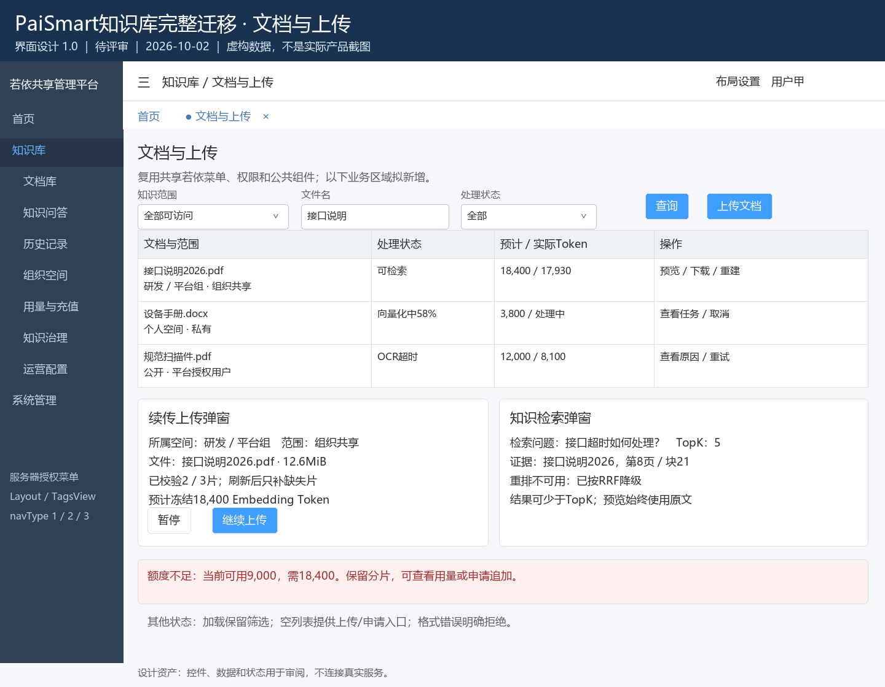
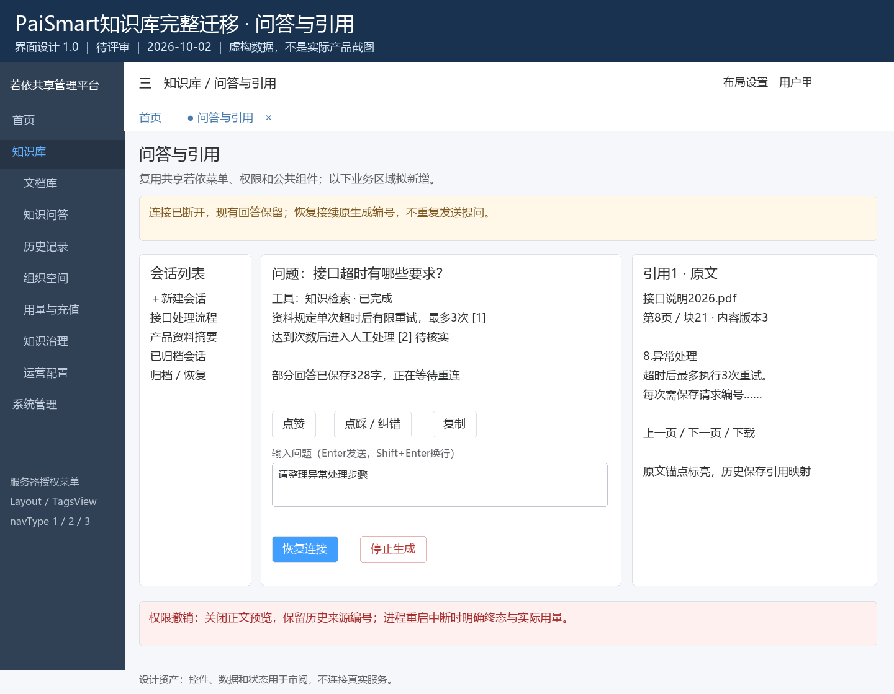
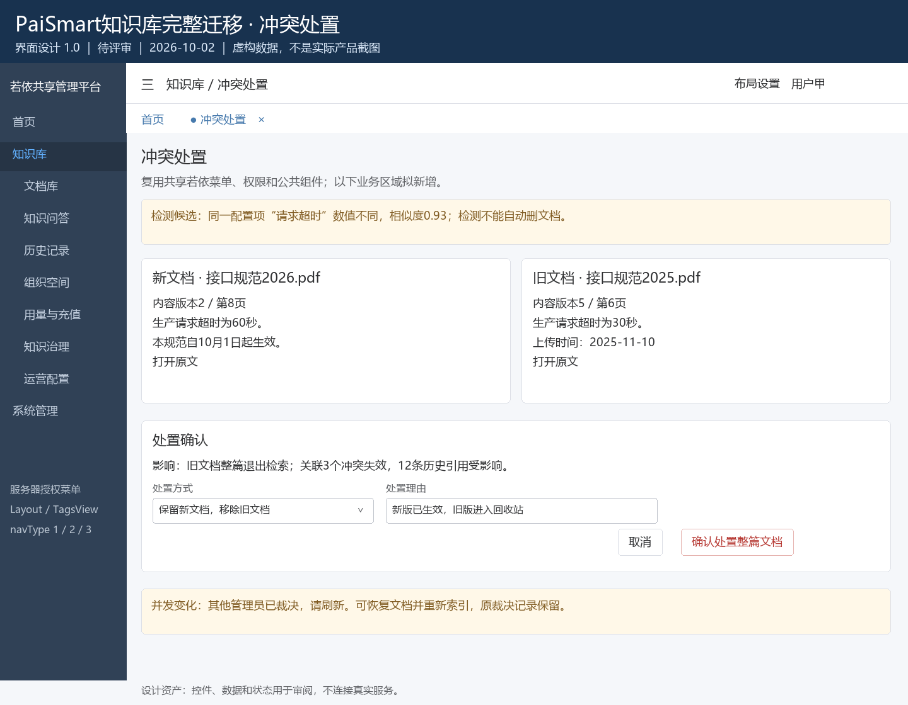
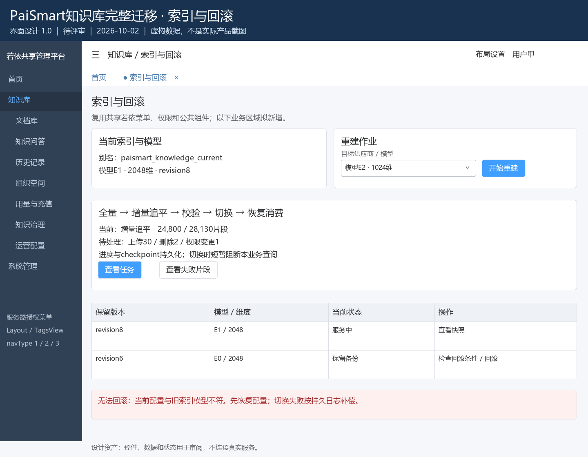
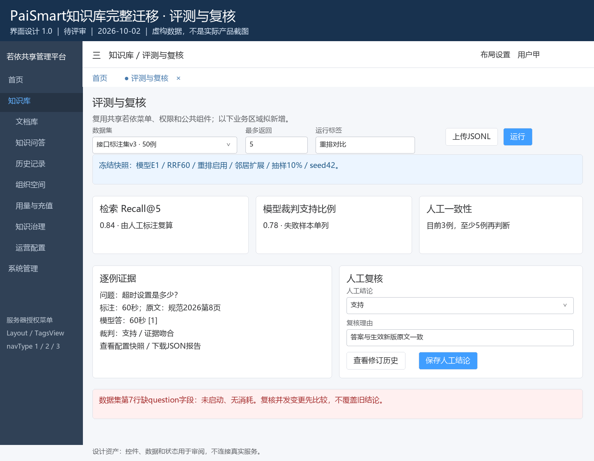
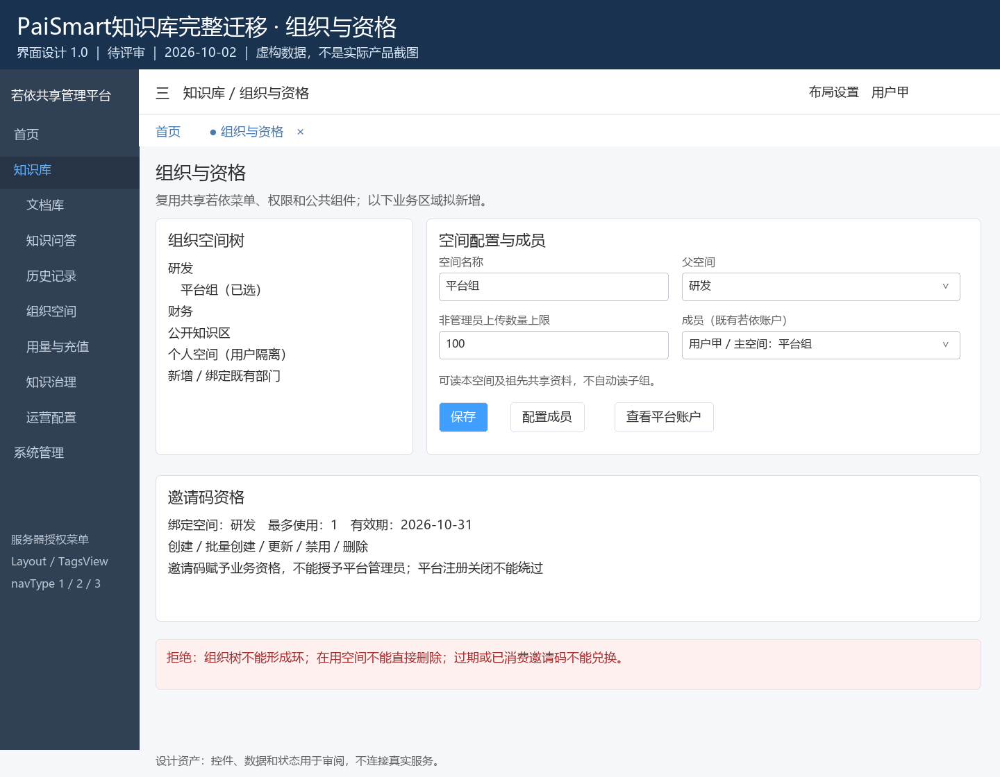
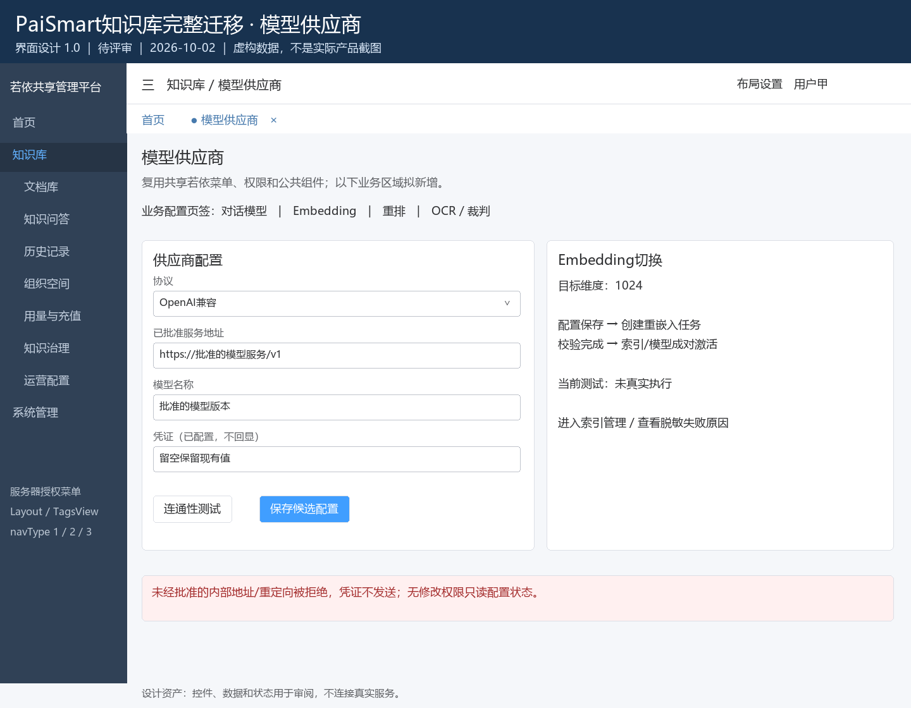
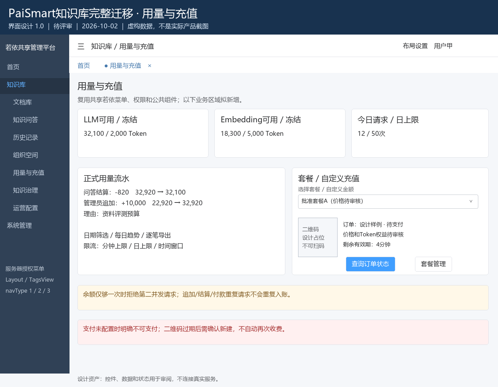
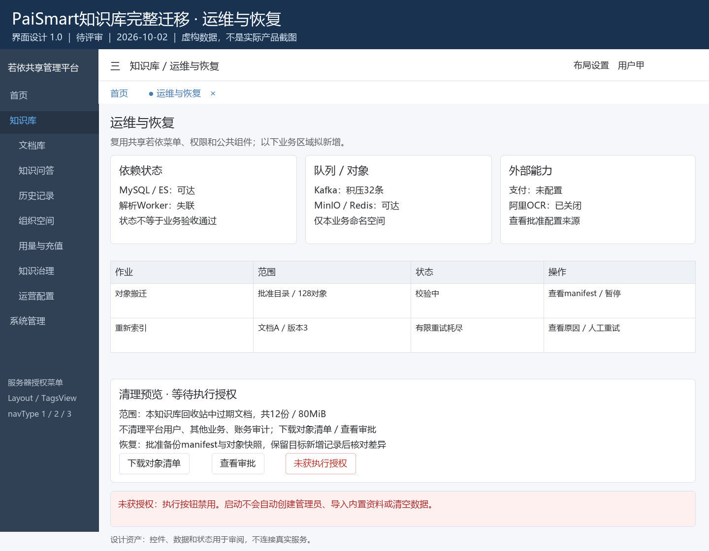

# 知识库迁移界面图稿

> 版本：1.0；类型：静态设计；方案：待评审；日期：2026-10-02。  
> 以下PNG为独立绘制的界面设计，全部采用虚构样例；不是运行产品、支付二维码或业务验收截图。业务规则唯一正文见[完整迁移设计](../完整迁移设计.md)。

PNG可直接查看，图中标明入口、字段、按钮及关键异常状态。另有[HTML交互线框稿](知识库界面设计.html)，可切换九个设计场景；HTML本地文件被内置浏览器安全策略拒绝，未完成浏览器渲染/交互验证，因此以已实际回读的PNG为本轮可查看图稿。HTML上方切换按钮是图稿控制，不是产品主导航。

## 1. 文档与分片上传

## 2. 流式问答与引用预览

## 3. 文档冲突处置

## 4. 索引重建与回滚

## 5. 离线评测与人工复核

## 6. 组织空间与邀请资格

## 7. 模型供应商

## 8. 用量、额度与充值

## 9. 系统作业与恢复

