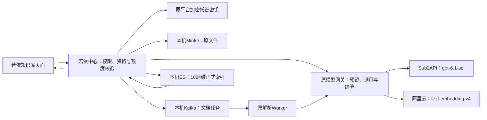

# PaiSmart API 密钥管理与测试文档

> 更新日期：2026-10-04；负责人：当前项目维护者；范围：阿里云与Sub2API密钥用途、模型参数、API技术测试和接入差距。
> 本文是API密钥管理、测试与项目接入方案的唯一维护正文，后续直接更新本文。双密钥登记、有限额度、模型验证、TXT上传入库、问答/引用及历史/结算已取得实际证据，批准的7项主链路验收通过；16模块完整验收与用户接受尚未完成。业务验收点和业务执行结果另见[主模块验收文档](主模块验收文档.md)。

## 1. 密钥登记与管理

当前共两份API密钥：Sub2API用于gpt-6.1-sol文字大模型及已验证的清晰PNG图片输入，gpt-6-sol另有原图片输入小样本证据；阿里云用于text-embedding-v4文字向量，同一阿里云Key不需另配一份“向量密钥”。

| 供应商 | 用途 | 当前登记状态 | 核对指纹（SHA256前16位） |
|---|---|---|---|
| Sub2API | gpt-6.1-sol文字及图片API技术验证；旧型号图片证据保留 | 已登记ai.paismart.sub2api.llm，托管密钥版本v1；gpt-6.1-sol生产三项验证通过并激活 | d984a1ca523aedcf |
| 阿里云百炼 | text-embedding-v4文字向量 | 已登记ai.paismart.aliyun.embedding，托管密钥版本v1；生产Gateway真实1024维验证通过并激活 | aec16905a7b2d081 |

用户要求保留的两份完整密钥仍在[本机私有密钥审核文件](../../../../../.runtime/paismart/model-credentials/API密钥私有审核文档.md)。该文件只保存完整值和必要登记资料，是本文的私有凭据附件；测试结论统一在本文维护。项目正文不复制完整Key，记录中只用指纹核对，私有附件沿用本机访问限制及Git忽略。

更新密钥时，在原私有位置更新相应供应商的值，再按平台托管规则登记或轮换对应用途；当前两条用途已登记。Provider只引用secretRef，不把Key作为页面字段或日志输出。更换Key、接口或模型后，重新验证受影响请求，更新本文的结果和证据链接。

## 2. 当前模型与调用配置

| 配置项 | Sub2API文字模型 | 阿里云文字向量 |
|---|---|---|
| API根地址 | http://39.102.215.183:8080/v1 | https://dashscope.aliyuncs.com/compatible-mode/v1 |
| 协议 | OpenAI Responses | OpenAI兼容Embeddings |
| 认证 | Authorization: Bearer，使用Sub2API Key | Authorization: Bearer，使用阿里云Key |
| 默认型号 | 用户指定默认gpt-6.1-sol | text-embedding-v4 |
| 当前生产验证型号 | gpt-6.1-sol；gpt-6-sol图片证据单独保留 | text-embedding-v4 |
| 请求路径 | GET /v1/models；POST /v1/responses | POST /compatible-mode/v1/embeddings |
| 当前生产请求条件 | Responses；reasoning.effort=low；store=false；Provider输出预算4096，实际调用取业务预算较小值；三项兼容验证分别限制128 | 实际Gateway短文本及文档向量；返回1024维，不发送dimensions |
| 已登记生产托管用途 | ai.paismart.sub2api.llm，v1 | ai.paismart.aliyun.embedding，v1 |

路径按根地址拼接一次：Sub2API根地址已经含/v1，调用Responses时追加/responses，不能再追加/v1/responses造成重复。默认gpt-6.1-sol已在本项目完成非流式文字、工具流式和工具反馈三项兼容验证；该型号已用一次独立Responses input_image请求验证清晰合成PNG的八项事实；结果及费用按本型号回执核对，不沿用gpt-6-sol结果。

当前文字Provider已启用激活，配置版本revision4；向量Provider已启用激活，配置版本revision3。正式索引冻结text-embedding-v4/1024维，实际返回长度与映射一致；本次主TXT问答、原文引用及会话历史已实际核对。该结论仅覆盖批准的主样本及管理员流程，不代表普通权限或完整模块验收。

## 3. 连通测试与图片输入能力

### 实际测试结果

| 检查 | 实际结果 | 能证明的范围 |
|---|---|---|
| Sub2API密钥与模型列表 | 用户原文精确匹配；GET /v1/models返回200，列出27个型号，包含gpt-6.1-sol | 密钥及列表可用，不能证明所有列出的模型已生成成功 |
| gpt-6-sol流式文字 | /v1/responses、stream=true、reasoning.effort=low；返回OK/completed，17.281秒 | 本型号、本请求条件的流式文字小样本通过 |
| gpt-6-sol图片输入 | 同一接口和文字模型；PNG Base64输入；completed，17.610秒；8项核对全通过 | 本型号可接受并正确读取本次清晰合成图片 |
| 阿里云Embedding | text-embedding-v4返回200，1条1024维有限非零向量；usage=8Token | 此Key、接口及模型的文字向量小样本通过 |
| 默认gpt-6.1-sol生产兼容验证 | Responses/low；非流式文字、工具流式、工具反馈三次真实调用全部PASSED，usage分别4239、4341、4496Token，合计13076Token；通过后启用激活revision4 | 本型号在当前配置及托管版本下通过项目兼容门；不是沿用gpt-6-sol结论；本型号图片小样本另见下行 |
| 默认gpt-6.1-sol图片输入 | Responses/low，固定720×320 PNG的Base64 input_image；completed；八项事实全匹配；输入4712、输出45、总4757Token | 当前型号能读取本次清晰合成PNG，原项目账本已结算；不证明平台聊天发图或OCR |
| 阿里云生产Gateway验证 | text-embedding-v4；真实返回1024维，连接测试READY、1493毫秒、4Token；通过后启用激活revision3 | 当前托管用途及真实Gateway可用；上传文档另完成38Token向量调用 |

已定位并纠正Sub2API密钥抄录差错，当前使用与用户原文一致的值；误录值的401记录只作为原始诊断证据。更正后gpt-5.5及gpt-6-sol的首轮非流式40秒超时尚未查明；gpt-5.5未取得文字调用通过结论。流式成功不证明该超时问题已解决。

表中gpt-6-sol文字/图片及早先阿里云8Token结果是API直连；文字流式报告总4395Token（输出5），图片报告总4757Token（输出45），没有经过项目账本。当前gpt-6.1-sol三项验证、阿里云4Token连接测试和38Token文档向量化经过原项目Gateway及额度预留/结算，记录关联原管理员UID1。供应商金额未核查；有限额度是项目Token预算，不是金额报价。模型技术通过不能代替16模块完整业务验收。

本次默认型号图片调用经过原ModelCallService与QuotaService，预留8192Token并按可靠用量4757Token一次结算；原管理员文字余额31998→27241，冻结和欠额均0，向量余额9943不变。无重送、充值或追加额度。完整冻结输入、八事实、安全回执及一次调用/预留/两条流水的原库核对保存在[既有技术附件](证据/第一阶段技术与运行核对.json)的visionProbeActual。下方固定样本由两个型号分别独立测试，旧型号结果不替代当前型号；供应商金额仍未核查。

### 图片测试图与结果


| 内容 | 图片预期 | 模型实际读取 |
|---|---|---|
| 上方文字 | VISION-4827 | VISION-4827 |
| 图形数量 | 2 | 2 |
| 左侧颜色、形状、数字 | 蓝色、正方形、7 | blue、square、7 |
| 右侧颜色、形状、数字 | 红色、圆形、3 | red、circle、3 |

问题没有包含正确答案，8项技术核对全部符合预期。本次只证明该清晰合成PNG样本可读；手写、模糊小字、复杂表格及扫描件需要各自样本，不能泛化为所有图片均准确。

### 图片怎样发送与读取

读取过程如下：

1. 本机客户端打开PNG文件，读取实际图片字节。
2. 将图片编码为Base64 data URL，放入OpenAI Responses消息的input_image字段；同一消息的input_text字段放问题。
3. Sub2API模型服务接收图片与问题，返回模型生成的文字结果；本次收集流式终态，再按独立预期核对文字、颜色、形状、数字及位置。

本次由本机测试客户端读取PNG文件并发送图片数据，Sub2API接受OpenAI兼容图片输入后返回模型响应。只把C:/...这样的本机路径写进问题，远端模型无法凭路径读取文件。本次测试直接传图，不依赖额外OCR服务；能识别字和图形不等于任何扫描件都能准确读取。

接口还允许通过图片URL或文件ID提供图像，但本次仅验证Base64 data URL；另外两种方式及此Sub2API的支持情况没有测试。字段格式依据[OpenAI官方图片输入说明](https://developers.openai.com/api/docs/guides/images-vision)（2026-10-04查阅）。服务内部具体如何做图像编码/切片没有可观测证据，本报告不推测其内部实现。

### 项目接入差距

实际源代码Sub2ApiResponsesCodec.request当前把message.content作为文字构建输入，尚未装配input_image数组。本次成功即证明该API/模型在此样本上支持图片，不等于知识库页面已能上传图片直接问答。要让项目提供该业务，还需对应上传入口、对象权限、格式/大小校验、服务端图片消息装配、预算计费及界面验收；本轮不改这些实现。

扫描文档OCR另有用途：批量提取文字并分段入库，建立可检索且可追溯的知识内容；图片直接问答让模型理解本次传入的画面。阿里云text-embedding-v4本轮验证的是文字向量，不是把PNG直接送进文字Embedding。

### 项目接入代码与运行核对

当前Java私有Maven构建及52项定向测试通过，包含模型参数/指纹、H2持久化、用量流水权限、首次索引/重建关联及统计边界，失败、错误、跳过均为0；必要修复已独立复核。前端模型组件8项、协议边界11项、TXT预览3项及PDF预览2项已有通过结果；索引页进度名称修正已通过类型检查、12项相关测试及最终构建，并完成独立复核。脚本27项AST/隔离mock通过。准确测试范围、补丁文件和摘要以[唯一补丁核对](证据/模型接入补丁核对.json)及[验收执行记录](证据/验收执行记录.json)为准，不重复合计重叠测试。

本机固定中心包已更新，仅替换PaiSmart模块，其余483个中心条目的内容SHA256逐项一致，原启动修复保留。当前已核对中心PID43452、固定包摘要前缀5d3a8799，运行包与制品记录一致；原前端PID40204继续复用，HTTP与同源代理就绪。MySQL、Redis、MinIO、Kafka、TLS ES、存储检索用途及生产连接继续复用；解析Worker沿用既有JAR和240依赖。精确包摘要与后续运行状态以现有制品记录和验收证据为准。

两条AI用途已登记v1，双模型已验证激活，原管理员UID1按BALANCE一次配置文字50000/向量10000Token有限额度。121字节TXT已单次上传，原MinIO对象SHA256与样本一致；正式文档1129bdb0-2ef5-4969-b129-e95c4c13fd6f现为READY/v2，1个内容块，文档向量实际38Token。索引9bf596a5-456b-4c36-8084-67e3808e9b06为唯一ACTIVE，模型/1024维、正式别名及ES内容块数1一致。原失败作业保留，新处理作业b4b14646开头的记录SUCCEEDED；三处不同表排序规则的文档ID关联已按完整BINARY(144)比较修正，未改表结构。详见[原库关联核对](证据/原库索引关联只读核对.json)、[正式索引样本核对](证据/正式索引样本核对.json)、[MinIO摘要核对](证据/样本MinIO摘要核对.json)。默认型号图片小样本API及原结算已完成；普通用户权限、平台聊天发图、OCR及16模块完整验收尚未完成；PowerShell5 ACL兼容分支未运行验证。

主样本问题“蓝杉项目每周什么时候归档，谁负责？超期怎么处理？”已取得COMPLETE回答，三条事实正确；generate_summary工具完成，检索采用RRF融合，引用指向原doc/v2且对应原文已打开。原UID1当前1个会话、2条消息，生成事件1—49连续；页面按全部有权空间检索（当前仅1空间，没有单空间选择控件）。问答新增文字计划4751及摘要175，合计4926Token；累计文字5次18002Token、向量3次57Token。8次调用全部COMPLETED、estimated=0，各对应一次SETTLE；可用余额文字31998/向量9943，冻结与欠额均0。业务证据和独立复算见[实际执行记录](证据/验收执行记录.json)、[主链路独立复算](证据/主链路独立复算.json)及[验收报告](verification-report.html)。批准的7项主链路通过，用户接受仍待明确确认。

## 4. 原始测试证据

| 检查内容 | 证据入口 |
|---|---|
| 密钥与用户原文核对 | [原文精确匹配](证据/Sub2API原文精确核对.json)、[抄录更正依据](证据/Sub2API密钥抄录纠正.json) |
| 认证与模型列表 | [纠正后模型列表](证据/Sub2API纠正后模型列表.json) |
| 文字流式 | [gpt-6-sol流式实际结果](证据/Sub2API纠正后GPT6流式观察.json) |
| 非流式超时 | [非流式实际结果](证据/Sub2API纠正后文字调用.json) |
| 阿里云文字向量 | [向量小样本结果](证据/模型密钥连通测试结果.json)，其中Sub2API的401使用误录Key，不能作为正确Key的当前结论 |
| 图片输入 | [独立预期](证据/图片输入独立预期.json)、[实际响应及8项核对](证据/GPT6图片输入实际测试.json)、[原始PNG](证据/图片输入样本.png) |
| 接入代码与本机运行版 | [实施核对与限制](证据/模型接入实施核对.json)，含构建、测试、运行摘要和就绪结果引用 |
| 平台托管与真实模型验证 | [密钥登记后回读](证据/密钥登记后回读.json)、[验收数据回读](证据/验收数据回读.json)、[实际执行记录](证据/验收执行记录.json) |
| 正式上传及索引 | [MinIO原对象摘要](证据/样本MinIO摘要核对.json)、[正式索引与样本](证据/正式索引样本核对.json)、[原库关联核对](证据/原库索引关联只读核对.json) |
| 问答、历史与用量 | [实际执行记录](证据/验收执行记录.json)、[主链路独立复算](证据/主链路独立复算.json)、[当前验收报告](verification-report.html) |
| 候选补丁离线核对 | [原候选技术核对](证据/模型接入补丁核对.json)，仅适用于该候选 |

以上模型调用实际发生于2026-10-04，结果适用于证据内的型号、接口和请求参数。本文整理没有再次调用API，没有新增模型费用；证据没有改写成新的测试结果。

## 5. 下一步测试与项目接入标准

| 核对内容 | 预期与完成标准 | 当前结果 |
|---|---|---|
| 默认gpt-6.1-sol文字与流式 | 正确Key请求完成，终态及生成内容可核对；记录实际usage和请求参数 | 当前生产非流式文字及工具流式验证通过 |
| 默认gpt-6.1-sol工具调用 | 使用项目规定的工具契约，校验名称、参数与终态；不可用或不兼容时明确失败 | 工具流式及工具反馈实际通过，三项合计13076Token |
| 默认gpt-6.1-sol图片输入 | 已按固定PNG独立八事实执行一次请求并核对4757Token实际结算；其他图片样本和平台发图另验 | 清晰合成PNG技术通过；平台发图及OCR未验 |
| 生产文字Provider | 登记精确默认型号及托管用途，按项目完成文字/流式/工具三项兼容验证，指纹和密钥版本匹配后激活 | 已登记v1用途，gpt-6.1-sol/Responses/low/4096启用激活revision4 |
| 生产向量Provider | 登记阿里云用途、API地址、模型及1024维，走实际Gateway核对维度和用量 | 已登记v1用途，text-embedding-v4/1024启用激活revision3；正式文档向量化38Token |
| 非流式调用 | 当前默认型号取得完整回执；不同型号或条件的失败不转写为成功 | gpt-6.1-sol当前生产非流式已通过；既有gpt-5.5/gpt-6-sol直连40秒超时原因仍未查明 |

当前管理员有限额度、正式READY文档及一致活动索引已就绪，主样本问答、历史和结算已通过批准清单核对；普通账号权限矩阵、其他图片样本、平台发图及其他模块仍须各自样本。对应条件和16模块验收方法见[主模块验收文档](主模块验收文档.md)，7项主链路通过不等于完整模块验收或用户接受。

## 6. 项目接入方案、实施文件与配置步骤

### 1. 目标与业务流程

实施状态：后端、前端和脚本已按分工实现，当前唯一补丁包含模型接入、流水/预览、必要索引关联及进度语义修复；文件范围、摘要和正反向检查见[补丁核对](证据/模型接入补丁核对.json)，工作区不重复应用。原中心已加载通过52项Java定向测试的PaiSmart模块，模型、额度、上传、问答与结算结果见第3章；其他模块继续按各自证据判断。

目标是让知识库的上传、向量检索和问答使用现有两份真实密钥：Sub2API的gpt-6.1-sol负责回答、摘要和原有工具回合；阿里云text-embedding-v4负责文档及查询文字向量。后端仍在原若依中心运行，MinIO、Kafka、ES、MySQL、Redis继续使用既有本机环境；不需要新建数据库、模型代理或第二套秘密服务。

接入后的调用关系：



例如上传“蓝杉项目每周五17:30归档，负责人林知；超期下周一09:00补交”的脱敏TXT：原文件进入MinIO，任务经Kafka交给现有解析流程，文字分块后由阿里云生成向量，写入正式ES索引。用户询问归档时间、负责人和超期处理时，现有检索工具在授权空间中查资料，Sub2API按工具结果生成回答，页面展示原文引用，项目按实际usage结算用量。

API文档只是登记和审核材料。运行程序通过平台托管用途读取密钥，不把Markdown当运行配置，也不让浏览器或解析Worker持有模型Key。

### 2. 哪些已有能力直接复用，哪些需要补丁

| 内容 | 当前实现 | 接入方式 |
|---|---|---|
| 密钥加密托管 | 原ManagedSecretService、ManagedSecretCrypto及两条固定AI用途已支持 | 复用原DPAPI与平台登记，扩充现有录入脚本从已提供的私有JSON安全导入，不要求重新提供Key |
| 供应商配置 | 原模型供应商页面及GET/PUT /paismart/providers/{scope}已支持 | 保存候选参数，复用原权限、rowVersion和激活门禁 |
| 文字、流式及工具验证 | 原ProviderService已有最多三次合成调用，绑定配置指纹和秘密版本 | 针对gpt-6.1-sol重新执行，不能继承gpt-6-sol通过结果 |
| Responses低推理参数 | 已允许可选reasoningEffort=low并映射reasoning.effort，保存与请求边界已有测试 | 省略保持旧请求，Chat带此字段拒绝；默认gpt-6.1-sol当前low配置已真实验证 |
| 向量模型 | 原Gateway发送model/input并验证返回维度 | 登记text-embedding-v4、1024维；不增加dimensions字段或新向量适配器 |
| 额度与用量 | 原成员额度、预留、结算和未知用量核对已实现 | 为指定测试账号设置有限额度，收费调用继续经过原账本 |
| 正式索引 | 首次文档处理已有ensureIndex与索引切换机制 | 在唯一激活向量模型就绪后走原流程；已有活动索引时通过原重建治理切换 |
| 日常启动 | 统一入口已有服务复用/恢复、用途与模型门禁，已核对当前固定包摘要 | 报告实际模型/地址/维度；根据既有制品记录识别版本更新，在停止旧中心前核对固定路径和SHA256，不增加收费测试 |

### 3. 前端操作与交互

沿用“PaiSmart知识库 → 模型供应商”，以及成员与资格、索引治理、文档知识库、知识问答等原页面。现有模型页对Sub2API Responses提供“默认（不传）/low”选择，并提示4096是Provider输出预算、实际请求取业务预算较小值；不增加直接输入Key的表单。切换协议、供应商或用途时清理Sub2API不适用参数；回读普通旧供应商时保留其未知配置。

文字供应商操作顺序：先保存未启用、未激活候选，刷新回读；再次编辑启用，保持未激活；准备额度后点击原“验证文字能力”，确认最多三次真实调用；三项均通过且当前配置/密钥版本匹配后，再编辑激活。保存本身不调用模型，验证失败或待核对时不能激活。

向量供应商操作顺序：保存未启用、未激活候选；编辑启用后按该候选ID连接测试，走生产Gateway核对实际1024维；没有活动索引时再激活。向量测试也需要额度，会调用阿里云，不作为每日启动探测。

### 4. 后台配置、数据与失败处理

**密钥导入。** 原录入脚本已提供-ImportProvidedKeys参数，固定读取现有私有JSON。只读取两份Key，不采用私有JSON中的旧模型字段；型号和调用参数以模型接入配置.json为准。先对全部选中密钥核对格式、用户确认指纹及已有DPAPI值，再保存缺少的受保护文件；相同值复用，不同值拒绝覆盖。随后调用既有register，将两条用途写入原平台托管表；已有用途的值或元数据不同，原注册器拒绝自动轮换。失败时可能已保留本机DPAPI文件，但不会把“登记失败”写成成功；修复后可核对同值来源再续行。完整Key不进入patch、源码、候选JSON或终端输出。目录DACL只授予当前Windows用户，PowerShell7使用FileSystemAclExtensions持久化DACL，避免对已保护目录重复Set-Acl触发额外系统特权要求；相同DPAPI文件重复导入不重写。

**候选参数。** scripts/paismart/模型接入配置.json，集中保存非秘密配置：

| 项目 | 文字候选 | 向量候选 |
|---|---|---|
| Provider与用途 | SUB2API / ai.paismart.sub2api.llm | ALIYUN / ai.paismart.aliyun.embedding |
| 根地址 | http://39.102.215.183:8080/v1 | https://dashscope.aliyuncs.com/compatible-mode/v1 |
| 模型 | gpt-6.1-sol | text-embedding-v4 |
| 专用参数 | responses；reasoningEffort=low；Provider输出预算4096 | dimension=1024 |
| 初存状态 | enabled=false、active=false、rowVersion=0 | enabled=false、active=false、rowVersion=0 |

4096是当前登记的Provider输出预算，不是gpt-6.1-sol能力上限声明；实际调用取业务方法预算与Provider预算的较小值。原三项兼容验证每次输出最多128Token，不因配置4096扩大验证输出上限。当前默认型号在low配置下非流式、工具流式及反馈均已真实完成，实际usage包含供应商计入的输入及附加上下文。

**候选配置工具。** 新脚本准备模型接入.ps1默认Plan，在输出前递归检查敏感字段及疑似完整sk密钥，只展示当前不含秘密的候选参数。ApplyCandidates才使用原若依登录令牌调用本机18096的授权GET/PUT API：先检查两类现有Provider，不同配置或同用途多条时拒绝覆盖；同参数复用并保留原启用/激活状态。写前再次读取，写后核对整个scope数量、参数和未启用未激活状态。Local命名Mutex防止同一Windows会话中的该脚本并发执行；它不覆盖其他会话或服务器所有入口，不提供全局创建幂等性，配置窗口须避免其他管理页面同时新建。请求超时、拒绝或回读不一致即停止，不自动重送，先在原页面核对保存状态。两个scope分别保存，第二条失败时第一条保留候选，不自动删除补偿。

该工具不测试模型、不追加额度、不自动激活，Check只回读配置。登录仍由原若依完成，脚本不能创建登录或绕过验证码；令牌通过SecureString参数或不回显输入提供，不写进命令参数、文件或报告。

**兼容、账本与授权。** Provider保存继续拒绝内联Key和客户端伪造compatibility；reasoningEffort只允许Responses的精确字符串low。现有outboundConfig与configFingerprint已经覆盖完整配置，新字段自然参与指纹；变更参数使原验证失效，不新增第二套验证记录。三项验证继续使用同一冻结模型和密钥版本，经过会员资格、限流、额度预留及正式账本。未知结果保留UNCERTAIN/PENDING_RECONCILIATION，通过原系统作业用量核对处理，不自动换协议、模型或重发收费请求。

**已批准的测试额度范围。** 使用原库已有测试账号；实施时从登录会话/成员页回读并列明具体用户ID，不新建账号。用户已批准沿用本机现有管理员，准备有限BALANCE可用额度，目标为文字50000Token、向量10000Token，理由“PaiSmart首次模型接入与单文档链路验证”；若已有余额不足，只追加差额，使用原成员追加入口和固定Idempotency-Key，重复请求不重复入账。额度是项目内调用上限，不是供应商金额报价，也不产生微信充值。管理员资格不免除模型额度。若该账号已有额度足够则复用，不重复追加；不足部分需按具体用户和数量执行审核后的方案，不静默设无限额或全局开关。

**索引与数据边界。** 不直接INSERT Provider、不手填compatibility/ACTIVE、不在启动时创建或重建索引。原MySQL持有业务状态、Provider和账本；MinIO持有原文件，ES持有可重建检索数据。首次文档处理按激活Embedding快照创建1024维索引，核对并建立paismart-knowledge别名。已有活动索引时普通保存禁止切换向量模型，必须走原重建、校验和切换流程。失败保留原活动版本与真实失败，不删除原数据。

### 5. 已实现patch的具体文件

模型接入专项差异：[PaiSmart模型接入.patch](工具/PaiSmart模型接入.patch)。准确文件范围、摘要及正反向隔离检查见[唯一补丁核对](证据/模型接入补丁核对.json)，包含当前实现和必要测试；索引页进度名称修正完成后由同一补丁原位更新。当前工作区已实现，不应再次应用。补丁基线包含用户此前未提交内容，不能直接用Git HEAD当作基线或强制覆盖。下表按受影响模块说明职责，不另维护补丁数量。

| 新增/修改 | 文件 | 理由与关键变化 |
|---|---|---|
| 修改 | ruoyi-backend/ruoyi-paismart/src/main/java/com/ruoyi/paismart/application/intelligence/ProviderService.java | 保存白名单及校验允许可选reasoningEffort，保留三项验证和激活门禁 |
| 修改 | 同模块infrastructure/intelligence/Sub2ApiTextAdapter.java | Responses映射low、拒绝非法值及Chat混用，保留原预算与解码 |
| 修改 | frontend/admin-web/src/types/paismart/index.ts | 增加可选low类型，与后台契约一致 |
| 修改 | frontend/admin-web/src/views/paismart/operations/providers/index.vue | Responses默认不传/low选择、输出预算提示；协议/供应商/用途切换清理不适用参数 |
| 修改 | contracts/paismart/knowledge-v1.openapi.yaml | 正式ProviderConfig契约增加可选reasoningEffort说明 |
| 修改 | scripts/paismart/录入模型密钥.ps1 | 安全导入已提供Key，复用原DPAPI/ACL及平台登记 |
| 新增 | scripts/paismart/模型接入配置.json | 一处维护默认文字和向量候选参数，无完整Key |
| 新增 | scripts/paismart/准备模型接入.ps1 | 默认展示；显式保存未激活候选；原权限API、差异拒绝、回读及本机串行保护 |
| 修改 | scripts/paismart/启动知识库本机环境.ps1 | 报告实际型号/地址/维度；按既有制品记录验证固定包，停止旧中心之前拒绝路径/摘要不符，保留原任务与用途检查 |
| 新增 | ruoyi-backend/ruoyi-paismart/src/test/java/com/ruoyi/paismart/infrastructure/intelligence/Sub2ApiReasoningEffortTest.java | 覆盖low映射、缺省行为、非法参数、Chat拒绝和输出预算，6项测试 |
| 修改 | 同模块application/intelligence/ProviderInputBoundaryTest.java | 新增H2保存/快照、非法参数不落库、推理参数变化使原兼容验证失效3项，原6项保留 |
| 新增 | frontend/admin-web/tests/unit/paismart/provider-reasoning-config.spec.ts | 覆盖low选择与保存、预算提示、切换清理及普通旧供应商未知配置保留，当前8项组件测试 |
| 修改 | ruoyi-backend/ruoyi-paismart/src/main/java/com/ruoyi/paismart/api/UsageController.java及对应H2测试 | 复用原sys_user返回用户名称、operation_key返回关联记录，保持原用户范围、权限及筛选 |
| 修改 | frontend/admin-web/src/views/paismart/documents/components/DocumentPreview.vue及对应测试 | 按真实MIME类型区分TXT内容与PDF逐页预览，保留原权限和版本入口 |
| 修改 | 同后端模块DocumentIntelligenceService.java、GovernanceService.java、SearchService.java及对应H2测试 | 三处跨表稳定ID关联使用BINARY(144)，兼容原表不同排序规则，保持版本、状态和权限条件，无DDL |

本补丁没有数据库DDL或后台新接口；新增脚本依赖PowerShell7，本机已有7.6.5。日常入口继续使用原服务和归属机制；密钥录入的PowerShell5 ACL兼容分支尚未运行验证，实际使用已验证的PowerShell7入口。向量表单上限已与后台规则对齐为8192，现有模型接入patch同步这一处，原dirty基线正反检查通过；本方案的实际1024维模型与活动索引未变，页面边界保存仍待验收；图片直接问答也未接入，本次只接通文字与文字向量主链路。

### 6. 当前实施状态与后续配置顺序

1. **代码与补丁已实施。** 模型接入及必要修复已实施，含索引页全量处理进度语义；独立复核、文件范围及摘要见唯一补丁核对。未暂存、提交或推送，保护原有修改。补丁是原模型接入专项的审查材料，不包含后续管理员续验的全部修复；24段中19段仍匹配当前，5段因空间/持久启动/下载/上传边界修复变化，配套依赖也不全在本专题中。当前真实实现以源码及统一技术记录为准，不在已实施工作区重复执行git apply；替代环境不能仅凭此patch作为当前项目全量交付，须核对dirty前像及配套范围，见补丁核对currentScopeAudit。

2. **Java构建和实际运行包已完成。** 模型接入运行基线已在PaiSmart私有目录完成5模块Maven reactor、52项定向测试及模块打包，命令为`mvn -o -pl ruoyi-paismart -am -Dtest=Sub2ApiReasoningEffortTest,ProviderInputBoundaryTest,UsageRecordsBoundaryTest,GovernanceMigrationBoundaryTest,SearchBoundaryTest,IndexCoordinatorTest -Dsurefire.failIfNoSpecifiedTests=false -DskipTests=false package`。中心沿用既有运行基线，仅替换PaiSmart模块；其他483条目内容摘要一致，嵌套JAR保持STORED，原启动修复不变，未写共享target。固定包`.runtime/paismart/ruoyi-admin-startupfix.jar`与原`package-verification.json`已同步；前端当前类型检查、定向测试和最终构建已通过，准确范围见同一验收记录。解析Worker继续原固定批次与classpath。 当前反馈意图及治理恢复另完成双类141项定向检查、独立复核和固定包更新；实际只改变两个class，未重建全reactor或修改模型参数/密钥。

3. **本机通道已加载当前中心。** 当前登记中心PID43452、前端PID40204及原基础服务复用；最新恢复检查为2026-10-05 03:49:36，PID仅表示该次登记状态，日常入口仍按路径、创建时间和监听归属核对；中心/代理HTTP通过，运行摘要与当前固定包一致。逐项环境结果见第3章和验收证据。正常入口用于日常复用和恢复：

   ```powershell
   pwsh -NoProfile -File "scripts/paismart/启动知识库本机环境.ps1"
   # 只核对现状，不恢复进程或写业务配置：
   pwsh -NoProfile -File "scripts/paismart/启动知识库本机环境.ps1" -CheckOnly
   ```

   模型/正式索引缺失如实报告，不能把进程启动成功视为知识库业务通过；有未知任务或消费门禁不满足时保留任务并停止相关动作。

4. **既有密钥已登记。** 已使用用户提供的两份Key登记原平台两条AI用途，当前均v1，不要求重新提供。以下是原录入入口，现有配置无需为日常启动重复录入：

   ```powershell
   pwsh -NoProfile -File "scripts/paismart/录入模型密钥.ps1" -Provider Both -ImportProvidedKeys
   ```

   此步骤读现有私有JSON，写缺少的DPAPI文件并登记原平台用途；核对两条用途元数据、可解密状态和版本，不回显完整Key。

5. **两类Provider已保存并回读。** 当前文字gpt-6.1-sol/Responses/low/4096、向量text-embedding-v4/1024已登记并激活。默认Plan仍可检查无秘密配置，Check回读当前状态；已有激活配置不作为未激活候选重新创建。保存/Check需原若依有效登录令牌，不绕过登录或验证码：

   ```powershell
   pwsh -NoProfile -File "scripts/paismart/准备模型接入.ps1" -Mode Plan
   # 批准保存配置后，使用原若依登录令牌，不回显输入：
   pwsh -NoProfile -File "scripts/paismart/准备模型接入.ps1" -Mode ApplyCandidates
   pwsh -NoProfile -File "scripts/paismart/准备模型接入.ps1" -Mode Check
   ```

   先部署新后端再保存含low的候选，否则原运行版会拒绝该参数。Check不是模型连通测试，保存也不收费。

6. **有限额度、验证及激活已完成。** 原管理员UID1按BALANCE一次准备文字50000/向量10000Token；不是无限额度。文字三次兼容验证全部PASSED、累计13076Token，当前revision4；向量连接测试4Token、1024维、READY后激活revision3。两类请求经过原会员资格、限流、预留与结算，不因日常启动重复验证或授额。后续配置变化必须重新满足原兼容门；失败或未知结果先核对，不删除非流式验证项、不重发未知收费请求。

7. **正式索引、TXT及主样本问答已通过。** 121字节TXT原对象摘要一致；文档READY/v2、1块、文档向量38Token，新处理任务SUCCEEDED，原失败任务保留。索引ACTIVE、text-embedding-v4/1024、正式别名及ES块数1一致。索引页processedCount已按“全量处理数”显示，表示重建进度，不是实时索引文档量。原问答三条事实、doc/v2引用原文、本人会话历史及8次主链路调用结算已实际核对；新增固定PNG图片API技术调用4757Token后，当前累计9次调用，文字余额27241、向量9943，详见第3章和[主模块验收文档](主模块验收文档.md)；普通权限、其他场景及用户接受仍分别判断。

8. **日常入口已核对当前就绪。** 最新2026-10-05 03:49:36原统一入口恢复为17项全部就绪或已配置，configurationReady=true，复用模型、活动索引、消费解析及前后端。入口不做收费模型探测，不自动重建Provider、轮换Key、授额或切换模型。日常恢复按原配置复用服务并启动当前已验证中心，刷新检查报告JSON；该次没有提交业务样本。仅检查模式不修改业务配置或恢复进程。此前原8次调用不变的比对仅证明当时启动范围；后续独立PNG已另实际调用并正式结算4757Token，当前6次文字+3次向量，不能再把旧8条快照称当前全部调用。模型门禁和实际账本分别见[唯一执行记录](证据/验收执行记录.json)与[技术及运行核对](证据/第一阶段技术与运行核对.json)。共享服务故障演练仍未执行。

### 7. 停止与恢复

发生托管用途不符、Provider并发变更、真实验证失败或用量未知时停止相关后续步骤。保存成功的候选可保持未激活；如已启用但不通过，可在原页停用，不清空账本或任务。未知请求先走原系统作业核账，不能撤销冻结额度来掩盖未知供应商费用。

中心部署失败时按已核对的原运行包及清单恢复，只处理本项目进程，共享MySQL/Redis/MinIO/Kafka/ES保持运行。首次尚无旧模型时恢复为“模型未就绪”；已有可用模型时按其有效版本恢复，不能把未经验证的默认候选自动替换它。索引失败按原治理的恢复/回滚入口处理，不手动删除别名或重置ACTIVE。正常文档维护仍直接更新本文，不创建逐轮方案副本。

### 8. 接入完成后的验收标准

| 业务点 | 操作与核对 | 正确结果 |
|---|---|---|
| 密钥登记与复用 | 对照两条固定用途元数据和DPAPI来源，再执行同值登记 | 同值复用，不新增版本、不打印Key；不同值拒绝自动覆盖 |
| 候选保存 | 默认Plan，再保存并刷新供应商页，核对模型/地址/参数/版本 | Plan不外呼；首次false/false；重复同配置不重复创建；异配置拒绝覆盖 |
| 默认文字模型 | 使用当前gpt-6.1-sol候选完成三项验证并回读账本 | 文字、流式、工具完整完成，同版指纹与密钥版本有效；用量逐次结算，失败/未知不能激活 |
| 向量模型 | 用真实短文本走项目Gateway，核对返回长度及用量 | text-embedding-v4返回1024维，模型、索引快照一致；不会使用文字模型代替向量 |
| 上传与正式索引 | 上传冻结TXT，等待任务终态，刷新文档及索引页 | 原文件摘要正确、文档READY、ES正式版本和别名一致；失败有真实原因 |
| 问答与引用 | 询问归档时间、负责人、超期处理，打开引用原文 | 三条事实正确、引用指向原版本、权限范围正确、额度流水可复算 |
| 日常复用与恢复 | 重开统一入口，另在明确窗口验证本项目进程恢复 | 已健康服务复用；缺目标进程按原规则恢复；逐项报告真实状态，无启动收费探测 |

模型配置、技术兼容、知识库业务通过和用户接受分别判断。gpt-6.1-sol已完成一次清晰合成PNG独立实测及正式结算，其他图片样本仍待验；项目图片上传问答不在此补丁范围；OCR、Rerank、支付及16模块全量验收继续按各自前提处理。
