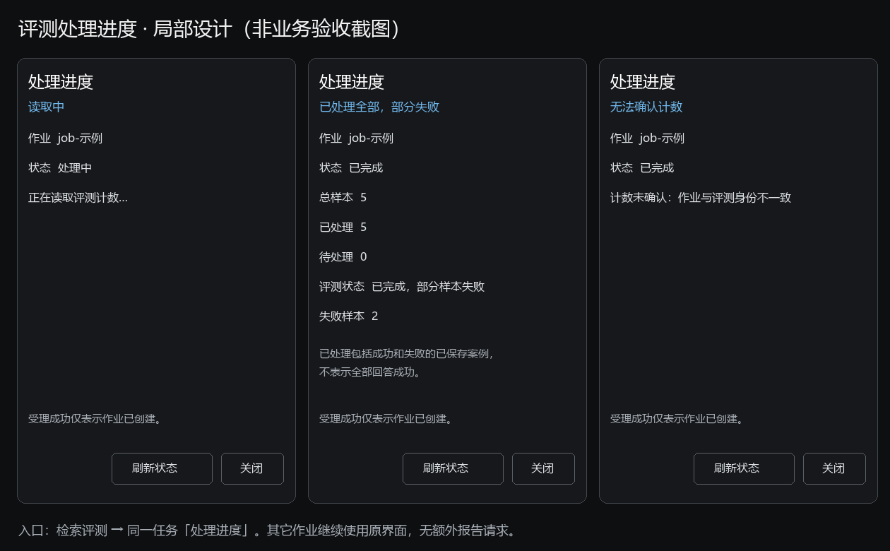

# PaiSmart 主模块验收文档

> 更新日期：2026-10-05；状态：16模块完整可复用流程清单已展开；原7项管理员主链路通过证据沿用，完整场景及用户接受尚未完成。
> 本文维护主模块验收的前置条件、功能点、预期和实际业务结论。API密钥登记、模型参数及技术测试统一见[API密钥管理与测试文档](API密钥管理与测试文档.md)。
> 业务依据：[完整迁移设计](../../完整迁移设计.md#5-业务验收方法)；31项稳定对应及16模块映射见[验收准备数据](证据/验收准备记录.json)。

本机验收登录恢复统一见[共用操作说明](../../../../若依框架/多项目并行开发启动指南.md#本机验收登录恢复)。全部本机验收通道启用辅助能力；先复用有效会话，失效时仅用已授权账号凭据辅助填写当前验证码并正常登录。浏览器无法控制或账号凭据未获授权时单独报告所需条件；恢复登录后回到待验步骤，既有业务结果与证据保持原判定。

## 1. 当前配置与总体状态

管理员正常登录已恢复；原TXT/v2、MD/v1、英文文本PDF/v1及公开DOCX/v1有效事实沿用；新增公开XLSX/v1已完成一次上传→可检索→标题及数字正文→一次片段检索首命中→同版引用原文，向量158+查询时间窗候选4=162，文字新增0，最新余额文字403/向量9447。管理员已正常恢复共同会话。完整格式、续传、权限及UI下载落地SHA未完成，普通用户暂缓。 具体逐步事实见[文档知识库固定HTML](证据/模块报告/文档知识库/verification-report.html)和[唯一执行记录](证据/验收执行记录.json)。

模型及密钥的配置与API测试状态见[API密钥管理与测试文档](API密钥管理与测试文档.md)；本文只维护正式验收所需条件及模块业务预期。

当前基础环境沿原MySQL/Redis、本机MinIO、Kafka/ZooKeeper、TLS ES、Java解析Worker，管理端15177、中心18096。两条模型托管用途已登记v1，gpt-6.1-sol/Responses/low/4096与text-embedding-v4/1024已真实验证并激活；原管理员UID1一次准备BALANCE文字50000/向量10000Token。121字节TXT原对象摘要正确，文档READY/v2、1块、文档向量38Token，唯一ACTIVE索引、1024维模型快照及ES别名一致。实际问答三条事实、原doc/v2引用、历史及用量结算已核对；当前7项批准主链路通过，默认gpt-6.1-sol清晰PNG图片API已独立实测并结算4757Token；普通用户权限矩阵、平台聊天图片、OCR及其他模块仍待验，用户接受待确认。

## 2. 前置条件与补齐顺序

### 主流程必需条件

数据库和配置数量以各项注明的核实时间为准；原服务、管理员余额、文档及会话沿用。最新17:07:58原库累计29调用，文字余额403/向量9447，冻结/欠额/未决0；本次XLSX入库158与一次查询候选4共162。正常DOCX原170Token事实保留，查询费用关联限制见唯一记录；后续调用按实际快照更新。

| 条件 | 实际调查结果 | 补齐内容与完成标准 |
|---|---|---|
| 原MySQL、Redis | 本轮只读检查正常，沿原ry-vue/Redis0 | 保持原连接，不再建库或复制基础实例 |
| MinIO、Kafka/ZK、ES | 原连接继续复用；主TXT原对象摘要、消费处理及正式索引已取得真实结果 | 不新建基础实例；健康与主样本通过范围分开，其他样本及故障场景另验 |
| 解析Worker与前端 | 固定Java Worker/classpath、pdfbox、并发1；HTTP及同源代理正常，WS Origin为15177 | TXT已有上轮技术证据；完整格式/页码/背压尚待样本。进程受限参数不等于OS低权限隔离已验证 |
| 文字模型（Sub2API） | 用途v1已登记；gpt-6.1-sol/Responses/low/4096生产三项PASSED，实际13076Token，已启用激活revision4 | 后续参数或密钥变化须重验原三项兼容门；默认型号已独立实测清晰PNG八事实并正式结算4757Token，其他图片样本、聊天发图与OCR另验；不借用gpt-6-sol结果 |
| 向量模型（阿里云Embedding） | 用途v1已登记；text-embedding-v4真实Gateway连接READY、1024维、1493毫秒/4Token，已启用激活revision3；文档向量38Token | 正式模型/索引维度已核对；Gateway不传dimensions，后端范围1–8192，已有活动索引更换模型须原治理流程 |
| 模型出口 | 当前批准127.0.0.1、39.102.215.183、dashscope.aliyuncs.com；两模型在原生产适配器已真实返回 | 接口变化时先核固定白名单及生效配置；不自动扩展主机或关闭TLS检查 |
| 个人额度 | 原管理员UID1已按BALANCE一次配置文字50000/向量10000Token，真实模型调用已经过预留和结算 | 此为有限项目Token预算；当前余额以账本回读为准，后续不重复追加，不等于微信充值或供应商金额 |
| 限流和全局预算 | 原库政策行0，代码有完整默认值，不能把0行误判成限流关闭 | 默认个人问答30次/分钟、上传10次/分钟、每日个人100万Token、单文件100MiB；五组默认规则含全局文字、上传向量、查询请求和查询向量窗口。验收前冻结实际生效值，低阈值场景须批准并保留恢复值 |
| 正式知识/索引 | 主TXT121字节已单次上传；文档1129bdb0开头现READY/v2/1块，向量38Token；索引9bf596a5开头ACTIVE，1024维/别名一致；ES块数1为原TXT主样本时点，后续MD/PDF独立实物见模块报告，不将旧计数当当前总量 | 首样本与正式索引已有证据；问答正确性与原文引用仍需实际操作，不用READY或块数代替回答通过 |
| 普通用户及权限样本 | ACTIVE普通成员0、本项目菜单角色关联0；管理员有既定资格豁免 | 指定既有受限账号和菜单/数据范围，配置业务资格、空间、主空间、上传/管理资格；准备独立矩阵。管理员能看菜单不证明普通用户及越权边界通过 |
| 登录及样本 | 原TXT仍READY/v2，原会话未归档；旧答案和历史证据有效；当前内置浏览器管理员会话已正常恢复，原TXT预览及一次片段检索已取真实页面证据；UI下载落地核对仍受阻 | 验证码沿若依原机制，不关闭或绕过；其他历史操作及评测另准备独立样本 |

### 扩展功能的条件

| 场景 | 当前事实 | 相应前提 |
|---|---|---|
| 重排Rerank | 关闭、没有Provider | 验收启用重排效果时提供对应API/模型/用途/预算；基本文字上传问答可先不启用 |
| 上下文增强、引用核验、冲突LLM确认 | 三项关闭 | 启用时复用符合条件的文字模型，并确定各请求预算、样本及开关；不是新增一种向量密钥 |
| 扫描/混合PDF及OCR | pdfbox文字解析；本地OCR和云OCR均关闭；OCR用途0为10月4日18:06准备快照，未重新查数量 | 文本TXT/文字PDF不需OCR。扫描件另选批准的LiteParse/本地OCR执行路径与语言包，或阿里云OCR及固定回调。云OCR用途为ai.paismart.aliyun.ocr，托管JSON含accessKeyId/accessKeySecret，不能复用Embedding Bearer Key；还需相应IAM权限与页数预算 |
| 评测生成和裁判 | 内联五例已单次提交：检索5/5，生成和裁判3例正确，2例额度不足失败；五条复核已保存，首例两版历史保持，可比仅3不足5 | 真实索引与独立标注JSONL；当前生成/裁判复用同一冻结文字Provider，需要相应权限及预算，未提供独立裁判选择入口。人工复核保存不要求新模型调用，但要真实原结果及至少规定样本 |
| 微信支付与订单全链路 | 支付关闭；支付用途0、套餐0为10月4日18:06准备快照，未重新查数量 | 商户ID/AppID、证书序列号、可达并匹配的notify-url、商户私钥和APIv3 Key、官方回执及批准测试金额；本机loopback不能直接当公网回调。支付启用及真实付款另明确范围，不为普通问答自动开通 |
| 套餐及邀请码管理 | 套餐0为10月4日18:06准备快照，未重新查数量；对应样本尚未冻结 | 批准价格/整数分/两类权益、次数/有效期/空间和未资格已有账号。维护这些配置本身不要求支付/模型；真实购买或消费才要求对应外部条件 |
| 清理、导入、对象搬迁、旧数据恢复 | 运维执行和旧源连接关闭；维护计划0为10月4日18:06准备快照，未重新查数量 | 来源/目标、身份映射、冻结manifest/hash、停写点、备份、不同批准人、恢复及补偿条件；另明确写入授权，不是模型配置的一部分 |
| 并发、断网、进程故障、安全解析 | 当前仅健康检查；没有本轮故障演练 | 明确仅本项目可操作的故障窗口及恢复点；多用户/大文件样本，Worker OS身份及资源/文件/网络边界。不得停共享服务或清共享Redis来制造条件 |

专项状态已按具体步骤核对：本地与云OCR、重排、支付、维护执行和旧源连接的持久开关均关闭，最近日常仅检查也确认关闭。扫描/混合PDF、启用重排、真实支付及维护/迁移链的必要步骤受阻；基本混合检索、支付关闭反馈、非法评测输入和管理员状态审计分别保留未执行。普通用户对照继续暂缓。OCR用途、支付用途、套餐与维护计划的0条计数仅来自2026-10-04 18:06:48准备快照，本次未重新查库，不能当作当前数量；具体条件及恢复步骤见各模块正文和固定HTML。

### 补齐顺序

1. 两条Key用途及Provider已登记，当前文字gpt-6.1-sol、向量text-embedding-v4/1024维；后续地址或预算变化仍核对固定出口和配置。
2. 原管理员有限额度已配置，普通受限账号、菜单/空间权限矩阵及低阈值场景仍待准备，不用管理员流程替代。
3. 当前默认文字三项及向量真实维度验证后已显式激活；配置变化重新满足原兼容门，直连小样本不代替生产验证。
4. 冻结TXT已READY、唯一活动索引已就绪，主样本问答与历史/结算已核对；冲突、其他格式、评测及人工样本另补。
5. 仅为要验的扩展补OCR、重排、支付或维护配置；补齐后重新核对前提，再执行已批准主链路与模块验收。

### 共同样本与权限要求

- 环境：原ry-vue和Redis；本机MinIO、原Kafka/ZK、ES；管理端15177、中心18096。配置条件见本文第2节。配置存在不等于业务通过。
- 角色：沿用现有管理员，准备子组成员甲、研发成员乙、财务成员丙、无资格/无菜单用户、复核员，以及需要时的不同维护批准人；先冻结账号—资格—空间—菜单权限矩阵。管理员账号只能证明管理员流程。不得为验收自行新建账号、扩大角色或开放注册。
- 主样本：UTF-8《本机问答验证说明.txt》121字节，含“每周五17:30归档、负责人林知、超期下周一09:00补交”，来源及SHA256见[主样本独立预期](证据/主样本独立预期.json)。已单次正式上传、原MinIO对象摘要一致，现有文档READY/v2供问答核对，不重新上传或删除清账；其他格式、冲突、评测及人工评价另准备样本。
- 总账样本数值、邀请码期限/次数、套餐价格权益及限流低阈值先明确批准。模型兼容/向量/OCR测试会消耗相应额度；本次API直连小样本结果见第3节。真实支付、迁移、清理、故障演练另需对象、金额、窗口与恢复范围。
- 已按批准清单进入真实主链路验收；双模型和主TXT结果按实际证据记录，不扩展为全部模块通过。真实付款、维护及故障演练仍按具体对象、金额和窗口判断。

## 3. 验收前核对要求

模型API技术检查统一在[API密钥管理与测试文档](API密钥管理与测试文档.md)维护。正式验收前核对本文前置条件和该文档的未完成项，完成生产配置后再执行下列16模块业务点。

模型直连结果只证明对应接口、型号及条件。当前项目Provider验证、有限额度、上传解析、正式索引及主样本问答/历史/结算已有实际业务证据；7项通过只适用于既定管理员和样本，普通权限及其他模块场景未完成，不据技术测试推定全量业务通过。

### 完整覆盖与计数口径

原参考项目当前有11个业务路由、15个正式Controller、91个HTTP方法映射，原Java有49个测试文件和260个测试注解声明；本次未运行这些原测试，不能计业务通过。既有迁移设计的32条来源包括29组实际业务、3类占位/计划/技术工具，第5章是31个成组验收要求。本清单展开为68个完整可复用流程（67个业务流程、1个独立图片API技术流程），共342步；流程里的格式/角色/并发样本矩阵仍须逐个执行。菜单、接口、能力分组、流程和样本实例不混算。

原29组正式能力均已找到目标实现依据，但不等于全部搬完：管理员会话空间选择及固定范围已实际验收，普通用户仍待验；全部设备退出存在平台替代差异；专用功能已有持久开关，仍缺专项条件。完整来源、源码锚点和流程对应维护在[唯一实际记录](证据/验收执行记录.json)的覆盖字段，并在[固定HTML](verification-report.html#coverage)直接展示。短信/微信模板、规划算法和技术演示按原边界替代或不适用；gpt-6.1-sol图片API属于后加扩展，不能与平台发图及PDF OCR混为一项。

格式续验的准确范围：原参考22项，当前目标源码白名单另含key、markdown，共24个扩展名。27份现有冻结文件还包括三个2013容器补充，并非27种格式；实际文件及事前正文预期已接入[文档知识库正文](模块验收/文档知识库.md)和固定HTML。样本与旧提取输出摘要匹配，未重跑解析；三份Office的24个源结构锚点及5个无害非法对照已准备。格式和评测负例输入、拒绝阶段预期及三条评测流程的记录一致性已完成限定独立复核；不代表真实拒绝或页面验收通过。文本PDF源物理第1页已实际渲染回读，四条预期可见；其他格式人工视觉、平台原页/正式引用映射及逐格式上传检索证据仍待补。

### 当前缺口及最小补齐方案

- **管理员会话空间入口已实际验收**：后端创建会话接收 spaceId 并继续原权限裁决；前端新建选择本人可见空间名称，历史/恢复先读取真实范围。该目标入口现已实现并同步本机运行包；前后端定向检查沿用；新建个人空间空会话、列表同ID、重新读取固定范围与原会话全部范围恢复已取得6张实际截图及关联响应。默认全部有权空间保留原行为，指定空间创建后固定；普通用户范围不以管理员代替。
- **平台替代存在权限及操作方式差异**：原项目当前用户有 logout-all；目标平台在线用户只能由有 monitor:online:forceLogout 权限的人按 tokenId 单会话强退。设计允许平台会话撤销承接，但没有普通用户一键撤销自己全部设备的等价入口。 验收文档明确平台替代边界，验证批准平台流程的多会话撤销；若要求本人一键全部退出须明确产品范围并按共享平台机制处理。
- **持久配置已实现，专用功能仍待条件**：原日常入口读取唯一非秘密本机功能配置，严格核对九开关，批准值不会被固定覆盖；默认全部关闭。OCR、支付和维护专项前提尚未接入，开启时报告未就绪；不能以两份模型Key或开关代替专项条件。
- **待专用配置及外发费用授权，页面存在**：阿里云 OCR 使用 ocr-api.cn-hangzhou.aliyuncs.com SDK AccessKeyId/AccessKeySecret 的 JSON 托管用途 ai.paismart.aliyun.ocr；已登记向量 sk Key 不等于 OCR 凭据。系统作业的模型与OCR核账抽屉具有图片真实健康测试及确认入口。 云 OCR 凭据/服务权限、LiteParse 或批准本地 OCR引擎、语言资源、许可、样本外发和一页预算分别核实；不声称仅两份模型密钥覆盖全部验收。
- **存在前后端链路但待专用模型配置和启用**：Provider 页面有配置重排模型及 RERANK 用途；ProviderService 和 ModelGateway 实际调用 /rerank。当前日常开关关闭，未证明供应商模型支持此协议、阈值语义或费用。 专用 RERANK API/托管用途/允许主机/预算配置并冻结标注检索样本；不能拿当前 RRF 混合检索通过替代重排通过。
- **存在正式实现，需独立环境/对象/权限/费用配置**：套餐和自定义充值、订单及官方微信 SDK，运维创建计划/独立审批/作业执行均有入口；支付和运维 execute 关闭。维护审批需另一名获授权操作人，原管理员一个账户不足以跑完整独立审批链。没有因此判源码遗漏或整项通过。 支付需要批准商户/价格/测试环境及回调验签凭据；维护/迁移需要批准演练清单、两名既有操作人及恢复条件。文档先完整列出，不能用充值套餐查看或计划表为空冒充业务完成。
- **新增模型能力独立扩展，非原图片上传能力**：原/目标直接图片作为知识文档上传仍拒绝；PDF OCR 是另一链路。gpt-6.1-sol 图片输入测试是后续用户新要求/模型能力检查，不应合并为原32行某项完整通过，也不证明平台聊天当前支持发图片。 分别列 API 模型图片输入、聊天界面图片输入、扫描 PDF OCR 三个独立场景；只在业务实施及预算批准后执行。

### 本次沿用与后续执行顺序

本次新增本人可见空间只读返回和问答范围入口，未改检索、生成、引用、解析、账本规则；九开关默认生成与原运行配置全文一致。原答案/引用/历史/结算及文档索引事实保留原版本沿用；新空间入口和普通权限需独立实际验收，旧图片不冒充新版本截图。环境恢复就绪已单独核对；前次登录与浏览器通道受阻期间保留基线，当前正常会话已恢复，继续定向补证。

1. 管理员会话空间入口和创建回执修复已同步并实际复验，持久开关沿用有效技术检查；继续工具流式及其他未完成步骤。普通用户配置按用户决定暂缓，原7项窄范围事实沿用，登录只恢复共同前提。
2. 沿用主闭环已补的独立片段检索截图及同版原文；UI下载点击和同源200请求已执行，落地文件/SHA及其他证据缺口继续待补。原文档、答案、引用、历史及账本适用则直接引用，受影响才定向复验。
3. 只推进管理员邀请码、文档格式/续传/解析、问答四工具/停止恢复及历史；普通成员资格、跨用户和多空间权限配置按用户决定暂缓；每个有业务意义的页面状态截图并回读。
4. 按冲突→索引→检索评测→人工复核顺序准备独立标注及版本样本，核对处理结果怎样供下一模块使用；先冻结费用预算。
5. 完成Provider边界、配额/流水、限流与套餐维护；OCR/重排/上下文/引用核验按专用配置和批准预算分别验，gpt-6.1-sol API图片测试与聊天发图分开。
6. 微信支付、维护/迁移和故障演练在商户/金额、不同审批人、对象清单、窗口及恢复条件明确后专项执行；不停止共享服务制造故障。
7. 每次从本唯一记录生成同一路径HTML，保留适用通过基线、只复验受影响及未完成步骤；结果、截图完整度和用户接受分别收口。

### 分阶段实施范围与当前执行位置

本次承接用户认可的分阶段执行。第一阶段是局部代码修改，其余阶段先验已有实现、发现具体缺陷再修；各阶段不会重新初始化环境或清零已有通过事实。

| 阶段 | 涉及模块 | 具体工作 | 完成条件 |
|---|---|---|---|
| 1．入口与验收前提 | 知识问答、知识空间、成员与资格、本机启动配置 | 新会话选择有权空间，已建会话固定范围；本人资格接口返回可见空间名称；原日常入口加载唯一非秘密持久开关；冻结普通用户权限矩阵。 | 代码定向检查、当前通道生效、空间选择关键页面截图及权限前提核对。 |
| 2．文档到答案的主流程 | 文档知识库、知识问答、会话历史、用量与流水 | 原READY/v2文档列表→预览→UI下载并核SHA→独立片段检索；关联原答案、引用、历史及账本有效证据。 | 同一文档与版本贯穿流程；输入、片段、原文、答案及结算逐步可查。 |
| 3．日常操作及权限边界 | 文档知识库、知识问答、知识空间、成员与资格、邀请码 | 原22格式及目标别名样本矩阵、分片续传、上传/访问权限、四工具、停止恢复、成员空间及邀请码。 | 正常、拒绝、恢复各分支有独立预期、状态回读及实际截图。 |
| 4．知识治理 | 知识冲突、索引治理、检索评测、人工复核 | 冲突处置、重建和回滚、标注评测、人工复核及下游生效。 | 冻结样本及模型预算，处置前后同一数据关联，索引版本和检索结果一致。 |
| 5．模型费用及专项功能 | 模型供应商、用量与流水、限流策略、充值套餐、充值与订单、系统作业与审计 | 模型能力/错误/图片边界、额度结算、限流、套餐；OCR、支付、维护及故障按专用条件独立执行。 | 有限额度及调用数、商户金额回调、不同审批人、演练对象窗口恢复方案分别具备；真实结果不混算。 |

当前第一阶段实现和定向检查已完成；管理员空间选择、固定范围、原会话恢复及片段检索原文四步已取实际证据，原答案/引用/历史沿用。原日常恢复17项就绪或已配置，中心固定运行包cc1a9c06、PID33444；原库仍V001—V005，普通用户配置暂缓。新内联评测单次执行五例，检索均命中原TXT/v2，前三生成和裁判正确，后两额度不足失败；原库文字已消费49597、余额403；MD/文本PDF两个实例后向量消费221、余额9779，冻结及欠额0。MD新增两条向量结算48、PDF新增两条41；各检索费用仍仅时间窗旁证。MD及PDF实物MinIO/ES已一致；旧立即提交参数失配未通过，PDF正常键盘提交分支保持2。五条管理员复核已保存，首例理由版本2及旧版1保留，可比3不足最低5。真实文档/报告下载均尚缺落地文件/SHA证据，完整16模块未通过、用户接受待确认。

代码范围：问答页及现有会话API、现有本人资格接口的可见空间只读结果、原日常启动脚本及唯一非秘密功能配置。后台仍由原空间权限算法判定；创建后的会话范围保持固定。OCR、支付及维护默认继续关闭，开关打开不等于环境就绪或业务通过。

本次验收清单：沿用原管理员有效会话；原文档列表与v2预览截图、实际页面下载及原文件SHA核对；新会话空间入口的限定实际页面结果见统一执行记录，其他权限和多空间场景另待验。旧答案、引用、历史及结算未受影响部分直接沿用；未执行的收费检索和专项场景如实保留。

当前管理员恢复边界已完成下载文件关联、上传暂停与续传、人工复核保存及报告下载、过期邀请码停用、会话与历史迟到响应隔离、断线恢复原生成及初始化活动读取隔离的局部修复。冲突比较、用量刷新、Provider用途回读与候选草稿、套餐保存、限流政策读写、共享引用对应文档、维护计划确认/回执、审计正文及充值页面卸载后的异步归属保护也已修复并完成独立复核。评测集上传及提交的迟到回执归属也已修复：更改文件标签、草稿、来源或关闭重开，不接收旧登记、不关闭新草稿、不弹出旧任务；已发操作仍需回查，真实页面待验。成员额度政策的跨成员迟到响应也已实际复现并局部修复，保留原失败记录；真实政策和普通用户数据未改。当前前端整合为27个文件、273项测试通过，类型检查通过；独立复核的私有用例另列，不与整合数量重复相加。浏览器通道已恢复；其余修复的真实页面定向复验按各模块待验步骤继续，技术证据只维护在[既有技术与运行核对](证据/第一阶段技术与运行核对.json)，不增加业务通过数。图片API五步属于独立技术通过，以固定PNG、冻结请求、脱敏回执和原库结算为替代证据；新增业务步骤及沿用计数以[统一执行记录](证据/验收执行记录.json)为准；TXT筛选/预览是完整矩阵局部补证，不算分页或同名矩阵通过，18个有效沿用业务步骤保持。

后台当前交付：固定运行包cc1a9c06、中心PID33444，保留本机验证码辅助并同步创建会话空间回执修复。原模块保持旧反馈ABI和V001—V005，当前中心及原样本正常复用。消息评价V006源码与迁移文件已准备、未部署，旧候选2ffea825须重新整合当前运行变更，原库升级范围待用户确认。用量白名单诊断通过独立复核，三个class已同步原固定包并按原入口恢复；它只改善后续观测，未补造历史数据或证明高用量根因。评测计数修复已通过原终态真实页面复验，刷新重开保持5/5/0/失败2；本次表单末尾与取消、当前21调用用量及7/30天趋势已补真实证据，运行中计数及异常矩阵仍未完成；正式状态见唯一技术记录。

知识治理的当前补充：冲突比较页保存时切换记录、关闭重开或卸载后的迟到响应隔离，以及重复提交保护已修复并完成独立技术复核；处置方式和原后台规则沿用。真实冲突样本和页面裁决仍未执行，当前步骤及继续条件见[知识冲突模块正文](模块验收/知识冲突.md)，完整技术结果以唯一执行记录和固定HTML为准。 已准备[主样本评测集](证据/主样本评测集.jsonl)五例人工独立标注，具体输入与指标见[检索评测正文](模块验收/检索评测.md)。正式评测固定执行检索、生成及裁判，不能按一次片段检索的预算直接提交；已有真实内联评测与五条复核，五例检索均命中、三例回答正确、两例生成额度不足；至少5对人工一致性未满足，其他来源和非法拒绝仍待验。 非法输入另已准备6个实际JSONL文件（含501例/900001字节）及13组参数，按三来源区分预期拒绝入口；路径/URL是后台契约输入，不伪造界面，尚无实际拒绝或核账结果。

当前评测进度局部设计沿用原处理进度弹窗，读取同一评测报告显示总数、已处理、待处理、部分失败；身份或计数不一致明确报未确认。下图为设计资产，不能计入业务截图。

### 共同前提和跨模块流程

#### 共同会话菜单三布局基线

- **来源与实现**：完整迁移设计第5章：统一账户与主导航；相关模块规则及原源码锚点见本记录覆盖核对。 已定位目标代码；扩充完整流程候选；原窄范围PASS与新全流程覆盖度分开。已确认真实缺条件时记受阻，实际业务失败保留未通过。
- **前提与独立输入**：原若依有效会话及唯一来源基线；原若依session/getRouters/navType1-2-3/受限账号；原若依session/getRouters/navType1-2-3/受限账号
- **最终业务产物与预期**：有效若依会话、getRouters与三种导航布局/深链接一致，未授权菜单和直接请求拒绝；认证变化才复验会话撤销，管理员逐设备撤销与本人一键全部退出差异明确。
- **当前结果**：未执行；扩充完整流程候选；原窄范围PASS与新全流程覆盖度分开。已确认真实缺条件时记受阻，实际业务失败保留未通过。
- **费用/配置/授权**：读取/配置本身0模型；本流程真正外呼/付款/负载及已发生失败usage须按调用数/最大Token或金额单独冻结。 本次规划/整理未新增外呼费用；旧费用只保留原回执。  本轮只调查并规划，不新增账号/支付/OCR/模型费用/故障/维护真实操作。 已有原主样本/原模型/UID1授权可沿用；新增对象、数据范围、费用和恢复窗口按实际批准执行，不机械重复问已授权范围。

**步骤 1. 有效会话菜单**

- 操作与输入：有效会话菜单；本步骤使用事前冻结的：原若依session/getRouters/navType1-2-3/受限账号
- 正确预期及独立核对：执行此阶段指定的输入和业务操作，记录实际反馈、对象/范围与产物，并用下列独立资料核对；本阶段正确结果以本流程最终业务产物中的对应规则为准，不推定其他阶段完成。；平台getRouters/session/menu/navType，来源32能力→目标→31验收组，22格式子样例与实际计时数据；技术检查不得替业务通过
- 应截图位置：有效会话菜单；真实页面展示当前对象/输入/反馈，一步至少一张有意义截图；可绑定同一图到紧邻步骤但不能仅终态一图替完整过程；保存后回读。
- 当前实际：尚未执行本完整流程的本步骤；已有主链路证据按下方独立基线和首个主流程引用，不推定其他输入/角色/分支已通过。 结果：未执行；截图：待截图。

**步骤 2. 三布局**

- 操作与输入：三布局；本步骤使用事前冻结的：原若依session/getRouters/navType1-2-3/受限账号
- 正确预期及独立核对：执行此阶段指定的输入和业务操作，记录实际反馈、对象/范围与产物，并用下列独立资料核对；本阶段正确结果以本流程最终业务产物中的对应规则为准，不推定其他阶段完成。；平台getRouters/session/menu/navType，来源32能力→目标→31验收组，22格式子样例与实际计时数据；技术检查不得替业务通过
- 应截图位置：三布局；真实页面展示当前对象/输入/反馈，一步至少一张有意义截图；可绑定同一图到紧邻步骤但不能仅终态一图替完整过程；保存后回读。
- 当前实际：尚未执行本完整流程的本步骤；已有主链路证据按下方独立基线和首个主流程引用，不推定其他输入/角色/分支已通过。 结果：未执行；截图：待截图。

**步骤 3. 深链接**

- 操作与输入：深链接；本步骤使用事前冻结的：原若依session/getRouters/navType1-2-3/受限账号
- 正确预期及独立核对：执行此阶段指定的输入和业务操作，记录实际反馈、对象/范围与产物，并用下列独立资料核对；本阶段正确结果以本流程最终业务产物中的对应规则为准，不推定其他阶段完成。；平台getRouters/session/menu/navType，来源32能力→目标→31验收组，22格式子样例与实际计时数据；技术检查不得替业务通过
- 应截图位置：深链接；真实页面展示当前对象/输入/反馈，一步至少一张有意义截图；可绑定同一图到紧邻步骤但不能仅终态一图替完整过程；保存后回读。
- 当前实际：尚未执行本完整流程的本步骤；已有主链路证据按下方独立基线和首个主流程引用，不推定其他输入/角色/分支已通过。 结果：未执行；截图：待截图。

**步骤 4. 无菜单拒绝**

- 操作与输入：无菜单拒绝；本步骤使用事前冻结的：原若依session/getRouters/navType1-2-3/受限账号
- 正确预期及独立核对：仅执行该阶段事前冻结的拒绝/异常输入；应显示明确原因，服务端不产生越权修改或重复费用。原已保存数据及版本保持正确；异常结果交给后续修正/恢复步骤。；平台getRouters/session/menu/navType，来源32能力→目标→31验收组，22格式子样例与实际计时数据；技术检查不得替业务通过
- 应截图位置：无菜单拒绝；真实页面展示当前对象/输入/反馈，一步至少一张有意义截图；可绑定同一图到紧邻步骤但不能仅终态一图替完整过程；保存后回读。
- 当前实际：尚未执行本完整流程的本步骤；已有主链路证据按下方独立基线和首个主流程引用，不推定其他输入/角色/分支已通过。 结果：未执行；截图：待截图。

**步骤 5. 仅认证变化重验撤销**

- 操作与输入：仅认证变化重验撤销；本步骤使用事前冻结的：原若依session/getRouters/navType1-2-3/受限账号
- 正确预期及独立核对：本步完成后核对本流程最终产物：有效若依会话、getRouters与三种导航布局/深链接一致，未授权菜单和直接请求拒绝；认证变化才复验会话撤销，管理员逐设备撤销与本人一键全部退出差异明确。；平台getRouters/session/menu/navType，来源32能力→目标→31验收组，22格式子样例与实际计时数据；技术检查不得替业务通过
- 应截图位置：仅认证变化重验撤销；真实页面展示当前对象/输入/反馈，一步至少一张有意义截图；可绑定同一图到紧邻步骤但不能仅终态一图替完整过程；保存后回读。
- 当前实际：尚未执行本完整流程的本步骤；已有主链路证据按下方独立基线和首个主流程引用，不推定其他输入/角色/分支已通过。 结果：未执行；截图：待截图。

#### 原能力占位测试接口对应

- **来源与实现**：完整迁移设计第5章：全部格式与非法内容、相邻父块扩展、功能完整性与占位区分；相关模块规则及原源码锚点见本记录覆盖核对。 已定位目标代码；扩充完整流程候选；原窄范围PASS与新全流程覆盖度分开。已确认真实缺条件时记受阻，实际业务失败保留未通过。
- **前提与独立输入**：原若依有效会话及唯一来源基线；原32能力和设计31组、16模块、22格式、路线图；原32能力和设计31组、16模块、22格式、路线图
- **最终业务产物与预期**：32来源→目标→31设计组→68流程可追溯，16模块流程不漏；原短信/微信占位、规划算法和技术演示边界明确，报告包含所有真实结果及逐步证据缺口。
- **当前结果**：未执行；扩充完整流程候选；原窄范围PASS与新全流程覆盖度分开。已确认真实缺条件时记受阻，实际业务失败保留未通过。
- **费用/配置/授权**：读取/配置本身0模型；本流程真正外呼/付款/负载及已发生失败usage须按调用数/最大Token或金额单独冻结。 本次规划/整理未新增外呼费用；旧费用只保留原回执。  本轮只调查并规划，不新增账号/支付/OCR/模型费用/故障/维护真实操作。 已有原主样本/原模型/UID1授权可沿用；新增对象、数据范围、费用和恢复窗口按实际批准执行，不机械重复问已授权范围。

**步骤 1. 来源目标对应**

- 操作与输入：来源目标对应；本步骤使用事前冻结的：原32能力和设计31组、16模块、22格式、路线图
- 正确预期及独立核对：执行此阶段指定的输入和业务操作，记录实际反馈、对象/范围与产物，并用下列独立资料核对；本阶段正确结果以本流程最终业务产物中的对应规则为准，不推定其他阶段完成。；平台getRouters/session/menu/navType，来源32能力→目标→31验收组，22格式子样例与实际计时数据；技术检查不得替业务通过
- 应截图位置：来源目标对应；没有产品页面；使用来源/目标代码对照、批准清单、计时结果或离线产物，不编造页面截图。
- 当前实际：尚未执行本完整流程的本步骤；已有主链路证据按下方独立基线和首个主流程引用，不推定其他输入/角色/分支已通过。 结果：未执行；截图：不适用。

**步骤 2. 完整菜单**

- 操作与输入：完整菜单；本步骤使用事前冻结的：原32能力和设计31组、16模块、22格式、路线图
- 正确预期及独立核对：执行此阶段指定的输入和业务操作，记录实际反馈、对象/范围与产物，并用下列独立资料核对；本阶段正确结果以本流程最终业务产物中的对应规则为准，不推定其他阶段完成。；平台getRouters/session/menu/navType，来源32能力→目标→31验收组，22格式子样例与实际计时数据；技术检查不得替业务通过
- 应截图位置：完整菜单；真实页面展示当前对象/输入/反馈，一步至少一张有意义截图；可绑定同一图到紧邻步骤但不能仅终态一图替完整过程；保存后回读。
- 当前实际：尚未执行本完整流程的本步骤；已有主链路证据按下方独立基线和首个主流程引用，不推定其他输入/角色/分支已通过。 结果：未执行；截图：待截图。

**步骤 3. 占位测试接口**

- 操作与输入：占位测试接口；本步骤使用事前冻结的：原32能力和设计31组、16模块、22格式、路线图
- 正确预期及独立核对：执行此阶段指定的输入和业务操作，记录实际反馈、对象/范围与产物，并用下列独立资料核对；本阶段正确结果以本流程最终业务产物中的对应规则为准，不推定其他阶段完成。；平台getRouters/session/menu/navType，来源32能力→目标→31验收组，22格式子样例与实际计时数据；技术检查不得替业务通过
- 应截图位置：占位测试接口；没有产品页面；使用来源/目标代码对照、批准清单、计时结果或离线产物，不编造页面截图。
- 当前实际：尚未执行本完整流程的本步骤；已有主链路证据按下方独立基线和首个主流程引用，不推定其他输入/角色/分支已通过。 结果：未执行；截图：不适用。

**步骤 4. 格式邻居边界**

- 操作与输入：格式邻居边界；本步骤使用事前冻结的：原32能力和设计31组、16模块、22格式、路线图
- 正确预期及独立核对：执行此阶段指定的输入和业务操作，记录实际反馈、对象/范围与产物，并用下列独立资料核对；本阶段正确结果以本流程最终业务产物中的对应规则为准，不推定其他阶段完成。；平台getRouters/session/menu/navType，来源32能力→目标→31验收组，22格式子样例与实际计时数据；技术检查不得替业务通过
- 应截图位置：格式邻居边界；没有产品页面；使用来源/目标代码对照、批准清单、计时结果或离线产物，不编造页面截图。
- 当前实际：尚未执行本完整流程的本步骤；已有主链路证据按下方独立基线和首个主流程引用，不推定其他输入/角色/分支已通过。 结果：未执行；截图：不适用。

**步骤 5. HTML多状态进度**

- 操作与输入：HTML多状态进度；本步骤使用事前冻结的：原32能力和设计31组、16模块、22格式、路线图
- 正确预期及独立核对：本步完成后核对本流程最终产物：32来源→目标→31设计组→68流程可追溯，16模块流程不漏；原短信/微信占位、规划算法和技术演示边界明确，报告包含所有真实结果及逐步证据缺口。；平台getRouters/session/menu/navType，来源32能力→目标→31验收组，22格式子样例与实际计时数据；技术检查不得替业务通过
- 应截图位置：HTML多状态进度；没有产品页面；使用来源/目标代码对照、批准清单、计时结果或离线产物，不编造页面截图。
- 当前实际：尚未执行本完整流程的本步骤；已有主链路证据按下方独立基线和首个主流程引用，不推定其他输入/角色/分支已通过。 结果：未执行；截图：不适用。

#### 代表容量与响应基线

- **来源与实现**：完整迁移设计第5章：；相关模块规则及原源码锚点见本记录覆盖核对。 已定位目标代码；扩充完整流程候选；原窄范围PASS与新全流程覆盖度分开。已确认真实缺条件时记受阻，实际业务失败保留未通过。
- **前提与独立输入**：原若依有效会话及唯一来源基线；拟1000文档10检索5问答、批准预算窗口计时法；拟1000文档10检索5问答、批准预算窗口计时法
- **最终业务产物与预期**：先批准建议1000文档/10并发检索/5并发问答及计时方法：检索P95≤3秒（不含模型生成），进度/任务查询P95≤1秒，首个可见处理反馈≤2秒；供应商首Token延迟单列。这些是拟目标，未实测、不作当前性能承诺。
- **当前结果**：未执行；扩充完整流程候选；原窄范围PASS与新全流程覆盖度分开。已确认真实缺条件时记受阻，实际业务失败保留未通过。
- **费用/配置/授权**：读取/配置本身0模型；本流程真正外呼/付款/负载及已发生失败usage须按调用数/最大Token或金额单独冻结。 本次规划/整理未新增外呼费用；旧费用只保留原回执。 代表容量样本/计时窗口及总预算 本轮只调查并规划，不新增账号/支付/OCR/模型费用/故障/维护真实操作。 已有原主样本/原模型/UID1授权可沿用；新增对象、数据范围、费用和恢复窗口按实际批准执行，不机械重复问已授权范围。

- **横向要求**：完整迁移设计第5章表后：代表容量与响应拟目标
**步骤 1. 容量计时冻结**

- 操作与输入：容量计时冻结；本步骤使用事前冻结的：拟1000文档10检索5问答、批准预算窗口计时法
- 正确预期及独立核对：执行此阶段指定的输入和业务操作，记录实际反馈、对象/范围与产物，并用下列独立资料核对；本阶段正确结果以本流程最终业务产物中的对应规则为准，不推定其他阶段完成。；平台getRouters/session/menu/navType，来源32能力→目标→31验收组，22格式子样例与实际计时数据；技术检查不得替业务通过
- 应截图位置：容量计时冻结；没有产品页面；使用来源/目标代码对照、批准清单、计时结果或离线产物，不编造页面截图。
- 当前实际：尚未执行本完整流程的本步骤；已有主链路证据按下方独立基线和首个主流程引用，不推定其他输入/角色/分支已通过。 结果：未执行；截图：不适用。

**步骤 2. 样本资源**

- 操作与输入：样本资源；本步骤使用事前冻结的：拟1000文档10检索5问答、批准预算窗口计时法
- 正确预期及独立核对：执行此阶段指定的输入和业务操作，记录实际反馈、对象/范围与产物，并用下列独立资料核对；本阶段正确结果以本流程最终业务产物中的对应规则为准，不推定其他阶段完成。；平台getRouters/session/menu/navType，来源32能力→目标→31验收组，22格式子样例与实际计时数据；技术检查不得替业务通过
- 应截图位置：样本资源；没有产品页面；使用来源/目标代码对照、批准清单、计时结果或离线产物，不编造页面截图。
- 当前实际：尚未执行本完整流程的本步骤；已有主链路证据按下方独立基线和首个主流程引用，不推定其他输入/角色/分支已通过。 结果：未执行；截图：不适用。

**步骤 3. 检索任务分布**

- 操作与输入：检索任务分布；本步骤使用事前冻结的：拟1000文档10检索5问答、批准预算窗口计时法
- 正确预期及独立核对：显示此阶段实际处理状态、原因及终态，和独立任务/账本/检查点一致；恢复复用有效工作，已发生用量真实保留，不重复产物或结算。仅任务受理不能当作完成。；平台getRouters/session/menu/navType，来源32能力→目标→31验收组，22格式子样例与实际计时数据；技术检查不得替业务通过
- 应截图位置：检索任务分布；没有产品页面；使用来源/目标代码对照、批准清单、计时结果或离线产物，不编造页面截图。
- 当前实际：尚未执行本完整流程的本步骤；已有主链路证据按下方独立基线和首个主流程引用，不推定其他输入/角色/分支已通过。 结果：未执行；截图：不适用。

**步骤 4. 问答首反馈**

- 操作与输入：问答首反馈；本步骤使用事前冻结的：拟1000文档10检索5问答、批准预算窗口计时法
- 正确预期及独立核对：执行此阶段指定的输入和业务操作，记录实际反馈、对象/范围与产物，并用下列独立资料核对；本阶段正确结果以本流程最终业务产物中的对应规则为准，不推定其他阶段完成。；平台getRouters/session/menu/navType，来源32能力→目标→31验收组，22格式子样例与实际计时数据；技术检查不得替业务通过
- 应截图位置：问答首反馈；真实页面展示当前对象/输入/反馈，一步至少一张有意义截图；可绑定同一图到紧邻步骤但不能仅终态一图替完整过程；保存后回读。
- 当前实际：尚未执行本完整流程的本步骤；已有主链路证据按下方独立基线和首个主流程引用，不推定其他输入/角色/分支已通过。 结果：未执行；截图：待截图。

**步骤 5. 限流费用恢复**

- 操作与输入：限流费用恢复；本步骤使用事前冻结的：拟1000文档10检索5问答、批准预算窗口计时法
- 正确预期及独立核对：本步完成后核对本流程最终产物：先批准建议1000文档/10并发检索/5并发问答及计时方法：检索P95≤3秒（不含模型生成），进度/任务查询P95≤1秒，首个可见处理反馈≤2秒；供应商首Token延迟单列。这些是拟目标，未实测、不作当前性能承诺。；平台getRouters/session/menu/navType，来源32能力→目标→31验收组，22格式子样例与实际计时数据；技术检查不得替业务通过
- 应截图位置：限流费用恢复；真实页面展示当前对象/输入/反馈，一步至少一张有意义截图；可绑定同一图到紧邻步骤但不能仅终态一图替完整过程；保存后回读。
- 当前实际：尚未执行本完整流程的本步骤；已有主链路证据按下方独立基线和首个主流程引用，不推定其他输入/角色/分支已通过。 结果：未执行；截图：待截图。

## 4. 16个模块的验收点与预期

每个独立模块的完整流程只维护在以下模块正文。共同前提、原参考覆盖关系、主闭环及分阶段执行顺序由本入口维护；当前实际结果、逐步截图和沿用判断统一见[执行记录](证据/验收执行记录.json)及[HTML报告](verification-report.html)。模块正文列出复用条件和继续入口，换会话不从登录或上传重新开始。

### 1. 文档知识库

完整业务步骤、字段规则、拒绝条件、角色/样本及继续入口见[文档知识库模块验收正文](模块验收/文档知识库.md)。该模块包含13个可复用流程；[当前逐步截图与结果](verification-report.html#module-1)由唯一执行记录生成。

### 2. 知识问答

完整业务步骤、字段规则、拒绝条件、角色/样本及继续入口见[知识问答模块验收正文](模块验收/知识问答.md)。该模块包含6个可复用流程；[当前逐步截图与结果](verification-report.html#module-2)由唯一执行记录生成。

### 3. 会话历史

完整业务步骤、字段规则、拒绝条件、角色/样本及继续入口见[会话历史模块验收正文](模块验收/会话历史.md)。该模块包含2个可复用流程；[当前逐步截图与结果](verification-report.html#module-3)由唯一执行记录生成。

### 4. 知识空间

完整业务步骤、字段规则、拒绝条件、角色/样本及继续入口见[知识空间模块验收正文](模块验收/知识空间.md)。该模块包含3个可复用流程；[当前逐步截图与结果](verification-report.html#module-4)由唯一执行记录生成。

### 5. 成员与资格

完整业务步骤、字段规则、拒绝条件、角色/样本及继续入口见[成员与资格模块验收正文](模块验收/成员与资格.md)。该模块包含3个可复用流程；[当前逐步截图与结果](verification-report.html#module-5)由唯一执行记录生成。

### 6. 知识冲突

完整业务步骤、字段规则、拒绝条件、角色/样本及继续入口见[知识冲突模块验收正文](模块验收/知识冲突.md)。该模块包含3个可复用流程；[当前逐步截图与结果](verification-report.html#module-6)由唯一执行记录生成。

### 7. 索引治理

完整业务步骤、字段规则、拒绝条件、角色/样本及继续入口见[索引治理模块验收正文](模块验收/索引治理.md)。该模块包含3个可复用流程；[当前逐步截图与结果](verification-report.html#module-7)由唯一执行记录生成。

### 8. 检索评测

完整业务步骤、字段规则、拒绝条件、角色/样本及继续入口见[检索评测模块验收正文](模块验收/检索评测.md)。该模块包含3个可复用流程；[当前逐步截图与结果](verification-report.html#module-8)由唯一执行记录生成。

### 9. 人工复核

完整业务步骤、字段规则、拒绝条件、角色/样本及继续入口见[人工复核模块验收正文](模块验收/人工复核.md)。该模块包含3个可复用流程；[当前逐步截图与结果](verification-report.html#module-9)由唯一执行记录生成。

### 10. 用量与流水

完整业务步骤、字段规则、拒绝条件、角色/样本及继续入口见[用量与流水模块验收正文](模块验收/用量与流水.md)。该模块包含4个可复用流程；[当前逐步截图与结果](verification-report.html#module-10)由唯一执行记录生成。

### 11. 充值与订单

完整业务步骤、字段规则、拒绝条件、角色/样本及继续入口见[充值与订单模块验收正文](模块验收/充值与订单.md)。该模块包含4个可复用流程；[当前逐步截图与结果](verification-report.html#module-11)由唯一执行记录生成。

### 12. 模型供应商

完整业务步骤、字段规则、拒绝条件、角色/样本及继续入口见[模型供应商模块验收正文](模块验收/模型供应商.md)。该模块包含6个可复用流程；[当前逐步截图与结果](verification-report.html#module-12)由唯一执行记录生成。

### 13. 限流策略

完整业务步骤、字段规则、拒绝条件、角色/样本及继续入口见[限流策略模块验收正文](模块验收/限流策略.md)。该模块包含3个可复用流程；[当前逐步截图与结果](verification-report.html#module-13)由唯一执行记录生成。

### 14. 充值套餐

完整业务步骤、字段规则、拒绝条件、角色/样本及继续入口见[充值套餐模块验收正文](模块验收/充值套餐.md)。该模块包含2个可复用流程；[当前逐步截图与结果](verification-report.html#module-14)由唯一执行记录生成。

### 15. 邀请码

完整业务步骤、字段规则、拒绝条件、角色/样本及继续入口见[邀请码模块验收正文](模块验收/邀请码.md)。该模块包含3个可复用流程；[当前逐步截图与结果](verification-report.html#module-15)由唯一执行记录生成。

### 16. 系统作业与审计

完整业务步骤、字段规则、拒绝条件、角色/样本及继续入口见[系统作业与审计模块验收正文](模块验收/系统作业与审计.md)。该模块包含4个可复用流程；[当前逐步截图与结果](verification-report.html#module-16)由唯一执行记录生成。

## 5. 实际验收记录与判定

### 沿用的7项主链路验收清单

用户已批准按“逻辑核对 → 真实配置 → 模型与额度界面验收 → 上传问答界面验收 → 修复复验及报告”推进。沿用本机原管理员和原空间，原执行时一次准备BALANCE文字50000 Token、向量10000 Token；当前只使用剩余有限额度，不充值或追加。已提供的Key沿用托管v1，不要求重新提供。下列7项是已通过的原窄范围基线，完整范围以16模块正文为准；普通用户越权、OCR、图片直接问答、评测、支付、维护及故障演练另按各自条件执行。

本次新增完整流程的范围和结果与原窄范围7项分开判定；固定HTML逐步展示上传、处理、列表、片段检索、问答、引用、历史及账本。独立片段检索已有四步实际页面证据；下载文件SHA及其他必要步骤仍有缺口，不能称完整主闭环通过。

实际记录唯一维护在[验收执行记录](证据/验收执行记录.json)，完成后由该记录生成[当前验收报告](verification-report.html)。样本及会话保留供验收核对，未经授权不删除或清账。

批准的7项主链路已有通过证据，本次沿用而未重新执行。主问题“蓝杉项目每周什么时候归档，谁负责？超期怎么处理？”回答包含每周五17:30、林知、下周一09:00补交，原doc/v2引用与对应原文已打开；原UID1基线记录为1会话2消息、生成事件1—49连续。原页面使用全部有权空间（当时仅1空间、没有单空间选择控件；当前空间入口的限定新增页面结果见统一执行记录，普通用户及多空间矩阵仍待验），不把预期步骤中的单空间选择写成实际操作。文字问答新增计划4751及摘要175，合计4926Token；原基线累计5次18002Token，向量查询15Token、累计3次57Token。原8次均COMPLETED、estimated=0、各对应一次SETTLE，基线时可用文字31998/向量9943、冻结和欠额0；图片技术调用4757Token后的05:08快照为6次文字22759Token、3次向量57Token，可用文字27241/向量9943。最新管理员片段检索仅新增向量1次6Token，该次片段检索后的快照累计向量4次63Token、可用9937，文字27241未变、冻结和欠额0；其后真实内联评测新增文字26838；新增MD48及文本PDF41向量后当前文字403、向量9779，详见主样本评测实际证据，未重做原问答；详见[主链路独立复算](证据/主链路独立复算.json)及[实际执行记录](证据/验收执行记录.json)。

原首次处理作业FAILED事实保留；三处跨表ID关联按BINARY(144)修正后，新任务一次SUCCEEDED，样本文档READY/v2、1块、38Token。实际对象、作业和索引见[验收数据回读](证据/验收数据回读.json)、[原库关联核对](证据/原库索引关联只读核对.json)、[正式索引样本核对](证据/正式索引样本核对.json)。索引页“重建已处理文档”表示全量重建进度，不表示当前索引文档总数；修复已通过类型检查、12项相关测试、构建及独立复核，实际页面已复验和截图回读。当前日常入口恢复17项就绪或已配置；此前05:08回读为6条文字/3条向量调用；最新管理员页面一次检索新增向量调用并结算6Token，这是评测前快照；评测后向量快照9868；新增MD48及文本PDF41向量后当前文字403、向量9779，冻结欠额0，关联新增结算及复核见唯一执行记录。第4章其余场景及用户接受仍分别判定。报告整体视觉检查受内置浏览器本地文件协议限制未执行；业务截图已逐张回读，HTML结构和本地引用另做静态检查，具体结果见同一执行记录。

**1. 模型候选保存与回读**

- **前提与依据**：原管理员有效登录、两条已登记用途；候选参数沿模型接入配置.json。 依据：第4章第12项模型供应商。
- **操作步骤**：先调查原Provider，再保存两类未启用/未激活候选；进入模型供应商，打开并保存配置，刷新回读模型、地址、协议、用途及维度。
- **预期结果**：文字为gpt-6.1-sol/Responses/low；向量text-embedding-v4/1024；首次false/false，保存不调用模型、不回显Key；普通页面保留参数。
- **截图与独立核对**：供应商列表、文字/向量编辑弹窗；核对授权API和保存前后模型调用数量。

**2. 管理员有限额度配置**

- **前提与依据**：已批准沿用原管理员，回读真实账号ID、空间、余额/冻结/欠额和政策；文字目标50000、向量目标10000。 依据：第4章第5项成员与资格。
- **操作步骤**：进入成员与资格，查询原管理员；核对或保存BALANCE政策，按不足差额追加并填写原因；刷新回读额度及流水。
- **预期结果**：不创建账号、不改平台角色；只为该账号补足批准目标，不足差额考虑欠额；重复同一幂等请求不会重复入账。
- **截图与独立核对**：管理员成员行、政策弹窗、追加结果和额度流水；独立核对政策、余额、欠额与追加量。

**3. 文字模型三项验证与激活**

- **前提与依据**：已配置候选、原账号有限额度；无旧未知验证，配置/密钥版本确定。 依据：第4章第12项模型供应商。
- **操作步骤**：编辑启用但不激活，保存；点击验证文字能力，确认原三次预算；观察非流式、流式、工具结果与账本，通过后编辑激活并刷新。
- **预期结果**：三项全部真实通过且指纹/密钥版本匹配，才能唯一启用激活；参数仍gpt-6.1-sol/Responses/low，失败或未知不激活、不重送收费请求。
- **截图与独立核对**：验证确认弹窗、三项结果/用量、激活列表；核对兼容快照、调用终态、供应商usage与账本。

**4. 向量维度验证与激活**

- **前提与依据**：已配置Aliyun候选、原账号向量额度；首次无活动索引。 依据：第4章第12项模型供应商。
- **操作步骤**：编辑启用但不激活，执行一次连接测试，回读模型和1024维；成功后编辑激活并刷新。
- **预期结果**：真实text-embedding-v4返回1024维，调用结算可核对；唯一启用激活，未经治理不能替换已有活动索引模型。
- **截图与独立核对**：向量编辑、连接测试结果和激活列表；核对返回维度、调用及账本。

**5. TXT上传处理与正式索引**

- **前提与依据**：两模型已验证激活、额度足够、原空间可上传；已有TXT SHA256=3fef34bf38a2923c65332fe8974e64cf8222136d3a161c7fdee5b45d95f7888f。 依据：第4章第1项文档知识库、第7项索引治理。
- **操作步骤**：在文档知识库选择原空间上传一次本机问答验证说明.txt；观察任务/处理状态，完成后预览原文；进入索引治理刷新核对活动版本。
- **预期结果**：原文件摘要一致，任务终态成功，文档READY；向量快照/1024维/ES别名/MySQL活动版本一致，正式索引实际含该文档。失败保留真实原因。
- **截图与独立核对**：上传弹窗、处理任务、READY列表/原文预览、活动索引；核对MinIO摘要、任务、ES文档与版本。

**6. 知识问答与原文引用**

- **前提与依据**：原账号可读目标空间、样本文档READY、唯一活动索引及可用文字/向量额度。 依据：第4章第2项知识问答。
- **操作步骤**：在知识问答选择目标空间，询问归档时间、负责人和超期处理；等待完整回答，点击引用打开原文。
- **预期结果**：回答包含每周五17:30、林知、下周一09:00补交；引用来自本次上传的原文版本，任务/消息完成，工具检索真实使用该索引。
- **截图与独立核对**：问题与完成回答、引用列表及打开原文；核对消息、检索/工具结果、引用文档ID和版本。

**7. 会话历史与用量结算**

- **前提与依据**：已经产生本次真实验证、上传和问答数据，原账号可读本人记录。 依据：第4章第3项会话历史、第10项用量与流水。
- **操作步骤**：进入会话历史刷新打开本次会话；进入用量与流水按账号和两类用途核对请求、冻结、消耗、余额及关联记录。
- **预期结果**：历史与实际问答一致，引用可打开；已完成调用各结算一次，新增额度与消耗可复算；未知保留核对，不能伪装全部结算。
- **截图与独立核对**：历史列表/详情、用量概览/流水；独立复算余额与已完成供应商用量。

### 记录与判定要求

登录通常作为共同前提，已通过且版本/环境/样本/权限与证据仍适用的项必须沿用。当前已补原样本片段检索、问答空间入口、评测表单与终态、用量及原作业页面证据；完整步骤和局部分支分开计数，沿用7项窄范围证据；不将源测试数、代码入口或新增清单当成通过数量。每个有业务意义的步骤/状态记录操作、输入、预期、实际、承前启后的产物和截图；没有页面的步骤使用数据/日志/产物，不编造界面。

完整清单和实际记录均原位维护；固定报告由[生成验收报告工具](工具/生成验收报告.py)从同一记录生成，不能用旧的7项专用生成脚本覆写完整范围。

每项操作前保存输入和正确预期，操作后立即记录实际、时间、版本和页面；截图保存后逐张回读。涉及保存、状态或计算时刷新/详情回读，并用独立数据核对。全部声明格式、普通账号权限、并发及恢复场景需要各自证据，不能用管理员首页替代。
实际符合要求且证据齐全才通过；已观察不符要求记未通过并保留失败；缺必要配置/规则/截图无法判断记受阻；尚未执行记未执行。技术健康与配置调查单列，不计业务通过。
实际执行后从同一份逐项记录生成verification-report.html，按本文同一记录展示操作、预期、实际、截图、结论、影响和复验；HTML是该记录的展示版本，不再维护另一套状态正文。用户接受另由用户明确决定。本文当前7项批准主链路通过，报告由同一执行记录生成；第4章16模块的未执行场景仍保留，不将局部通过替代完整模块结论或用户接受。
当前细节提醒：续传按DB与对象manifest核对，未实现的Redis上传位图不作为删缓存前提；向量表单已与后台范围1–8192对齐，类型检查及独立源码核对通过；页面上下界保存仍待验收；持久父子分块仍属规划，不列成已实现验收能力。

当前实际结果统一维护在JSON，各模块正文原位同步继续位置，独立HTML由同一记录生成；总报告只作导航。已补管理员审计正常分支、问题卡片可读性修复复验、套餐两前端拒绝/取消刷新、邀请码单次格式拒绝/原库前后核对及MD/PDF上传到检索引用、原页定位、不支持后缀客户端拒绝及四份非法样本提交/合并/失败终态实际图，未据局部证据增加完整流程通过。完整范围仍为16模块、68流程、342步骤；图片数量和静态检查取当前唯一记录，不沿用旧数量。固定HTML整体视觉检查未执行：内置浏览器此前拒绝file协议，未换通道或托管绕过；业务HTTP页面及实际截图回读已正常进行。

## 6. 原始证据入口

| 内容 | 数据入口 |
|---|---|
| 当前环境、配置及额度调查 | [环境预检](证据/本轮只读环境预检.json)、[模型与额度](证据/模型与额度只读调查.json)、[原库调查](证据/原库配置只读调查.jsonl) |
| 模块对应及样本文档 | [16模块与31项对应](证据/验收准备记录.json)、[TXT独立预期](证据/主样本独立预期.json) |
| 当前实际配置及业务数据 | [密钥登记后回读](证据/密钥登记后回读.json)、[验收数据回读](证据/验收数据回读.json)、[逐项执行记录](证据/验收执行记录.json) |
| 正式原对象和索引 | [MinIO摘要](证据/样本MinIO摘要核对.json)、[正式索引样本](证据/正式索引样本核对.json)、[原库关联核对](证据/原库索引关联只读核对.json) |
| 当前代码修复及范围 | [唯一补丁核对](证据/模型接入补丁核对.json)、[用量流水与权限核对](证据/用量流水修复核对.json)、[文本预览核对](证据/文本预览修复核对.json) |
| 主链路结算与业务报告 | [独立复算](证据/主链路独立复算.json)、[当前HTML验收报告](verification-report.html) |

验收相关原始调查和样本附件保留在证据目录。API请求、图片能力及密钥核对证据由[API密钥管理与测试文档](API密钥管理与测试文档.md)引用和解释；两个主题分别在各自正文更新。
