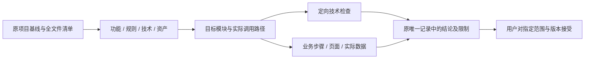

# 五个参考项目的复现与迁移学习指南

> 类型：跨项目研究导航；版本：1.0；负责人：Agent；日期：2026-10-04  
> 依据：用户要求多个智能体仔细调查`参考项目/`的全部项目，逐项目解释功能、技术栈、架构、业务逻辑、复现、迁移、学习与扩展，并建立迁移完整性追溯。  
> 来源：本地五个参考工程、同目录原始压缩包，以及当前工作区目标源码和已有设计记录；不认证远端最新提交。  
> 实际调查及文档检查见[调查与检查记录](../开发记录/2026-10-04-五个参考项目复现调查与文档检查.md)。本页只导航和说明阅读/核验方法，不维护五项目的实施状态。

## 1. 先选项目，再按同一条业务链读懂

五个项目各有一份深入文档。每份都从用户目标和业务流程开始，再解释前端入口、实际处理组件、接口、数据/状态、异常路径、依赖、运行条件、目标迁移候选与扩展方式。源码链接可以继续追到实现；已有完整迁移设计仍是目标方案和批准决定的唯一正文。

| 项目 | 原产品解决的问题 | 原技术主线 | 深入文档 | 目标方案与实际结果入口 |
|---|---|---|---|---|
| AI图片编辑 | 用画布、选区和AI计划生成/编辑图片 | React/Konva；FastAPI、ARQ、LangGraph；PostgreSQL、Redis、对象存储和图像处理 | [原项目复现与学习设计](AI图片编辑项目/原项目复现与学习设计.md) | [完整迁移设计](AI图片编辑项目/完整迁移设计.md)、[实施记录](AI图片编辑项目/开发记录/2026-10-03-完整迁移实施.md) |
| AI演示文稿 | 从主题或材料形成提纲、幻灯片，编辑并导出 | React；Python或Java可替换控制后端；PDF等材料解析、模板/布局、PPTX导出与回读 | [原项目复现与学习设计](AI演示文稿项目/原项目复现与学习设计.md) | [完整迁移设计](AI演示文稿项目/完整迁移设计.md)、[实施记录](AI演示文稿项目/开发记录/完整迁移实施记录.md) |
| PaiSmart知识库 | 把企业文档变成有权限、有引用的检索与问答资料 | Java17/Spring Boot/JPA、Vue3；MySQL、Redis、Elasticsearch、Kafka、MinIO、模型/OCR | [原项目复现与学习设计](PaiSmart知识库项目/原项目复现与学习设计.md) | [完整迁移设计及实施记录](PaiSmart知识库项目/完整迁移设计.md)、[开发环境指南](PaiSmart知识库项目/开发环境启动指南.md) |
| PaiFlow工作流 | 把模型、工具、分支与循环连接成可运行流程 | React、Java Hub、Python引擎/Agent/插件、独立Java引擎；数据库/缓存/对象存储 | [原项目复现与学习设计](PaiFlow工作流项目/原项目复现与学习设计.md) | [完整迁移设计](PaiFlow工作流项目/完整迁移设计.md)、[唯一核对记录](PaiFlow工作流项目/设计资料核对记录.md) |
| PaiCLI智能编码 | 让开发者在获批仓库中理解、计划、修改、检查并恢复 | Java17自建Agent/DAG/工具；JLine/Lanterna、SQLite、JGit、模型/MCP/CDP | [原项目复现与学习设计](PaiCLI智能编码项目/原项目复现与学习设计.md) | [完整迁移设计](PaiCLI智能编码项目/完整迁移设计.md)、[实施记录](PaiCLI智能编码项目/开发记录/2026-10-03-完整迁移实施记录.md) |

表内是定位摘要。具体版本、实际支持能力和未实现边界以逐项目研究的构建文件与实现证据为准。原项目部署样例不能直接当成本工作区启动命令；当前运行继续按[多项目并行开发启动指南](../若依框架/多项目并行开发启动指南.md)，沿用原共享基础服务及项目数据，不新建或克隆数据库。

### 推荐阅读法

每个项目先挑一条最重要的业务链：图片的“上传→选区→计划→工具执行→结果”、演示文稿的“材料→提纲→页内容→编辑→导出”、知识库的“分片上传→解析→索引→权限检索→引用问答”、工作流的“画布→图校验→调度→节点→事件/终态”、CLI的“输入→模型→策略/工具→上下文→答复/快照”。

每走到一个环节都回答：谁触发、输入从哪里来、谁决定能否操作、处理在哪个进程、数据归谁、失败后保留什么、用户如何确认结果。能够把这七个问题讲清楚，比先背目录和依赖名称更能支撑复现。

## 2. 原项目复现与迁移到本仓库是两种学习目标

**原项目复现**以本地来源基线为准，先在明确的测试环境重建原入口、依赖和主要流程，理解原实现的优点与缺口。它是学习原架构的实验，不会自动成为本仓库正式业务，也不能把原说明中的宣传、规划或接口空壳当作已实现能力。

**本仓库迁移**按既有批准方案接到若依。账号、认证、菜单、按钮权限、共享请求、数据库所有权和秘密管理继续复用已有机制；Python、Java Worker、Runner或保留的React工作台承担对应算法及专业交互。已经批准保留React的项目继续保留，不能为“统一Vue”重新改写产品和方案。

迁移中允许批准的等价重写，但要记录替换的技术和保持的语义。例如PostgreSQL转目标MySQL、SQLAlchemy/JPA转中心持久化、源WebSocket/SSE转中心事件协议，都要核对字段、排序、分页、事务、并发、重试、取消和错误。可以证明“原功能已等价迁移”，不能同时写“原数据库、所有框架原样保留”。

## 3. 怎样证明迁移完整

用户需要的证明应当形成可以复核的证据链：

### 3.1 文件、功能、技术、数据、运行分别核对

| 核对对象 | 必须回答的问题 | 合格证据 | 常见误判 |
|---|---|---|---|
| 所有代码与资料 | 每个来源文件迁到哪里、重写到哪里、为什么排除 | 全文件基线、目标路径、处置理由、对应功能/验证引用 | 只数类或文件数量，漏掉脚本/提示词/测试/样例/字体 |
| 所有功能 | 所有页面、接口、工具、命令、作业、节点和异常是否有目标行为 | 功能追溯矩阵、活跃调用、独立预期、实际业务证据 | DTO/按钮/接口存在就算完成；把ROADMAP算原已有 |
| 所有技术 | 原依赖和协议保留还是替换，原语义如何继续成立 | 构建声明/锁、运行版本、协议兼容和技术替换说明 | 改了技术却写“全部原技术保留”；声明版本当解析/运行版本 |
| 数据与权限 | 字段、身份、隔离、历史、计费、迁移、恢复是否正确 | 原/目标模型、字段映射、数据核对、权限拒绝、幂等/补偿证据 | 文件复制等同数据库完成；Mock等同真实数据链路 |
| 运行与交付 | 用户实际入口运行的是哪个产物，关键外部能力是否验证 | 构建/分发hash、运行版本、页面/终端截图、真实链路结果 | 工作区源码有改动就说安装版/服务已更新 |

只要有未解释的源能力或文件、未验证的关键业务路径、未处理的技术替换，结论就必须保留对应缺口。技术通过、业务通过、用户接受和发布事实继续各自记录。

### 3.2 本轮已经建立的基线怎样使用

每个项目在`证据/2026-10-04-原项目复现调查/`下有五种静态资料：

- `源文件清单.csv`：所有本地普通文件的相对路径、类别、大小、SHA-256、与原包的关系；点文件也纳入，生成物单独分类，符号链接不跟随。
- `压缩包成员清单.csv`：原包每个文件的路径、大小、SHA-256，帮助识别解压后新增/变更/缺失。
- `源码基线.json`：来源和取得时间、压缩包hash、数量、目录差异、目标扫描范围及限制。
- `源文件目标候选对照.csv`：在所属目标业务目录查到的字节相同文件；空缺不代表漏迁，有候选不代表进入活跃调用。
- `依赖声明清单.csv`：Maven父工程/依赖/插件、npm声明和package-lock已有锁值、Python直接/可选声明、Compose镜像。没有运行依赖解析；Python完整锁、pnpm/yarn锁、继承属性及实际环境版本继续按各源码文件核对，不能把声明行数当成完整运行依赖数量。

清单只保留文件元数据，不复制秘密配置值。目标扫描跳过生成物/依赖缓存，共享若依设施由原设计和对应技术核对承接。候选可能是distribution或参考副本，不能把它们计为运行实现。

后续逐文件审查需要填写或引用“迁移处置、功能关联、等价重写依据、验证证据入口”。已有源码处置清单继续是其原用途的事实源，本轮候选表是可复核的调查快照；不要另建一份长期实施状态。正式结论进入各项目的已有实施/验收记录。

### 3.3 完成证明的计算口径

文件处置覆盖率是“已明确处置的基线文件数 / 基线文件总数”；业务覆盖率是“有足够通过证据的适用原能力数 / 适用原能力总数”。二者不能互相代替。等价重写应纳入文件处置，但只有相应业务证据通过才计入功能通过。原未实现能力单列为扩展候选，不混入已实现功能分母；批准排除必须保留理由，不能悄悄缩小分母。

本轮建立分母和研究追溯，没有将所有目标业务重新运行，因此不发布“100%迁移完成”比例。原已有通过基线按受影响范围沿用，受影响和未通过/未执行项定向复验，不抹掉旧失败，也不把历史结果冒称本轮新执行。

## 4. 深度学习与扩展的推进顺序

| 步骤 | 要做的事 | 最小学习产物 |
|---|---|---|
| 1. 阅读需求和原主流程 | 用一组固定输入手工推导预期，沿入口读完整调用 | 一张用户流程和输入/输出表 |
| 2. 阅读数据与权限 | 查表/DTO/实体、写入点、状态迁移、隔离与所有权 | 字段/状态说明，至少一个拒绝案例 |
| 3. 复现核心算法 | 使用Mock/fixture理解规划、渲染、检索、调度或工具循环 | 可重复的小实验和独立期望 |
| 4. 理解异常与恢复 | 模型失败、外部超时、取消、重投、断流、并发冲突 | 失败后哪些数据/产物保留、怎样停止/恢复 |
| 5. 对照迁移实现 | 从原功能到目标入口到活跃模块到证据逐项走查 | 原清单中的处置/功能/验证引用 |
| 6. 选择一个完整扩展目标 | 例如一个图像工具、一个导出格式、一个知识源、一个节点或一个只读CLI工具 | 输入、权限、处理、输出、失败、验收的局部设计 |
| 7. 完成定向验证 | 原正常/异常行为保留，新能力独立验证 | 相关测试、页面/终端与数据证据，写回原记录 |

扩展不应从批量改名、全栈重写或另建平台外壳开始。优先找到现有注册表、Provider适配、解析器/检索策略、节点协议、工具schema或Renderer接口。每份项目文档给出真实文件入口和需要联动的验证点，按它们做一个能闭环的小功能，再逐步扩大。

## 5. 原实现的缺口同样是学习内容

本轮从实际源码发现的差异在逐项目文档就地解释。例如：图片Worker终态防重不能保证运行中重投和费用只发生一次；演示文稿Python/Java控制后端是替换方案；PaiFlow的完整节点枚举不等于Java引擎已实现全部节点，原认证还有开发用mock；PaiCLI原headless审批和Team审查错误处理与交互路径不同。

这些原缺口不应在学习文档中消失，也不应无条件复制到目标。已经批准的目标补齐要求继续按原迁移设计执行；新的产品取舍另记到该项目既有设计/决定。读懂为什么原代码会产生这些结果，才有能力独立修改和扩展。
