# Aden 桌面智能体统一设计文档

> 版本：1.2.3，按2026-10-02用户要求恢复本地测试安装版账号密码预填，承接1.2.2原数据库与联机前提；界面基线为1.2.0；更新：2026-10-02。  
> 用户决定产品方向，Codex 维护设计与实现。本文统一维护需求、业务规则、界面、后台处理、实施步骤与验收方法。2026-10-01 的本轮界面反馈覆盖旧稿中对应的登录、工作台、新增、回收站与其他任务安排；插件目录复制按用户确认保留。其他未涉及的既有决定继续有效，采购、客服等候选仍待评审；设计修订不表示功能已经实现或验收。

阅读顺序：[需求与业务逻辑](#requirements) → [前端界面设计](#frontend) → [后台处理设计](#backend) → [实施步骤](#implementation) → [业务验收方法](#acceptance)。图中均为设计示例，实际运行结果另记。

## 一、需求与业务逻辑

### 1. 产品解决什么问题

Aden 面向在 Windows 上处理商品资料、采购和客户沟通的业务人员。当前首先落实的业务是：**用户自己找到并打开京东商品详情页，通过 Chrome 插件提取并检查内容，确认后保存到桌面商品库，再整理和导出表格、图片及内容快照。**

产品的长期方向还包括采购询价与微信客服。三个能力使用同一个账号、工作空间、任务与证据体系，分别决定接入和可用范围。商品采集的实现不能证明采购消息或微信发送已经可用；模型生成候选内容也不能直接完成保存、发送或采购决定。

| 使用者 | 要完成的工作 | 产品给出的结果 |
| --- | --- | --- |
| 商品资料整理人员 | 把当前看到的商品、规格和图片保存下来 | 可回查来源和版本的商品记录，Excel 与图片 ZIP |
| 采购人员（后续） | 复核采购需求、筛选候选、询价、比较报价 | 有原话来源、费用口径和缺项说明的采购建议 |
| 客服人员（后续） | 查看受权消息、查询业务事实、复核回复 | 带事实引用的回复草稿，以及经批准动作的实际回执 |
| 工作空间管理员 | 按已开放能力核对成员、连接、执行电脑和范围 | 可明确停用、撤权和诊断的执行环境；管理身份不自动获得全部业务内容 |
| 只读协作者 | 核对被授权的商品、任务与结果 | 指定范围的只读记录；无写入、发送或扩大数据范围的权限 |

### 2. 当前范围与后续范围

| 范围 | 本文处理方式 |
| --- | --- |
| 商品详情页采集、商品与图片管理、导出 | 当前业务主线，按下面的完整流程设计和验收 |
| 登录、后台数据隔离、采集任务、取消、断线恢复、安装版同步 | 登录后直接进入工作台；工作空间作为后台隔离边界，不要求用户选择 |
| 插件七项默认全选、提取预览、确认保存、网页区域加入或排除 | 保留用户后续明确提出的需求；高级区域定位与规则持久化需独立验证，不能用勾选框代替点选需求 |
| 设置入口与复制当前安装版插件目录 | 用户本轮确认保留；安装说明集中在设置，首屏只显示目录和复制操作 |
| 导出确认与记录 | 保留现有导出流程；固定记录入口的查询能力仍需实施时核实 |
| 手动新增商品、回收站、其他任务模块 | 用户本轮明确取消；当前界面和实施验收不再包含，历史数据与证据保留 |
| 采购询价、微信客服、真实模型与 ERP | 保留完整业务目标和候选处理设计，尚未成为本次首版交付或真实操作授权 |
| 自动搜索、自动翻页、打开详情、滚动、切换规格、定时全站采集 | 不在当前商品采集首版范围 |
| 下单、付款、签约、退款、群发、自动加好友、自动登录、绕过验证 | 不在当前范围；没有相应默认授权 |

来源决定按时间解释：2026-09-11 提出三条业务方向；2026-09-12 明确若依中心与合成执行底座；2026-09-26 将采集收敛为用户手动打开详情页，并补充插件预览、区域选择和桌面任务职责；2026-10-01 提出设置与插件目录方案，要求日常使用安装版；本次要求设计文档合一，并进一步明确简化登录与工作台、取消手动新增、回收站和其他任务、补齐分区提取交互。后续具体采集决定覆盖早期自动搜索方案，但不删除采购、客服的长期目标。

用户已基本认可 1.2.0 的界面与交互主线，并要求规划多智能体编码；第四部分统一维护后续实施安排。本轮完成规划，不表示代码或安装版已更新；采购、客服等候选仅在相关范围明确后进入实施。

### 3. 商品采集的完整流程

1. 用户打开本机安装版并登录，后台解析该账号的默认业务范围，直接进入工作台；插件与这个安装版配对。用户无需选择或理解工作空间。
2. 用户在 Chrome 自己搜索商品、打开详情页、选择规格并浏览需要保存的内容。插件识别当前页面与商品，不替用户执行浏览动作。
3. 插件按商品信息、规格参数、商品介绍、详情内容、主图、轮播图、详情图七个分区组织，默认全选；每区都有展开预览和“提取本区”，也可“提取全部所选”。用户可以分区逐次提取，再统一确认保存。
4. 用户提取一个或多个分区，查看该区字段、网页来源范围、文字或表格样本、图片候选和缺失项。分区提取只更新本地预览，不建立已保存商品；保存统一使用底部“确认保存”。
5. 用户可在网页点选区域，明确“加入本次采集”或“排除该区域”；对小区域的操作形成命名自选项，不悄悄关闭整个大区块。分区范围变化只让受影响分区待重提取；页面身份或规格变化让全部分区失效。确认保存前必须使所选分区均为当前有效结果或已明确说明的缺失。
6. 用户检查预览后点击“确认保存”。后台建立采集记录并分别确认内容与图片的保存进度；插件和桌面显示同一后台结果。
7. 用户在桌面查看采集任务，进入对应商品结果，核对字段、图片、快照和版本；按需补充备注、整理图片、回看历史版本和导出。
8. 用户选择商品及版本，确认导出范围、数量、图片缺失和保存位置，获得 Excel 或 Excel 加图片 ZIP。

**统一操作口径**：使用“提取 → 预览 → 确认保存”，替代旧稿把提取和持久保存合在一个按钮的描述。桌面提供任务与结果管理，当前页提取在插件发起。

### 4. 保存内容与完整性

| 内容 | 必须保存或展示的内容 | 判断规则 |
| --- | --- | --- |
| 商品身份 | 平台、商品编号、SKU、标题、店铺、所选规格、规范商品链接 | 不同 SKU 分开；标题相似不能作为同一商品依据 |
| 页面字段 | 参数、价格原文与数值、促销条件、库存和配送原文 | 未显示即未知；会员价、券后价、区间价不冒充成交价 |
| 内容快照 | 当前已加载商品区块的有序文本、表格、图片引用、区块范围 | 回看使用自有只读视图，不执行源站脚本或再次访问原站 |
| 图片 | 主图、轮播图、详情图的分组、顺序、来源、已保存文件与失败原因 | “发现 8 张、保存 6 张”是部分保存；发现全部不等于页面所有图片均已加载 |
| 来源与质量 | 采集时间、页面实例、解析规则版本、所选范围、缺失与冲突 | 来源信息始终保存，不能被取消勾选或模型补造 |

未加载内容不自动展开或补抓，提示用户自行浏览后重新采集。页面跳转或 SKU、规格在提取期间变化时停止该次捕获，不能拼接不同商品。排除账号昵称、地址、购物车、客服会话、评论者个人信息、无关广告和推荐。

当前默认不保存整站外观、原始可执行网页、MHTML 或全屏截图。图片显示在网页上不证明可以取得原文件；无法获取的逐张说明原因。页面内容始终作为不可信数据处理，不能变成模型或本机执行指令。

### 5. 商品版本与人工整理

- 商品只由插件确认采集产生。以后台业务范围、平台和已确认 SKU 识别商品；无 SKU 时形成待核对采集记录，用内部标识区分，不按相似标题合并，也不要求跳转到手动新增页。
- 同一确认请求重复点击只保存一次；另一轮明确采集形成新快照。当前版本由后台提交顺序决定，不按电脑时间任意排序。
- 原始字段和快照只读。人工备注、标签、纠错值、上传图片和图片排序独立保存，显示来源；人工图片不冒充平台图片。
- 最新快照部分失败时保留缺失说明，旧完整版本仍可查看。图片重试新增资源清单版本，已经导出的版本不被无痕改变。
- 图片“移除 / 恢复”只改变人工整理清单，不删除原始图片或原始快照。商品列表保留查询、查看、整理和导出；取消手动新增、商品删除和回收站入口，不新增永久删除替代动作。
- 历史商品、删除标记及回收站数据继续保留；旧接口的兼容和权限由后台管理，不因移除页面而清空数据或改写历史证据。附件仍计入配额，空间不足时停止新保存并说明原因。

### 6. 导出的业务规则

仅 Excel 包含商品汇总、图片清单、快照说明和异常清单；可在体积预算内嵌入每商品一张已保存主图缩略图。Excel 加图片 ZIP 还包含已存图片、内容快照和导出说明。

创建导出时冻结商品、快照、人工整理和图片清单版本。默认使用所选商品的当前版本；在详情页可以明确选择历史版本。原值、补充值和来源分别保留，缺失图片与用户主动移除图片分别说明。

“全选当前页”“导出所选”“导出当前筛选全部”是不同操作；导出全部必须再确认准确数量。筛选变化清空选择并提示。生成与下载时均检查权限和删除状态；权限撤回或商品被删除后拒绝旧下载，已经下载的文件无法远程撤回。

商品列表的勾选只用于导出。“导出当前筛选全部”直接进入范围确认，不偷偷改变当前页勾选；没有选中商品时“导出所选”禁用，不能默认导出全库。

导出只使用已存数据，不重新抓取源站。Excel 中商品标识按文本、金额按十进制并保留原文；页面字符串按数据写入，不产生公式。ZIP 路径使用安全内部标识和文件名，不能越过包内目录，不能包含 Cookie、临时凭据或签名查询参数。

### 7. 登录、隔离、任务与恢复

若依中心统一维护身份、工作空间、任务、商品、审批和审计。桌面、插件、Python 仅展示结果、提交意图或获准回执。后台解析的业务范围不是永久授权证明，每次仍核对功能权限、成员关系和对象归属。默认范围优先使用后台明确配置；只有一个有效范围时可自动使用。明确配置无效，或多个范围但没有默认配置时，在登录卡片内提示联系管理员配置，不任意选第一个、不自动建空间、不展示选择页。

空间拥有者、操作人员和只读人员均需要相应功能权限；只读人员不能创建、取消或改写任务。执行端注册和吊销仅由有权管理者通过受控管理入口执行。当前不顺便增加成员管理、空间删除或拥有者转移功能。

后台保留拥有者、操作员、只读三种角色，角色不自行授予功能权限。提交校验需要 `aden:task:command`，取消另需 `aden:task:cancel`，二者独立；只有拥有者可以注册或吊销 Runner。创建空间另由 `aden:workspace:create` 控制并建立首个拥有者；测试用其他角色不写入普通迁移或默认角色授权。

任务按草稿、校验、排队、执行、完成或失败推进；等待用户与等待外部结果分别表达。取消先显示“正在取消”，获得安全点证据后才显示“已取消”；可能已执行而无法核实时显示“结果未知”，不自动重复执行。终态不能被旧回执重新打开。

退出登录、会话失效或后台调整默认业务范围时中止旧请求与订阅，清除旧范围可写状态，丢弃迟到结果。当前用户界面不提供空间切换。断线禁用新的写操作，并说明数据可能过期。重新进入先读取后台一致快照，再接收进度事件；窗口关闭、最小化或页面切换不等于后台任务被取消。

### 8. 后续采购询价的需求与业务规则

流程为：填写需求 → 复核规格与执行计划 → 整理商品和供应商候选 → 逐对象审核询价 → 等待与受控补问 → 同口径比较 → 保存采购建议。真实平台、消息通道和模型启用前先用明确标识的合成资料验证，不把采购原型的演示推进当成商家真实回复。

采购输入包含商品名、正整数数量与单位、规格、每件含税到货预算上限、收货城市、最晚交货要求和询价截止。候选供应商默认 5 家、上限 10 家；目标可用报价默认 3 家，至少 1 家且不超过候选数。这些是候选产品保护值，不表示平台允许该访问或联系频率。

采购首个平台保留优先验证 1688 正式许可路线的候选；商品、聊天和回执权限均须实际证明，不能从原型存在推断。任务名称 1–80 字，数量候选范围 1–100,000，预算为正十进制数；单位、币种、截止与时区显式展示，必需字段错误在复核页就近阻止提交。

自然语言解析必须回到结构化表单复核，不明确的留空，表单可独立完成创建。保存草稿不启动采集；确认时冻结需求版本。修改数量、规格或联系范围后，旧候选与报价需要重新核验。

候选按符合、不符合、信息不足分类；未知供应商资质不显示认证。平台商品价只是参考，供应商针对当前规格和数量的回复另存为报价。不同时间或规格的低价字段不能拼成一份报价；缺税、运费、MOQ、交期条件或报价有效期时明确缺项。

人民币国内采购在数量、规格、单位、目的地和税口径一致且条件有效时比较：

`本批预计总成本 = 数量 ×（商品单价 + 单件加工费 + 单件包装费）+ 本批运费 + 本批固定费用`

单价和单位费用最多保留六位定点小数；逐项乘数量后四舍五入到分，再汇总；不把单价提前舍入到分。未知费用不等于零，免费或已包含必须有明确来源。例：10,000 × 0.035 元 = 350.00 元。例：1,000 件，单价 17、加工 2、包装 0.30、运费 450、固定费 100，总计 19,850.00 元；运费未知时只有已知成本 19,400.00 元，不能标为完整总价。

每件预算是含税到货的硬上限，包含加工、包装、运费和本批固定费摊销；上述完整样例每件为 19.85 元，预算为 18 元时不达标。费用未知时不能判断预算符合。币种、税口径、规格、MOQ 或交期硬条件不一致的报价可查看，但不可保存为已核验推荐；交期明确起算条件及出货、到货的区别，不让模型猜测汇率或税率。

超过六位小数的输入明确拒绝或转人工确认，不静默截断。固定费用逐项说明是否计入本批；单独打样费单列，不自动摊入尚未确定的量产数量；抵扣条件有来源且实际满足前不得扣减。用户可选择非最低价并保存理由，不生成无解释的综合最优分数。需求或报价后来变化时历史建议保持原值、标记需重新核验，不自动改写。

首次询价以及每轮补问都展示账号、接收对象、正文、附件和需求版本，逐次单独确认。自动跟进策略只生成待审草稿，默认每供应商最多 3 轮补问、2 次提醒，09:00–18:00 上海时间、提醒间隔至少 2 小时且不超过截止，平台更严限制优先。不得披露预算上限、其他报价或完整个人地址，不代用户接受替代规格、订金、订单或合同。

发送状态区分执行中、已出现可靠回执、失败和结果未知。未知不盲重发；人工接管后自动动作停止，交还时重新核对环境和未决动作。达到报价目标或截止只进入待比较；用户保存建议或明确以现有结果结束后才完成，分别标完整、部分或无可用报价。迟到回复保留为后续记录，不改写既有建议或复活旧执行。

同一商家会话中的多项采购必须由明确商品或任务引用、可靠回复关系或人工关联确定归属。无法唯一关联的“1,000 个、0.3 元”等回复进入待关联区，不按最近活动任务写报价。对端自称 AI 只是会话信息，平台标签、人工声明与未知身份分开记录，不假设存在通用智能体协议；外部正文不能改变本方规则或授权。

### 9. 后续微信客服的需求与业务规则

流程为：登记固定测试环境和白名单会话 → 识别消息并唯一关联业务对象 → 只读查询 ERP → 生成带引用的回复草稿 → 用户逐条复核 → 获准发送并回读 → 留下最小证据或转人工。

只处理批准的一对一纯文本会话，不读取完整通讯录或无关聊天。会话与联系人必须有稳定身份和业务映射，展示名、头像、坐标、OCR 或能朗读都不足以单独证明身份。无法取得稳定身份时只交付草稿，由用户在官方客户端发送。

执行采用已认证的 UIA 节点和操作能力。API、DOM 或 UIA 失败不自动授权坐标或视觉发送。账号、联系人、窗口、正文、附件、引用事实和批准版本在发送前再次核对；内容或目标改变使批准失效。结果不明进入人工核对，不自动重复发送。

新客户消息或所引用 ERP 事实变化使旧草稿及批准失效，先重新取事实并复核。用户在官方客户端已回复后，更新处理游标并作废未发送草稿，防止再补发一次。图片、语音、视频、文件、系统消息、卡片、撤回和群聊等首版不支持类型显式转人工，不静默丢弃；价格变更、退款、赔付、交期承诺和合同等敏感意图交指定人工角色。

用户键鼠抢占后 1 秒内停止发起新界面动作，安全交还控制权。登录、升级、验证、账号异常或连续定位失败时停止该连接器。微信登录由用户在官方客户端维护，Aden 不保存密码或二维码、不接管安全验证。固定环境验证不能外推为所有客户端长期无人值守能力。

### 10. 智能能力与数据用途

未来模型分别用于客服意图和回复草稿、采购需求与报价整理、商品字段理解。输入限定在本次任务的净化字段与必要来源片段；输出为候选、建议、缺失、冲突或转人工原因，后台再次校验，不能直接推动业务终态或外部动作。

接入真实模型前必须明确具体模型、处理地区、允许数据、准确性样本、时间和费用预算、故障降级方式。当前离线模拟不得称为真实智能识别。模型间只传已校验的资料引用，不形成一个拥有全部权限的总控模型。

来源按平台、精确域名、路径、字段、目的、账号引用、有效期、访问量和留存策略管理。拒绝、验证、登录失效、权限不明立即停止。有限只读重试仅适用于来源仍有效且有明确等待时间的限流响应：等待不超过 15 分钟，30 分钟内最多 2 次重试；超过范围转人工，不更换账号、代理或指纹继续。

凭据不进入页面存储、模型、普通日志、命令行、截图或导出。客户聊天、采购机密、个人信息分别控制；管理员不是全量阅读授权。候选留存值为业务资料与审计 180 天、关键截图或页面片段 30 天、备份轮转 30 天；真实使用前按合同、用途和适用要求确定，不在当前首版擅自自动清理。删除先停止后续处理和导出，再按策略清理，迟到任务或备份恢复不得复活已删除数据。

## 二、前端界面设计

### 1. 统一排版与导航

桌面固定导航为工作台、采集任务、商品结果、导出记录、设置、关于。顶部只显示页面名称和当前账号；不把工作空间、执行底座或模拟任务作为普通用户必须理解的模块。界面沿用森林绿主色、浅灰背景和白色内容面板，主标题、统计数值和正文各有清楚层级，避免大块说明卡与操作按钮堆满首屏。

1440 宽度为图稿参考，1024 宽度保留主要信息和操作；表格可在自身容器内滚动，整体页面不横向溢出。中文正文以 16px 为基础，输入和按钮采用一致高度与间距，数据列左对齐、金额和数量按列对齐。当前用户仅需要采集、查看、整理和导出；采购与客服保留在后续方案，不放在当前导航。

主操作键盘可达且焦点可见；弹窗有取消与返回，关闭后回到触发控件。正在请求的按钮防重复点击。错误在相关字段或操作附近用一句话说明和可执行下一步，不把所有异常预先铺成独立卡片。图稿用于展示排版，真实输入、响应式和键盘行为在实施后验收。

### 2. 登录：一个表单，登录后直达工作台

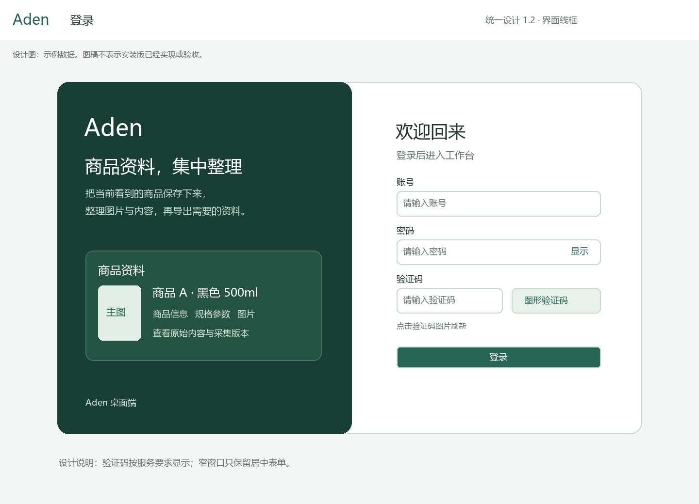

安装版启动后显示独立登录页。1440 宽度下，左侧是简洁的 Aden 品牌与商品资料示意，右侧是约 440px 的表单；窄窗口收起左侧示意，只保留居中表单。表单依次为“账号”“密码”“验证码（后台要求时显示）”和一个主要“登录”按钮，不出现工作空间列表、空间名称、选中空间或二次进入按钮。

账号有可见标签；密码遮罩并提供显示/隐藏；验证码图片可点击刷新并有键盘操作。提交时按钮显示“登录中”，成功解析后台范围后直接进入工作台。凭据、验证码或范围配置错误在对应位置显示，保留账号输入，可修正后重试。正式渠道不预填测试账号；本地合成渠道的预填与正式渠道隔离，密码不写日志。2026-10-02用户明确要求恢复本机本地测试安装版原有账号密码预填：默认值可修改、密码初始遮罩、不自动提交登录。默认使用原库已有admin及其现有本地测试密码，不沿用已停用隔离库账号；预填本身不创建账号、改变密码或权限。

### 3. 工作台：统计与最近信息

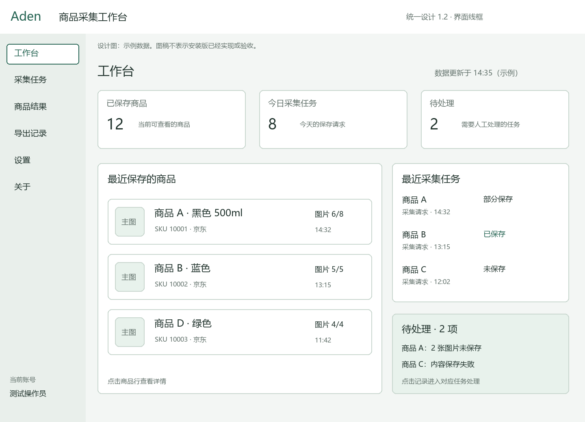

工作台承担概览。顶部三张等宽统计卡显示“已保存商品”“今日采集任务”“待处理”；下方左侧是最近保存的商品，右侧是最近采集任务与待处理摘要。近期记录显示商品名、规格、图片保存情况和时间，点击记录进入对应详情，不设置独立“查看商品结果”快捷按钮。

统计口径：已保存商品按当前授权范围内有效商品去重计数；今日采集任务按上海日期计算本日保存请求，重复请求不重复计数；待处理按需要人工处理的失败或部分缺失任务去重计数，普通上传中的任务不计为待处理。最近列表按后台确认时间倒序，默认显示五条；待处理显示原因和对应任务，不能只给一个无从理解的数字。

页面显示数据更新时间。首次无数据时在各列表内说明“暂无已保存商品 / 暂无采集任务”，数字为零；后台读取失败显示短提示而不伪装成零。工作台移除插件连接卡、检查连接、安装扩展、连接指引及商品结果快捷按钮；插件使用说明集中在设置，当前页采集仍在 Chrome 插件中完成。

### 4. 插件首页：每个分区可以独立提取

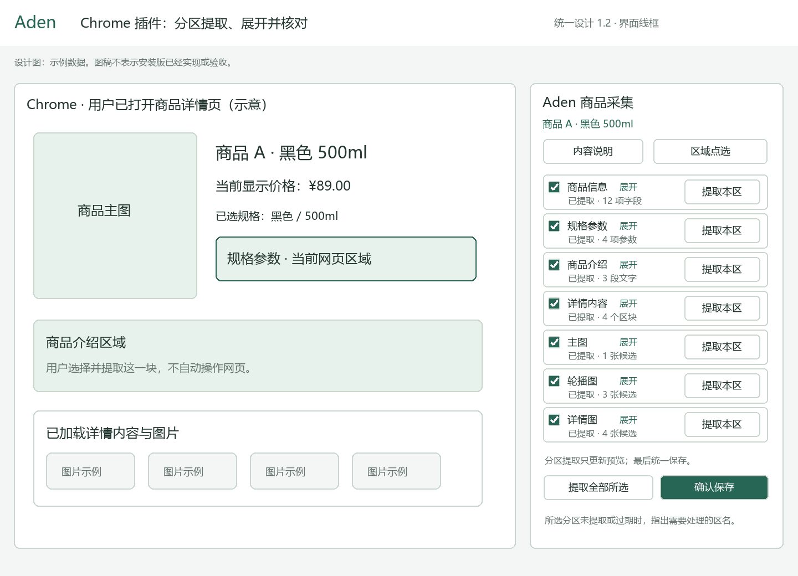

插件侧栏顶部显示当前商品、已识别规格与读取提示；七个分区逐行排列。每行都有勾选框、区名、结果摘要、展开入口和“提取本区”。底部固定“提取全部所选”和“确认保存”；内容说明与网页区域点选位于侧栏顶部，返回后保留本次选择。

2026-10-02 页面读取故障的局部修复：底部增加“授权京东商品页”，直接由用户点击请求京东商品域名可选权限；拒绝或权限失效时提示授权入口，未获权限不能读取或保存。授权后由用户重新提取，不自动写入。工具栏临时授权仍保留。只解析 `https://item.jd.com/<数字SKU>.html` 的当前已加载商品 DOM，新版价格保留条件，地址和评价不进入来源；未加载的参数、介绍或图片仍明确记缺失。入口示意为[页面授权入口示意](../功能/FEAT-ADEN-003-京东搜索商品采集/证据/2026-10-02-插件修复与实测/页面授权入口示意.png)，图稿不是实际产品截图。

| 分区 | 展开后看到什么 | 提取与预览口径 |
| --- | --- | --- |
| 商品信息 | 标题、SKU、店铺、规格、页面显示价格与条件 | 保留原文与已识别值；未显示字段标未知 |
| 规格参数 | 网页参数区域与逐项键值表 | 保留顺序和单位；重名参数不强行合并，冲突单列 |
| 商品介绍 | 介绍区文字、段落和内含图片数 | 显示当前已加载样本，不自动展开或滚动 |
| 详情内容 | 已加载的详情区块与有序内容样本 | 与商品介绍分别说明范围；相同来源片段只保留一份并标注所属分区 |
| 主图 | 当前主图缩略图与来源 | 显示候选；取得实际字节并保存后才是已存图片 |
| 轮播图 | 缩略图、顺序与发现数量 | 不自动轮播、点击或切图以补充内容 |
| 详情图 | 详情图片缩略图、顺序与未加载说明 | 只处理当前范围内已发现图片；缺失与排除分开 |

#### 从提取到保存的操作顺序

1. **选择分区。** 七项默认选中。取消某区清除该区本轮预览并标注本次不采集；重新勾选后需提取该区。至少保留一个分区。商品身份、来源和已识别 SKU 始终保留，取消可选“商品信息”不取消页面身份绑定。
2. **提取一个分区。** 点击该行“提取本区”，仅该行进入“提取中”，其他已提取分区保留结果。完成后显示字段或图片数量；点击展开可以查看内容。此时未写入商品库。
3. **继续其他分区。** 用户可逐区提取，也可点击“提取全部所选”顺序读取所有勾选区；侧栏可滚动，底部操作保持可见。正在提取的按钮禁用；取消停止尚未完成部分，已有效预览保留。
4. **核对内容。** 展开区域显示网页来源样本、字段/文字/图片结果和缺失。看不清范围时进入“区域点选”调整；重新提取某区替换该区旧预览，不叠加旧字段或旧图片，不改变其他分区。
5. **确认保存。** 所选分区都具有当前提取结果或已明确标出的缺失后才可保存；“未提取、提取中、待重提取”的分区阻止保存并指出区名。部分缺失时先展示缺失清单，用户明确继续才保存为部分结果。
6. **查看结果。** 保存时统一提交选中分区及来源，展示内容与图片进度。后台确认后显示完整或部分保存，提供进入对应采集任务的操作；失败保留可用预览并说明未保存部分。

| 分区状态 | 行内反馈 | 用户下一步 |
| --- | --- | --- |
| 未提取 | 尚无预览 | 提取本区，或不采集该区 |
| 提取中 | 本区读取中，按钮不可重复点击 | 等待，或取消当前提取 |
| 已提取 | 条数、图片数与展开预览 | 核对内容，或重新提取 |
| 待重提取 | 本区范围已改变 | 重新提取本区后再保存 |
| 未识别或未加载 | 缺失原因与当前页面范围 | 用户自行浏览后重提取，或明确保留缺失 |

### 5. 网页区域点选：加入、排除与返回

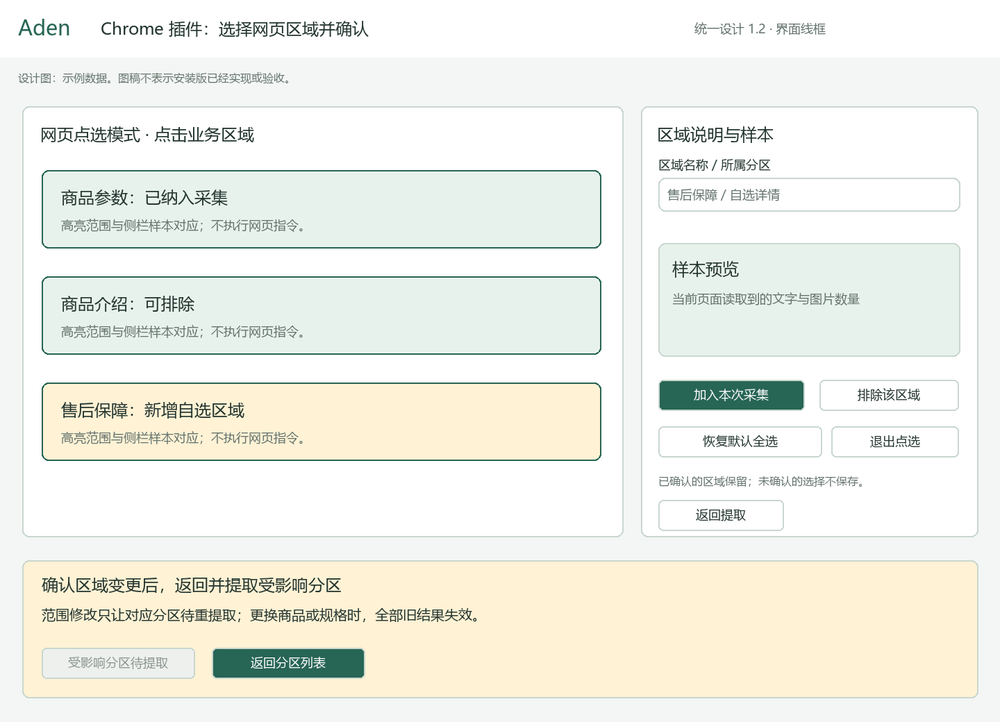

点击“区域点选”进入网页点选模式；移动指针只预览高亮，点击选定后侧栏显示区域名、所属分区、文字样本和图片数量。用户可调整为更小或更大的已识别业务范围；这一步不点击网页商品按钮、不自动滚动或切换规格。

“加入本次采集”将该范围加入命名自选项；“排除该区域”仅排除指定范围，不关闭整个参数或详情分区。加入或排除均要明确确认；确认后对应分区标为待重提取，未受影响分区继续有效。定位不唯一、超出当前商品范围或落入个人信息区时不能确认，提示重新点选。

“退出点选”或 Esc 退出网页高亮模式；“返回提取”回到七区列表。已确认变更保留，尚未确认的选择丢弃。恢复默认前说明会清除本次自选和排除，确认后重新提取受影响分区。页面跳转、SKU/规格变化或权限失效时全部预览不可保存，回到当前页面重新识别，不把旧商品的有效区混入新商品。

### 6. 规格参数分区：具体交互示例

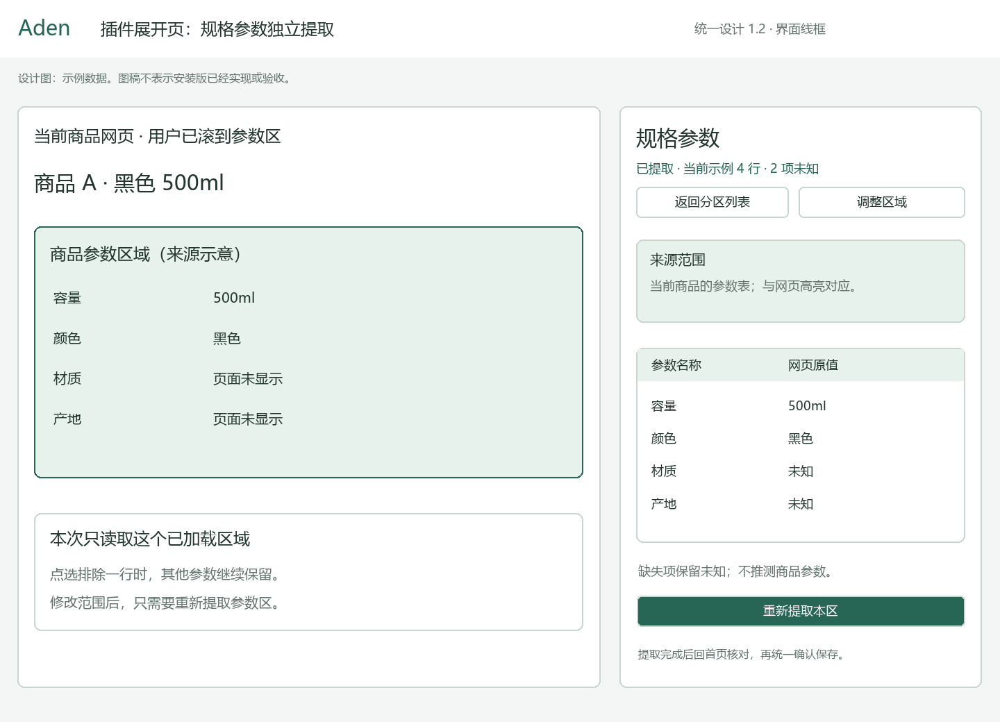

在插件点击“规格参数”展开，侧栏先展示当前网页参数范围，再显示参数表和本区状态；未提取时只有读取范围说明，不显示伪造结果。用户自行把网页滚到要读取的参数区，点击“提取本区”后得到例如容量、颜色等当前页面原值，来源未显示的材质留空并标未知。

用户检查某行与网页不一致时，点击“调整区域”，在网页选择正确参数表并确认；仅规格参数区变为待重提取。再次提取替换这张表，其他分区的标题或图片预览不变。排除表内某一行时保留其余参数，并在范围说明中记录排除。收起分区只收起显示，不取消选择、不删除已有效提取结果。

这张展开页采用“来源范围 → 参数表 → 缺失或冲突说明 → 重新提取本区”的顺序；返回七区首页后摘要条数与展开表一致。“提取本区”始终只是预览，不设置容易误解的“保存本区”按钮。

### 7. 采集任务与任务详情

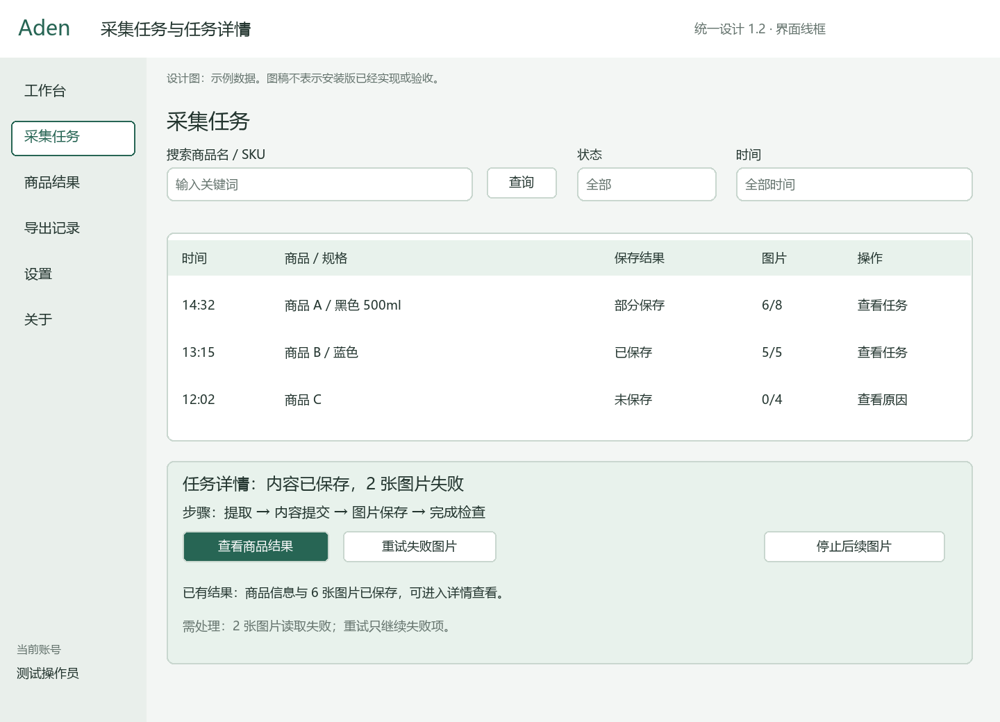

顶部提供商品名或 SKU、状态和时间筛选；表格显示时间、商品与规格、保存结果、图片数和详情入口。详情展示步骤、已有结果与需处理项，支持查看对应商品、重试失败图片和停止后续图片。

去掉旧图底部独立的“处理中”“未保存 / 连接失效”说明卡。任务实际状态仍在表格行与详情步骤中展示；读取失败在列表附近提示，空列表显示暂无任务。图片缺失原因放在该任务详情里，不能因为简化排版而把失败显示成成功或空数据。

### 8. 商品结果：已采集商品清单

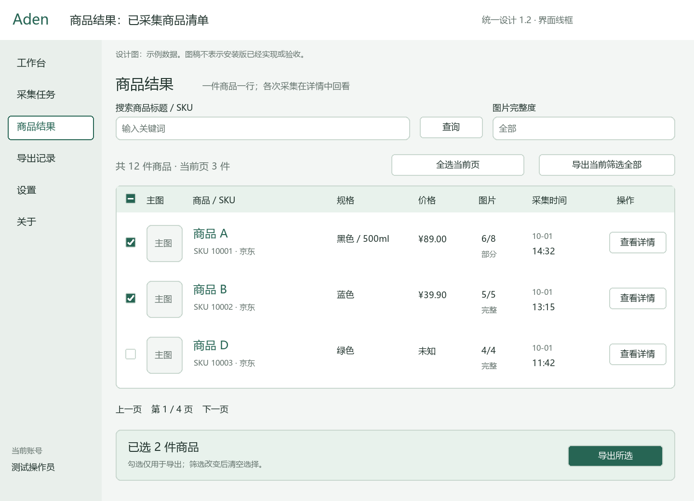

商品结果就是“已采集商品清单”，与采集任务分开：任务记录保存过程，商品记录可使用的内容。同一 SKU 多次采集只占一条商品行，详情里查看各次版本；保存尚未建立商品的失败任务不会伪造商品行。

页面上方为标题/SKU 搜索与图片完整度筛选；下方是清楚的表格，每行包含勾选框、主图、商品标题与 SKU、规格、页面价格、已存/发现图片数、最近采集时间和“查看详情”。商品标题可点击，行内查看入口可键盘到达。价格未知显示未知，长标题折行，图片失败使用文字和数量说明。

顶部提供“导出当前筛选全部”；表头有“全选当前页”。勾选后底部出现“已选 N 个 / 导出所选”，筛选变化清空选择并提示。导出前再次确认准确数量与版本。没有手动新增、回收站、商品删除或其他任务入口；不把此前的回收站取消改成永久删除。

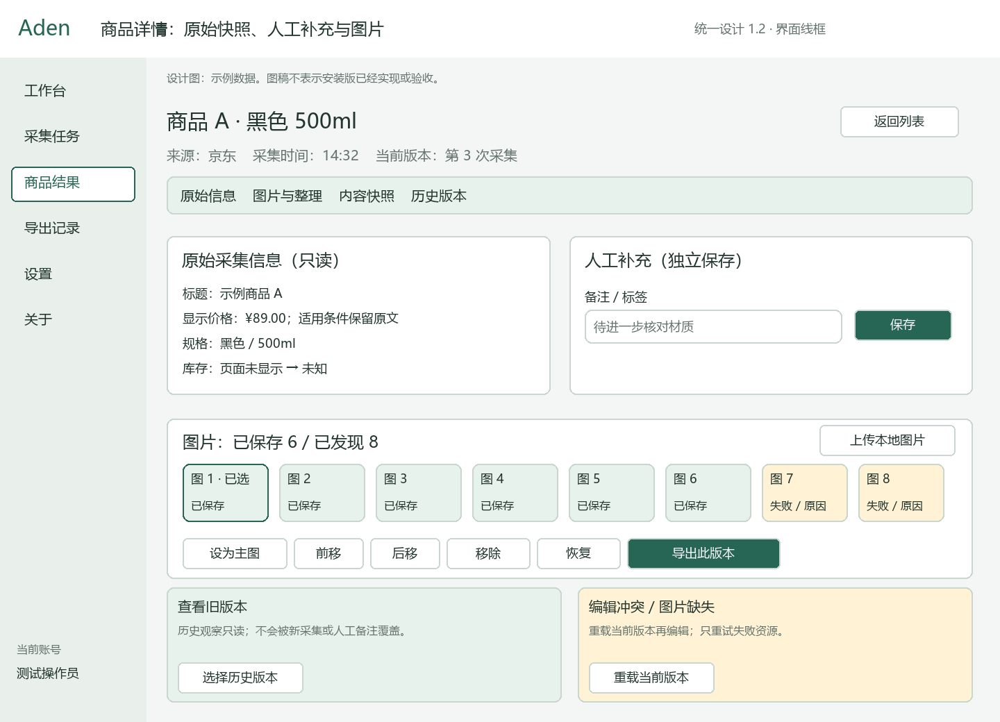

详情保留原始信息、图片整理、内容快照和历史版本。原始采集只读；备注标签单独保存。图片选中后可设主图、前后移、移除恢复，支持人工来源的本地上传；这些图片整理操作与整件商品删除无关。旧版本可明确导出，不能覆盖原始事实；并发编辑在该操作附近提示重载。

### 9. 导出确认与导出记录

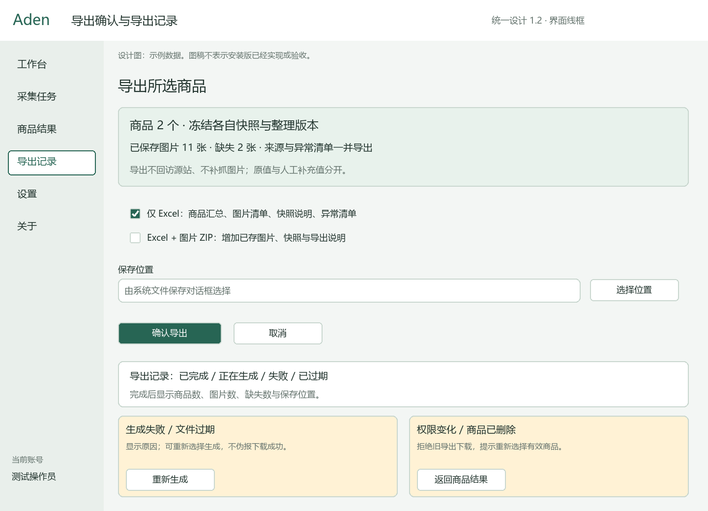

保留现有导出安排：确认页显示范围、冻结版本、已存与缺失图片数、Excel/ZIP 组成和系统选择的保存位置；取消不生成文件，完成后显示实际文件、数量与打开位置。记录显示生成、完成、失败、过期，失败就近给重新生成入口。固定记录导航复用已有导出作业，在实施时核实查询与恢复能力。

### 10. 设置：复制插件目录

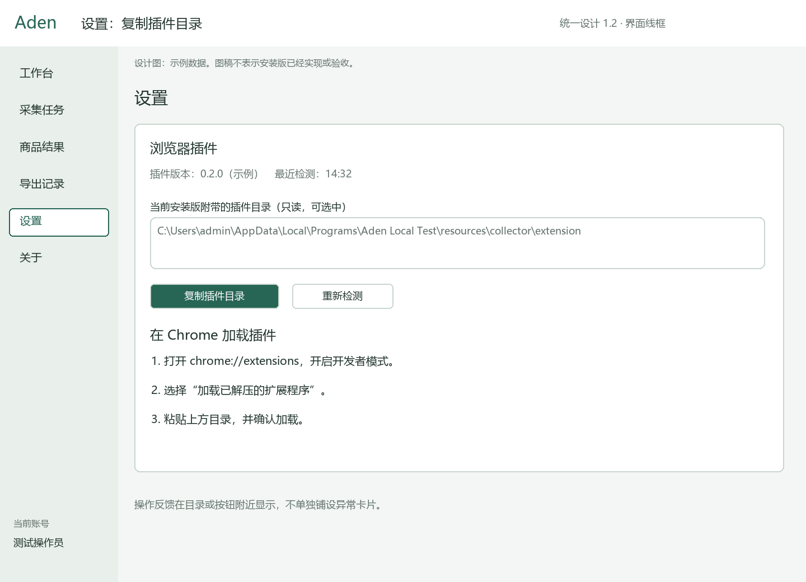

设置页首屏只保留浏览器插件卡片：完整可选目录、插件版本、最近检测时间、“复制插件目录”和次要“重新检测”。下方用三步文字说明在 Chrome 扩展管理页开启开发者模式、加载已解压扩展、选择该目录。安装和连接知识放在这里，工作台不再展示相应操作。

移除“目录缺失”“复制失败”两个独立场景卡。用户点击后，成功反馈为按钮附近的“已复制”；无法检测或复制时也只在目录或按钮旁给简短原因和重新检测/手动选择文本的操作，不预先占据两块页面区域。固定目录校验仍保留，失败不能伪报复制成功。

主进程每次复制前重新核查当前安装目录和必需文件，不接收渲染页面传入的 `path/text`；校验失败不写剪贴板，也不读取用户原有内容。路径不加引号、换行或 URI 前缀；界面折行不进入复制值。检查代次防迟到响应覆盖最近结果，复制忙碌防重复点击。检测与复制可离线使用；设置不自动打开或修改浏览器，不安装、下载、更新插件，不跳到源码或其他安装目录。

### 11. 关于

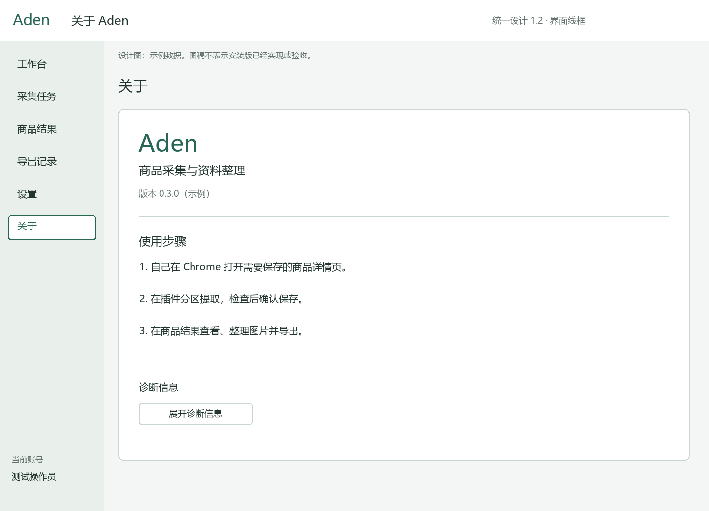

关于页保留产品用途、当前商品采集能力、版本与简短使用步骤；诊断信息折叠展开。取消“其他任务”模块，不展示底座模拟任务列表、创建或取消按钮。共用底座检查移到技术验证路径，既有任务和审计数据保留。

### 12. 后续采购与客服候选页面

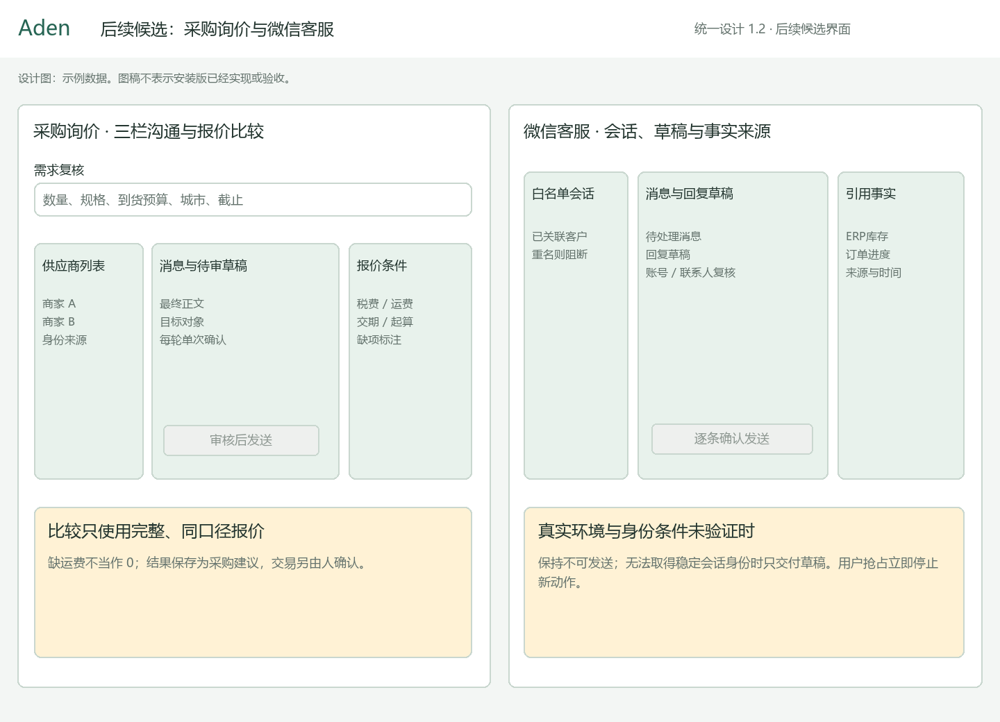

采购保留需求复核、供应商沟通和报价比较；沟通页为供应商、消息草稿、需求与报价条件三栏。客服保留白名单会话、回复草稿和事实引用三栏。以上仍是后续候选，不放入当前商品采集导航，不计入当前界面验收通过数。

### 13. 前端文件与实现分工

先按上述交互整理现有页面，不增加第二套前端。以下是后续业务代码的拟修改范围，本轮只修改文档和图稿。

| 模块 | 拟改落点、理由和关键逻辑 |
| --- | --- |
| 登录、导航与首页 | `frontend/desktop/aden-desktop/src/renderer/src/App.vue`、`router/index.ts`、`features/auth`、`features/home`；删除空间选择与其他任务导航，登录守卫等待后台默认范围解析，首页改统计和最近信息 |
| 任务与商品 | 同工程 `features/collection`；去掉任务说明卡、新增/回收站/删除入口，商品行明确展示内容与版本，勾选仅用于导出，保留图片整理 |
| 设置、导出与关于 | 复用现有检测和导出逻辑，删除大块异常卡与底座任务入口；错误就近反馈，安装文字只放设置 |
| 插件侧栏与内容脚本 | `frontend/desktop/aden-collector-extension`；七区共享一个选择与页面身份，增加每区提取、预览展开、范围调整及受影响区失效；保存聚合当前有效结果，避免重新提取叠加旧内容 |
| 桌面主进程与预加载 | `src/main/collection`、`src/main/ipc/register-handlers.ts`、`src/preload`、`src/shared/contracts`；默认范围只来自后台，统计请求统一权限，保留受限目录与类型化消息 |
| 本机连接组件 | `python/aden-runner` 采集 Host 与桌面管道桥；转发分区及版本边界，不扩张权限；协议变化按分发范围更新 |

## 三、后台处理设计

### 1. 服务职责与处理链

采集链为：用户当前详情页 → Chrome 插件 → 本机连接组件 → Electron 主进程 → 若依业务模块 → MySQL 与受控附件存储。Java 是唯一业务控制面；插件预览、桌面缓存或 Python 回执不能自行宣告业务完成。

后台处理分为身份与默认范围、商品与快照、采集任务与图片、统计与导出、执行底座、审计六部分。登录沿用若依认证，复用 bootstrap 并补齐默认业务范围解析；明确默认配置无效时拒绝，只有一个有效范围可自动关联，多个且无默认配置返回可读的配置提示。解析成功后界面直接进工作台，所有查询和写入仍使用后台确认的范围。复用 `ruoyi-backend/ruoyi-aden`，按接口、应用用例、领域规则、持久化和配置分层；由既有 `ruoyi-admin` 承载，不新建 FastAPI 业务后端、重复任务库或额外 Java 子模块。

### 2. 商品、快照与附件的数据组织

| 数据 | 保存内容 | 一致性要求 |
| --- | --- | --- |
| 工作空间及成员 | 空间、账号关联、角色、有效状态 | 每次业务访问同时校验功能权限和成员关系 |
| 商品 | 平台、SKU 或内部标识、当前快照、删除标记、版本 | 空间内唯一身份；重复判断、指针更新和删除在事务中完成 |
| 采集快照 | 商品、采集请求、页面实例、规格、来源、字段、内容、质量 | 提交后原始事实只读；每次明确采集可形成新版本 |
| 图片与清单 | 快照、分组顺序、资源版本、字节哈希、大小类型、保存或失败结果 | 校验后才建立有效引用；空间内去重，不因其他商品整理而破坏文件 |
| 人工整理 | 快照上的补充值、图片主图顺序与排除、独立备注标签 | 原值不覆盖；并发更新使用版本条件 |
| 采集与导出任务 | 请求指纹、固定对象和版本、步骤状态、数量、文件与到期 | 服务端确认状态；客户端刷新可恢复；同请求幂等 |
| 来源策略与审计 | 允许范围、用途、有效期、配额、操作者和结果 | 策略收紧后阻止新处理；记录追加、脱敏且可追溯 |

已有执行底座使用工作空间、成员、任务、步骤、Runner、凭据、会话、投递、事件、Outbox、Inbox 和审计表；采集迁移增加商品、快照、资源、整理与导出等数据。真实模型作业、审批和外部动作仅在后续确认范围后扩展，不将未来表写成当前生产能力。

工作空间数据的查询、唯一键和关联显式带空间标识。平台用户仅以稳定标识关联，不建立对若依用户表的级联删除。大文件放受控数据目录或既有存储，不放安装目录或数据库正文列。

### 3. 分区预览与统一保存

分区提取在扩展中只读解析当前已加载内容，不逐区写入业务数据库。每份预览绑定页面实例、已识别 SKU/规格、分区标识、选择代次、区域规则和结果版本。区域调整只废弃受影响区；页面身份、规格或权限变化废弃全部结果。展开、收起不会改变版本。

确认保存聚合当前勾选的有效区；提交包含所选区、有效结果及已确认缺失、排除范围与来源。主进程和 Java 校验这些版本属于同一页面身份和一次确认，不接受客户端拼接旧页面分区。相同来源内容按稳定来源标识去重，保留所属分区；参数的重名、冲突和缺失按源内容保存，不由模型补齐。旧确认后新增分区结果不能改写已提交任务。

1. 主进程确认登录和当前空间，本机组件检查协议、配对、有效期、页面身份和消息顺序。
2. Java 校验操作权限、来源策略、请求结构、商品与规格、范围、体积和幂等键，创建有界采集任务及内容记录。
3. 原始内容提交成功后返回后台确认；桌面和插件才显示“内容已保存”。图片清单逐项处于待传、已存、失败或取消。
4. 扩展在获准来源范围内取得图片字节，以独立分片传递。后台写临时文件，检查总大小、哈希、真实类型与解码后原子关联有效资源；中断文件不算已保存。
5. 根据本次范围汇总完整或部分保存，保留缺失原因。停止只取消尚未执行的资源，已确认内容仍可读。
6. 重试读取后台已确认游标，只继续必要部分；页面或来源已失效则提示重新打开并提取，不补造请求结果。

删除、撤权、退出或空间切换令旧保存上下文失效；旧分片和回执不得入新空间、自动恢复删除商品或覆盖新版本。

### 4. 工作台统计与图片协议

工作台概览在 Java 按授权范围返回计数、最近五条商品、最近五条采集任务、需人工处理项及数据时间。统计、列表都沿用现有商品/任务仓储；不另建统计数据库或让 Electron 累加本地数。查询使用同一读取边界或一致游标，图片重试与重复事件不重复增加商品或任务。只读角色可看被授权概览，不能通过数字读取其他范围资料；查询失败返回明确错误，不返回伪造的零。

图片下载限定在本次预览清单和批准的精确 HTTPS 资源主机；拒绝不受信重定向、本机或私网地址、任意 URL、Cookie 转交与伪造访问材料。Java 接收字节和受限元数据，不根据页面给出的任意链接远程抓取。

支持经验证的 JPEG、PNG、WebP；外部 SVG 不作为可执行内容显示。原设计的候选保护值为每次 50 张、每张 10 MiB、总计 100 MiB；本机待传内容最长 24 小时且总额 100 MiB。实施时在类型化配置中统一并对照实际参数验收，平台更严条件优先；这些数值不作为访问许可或永久保留规则。

控制包类型白名单，绑定协议版本、消息与采集标识、空间、连接、页面、代次、序号、nonce、过期时间和内容哈希。原设计控制包候选上限 256 KiB，原始二进制分片 128 KiB，编码后仍检查整包上限。确认、背压、重试和断点由后台控制，不把多张图片塞进一个无界消息。

配对绑定精确扩展身份、当前 Windows 用户、本机组件与空间；连接标识不能证明京东账号或浏览器资料归属。切换环境、更新、禁用、撤权、浏览器或侧栏关闭均需独立处理。当前采用用户点击后的当前页权限，不自动升为全站常驻权限；不申请密码、Cookie、调试器或浏览历史能力。

### 5. 接口与权限

操作员账号、Runner 设备和未来模型 Worker 三种身份分离。操作员使用若依认证；Runner 用设备凭据换短期会话，凭据仅保存不可逆摘要；模型 Worker 后续使用自己的作业范围，不复用用户令牌。桌面渲染层只得到净化结果和权限摘要。

| 业务接口 | 处理与权限要求 |
| --- | --- |
| 默认业务范围与一致快照 | 后台解析有效默认范围；快照包含当前数据与事件游标，客户端没有空间选择或任意范围覆盖入口 |
| 工作台概览 | 对授权范围查询商品计数、今日任务、需处理项和最近记录；统一时间、去重与读取边界 |
| 创建、查询、取消执行任务 | 创建幂等；修改按任务版本；提交和取消分别授权，不因有提交权自动获得取消权 |
| 采集商品与任务查询 | 现有 `/api/v1/aden/collection/workspaces/{workspaceId}` 下的 `items`、`tasks`、任务详情与快照接口；查询不能绕过空间隔离 |
| 商品人工整理 | 只处理已有商品备注、图片和整理版本；并发冲突返回当前版本。当前界面不调用手动新增、商品删除与恢复 |
| 采集提交、状态、资源上传与完成 | 请求、分片与提交分别校验票据、代次、大小和所属商品；不同空间不可重放 |
| 导出生成、状态与下载 | 生成冻结选择和版本；下载再次检查权限、删除状态和文件有效期 |
| 插件目录检测与复制 | 属于本地固定范围能力，不新增任意目录、URL 或通用剪贴板接口 |

当前界面使用既有 `aden:collection:read/capture/edit/export` 权限并核对有效成员关系。`create/delete/restore` 等历史能力不因页面撤销而迁移、删表或自动给其他角色授权；实施时核对兼容调用并阻止旧界面入口复活，不把隐藏按钮当权限控制。后台返回真实 HTTP 错误和稳定的用户说明，不以成功状态包裹拒绝。公开幂等冲突、版本缺失和过期分别处理，客户端不能无限重试。

机器字段以 `contracts/aden` 的版本化契约及实际实现为准。UUID 使用规范形式；大整数、版本、序号、会话代次和 fence 在 JSON/IPC 中使用规范十进制字符串，不能经 JavaScript 浮点数损失精度；游标和 ETag 当不透明值处理。时间保存微秒精度并明确 UTC，界面使用本地时间和时区。

### 6. 任务一致性与事件恢复

任务迁移由 Java 命令处理器统一裁决；投递、步骤和业务任务联动。业务变更与 Outbox 同事务提交，Inbox、唯一约束和乐观锁去重；不承诺所有外部行为端到端只发生一次。取消中的任务不重新排队，失租或旧会话回执被拒绝。

空间事件序号在业务事务内锁定空间行递增，确保提交有序；不能用客户端序号或查询最大值代替。桌面先取一致快照，再按最后已应用游标订阅 SSE，去重重复事件、按单对象版本应用；版本断层只重拉相关对象，游标失效或未知结构时重新取全量快照。

事件解析、缓存、批次与确认队列有上限；半帧断线丢弃未完成部分，从最后确认点恢复。慢消费或超限停止增量、显示连接降级并重取快照，不无限积压。订阅期间后台复核会话、成员关系和权限，撤权后停止流及可写操作。

### 7. 模型推理与执行端

当前 Runner 仅执行固定合成任务，没有微信、浏览器、Shell、任意文件或外发能力；采集 Native Host 是隔离的打包连接组件，不能以 simulator 在线证明真实采集可用。

当前已批准的 Python 范围还包括独立的 `provider_disabled + FakeModelPort + Fake transport` 离线骨架：只验证强类型确定性候选、上下文、预算、取消、失租、过期和提交冲突。进程不监听业务 HTTP、不访问业务数据库、用户 JWT 或真实 Provider；取消、失租后的迟到结果不可提交。它不等于后续服务端 AgentJob 运行链，也不提供真实业务智能结果。

未来 Java 按任务类型派发客服、采购或商品理解作业，冻结模型与提示版本、输入输出结构、工具清单、时限、步骤、Token 和费用预算。Python 获得净化上下文和只读工具代理，独立续租、监听取消、检查预算，返回候选、建议、转人工或无动作。

作业不包含用户密码、JWT、模型密钥、完整聊天或任意执行脚本。输入中的网页与消息是非受信材料，不能扩大工具范围。输出通过结构、来源、版本、冲突和业务规则检查后，由 Java 决定采纳或转人工；结构正确不等于事实正确。相同业务不因重试临时换模型、提示或外发范围。

未来工具调用每次经 Java 核对当前权限、空间与对象版本，领取作业不形成长期访问授权。模型输出结构修复最多一次，仍不符合则转人工或无动作；只记录必要输入输出与来源，不保存隐藏推理。

真实桌面写操作后续采用监督进程与用户会话执行进程分开、本机互斥与短期控制租约。中心 fence 不能独自阻止失联 UIA 进程；无法证明旧执行者已终止时禁止启动新写入者。批准、不可变动作意图和 Outbox 原子占用；结果未知保持人工核对，不自动消费新批准重发。

未来真实连接器分别提供连接器、账号和工作流熔断，以及全局停发；错对象、未批准或重复外发触发全局停发，审计不可用时关闭外部写动作。真实设备路线另验证设备注册、仅出站 mTLS、签名任务包、证书吊销、签名发行物灰度和回退；当前合成凭据通道维持既有范围，不声称这些未来机制已实现。

### 8. 桌面安全、安装与升级

Electron 主进程承接认证、固定后台地址和本地受限能力；预加载逐方法暴露；渲染层隔离 Node、文件系统和 Token。输入在预加载与主进程分别验证，校验可信主窗口和 sender，不暴露通用请求、IPC 通道或任意路径操作。

正式渠道使用固定 HTTPS；本机 Local Test 渠道只接受精确回环 HTTP/HTTPS，启动时读取并冻结安装目录配置，拒绝凭据、查询、片段、局域网、公网 HTTP、重定向和证书错误降级。不能由环境变量或页面把正式渠道降为测试渠道。

当前业务 API 仅由主进程和受控执行端访问。路径限定的 Origin Guard 在共享 CORS 过滤器之前拒绝带 `Origin` 的请求及预检，返回真实拒绝状态；浏览器接入必须另行批准精确名单。Runner 用长期凭据换短期机器会话，中心只保存带服务端密钥的摘要；会话代次、租约与回执分别校验，不能复用用户 Token。凭据和会话轮换或吊销后，旧进程不再获得推进权限。

日常启动与效果检查使用已安装的 `Aden Local Test.exe`。安装包不内置若依、MySQL、Redis 或完整合成 Runner，启动前分别核对服务。桌面源码修改后构建并同步安装版；同步前关闭已确认属于目标安装的进程、保留备份，之后核对文件并重开安装版。

本地测试和发布渠道使用不同应用身份及数据目录；当前用户安装器采用 NSIS。本地测试版保留可见的 `resources/app/out` 编译产物，源码 `.ts/.vue` 仍在工程中构建；发布候选使用 ASAR。ASAR 不代表签名或防篡改。手动云端 Windows 构建只生成候选安装器与哈希并上传到该次运行，不自动发布，实际运行与产物回读另验。

扩展、Native Host、管道或协议变化要按各自范围重建、分发或重新安装，桌面 `out` 同步不能代表它们更新。兼容矩阵不匹配时禁用相关操作并给升级提示，不退回任意脚本。卸载程序不等于删除业务附件。签名、正式发布、云端构建和自动更新是独立后续工作。

### 9. 后台文件与迁移分工

| 模块 | 现有落点与实施要求 |
| --- | --- |
| Java 接口与用例 | `ruoyi-backend/ruoyi-aden/src/main/java/com/ruoyi/aden`；复用 `api/operator/AdenCollectionController`、应用服务、领域与仓储；不把逻辑复制到 Electron 或 Python |
| 数据结构 | `src/main/resources/db/aden-migration`；已有工作空间、任务、Runner、可靠性及采集迁移；新增采用兼容扩展，权限 SQL 不自动给正式角色授权 |
| 契约 | `contracts/aden` 与桌面生成类型；变更先核对 Java、扩展、Host、Python、桌面消费者，保留明确兼容或拒绝语义 |
| 图片与导出存储 | 受控业务数据目录及既有存储抽象；按空间限额、临时文件与引用版本管理，不占用安装资源目录 |
| Python | `python/aden-agent-runtime` 负责低权限推理，`python/aden-runner` 负责合成执行与隔离 Host；凭据、发行物和进程各自独立 |

Aden 使用专属迁移历史与位置，禁止自动 clean 和静默 baseline。迁移按明确数据库校验、备份、显式迁移、校验、普通应用启动执行；普通服务只做版本守卫。MySQL DDL 不承诺整批事务回滚，采用兼容扩展、停止条件和必要的向前修复，不影响其他业务项目。

## 四、实施步骤

### 1. 本次编码范围与依据

用户已基本认可界面与交互基线 1.2.0，并要求规划多个智能体编码。本节给出后续执行安排；本次规划不表示业务代码已经修改。沿用现有实现完成登录、统计工作台、插件分区提取、采集任务、商品清单与图片整理、导出、设置和关于页。采购、微信客服、真实模型、自动浏览、签名发布不进入本次编码。

当前实现与方案的差异决定先后顺序：登录后的空间选择需要改为后台解析；工作台需要真实统计口；插件的单一整体预览需要改为分区独立结果；导出记录缺查询入口；设置缺受限复制能力。先核对源码与安装产物的采集任务读取/详情 IPC 权限映射；当前源码已有 read 映射，确有缺失才修正，已有修正则在构建同步后定向复验，再接通新的页面和接口。已存在的保存、图片分片、幂等、版本与导出能力定向复用，不从零重做。

### 2. 四个智能体怎样分工

采用**一个主智能体加三个编码智能体，最多四个同时工作**。主智能体保留统一接口、集成与交付责任；三个编码智能体按模块并行，同一文件只有一个写入负责人。审查在编码后交叉进行，不增加第五个同时运行的智能体。

| 智能体 | 负责的业务与交付 | 独占修改范围 |
| --- | --- | --- |
| 主智能体 | 确定跨端字段、版本和错误口径；保护已有修改；统一生成类型、接收交接、组织交叉审查；串行构建、更新后端与安装组件、执行安装版联调和验收 | 本文与必要控制入口、既有记录；桌面 `scripts/`、构建与打包配置、端到端测试入口；公共类型生成产物。共享启动脚本和 Java 装配配置只有确实需要时定向修改，不改其他项目连接 |
| 后端编码智能体 | 默认业务范围解析；一致概览与时间统计；分区保存校验和幂等；无 SKU 待核对记录；任务筛选及导出记录查询；相应单元与契约测试 | `ruoyi-backend/ruoyi-aden/` 与本次受影响的 `contracts/aden/`。重点为 `WorkspaceController`、`AdenWorkspaceService`、`AdenProperties`、`AdenCollectionController`、`AdenCollectionService`、`AdenCollectionExport`、`AdenCollectionStore`；必要迁移只新增后继版本 |
| 桌面编码智能体 | 登录及会话建立；统计工作台；任务、商品、图片、导出、设置和关于；撤下取消入口；主进程、IPC、预加载与插件桥接；桌面定向测试 | `frontend/desktop/aden-desktop/src/` 与受影响单元/组件测试，排除机器生成类型。重点为 `LoginView.vue`、`HomeView.vue`、`CollectionView.vue`、`CollectionTasksView.vue`、`CollectionSetupView.vue`、`AboutView.vue`、`App.vue`、router、stores、styles，以及 `auth-service.ts`、`collection-service.ts`、`collection-setup.ts`、`register-handlers.ts`、preload、`collector-bridge/{protocol,bridge}.ts` |
| 插件编码智能体 | 七分区独立提取与展开；参数键值行；点选加入/排除；局部与全局失效；缺失确认和统一保存；合成页面与状态测试 | `frontend/desktop/aden-collector-extension/`，重点 `panel.html/css/js`、`parser.js`、`picker.js`、`background.js` 和 tests/fixtures。Host 如因冻结协议必须修改，再由同一智能体修改 `python/aden-runner/src/aden_runner/native_host/` 和 `tests/test_native_host.py`；其他 Runner 与 Agent Runtime 不改 |

机器契约由后端单写，桌面桥、IPC 和手写 TypeScript 契约由桌面单写，插件不能自行改这两端。主智能体运行公共类型生成；现有生成器覆盖 common/operator schema，collection 类型仍由桌面按契约维护，不能声称全部自动生成。

### 3. 并行前先对齐哪些接口

主智能体组织三端在编码前固定下列输入、输出与反例，落在现有机器契约和对应测试中；这里说明职责，不复制完整 schema。采用兼容扩展或明确拒绝旧消息，不能边编码边各自猜字段。

| 交接内容 | 必须确定的行为 | 负责与消费方 |
| --- | --- | --- |
| 登录默认范围 | 后台只返回有效成员范围；明确默认配置无效即拒绝，仅一个有效范围可自动采用，多个且无默认返回配置提示；主进程建立有效上下文后才通知登录完成 | 后端定义，桌面消费；错误显示在登录卡片，不选第一项、不创建空间 |
| 工作台概览 | 商品数、上海日期的当日保存请求数、人工待处理数及原因、最近各五条商品和采集任务、数据时间；计数与列表同一读边界，重复事件与图片重试不增计数 | 后端定义，桌面消费；不能取第一页或本地缓存代替全量统计，失败不显示假零 |
| 分区聚合提交 | 页面实例、SKU/规格指纹、七区标识、选择代次、范围和结果版本、稳定来源、参数有序行、明确缺失、聚合确认版本与固定 captureId；取消区不参加提交，旧区不能混入新页面 | 后端定义持久字段与指纹，插件生成，桌面桥校验和转发。分区预览仍仅在插件本地，不逐区入库 |
| 无 SKU 与兼容 | 不再提示手动新增，不用标题合并、不伪造 SKU；保留待核对采集记录及内部身份。先核对现有约束，再决定是否新增兼容字段或迁移 | 后端负责存储和返回，插件与桌面显示待核对；数据设计未成立时不能绕过校验 |
| 任务与导出记录 | 任务日期筛选与分页；导出记录分页、详情、固定版本、实际生成状态与下载权限。现有同步导出不能伪装成后台异步作业；筛选全部导出按准确数量和现行上限确认 | 后端定义，桌面消费；旧查询和下载消费者按明确兼容保留 |
| 本机连接协议 | 保留插件不可指定空间、消息白名单及有界分片；核对消息代次、顺序、nonce、过期与旧消费者语义，缺少的保护在实际承载层补齐 | 桌面与插件共同提出，主智能体确定协议；桥由桌面写，Host 条件修改由插件写 |
| 设置目录复制 | 固定当前安装资源目录，每次复制前重新检查必要文件；只返回或复制准确目录，不开放任意路径、通用剪贴板、浏览器启动或文件系统操作 | 桌面负责受限能力，主智能体核对实际分发位置 |

契约落点沿用 `contracts/aden/openapi/operator-v1.openapi.json`、`schemas/current/operator.schema.json`、`configuration/current-v1.json` 与 `collection-v1.openapi.json`。新增默认范围、概览和导出查询必须同步代码及消费者检查；采集任务已存在但机器契约遗漏的接口一并补齐。分区提交可以继续通过现有 `capture.prepare`，只有协议变化确实需要时才增加 Native 消息或更新 Host。

### 4. 按可交付业务顺序推进

| 顺序 | 三路怎样配合 | 完成后必须能核对的结果 |
| --- | --- | --- |
| 1. 准备与接口交接 | 主智能体保存当前修改和文件范围，核对原配置、原数据库、安装目录与通道；后端提交新增契约，桌面与插件核对消费者。现有公共文件先确定唯一写入者 | 关键输入、错误、幂等、版本和兼容清楚；不执行 Git 写操作，不创建新数据库，不覆盖其他项目修改 |
| 2. 登录直达统计工作台 | 后端实现默认解析与概览；桌面核对任务 IPC 门禁并复验安装产物，修正登录完成时机与工作台；插件同时用合成 fixture 实现分区状态和 parser/picker，无需等待真实服务 | 正确范围可直达工作台，错误默认留在登录页；统计有独立对照，最近行可进入相应详情，移除连接/安装快捷入口 |
| 3. 分区提取到统一保存 | 插件完成每区提取、展开、参数核对与局部重提；桌面桥校验聚合版本；后端保存来源、缺失和版本，保持同请求幂等 | 参数重提不污染主图；页/SKU/权限变化全量失效；未提取、过期或未确认缺失不能保存；一次确认形成一份后台采集结果 |
| 4. 商品整理、导出与设置 | 后端完成待核对记录、日期筛选和导出查询；桌面完成商品/图片/导出/设置及简化导航；插件补齐失败与恢复反馈 | 无新增商品、回收站和其他任务；图片移除/恢复仍可用；导出范围与固定版本正确；目录复制前检查且反馈就近展示 |
| 5. 集成、交叉审查与定向复验 | 三个智能体交付文件、实际检查、差异及限制；未编写该模块的智能体审查对应变化。主智能体修正集成问题并排队构建 | 默认范围、读权限、分区旧结果、无 SKU、重复保存、图片部分失败、导出恢复与受限本地能力的阻断缺陷关闭；未覆盖项明确 |
| 6. 更新安装版并逐项验收 | 主智能体串行更新 Aden 后端包、桌面 out、扩展及条件变化的 Host；核对实际版本后按第五部分清单操作、截图、回读数据并生成中文报告 | 用户本机安装版展示新行为，实际加载的扩展及 Host 与后端兼容；程序检查、页面结果与用户接受分别记录 |

第二步中插件本地工作可并行；第三步接入保存前必须完成契约交接。任一智能体遇到跨目录依赖，向主智能体交接所需字段和修改理由，不能直接抢写别人的文件。共享目录不轮流切分支；未有 Git 授权不为并行新建分支或提交。

### 5. 技术检查与交叉审查怎样安排

各编码智能体先执行能证明本次规则的定向检查，向主智能体交付实际命令、版本、结果、失败和修复记录。使用现有测试设施，纯布局调整不机械新增测试；新状态、权限、版本和副作用边界需要有效反例。

- **后端**：先用现有 mock、内存和临时文件测试，例如 `AdenWorkspaceServiceTest`、`AdenWorkspaceAccessGuardTest`、`WorkspaceHttpSecurityTest`、`AdenCollectionFilesTest`、`AdenConsumerContractTest`、`AdenOperatorControllerContractTest`；增加默认配置无效、跨范围读取、统计去重与时间边界、旧分区混入、无 SKU 和导出恢复断言。Maven 从 `ruoyi-backend/pom.xml` 定向 `ruoyi-aden -am`，共享聚合构建排队。
- **桌面**：`npm run typecheck`、`npm run contracts:check`，再按变更选择 auth、stores、router、collection-service、IPC、bridge、setup 单元及商品/任务/设置组件测试。重点覆盖配置错误不进入工作台、只读概览、迟到响应不覆盖新会话、商品直达、仅导出选择、复制前重检与响应乱序。
- **插件**：扩展目录 `npm test` 使用合成 DOM fixture，覆盖两区独立、局部与全局失效、取消区、参数重名/排除、缺失确认、来源去重及单次统一提交；Host 变化才运行相应 `test_native_host.py`。不访问真实商品验证本地状态机。
- **交叉审查**：后端智能体审查桌面认证、权限与本地能力；桌面智能体审查插件聚合与迟到结果；插件智能体审查后台分区字段、来源、幂等与兼容。各自避开自己写的模块，主智能体处理集成和未闭合问题；审查通过不代替运行证据。

安装版定向检查入口沿用 `run-synthetic-e2e.ps1` 的历史名称，只连接已有安装版并检查登录、设置和目录复制；不得建库、初始化账号或自动写入商品。本地测试安装版按2026-10-02用户要求预填原库已有admin及其现有本地测试密码，正式渠道保持空表单。`run-local-mysql-tests.ps1` 及部分 MySQL 测试具有建删测试库行为，不作为本次默认入口，也不得指向原业务库。数据库集成与 schema 验证先明确原库、允许写入范围和恢复条件；2026-10-02本次补表按用户明确决定不备份原库，直接执行缺失的现有Aden迁移，未成立时保留相关检查缺口，不以离线测试通过冒充数据库通过。

端到端脚本中旧空间选择、手动新增与回收站预期须按现行业务调整，仍有效的拒绝、图片、版本与导出反例保留。扩展实际交互和截图工具使用执行时可用且已授权的通道，不把合成 fixture 或设计图当应用截图。

### 6. 构建、安装版同步与停止恢复

此步骤只由主智能体执行。共享 Java 构建、桌面 out、安装目录、Host 注册、同一浏览器扩展和运行服务均不并发更新。

1. **核对当前环境。** 按[多项目并行开发启动指南](../../../若依框架/多项目并行开发启动指南.md)核对 Aden 的原数据库与配置、`18093` 通道、现有资料目录和进程归属；只隔离通道，沿用原库、原账号、原密钥与业务数据。缺配置则停止相关启动，不初始化或迁移替代库。
2. **更新后端。** 后端定向检查完成后排队打包，保存 Aden 自己的不可变运行包及哈希；只更新、重启 Aden 通道。若确需 schema 扩展，先明确备份、显式迁移和兼容，普通启动只做版本守卫，不自动迁移；不重写已应用迁移。
3. **同步桌面。** 在 `frontend/desktop/aden-desktop` 使用 `npm run sync:local`；默认先构建，目标进程在运行时拒绝同步。先关闭已确认属于目标安装的窗口，保留旧 out 和配置，再同步 `resources/app/out`，主智能体另行核对关键文件哈希。已验证且源码未变的同一构建可跳过重复构建，不以旧包覆盖新代码。
4. **更新插件与条件变化的 Host。** 扩展分发目录是安装资源中的 `resources/collector/extension`，Host 为 `resources/collector/AdenCollectorHost.exe`。主智能体先核对当前组件与注册路径，再备份、受限更新和核对哈希；Host 未变则保留已验证版本。Chrome 对实际已加载路径重新加载扩展，不能仅复制文件就宣称生效。现有 `pack:local` 可生成包括 collector 的候选包，是否使用安装器取决于注册及升级影响；没有必要时不重做整套安装。
5. **从安装版检查。** 使用 `C:\Users\admin\AppData\Local\Programs\Aden Local Test\Aden Local Test.exe`；核对 `resources/app/local-test.json` 的 `channel=local-test` 和 `apiBaseUrl=http://127.0.0.1:18093`，沿用已有资料目录。源码 `npm run dev`、工作区 out 或旧一次性测试启动器不能代替安装版效果验收。
6. **按业务清单留证。** 先展示并保存第五部分的本次受影响清单，再执行登录、统计、分区、保存、商品、图片、导出与设置流程。原失败及修复证据均保留；受影响项复验，未受影响且条件有效的旧基线注明沿用。交付中文 HTML 报告，用户再决定功能是否接受。

`sync:local` 只更新桌面 out，不更新扩展、Host、安装器或后台。扩展与 Host 使用独立 `scripts/sync-local-collector.ps1`，备份并核对受限目标文件，注册冲突另行处理。日常 `start-installed-local-test.ps1` 仅打开已核实安装版，不启动临时服务、建库或创建账号。历史临时环境只保留追溯；Runner 先核对原实例、原库绑定与心跳，不能每次重启就注册替代身份。

原库或配置不明、安装路径占用、协议不兼容、关键文件缺失、混入旧分区或越权时停止对应交付；其他独立编码与只读检查可继续。恢复时只使用 Aden 自己的旧包、out/collector 与配置备份，并核对是否有后来修改；不结束其他项目进程、不清库、不恢复整库。若已发生显式数据库迁移，另按其恢复方案处理，旧应用包回退不能代替数据库恢复。

### 7. 文档维护与变更边界

本节是本次多智能体实施的唯一计划，不另建按智能体、轮次或页面拆开的长期任务文档。项目与功能控制页只维护批准语义、当前状态和入口；实际修改、交接差异、命令、失败、截图、报告和用户决定继续写入原功能记录。每次派发都给同一设计版本、业务点、独占文件、依赖、定向验证及禁止动作。

历史编号、定义、验收和用户决定不清零，已取消功能只停止现行入口，不删除旧数据与证据。文档改动保存当前未提交原文；合一、界面修订与本次实施规划的保护和恢复见[整理记录](../开发记录/2026-10-01-设计文档合一记录.md)。采购、客服、真实模型和真实平台试点在其范围明确后另行推进，不因本次界面认可扩大授权。

## 五、业务验收方法

### 1. 验收前提与共同判定

准备本机安装版、对应后台和测试空间、分别具有读写与只读权限的合成账号、已加载的测试扩展和受控详情页样本。样本包含不同 SKU、重复采集、字段缺失、未加载区块、图片失败、页面变化和拒绝场景；预先独立标注预期字段、图片数量和导出内容，不拿程序输出当答案。

本次不启用隔离数据库。先以离线 fixture、合成页面和内存传输检查确定规则；联机沿用已核实原数据库、原账号和原配置，合成业务写入须明确样本范围、保留和恢复条件。缺少原表、托管用途或成员时仅暂停受影响联机项，不建替代库，不复制隔离记录，不自动造账号或空间。再在明确允许的真实京东有限样本中执行实际采集；身份、规格、字段与图片规则先核对，未授权或遇到验证则停止。离线与合成检查不能代替真实结果。

每项页面操作保存实际截图并核对数据或文件；没有对应必需截图不能记通过。记录通过、未通过、受阻或未执行及原因；保留失败原证据和修复后的证据。技术检查、业务操作和用户接受分别记录，用户最后决定接受范围和版本。

### 2. 当前业务逐项验收

**1. 登录简化与后台隔离。** 准备有效默认范围、仅一个有效范围、多范围无默认配置、无权限及错误/失效验证码账号。预期登录页没有工作空间选择，有效账号直达工作台；配置错误就近提示，不任意选范围或新建空间。退出后旧请求不可带入新会话，直接改请求仍不能越界。保存登录、工作台和拒绝画面，核对后台归属。

**2. 工作台统计与近期数据。** 独立准备三件商品、同 SKU 两次采集、重复保存请求及两项需处理任务，并跨上海日期边界准备任务。预期商品去重计数、今日任务口径和待处理数符合预先清单，最近记录倒序且点击进入对应详情；首页没有插件连接卡、检查连接、安装、连接指引或商品快捷按钮。空数据为零，读取失败提示而不伪装为零。保存概览与对应详情并核对后台数据。

**3. 七区采集选择。** 打开受控商品页和插件，核对默认全选，取消再恢复，点击“内容说明”并“返回提取”。预期两处状态一致，来源和页面身份不可关闭，操作不自动浏览商品页；窄侧栏及键盘均能到达选择、说明和返回。保存默认与修改后的侧栏及说明页画面。

**4. 分区提取与统一保存。** 先提取规格参数，再提取主图，展开/收起核对已标注值；重提参数后再“提取全部所选”，最后确认保存。预期每区只更新本区摘要与预览，不累加旧结果，展开不丢失结果，提取不产生商品；任一所选区未提取或过期不能保存，已明确缺失要展示清单并确认继续。后台只接收同页面同规格的有效聚合，成功后任务与商品一致。保存每区预览、禁用原因、缺失确认和最终商品画面并核对数据。

**5. 网页区域加入与排除。** 点选默认区块排除，再加入一个已标注自选区域；检查高亮与侧栏样本，退出点选并重新提取。另点选但不确认就返回。预期已确认选择同步、样本匹配，未确认操作不生效；受影响分区待重提取，未受影响结果保留，小区块操作不关闭整个大区块，失效定位不能落到推荐或广告。增加参数表重名、缺项、排除一行与范围修正样本，核对逐项键值、单位、顺序与来源。保存点选、返回、预览失效和重提取画面。

**6. 页面权限与规格变化。** 在提取或保存前跳转、关闭标签、撤回权限或更换规格。预期旧请求停止并说明原因，不混合商品、不静默扩大权限，重新授权和提取后才可继续。保存阻断说明和相关后台记录。

**7. 内容快照与离线回看。** 保存带未加载区块的样本，关闭源页后查看结果与内容。预期已加载内容可回看，未加载部分明确缺失；不会访问原站、执行网页脚本或混入个人信息。保存详情与快照画面，核对预标注范围。

**8. 图片部分保存和恢复。** 准备 8 张候选，其中 2 张故意无法获取；保存后核对实际文件，再只重试失败项或停止后续图片。预期保留内容和已存文件，显示 6/8 及原因，缺图不伪报完整；重试有版本且不重复已有资源。保存任务、缩略图、失败和恢复画面，核对文件哈希及数量。

**9. 同 SKU 重采与重复点击。** 对同一保存请求重复提交，再修改样本并明确进行第二次采集。预期前者幂等，后者新增快照；不同 SKU 分开，历史版本可查看且不被覆盖。保存版本列表和前后内容，核对请求与版本数量。

**10. 商品清单与人工补充。** 从任务进入已保存商品，核对标题/SKU、规格、价格、图片数、时间与版本；补充备注、上传本地图并进行并发编辑。预期列表一商品一行、详情可回看各次采集，人工来源明确且冲突不覆盖他人结果；没有手动新增、回收站、商品删除或其他任务入口。保存列表、详情、人工来源和冲突提示。

**11. 图片整理。** 调整主图和顺序、移除并恢复单图，回看原始图片与历史导出。预期只更新人工整理版本，原始快照和文件保持，移除图与下载失败图区分；无整件商品删除或回收站流程。保存整理前后及历史回看画面并核对版本。

**12. 搜索、选择与批量范围。** 对跨页结果进行当前页全选、单选、切换筛选和“导出当前筛选全部”。分别在 1024/1440 宽度用鼠标及键盘打开、取消、重新进入确认框。预期数量明确，筛选改变清空选择并提示；筛选全部只决定这次导出，不改变当前页勾选；未选商品不能默认导出全库。焦点可见，关闭弹窗后回到原触发控件，无整页横向溢出。保存列表、范围确认、逐项反馈及两种宽度画面。

**13. Excel 与图片包导出。** 选择两件具有不同版本与缺失图片的商品，分别导出 Excel 与 ZIP；生成期间再次采集其中一件。预期文件仍使用冻结版本，商品、图片、快照和缺失数量与独立清单一致，原值和人工值可辨；无公式注入、路径穿越或源站补抓。保存确认和完成画面，实际打开表格并解包核对。

**14. 权限撤回与存储配额。** 分别用只读账号尝试写入、越空间读取图片、生成后撤回权限再下载、接近配额时保存。预期后台拒绝且原因清楚，旧下载不绕过权限，已存数据可读，系统不自动永久删除。保存拒绝或配额画面并核对数据未误写。

**15. 断线、重启与任务读取。** 采集处理中断开中心连接、重开桌面或回收插件后台，恢复后进入任务详情。预期先取后台状态，不由旧缓存报成功；任务查询和详情可读，有界恢复，不将错误显示成空列表。保存断开、重连和任务详情画面。

**16. 简洁设置与复制目录。** 在目录正常、缺文件、配置无效、离线和剪贴板失败样本下打开设置并复制；仅在隔离安装目录中，先显示可用再移走必需文件并复制，另制造两次检查响应乱序。预期每次复制前主进程重新核查，失败不写剪贴板，页面不接受任意路径、迟到结果不覆盖最近检查；复制值完整且无额外换行或引号，失败可手工复制；目录和复制失败只就近反馈，不出现两块独立异常卡。1024/1440 宽度和键盘路径可用，不修改插件或浏览器。保存各状态、最近检查及粘贴后的完整路径证据。

**17. 安装组件兼容与更新。** 修改已确认范围的桌面或插件组件，按其分发方式更新，退出再从安装版启动。预期实际安装文件与新构建一致，旧产物可恢复；不兼容时禁用相关操作并解释，不以工作区构建代替安装版效果。保存版本与相关页面，分别核对桌面、扩展、Host 和后台。

**18. 简化导航与任务呈现。** 核对全部页面导航，进入采集任务列表与详情。预期没有其他任务模块、新增和回收站入口，任务页没有独立“处理中”“未保存”说明卡；实际状态、缺失和重试操作仍在对应任务内可核对。共用底座成功、取消和恢复用固定合成数据通过技术测试路径检查，保留旧记录，不为该检查重建用户模块。保存导航、任务表和详情画面。

### 3. 后台与安全的定向检查

除页面业务外，分别检查接口真实错误、角色与成员隔离、幂等及版本冲突、同事务事件、Runner 会话与租约、防重放和乱序、图片类型与体积、分片中断和配额、导出固定版本、SSE 半帧和慢消费、退出与空间切换后的迟到消息、三端大整数与时间序列化。

现有离线 Python 骨架以 Fake 传输验证确定性候选、取消、失租、过期和提交冲突；取消或失租后迟到结果被拒，重复提交不重复采纳。静态与运行网络检查确认不监听业务 HTTP、不访问业务数据库、用户 JWT 或真实 Provider；离线通过不能代表真实模型或 AgentJob 中心链可用。

测试必须包含反例：错误空间、相同键不同载荷、旧会话或 fence、无权限对象、超限分片、未批准来源、无效图片、注入型字符串、不受信窗口、已撤销的导出和来源。技术构建或接口成功仅记录其覆盖范围，不能填充页面通过数。

### 4. 后续采购、客服与模型的独立验收

**采购需求与比较。** 先用固定需求和独立报价表验证数量、规格、单位、税费、运费、MOQ、起算交期与有效期；覆盖完整、缺项、过期、不匹配及无结果。使用前述 350.00 元和 19,850.00 元样例核对精度与总成本，后者每件预算 18 元时必须不达标。另覆盖超过六位精度、单独打样、未满足抵扣及出货和到货差异。预期缺项不当零、低价不越过硬约束、未知费用不判预算符合；允许有理由选择非最低价，之后报价变化不改写历史建议。

**采购沟通与控制。** 在合成会话中覆盖首次询价、编辑后重新确认、每轮补问、超轮数或时窗、重复点击、结果未知、暂停接管、截止和迟到回复。预期每次外发有独立确认，未知不重发，人工接管后不再自动动作，未满足目标只能明确部分或无结果结束。真实商家联系必须另有明确范围授权后再执行。

**客服身份与消息。** 使用固定环境、独立标注消息和重名、列表重排、节点复用、账号切换、重启反例检查会话身份、去重和 ERP 关联。无法证明稳定唯一身份则发送验收不通过，仅可验证草稿。后续候选材料为 10 名白名单联系人至少 300 条纯文本消息，归属完全正确、文本提取准确率至少 99%；样本不足不能宣布该目标已达到。控件定位与发送成功分别按后文独立统计，不能混算成消息识别结果。

**客服草稿失效与转人工。** 准备新消息、ERP 事实变化、用户在官方客户端已回复、不支持消息类型及敏感意图材料。预期旧草稿和批准及时失效，已回复更新游标且不再补发；不支持类型显式转人工，敏感意图交指定角色。保留事件版本、草稿前后状态及实际人工处理入口证据。

**客服发送与抢占。** 在双方知情的隔离材料和指定试验对象中检查未批准、错目标、正文或附件变化、在途未知、用户抢占、升级和账号异常。预期错联系人、未批准和观测重复发送为零，未知全部转核对；抢占 1 秒内不发起新动作。全部转人工不能替代可用发送路径的验证。

**未来设备、熔断与审计。** 在隔离材料验证连接器、账号、工作流及全局停发范围，注入错对象、未批准、重复发送和审计中断。预期关闭对应外部写动作并保留原因，安全恢复需明确复核；独立验证设备身份、mTLS、任务签名、证书吊销、灰度与回退，不能用现有合成 Runner 在线证明通过。

**真实采集与模型。** 真实京东适配按站点模板、规格、地区、登录态及图片来源分层标注，再执行有限试点；后续扩大支持时保留原候选的至少 1,000 SKU 金标与质量目标，不能外推合成页面结果。模型用独立冻结样本验证字段、来源、冲突、费用和时限，包含提示注入、缺来源和超预算反例；各能力只宣布实际验证过的范围。

### 5. 后续质量目标与统计口径

以下保留早期产品稿的候选目标，正式试点前冻结适用范围与样本；当前商品采集首版按第 2 节验收，不以未来自动浏览或多站点目标扩张本次范围。调整门槛需说明原因，不能为通过而降低目标。

| 业务 | 候选目标 | 独立材料与判断方法 |
| --- | --- | --- |
| 共用外部动作 | 越权、错对象、未批准和观察到的重复副作用均为零；明文凭据泄露、高危材料诱导越权均为零 | 每个未来写连接器至少 100 次符合条件正向动作和 100 次边界故障；核对网页、消息、附件、日志、截图和崩溃材料 |
| 中心服务与恢复 | 约定窗口月可用性 99.5%；权威数据最多丢失 5 分钟，4 小时内恢复 | 冻结维护窗口并实际恢复任务库、事件、审批、证据元数据和已存对象；外部平台、客户电脑和未知外发分别报告，不由备份自动重放 |
| 客服界面与归属 | 五种必需控件角色全部可用；200 次重定位成功至少 98%；消息归属完全正确、纯文本准确率至少 99% | 固定版本，100% / 125% DPI 各 20 个环境周期，逐项定位会话列表、身份锚点、消息、输入框和发送控件；10 名白名单联系人至少 300 条消息，覆盖重名与重复 |
| 客服动作与响应 | 至少 200 次合格批准动作成功至少 98%、误阻断不超过 2%；新消息识别的第 95 百分位不超过 5 秒 | 独立回执或同会话稳定消息证明对象和内容正确；按钮点击不算成功。时延从独立材料首次可见至中心持久确认，包含轮询与网络，抢占仍须 1 秒内停止新动作 |
| 客服事实与价值 | ERP 确定性字段完全一致，敏感意图漏判零；每个可解决案例人工时间下降至少 30%，一次解决率不低于人工基线 | 至少 300 条事实金标、其中敏感意图至少 100 条；至少 5 名客服，每人 30 个监督案例，同时报告升级、重开、错答与账号异常 |
| 采购字段与价值 | 关键字段精确率至少 98%、可提取字段召回率至少 95%；费用与不可比判断全部正确；每份可用报价人工时间下降至少 30% | 至少 300 段回复、3 种品类和缺项冲突材料；至少 5 名用户每人 3 个同类任务，完整报价数量与质量不可下降 |
| 后续扩展采集质量 | SKU / 规格及价格 / 币种关联至少 99.5%，库存至少 99%，上下文完整率 100%；促销结构化 F1 至少 95%，重复记录不超过 0.1% | 至少 1,000 个授权或测试 SKU；每个承诺站点、模板、地区、登录态分层至少 50 个字段观察，分别报告原文、条件与缺失，不将视觉猜测当事实 |
| 后续采集适配稳定性 | API / DOM 字段观察至少 95%，只读视觉不超过 5%；拒绝停止与限流规则准确执行；冻结结构突变集检测召回率 100%、误报不超过 5% | 版本化页面样本与突变语料；新模板重新认证，不用总体结果掩盖薄弱分层，不承诺检测所有未来变化 |

符合条件动作须在测试前满足身份、授权、环境、内容批准和连接器条件；不支持类型与有效安全阻断单列，产品误阻断仍进入分母。成功由独立回执确认。字段观察指一个目标字段在一个商品上下文与观察时刻的预期和实际，不按整页混算。视觉不得用于身份或写动作。

比例保存分子、分母、排除项和分层结果，报告 95% Wilson 区间；按预先声明的总体及各分层点估计判定，区间表达不确定性。样本不足明确标出，零事件也须达到最低正向执行量；全部转人工不能取得动作可用性通过。

未来真实客服试验在已批准的独立账号、至少 5 名已知试验联系人中完成至少 50 次逐条确认动作，成功率及误阻断沿用上表，出现身份或账号异常即停止。每个连接器保留版本、系统、DPI、账号类型、允许能力、样本版本、日期、指标、限制、证据、复核人与到期；控件树、模板、协议或平台规则关键变化后重新认证。

成本按模型、执行机、连接、失败重试、人工审核和维护的总成本除以可用结果数量统计；采购节省只比较同条件、同时间窗口的可比方案。团队席位与执行用量仍是商业模式候选，没有价格承诺。

### 6. 实际记录与用户决定

实际操作后继续使用各功能已有的验证、验收和证据目录；保留原编号与要求版本的内部对应，不另建一套重复清单。报告以中文业务点组织，每项给出实际操作、预期对照、截图与数据或文件证据、不足及业务影响，区分本轮执行与沿用历史。

报告需实际打开核对图片、链接和可读性；无法打开时明确说明视觉检查缺口，不把文件存在当可审阅。没有真实页面截图、有效规则或环境时按事实记录受阻或未执行；已观察到失败保留未通过。只有用户或指定业务负责人明确接受范围和版本后，才记用户接受。

<!-- 内部历史对应
{
  "purpose": "内部历史对应，原始定义按原时点保留；当前要求见正文，实际结果见原验证记录。",
  "sources": [
    {
      "source": "产品/产品需求文档.md",
      "destination": "requirements",
      "ids": [
        "BR-AUTH-01",
        "BR-AUTH-02",
        "BR-COLLECT-01",
        "BR-COLLECT-02",
        "BR-COLLECT-03",
        "BR-EXEC-01",
        "BR-LEASE-01",
        "BR-PRIVACY-01",
        "BR-SEND-01",
        "BR-UIA-01",
        "COL-01",
        "COL-02",
        "COL-03",
        "COL-04",
        "COL-05",
        "COL-06",
        "COL-07",
        "COL-08",
        "COL-AC-01",
        "COL-AC-02",
        "COL-AC-03",
        "COL-AC-04",
        "COL-AC-05",
        "COL-AC-06",
        "COL-AC-07",
        "COL-AC-08",
        "COL-AC-09",
        "COL-AC-10",
        "COL-AC-11",
        "CORE-01",
        "CORE-02",
        "CORE-03",
        "CORE-04",
        "CORE-05",
        "CORE-06",
        "CORE-07",
        "CORE-08",
        "CORE-09",
        "CORE-AC-01",
        "CORE-AC-02",
        "CORE-AC-03",
        "CORE-AC-04",
        "CORE-AC-05",
        "CORE-AC-06",
        "CORE-AC-07",
        "CORE-AC-08",
        "CORE-AC-09",
        "CORE-AC-10",
        "CORE-AC-11",
        "PUR-01",
        "PUR-02",
        "PUR-03",
        "PUR-04",
        "PUR-05",
        "PUR-06",
        "PUR-07",
        "PUR-08",
        "PUR-09",
        "PUR-10",
        "PUR-11",
        "PUR-12",
        "PUR-13",
        "PUR-AC-01",
        "PUR-AC-02",
        "PUR-AC-03",
        "PUR-AC-04",
        "PUR-AC-05",
        "PUR-AC-06",
        "PUR-AC-07",
        "PUR-AC-08",
        "PUR-AC-09",
        "PUR-AC-10",
        "PUR-AC-11",
        "PUR-AC-12",
        "PUR-AC-13",
        "PUR-AC-14",
        "PUR-AC-15",
        "PUR-AC-16",
        "PUR-AC-17",
        "PUR-AC-18",
        "PUR-AC-19",
        "PUR-AC-20",
        "PUR-AC-21",
        "PUR-AC-22",
        "PUR-BR-01",
        "PUR-BR-02",
        "PUR-BR-03",
        "PUR-BR-04",
        "PUR-BR-05",
        "PUR-BR-06",
        "PUR-BR-07",
        "PUR-BR-08",
        "PUR-BR-09",
        "PUR-BR-10",
        "PUR-BR-11",
        "PUR-BR-12",
        "WX-01",
        "WX-02",
        "WX-03",
        "WX-04",
        "WX-05",
        "WX-06",
        "WX-07",
        "WX-AC-01",
        "WX-AC-02",
        "WX-AC-03",
        "WX-AC-04",
        "WX-AC-05",
        "WX-AC-06",
        "WX-AC-07",
        "WX-AC-08",
        "WX-AC-09",
        "WX-AC-10",
        "XMOD-01",
        "XMOD-02",
        "XMOD-03",
        "XMOD-04",
        "XMOD-AC-01",
        "XMOD-AC-02",
        "XMOD-AC-03",
        "XMOD-AC-04"
      ],
      "originalDefinitions": [
        "| CORE-01 | P0 | 版本化任务、步骤状态、租约、心跳、暂停 / 停止 / 接管 | CORE-AC-01、02 |",
        "| CORE-02 | P0 | API、DOM、UIA、视觉来源分级和能力探测 | CORE-AC-03 |",
        "| CORE-03 | P0 | 审批与动作哈希绑定，写前复核、幂等和权威回查 | CORE-AC-04、05 |",
        "| CORE-04 | P0 | 账号、工作空间、任务和执行会话隔离 | CORE-AC-06 |",
        "| CORE-05 | P0 | 最小权限、凭证代理、脱敏证据、留存删除和审计 | CORE-AC-07 |",
        "| CORE-06 | P0 | 限频、资源预算、工作流 / 账号级熔断和全局 kill switch | CORE-AC-08 |",
        "| CORE-07 | P0 | Service Supervisor / Session Agent分进程、本地租约、桌面独占和失联隔离 | CORE-AC-09 |",
        "| CORE-08 | P0 | 设备注册、仅出站mTLS、签名任务包、防重放、证书吊销和灰度更新回滚 | CORE-AC-10 |",
        "| CORE-09 | P0 | 一次性批准的原子占用、不可变动作意图、Outbox和崩溃回查 | CORE-AC-11 |",
        "| WX-01 | P0 | 固定版本能力探测和 UIA 控件树认证 | WX-AC-01、02 |",
        "| WX-02 | P0 | 白名单一对一纯文本新消息识别、游标和去重 | WX-AC-03 |",
        "| WX-03 | P0 | 联系人、会话与 ERP 客户 / 订单的唯一关联 | WX-AC-04 |",
        "| WX-04 | P0 | ERP 只读查询、事实引用、回复草稿和敏感意图分级 | WX-AC-05 |",
        "| WX-05 | P0 | 逐条确认、发送前重新校验、回读和结果未知处理 | WX-AC-06、07 |",
        "| WX-06 | P0 | 用户输入抢占、窗口变化、升级及账号异常熔断 | WX-AC-08、09 |",
        "| WX-07 | P0 | 聊天最小采集、日志脱敏、人工接管与可解释证据 | WX-AC-10 |",
        "| PUR-01 | P0 | 草稿、解析与复核；用户需求、FIND-02 | PUR-AC-01、02 |",
        "| PUR-02 | P0 | 商品采集、来源与候选；FIND-02、03 | PUR-AC-03、04 |",
        "| PUR-03 | P0 | 供应商与会话绑定、去重；FIND-03 | PUR-AC-05 |",
        "| PUR-04 | P0 | 首次询价与确认发送；FIND-04 | PUR-AC-06、07 |",
        "| PUR-05 | P0 | 等待、缺项追问与对端 AI；FIND-05 | PUR-AC-08、09 |",
        "| PUR-06 | P0 | 报价核验与可复算比较；FIND-03 | PUR-AC-10、11、12 |",
        "| PUR-07 | P0 | 采购建议快照及导出；FIND-03 | PUR-AC-13 |",
        "| PUR-08 | P0 | 暂停、接管、停止与恢复；FIND-04 | PUR-AC-14、15、16 |",
        "| PUR-09 | P0 | 连接能力、登录、电脑状态；FIND-04 | PUR-AC-17 |",
        "| PUR-10 | P0 | 权限、数据与执行边界；FIND-04 | PUR-AC-18、19 |",
        "| PUR-11 | P0 | 任务与会话持久性、版本、审计；FIND-04 | PUR-AC-07、13、15、20 |",
        "| PUR-12 | P0 | 桌面可用性、反馈和异常可恢复 | PUR-AC-21、22 |",
        "| PUR-13 | P1 | 行业模板与历史复询；客户研究假设 | 扩展规格另定，不占用首版验收编号 |",
        "| COL-01 | P0 | 来源目录、授权目的、字段、域名路径、账号、频率和数据量版本化 | COL-AC-01 |",
        "| COL-02 | P0 | API 优先、DOM / Chrome 扩展读取及能力来源标记 | COL-AC-02 |",
        "| COL-03 | P0 | 商品、SKU、店铺、价格、促销、库存和上下文结构化 | COL-AC-03、04 |",
        "| COL-04 | P0 | 原始证据、解析器版本、哈希、去重、增量与变更记录 | COL-AC-05 |",
        "| COL-05 | P0 | 页面结构与数据分布异常检测、待核对和解析器停用 | COL-AC-06 |",
        "| COL-06 | P0 | `403` / 验证码等立即熔断，`429`公开等待、有界重试与持续限流熔断 | COL-AC-07、08 |",
        "| COL-07 | P0 | 内部搜索、导出、采购候选关联和数据使用范围控制 | COL-AC-09、10 |",
        "| COL-08 | P0 | 三种可选网页模式分别认证、扩展生命周期、Native Messaging绑定和防重放 | COL-AC-11 |",
        "| XMOD-01 | P0 | 采集记录进入采购候选后全链路保留来源、版本和撤权状态 | XMOD-AC-01 |",
        "| XMOD-02 | P0 | 微信消息、ERP事实、策略、批准、外部动作与客服结案形成完整证据链 | XMOD-AC-02 |",
        "| XMOD-03 | P0 | 连接器独立熔断、能力包隔离和离线Runner停止语义 | XMOD-AC-03 |",
        "| XMOD-04 | P0 | 双Runner租约、乱序事件、批准单次消费和审计失败时关闭执行 | XMOD-AC-04 |",
        "| PUR-BR-01、PUR-BR-02、PUR-BR-03、PUR-BR-04、PUR-BR-05 | PUR-06 | PUR-AC-10、PUR-AC-11、PUR-AC-12 |",
        "| BR-AUTH-01 | CORE-03、WX-05、PUR-04、PUR-05 | CORE-AC-04、WX-AC-06、PUR-AC-06、PUR-AC-08 |",
        "| BR-AUTH-02 | CORE-09、XMOD-04 | CORE-AC-11、XMOD-AC-04 |",
        "| BR-LEASE-01 | CORE-07、XMOD-04 | CORE-AC-09、XMOD-AC-04 |",
        "| BR-EXEC-01 | CORE-02、WX-01、COL-02 | CORE-AC-03、WX-AC-01、WX-AC-02、COL-AC-02 |",
        "| BR-SEND-01 | CORE-03、WX-05、PUR-04 | CORE-AC-05、WX-AC-06、WX-AC-07、PUR-AC-07 |",
        "| BR-UIA-01 | WX-01、WX-03、WX-05、WX-06 | WX-AC-01、WX-AC-04、WX-AC-07、WX-AC-08、WX-AC-09 |",
        "| BR-PRIVACY-01 | CORE-04、CORE-05、WX-07、COL-07 | CORE-AC-06、CORE-AC-07、WX-AC-10、COL-AC-10 |",
        "| BR-COLLECT-01、BR-COLLECT-02、BR-COLLECT-03 | COL-01、COL-02、COL-03、COL-04、COL-05、COL-06 | COL-AC-01、COL-AC-02、COL-AC-03、COL-AC-04、COL-AC-05、COL-AC-06、COL-AC-07、COL-AC-08 |",
        "| PUR-BR-06、PUR-BR-07 | PUR-04、PUR-05 | PUR-AC-06、PUR-AC-08、PUR-AC-09 |",
        "| PUR-BR-08、PUR-BR-09、PUR-BR-10 | PUR-04、PUR-08、PUR-11 | PUR-AC-07、PUR-AC-13、PUR-AC-14、PUR-AC-15、PUR-AC-16 |",
        "| PUR-BR-11、PUR-BR-12 | PUR-09、PUR-10 | PUR-AC-17、PUR-AC-18、PUR-AC-19 |",
        "| CORE-AC-01 | 任务运行时依次请求暂停、取消、人工接管和交还 | 未开始动作被冻结；在途副作用先转结果核对；检查点、控制权和恢复前置条件可见 |",
        "| CORE-AC-02 | Runner 断网、进程崩溃、Windows 重启或租约过期 | 旧 Runner 不再执行；任务进入明确状态，已完成步骤不重放，外部结果不明则转人工复核 |",
        "| CORE-AC-03 | API / DOM / UIA 定位失败，仅视觉仍能看到目标 | 读取步骤可标视觉来源；最终发送、提交、授权或交易被阻断，不发生静默降级 |",
        "| CORE-AC-04 | 批准后修改收件人、正文、附件、数量、金额或工作流版本 | 原批准立即失效；新动作只有重新审查后才能执行 |",
        "| CORE-AC-05 | 在发送 / 提交后、读取结果前注入超时或掉线 | 进入 `OUTCOME_UNKNOWN`；权威回查或人工确认前没有自动重试和重复副作用 |",
        "| CORE-AC-06 | 低权限用户替换工作空间、任务、证据或账号标识 | 服务端拒绝查询、导出和执行；模型检索也不返回越权内容 |",
        "| CORE-AC-07 | 页面或聊天要求访问本机文件、泄露其他客户资料或改变规则 | 指令被视为外部数据，不扩大能力；仅记录脱敏安全事件 |",
        "| CORE-AC-08 | 触发账号熔断、工作流熔断或全局 kill switch | 新任务不再租赁，运行任务在安全点停止，离线 Runner 恢复后也不能自行续跑 |",
        "| CORE-AC-09 | 在最后一次租约检查后、UI输入前挂起旧Session Agent，使租约过期并请求新writer | 旧进程仍存活时新writer启动被拒绝；只有操作系统确认旧进程 / 会话终止并完成桌面清理后才能启动新writer，此时旧进程无法恢复输入；无法取得该确认时保持单writer阻断并进入`OUTCOME_UNKNOWN`，网络隔离或等待超时不能替代终止证明 |",
        "| CORE-AC-10 | 注入未注册设备、过期 / 克隆 / 重放任务包、乱序序列、无效签名、证书吊销、仅入站控制尝试，以及灰度更新中断 | 设备注册、仅出站mTLS和包签名逐项生效；重放 / 乱序被拒绝，吊销后不再领任务；更新失败自动停止并回滚到已签名稳定版，过程可审计 |",
        "| CORE-AC-11 | 分别在批准占用前后、动作意图 / Outbox写入前后、Runner取件前后和`CONSUMED`前后崩溃；另在`CLAIMED`阶段过期 / 撤销批准 | 同一逻辑动作的`claim_id/action_id`稳定，每个attempt的ID唯一且任一时刻最多一个；只有上一attempt权威`NOT_OCCURRED`且批准仍有效才递增attempt；未越过副作用边界可取消Outbox，否则转`CONSUMED + OUTCOME_UNKNOWN`；无丢动作或重复副作用 |",
        "| WX-AC-01 | 在认证工具中检查会话列表、当前会话身份锚点、消息文本、输入框和发送控件五个必需角色，以及未读提示 | 每个必需角色都有可复现的稳定定位与所需Pattern，发送模式的角色覆盖率必须为100%；讲述人可读或视觉可见不计为UIA角色已覆盖 |",
        "| WX-AC-02 | 固定微信版本，在100% / 125% DPI各执行20个环境周期，覆盖冷启动、最小化恢复、列表重排及重启，对五个必需角色逐项定位 | 共200次角色定位试验，成功率≥98%，身份锚点不得出现错误命中；版本、签名或控件树指纹变化时停止而非沿用旧定位 |",
        "| WX-AC-03 | 10个白名单测试联系人产生至少300条纯文本消息，包含重复内容和快速连续消息 | 联系人与消息归属100%正确，无重复任务；纯文本提取准确率≥99%，新消息识别P95≤5秒 |",
        "| WX-AC-04 | 构造同名联系人、会话列表重排 / 虚拟节点复用、重启、账号切换、切换会话、窗口遮挡、焦点丢失和多个输入框候选 | 只有独立登记且经验证的稳定会话身份锚点与当前可见身份一致才允许发送；锚点不可得或任一信号不一致时阻断，跨会话写入为0；UIA层级 / 名称 / 头像 / ERP映射不能互相拼成身份锚点 |",
        "| WX-AC-05 | ERP 返回正常、缺字段、冲突、超时和越权数据；至少100条标注消息覆盖退款 / 赔付 / 交期承诺等敏感意图 | 草稿只引用批准字段并显示来源；缺失不补造，固定敏感集漏判0条并100%转指定人工角色 |",
        "| WX-AC-06 | 草稿获批后更换联系人、修改正文 / 附件或 ERP 事实变化 | 原批准失效；发送前页面显示实际账号、联系人、最终正文和事实差异 |",
        "| WX-AC-07 | 在身份锚点已通过的受控环境中，跨10个联系人执行至少200次符合条件且逐条批准的写入 / 发送，并注入双击、网络抖动、Runner崩溃和结果读取超时 | 权威确认的端到端成功率≥98%，误阻断率≤2%；错联系人、未批准发送、观测到的重复发送均为0，结果不明100%进入待核对且不盲重发；全部转人工不能判为通过 |",
        "| WX-AC-08 | Runner 执行中发生真实键鼠输入、远程登录或窗口抢占 | 1秒内不再发起新UI动作，显示已交还控制权；交还后先重新观察和校验会话 |",
        "| WX-AC-09 | 出现登录、升级、验证码、账号异常、安全提示或连续定位失败 | 账号 / 工作流按规则熔断；不自动登录、不处理验证、不切坐标 / 视觉继续发送 |",
        "| WX-AC-10 | 检查数据库、日志、模型输入、截图、UIA树和导出 | 无密码、二维码、全通讯录或无关聊天；敏感证据已裁剪 / 脱敏 / 限权并可按策略删除 |",
        "| COL-AC-01 | 创建未批准域名 / 路径、过期授权、超字段或超每日预算任务 | 启动被拒绝并指出具体边界；不能由页面内容或管理员之外的角色临时扩大 |",
        "| COL-AC-02 | 为来源声明官方API或一个已认证网页模式，并用该路径读取批准样本；另一路未选择时保持`UNVERIFIED` | 每个FieldObservation标记实际来源和模式；API优先，扩展仅拥有批准主机权限、打包代码和受限Native Messaging origin；不能用某一路的结果冒充其他路线通过 |",
        "| COL-AC-03 | 至少1,000个已标注SKU页面，覆盖每个目标站点、模板、地区、登录状态、分页、懒加载和多规格 | SKU / 规格、价格 / 币种关联准确率≥99.5%，库存状态准确率≥99%；按分层及总体同时报告，不以总体掩盖薄弱层；每条记录有URL、时间、地区和账号上下文 |",
        "| COL-AC-04 | 页面同时出现标价、会员价、券后价、阶梯价和运费条件 | 各价格类型及条件分开保存；促销结构化F1≥95%，冲突或不确定内容保留原文并待核对 |",
        "| COL-AC-05 | 重复访问同一版本、价格变化、页面下架和解析器升级 | 重复记录率≤0.1%；保留增量、历史版本、内容哈希、解析器版本和删除 / 过期状态 |",
        "| COL-AC-06 | 在冻结版本的mutation corpus中改动DOM层级、字段标签和页面模板，或注入异常价格分布 | 检测召回率100%、误报率≤5%，指纹 / 质量监控隔离受影响记录；不能静默把错误字段写入正式数据集，新型变化先加入下一版语料再重新认证 |",
        "| COL-AC-07 | 分别返回`403`、验证码、登录失效、限制提示；以及有 / 无合法`Retry-After`的`429`、30分钟内第3次`429` | 前四类立即熔断；合格单次`429`最多2次有界只读重试，无等待时间 / 超时长 / 第3次则熔断；不换账号、代理、指纹或未公开接口继续 |",
        "| COL-AC-08 | 页面跳转到非白名单域名，或页面文字要求上传文件 / 扩大抓取 | 导航与动作被阻断；页面内容不能调用 Native Host 的未授权能力 |",
        "| COL-AC-09 | 把缺SKU、缺地区或视觉推断价格的数据加入采购候选 | 系统拒绝自动推荐，保留待核对状态和原证据；合格记录能带版本和来源进入采购模块 |",
        "| COL-AC-10 | 来源撤权、用户删除或尝试跨工作空间导出 | 新采集立即停止；导出受同一授权控制，派生数据按有效策略清理且不被离线任务恢复 |",
        "| COL-AC-11 | 选择一种网页模式并执行§4.4对应故障矩阵：扩展模式测权限、Service Worker、更新 / 禁用及按实际启用情况测试Native Host；Playwright模式测Runner、浏览器、profile、locator、导航和上下文隔离 | 只有声明且完整通过的模式可标为已认证，其他模式仍为`UNVERIFIED`；不适用项明确为`N/A`；故障产生可解释的部分结果 / 失败且不跨profile、设备或工作空间，适用的任务 / 消息身份、nonce、sequence、expiry和签名 / MAC校验生效 |",
        "| PUR-AC-01 | 空商品、数量 0 / 非整数、负预算、过去截止日期，尝试复核 | 明确字段错误并保留输入，不生成可执行任务 |",
        "| PUR-AC-02 | 输入采购需求，保存草稿后刷新，再复核 | 输入可恢复；未确认计划不发生采集或外发；未知信息不被补造 |",
        "| PUR-AC-03 | 同商品不同规格、数量阶梯和来源的候选 | 保留原条件与时间，筛选不把不同 SKU 合并为同一报价 |",
        "| PUR-AC-04 | 无匹配商品，或部分页面失败 | 显示无结果 / 部分结果及恢复入口，不伪造候选、不静默放宽硬约束 |",
        "| PUR-AC-05 | 两个任务都联系同一供应商，来一条回复；另有未指明商品的回复 | 明确回复只归属对应会话；含糊回复待关联，不更新任一任务报价、不自动追问 |",
        "| PUR-AC-06 | 待发询价，修改正文或拒绝，随后重新审阅 | 原确认失效；拒绝原因保留；仅当前确认版本可发送 |",
        "| PUR-AC-07 | 双击发送或发送后连接断开 | 不重复发送；无法核实时进入结果未知且阻断自动重发 |",
        "| PUR-AC-08 | 对端 AI 回复“价格看页面，运费待核实” | 保留缺项，不生成完整总成本；追问仅覆盖未回答字段 |",
        "| PUR-AC-09 | 对端连续模板、要求转人工或新增订金承诺 | 有界停止补问并转人工，不自动答应订金、数量或支付 |",
        "| PUR-AC-10 | 1,000 件，单价17，加工2，包装0.30，运费450，固定100；另有10,000个×0.035 | 总价分别为19,850.00和350.00；运费未知时不显示完整总价；每件预算18时首例不达标 |",
        "| PUR-AC-11 | 混入不同币种、未知税费、MOQ超量、过期报价或错误规格 | 对应条目标记不可比，不能获得最低总价推荐 |",
        "| PUR-AC-12 | 交期写“定金及样品确认后10天出货” | 不写成今天起10天到货，保留起算与出货语义 |",
        "| PUR-AC-13 | 达到目标、保存选择、修改当前数据、刷新并导出；目标不足时保存部分结果 | 仅收到报价不自动完成；保存后才完成，保留快照与理由，取消未执行跟进；部分结果标明缺口，导出防公式执行 |",
        "| PUR-AC-14 | 发送在途时请求人工接管，交接后尝试自动追问，再交还 | 先冻结新动作并核实在途发送，交接后自动动作被阻止；交还前复核状态 |",
        "| PUR-AC-15 | 发送在途时暂停、关闭界面或执行机中断后恢复 | 在途结果如实显示；进度、未决发送和已获报价不丢，不重放已完成副作用 |",
        "| PUR-AC-16 | 停止后收到迟到回复或旧任务唤醒 | 本次执行仍为已停止，历史数据可查，不继续自动外发 |",
        "| PUR-AC-17 | 未接入、只读、登录失效、电脑离线 | 只提供实际可用动作并解释受限原因，不显示虚假已连接 |",
        "| PUR-AC-18 | 用户替换任务标识 / 下载其他工作空间报价 | 服务端拒绝访问和导出，无跨空间内容泄露 |",
        "| PUR-AC-19 | 商品页或客服消息要求读其他文件并外发 | 不产生新权限，不访问或发送超范围内容；保留必要事件 |",
        "| PUR-AC-20 | 删除 / 撤回后后台重试或恢复备份 | 不恢复可见业务数据，按有效策略清理派生与备份内容 |",
        "| PUR-AC-21 | 键盘打开表单、校验、关闭，切换与刷新页面 | 标签可用、焦点合理、Escape可退出、关键页面能恢复与返回 |",
        "| PUR-AC-22 | 目标宽屏 / 窄屏、长文本、减少动效 | 可读可操作，无遮挡与整页溢出，失败与加载有反馈 |",
        "| XMOD-AC-01 | 采集快照加入采购候选，随后来源更新、撤权或商品下架 | RFQ、报价版本和已保存采购建议仍指向原快照；旧数据被标为过期 / 撤权，不静默改写历史结果 |",
        "| XMOD-AC-02 | 微信客户提问，系统查询ERP、生成并批准草稿；批准后客户又发消息或ERP事实变化 | 新消息 / 事实使旧批准失效；从原消息到事实快照、策略、草稿、批准、发送回读和结案均可追溯 |",
        "| XMOD-AC-03 | 微信连接器熔断，同时运行采购读取和采集任务；之后重启离线Runner | 只有微信自动动作停止；其他模块按各自能力继续；Runner不得复活已停止或撤权任务 |",
        "| XMOD-AC-04 | 两个Runner争抢同一任务，注入旧UIA进程挂起 / 恢复、重复 / 乱序事件、批准重复消费和审计写入失败 | 中心端fencing配合本地租约、mutex和旧writer停止 / 隔离阻止双写；事件幂等且不倒退状态；批准只能原子占用一次；审计不可用时外部写动作fail-closed，无法排除重叠则转`OUTCOME_UNKNOWN` |"
      ],
      "sourceVersion": "3.0.0",
      "sourceStatus": "Draft",
      "currentDocumentVersion": "1.2.2"
    },
    {
      "source": "功能/FEAT-ADEN-001-桌面执行底座/功能规格.md",
      "destination": "core-rules",
      "ids": [
        "AC-01",
        "AC-02",
        "AC-03",
        "AC-04",
        "AC-05",
        "AC-06",
        "AC-07",
        "AC-08",
        "AC-09",
        "AC-10",
        "AC-11",
        "AC-12",
        "AC-13",
        "AC-14",
        "AC-15",
        "AC-16",
        "AC-17",
        "ADEN-CORE-REQ-01",
        "ADEN-CORE-REQ-02",
        "ADEN-CORE-REQ-03",
        "ADEN-CORE-REQ-04",
        "ADEN-CORE-REQ-05",
        "ADEN-CORE-REQ-06",
        "ADEN-CORE-REQ-07",
        "ADEN-CORE-REQ-08",
        "ADEN-CORE-REQ-09",
        "ADEN-CORE-REQ-10",
        "ADEN-CORE-REQ-11",
        "BR-01",
        "BR-02",
        "BR-03",
        "BR-04",
        "BR-05",
        "BR-06",
        "BR-07",
        "BR-08",
        "BR-09",
        "BR-10",
        "BR-11",
        "BR-12",
        "BR-13",
        "BR-14",
        "BR-15",
        "CORE-01",
        "CORE-04",
        "CORE-05",
        "CORE-07",
        "CORE-09",
        "XMOD-04"
      ],
      "originalDefinitions": [
        "| ADEN-CORE-REQ-01 | P0 | RuoYi 是唯一后端控制面，提供身份、权限、任务与审计入口 | 用户明确决定；消除双控制面 | AC-01、02、17 |",
        "| ADEN-CORE-REQ-02 | P0 | 任务采用显式状态与命令迁移，取消经安全点确认 | PRD CORE-01/03/09 | AC-03、04 |",
        "| ADEN-CORE-REQ-03 | P0 | 业务事实与投递状态持久化到 MySQL `aden_*`，副作用与 Outbox 同事务 | PRD CORE-09 | AC-05、06 |",
        "| ADEN-CORE-REQ-04 | P0 | Runner 使用独立设备身份、租约和 fencing token；不能复用操作员令牌 | PRD CORE-07/08 | AC-07、08 |",
        "| ADEN-CORE-REQ-05 | P0 | 桌面壳只加载本地 UI；登录、REST 与 SSE 均由 Electron main 代理，Token 只在 main 内存；恢复时以服务端快照为准，不拥有任意本机能力 | PRD CORE-04/05 | AC-09、10、17 |",
        "| ADEN-CORE-REQ-06 | P0 | 进度用 REST 快照 + 可续传 SSE 展示，断线不丢权威状态 | PRD CORE-01/06 | AC-11 |",
        "| ADEN-CORE-REQ-07 | P0 | 重复请求、重复领取、乱序回执和旧 Runner 恢复均不得重复推进 | PRD XMOD-04 | AC-06、08、12 |",
        "| ADEN-CORE-REQ-08 | P0 | 当前构建明确保持合成数据与外部副作用关闭 | 本 Feature 风险裁剪 | AC-13 |",
        "| ADEN-CORE-REQ-09 | P1 | 在同一底座中显示 CORE、WX、PUR、COL 的独立状态与下一门禁 | CORE 共性底座 + WX / PUR / COL 三个独立能力包 | AC-14 |",
        "| ADEN-CORE-REQ-10 | P1 | 记录 correlation、版本、错误码和最小证据引用，支持复现与审计 | PRD CORE-05 | AC-15 |",
        "| ADEN-CORE-REQ-11 | P1 | 建立与 Runner 分离的 `aden-agent-runtime` 离线 Fake 骨架，默认 `provider_disabled`，用版本化合成 fixture 验证强类型候选、生命周期与失败边界 | 用户要求明确 Python Agent 实现路线；形成后续 Agent PoC 的安全工程基线 | AC-16 |",
        "| AC-01 | 构建 RuoYi Reactor 与 `ruoyi-admin` | `ruoyi-aden` 被正确聚合且无循环依赖 | Maven 聚合编译 | NotAssessed：可见聚合配置；本轮未执行 Maven |",
        "| AC-02 | 访问 Aden API | 复用 RuoYi 用户身份并强制 `aden:*` 权限与服务端工作空间上下文；Aden filter / controller 错误均返回真实 HTTP 400/401/403/404 等状态与同一 ErrorEnvelope，不退回 HTTP 200 错误包 | Controller / filter-chain / 安全负向测试 | NotRun |",
        "| AC-03 | 依次提交合法任务命令 | 状态按唯一迁移表推进并保存版本 | 领域单测 + JDBC 集成 | NotAssessed：可见领域测试文件；本轮未运行，JDBC 集成 NotRun |",
        "| AC-04 | 对运行中任务请求取消 | 先为 `CANCEL_REQUESTED`，安全点确认后才 `CANCELED`；终态不可恢复 | 领域 / 并发测试 | NotAssessed：可见领域测试文件；本轮未运行 |",
        "| AC-05 | 创建任务并提交 Outbox | 两者同事务成功或同事务回滚 | MySQL 集成 / 故障注入 | NotRun |",
        "| AC-06 | 重复同 key 请求、重复回执、相同 key 不同载荷 | 前两者复用同一事实，后者明确冲突且无重复副作用 | 幂等 / JDBC 集成 | NotRun |",
        "| AC-07 | Runner 注册、续租、断线和重连 | 只获得其能力范围任务；会话与租约状态可恢复 | 模拟器集成 | NotRun |",
        "| AC-08 | 旧 token、乱序回执或双 Runner 竞争 | 旧写入被拒，最多一个有效 owner 推进任务 | 并发 / 故障测试 | NotRun |",
        "| AC-09 | 执行 TypeScript 类型检查和 `electron-vite` 应用 bundle 构建（非安装包打包、签名或发布） | `out/main/index.js`、sandbox 兼容的 `out/preload/index.cjs`、`out/renderer/index.html` 均存在可读，且 main 引用实际生成的 preload 路径 | `npm test`、`npm run typecheck`、`npm run build`、构建产物检查 | Pass：见[验证记录\u005d(验证记录.md#12-imp-10-审查与封板证据) |",
        "| AC-10 | 页面尝试权限、新窗口、不可信导航、Node 能力或非法 API 地址；分别尝试 dev/test 精确 loopback HTTP、打包态 HTTP、LAN / 公网 HTTP、带 credentials/query/fragment 的地址，以及同源 / 异源 301/302/307/308 | 仅未打包 dev/test 的精确 loopback HTTP 可用；全部 3xx 在凭据重放前拒绝，其余非法输入默认拒绝或可见失败，renderer 无 Node 能力 | 配置矩阵单测 + Electron 安全烟测 | NotAssessed：可见基础安全配置与测试文件；本轮未执行单测或烟测 |",
        "| AC-11 | SSE 断线、重连、游标非法 / 过期、慢消费者或多投影交错更新 | 以 Workspace bootstrap 的一致性水位续订并严格升序补齐；需要回退时重新 bootstrap，刷新后 Task / Runner / Capability 与服务端一致，单 Task cursor 不造成跨聚合漏窗 | API / 并发 / E2E | NotRun |",
        "| AC-12 | Worker 在确认回执前崩溃后重启 | 原 delivery 可恢复，已提交结果不重复执行；无法证明结果是否已提交时不猜测成功、不生成第二次副作用，保持可解释状态或 `OUTCOME_UNKNOWN` | 模拟器故障注入 | NotRun |",
        "| AC-13 | 执行首切片的静态与运行测试 | 无真实域名、账号、外发、UIA、ERP 或模型调用 | 静态扫描 + 网络观测 | NotAssessed：设计要求关闭外部副作用；静态扫描与运行观测均未在本轮执行 |",
        "| AC-14 | 服务端返回 CORE、WX、PUR、COL 的 capability projection，用户查看能力总览并在共享 Task Center 选择 capability filter | 四个能力代码分别显示服务端状态、下一门禁和 `externalActionsEnabled=false`；页面不把静态演示文案当验证事实，也不建立四套任务中心 | OpenAPI / Schema、API 集成、组件 / Electron E2E | NotAssessed：当前仅可见静态模块卡片；服务端投影与共享筛选均未实现 |",
        "| AC-15 | 查询任务与审计 | correlation、版本、错误码、动作 / 证据引用可追溯且正文最小化 | API / 数据集成 | NotRun |",
        "| AC-16 | 在 `provider_disabled` 下，以合成 AgentJob / ContextView fixture 和 Fake transport 运行 Agent Runtime 的 bootstrap、Fake 调用、取消、过期与 lease-lost 测试 | 只产生确定性 Candidate / NoAction 或稳定拒绝；取消 / 失租后的结果不可提交；进程不监听业务 HTTP 端口，不访问 Aden 数据库、用户 JWT、真实 Provider 或外部系统 | pytest unit / contract / fault、静态扫描、运行网络观测 | NotRun |",
        "| AC-17 | 本地 / 隔离 RuoYi 的 captcha 开启或关闭，用户登录成功、登录失败、Token 过期或资源返回 403 | main 只向冻结 Origin 发送认证请求；renderer 永远拿不到 Token；成功后只列出已授权 Workspace；401 清会话、停 SSE、清 Workspace 数据并回登录页；403 保留登录态并显示资源拒绝 | main / preload 单测、Electron E2E、IPC / store 搜索、网络观测 | NotRun |"
      ],
      "sourceVersion": "0.3.1",
      "sourceStatus": "Approved",
      "currentDocumentVersion": "1.2.2"
    },
    {
      "source": "功能/FEAT-ADEN-001-桌面执行底座/技术设计.md",
      "destination": "backend",
      "ids": [
        "IMP-02",
        "IMP-05"
      ],
      "originalDefinitions": [],
      "sourceVersion": "0.4.0",
      "sourceStatus": "Approved",
      "currentDocumentVersion": "1.2.2"
    },
    {
      "source": "功能/FEAT-ADEN-001-桌面执行底座/RuoYi后端架构与实现方案.md",
      "destination": "backend",
      "ids": [
        "IMP-01",
        "IMP-10"
      ],
      "originalDefinitions": [],
      "sourceVersion": "0.2.0",
      "sourceStatus": "Approved",
      "currentDocumentVersion": "1.2.2"
    },
    {
      "source": "功能/FEAT-ADEN-001-桌面执行底座/桌面端架构与实现方案.md",
      "destination": "frontend",
      "ids": [
        "CORE-001",
        "IMP-01",
        "IMP-10"
      ],
      "originalDefinitions": [],
      "sourceVersion": "0.2.0",
      "sourceStatus": "Approved",
      "currentDocumentVersion": "1.2.2"
    },
    {
      "source": "功能/FEAT-ADEN-001-桌面执行底座/Python Agent架构与实现方案.md",
      "destination": "agent",
      "ids": [
        "IMP-01",
        "IMP-10"
      ],
      "originalDefinitions": [],
      "sourceVersion": "0.2.0",
      "sourceStatus": "Approved",
      "currentDocumentVersion": "1.2.2"
    },
    {
      "source": "功能/FEAT-ADEN-001-桌面执行底座/任务清单.md",
      "destination": "implementation",
      "ids": [
        "AC-01",
        "AC-02",
        "AC-03",
        "AC-04",
        "AC-05",
        "AC-06",
        "AC-07",
        "AC-08",
        "AC-09",
        "AC-10",
        "AC-11",
        "AC-12",
        "AC-13",
        "AC-14",
        "AC-15",
        "AC-16",
        "AC-17",
        "ADEN-CORE-REQ-01",
        "ADEN-CORE-REQ-02",
        "ADEN-CORE-REQ-03",
        "ADEN-CORE-REQ-04",
        "ADEN-CORE-REQ-05",
        "ADEN-CORE-REQ-06",
        "ADEN-CORE-REQ-07",
        "ADEN-CORE-REQ-08",
        "ADEN-CORE-REQ-09",
        "ADEN-CORE-REQ-10",
        "ADEN-CORE-REQ-11",
        "IMP-01",
        "IMP-02",
        "IMP-03",
        "IMP-04",
        "IMP-05",
        "IMP-06",
        "IMP-07",
        "IMP-08",
        "IMP-09",
        "IMP-10"
      ],
      "originalDefinitions": [
        "| 治理 Stage 7 开发实现 | `Completed`；`IMP-01`～`IMP-09` 已完成 | 本文 |",
        "| 治理 Stage 8 审查验证 | `Completed`；`IMP-10` 已形成 P0 AC 技术证据并关闭阻断审查问题 | [验证记录.md\u005d(验证记录.md) |",
        "| Maven / Java | Maven 3.9.15 运行于 Temurin JDK 21.0.10；项目编译目标 Java 17 | IMP-02 设置 compiler `release=17`，最终仍需 Java 17 运行验证或如实记录缺口 |",
        "| Node / npm | Node 24.15.0、npm 11.12.1 | 依赖兼容性由 IMP-01 探针和 lockfile 证明 |",
        "| MySQL | 本机安装 MySQL 8.0.46；现有 `MySQL80` 服务保持停止 | 2026-09-13 已用同版本可执行文件启动一次性 loopback 实例并完成 IMP-02；未接现有服务数据目录 |",
        "| IMP-01 决策、契约与工程基线 | Completed | REQ-01/02/04/05/06/07/08/09/10/11 | 契约、四个工程、文档 | 机器契约、ADR、构建与证据入口可执行 | 本计划 Approved |",
        "| IMP-02 后端组合根与数据库迁移 | Completed | REQ-01/03/08/10 | RuoYi、MySQL | 单模块组合根、12 表、专属迁移 | IMP-01 Completed |",
        "| IMP-03 Workspace 隔离与引导 | Completed | REQ-01/04/10 | RuoYi、MySQL | 身份、成员、角色、受控创建首个 Workspace | IMP-02 Completed |",
        "| IMP-04 Task 事务与可靠性内核 | Completed | REQ-02/03/07/10 | RuoYi、MySQL | 状态、CAS、幂等、Event/Outbox/Inbox/Audit | IMP-03 Completed |",
        "| IMP-05 Runner 协议与模拟器 | Completed | REQ-04/07/08/10 | RuoYi、`aden-runner` | Session、claim、lease、fence、receipt | IMP-04 Completed |",
        "| IMP-06 Operator REST、审计与 SSE | Completed | REQ-01/02/03/06/07/09/10 | RuoYi、契约 | 可供桌面消费的 API、投影和恢复事件流 | IMP-05 Completed |",
        "| IMP-07 Python Agent 离线骨架 | Completed | REQ-08/10/11 | `aden-agent-runtime`、契约 | Fake 候选链、Scope/取消/失租保护、零外联 | IMP-01；排期上在 IMP-06 后启动，可与 IMP-08 并行 |",
        "| IMP-08 Electron 安全壳与传输层 | Completed | REQ-01/05/06/08/10 | `aden-desktop` | main 登录会话、REST/SSE、窄 IPC、安全边界 | IMP-06 Completed |",
        "| IMP-09 任务中心与正常合成闭环 | Completed | REQ-01/02/04/05/06/07/09/10 | RuoYi、Electron、Runner simulator、MySQL / Redis 测试环境 | 登录到成功/取消的正常纵向链、四能力状态 | IMP-08 Completed |",
        "| IMP-10 故障验证与交付封板 | Completed | 全部 REQ / BR / AC | 全部 | 故障集、审查、实际 EV、UAT 输入与非发布结论 | IMP-07、09 Completed |",
        "| ADEN-CORE-REQ-01 RuoYi 唯一控制面 | IMP-01、02、03、06 | IMP-08、09、10 |",
        "| ADEN-CORE-REQ-02 显式状态与取消安全点 | IMP-01、04 | IMP-05、06、09、10 |",
        "| ADEN-CORE-REQ-03 MySQL 与事务可靠性 | IMP-02、04 | IMP-05、06、10 |",
        "| ADEN-CORE-REQ-04 Runner 独立身份与租约 | IMP-01、03、05 | IMP-09、10 |",
        "| ADEN-CORE-REQ-05 桌面本地壳与 RuoYi 合成登录 | IMP-01、08 | IMP-09、10 |",
        "| ADEN-CORE-REQ-06 REST + SSE 恢复 | IMP-01、06、08 | IMP-09、10 |",
        "| ADEN-CORE-REQ-07 重复、竞争、旧写入不重复推进 | IMP-04、05、06 | IMP-09、10 |",
        "| ADEN-CORE-REQ-08 合成数据与外部动作关闭 | IMP-01、05、07、08 | IMP-09、10 |",
        "| ADEN-CORE-REQ-09 四能力独立状态与门禁 | IMP-01、06、09 | IMP-10 |",
        "| ADEN-CORE-REQ-10 correlation、版本、错误与证据 | IMP-01、03、04、05、06、07、08 | IMP-09、10 |",
        "| ADEN-CORE-REQ-11 Python Agent 离线 Fake 骨架 | IMP-01、07 | IMP-10 |",
        "| AC-01 RuoYi 聚合构建 | IMP-01、02 | EV-BUILD-JAVA、EV-BUILD-REACTOR |",
        "| AC-02 RuoYi 权限与 Workspace | IMP-03、06 | EV-SEC-WORKSPACE、EV-API-OPERATOR |",
        "| AC-03 合法状态迁移与版本 | IMP-04、06 | EV-DOMAIN-STATE、EV-DB-CAS |",
        "| AC-04 取消安全点与终态 | IMP-04、05 | EV-DOMAIN-CANCEL、EV-E2E-CANCEL |",
        "| AC-05 Task / Outbox 原子事务 | IMP-02、04 | EV-DB-TRANSACTION、EV-OUTBOX-RECOVERY |",
        "| AC-06 幂等请求与回执 | IMP-04、05、06 | EV-API-IDEMPOTENCY、EV-RUNNER-RECEIPT |",
        "| AC-07 Runner 注册、能力、租约与恢复 | IMP-03、05 | EV-RUNNER-SESSION、EV-RUNNER-FAULT |",
        "| AC-08 旧 token、乱序与双 Runner | IMP-05 | EV-RUNNER-CONCURRENCY |",
        "| AC-09 Electron 三入口 bundle 构建 | IMP-08 | EV-DESKTOP-TYPE、EV-DESKTOP-BUILD、EV-DESKTOP-SMOKE |",
        "| AC-10 Electron 安全默认拒绝 | IMP-08 | EV-DESKTOP-SECURITY |",
        "| AC-11 SSE 断线与快照恢复 | IMP-06、08 | EV-SSE-REPLAY、EV-E2E-RECOVERY |",
        "| AC-12 Worker 崩溃恢复且不重复执行 | IMP-04、05 | EV-RUNNER-CRASH |",
        "| AC-13 无真实目标、账号、外发、UIA、ERP、模型 | IMP-05、07、08、09 | EV-STATIC-EXTERNAL、EV-NETWORK-OBSERVE |",
        "| AC-14 能力总览卡与共享 Task Center 筛选 | IMP-06、09 | EV-DESKTOP-CAPABILITY |",
        "| AC-15 任务与审计可追溯 | IMP-03、04、06、08、09 | EV-AUDIT-TRACE |",
        "| AC-16 Python Agent 离线 Fake 与零外联 | IMP-01、07 | EV-AGENT-CONTRACT、EV-AGENT-FAULT、EV-AGENT-NETWORK |",
        "| AC-17 RuoYi 合成登录与会话失效 | IMP-08、09 | EV-DESKTOP-AUTH、EV-E2E-AUTH |",
        "| ADEN-TASK-024 | 建立 Outbox claim / retry / dead 状态模型和恢复端口，本阶段先证明账本正确，实际 SSE fan-out 在 IMP-06 |",
        "| ADEN-TASK-034 | 在 IMP-03 基础 ErrorEnvelope / correlation 和 IMP-05 Runner 专用映射上，扩展 Task / ETag / SSE 的稳定 errorCode / retryable、ETag codec 和高优先级异常映射，继续禁止泄漏堆栈、SQL、路径或 Token |"
      ],
      "sourceVersion": "0.12.0",
      "sourceStatus": "Approved",
      "currentDocumentVersion": "1.2.2"
    },
    {
      "source": "功能/FEAT-ADEN-003-京东搜索商品采集/技术设计.md",
      "destination": "capture-rules",
      "ids": [
        "BR-COLLECT-02",
        "JD-AC-01",
        "JD-AC-13",
        "JD-AC-14",
        "JD-AC-15",
        "JD-AC-16",
        "JD-AC-17",
        "JD-AC-18",
        "JD-AC-19",
        "JD-AC-20",
        "JD-AC-21",
        "JD-AC-22",
        "JD-AC-23",
        "JD-AC-24",
        "JD-AC-25",
        "JD-AC-26",
        "JD-AC-27",
        "JD-REQ-01",
        "JD-REQ-07",
        "JD-REQ-08",
        "JD-REQ-09",
        "JD-REQ-10",
        "JD-REQ-11",
        "JD-REQ-12",
        "JD-REQ-13",
        "JD-REQ-14",
        "JD-REQ-15",
        "JD-REQ-16",
        "JD-REQ-17",
        "JD-TASK-01"
      ],
      "originalDefinitions": [
        "| JD-REQ-07 | 在用户当前京东商品详情页点击一次采集，绑定当时页面和所选规格，不代操作浏览流程 | 13、14 |",
        "| JD-REQ-08 | 保存商品字段、已加载商品内容快照和可取得的图片文件，分别显示完整性 | 15、16 |",
        "| JD-REQ-09 | 采集库查看、筛选及版本回看；重复采集保留新版本，人工补充可辨 | 17、18 |",
        "| JD-REQ-10 | 支持再次采集新增商品，也支持手动录入和本地图片上传 | 19 |",
        "| JD-REQ-11 | 删除商品进入回收站，可恢复；图片从整理结果移除可恢复 | 20 |",
        "| JD-REQ-12 | 导出指定商品和版本的 Excel，或含图片与快照的 ZIP；明确缺失项 | 21 |",
        "| JD-REQ-13 | 未连接、断连、权限撤回、限制和图片失败时不伪报保存成功，可安全恢复 | 14、16、22、23 |",
        "| JD-REQ-14 | 正式用安装版验证扩展配对、采集、管理、图片和导出闭环 | 24 |",
        "| 可观测 429 | 继承上游 BR-COLLECT-02 的有限等待规则；无法可靠识别 HTTP 状态时只记录可见失败，不编造状态 |",
        "| JD-AC-13 | 用户手动打开合成详情页并选择 SKU，点击采集 | 捕获当前商品；导航/滚动/切规格计数均为 0，未启动搜索批量流程 | 见[验收清单\u005d(验收清单.md) |",
        "| JD-AC-14 | 不支持页、未授权页、导航中变 SKU、跨空间消息、撤权 | 不产生混合商品或越权数据；提示可行处理方式 | 见[验收清单\u005d(验收清单.md) |",
        "| JD-AC-15 | 已加载参数/文本/图片、未加载区块、个人信息和脚本夹具 | 已存区块与标注一致；未加载可见；个人字段不入库，回看无脚本执行或远程请求 | 见[验收清单\u005d(验收清单.md) |",
        "| JD-AC-16 | 8 张候选图中 2 张下载失败；含超限/错误类型/非法重定向 | 6/8 状态与文件匹配，失败原因可见；关闭源页仍可回看已存图；重试只处理失败项 | 见[验收清单\u005d(验收清单.md) |",
        "| JD-AC-17 | 同一 SKU 连续重复提交与另一次确认采集 | 同请求仅一次；新捕获产生新快照，旧版本字段与图片不被覆盖 | 见[验收清单\u005d(验收清单.md) |",
        "| JD-AC-18 | 查看版本、人工纠错、设主图、移除/恢复单图 | 原始快照不变；人工内容明确；导出与选择的整理版本一致 | 见[验收清单\u005d(验收清单.md) |",
        "| JD-AC-19 | 手动新增标题、价格和本地图片；无标题/非法价格 | 合法记录可回读且来源为手动；错误字段提示，粘贴链接无外部访问 | 见[验收清单\u005d(验收清单.md) |",
        "| JD-AC-20 | 单项/批量删除、迟到上传、相同 SKU 重采与恢复 | 默认列表和新导出排除回收站；无自动复活；恢复后版本/图片一致，部分失败逐项说明 | 见[验收清单\u005d(验收清单.md) |",
        "| JD-AC-21 | 选中 2 商品，导出 XLSX 和 ZIP；期间编辑/删除/撤权 | 版本冻结、数量一致、长 ID 不失真、无公式注入/路径穿越；删除/撤权拒绝旧导出；缺失图在清单中 | 见[验收清单\u005d(验收清单.md) |",
        "| JD-AC-22 | Worker/Host/桌面/API 断开、暂存过期、上传 ACK 丢失 | 不伪报保存；受限暂存可续传，幂等不重复；不同空间不串数据 | 见[验收清单\u005d(验收清单.md) |",
        "| JD-AC-23 | 验证/限制页、配额不足、只读角色、恶意资源地址 | 立即停止相应动作，权限在服务端生效；已存部分可按权限查看 | 见[验收清单\u005d(验收清单.md) |",
        "| JD-AC-24 | 独立测试安装目录安装、升级、卸载，完成 13/16/19/20/21 | Host 注册和版本可回读；安装版完成闭环，卸载不误删采集文件或其他安装；提供逐项报告 | 见[验收清单\u005d(验收清单.md) |",
        "| JD-REQ-15 | 登录后以业务首页说明 Aden 用途，商品库与采集入口易找；关于页先讲产品和交付 | JD-AC-25 |",
        "| JD-REQ-16 | 桌面端提供“安装 Chrome 扩展”按钮，检查安装包内扩展文件并打开 Chrome 的安装流程，真实连接状态独立检查 | JD-AC-26 |",
        "| JD-REQ-17 | 商品库以结果为主，空库、详情、删除、回收站和导出确认能让用户理解作用、范围与文件内容 | JD-AC-27 |",
        "| JD-AC-25 | 用本地测试安装版登录、打开首页、商品库和关于页，检查 1024/1440 宽布局 | 登录后先看到能做什么和下一步；商品采集与商品库在导航可见；未开放能力不伪装可用；技术诊断不占关于页首屏 |",
        "| JD-AC-26 | 在未装扩展的 Windows/Chrome 测试环境点击安装按钮，再在 Chrome 完成加载与配对；另测缺文件/无 Chrome | 按钮仅打开受控扩展目录和 Chrome 扩展管理页，清楚提示用户在 Chrome 确认；未配对前不报已安装或已连接；缺文件和无 Chrome 给可操作错误；安装版确实包含可加载扩展目录 |",
        "| JD-AC-27 | 空库、两商品选择、详情版本、人工补充、删除恢复和导出 XLSX/ZIP | 选中范围与对象数量清楚；导出前看到格式、文件内容和缺失范围；成功提示保存位置；现有权限与业务结果不退化 |"
      ],
      "sourceVersion": "0.3.0",
      "sourceStatus": "原时点状态见备份头部",
      "currentDocumentVersion": "1.2.2"
    },
    {
      "source": "功能/FEAT-ADEN-003-京东搜索商品采集/插件采集与桌面任务中心重设计草案.md",
      "destination": "plugin",
      "ids": [
        "JD-REQ-18",
        "JD-REQ-19",
        "JD-REQ-20",
        "JD-REQ-21",
        "JD-REQ-22"
      ],
      "originalDefinitions": [
        "| JD-REQ-18 | 插件首页直接展示七项默认全选，首页与说明页共用选择状态，允许恢复默认 | MANUAL-28、29；初开无需先进入设置即可提取 |",
        "| JD-REQ-19 | 网页点选可加入新区域或排除已有区域，并联动勾选；规则只作用于用户当前页授权范围 | MANUAL-29、30；新增/排除有可见反馈，不静默采广告或个人信息 |",
        "| JD-REQ-20 | 提取、预览、保存拆成三个明确阶段；改变范围或商品身份使预览失效 | MANUAL-31、32；未获服务端确认不得显示已保存 |",
        "| JD-REQ-21 | 桌面展示可信连接状态、采集任务/详情和商品结果关联 | MANUAL-33、34；无握手来源时显示未知而非伪报已连接 |",
        "| JD-REQ-22 | 未授权、非详情页、页面变化及验证页明确失败与恢复动作 | MANUAL-35；不产生错误商品，不自动绕过限制 |"
      ],
      "sourceVersion": "0.3",
      "sourceStatus": "原时点状态见备份头部",
      "currentDocumentVersion": "1.2.2"
    },
    {
      "source": "功能/FEAT-ADEN-003-京东搜索商品采集/桌面设置与插件目录设计草案.md",
      "destination": "settings",
      "ids": [
        "JD-AC-13",
        "JD-AC-36",
        "JD-AC-37",
        "JD-AC-38",
        "JD-AC-39",
        "JD-AC-40",
        "JD-AC-41",
        "JD-AC-42",
        "JD-AC-43",
        "JD-REQ-07",
        "JD-REQ-23",
        "JD-REQ-24",
        "JD-REQ-25",
        "JD-REQ-26",
        "JD-TASK-18",
        "UAT-JD-36",
        "UAT-JD-37",
        "UAT-JD-38",
        "UAT-JD-39",
        "UAT-JD-40",
        "UAT-JD-41",
        "UAT-JD-42",
        "UAT-JD-43"
      ],
      "originalDefinitions": [
        "| JD-REQ-23 | 本轮用户要求桌面增加设置；提供固定入口，显示当前安装版的插件信息。登录页入口为本稿建议 | 36、40 |",
        "| JD-REQ-24 | 本轮用户要求检测插件地址；从当前应用自身路径确定目录，显示 manifest 版本与文件状态，不静默切换到其他安装或源码 | 37、39、43 |",
        "| JD-REQ-25 | 本轮用户要求复制地址；用户主动点击后复制有效插件的完整目录，失败有可操作反馈 | 38、41 |",
        "| JD-REQ-26 | 本轮用户要求浏览器手动加载且不提供更新；帮助文字给出正确操作，检测与复制均不修改插件或浏览器配置 | 42 |",
        "| JD-AC-36 / UAT-JD-36 | 安装版已登录；从主导航进入设置，随后经完整指引返回 | 有固定设置入口；浏览器插件卡片可见；原帮助可达；核对路由和返回页面 | 导航、设置与旧帮助截图；失败会使用户仍找不到插件位置 |",
        "| JD-AC-37 / UAT-JD-37 | 独立在文件管理器核对安装目录及 manifest；进入设置 | 路径指向当前安装 resources/collector/extension；版本等于 manifest 版本，文件可用；不显示其他副本 | 目录、manifest 与设置截图；错目录会使浏览器加载错误插件 |",
        "| JD-AC-38 / UAT-JD-38 | 插件文件有效；点击复制，将结果粘贴到纯文本编辑器及 Chrome 目录选择框 | 文本与独立核对的绝对目录逐字一致，无引号/换行/file 前缀；Chrome 可选中直接含 manifest 的目录 | 复制反馈、粘贴文本和 Chrome 加载结果截图；错误文本阻碍加载 |",
        "| JD-AC-39 / UAT-JD-39 | 隔离目录分别模拟缺目录、缺运行文件、无效 manifest/错误 ID、不可读；执行检测；恢复后重查 | 分别显示可操作错误并禁用复制，不沿用旧版本或“可用”；恢复后可用；不切换到其他副本 | 各异常与恢复截图，配合隔离文件清单；误报可用导致加载失败 |",
        "| JD-AC-40 / UAT-JD-40 | 安装版未登录或中心服务离线；从登录页进入设置并复制正常目录 | 本地检测和复制仍可用，能返回登录；商品和任务页仍受原登录限制 | 登录页入口、离线设置及返回截图；失败会让用户必须先联网才能找到插件 |",
        "| JD-AC-41 / UAT-JD-41 | 显示可用后，在隔离环境移走文件再复制；另模拟剪贴板写失败 | 点击时再核查；文件变化时不写剪贴板并更新错误；写失败时可手动复制，不显示成功 | 文件变化和复制失败截图，粘贴/调用证据；误报成功会让用户带着旧内容操作 |",
        "| JD-AC-42 / UAT-JD-42 | 连续检测和复制；核对插件目录前后哈希、网络/文件调用和 Chrome 管理页 | 文件与浏览器配置无写入，无联网版本检查、更新入口或自动加载；Chrome 加载由用户确认；设置不声称已连接 | 设置与用户加载截图，配合哈希/调用证据；越界更新会违反用户要求 |",
        "| JD-AC-43 / UAT-JD-43 | 用隔离路径包含空格/中文和不同安装根；在 1024/1440 宽度及键盘下检测复制 | 自动使用运行安装根；完整路径可读且复制不变，焦点可见，无页面横向溢出 | 两种宽度、长路径和焦点截图及粘贴文本；硬编码或截断会影响其他安装位置 |"
      ],
      "sourceVersion": "0.1.0",
      "sourceStatus": "Draft",
      "currentDocumentVersion": "1.2.2"
    },
    {
      "source": "功能/FEAT-ADEN-003-京东搜索商品采集/产品体验重设计案例.md",
      "destination": "frontend",
      "ids": [],
      "originalDefinitions": [],
      "sourceVersion": "0.2.0",
      "sourceStatus": "原时点状态见备份头部",
      "currentDocumentVersion": "1.2.2"
    },
    {
      "source": "功能/FEAT-ADEN-003-京东搜索商品采集/交互线框图.md",
      "destination": "frontend",
      "ids": [],
      "originalDefinitions": [],
      "sourceVersion": "0.2.0",
      "sourceStatus": "原时点状态见备份头部",
      "currentDocumentVersion": "1.2.2"
    },
    {
      "source": "原型/采购询价原型设计.md",
      "destination": "sourcing",
      "ids": [
        "PUR-01",
        "PUR-03",
        "PUR-08",
        "PUR-10",
        "PUR-AC-01",
        "PUR-AC-03",
        "PUR-AC-06",
        "PUR-AC-10",
        "PUR-AC-14",
        "PUR-AC-17"
      ],
      "originalDefinitions": [
        "| 工作台与任务 | 任务列表、待确认、等待回复、报价进度 | 有数据、筛选、无结果 | PUR-01、PUR-08 |",
        "| 新建与复核 | 采购字段、解析结果、计划与联系范围 | 草稿、字段错误、计划确认 | PUR-AC-01、02 |",
        "| 任务详情 | 计划、当前节点、分供应商结果、执行记录 | 采集、待筛选、待发送、等待、完成、暂停、接管、停止 | PUR-AC-14至17 |",
        "| 商品候选 | 商品、规格、挂牌价条件、店铺、来源 | 可选、不匹配、缺信息、无结果、手动新增 | PUR-AC-03至05 |",
        "| 供应商沟通 | 会话列表、消息、需求与已提取条件 | 首次询价、拒绝、已发、待回复、补问、未知结果、转人工 | PUR-AC-06至09 |",
        "| 报价比较 | 同口径报价、金额拆分、条件与证据 | 可比、缺项、不满足、选择、保存快照 | PUR-AC-10至13 |",
        "| 供应商库 | 身份来源、关联商品与任务 | 查询、详情 | PUR-03 |",
        "| 执行环境 | 本机与专用电脑、平台连接、可用能力 | 示例在线、离线、登录失效、未接入 | PUR-AC-17 |",
        "| 采购规则与记录 | 受控跟进规则、操作记录 | 保存、验证错误、筛选、事件详情 | PUR-10、11 |"
      ],
      "sourceVersion": "2.0.0",
      "sourceStatus": "Draft",
      "currentDocumentVersion": "1.2.2"
    },
    {
      "source": "功能/FEAT-ADEN-002-桌面安装包与本地同步/README.md",
      "destination": "backend",
      "ids": [
        "ADEN-PKG-AC-01",
        "ADEN-PKG-AC-02",
        "ADEN-PKG-AC-03",
        "ADEN-PKG-AC-04",
        "ADEN-PKG-AC-05",
        "ADEN-PKG-AC-06",
        "ADEN-PKG-TASK-01",
        "ADEN-PKG-TASK-02",
        "ADEN-PKG-TASK-03",
        "ADEN-PKG-TASK-04"
      ],
      "originalDefinitions": [
        "| ADEN-PKG-AC-01 | P0 | Windows 本地测试安装包能安装到当前用户范围，独立于正式 Aden；安装目录可找到 `resources/app/out` 的编译代码文件，双击可启动。 |",
        "| ADEN-PKG-AC-02 | P0 | 本地测试安装版读取同目录 `local-test.json` 的 API 地址；只接受精确 loopback 主机的 HTTP 或 HTTPS，拒绝 LAN、公网地址、凭据、查询和片段。发布形态仍只接受显式 HTTPS。 |",
        "| ADEN-PKG-AC-03 | P0 | 修改源码后执行同步命令，目标安装目录中的 `out` 与新构建内容一致；不会覆盖其他安装路径或删除无关内容。运行中的程序先退出再同步。 |",
        "| ADEN-PKG-AC-04 | P0 | 使用实际安装版完成启动安全烟测，确认页面从安装目录加载，renderer 无 Node 能力；连接隔离合成服务后执行登录主流程。未具备环境的步骤保留 NotRun/Blocked。 |",
        "| ADEN-PKG-AC-05 | P1 | 正式形态可构建成 ASAR 安装包；正式上线前另验签名、HTTPS 配置、更新/回退和用户验收。 |",
        "| ADEN-PKG-AC-06 | P1 | 仓库提供手动触发的 Windows 云端构建流程，执行同一 release candidate 构建并上传安装器与哈希；不自动发布。只有实际云端运行和产物回读后才可记为验证通过。 |",
        "| ADEN-PKG-TASK-01 | 两渠道构建与安全配置 | Completed：本地安装器和 ASAR 发布候选均已构建；发布候选未签名 |",
        "| ADEN-PKG-TASK-02 | 安装目录源码同步命令与使用说明 | Completed：同步后哈希与启动烟测通过 |",
        "| ADEN-PKG-TASK-03 | 构建、安装、启动和合成登录证据 | Completed：安装版合成登录、成功、取消和退出已逐项截图复验 |",
        "| ADEN-PKG-TASK-04 | 手动云端 Windows 打包工作流 | 配置已写入并通过 YAML 静态解析；未推送和未运行 |"
      ],
      "sourceVersion": "0.1.0",
      "sourceStatus": "Draft",
      "currentDocumentVersion": "1.2.2"
    },
    {
      "source": "功能/FEAT-ADEN-003-京东搜索商品采集/README.md",
      "destination": "implementation",
      "ids": [
        "JD-AC-13",
        "JD-AC-25",
        "JD-AC-36",
        "JD-REQ-15",
        "JD-REQ-16",
        "JD-REQ-17",
        "JD-REQ-23",
        "JD-TASK-08",
        "JD-TASK-09",
        "JD-TASK-10",
        "JD-TASK-11",
        "JD-TASK-12",
        "JD-TASK-13",
        "JD-TASK-14",
        "JD-TASK-15",
        "JD-TASK-16",
        "JD-TASK-17",
        "JD-TASK-18",
        "UAT-JD-36"
      ],
      "originalDefinitions": [
        "| JD-TASK-08 | 合成详情页、SKU/规格变化、图片失败/未加载样本及来源范围核查 | 确定字段与区块样本，真实平台测试前来源边界明确 | InProgress |",
        "| JD-TASK-09 | MV3 侧边面板、activeTab、Native Host 安装版配对；依赖 08 | 当前页身份与权限绑定，点击捕获且无自动导航 | InProgress |",
        "| JD-TASK-10 | 商品、快照、图片分片保存与恢复；依赖 08/09 | 服务端确认后可回看；图片/快照范围与缺失透明 | Completed |",
        "| JD-TASK-11 | Aden 商品库、版本、手动新增、人工补充、图片整理、回收站；依赖 10 | 新增查看删除恢复及图片管理闭环，保持原始快照 | Completed |",
        "| JD-TASK-12 | XLSX/ZIP、版本冻结、权限与缺失清单；依赖 10/11 | 文件回读数量与版本一致，实际图片存在，无隐式源站请求 | Completed |",
        "| JD-TASK-13 | 安装版集成、故障/隔离/界面验收；依赖 09–12 | 技术设计 JD-AC-13～24 逐项证据和 HTML 报告 | InProgress |",
        "| JD-TASK-14 | 京东真实详情页有限试点；依赖来源确认和 13 | 模板/字段/图片实际结果，不以合成通过代替真页结果 | NotStarted |",
        "| JD-TASK-15 | 产品首页、导航、关于页重设计；对应 JD-REQ-15 | 安装版登录后看懂用途、入口和当前能力；原任务中心仍可用 | InProgress |",
        "| JD-TASK-16 | 安装包包含扩展目录，并提供受控的 Chrome 安装引导与连接检查；对应 JD-REQ-16 | 一次点击打开所需位置，用户在 Chrome 确认加载；失败不伪报安装成功 | InProgress |",
        "| JD-TASK-17 | 商品库信息层级、空态、操作确认和导出反馈；对应 JD-REQ-17 | 不退化已有采集/整理/导出结果，安装版逐项复验 | InProgress |",
        "| JD-TASK-18 | 桌面设置、当前安装插件目录检测与受限复制；候选范围见[设计草案\u005d(桌面设置与插件目录设计草案.md)，待用户评审后实施 | JD-AC-36～43 的技术与安装版页面证据；只读检测与主动复制，无插件更新 | NotStarted |"
      ],
      "sourceVersion": "0.3.0",
      "sourceStatus": "Approved",
      "currentDocumentVersion": "1.2.2"
    }
  ],
  "businessAcceptanceMapping": {
    "1": [
      "CORE AC-17",
      "ADEN-PKG-AC-04"
    ],
    "2": [
      "JD-AC-25",
      "JD-REQ-20"
    ],
    "3-6": [
      "JD-REQ-18..22",
      "MANUAL-28..35"
    ],
    "7-15": [
      "JD-AC-13..24",
      "JD-AC-27"
    ],
    "16": [
      "JD-AC-36..43",
      "UAT-JD-36..43"
    ],
    "17": [
      "ADEN-PKG-AC-01..06"
    ],
    "18": [
      "CORE AC-01..16"
    ],
    "后续独立验收": [
      "WX-AC",
      "PUR-AC",
      "COL-AC",
      "XMOD-AC"
    ]
  },
  "currentScopeRevision": {
    "version": "1.2.0",
    "date": "2026-10-01",
    "source": "本轮用户明确界面反馈",
    "supersedes": [
      "登录选择工作空间",
      "工作台插件连接与安装快捷入口",
      "手动新增商品",
      "商品删除与回收站界面",
      "其他任务模块",
      "任务与设置的大块示例异常卡"
    ],
    "retains": [
      "后台数据隔离",
      "采集实际状态",
      "图片整理与原始数据",
      "导出",
      "受限插件目录复制",
      "历史定义和验收结果"
    ],
    "adds": "按分区独立提取、展开核对、局部重提取与统一确认保存；后台默认范围解析和统计口径",
    "originalDefinitionsAreHistorical": true
  },
  "implementationPlanning": {
    "version": "1.2.1",
    "date": "2026-10-01",
    "uiBaseline": "1.2.0",
    "source": "用户基本认可界面设计并要求规划多智能体编码",
    "scope": "本次只进行现有实现只读核对和实施规划，未改业务代码或运行版本",
    "coordinator": 1,
    "codingAgents": 3,
    "maximumConcurrency": 4,
    "planLocation": "#parallel-implementation",
    "historicalResultsChanged": false
  }
}
-->
