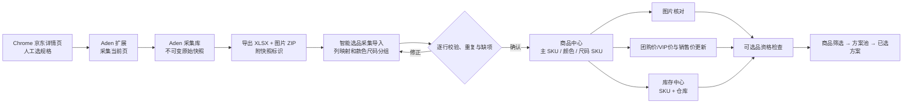
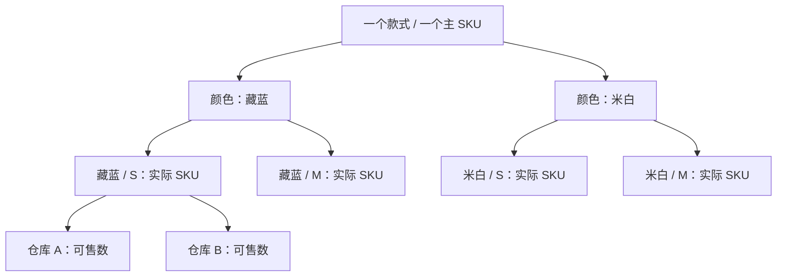

# 京东商品采集到选品商品库：设计案例与逐页线框

> 文档类型：Feature 交互与数据设计案例；版本：0.2；状态：待用户逐项核对的设计稿  
> Feature：FEAT-FASHION-001；风险：L2；owner：Codex 编写、用户确认业务口径  
> 创建日期：2026-09-26；更新时间：2026-09-27  
> 阅读方式：先看第 0 节的需求/现状对照，再看第 1～3 节理解流程和第 5 节逐页线框；[可视化线框图](京东商品采集到选品商品库线框图.html)按页面展示；[用户手工核对清单](证据/2026-09-27-商品资料手工核对/手工验收清单.md)逐项记录决定。  
> 关系：方案池三步交互仍以[现有设计](商机驱动套装选品交互设计.md)为准；本稿补的是方案池之前的商品数据准备过程。实际任务状态仍以[唯一任务清单](任务清单.md)为准。

## 0. 需求目前做到了哪里（2026-09-27 源码核对）

本表只说明**代码存在与差距**，不是联机结果或用户验收。当前独立工作树仍是 `codex/fashion-selection-pool` 的 `dff8497` 加本轮未提交设计文件；桌面 Aden 采集源码在共享 `main` 的 `6cfc31b`，不在该独立工作树，且共享目录的桌面采集文件有另一任务的未提交修改。2026-09-27 只读检查时，5173、11255、11256 均无监听，故本稿不声称这些页面当前可打开。

| 对应线框与需求 | 已有代码 | 尚缺的可交付结果 | 当前判断 |
| --- | --- | --- | --- |
| W0 当前京东规格采集 | `main` 有 Chrome 扩展，需人打开详情页并手动点击采集；支持快照和图片缺失状态 | 真实京东页面/规格/图片适配及连续采集的实际证据；不能自动搜索或切规格 | 部分代码，真实平台未验收 |
| W1 Aden 采集库 | `main` 有商品快照列表、人工纠错、XLSX 与图片 ZIP 导出 | 与独立 Fashion 分支统一的交换包版本、图片清单和导入回执 | 部分代码，跨系统未接通 |
| W2 采集包导入 | Fashion 有普通 CSV/XLSX 商品导入、列映射、行错、预览/发布、批次历史 | 直接解析 Aden 导出包、主 SKU 归组、来源快照/图片关联、冲突处理向导 | 普通导入已有，采集包流程未实现 |
| W3 主 SKU 商品列表 | Fashion 商品列表可搜索、筛选属性、查看售价与完整性 | 默认按款式主 SKU 一行展示，展开颜色与实际尺码 SKU；品号/货号/三级分类/价库状态同屏 | 部分代码，列表层级不符 |
| W4 完整商品详情 | 有单个尺码 SKU 详情抽屉、基础字段和扩展服装属性编辑、来源图片 URL 展示 | 一款一页的共享属性、颜色图片、尺码矩阵、原始/标准值与历史并列；品类专属属性完整性 | 部分代码，款式视图未实现 |
| W5 图片核对 | 有图片/ZIP 上传、SKU 或款色映射、预览和人工确认 | Aden 图片清单自动带入、按主 SKU→颜色归属、缺图与原快照版本回溯 | 文件上传已有，采集关联未实现 |
| W6 价格管理 | 有当前销售价 Excel 严格全量更新、批次差异/恢复；团购/VIP价有单 SKU 维护入口 | 京东观察价与三种内部价同屏分口径展示；团购/VIP价批量更新与历史、按主 SKU 价格区间 | 部分代码，双价批量与统一视图未实现 |
| W7 库存中心 | 有按实际 SKU/仓库的库存列表、0/未知/过期筛选、本页尺码矩阵、Excel 更新和批次历史 | 按主 SKU 展开的跨色完整矩阵、未建 SKU 与未导入区分、与来源记录同屏追溯 | 已有独立模块，目标视图仍有差距 |
| W8 方案池衔接 | 有 1～4 组三级分类筛选、主 SKU 笛卡尔积分页、跨页选择、试衣/PPT弹窗代码 | 真实采集商品入库后的端到端回读；商品缺分类/图/价/库存时的逐项排除原因和跳转修复 | 方案池代码已有，来源链路未验证 |

**可立即核对的范围**是设计规则、线框布局和代码界限；**不能据此判定为验收通过**的是实际京东采集、采集包导入、主 SKU 新列表以及真实商品进入方案池。已有的 36 项 Java 定向、12 项 MySQL、前端类型/构建和 HTTP 检查属于旧方案池技术证据，与上表这条跨系统业务流程的用户验收分开。用户自己操作后的结果、截图和接受决定由用户填写[手工清单](证据/2026-09-27-商品资料手工核对/手工验收清单.md)；Codex 不代签。

## 1. 一句话说清这个功能

商品运营人员在京东打开服装详情页，**逐个选择真实存在的颜色、尺码并手动采集**；在桌面采集库核对来源和图片；将采集快照转换成智能选品可识别的款式、颜色和尺码 SKU；预览差异后发布商品资料；分别核对/更新价格和库存；最后让合格的主 SKU 进入选品筛选与方案池。整个过程中，来源事实、运营补充和测试数据要分开标记。

**这是一份目标设计，不是现有功能验收结论。** 当前 Aden 扩展和桌面商品库已有手动采集、快照与导出代码，但京东真实页面适配尚未验收；智能选品已有 Excel 导入和商品维护，两者没有直接转换通道。共享主目录 5173 的 4 条商品是演示数据。独立分支的商品页仍按尺码 SKU 列表展示；本稿设计的“款式主 SKU 列表”尚未实现。

## 2. 角色、输入、结果

| 角色 | 主要动作 | 交付物 |
| --- | --- | --- |
| 商品采集员 | 自行打开详情页、选规格、点击扩展、记录缺失 | 可回看的采集快照，含来源 URL、平台 SKU、时间、原文和图片状态 |
| 商品运营 | 整理同款不同色尺码、确认三级分类和属性、解决重复与缺项 | 待发布的主 SKU、颜色、尺码 SKU 映射及逐行差异 |
| 价格/库存管理员 | 维护企业团购价、VIP 价和仓库可售数 | 各口径价格、库存批次及更新时间 |
| 选品人员 | 按三级分类与属性筛选主 SKU，查看图片与价库状态 | 可组合的主 SKU 候选；不把颜色尺码重复展开 |

入口建议：桌面端「商品采集库」负责采集与原始快照；智能选品管理端在「商品中心」下提供「采集导入」「商品列表」「图片核对」「价格管理」「库存中心」。智能选品不直接持有京东登录态，也不在后台替用户自动浏览。

## 3. 端到端业务图





采集快照和正式商品是两种身份：一个京东页面可以产生多个时间点的快照；一个内部主 SKU 可关联多条来源记录。不能用平台商品 ID 直接冒充内部主 SKU，也不能因页面出现“有货”推算精确仓库库存。现有 `fq_product` 是尺码 SKU 行，主 SKU 关系在现有方案池设计中已建立；本稿需要把商品中心的展示和维护层级同步改清楚，数据库增量以实施时的技术设计为准。

## 4. 贯穿案例：秋季团建运动套装

以下名称、编码、价格和数量都是**说明交互用的合成案例**，不代表真实京东商品。真实试点必须保存实际页面来源和可核查的快照。

1. 运营在京东打开一件运动外套，手动选择「藏蓝 / M」，扩展读到页面标题、平台 SKU、规格、页面标价、店铺、参数和已加载图片；再人工切到「藏蓝 / L」「米白 / M」各采一次。未展示的尺码保持未知，不自动补齐。
2. 桌面采集库出现 3 条 SKU 快照。采集员确认两张主图、一张详情图；某张图片下载失败时显示「缺图」，保留来源链接和错误原因。
3. 智能选品导入向导把三条快照归到同一内部款式，建议主 SKU `JKT-2026-018`，颜色为藏蓝、米白；每种颜色下仅建立已确认的实际尺码 SKU。品号 `P-018`、货号 `H-018` 由运营明确填入，不能从京东 SKU 猜测。
4. 运营选择三级分类「服装 / 运动服 / 运动外套」，核对性别、季节、材质、面料成分、版型、领型、袖长、厚薄、适用场景等。无法从页面确认的属性标「待补充」，不默认空值等于不限。
5. 导入预览提示：藏蓝 M 为新增；藏蓝 L 为新增但缺主图；米白 M 与已有内部 SKU 冲突。运营解决冲突后发布。发布商品资料不覆盖当前销售价、团购价、VIP 价或库存。
6. 页面采集价只作为「京东观察价及采集时间」。企业销售价、团购价、VIP 价分别录入或通过相应批次更新；库存管理员按「实际尺码 SKU + 仓库」导入可售数，不能把页面“有货”写成 20 件。
7. 主 SKU 详情展示完整资料、颜色图片、尺码矩阵和缺项。达到选品必需条件后，在方案池只占一个上装候选；选中方案后再选颜色和核对尺码供货。

### 本案例交付文件包

| 文件/记录 | 必须包含 | 用途 |
| --- | --- | --- |
| 采集来源清单 | 平台、去参数化来源 URL、平台商品/SKU、采集时间、规格、快照 ID、采集结果 | 证明信息从哪里来；失败与缺失也记录 |
| 原始采集 XLSX + 图片 ZIP | 原始文本、图片文件与摘要、缺失清单、快照版本 | 可回看、可重做映射；不直接当正式商品表 |
| 导入映射表/预览 | 每个原字段→目标字段、主 SKU 归组、颜色尺码匹配、错误/警告、旧新差异 | 人工确认后才发布 |
| 商品发布批次 | 文件摘要、操作者、时间、成功/失败行、正式商品 ID、前后值 | 回读与追溯 |
| 价格与库存批次 | 来源、业务时间、逐 SKU/仓库旧新值、错误行、发布状态 | 验证价库独立更新 |
| 商品可用性报告 | 哪些主 SKU 可选品，哪些缺分类/图/价/尺码库存及原因 | 防止「商品已导入」被误当成「可用来选品」 |

## 5. 逐页线框与操作说明

下面线框按桌面宽度约 1440 px 画。每页都有入口、数据、主要按钮、异常状态；[HTML 线框](京东商品采集到选品商品库线框图.html)把布局展开为独立页面。页面编号是设计编号，不是当前菜单编号。

### W0 · Chrome 详情页采集侧栏（Aden 扩展）

```text
京东详情页（用户自行打开）       │ 商品采集侧栏
商品图、标题、选色选码          │ 来源：京东 | 当前页面/SKU 已识别
                               │ 标题 / 已选：藏蓝 M / 页面价 / 店铺
                               │ [✓主图] [✓轮播图] [详情图]
                               │ 完整性：规格✓ 参数✓ 图片 2/3
                               │ [采集当前规格并新增快照]
                               │ 缺失：详情图未加载  [打开采集库]
```

- 采集按钮只作用于当前已加载、已选定规格；再次采集相同平台 SKU 新增快照版本，不静默覆盖。
- 登录、验证码、页面规格变化或 SKU 无法确定时停在侧栏，提示用户手工处理。不能自动绕过，也不能自动切规格。
- 采集完成要等服务端确认；图片失败显示失败清单，不能只显示一个绿色「成功」。

### W1 · 桌面采集库（Aden）

```text
商品采集库                       [按 SKU/标题/来源搜索] [导出 Excel] [Excel+图片 ZIP]
□ 平台SKU  标题          规格     最新采集时间  图片  状态       操作
□ 884001  秋季运动外套  藏蓝 M  09-26 10:12   2/3   待补图     查看快照
└ 详情抽屉：原始字段 | 人工纠错 | 图片/缺失 | 历史快照 | 来源链接
```

- 默认看「最新快照」，历史版本可以单独打开；人工纠错与原始值并列，不修改原文。
- 导出前显示条数、是否含历史版本、图片缺失数、文件范围；导出包带版本和清单。
- 此页是采集资料库，不显示「智能选品已入库」；只有后续发布回执才能表明进入正式商品库。

### W2 · 智能选品「采集导入」向导

```text
采集导入  ①上传来源包 → ②字段映射 → ③款色尺码分组 → ④差异预览 → ⑤确认发布
来源包：[选择 XLSX] [选择图片 ZIP]    来源：京东   采集批次：____
映射表：平台SKU→来源SKU | 标题→商品名称 | 规格原文→颜色/尺码（需确认）
内部字段：主SKU[____] 品号[____] 货号[____] 三级分类[多选树/当前选择]
校验：总 3 行 · 可发布 1 · 待确认 1 · 错误 1  [只看问题行]
逐行预览：来源值 | 标准值 | 旧值 | 新值 | 差异 | 处理
底栏：[保存草稿] [重新校验] [下载错误行] [确认发布（有错误时禁用）]
```

- 上传普通商品 Excel 仍可走现有入口；此向导专门处理 Aden 导出包。不得假设现有 Aden XLSX 与当前商品模板同列，转换和图片映射需要单独实现。
- 款色尺码分组必须显示「为什么归为同款」及人工覆盖；冲突时只允许选择合并、建立新款或跳过，显示对已有商品影响。
- 一行有来源事实与运营标准值两个区域；SKU、品号、货号保留前导零，缺少平台字段标未知。发布前有行错就不发布该批，不悄悄导入部分行。

### W3 · 商品中心主 SKU 列表（智能选品）

```text
商品中心  [新增款式] [采集导入] [商品Excel导入] [图片核对] [价格] [库存]
筛选：三级分类[多选] 季节[多选] 性别[多选] 品牌[ ] 品号[ ] 货号[ ]
      主SKU[ ] 来源[ ] 商品状态[ ] 资料状态[ ] 有图[ ] [查询/重置]
主图  商品名称/品牌  主SKU/品号/货号  三级分类  颜色×尺码  团购/VIP区间  库存摘要  完整性  操作
图    秋季运动外套   JKT-018/...      运动外套  2色/3码     缺价/¥...    部分缺码  缺主图  详情
```

- 默认一行一个款式主 SKU；不让相同款式每个尺码占一行。行内标明颜色数、实际尺码 SKU 数和库存时点。
- 列表价格显示范围及缺价标志，不把各尺码价差折成一个假单价；库存汇总不能掩盖「M 缺货」。
- 完整性直接给缺项链接，如「三级分类缺失」「米白主图缺失」「VIP价缺失」。商品可保存草稿，但选品资格要单独显示。

### W4 · 商品详情与编辑（主 SKU → 颜色 → 尺码）

```text
面包屑：商品中心 / JKT-018                         [保存草稿] [提交核对] [查看来源]
头部：主图 | 商品名称 | 主SKU | 状态 | 可选品/待补 | 缺项 3
页签：[基础资料] [服装属性] [颜色与图片] [尺码SKU] [价格] [库存] [来源/历史]
基础：品牌、品号、货号、三级分类、性别、季节、年份、场景、来源
属性：面料成分、材质、版型、领型、袖长、厚薄、弹力、裤型等按品类出现
颜色：藏蓝 [主图][轮播][详情图] | 米白 [缺图] [确认颜色对应]
尺码：颜色 | 尺码制式 | S/M/L | 实际SKU | 状态 | 价库状态
侧栏：来源原文 vs 标准值 | 最后核对人/时间 | 被方案引用情况
```

- 主 SKU 的款式共有属性只编辑一次；颜色专属图/属性落颜色层；实际可售数量落尺码 SKU + 仓库层。
- 原始采集值只读，标准值可改且留修改来源；所有未知要能区分「未采集」「未确认」「不适用」。
- 上架与可选品分开：在售但缺关键图或分类的款式可以查看，进入方案池时给明确排除原因。被已有方案引用时更改图片/价格要提示影响和版本。

### W5 · 图片核对工作台

```text
图片核对  [待匹配] [错色风险] [缺图] [已确认]
左：来源快照、原图、采集规格/时间   中：待归属图片   右：主SKU→颜色→用途
来源：藏蓝 M / 京东SKU 884001         [图片缩放]      主SKU JKT-018
状态：主图候选/下载失败/重复图         [旋转不改原图]  颜色 藏蓝
                                                  用途 主图/轮播/详情
                          [确认映射] [标记不适用] [退回采集]
```

- 图片应先校验文件类型、摘要和来源，再由人确认颜色与用途；错误颜色不能仅靠文件名自动通过。
- 缺图保留占位与来源状态；没有真实图片不能放示意图冒充商品图。主图替换会使方案和试衣素材进入待复核状态。

### W6 · 价格管理与更新

```text
价格管理  当前口径：销售价 | 团购价 | VIP价     [导入更新] [查看批次]
主SKU/颜色/尺码SKU  京东观察价+时间  当前销售价  团购价  VIP价  最后更新  缺价
JKT-018 / 藏蓝 M   ¥199（采集时点）   ¥...        ¥...    待录入   09-26   VIP缺价
导入弹窗：选来源/范围→上传文件→旧新差异→错误→确认生效
```

- 京东观察价只是外部页面记录，不能自动写成内部销售价、团购价或 VIP 价。每种价格显示来源、币种/税口径、业务时间和批次。
- 普通商品资料导入不改任何价格；价格批次不改库存。缺价显示「缺价」，绝不显示 0 或复制另一口径。

### W7 · 库存中心与尺码矩阵

```text
库存中心  仓库[全部/指定] 更新时间[ ] 状态[缺货/过期/未知] [导入库存]
主SKU JKT-018  藏蓝       S 12 | M 0 缺货 | L 8
                 米白       S 未知 | M 5     | L 未建SKU
展开：实际SKU | 仓库 | 可售数 | 业务时间 | 批次 | 最近变更
```

- 0、未知、未建 SKU 是三种不同状态。不同仓库不能相加后冒充某仓现货；缺失的尺码不凭名称自动建 SKU。
- 电商页面的「有货」只在来源记录中显示为页面状态；精确内部库存只能由有来源的库存批次或人工有据维护产生。库存批次不改商品属性和价格。

### W8 · 选品前资格检查与方案池衔接

```text
商品筛选：三级分类[运动外套] + 季节[秋] + 团购价范围 + 库存条件
匹配主SKU 18款 | 因资料问题排除 4款 [查看原因]
排除：JKT-018 米白缺图（可选择藏蓝） / K-025 无三级分类 / P-103 团购价缺失
[生成方案池] → 按主 SKU 组合；颜色尺码在已选详情中确定
```

- 资格状态按本次筛选所用字段动态计算，不能只存一个永久「完整」布尔值。
- 若某款一个颜色合格、另一个颜色缺图，保留主 SKU 候选并标注可用变体范围；后续选色仍需复核价格、图片和尺码库存。

## 6. 商品信息字段与来源规则

**字段分层**：主 SKU 是款式身份；颜色是同款图片和颜色属性；实际 SKU 是颜色×尺码；库存按实际 SKU×仓库；采集记录按平台 SKU×采集时间。下面是页面和导入应同时支持的目标字段清单，不表示现有数据库已全部具备。

| 层级 | 字段 | 来源与填写规则 | 展示/选品用途 |
| --- | --- | --- | --- |
| 来源快照 | 平台、店铺、来源链接、平台商品 ID、平台 SKU、采集时间、所选规格、原始标题/价格/参数、图片状态 | 扩展采集；无法确认的不造值；原文只读 | 追溯、冲突判断、人工核对 |
| 主 SKU 身份 | 内部主 SKU、品号、货号、款号、名称、品牌、三级分类、状态 | 内部编码规则或运营确认；编码按文本保存 | 列表、搜索、笛卡尔积去重 |
| 主 SKU 通用属性 | 适用性别/年龄、季节、年份、风格、场景、材质、面料成分、版型、领型、袖长、衣长、厚薄、弹力、洗护 | 从来源建议、运营确认；按品类控制适用 | 筛选、商品卡、PPT |
| 品类特有属性 | 上装：领型/袖型；裤装：裤型/腰型/裤长；鞋：鞋型/鞋面/跟高；配件：材质/尺寸 | 商品所属三级分类决定表单；不适用需明确 | 分类筛选与方案解释 |
| 颜色 | 颜色编码/名称、色系、颜色图片、主图、图片核对状态 | 平台规格与运营标准色映射；人工确认错色 | 已选方案展示、试衣/PPT素材 |
| 实际 SKU | 尺码、尺码制式、平台 SKU、内部 SKU、条码（如有）、上下架状态 | 仅为已确认的真实规格建行 | 订货、价格、库存 |
| 价格 | 京东观察价/采集时间；内部销售价、团购价、VIP价、币种、税口径、业务时间、批次 | 外部观察价和内部价分开；缺价不填 0 | 筛选、报价、PPT |
| 库存 | 仓库、实际 SKU、可售数、业务时间、来源批次、时效状态 | 由内部库存导入/有据维护；页面“有货”不转数字 | 缺码判断、供货提示 |
| 质量/追溯 | 字段确认状态、缺项原因、核对人/时间、导入批次、图片摘要、来源快照 ID | 每次发布和确认记录版本 | 可选品资格、排错、恢复 |

选品必需项按三级分类制定：主 SKU 编码、名称、三级分类、至少一个真实子 SKU、可用主图为基础门；选择价格筛选时对应价格必须存在；选择有货筛选时所选仓库和尺码须有有效可售记录。其它属性允许草稿缺失，但需显式显示未知、不可推断。

## 7. 交付与实施切片

| 切片 | 产物 | 完成判定 |
| --- | --- | --- |
| A. 真实采集试点 | 少量真实可访问京东服装页面的采集快照、失败记录、图片清单 | 每个样本可回到来源；实际模板与图片范围已验证；失败不删分母 |
| B. Aden→智能选品转换 | 导出包版本、字段映射、款色尺码归组、来源快照引用、图片关联 | 同款不重复建主 SKU；平台 SKU 不编造；重复上传幂等；原值可回看 |
| C. 商品中心重做 | 主 SKU 列表、完整详情、按品类属性、颜色图、尺码矩阵 | 用户能从主 SKU 查到来源、每色图片、每个真实尺码 SKU、缺项；列表不重复按尺码展开 |
| D. 价库核对 | 价格口径页、价格批次；独立库存中心与批次 | 两轮更新有旧新对账；商品资料、价格、库存互不误覆盖；0/未知清楚 |
| E. 选品衔接 | 可选品资格、排除原因、方案池主 SKU 候选 | 三级分类与价库库存条件可解释；已选方案再确定颜色尺码 |
| F. 页面验收 | 每页逐项清单、实际截图、批次与数据库回读、HTML 验收报告 | 技术检查与用户手工验收分开；缺截图或真实京东试点时如实标未完成 |

本轮只交付设计稿与线框，不改采集插件、业务接口、数据库或服务。真实京东采集前需确认可访问页面与授权使用范围；访问限制只能记录与人工处理，不设计绕过。下一步编码按上述切片接入现有 Feature 任务清单，不另造一套状态源。

## 8. 与当前实现的差距及需核对的业务决定

| 事项 | 当前事实 | 设计目标 |
| --- | --- | --- |
| 桌面采集 | 有手动扩展、采集库、Excel/ZIP 导出；真实京东适配未验收 | 先真实小样本试点，再稳定字段和图片范围 |
| 两库衔接 | Aden 导出列与 Fashion 模板不同，无自动转换 | 有明确映射、归组、预览、确认和回执 |
| 商品列表 | 独立分支按颜色尺码 SKU 行展示 | 默认主 SKU 行，展开颜色和尺码 |
| 商品字段 | 已有一部分扩展属性、主 SKU/三级分类维护；来源/属性/价格/库存分散 | 同一详情按层级和来源并列呈现，缺项可追踪 |
| 库存与价格 | 批次/独立维护已有部分实现 | 精确展示数据口径、缺值与业务时间，并与采集观察值隔开 |

待用户核对的产品选择集中为：①哪些三级分类先纳入首批真实样本；②主 SKU、品号、货号由现有企业编码导入还是由运营手工分配；③库存来源是内部 Excel 还是已有 ERP 导出。它们影响编码与真实数据准备，但不影响本稿页面关系。用户已确认「一个款式一个主 SKU，下面有颜色和尺码」以及方案池三步、横向筛选和独立试衣/PPT按钮，本稿不重复征求这些决定。
