# 若依布局、列表字段与模块恢复定向检查

> 日期：2026-10-02；要求：唯一系统设计1.3第2章、第4.4及第5章；执行者：Codex主控  
> 通道：用户指定的Chrome插件；原MySQL及现有商品只读回看，布局/显示偏好使用原设置保存；不新增业务样本，不触发Provider费用  
> 初始状态：以下各项未执行；截图待采集。技术检查另记，不作为用户接受。旧失败见上一轮字段核对与模块故障调查，不改写历史。

## 1. 若依三种布局与权限菜单

前提：已有授权账号和选品后台，菜单同步完成；布局依据设计第2.1节。进入设置分别切换左侧、混合、顶部，查看业务入口、侧栏和页签；按原保存按钮保存顶部布局并刷新，打开商品与选品深链，再查看其他项目已有菜单的布局。

预期：三种布局均依用户选择生效，刷新保留保存偏好，选品不再强制覆盖；菜单由后台授权树显示，名称/顺序/隐藏及activeMenu正确。保留三种布局及刷新后的截图。角色越权需有另一个已授权账号，未具备时单列受阻，不切换或创建账号。

实际：2026-10-02主控在Chrome已有管理员会话查看侧栏布局，其他项目原菜单仍存在；从若依头像菜单进入原布局抽屉，切换混合布局、保存、刷新，页面DOM为`navbar nav2`并存在原TopNav。首次混合刷新截图为空白，回读后判无效，不作为通过证据。顶部切换及深链复验尚未完成，另一授权角色账号未具备。后续键盘操作误选锁屏，已说明并请用户解锁。

结果：**受阻**。已执行部分保留；缺顶部布局/有效混合截图与角色条件，不记整项通过。解锁后只补受影响及未完成步骤。

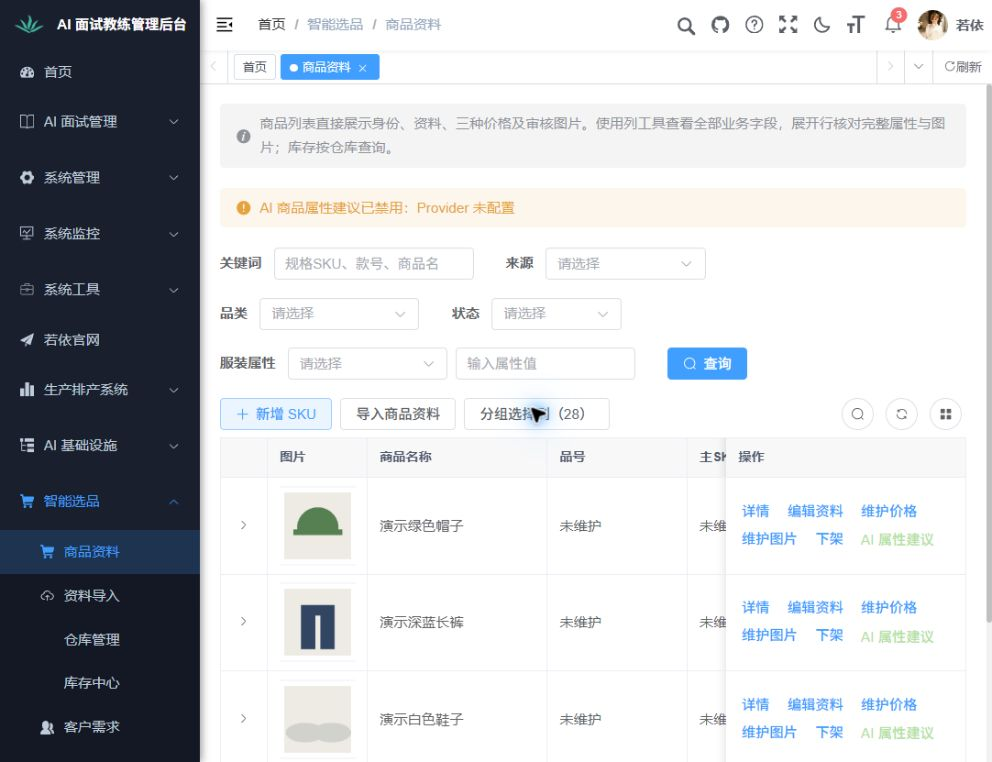

## 2. 商品资料、价格和图片在列表直接显示

前提：现有4条商品及原价格/图片资料，要求见设计第2.2/2.6节。进入商品列表，核对28默认业务列；横向滚动查看三价、币种、税口径、价格时间、复核/许可；打开完整字段选择器，选全部、按分组切换及恢复；展开一条商品的44属性和图片明细，查看受保护缩略图及图片/价格维护入口，只读关闭。

预期：品号/货号/主SKU/款号/规格SKU独立，已有业务值与原数据一致，缺值显示未维护或待映射；图片是审核存储图，缺文件/无许可/无权限明确反馈；全部业务资料可在本列表核对。只有表格水平滚动，身份/操作固定。保存主要表格、价格视区、全字段、展开资料及图片状态截图，读原数据对照；空值不补造。

实际：原4条商品读取成功，28个默认业务列在实际表头可见；管理员分组选择全部后显示76，恢复28后刷新仍为28。展开原绿色帽子，完整资料分组与44项属性标签、三价及审核图片明细进入DOM。原销售价分别30/100/150/120；品号/主SKU/货号、团购/VIP等原数据缺值，仍显示未维护，原分类显示待映射。原图片曾“内容不可用”，发现启动目录错配；沿用原存储后视口内3张审核缩略图恢复，第四张在视口下保持懒加载，不冒称已看完。当前截图仅展示展开开头，横向价格视区、完整属性分段及维护入口只读关闭仍待补验。

结果：**受阻**。原查询/图片故障及修复后证据都保留；字段选择与默认偏好已实际操作，但整项必需视区截图和入口步骤尚未齐全，当前锁屏不能补采。空值属于原业务资料，不伪造补齐。

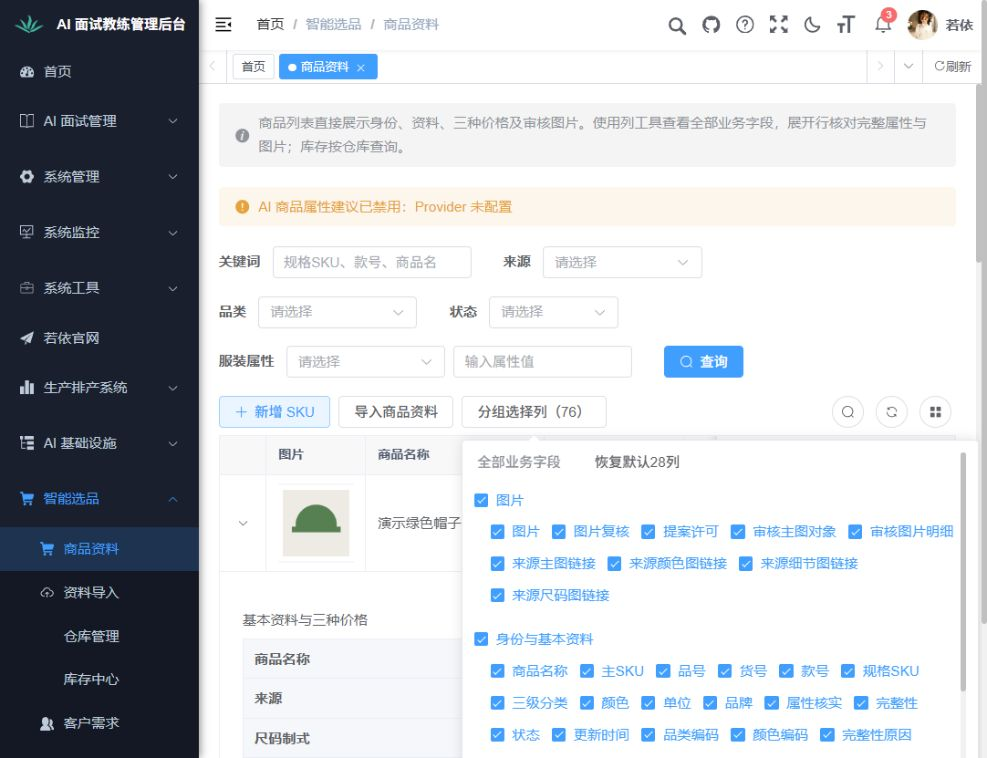
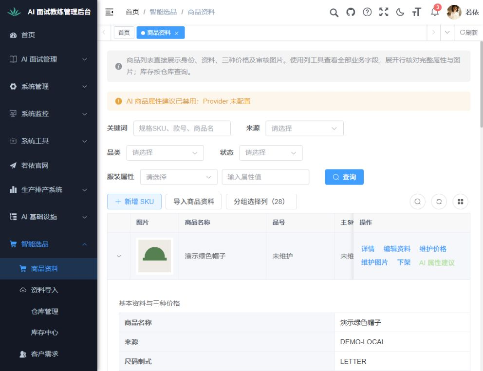

## 3. 导入记录、仓库、库存和客户列表

前提：已有原库资料；目标字段逐项见原17类字段核对及设计第2.6节。依次查看导入记录和允许只读的历史预览、仓库列表、库存明细/尺码矩阵、客户列表，核对类型/来源/业务时间、数量/时效/批次、仓库名称编码与负责人事实。

预期：模块请求不再缺接口/表/列；实际字段从权威记录返回，0与未知分开；矩阵明确其汇总范围，不冒称当前页为全部库存；姓名或审计事实缺失不能猜造。缺历史批次时对应预览未执行。各页保存截图及只读计数/字段对照，不导入发布或修改原资料。

实际：资料导入可读取13默认字段、4身份可选项及当前商品导入历史1条；仓库读取MAIN主仓、默认/启用、关联4个SKU及原业务时间；库存明细4条，每条原可售量50，业务时间为9月26日且提示超时待核实；客户读取原1条演示客户、负责人若依，原联系人/电话空值保留。页面未出现旧缺接口/表/列错误。分别保存截图回读；未生成新上传预览、发布或修改资料。尺码矩阵切换、历史批次详情展开仍待实际操作。

结果：**受阻**。四个列表已实际读取并采图，尚未完成的矩阵和历史预览步骤等待解锁，不记整项通过。

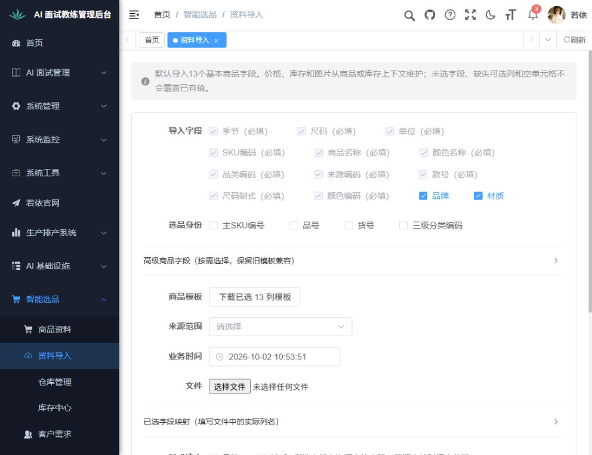
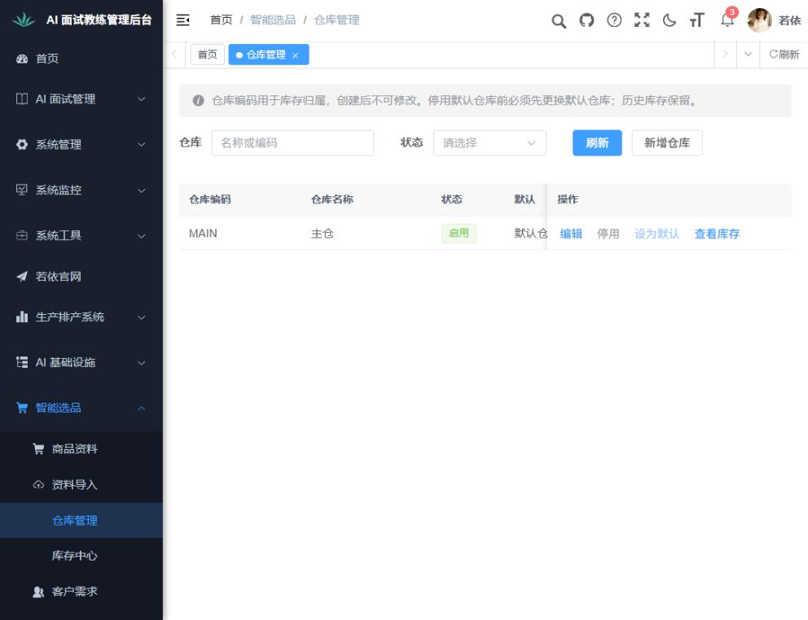
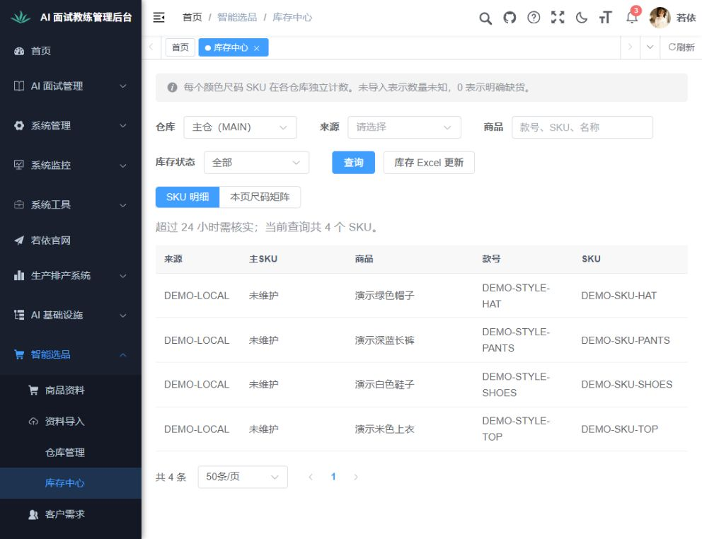
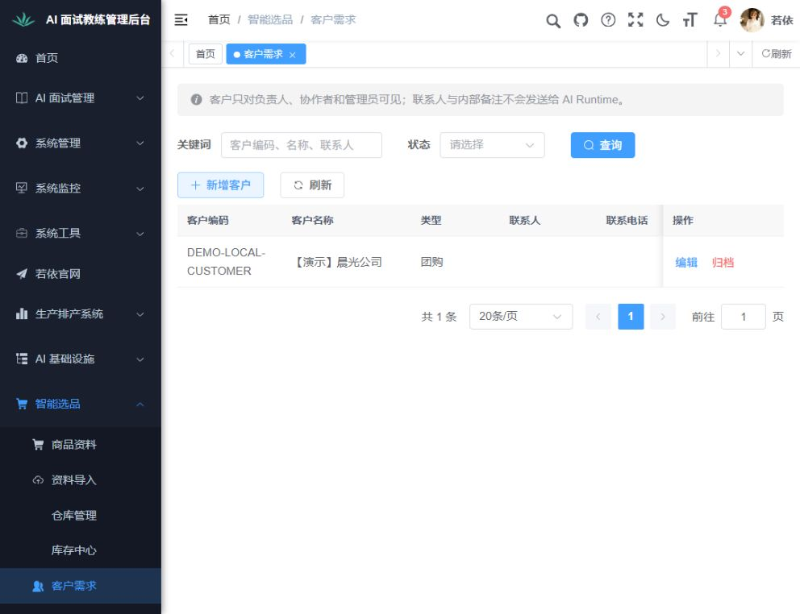

## 4. 选品筛选、工作单和方案字段

前提：原商品能只读筛选，是否具备真实主SKU及分类先核对。打开选品页，查看分类、仓库和44属性条件；设置三组→二组→三组及独立条件，确认草稿恢复，仅操作未提交查询偏好；查看已有工作单、方案池及已选列表。

预期：初始化成功，组数与继承符合原规则；工作单/方案/已选字段按设计第2.6节完整呈现，缺真实销量明确不可用；库存与需求状态、顺序、选色/规格、试衣及提案状态有真实依据。原库无方案或身份未补齐时，不新增商品、映射或生成业务样本，数据场景记受阻，页面空状态与源码/技术检查单列。保存筛选、工作单及有条件的结果截图。

实际：选品入口初始化成功，四组及总条件/独立按钮、主仓与44扩展条件入口可见。尚未执行三组→二组→三组与独立条件的实际复验。原库方案池为0，原4商品缺主SKU/标准三级分类，不能据此验证真实方案/已选/工作单恢复。源码复核发现未知库存误返回false，已改true/false/null并通过34项定向检查、前端三态及旧JSON兼容检查；技术结果不能代替实际池记录。

结果：**受阻**。筛选页面已采图；交互等待解锁，结果/恢复场景缺原业务记录，未造样本。

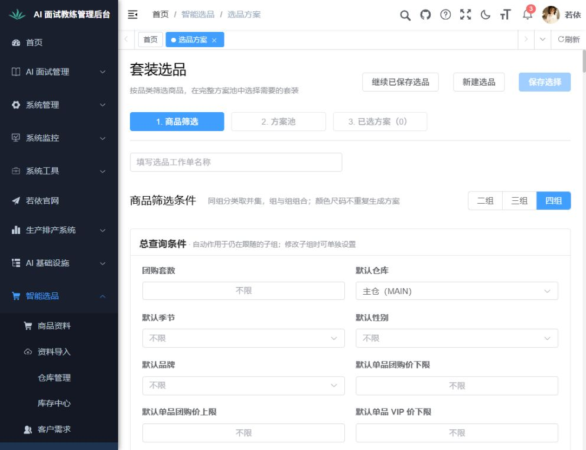

## 5. AI任务、试衣与提案交付

前提：有权读取任务/交付；真实Provider和费用未授权。打开任务和交付页，只读查看已有列表/详情，并在有既有方案时查看上下工具工作区。

预期：任务、交付接口可读取；发起人、关联来源、执行/复核/采用状态、时间、费用和文件资料按真实字段展示；复核与采用独立，未知费用不置零。Provider未就绪提示明确，不能声称试衣链路恢复。缺现有任务/交付/方案时，只判页面和空状态，不判执行/下载/费用成功。保存各页和有条件的工具截图。

实际：AI任务页观察到MySQL1271联合查询排序规则冲突，列表显示“读取失败”而非正常无数据，原失败截图已保存回读。后台已统一18个字符串投影，不改表排序规则/权限/数值时间；原MySQL只读实际查询及最终打包通过，已同步新包，Chrome解锁前尚未页面复验，原失败不能改记通过。交付列表可读取，显示尚未生成文件、共0条。试衣任务/新交付/方案池均0；Python原服务认证密钥无活跃版本，真实Provider、采用、费用及下载未验证。

结果：**未通过（保留原任务失败）**。修复后页面复验受锁屏阻断；交付空状态已采图，缺业务前提的试衣/文件流程另列受阻，不当作成功。

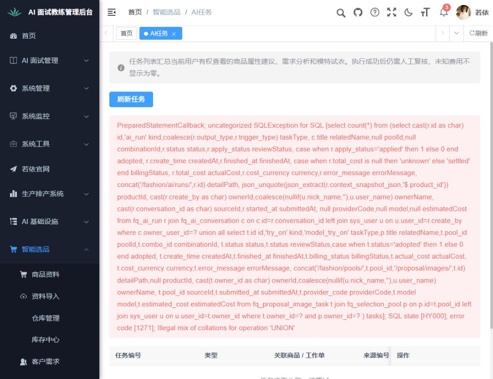
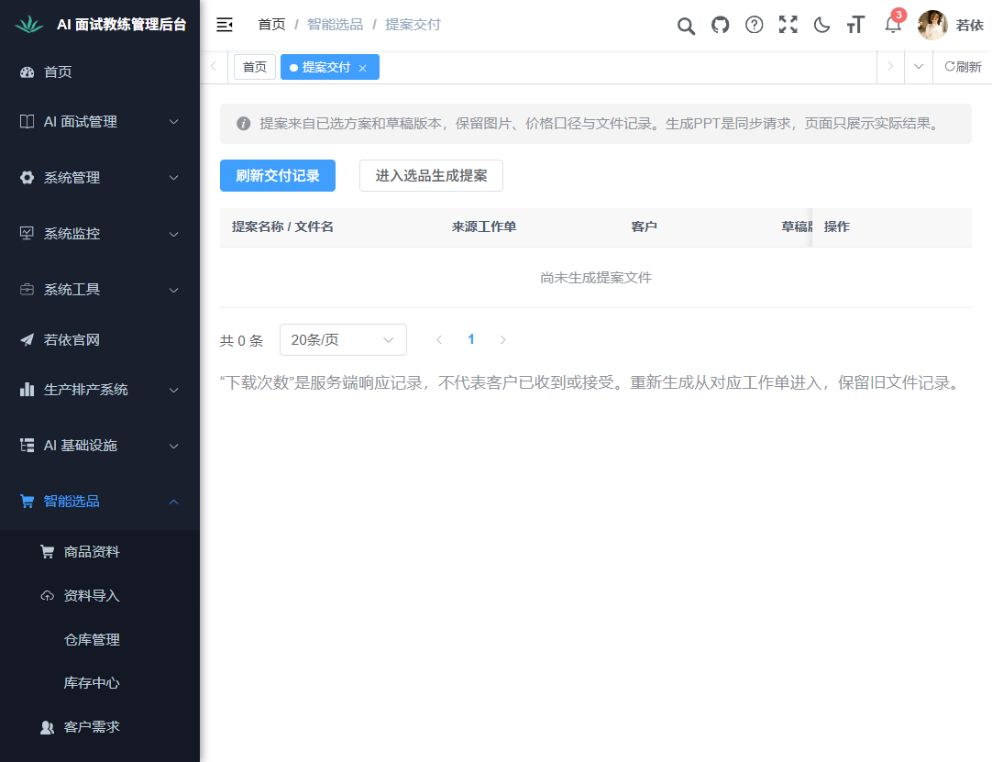

## 6. 原数据、运行版本与错误反馈

前提：备份、迁移及运行包同步记录已形成，业务就绪护栏依据设计第4.4节。只读核对原商品/库存/客户数量和原列指纹、迁移历史、实际登记包；查看有关页面请求及错误。需要故障模拟时只在定向单测执行，不改原库或中断其他项目。

预期：原业务数据未被覆盖，原库从既有V1按V2→V3→V4升级且history/checksum一致，登记包包含新接口；加载、空结果、未维护、无权限、结构不就绪和查询失败不会混淆。数据指纹/包及测试记录属于技术证据，页面截图只能证明画面，不据此记用户接受。

实际：完整私有备份后执行既有V2～V4，原业务列56行指纹不变、商品4/库存4/客户1，85行角色菜单关系未改。最终包`819ED230…DF32E2B`、Java27692/前端25636及原Redis19736已核对，原库名/原存储声明、20表与5条迁移历史严格只读就绪通过。系统设置、Agent版本、运行与保留三管理页可读取；运行页如实显示4个过期库存、通知未配置。原图片失败/任务查询失败及过程中前端退出均保留，退出根因尚未知；故障模拟仅在定向测试，未破坏原库。剩余页面错误场景受锁屏及角色前提限制。

结果：**受阻；技术检查完成**。技术结果见[技术检查与运行同步](技术检查与运行同步.md)，不计业务通过。字段缺口见[17类字段对照](字段修复对照.md)。

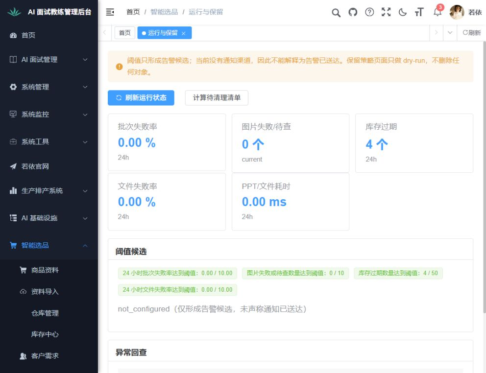

## 本轮结果与后续

六个完整业务点：通过0、未通过1、受阻5；各已执行子步骤如上记录，不将部分完成改称完整通过。旧通过基线与旧失败证据继续保留，没有重置历史结论。本轮113项前端检查、类型/构建、原库只读查询及Java定向检查另计，不表示用户接受。

恢复条件：用户在Chrome解锁后继续未完成的布局、视区、矩阵及任务修复复验；真实方案/试衣/费用/文件场景还缺原业务数据和Provider前提。2026-10-02主控已通过异步问题请求用户在页面解锁，不要求在对话提供密码，不绕过锁定。报告由本清单的实际记录生成，入口为[页面报告](verification-report.html)。用户接受：尚未取得。
