# 智能选品系统设计方案

> 文档类型：项目唯一系统设计正文；版本：1.3；文档状态：Draft，导航与商品列表修复方案待审阅  
> owner：用户维护产品方向；Codex 维护设计与工程映射  
> 创建日期：2026-09-12；更新日期：2026-10-02  
> 本次修订依据：2026-10-02用户纠正独立顶部菜单，要求遵循若依现有布局切换、商品列表完整展示资料/价格/图片，并先调查模块报错给出方案。2026-10-01已明确的商品子能力、基础导入和选品流程继续保留。本文包含拟实现方案；具体授权不等于实现、业务验收或发布完成。
> 结构依据：2026-10-01用户认可五章结构，并进一步要求保留现有商品资料、完善SKU/查询字段、仓库管理、条件复用、库存/销量推荐、上下工具布局、阿里云试衣及移除正式报价。原结构依据：用户已认可按“需求与业务逻辑 → 前端界面设计 → 后台处理设计 → 实施步骤 → 业务验收方法”重写，并将项目架构、Python、数据库、Feature 技术与选品交互设计归一。该认可不等于本文所有目标行为均已实现、验收或接受。

本文说明系统要怎样工作，以及怎样实现、怎样判断正确。现行范围为商品资料复用、仓库与库存、选品、AI试衣及PPT提案交付；正式报价退出现行流程。设计在此唯一维护。需求来源为[产品需求文档](../产品/产品需求文档.md)及[功能规格](../功能/FEAT-FASHION-001-服装智能选品生产首版/功能规格.md)；涉及后续主 SKU、双价及方案池的决定以本文对应业务规则及[既有任务中的用户决定](../功能/FEAT-FASHION-001-服装智能选品生产首版/任务清单.md#15-2026-09-26-分阶段整改计划用户已批准)衔接。本轮用户反馈优先于旧的1～4组、独立价格/图片菜单及正式报价流程；按2/3/4组、总条件联动和完整提案处理。商品资料沿用现有功能，并补齐商品列表的身份、价格、图片及完整资料展示。

实际开发状态只见[任务清单](../功能/FEAT-FASHION-001-服装智能选品生产首版/任务清单.md)，实际检查见[验证记录](../功能/FEAT-FASHION-001-服装智能选品生产首版/验证记录.md)，业务执行与用户决定见[验收记录](../功能/FEAT-FASHION-001-服装智能选品生产首版/验收记录.md)。本文不填写通过数或替代这些记录。原设计的章节迁移、原文和恢复方法见[设计归一与恢复记录](../开发记录/2026-10-01-设计文档归一与恢复.md)。图稿是设计示意，机器契约与 SQL 是配套实现资产，均不另维护一份系统设计正文。

**2026-10-02修订决定：** 用户明确要求通过若依现有设置切换布局，不接受独立开发顶部菜单；商品列表必须直接展示品号、商品资料、价格和图片。本版纠正1.2中“Fashion强制纯顶部、默认八列不变”的设计。新增方案未实施；运行故障与字段差距见[模块故障调查](../功能/FEAT-FASHION-001-服装智能选品生产首版/证据/2026-10-02-进度与实际页面检查/模块故障调查.md)、[既有字段核对](../功能/FEAT-FASHION-001-服装智能选品生产首版/证据/2026-10-02-进度与实际页面检查/字段与导航核对.md)。旧核对中“八列与1.2一致”仅是旧要求的历史比较，不作为本版完整性标准。若依机制需要替代或覆盖时，先列冲突、影响和选项，取得用户明确确认后才修改。

目录：[需求与业务逻辑](#business) · [前端界面设计](#ui) · [后台处理设计](#backend) · [实施步骤](#implementation) · [业务验收方法](#verification)

## 1. 需求与业务逻辑

### 1.1 使用者、目标与范围

商品运营使用现有完善的商品资料，在同一商品上下文内维护价格与图片，并按基础商品字段导入；仓库管理员管理仓库编码、名称、启停与默认仓库；销售以团购需求建立2、3或4组筛选，浏览完整方案池并选出方案，进行阿里云模特试衣和PPT提案交付。AI任务与交付页继续提供状态、复核、失败和恢复入口。

**本轮不重做商品资料页面，不删减其字段；库存中心沿用已有数量、仓库及时间口径。** 正式报价、优惠审批、税额计算、报价确认/修订及其前端入口退出本期设计。既有代码、历史记录和数据库兼容是后续实施的保护对象，不能把设计范围移除解释为立即删除数据或改写旧证据。

本期不增加订单、采购、支付或库存扣减。库存筛选只核对可供数量，不构成预占。销量推荐需要真实销售统计输入；数据未具备时清楚显示不可用，不能用合成数据、库存、AI猜测或价格代替销量。

### 1.2 输入资料与业务口径

| 对象 | 业务含义与处理要求 |
| --- | --- |
| 主 SKU | 用户显式维护的款级身份，保留前导零。一个主 SKU 下挂颜色、尺码等子 SKU；不能未经确认用款号替代。组合位置按主 SKU 计数。 |
| 子 SKU | 来源内唯一的可库存/可定价规格；颜色、尺码、尺码制式、来源和仓库共同决定展示与可售数据。子 SKU 数不扩大方案池组合数。 |
| 品号、货号、款号 | 各自保留原字段语义；不把品号与主 SKU 自动互相填充，不按名称猜测合并。 |
| 三级分类 | 映射到标准三级叶子编码及路径。旧商品未映射时显示待映射，并保留可查性，不伪造叶子分类。 |
| 原销售价 | `sale_price`，保留现有商品资料的价格口径。旧销售价 Excel 只更新这一字段，不作为双价的默认值。 |
| 团购价、VIP 价 | `group_price`、`vip_price`，独立可空，用于筛选、方案池和提案展示；与原销售价保持相同币种及税口径。缺失显示“未维护”，不置零、不复制另一种价格。 |
| 库存 | 子 SKU＋仓库的可售量及实际取得时间。没有记录表示未知；明确记录为 0 才是零库存。主 SKU 汇总库存不能证明齐码、也不构成预占。 |
| 图片 | 私有对象键、文件摘要、来源和用途许可。内部查看、AI 输入、对客提案、电商外发分别确认；下载到本地并不自动取得使用许可。 |
| 客户需求 | 人数、场景、预算、季节、风格、分类、颜色、排除项和交付目的。自然语言分析只生成待确认建议，人工应用后才进入筛选和选品草稿。 |

原销售价、团购价、VIP价以及商品图片均为商品资料的子能力，不建立独立价格管理或图片管理业务模块。复用商品内既有双价维护和图片服务，保留不同价格口径。基础商品导入只写商品字段；原销售价、库存、图片专用批次作为相关上下文工具保留兼容，不要求在基础模板混入。双价批量导入尚需明确模板和发布语义，不能用旧销售价导入代替。

### 1.3 完整业务流程

1. 沿用现有商品资料，在商品内维护价格与图片、按基础字段导入；将主SKU、款号、品号、货号、颜色与尺码关系核对清楚，保留完整来源、服装及图片属性。
2. 在仓库管理维护仓库编码、名称、启停和默认仓库；库存、导入与筛选选择同一仓库来源，按子SKU＋仓库回看数量及时点。
3. 进入商品筛选，默认四组，可切换二组/三组/四组。先填写总条件，再按需要独立调整各组；切换仅改变参与组合的组数，不清空任何组的草稿。
4. 生成完整主SKU方案池。库存最多、销量最高只对同一完整集合排序和推荐，仍可分页浏览全部结果。
5. 跨页选择，命名、排序、选择展示颜色尺码，保存并重开草稿；旧版本不能覆盖新保存。
6. 从已选方案打开工具工作区：上栏为阿里云模特试衣，下栏为PPT配置与导出。试衣先校验输入与费用，任务返回后逐张复核采用；也可明确选择获许可原图交付。
7. 预检已选范围、名称顺序、双价口径、图片许可、试衣覆盖范围及文件大小，生成可编辑PPT；任务与交付页查看进度、失败及有权下载。

### 1.4 筛选、组合与选择规则

#### 1.4.1 二组、三组、四组切换

默认四组，明确只提供二组/三组/四组三种模式。前端始终持有四份按位置固定的草稿。三组切二组时，仅隐藏并停用第三组，前两组原值和独立设置原样保留；切回三组恢复第三组。四组切二组再切四组同理。隐藏组不参与当前请求、容量计算和组合，不被删除或重置；只有用户明确点“重置此组/全部条件”才清空对应范围。历史一组池可只读回看，不将它当作新模式选项。

#### 1.4.2 总条件与继承

总条件分成两类：整套条件包含**单套团购总价范围**（可切VIP口径）、团购套数和推荐口径；可下发的共同条件包含仓库、季节、性别、品牌、库存时效、单品团购/VIP价默认范围及供货要求。团购套数100表示每组默认需要100件/双，单位置每套用量默认1；展示各组需求数量及库存是否满足，不能只看总库存后称齐码。

各可下发字段分别有“跟随总条件/独立设置”，默认跟随。总条件变化只更新仍跟随的字段；独立值不被覆盖，旁边标“独立”，可逐字段恢复跟随。空总条件表示不限，0只对允许零的数值字段有含义；套数必须为正整数。总团购金额约束整套相加，**不把300元整套上限复制成每件300元**；如需共同单品价范围，使用另外命名的单品默认价字段。

生成时由Java解析每个活动组的实际生效条件，保存总值、各组原值、继承模式和生效值。刷新/返回恢复四组草稿及独立设置；旧请求/旧AI建议不能覆盖新编辑。完整字段逐项见第2.3节，不将季节/性别/仓库合成一个输入。

#### 1.4.3 完整组合、未知与区间

同组多选分类/属性值取并集，不同字段取交集；组合按来源＋主SKU身份去重，禁止同一身份占两位置。颜色尺码只用于素材和满足条件的库存汇总，不倍增组合。要求100件时只汇总指定仓库及符合颜色/尺码等条件的有效库存；0、未知、过期分别处理，未知不能通过硬数量校验，合计100不能承诺指定尺码已齐备。

各组价格、库存及整套金额分别校验；允许单边留空、0与相等边界（套数除外），拒绝负数、非有限值与下限大于上限。保留输入、就地提示、修正自动消失；生成前定位首个错误。商品缺价不置零、不替代另一口径。

完整笛卡尔积经整体约束剔除后计算有效总数与稳定分页，不能用Top N截断代替全集。当前原始组合上限100,000，超过明确拒绝缩范围；每组候选子SKU5,000、快照20MiB及价格扫描2,000,000步守卫继续沿用。页大小20/50/100；排序或推荐不改变池身份、全集与跨页选择语义。全部选择按池快照“全部＋排除”保存，新池不承接旧池的全部选择。

#### 1.4.4 库存最多与销量最高推荐

| 推荐 | 计算口径与顺序 | 必须显示的信息 |
| --- | --- | --- |
| 库存最多 | 对已通过筛选的方案，先算每组指定仓库、时效、颜色尺码范围的有效可售量，再取各组可供套数的最小值作为整套可供量；按整套可供量降序，最后用稳定组合ID打破并列。 | 各组库存、整套可供量、仓库与时点、是否满足团购套数、未知/部分未知标记。不是按库存相加造成短板被掩盖。 |
| 销量最高 | 推荐默认近30日净售出件数，展示统计起止、来源/更新时间及退货口径；按方案中各主SKU净销量之和降序，最后用稳定组合ID打破并列。只是一套方案的热销分数，不冒称该套实际卖出过。 | 每个主SKU的销量、汇总热销分数、周期与数据完整性。无统计为未知，明确完整统计且为0才显示0。 |

推荐区给出同全集前3个建议和理由，点击定位该完整方案，不另外生成一套推荐池、不自动勾选。列表支持默认、团购/VIP升降序、库存最多和销量最高；全量结果仍保留。销量来源未接通时，该推荐禁用并说明缺口；可继续库存推荐与人工选品。

### 1.5 阿里云试衣、提案与恢复

模特试衣/换装采用阿里云路线；推荐百炼 `aitryon-plus` 用于对服饰细节要求较高的提案，创建异步任务后按任务ID查询。模型输入与支持范围以[阿里云AI试衣Plus API](https://help.aliyun.com/zh/model-studio/aitryon-plus-api)为准：人物全身正面照、上装/下装或连体服平拍素材。鞋帽在提案中使用对应商品原图并标“未做试衣”，不能把服饰分割能力称为鞋帽试穿。需要整套上/下装都被核实时，必须提供两部分实际素材；随机生成的缺省服饰不得冒称已选商品。

试衣冻结池、草稿版本、展示规格、视觉版本、图片摘要、模特及许可；任一输入变化使旧结果过期。未审、已拒绝和过期图不得对客交付。逐张检查款式、颜色、纹理/标识和覆盖范围后采用；部分成功保留，只重试失败项。关闭工作区保留配置和已受理任务，取消按供应商实际状态处理；未知结果先回查，不换键重复付费。

PPT只导出已选方案，保持名称、顺序及展示规格。价格选择团购/VIP/不展示；缺价明示，不用另一价替代。使用有许可原图或已复核采用试衣图；图旁显示未覆盖的鞋帽等商品。标题、商品名、编码及价格文本可编辑，图嵌入离线可见，不以整页截图代替内容。当前同步导出每文件1～100套，超出由用户明确选范围分批；自动分包或异步提案导出须先补契约，不假装已有后台进度。

权限、许可、容量、版本或素材不满足时定位具体方案，保留选择与配置供修正。图片外部调用的费用预检与任务对账保留；正式报价及其优惠/税/冻结确认流程不再进入本期页面或提案预检。库存恢复保留原时点，批次恢复保护后来修改。

### 1.6 各模块操作与业务结果

以下按用户进入页面后的顺序说明主流程。各页默认列、补充列及详情的唯一清单在第2.6节；价格与图片在商品资料内部使用，不是独立业务模块。

#### 1.6.1 商品资料（包含价格和图片）

1. 按来源、品类、状态、SKU、款号或名称查找商品，在同一列表查看身份、基本资料、三种价格与图片；保留详情/编辑能力，完整列见第2.6节。
2. 查看主SKU、款色和具体规格的对应关系；价格/库存属于具体规格，不能用款号猜测主SKU或跨来源合并。
3. 在商品详情内维护基础和扩展资料；在“价格”中分别查看/维护原销售价、团购价、VIP价，在“图片”中上传、关联、设置主图及复核。
4. 校验商品字段、价格币种/税口径、图片颜色/用途及许可。AI属性建议和试衣结果先人工确认；缺价、未知属性不自动补零或猜值。
5. 保存对应子能力，记录版本和操作反馈。已有方案/提案保留原快照，对当前商品变化提示重新核对，不静默替换旧素材。

#### 1.6.2 基础商品导入

1. 从商品列表“导入”或顶部“资料导入”进入同一导入流程，选择来源与基础字段模板。
2. 按商品字段定义选列/映射表头，必需身份字段固定保留；复合显示列展开为具体字段。“操作”“完整性”和图片文件不作为基础商品数据导入。
3. 上传Excel/CSV，预览每行来源/SKU、拟修改字段、原值/新值及错误；编码按文本保留前导零。
4. 修正错误后发布。未选字段与缺列保持原值；已有商品的空单元格默认不清空，确需清空时显式选字段并在预览列明。
5. 查看批次结果并返回商品列表核对。发布冲突不部分写入；恢复先校验后续修改，不能覆盖后来维护。价格、库存、图片使用各自既有专用流程，不由基础商品导入顺带修改。

#### 1.6.3 仓库管理

1. 新增仓库，填写唯一编码、名称、顺序和备注。
2. 启用后出现在库存导入、库存查询和选品条件中，即使没有库存记录也能选择。
3. 设置有效默认仓库；各入口显示仓库名称与编码并读取同一来源。
4. 编辑名称、顺序和备注；被业务引用的编码不能修改，不通过改名迁移库存。
5. 停用默认仓库前先更换默认；引用仓库不能删除，历史库存/批次仍按原编码可查。

#### 1.6.4 库存中心

1. 选择仓库，再按来源、商品、SKU、颜色或尺码查询。
2. 明细查看具体规格的数量、时点和来源批次，尺码矩阵查看同款色的分布。
3. 区分明确零库存、未知库存、有效与过期；没有记录不能补零，合计够量不能承诺指定尺码齐备。
4. 通过指定仓库的库存批次或有依据的人工核实更新，记录实际业务时间，不改成刷新页面时间。
5. 回看仓库、数量、时点和批次。选入方案不扣减或预占，不增加出入库、采购和订单流程。

#### 1.6.5 客户需求

1. 查看和维护客户编码、名称、联系人、地区、负责人及协作者，按权限范围访问。
2. 从客户上下文进入本次选品工作单，记录需求名称、场景、套数、预算、价格口径和交付目的；未关联客户的内部选品仍保持现有可用性。
3. 填写季节、性别、人群、分类、风格、颜色/尺码偏好和排除项；可用AI整理需求原文，整理结果只是建议。
4. 人工确认后应用到工作单，核对总条件和各组实际生效值；旧AI建议不能覆盖新编辑。
5. 保存工作单中的需求上下文及可选客户关联，后续方案/PPT可追溯本次需求；不另建重复需求真相或转入正式报价。

#### 1.6.6 选品方案

1. 新建/继续工作单，填写总条件与2/3/4组条件，逐字段选择跟随或独立；切组数保留四组草稿。
2. 校验当前活动组并展示候选数量和错误。隐藏组不参与请求、容量或结果，总套价不复制为每件价格。
3. 生成符合条件的完整主SKU组合，稳定分页；容量超限明确拒绝缩范围，不能以Top N假装全集。
4. 按库存最多或销量最高查看推荐理由，查看详情、对比、跨页选择；无真实销量禁用该推荐，排序不改变池和选择范围。
5. 在已选方案修改名称、顺序、展示颜色/规格，保存后重开恢复。条件改变需要新池时，保留旧池历史并明确新池不继承旧“全选”语义，再进入工具工作区。

#### 1.6.7 模特试衣（选品子能力）

1. 从已选方案打开上下工作区，上方选取搭配、模特图及当前颜色/服装图。
2. 检查阿里云支持的上装/下装/连衣裙位置、图片许可、输入版本和费用条件；鞋帽等未覆盖位置保留原图并标未试衣。
3. 提交任务并查看排队/处理/失败/未知；关闭、Esc、返回页面不重复提交，配置和任务按工作单保存/恢复。
4. 逐张检查款式、颜色、遮挡和异常，采用或驳回；采用与当前输入绑定，输入改变使旧结果提示过期。
5. 已采用图供下方PPT配置使用；成功结果保留，只处理失败项。提交状态不明确先对账查询，无法确认时人工处置，不盲目重付费。

#### 1.6.8 AI任务

1. 在商品、需求或选品上下文发起属性建议、需求分析或试衣任务，先检查权限、输入和服务配置。
2. 统一业务列表汇总既有任务来源，按商品/工作单/方案名称展示关联，不创建第二套任务状态库。
3. 查看真实执行与结果状态。Provider生成成功与人工复核/采用分别显示，关闭页面不等于取消任务。
4. 人工确认并应用结果，记录采用对象和输入版本；技术日志、Agent配置在管理设置，不混成业务任务列。
5. 失败展示原因与可执行恢复动作；未知先查原任务，只对允许重试的失败项重试并保持幂等。

#### 1.6.9 提案交付

1. 从已选方案或交付入口选择范围，检查名称/顺序、价格、图片许可和试衣复核。
2. 在工具下方确认标题、模板、团购/VIP/无价口径、原图/采用图模式及补充说明。
3. 执行预检与PPT生成，明确成功/失败和缺口；现有直接PPT是同步文件响应，不假造后台队列进度。
4. 保存文件与所用池、草稿和素材版本的对应记录；后续补交付记录契约，不把现有报价交付页当作已支持新提案记录。
5. 下载并在目标Office/WPS核对可编辑及离线查看；方案改变后重新生成形成新记录，旧文件不静默改写，无正式报价编号/审批前提。

## 2. 前端界面设计

### 2.1 顶部导航与页面组织

使用本项目若依已经提供的三种布局：设置面板的左侧导航（navType=1）、混合导航（navType=2）、顶部导航（navType=3）。用户选择顶部导航时，由既有Navbar/TopBar渲染后台授权菜单树；切换其他布局时仍走既有Sidebar/TopNav，布局偏好按原设置保存机制生效。不新增Fashion专用顶部菜单，不在业务路由中强制隐藏侧栏、页签或覆盖布局设置。

智能选品的业务菜单为**商品资料、资料导入、仓库管理、库存中心、客户需求、选品方案、AI任务、提案交付**，作为若依菜单树中的业务入口；分组、名称、排序、隐藏与权限由sys_menu及getRouters决定。保留“智能选品”父目录，顶部通过既有子菜单访问，不硬编码一排业务入口取代框架菜单。价格和图片保留在商品上下文内，管理设置继续按原权限显示。

| 顶部入口 | 页面/页签与归属 |
| --- | --- |
| 商品资料 | 保留商品列表与完整详情；详情内基础/扩展资料、价格、图片；商品行直接进入相应子能力。 |
| 资料导入 | 默认基础商品导入、字段映射、预览与记录；与商品列表“导入”共用。既有销售价/库存/图片专用工具从相应上下文进入，不变成新的价格或图片模块。 |
| 仓库管理 | 仓库列表与编辑，复用仓库字典和默认设置。 |
| 库存中心 | 库存明细、尺码矩阵，统一仓库名称＋编码。 |
| 客户需求 | 客户列表及选品工作单中的本次需求，不另建重复需求台账。 |
| 选品方案 | 工作单、商品筛选→完整方案池→已选方案；已选页打开上试衣/下PPT工作区。 |
| AI任务 | 业务任务列表、详情、复核与恢复；Agent配置和技术日志不在此混列。 |
| 提案交付 | 已选提案范围、生成结果和文件记录/下载，不含正式报价流程。 |
| 右上角管理设置 | Agent配置、系统参数与脱敏运行日志，仅按管理权限可见。 |

页内顺序统一为页签→查询条件→操作按钮→结果列表→分页；默认列与完整详情分开，局部表格允许滚动，页面本身不水平溢出。后台字段、查询条件、列表列、工具配置各有明确归属。折叠不删除值，缺数据/加载/错误就地说明。

恢复现有RuoYi权限路由与布局分支，取消FashionNavigation的渲染接管及Fashion路由布局强制覆盖。菜单调整沿用后台菜单/角色机制，前端隐藏不能代替后端鉴权；维护深链、activeMenu、页面权限及历史访问边界。该调整影响共享layout，需复核其他项目三种布局及用户保存偏好。出现与若依机制的冲突时先确认，不自行覆盖框架。

本版导航与商品列表以[若依布局与完整商品列表修复图](图稿/商品列表与若依布局修复.png)为准。旧[界面图集](图稿/界面图集.html)及[可交互设计稿](../功能/FEAT-FASHION-001-服装智能选品生产首版/商机套装选品线框图.html)保留其他业务交互参考，其中独立顶部导航和八列表不再作为本版目标。图稿使用合成示例，不能作为生产验收证据。

### 2.2 商品资料复用、SKU概念、完整字段与仓库

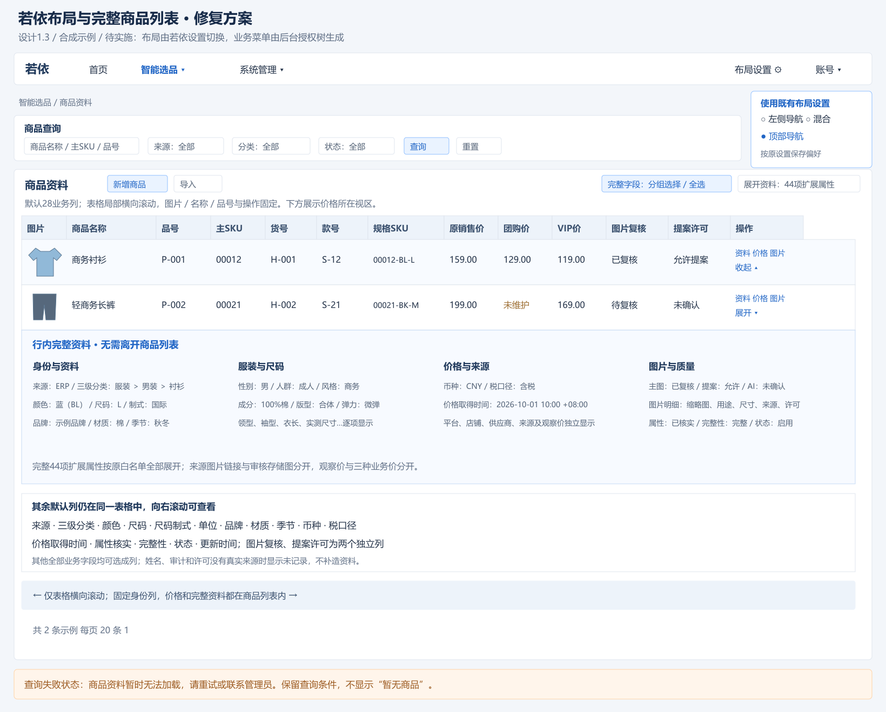

**商品列表直接展示商品资料、三种价格和审核图片。** 默认28个业务列，具体顺序见第2.6节；品号、货号、主SKU、款号与规格SKU各自显示，不能只藏在详情。缩略图可预览；原销售价、团购价、VIP价及币种、税口径、价格取得时间同列表可查。超出屏幕时仅表格横向滚动，图片、商品名称、品号和行操作固定，不让整页溢出。

完整字段选择器按“身份与基本资料、服装、来源、尺码、价格、图片”组织，提供全部业务字段的独立可选列及全选；已选列按用户偏好保存。44项扩展属性沿用原白名单、分组与类型，身份字段只定义一次。行内展开同步列出完整资料、价格和图片明细，便于核对；详情/编辑继续用于维护，不能以详情存在替代列表展示。技术ID、版本及摘要按管理权限查看。加载、查询失败、图片不可用、未维护、无权限、空结果分别显示，查询失败不能显示成“暂无商品”。

| 概念 | 唯一语义与例子 |
| --- | --- |
| 主SKU（项目款级身份） | `mainSkuCode`，例如00012，是方案位置的款级身份；从商品现有属性显式读取。实际聚合键含来源，不能同编码跨来源自动合并。 |
| 款色 | 主SKU下的颜色展示维度，例如00012＋蓝色；不是独立库存记录或新的方案位置。 |
| 规格SKU / 子SKU | `skuCode`，例如00012-BL-L，颜色＋尺码制式＋尺码的规格身份；库存和价格落在这一层。`sourceCode+skuCode`在来源内唯一。 |
| 款号、品号、货号 | `styleCode/itemNo/articleNo`各有原业务语义；均不默认等于主SKU，不能自动互填或按商品名猜合并。 |
| 平台商品/SKU ID、条码 | 来源溯源或识别编码，分别保留；不替代本项目主/子SKU。 |

| 基础或关联字段 | 完整字段与展示范围 |
| --- | --- |
| 现有商品接口字段 | 内部商品ID `id`、来源编码 `sourceCode`、规格SKU `skuCode`、款号 `styleCode`、商品名称 `name`、品类编码 `categoryCode`、颜色编码 `colorCode`、颜色名称 `colorName`、尺码编码 `sizeCode`、尺码制式 `sizeSystem`、销售单位 `unit`、原销售价 `salePrice`、币种 `currency`、税口径 `taxMode`、价格取得时间 `priceAsOf`、品牌 `brand`、材质 `material`、季节 `season`、标签 `tags`、审核主图对象 `mainImageKey`、审核图片明细 `images`、视觉版本 `visualVersion`、属性已核实 `attributesConfirmed`、京东商品ID `jdItemId`、京东链接 `jdUrl`、状态 `status`、完整性原因 `incompleteReasons`、记录版本 `rowVersion`、更新时间 `updateTime`、扩展属性容器 `attributes` |
| 独立商业价格 | 团购价 `groupPrice`、VIP价 `vipPrice`，来自已有独立价格维护接口；原销售价另保留。 |
| 图片明细 | 图片ID、对象键、摘要、用途、状态、宽高、原文件名及用途许可/确认信息；来源图片链接与已审核存储图分开。 |
| 库存关联 | 规格SKU、仓库、可售量、实际时点、来源批次、有效/零/未知/过期；不新增商品自身的“库存总真相”。 |

| 属性分组 | 完整字段（现有白名单） |
| --- | --- |
| 主SKU与分类 | 主SKU编号 `mainSkuCode`、品号 `itemNo`、货号 `articleNo`、三级分类编码 `categoryLeafCode`、标准三级分类路径 `categoryLeafPath` |
| 来源 | 平台 `platform`、店铺 `shopName`、供应商 `supplierName`、平台商品ID `platformProductId`、平台SKU ID `platformSkuId`、商品来源链接 `sourceUrl`、采集时间 `collectedAt`、平台品类路径 `categoryPath` |
| 基础 | 上市年份 `listingYear`、条码 `barcode` |
| 服装 | 适用性别 `gender`、适用人群 `audience`、风格 `style`、适用场景 `scene`、面料成分及比例 `fabricComposition`、里料 `lining`、厚薄 `thickness`、弹力 `elasticity`、版型 `fit`、领型 `collar`、袖型 `sleeveType`、袖长类型 `sleeveLength`、衣长类型 `garmentLength`、图案 `pattern`、工艺 `craft`、裤型 `trouserFit`、裤长类型 `trouserLength`、腰型 `waistType` |
| 尺码 | 尺码名称 `sizeName`、实测尺寸说明 `sizeMeasurements`、测量单位 `measurementUnit`、尺码来源说明 `sizeSource` |
| 图片来源 | 来源主图链接 `sourceMainImageUrl`、来源颜色图链接 `sourceColorImageUrl`、来源细节图链接 `sourceDetailImageUrls`、来源尺码图链接 `sourceSizeImageUrl` |
| 观察价格 | 电商观察价 `observedPrice`、观察价币种 `observedCurrency`、观察价时间 `observedAt` |

44项扩展属性保持原字段、原分组和原校验：编码文本/前导零、HTTPS来源、带时区的采集与观察时间、合法年份及观察价。观察价只作来源信息，不自动改变销售/团购/VIP价。`id/rowVersion/visualVersion`等技术标识用于授权和并发，不要求在默认商品列表显示。

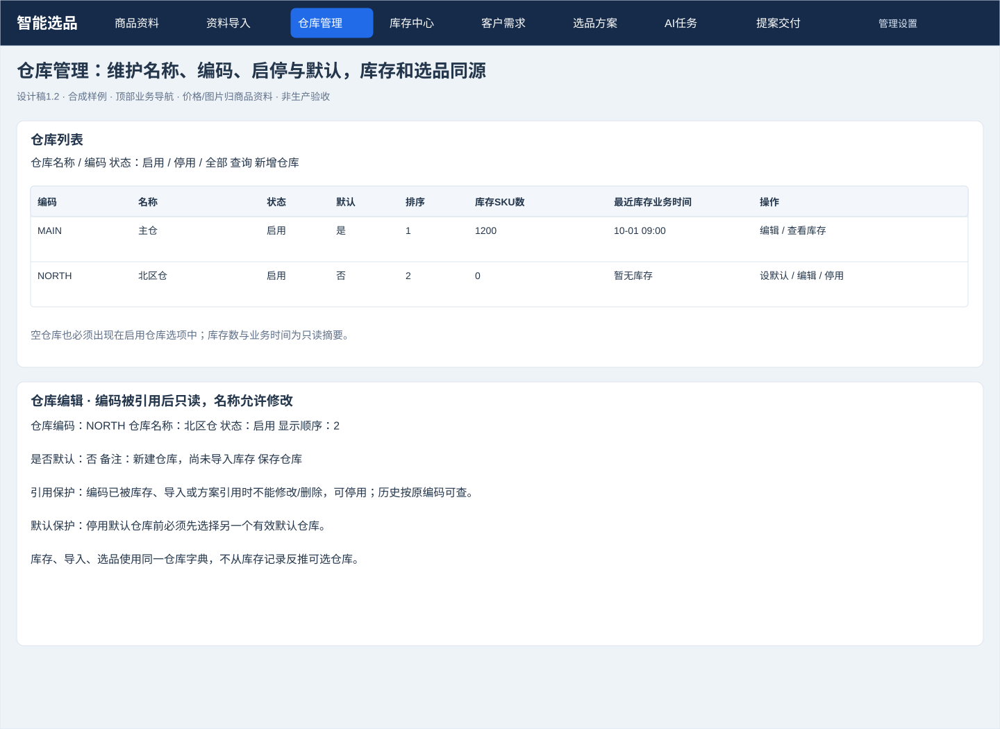

仓库管理复用既有 `fashion_warehouse` 字典与默认仓库设置：编码、名称、状态、显示顺序、备注、是否默认；显示关联库存SKU数和最近库存时间作为只读摘要。新增无库存的仓库也能出现在启用仓库选项中，不能只从库存记录反推仓库列表。默认仓库停用前必须先换默认；已被库存/批次/池引用的编码不能修改或删除，名称允许编辑，以停用代替删除，历史仍按原编码可查。页面操作为新增、编辑、启用/停用、设为默认、查看该仓库存量。

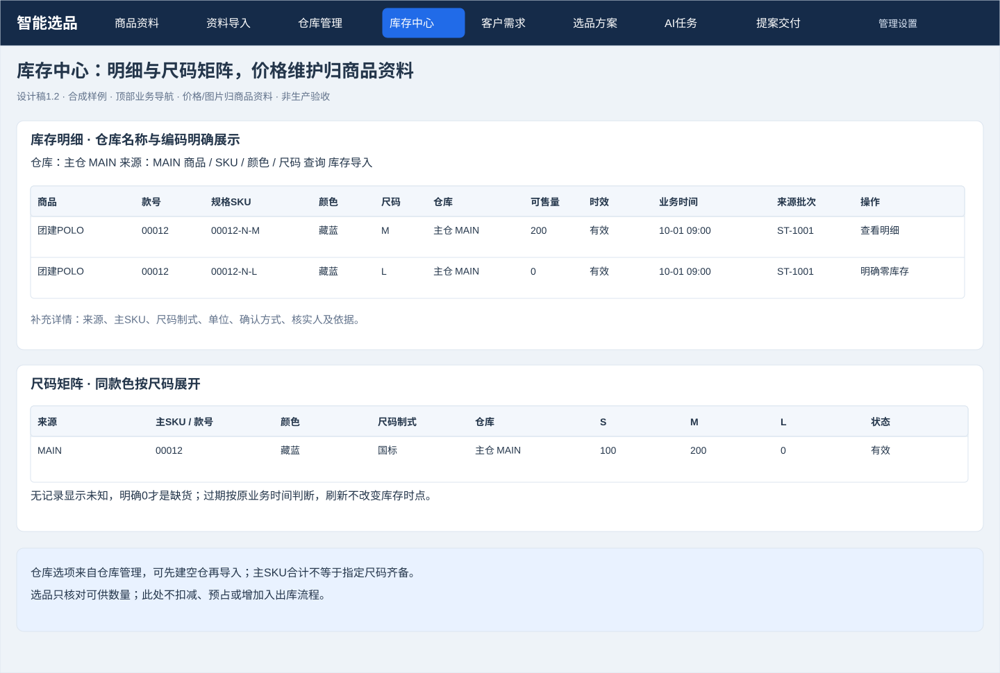

库存数量和价格原口径保留，仓库下拉改为同一仓库管理来源并显示名称＋编码。0、未知和过期标签继续区分；不把仓库管理扩展成入出库、预占或盘点系统。

#### 2.2.1 商品内价格与图片

商品详情以“基础资料/扩展属性、价格、图片”组织，不删减既有字段。商品行“价格”直接复用CommercialPrices等已有能力；三价、真实价格取得时间和图片摘要进入商品分页契约及默认列表，分别保存、独立缺值，币种/税口径明确。Java按当前页批量返回价格及图片状态/许可摘要，禁止前端逐行请求价格或完整素材清单；受保护缩略图复用ProductThumbnail与既有认证图片接口，按可见行加载、取消旧请求并释放对象URL。不创建独立价格模块或复制商品主数据。

图片页签复用现有素材上传、映射、确认和许可服务。列表保留商品上下文、缩略图、用途、状态和许可；图片不能仅凭外部来源链接就当作已审核素材。商品图片复核与选品模特试衣复核分别记录，试衣不建立独立商品图片业务模块。价格/图片完整列见第2.6节。

#### 2.2.2 基础商品导入与列表字段映射

导入依据商品字段定义选择可写字段，并复用字段中文名称、稳定键和校验；不是把页面显示文本原样当作表头。“款色分组”拆成来源/款号/颜色，“SKU/尺码”拆成规格SKU/尺码制式/尺码；显示列隐藏不取消必填身份约束。详情扩展字段仍可选择，但默认基础模板不带全套44属性。

| 模板范围 | 中文字段及稳定键 | 约束 |
| --- | --- | --- |
| 默认基础模板必填 | 来源编码sourceCode、规格SKU skuCode、款号styleCode、商品名称name、品类编码categoryCode、颜色编码colorCode、颜色名称colorName、尺码sizeCode、尺码制式sizeSystem、单位unit、季节season | 沿用现有11项行值必填；编码文本保留前导零，字典按现有规则校验。 |
| 默认基础模板可选 | 品牌brand、材质material | 可以缺列/空值；已有商品不因缺列丢失原值。 |
| 选品身份可选补充 | 主SKU mainSkuCode、品号itemNo、货号articleNo、三级分类编码categoryLeafCode | 从已有扩展字段选择；需要款级选品时必须补齐真实主SKU及分类，不能从款号自动猜填。标准分类路径按已确认映射展示。 |
| 高级或旧模板兼容 | 现有44扩展字段、京东商品ID jdItemId、京东链接jdUrl | 保留选择和旧模板兼容；不要求全部出现在新默认模板。 |
| 不属于基础商品导入 | 原销售价、团购价、VIP价、库存数量、图片文件/主图对象、完整性、操作、内部ID/版本/审计字段 | 使用对应商品子能力或库存专用工具，不接受普通映射任意写入。来源图片链接仅为扩展来源信息，不自动取得图片许可。 |

流程为选字段/下载模板→上传与映射→预览错误和差异→发布→回商品列表/记录。未选字段/缺列不更新，空单元格默认保持已有值；显式清空仅限允许字段并在预览标识。默认模板13列，增加4个选品身份字段可形成17列，不强制导入全部商品详情。当前模板/解析器需要同步调整可选表头与缺列语义，界面隐藏字段不能替代后台实现。

### 2.3 完整查询条件、联动与组数复用

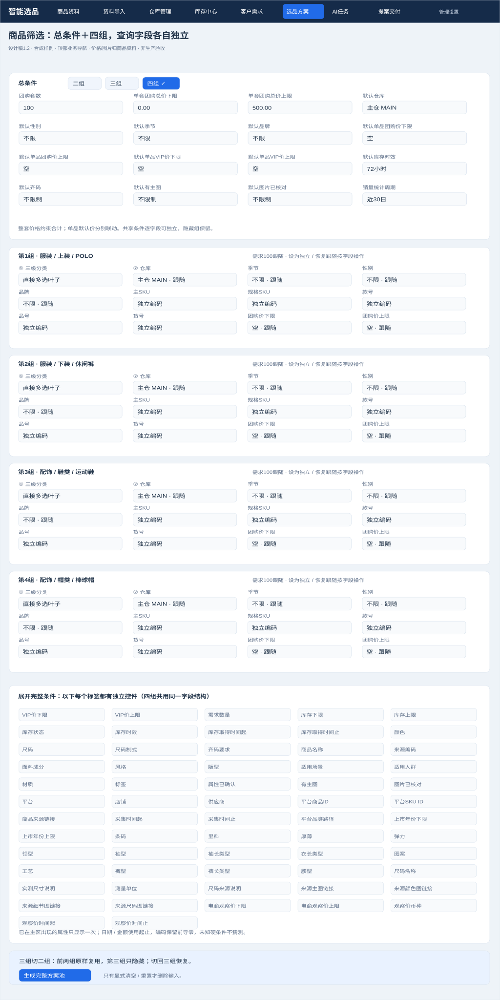

总条件置顶，模式单独提供二组/三组/四组，默认四组。每组横向卡片把每个字段作为独立控件，三级分类排第一，仓库排第二；收起只隐藏控件，组草稿保留。长表单按“商品身份/服装/价格与库存/图片与来源”分组展开，字段各自有标签。下表是完整条件范围，不用“等等”替代。

| 总条件 | 输入、作用与边界 |
| --- | --- |
| 组合模式 | 二组/三组/四组；只切活动组，保存四份草稿。 |
| 团购套数 | 正整数，示例100；下发每组需求100，默认每位置每套1件/双，允许单组独立需求并明确显示。 |
| 单套团购总价下限/上限 | 两个独立金额输入，整体求和后判定；可选VIP口径，不能与单品价混称。 |
| 默认仓库 | 启用仓库名称＋编码，下发仍跟随的组。 |
| 默认季节、默认性别、默认品牌 | 三个独立多选，各字段继承/独立分别管理。 |
| 默认单品团购价下限/上限、默认单品VIP价下限/上限 | 四个独立金额，作为子组默认值，区别整套金额。 |
| 默认库存时效、默认齐码/主图/图片已核对要求 | 各自控件，下发仍跟随的组。 |
| 推荐口径、销量统计周期 | 默认/库存最多/销量最高；销量推荐默认近30日，数据显示来源与起止。排序不减少完整方案。 |

| 每组独立条件 | 控件与判断 |
| --- | --- |
| 三级分类 | 直接多选叶子，显示完整路径；同组并集；必填。 |
| 仓库 | 单选名称＋编码，跟随/独立。 |
| 季节、性别、品牌 | 各自多选，分别跟随/独立。 |
| 主SKU、规格SKU、款号、品号、货号 | 五个独立编码控件；多值按OR，文本保留前导零。 |
| 商品名称、来源编码 | 两个独立条件，名称包含/来源选项。 |
| 团购价下限、团购价上限、VIP价下限、VIP价上限 | 四个金额控件；指满足条件规格价，不将缺价视作0。 |
| 需求数量、库存下限、库存上限 | 三个独立整数；需求默认跟随总套数，库存范围另表达。有效可售量需同时满足需求和范围。 |
| 库存状态、库存时效、库存取得时间起/止 | 状态与时效单独选择，两时点独立；未知/0/过期不混用。 |
| 颜色、尺码、尺码制式、齐码要求 | 三个独立规格控件＋齐码开关；只统计匹配规格，合计不代替齐码。 |
| 面料成分、风格、版型、适用场景、适用人群、材质、标签、属性已确认 | 各自输入或多选/开关，未知硬条件不猜值。 |
| 有主图、图片已核对 | 两个独立开关，检查当前可用与许可资料。 |
| 全部来源/服装扩展条件 | 第2.2节44项属性均提供白名单查询说明；已在上面出现的字段只出现一次。其余平台、店铺、供应商、平台商品/SKU ID、来源链接、采集时间、平台分类路径、上市年份、条码、里料、厚薄、弹力、领型、袖型、袖长、衣长、图案、工艺、裤型、裤长、腰型、尺码名称/实测/单位/来源、各来源图片链接、观察价/币种/时间各有独立条件，日期/金额使用起止范围，文本使用包含/编码精确匹配。 |

通用服装/来源属性按固定字段白名单展开，不接受任意JSON路径；现有Pool接口未覆盖的条件需先补契约和服务端过滤，不因界面稿出现而标为已支持。高级区可折叠，展开时必须看到全部字段和各自控件。总条件字段旁可“下发到跟随组”；组字段旁显示生效值来源及“设为独立/恢复跟随”。

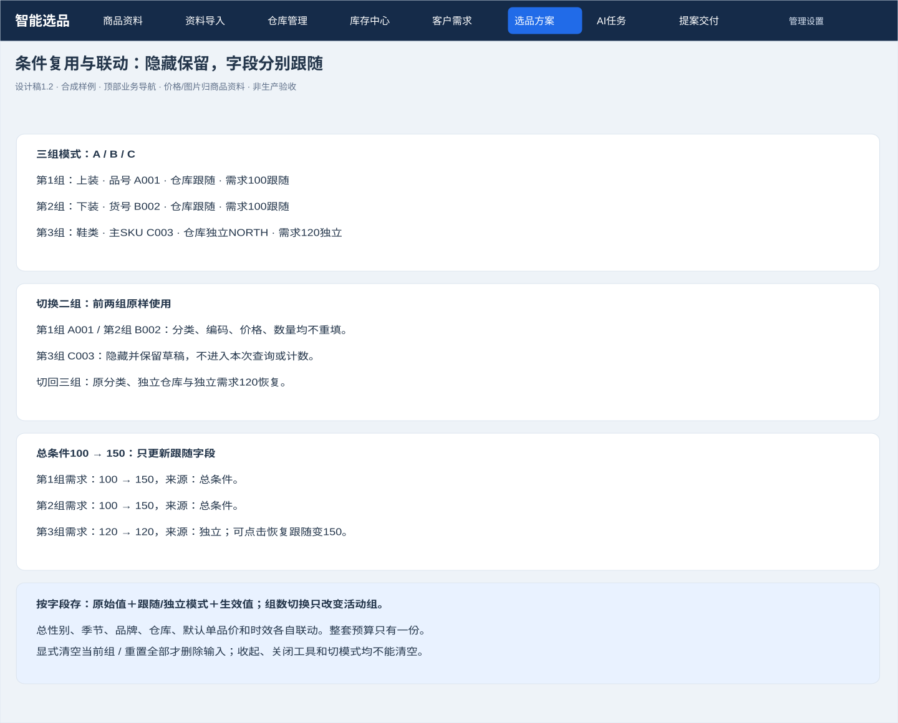

三组→二组：前两组值不动，第三组保留但不参与；二组→三组：恢复第三组。总性别男→中性时，跟随组更新；已独立设女的组保留女并明确标识。先独立填写的隐藏组回来后仍保持其独立模式。团购数量100下发各跟随组100；改变总套数时仅跟随数量更新。错误按字段显示，切模式不绕过活动组校验。

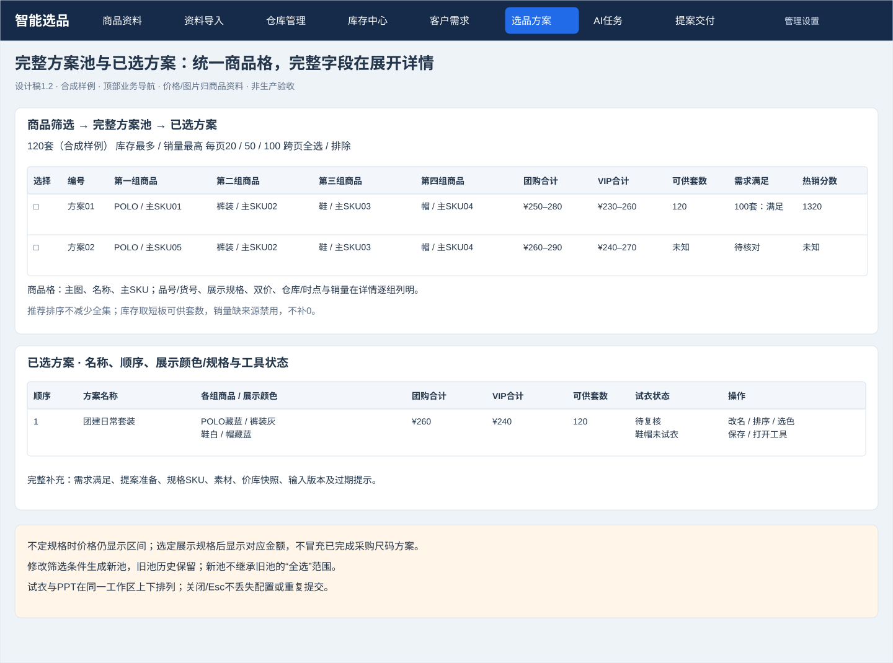

结果列表完整分页，列出每组主SKU/品号/货号、名称、展示颜色/规格、双价、仓库/库存/时点、整套价格、可供套数、各组销量及热销分数/周期、选择与详情。字段太多时表格局部横向滚动，商品详情抽屉列全量属性。顶部推荐仅两种：库存最多、销量最高；显示计算理由和缺数据状态。前3个推荐可“查看/选入”，不会自动减少方案池。名称、顺序和展示颜色仍随草稿保存。

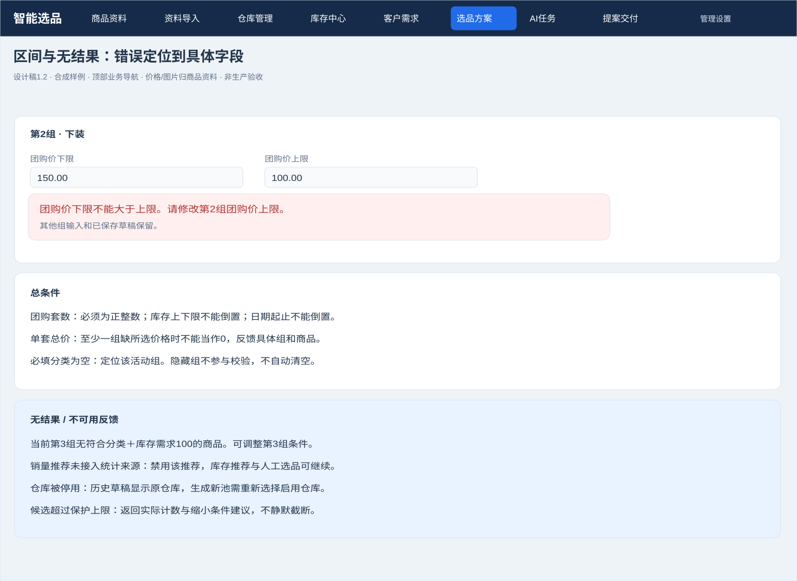

### 2.4 上下工具工作区、AI任务与提案交付

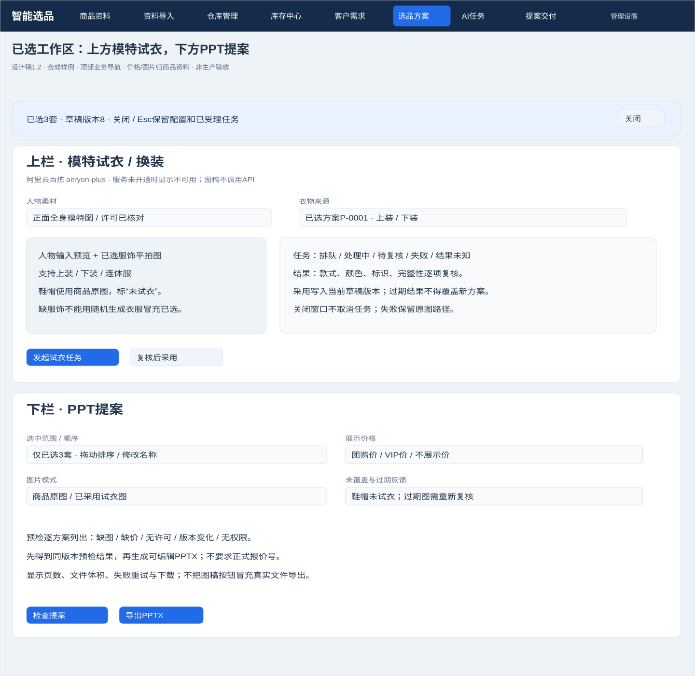

已选页两个按钮分别打开同一工作区并聚焦对应栏；默认全宽上栏“模特试衣”、全宽下栏“PPT提案”，禁止左右并排代替上下布局。上栏含阿里云服务状态、模特/服装素材、覆盖范围、任务、复核与采用；下栏含选中范围、名称顺序、团购/VIP/无价、原图/已采用图、预检、页数体积与导出。上下栏目可在窄视口继续纵向滚动。关闭/Esc保留配置和已受理任务，返回触发按钮焦点，不能等同取消任务。

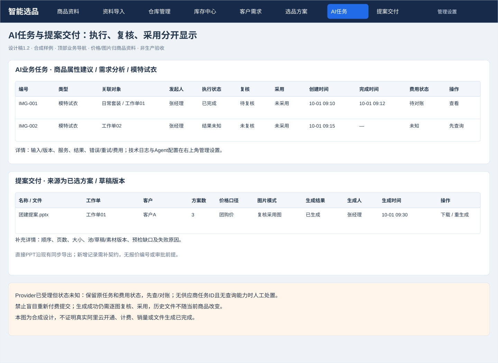

保留排队/处理中/待复核/成功/失败/取消请求/结果未知状态；显示阿里云任务对应的输入版本、费用是否待对账及可行下一步。PPT交付按池/草稿版本与选中范围呈现，不要求正式报价号。缺图/缺价、未覆盖鞋帽、过期图、无权限与Provider未开通均明确反馈；原图或手工路径可继续。

### 2.5 前端组件与交互变化

| 新增/修改位置（相对frontend/admin-web） | 目的与关键逻辑 |
| --- | --- |
| 商品 `src/views/fashion/product/`及`material/index.vue` | 默认28业务列、全字段列选择器与行展开；补齐三价/时间/审核图/许可摘要；保留44属性和维护能力，复用CommercialPrices/ProductThumbnail。 |
| 商品导入 `src/views/fashion/import/`、`src/api/fashion/importBatch.ts` | 基础字段模板、列表字段映射与必填身份列；与商品导入入口共用，不混写价库图片。 |
| 既有layout/Navbar/Settings、路由与后台菜单 | 取消FashionNavigation接管与强制隐藏；恢复navType=1/2/3切换、保存及菜单树；按sys_menu管理入口和权限；冲突先确认。 |
| 新增 `src/views/fashion/warehouse/index.vue`、仓库API封装与菜单 | 业务入口复用仓库字典和默认设置；启停/引用保护/默认仓库校验，库存和Pool统一名称编码。 |
| 修改 `src/views/fashion/pool/index.vue`、`FilterGroup.vue`、`src/api/fashion/poolTypes.ts` | 固定四组草稿、活动组数2/3/4、字段继承来源、完整条件、清空范围、有效值解析与版本保存。 |
| Pool列表与详情 | 完整分页集合＋两类推荐，库存瓶颈和销量数据范围展示，缺销量禁用，不用TopN替代全集。 |
| `src/views/fashion/pool/DeliveryTools.vue` | 全宽上下工具栏、阿里云试衣预检/任务/复核、PPT范围与素材预检；关闭保状态。 |
| `src/views/fashion/{image,delivery,agent,operations}/`与菜单 | 区分业务AI任务与管理配置/日志，提案交付使用工作单/草稿；正式报价入口退出现行界面，历史访问/保留方式在实施时保护数据，不再提供新报价工作流。 |
| `src/views/fashion/stock/index.vue` | 只统一仓库选项来源/名称编码；不改库存计算、0/未知/时效语义。 |

本表为后续实现交接，文档和可交互稿不代表上述生产代码已修改或联机验收。

### 2.6 各页面完整列表字段

默认列直接展示，补充业务字段通过本列表可选列和展开行查看；商品列表全部业务资料都要可选成列，不能仅在详情出现。“操作”独立在右侧。查询条件以第2.3节为准，不混成列表列；技术ID、哈希及JSON只在需要的管理详情查看。表中是目标清单，新增列必须补契约与实际数据，不能用合成值填生产缺口。

| 页面及归属 | 默认列表字段（按顺序） | 补充字段/详情 | 操作 |
| --- | --- | --- | --- |
| 商品列表 | 图片、商品名称、主SKU、品号、货号、款号、规格SKU、来源、三级分类、颜色、尺码、尺码制式、单位、品牌、材质、季节、原销售价、团购价、VIP价、币种、税口径、价格取得时间、图片复核、提案许可、属性核实、完整性、状态、更新时间（28个业务列） | 第2.2节业务字段及44扩展属性均可独立选列；品类编码、颜色编码、标签、京东ID/链接、完整性原因、分类路径及图片明细在本列表展开；分类未映射显示待映射并保留原品类；来源图片链接与审核图分开 | 展开完整资料、详情、编辑、价格、图片、导入 |
| 商品价格视图/页签 | 商品名称、主SKU、规格SKU、颜色、尺码、原销售价、团购价、VIP价、币种、税口径、价格取得时间、维护状态 | 来源、款号、品号、货号、尺码制式、单位、更新时间及可追溯修改记录；不伪造当前不存在的逐价审计字段 | 查看/编辑价格，进入既有销售价导入工具 |
| 商品图片页签 | 缩略图、商品名称、关联主/规格SKU、款号、颜色、用途、来源、复核状态、提案许可 | 原文件名、尺寸、主图标记、颜色确认、内部/AI/提案/电商许可、来源链接、上传/复核信息及驳回原因 | 上传、关联、设主图、复核、查看；权限不足说明原因 |
| 导入记录 | 批次编号、类型、文件名、来源、仓库（仅库存）、状态、行数、错误数、创建时间 | 范围、业务时间、新增/修改/不变/清空数、发布人/时间、失败与恢复信息；已有批次明细兼容 | 查看预览/结果、允许状态下发布或恢复 |
| 导入行预览 | 文件行号、来源/规格SKU、差异类型、原值、拟生效值、行级错误 | 原文件字段、映射、每字段差异和显式清空标记；商品/价格/库存按类型展示对应值 | 定位错误、修改映射、重新预览 |
| 仓库列表 | 编码、名称、状态、默认、关联库存SKU数、最近库存业务时间 | 显示顺序、备注；数量和时点只读 | 新增、编辑、启停、设默认、查看库存 |
| 库存明细 | 商品名称、款号、规格SKU、颜色、尺码、仓库名称/编码、可售量、时效、业务时间、来源批次 | 来源、主SKU、尺码制式、单位、确认方式、核实人/依据；0/未知分别显示 | 明细、库存导入、允许的人工核实 |
| 尺码矩阵 | 来源、主SKU/款号、颜色、尺码制式、仓库、动态尺码数量列 | 原规格SKU、时点/批次、未知/过期说明 | 查看规格明细、切换明细 |
| 客户列表 | 客户编码、名称、类型、联系人、电话、地区、负责人姓名、状态 | 协作者、内部备注；电话按权限展示 | 新增/编辑、归档、进入需求工作单 |
| 选品工作单 | 名称、关联客户（可空）、组合模式、套数、单套预算、当前阶段、方案总数、已选数量、创建/保存时间 | 需求原文/摘要、场景/交付目的、总条件、四组原值/继承模式、推荐口径 | 新建、继续、查看池/已选、工具；现有简表按契约补列 |
| 完整方案池 | 选择、编号、各活动组商品（图/名称/主SKU）、团购合计区间、VIP合计区间、整套可供量、需求满足状态、热销分数 | 各组品号/货号/款号/来源/分类/品牌、展示颜色/规格/尺码、双价区间、仓库/库存/时点、销量/周期/来源、缺口 | 详情、对比、跨页选择、定位推荐 |
| 已选方案 | 顺序、方案名称、各活动组商品/展示颜色、团购合计、VIP合计、整套可供量、需求满足状态、试衣状态、提案准备情况 | 展示规格、采用素材、价格/库存快照、复核/过期提示；未定规格价格仍为区间，定规格后对应确切金额 | 改名、排序、选色/规格、移除、保存、打开工作区 |
| 试衣结果（选品工具上部） | 方案名称、模特图、实际服装输入、结果缩略图、任务状态、复核状态、采用状态、完成时间 | 任务号、输入版本、服务、请求/成功数、失败原因、费用、未覆盖商品位置 | 查询、逐图复核、采用/驳回、允许的取消/重试 |
| AI任务 | 编号、类型、关联商品/工作单/方案、发起人、执行状态、复核状态、采用状态、创建/完成时间、费用状态 | Provider/模型、输入摘要/版本、结果数、失败原因、重试与费用记录；无事实显示未知 | 详情、返回来源、复核、允许的查询/取消/重试 |
| 提案交付记录 | 名称/文件名、来源工作单、客户（可空）、方案数、价格口径、图片模式、生成结果、生成人、生成时间 | 顺序、页数、大小、池/草稿/素材版本、预检缺口/失败原因 | 查看预检、下载、重新生成；补新记录契约，不套用报价页 |
| 管理设置：Agent | 名称/编码、类型、当前版本；版本子表为版本、Provider/模型、状态 | 配置/提示词、版本摘要与权限；不放普通商品/选品列 | 允许的保存/发布、查历史 |
| 管理设置：运行日志 | 类型、记录ID、关联ID、状态、脱敏摘要、时间 | 相关任务、错误及审计；系统参数用表单展示名称/说明/值/允许范围 | 查询、定位任务；不提供未授权清理 |

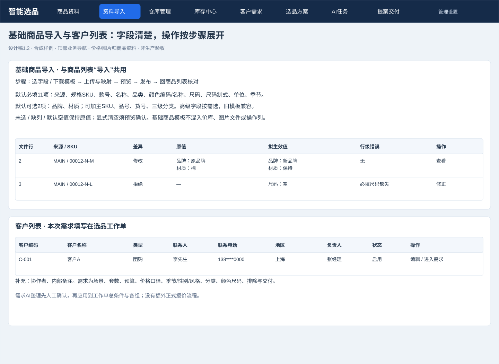

## 3. 后台处理设计

### 3.1 系统组成、职责与调用

用户请求先经若依登录、角色和对象权限；Java 从 MySQL 读写商品、库存、客户、池、草稿与任务。需要试衣或AI辅助时，Java 冻结输入、授权、预算和运行版本，经内部认证调用 Python；Python 返回结构化建议或 Provider 任务结果，Java 再校验并保存，人工采用产生业务变化。浏览器只调用 Java。

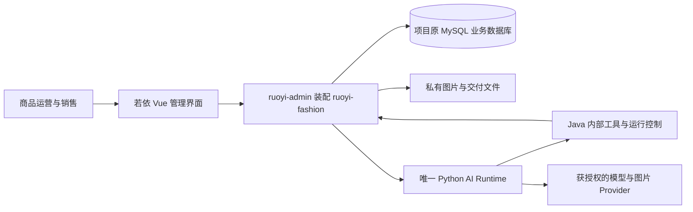

| 单元 | 唯一职责 | 边界 |
| --- | --- | --- |
| `ruoyi-backend/ruoyi-fashion` | 权限、业务规则、事务、当前数据、提案、任务租约、幂等、预算、审计和正式采用 | 库存和提案价格由Java读取真实资料，模型不能编造。 |
| `frontend/admin-web` | 商品运营和销售交互、草稿、状态和错误反馈 | 不直连 Python，不持有服务密钥，不自建业务状态真相。 |
| `python/fashion-ai-runtime` | 需求解析、属性建议、候选排序/搭配建议、护栏、Provider 适配与评测 | 不持有业务数据库凭据，不直接发布导入或对外发送提案文件。 |
| `contracts/fashion` | OpenAPI、JSON Schema、导入和内部认证协议 | 三工程共享机器契约，不是第四个部署工程。 |

使用项目原数据库、账号、密钥和业务数据；独立运行通道仅隔离进程、端口、浏览器、Redis、缓存与日志。环境核对遵循[多项目并行开发启动指南](../../../若依框架/多项目并行开发启动指南.md)，不能为新通道自动新建、克隆或初始化业务库。配置核对是实施前提，不把历史 `dev_*` 连接当作已确认环境。

### 3.2 商品、导入、价格与库存处理

**触发与校验。** 商品创建/修改、资料包上传、销售价或库存批次、人工核实、仓库管理和恢复均经 Java 权限校验。解析 Excel 时保持编码文本、来源行号和字段缺失语义；固定模板在代码/配置维护，用户映射必须先确认。必填、字典、重复业务键、格式、图片许可、文件大小与压缩包安全检查在发布前完成。价格/库存不认识的 SKU 拒绝，不借价格更新自动创建商品。

**处理与数据变化。** 先在锁外解析文件并生成预览，记录原行、标准化数据、错误、范围摘要、基线摘要和 `before/after`。发布时核对批次有效状态、版本、幂等键和基线；在同一事务写完整有效批次与影响行。销售价只改价格白名单；库存只改指定仓库范围及原始 `as_of`；商品资料不顺带清空价格库存。全量文件中缺失的行按该类型固定范围规则处理，预览必须列出将清空或置零的行；商品资料缺失不能变成未经确认的删除。

所有商品资料、主图、价格、库存写入共用 `FashionCatalogWriteLock`，锁名为 `fashion:{database}:catalog-write`，事务提交或回滚后才释放。AI、文件解析、Provider 与下载不放在该锁或数据库事务中。共享容器内显式使用 `fashionJdbcTemplate`、`fashionTransactionManager/Template`，绑定同一个业务数据源，避免落到面试 PostgreSQL 的主 Bean。

仓库管理由Java复用平台字典 `fashion_warehouse` 维护编码/名称/排序/状态/备注，默认仓库引用既有设置。服务端校验编码唯一、默认仓库有效和引用保护；历史库存编码保留，停用仅阻止新默认/新选品使用，历史可查。库存中心和Pool选项统一读取全部启用仓库而不是 `distinct fq_stock.warehouse_code`，允许先建仓库后导入库存。本期不新增第二套仓库主表。

**输出与失败。** 返回批次、错误行、差异和实际生效范围，不只返回成功布尔值。校验失败保留明细，正式数据不部分发布；并发变更返回冲突；恢复按版本与摘要拒绝覆盖后来修改，保留失败原文。图片按款号＋颜色先列出拟关联子 SKU，再确认，对象键不可覆盖复用。

#### 3.2.1 基础商品导入字段契约

基础字段复用FashionProductImportParser已有字段定义，扩展复用ProductAttributeFields白名单和现有fields元数据；展示复合列只是映射入口，不能成为任意SQL/JSON写路径。契约提供字段键/中文名、可导入、默认选中、必填、字典/格式及允许清空。默认13列与可选4个选品身份字段见第2.2.2节，不另造商品表或复制属性注册表。

解析器需从“所有15个基础表头必须出现”改为“必填11个必须可解析，其他可选列允许缺失”；旧15＋44模板继续兼容。发布字段集合按用户选中且实际提供的白名单解析，区分未选/缺列、空格/空单元格、合法零和显式清空；before/after保存实际更新集。未选/缺列/默认空值不能抹去已有品牌、材质或扩展属性；新增商品仍满足必填和默认约束。非法、重复字段映射或任意技术键拒绝，列表隐藏不能绕过必填。

价格与图片仍走商品子资源及现有授权/事务服务；已有商业价格路径虽位于Pool命名下，也不因UI归属改变迁移数据。三价、价格取得时间、图片状态及许可摘要由Java分页批量提供，避免前端逐行请求价格和完整素材清单。同步ProductView、分页组装和TypeScript类型，包括当前前端遗漏的priceAsOf。商品图片使用既有素材服务，来源链接不等于可用审核图片；不存在的上传/复核人员等审计字段先核实事实来源，不能根据当前登录用户补造。

### 3.3 筛选、完整组合、跨页选择与草稿

**触发与校验。** 创建池时核对2/3/4个活动组及完整四组草稿、继承模式、三级分类映射、每组范围、仓库与服装属性；身份来自服务器，客户端不得提交任意 owner。各组查询后按主 SKU 聚合，在原始组合数超过 100,000 时拒绝。

**处理。** `FashionPoolCatalog` 读取可见商品与规格，`PoolCombinations` 根据已解析生效分组生成稳定混合进位组合身份；重复主 SKU 位置和整体条件不符的组合剔除后才计算有效总数、排序与分页。池持久化请求及分组快照，不为全部组合逐行落表。价格/库存更新不悄悄改变旧池，刷新资料需重新生成并说明版本变化。

**数据与输出。** `fq_selection_pool` 持有请求与候选快照；`fq_selection_draft` 保存显式 IDs 或快照全部＋排除项，以及 `names/orderedIds/variantSelections/rowVersion`；筛选草稿同时保存总条件、四组原始值、活动组数与逐字段继承模式。保存草稿必须校验组合属于池、展示子 SKU 属于对应主 SKU、名称长度与顺序无重复，并以版本比较更新。返回有效总数、分页行、双价与未知状态、草稿版本和已选数量。

**失败与恢复。** 空候选组、无效仓库、数量/继承冲突、超容量、非法组合或过期版本给出可修正原因；旧版本不能覆盖，结果未知先读取最新草稿。分页/排序失败不清空已选内容。AI 推荐最多 12 个候选是独立建议通道的边界，不得限制完整人工方案池。

同一池另有每组候选子 SKU 5,000、候选快照 20 MiB、离散价格扫描/搜索 2,000,000 步的守卫。任一超过均明确拒绝并说明缩小条件；这些是当前容量边界，不应以分页或推荐截断绕过。

排序推荐由Java在同一快照全集计算；库存推荐使用指定仓库匹配规格的整套可供量瓶颈，unknown不作零。销量统计接口须返回来源、统计起止、更新时间、主SKU净售出量及完整性；推荐默认近30日。当前仓库/商品/Pool契约没有已核实的销量字段，接入前必须先固定只读统计来源和契约，未就绪返回不可用，不用库存、Mock或AI推断替代。排序只改变行次序，名称/选择/稳定ID不变。新增活动组/继承/高级条件需先扩展唯一Pool契约；服务端再次校验客户端生效值，不能只靠前端下发。

### 3.4 阿里云试衣、人工复核与PPT提案

触发试衣时冻结池ID、草稿版本、组合、展示规格、视觉版本、服装/模特对象及许可、预算与幂等键。预检明确上装/下装/连体服映射及未覆盖鞋帽；缺失或不合规素材给出具体原因。Java创建 `fq_proposal_image_task`，Java通过现有FashionImageProviderPort适配阿里云异步试衣接口；外部调用在事务外执行，先持久 `provider_task_id` 再验证结果，受理不明时保留unknown并回查，不能自动换键重复付费。自动恢复最长24小时，连续查询失败最多8次；停止后保留任务及费用预留，需人工核查，不用重提交冒充恢复。V3存量在途任务以已有创建时间回填恢复期限，不补造费用；已受理却缺费用记录的历史任务会阻止新的付费提交，直至对账。

同owner＋请求键返回同任务，输入不一致冲突。结果立即转存私有对象并记录摘要/来源，不把供应商临时URL作为长期图片身份。逐张复核保存人、时间、理由、覆盖范围和输入摘要，采用前重核草稿、商品视觉版本与许可。待核实图、随机生成的非选中商品部分、已撤销许可或过期图不能冒称已确认全套商品。

提案预检读取已选范围、名称顺序、团购/VIP/无价、展示规格、原图/采用图和未覆盖说明，返回具体方案阻塞项。生成只消费同版本预检，不混入中途变更。PPT保持可编辑文字和离线嵌入图，不泄成本/内部备注/密钥。当前每文件1～100套同步导出；不借正式报价号或旧正式文件表承载提案。下载经对象权限与当前图片许可检查。

阿里云能力开通/地域密钥/费用和素材许可是实际调用前提，图稿不触发调用。Provider未就绪仍允许完整人工选品和有许可原图PPT。正式报价的计算、审批、冻结和确认流程已移出本期。

### 3.5 数据模型、字段约束、事务与版本

#### 3.5.1 当前范围、存量兼容与关系

V3目标Schema有19张 `fq_*` 表。本期沿用其中14张：商品/库存2、客户1、导入2、AI生命周期6、方案池/草稿/试衣3；设计1.2另以V4增量增加1张提案交付记录表，拟采用的现行业务表为15张，包含历史兼容表的物理总量为20张。V4在获授权环境按顺序迁移后才形成实际数据库变更；不能把目标Schema当作当前运行数据库事实。仓库管理复用若依字典及默认设置，不另建仓库事实表。正式报价相关5表退出现行功能设计，其定义随1.0原文备份保存，存量表和数据不因文档修改被删除。

| 模块 | 现行表与关系 |
| --- | --- |
| 商品/库存 | `fq_product` → `fq_stock`；规格SKU＋仓库，主SKU属性用于聚合。 |
| 客户需求 | `fq_customer`；范围和协作者继续校验。 |
| 导入 | `fq_import_batch` → `fq_import_detail`；原行、差异、错误与恢复。 |
| AI生命周期 | `fq_ai_agent` → `fq_ai_agent_version`；`fq_ai_conversation` → `fq_ai_message/fq_ai_run` → `fq_ai_run_step`，Java持有。 |
| 选品提案 | `fq_selection_pool` → `fq_selection_draft/fq_proposal_image_task`，无正式报价前提。 |

历史字段锚点仅保留到本段以避免旧入链断开；原正式报价五表正文见[界面修订前1.0原文](../归档/设计/2026-10-01-界面修订前1.0/原文备份.zip)。现行字段不重复维护它们。AI字段中的历史 `quote_id/combo_id`兼容引用保留，新选品上下文按池/草稿ID及版本表达，不能据此恢复正式报价入口。

#### 3.5.2 字段约定与字段字典

MySQL 8 / InnoDB / utf8mb4。既有业务/AI表采用 `BIGINT` 服务端 ID，API 以字符串传递；编码按文本保留前导零。共同字段为 `id,create_by,create_time,update_by,update_time,row_version`，时间为 `DATETIME(3)`，版本从 1 开始。**V3 新表按下方逐字段定义，不机械套用这组公共字段**：池/试衣使用字符串 ID，草稿以池 ID 为主键。金额用 `DECIMAL(16,2)` 元，百分率 `DECIMAL(5,2)`，5.00 表示 5%；接口保持精度，时间存 UTC、显示明确时区。

下方 `—` 表示可空。外键使用 `ON DELETE RESTRICT`，平台用户/字典是逻辑引用并由服务端校验；停用、归档替代删除，业务编码不因归档重用。有循环关系的可空回指在基础表建立后增加，先插入主记录再设置回指，不永久关闭外键。以下是唯一人读字段字典，内部 原T01～T19标识保持历史对应，T04～T08不作为现行字段正文。

T01 fq_product：商品资料表

| 字段 | 类型 | 必填/默认 | 说明 |
| --- | --- | --- | --- |
| source_code | VARCHAR(64) | 是 | 来源字典编码 |
| sku_code | VARCHAR(64) | 是 | 来源内唯一的商品规格编码 |
| style_code | VARCHAR(64) | 是 | 款号，用于同款分组 |
| name | VARCHAR(120) | 是 | 商品名称 |
| category_code | VARCHAR(32) | 是 | 品类字典，上衣/裤子/帽子/鞋等 |
| color_code | VARCHAR(32) | 是 | 稳定颜色代码 |
| color_name | VARCHAR(32) | 是 | 展示颜色 |
| size_code | VARCHAR(32) | 是 | M、L、40.5、均码等 |
| size_system | VARCHAR(16) | 是 | CN/EU/US/LETTER/FREE等尺码制式 |
| unit | VARCHAR(16) | 是 | 件、顶、双等 |
| attributes_json | JSON | — | 商品扩展属性白名单；旧值读取为 {}，显式清空才删除对应键 |
| group_price | DECIMAL(16,2) | — | 独立团购价，非负、不从销售价猜算 |
| vip_price | DECIMAL(16,2) | — | 独立 VIP 价，非负、不从团购价替代 |
| sale_price | DECIMAL(16,2) | — | 当前销售单价，单位元；可空或为0；与团购/VIP价独立 |
| currency | CHAR(3) | CNY | 当前价格币种，首期仅CNY |
| tax_mode | VARCHAR(16) | included | 当前价格口径：included含税/excluded未税 |
| price_as_of | DATETIME(3) | — | 当前价格的实际业务时间；有价格时必填 |
| last_price_import_batch_id | BIGINT | — | FK→fq_import_batch.id，当前价格来源；有价格时必填 |
| brand | VARCHAR(80) | — | 品牌资料 |
| material | VARCHAR(255) | — | 实际材质资料，不由图片推测成事实 |
| season | VARCHAR(32) | 四季 | 季节；多季节按字典集合校验 |
| tags_json | JSON | 空数组 | 风格、场景、人群等确认标签 |
| main_image_key | VARCHAR(512) | — | 当前主图的私有对象键 |
| images_json | JSON | 空数组 | 最多5张当前关联图片及来源、用途许可；结构见第 3.5.3 节 |
| visual_version | BIGINT | 1 | 主体/颜色/使用图片改变递增；仅改文案不递增 |
| last_ai_run_id | BIGINT | — | FK→fq_ai_run.id，最近一次已采用属性建议的来源运行 |
| attributes_confirmed | TINYINT | 0 | 0待核实，1已确认；不能将AI建议当人工确认 |
| attributes_confirmed_by | BIGINT | — | 实际确认者 |
| attributes_confirmed_at | DATETIME(3) | — | 实际确认时间 |
| jd_item_id | VARCHAR(64) | — | 当前主要京东来源ID，非唯一 |
| jd_url | VARCHAR(2048) | — | HTTPS来源链接，无Cookie/凭据 |
| last_product_import_batch_id | BIGINT | — | FK→fq_import_batch.id，最近商品资料变更来源 |
| status | VARCHAR(16) | draft | draft/active/inactive |

唯一：`(source_code,sku_code)`、`(source_code,style_code,color_code,size_system,size_code)`。索引：`(category_code,status)`、`(source_code,style_code,color_code)`、`(price_as_of,status)`。不按商品名称匹配，也不让京东ID替代SKU。批量图片映射按款号＋颜色查出全部规格，一次确认关联。

原销售价、团购价和 VIP 价是三个独立当前字段，共用币种与税口径。旧销售价批次只改 `sale_price/currency/tax_mode/price_as_of/last_price_import_batch_id`，不覆盖双价、款号、图片或库存；双价通过独立维护入口更新并留平台审计。前后值在对应导入明细留痕，`price_as_of` 保留真实来源时间，不支持预约生效。客户、渠道或阶梯价另需需求及迁移决定。

主 SKU、品号、货号和三级分类分别对应 `mainSkuCode/itemNo/articleNo/categoryLeafCode/categoryLeafPath`，来源编码前导零保留；`group_price/vip_price` 各有非负 CHECK，允许 NULL。扩展字段查询只走固定白名单，不接收客户端 JSON 路径。

T02 fq_stock：商品库存表

| 字段 | 类型 | 必填/默认 | 说明 |
| --- | --- | --- | --- |
| product_id | BIGINT | 是 | FK→fq_product.id |
| warehouse_code | VARCHAR(64) | 是 | 仓库字典编码，默认主仓由系统配置 |
| available_qty | INT | 是 | ≥0，来源确认的可售量，不自行推测预占 |
| as_of | DATETIME(3) | 是 | 当前数量实际取得/核实时间 |
| confirmation_type | VARCHAR(16) | import | import/manual_verify/restore |
| verified_by | BIGINT | — | 人工核实者；manual_verify必填 |
| evidence_note | VARCHAR(1000) | — | ERP导出或盘点凭据摘要；人工核实必填 |
| last_import_batch_id | BIGINT | 是 | FK→fq_import_batch.id，当前数量来源 |

唯一：`(product_id,warehouse_code)`；索引：`(warehouse_code,as_of)`。无记录是未知库存，不是0。库存全量发布和逐SKU人工核实都通过批次留痕；核实创建新变更记录而不是把旧文件时间伪装成现在。恢复原值必须恢复原as_of，不能解除24小时过期条件。

本期不建入库单、出库单、库存流水和预占表：库存用于现货选品核对，不扣库存；正式订单锁库存是以后独立需求。

T03 fq_customer：客户资料表

| 字段 | 类型 | 必填/默认 | 说明 |
| --- | --- | --- | --- |
| code | VARCHAR(64) | 是 | 客户唯一编码 |
| name | VARCHAR(80) | 是 | 名称或简称，可同名不自动合并 |
| customer_type | VARCHAR(24) | 是 | group_purchase/wholesale |
| contact_name | VARCHAR(80) | — | 联系人 |
| contact_phone | VARCHAR(512) | — | 联系电话，应用层加密后保存；密钥不入库 |
| region | VARCHAR(120) | — | 地区 |
| salesperson_id | BIGINT | 是 | 主要销售，引用平台用户 |
| collaborator_ids | JSON | 空数组 | 少量明确授权协同销售ID；服务端检查，不接受任意前端自赋权 |
| internal_note | VARCHAR(2000) | — | 内部备注，不能复制到客户文件 |
| status | VARCHAR(16) | active | active/archived |

唯一：`code`；索引：`(salesperson_id,status)`、`name`。首期客户量和协作者数量小，授权ID集合不单拆关系表；访问仍要结合平台角色检查。若以后需要大规模按协作关系检索，再拆关联表，不在本版预建。

T09 fq_import_batch：导入批次主表

| 字段 | 类型 | 必填/默认 | 说明 |
| --- | --- | --- | --- |
| batch_no | VARCHAR(64) | 是 | 唯一批次号 |
| template_code | VARCHAR(64) | — | 固定模板家族编码；文件导入必填，手工核实/恢复可空 |
| template_version | VARCHAR(32) | — | 应用内模板版本；文件导入必填，与 mapping_snapshot 一起冻结 |
| import_type | VARCHAR(16) | 是 | product/price/stock/image |
| operation_type | VARCHAR(16) | import | import/manual/verify/restore |
| source_batch_id | BIGINT | — | FK→fq_import_batch.id，修正/恢复来源 |
| source_code | VARCHAR(64) | 是 | 本批来源范围 |
| warehouse_code | VARCHAR(64) | — | stock必填；其他为空 |
| file_name | VARCHAR(255) | — | 原文件名；文件导入必填 |
| file_key | VARCHAR(512) | — | 私有原文件对象键 |
| file_hash | CHAR(64) | — | 原文件摘要；文件导入必填 |
| mapping_snapshot | JSON | 是 | 固化工作表、字段映射和显式清空字段 |
| scope_json | JSON | 是 | 来源、品类、状态等范围定义；不是随意SQL |
| scope_hash | CHAR(64) | — | 校验时按稳定商品ID排序的冻结范围摘要 |
| base_data_hash | CHAR(64) | — | 校验时范围内商品结构和目标行row_version/不存在标记摘要 |
| as_of | DATETIME(3) | 是 | 本批实际业务时间，不用上传时间冒充 |
| request_key | VARCHAR(128) | 是 | 同文件/映射/范围/时间/类型幂等键 |
| expected_count | INT | 0 | 严格全量应覆盖商品数 |
| actual_count | INT | 0 | 文件实际数据行数 |
| error_count | INT | 0 | 阻断错误数 |
| status | VARCHAR(24) | uploaded | uploaded/validating/invalid/validated/publishing/success/failed/cancelled/conflict |
| validated_at | DATETIME(3) | — | 实际校验完成时间 |
| published_at | DATETIME(3) | — | 实际事务生效时间 |
| operator_note | VARCHAR(1000) | — | 人工核实/恢复原因及依据 |
| error_message | VARCHAR(1000) | — | 批次错误摘要 |

唯一：`batch_no`、`request_key`；索引：`(import_type,status,create_time)`、`(source_code,create_time)`。手工改价/核实也建有操作类型的批次，不制造假的上传文件。source_batch_id禁止指向自身或形成来源环，来源批次创建时间必须早于当前批次。

T10 fq_import_detail：导入行明细表

| 字段 | 类型 | 必填/默认 | 说明 |
| --- | --- | --- | --- |
| batch_id | BIGINT | 是 | FK→fq_import_batch.id |
| detail_no | INT | 是 | 批次内内部连续行号 |
| source_row_no | INT | — | Excel/CSV实际行号；缺失商品的系统补记行为空 |
| row_type | VARCHAR(16) | input | input/missing；区分输入与应有但缺失的行 |
| product_id | BIGINT | — | FK→fq_product.id；未知/新增商品可空 |
| business_key | VARCHAR(255) | 是 | 来源＋SKU等规范化业务键，文本保留前导零 |
| raw_data | JSON | — | 原始字段白名单；missing行为空 |
| normalized_data | JSON | — | 类型化后的拟写入商品/价格/库存/图片数据 |
| before_data | JSON | — | 受影响字段原值、row_version和原业务时间；原记录不存在用exists=false |
| after_data | JSON | — | 实际成功写入的字段、row_version和业务时间；未发布为空 |
| status | VARCHAR(16) | pending | pending/valid/invalid/applied |
| error_json | JSON | 空数组 | [{field,code,value_summary,message}] |
| change_type | VARCHAR(16) | — | added/changed/unchanged |

唯一：`(batch_id,detail_no)`；索引：`(batch_id,status)`、`(batch_id,business_key)`、`(product_id,create_time)`。**business_key在文件行内不设唯一**，才能保存重复输入并明确报错。发布前要求合法目标业务键恰好一条。缺行补记missing，既保留冻结范围，又不再单独建范围表。

商品导入可以新增；价格/库存不得遇到未知SKU自动建商品。全量仅适用于价格和库存的明确范围，普通商品资料导入不是强制整库覆盖。

T11 fq_ai_agent：Agent主表

| 字段 | 类型 | 必填/默认 | 说明 |
| --- | --- | --- | --- |
| agent_code | VARCHAR(64) | 是 | Agent稳定编码，如fashion_orchestrator/product_selector |
| name | VARCHAR(100) | 是 | 中文显示名称 |
| agent_type | VARCHAR(32) | 是 | orchestrator/requirement/selection/styling/quotation/image |
| description | VARCHAR(500) | — | 能力和不负责事项 |
| current_version_id | BIGINT | — | FK→fq_ai_agent_version.id，必须属于本Agent且已published |
| status | VARCHAR(16) | active | active/inactive |

唯一：`agent_code`；索引：`(agent_type,status)`。Agent主表是稳定身份，对话引用它；提示词、模型和工具变化不覆盖主表历史配置。

T12 fq_ai_agent_version：Agent配置版本表

| 字段 | 类型 | 必填/默认 | 说明 |
| --- | --- | --- | --- |
| agent_id | BIGINT | 是 | FK→fq_ai_agent.id |
| version_no | INT | 是 | 本Agent内递增版本 |
| provider_code | VARCHAR(64) | 是 | 供应商配置逻辑引用；密钥不入本表 |
| model_name | VARCHAR(128) | 是 | 实际模型标识 |
| system_instruction | MEDIUMTEXT | 是 | 版本化系统指令，不含API密钥或客户私密数据 |
| model_config_json | JSON | 是 | temperature、reasoning、输出限制等允许参数 |
| tools_json | JSON | 空数组 | 工具名、版本、只读/写入、审批要求和超时 |
| handoffs_json | JSON | 空数组 | 允许移交的目标agent_code和条件 |
| input_schema_json | JSON | 是 | 允许输入的JSON Schema |
| output_schema_json | JSON | 是 | 结构化输出JSON Schema |
| guardrails_json | JSON | 是 | 输入/输出限制、敏感字段、最大商品数等 |
| max_steps | INT | 12 | 单次运行最大步骤，1–50 |
| timeout_seconds | INT | 120 | 单次运行总超时，1–600 |
| config_hash | CHAR(64) | 是 | 配置规范化摘要 |
| status | VARCHAR(16) | draft | draft/published/retired |
| published_by | BIGINT | — | 发布人；published必填 |
| published_at | DATETIME(3) | — | 发布时间 |

唯一：`(agent_id,version_no)`；索引：`config_hash`、`(agent_id,status)`。published版本的业务字段不可更新；发布新版本与切换agent.current_version_id在同一事务。同一个Agent历史上可有多个published版本，但只有指针所指版本用于新run；旧run继续引用实际版本。max_steps统计run_step中互异call_key的逻辑步骤，重试attempt不重复计数；每个call_key最多1次初始尝试＋2次重试。`run_attempt`只统计整run的worker重新调度，与step.attempt_no分开。Agent不能靠tools_json授予权限，工具服务每次按登录用户、客户和方案重新鉴权。

T13 fq_ai_conversation：AI对话主表

| 字段 | 类型 | 必填/默认 | 说明 |
| --- | --- | --- | --- |
| conversation_no | VARCHAR(64) | 是 | 内部唯一对话号 |
| owner_user_id | BIGINT | 是 | 发起销售，引用平台用户 |
| customer_id | BIGINT | — | FK→fq_customer.id；尚未选择客户可空 |
| quote_id | BIGINT | — | FK→fq_quote.id；一份方案可有多段对话 |
| primary_agent_id | BIGINT | 是 | FK→fq_ai_agent.id，对话默认Agent身份；每次run再固定实际版本 |
| title | VARCHAR(120) | 是 | 对话标题 |
| channel | VARCHAR(16) | web | web/api/voice；voice只保存已授权转写文本引用 |
| context_json | JSON | 是 | 当前客户/方案/组合ID和row_version，不复制完整业务数据 |
| summary_text | TEXT | — | 可见上下文摘要，不是商品或报价事实源 |
| summary_up_to_seq | INT | 0 | 摘要覆盖到的消息序号 |
| message_count | INT | 0 | 消息数缓存，由消息事务维护 |
| last_message_at | DATETIME(3) | — | 最近消息时间 |
| status | VARCHAR(16) | active | active/closed/archived |

唯一：`conversation_no`；索引：`(owner_user_id,status,last_message_at)`、`(quote_id,last_message_at)`、`(customer_id,last_message_at)`。对话访问权=登录用户有客户/方案权限，不能只凭conversation_no。首期只以本库message和可见summary构造模型上下文，不保存或依赖供应商的持续conversation；以后若启用供应商会话，必须先增加供应商和Agent版本归属字段并形成迁移设计，不能暗中同时维护两套上下文事实源。

T14 fq_ai_message：AI消息明细表

| 字段 | 类型 | 必填/默认 | 说明 |
| --- | --- | --- | --- |
| conversation_id | BIGINT | 是 | FK→fq_ai_conversation.id |
| seq_no | INT | 是 | 对话内单调递增序号 |
| parent_message_id | BIGINT | — | FK→fq_ai_message.id，重试/分支来源；必须同对话且早于本消息 |
| run_id | BIGINT | — | FK→fq_ai_run.id；助手输出消息关联产生它的run |
| role | VARCHAR(16) | 是 | user/assistant/system_summary；工具过程不伪装成聊天消息 |
| content_text | MEDIUMTEXT | — | 用户可见文本；与content_json至少一个非空 |
| content_json | JSON | — | 卡片、结构化片段或错误提示，不保存隐藏思维链 |
| attachments_json | JSON | 空数组 | 获准文件/图片的对象引用、摘要、类型和用途，不存Base64 |
| provider_item_id | VARCHAR(128) | — | 供应商消息/响应项标识，用于排查 |
| visible_to_user | TINYINT | 1 | 系统摘要可0；权限仍由服务端控制 |
| content_hash | CHAR(64) | 是 | 消息内容及附件摘要 |
| status | VARCHAR(16) | complete | pending/streaming/complete/failed/superseded |
| error_message | VARCHAR(1000) | — | 输出失败脱敏摘要 |

唯一：`(conversation_id,seq_no)`；索引：`(conversation_id,create_time)`、`run_id`。流式输出更新同一pending/streaming消息，完成后固定；不为每个token建行。重试建立新消息/新run，旧失败和分支仍可追查。

T15 fq_ai_run：Agent运行表

一次用户消息可能先由总控Agent运行，再产生一个或多个子Agent run；每个run记录自己实际使用的Agent版本、成本和终态。

| 字段 | 类型 | 必填/默认 | 说明 |
| --- | --- | --- | --- |
| run_no | VARCHAR(64) | 是 | 唯一运行号 |
| conversation_id | BIGINT | 是 | FK→fq_ai_conversation.id |
| agent_version_id | BIGINT | 是 | FK→fq_ai_agent_version.id，固定实际配置版本 |
| parent_run_id | BIGINT | — | FK→fq_ai_run.id，子Agent运行来源；同对话且无环 |
| input_message_id | BIGINT | 是 | FK→fq_ai_message.id，同对话用户输入或明确触发消息 |
| trigger_type | VARCHAR(32) | chat | chat/parse_requirement/select_products/style/quote_explain/image_coordinate |
| quote_id | BIGINT | — | FK→fq_quote.id，本次业务上下文 |
| quote_row_version | BIGINT | — | 运行开始时方案版本；应用结果前重查 |
| combo_id | BIGINT | — | FK→fq_quote_combo.id，针对具体组合时填写 |
| request_key | VARCHAR(128) | 是 | 用户意图幂等键，防双击重复提交 |
| agent_config_hash | CHAR(64) | 是 | 实际Agent配置摘要，须等于引用行 |
| deadline_at | DATETIME(3) | 是 | 本次运行绝对截止时间；恢复和子运行不得延长原业务意图 |
| budget_json | JSON | 是 | 冻结本次最大步骤、模型/工具/移交次数、token、费用、并行数和图片请求上限 |
| context_snapshot_json | JSON | 是 | 本次业务ID、版本、确认条件及权限范围的白名单快照 |
| output_type | VARCHAR(32) | — | text/product_attributes/requirement/product_candidates/outfit_plan/quote_draft/quote_explanation/image_prompt |
| output_json | JSON | — | 本run结构化建议；同类最多12个候选，不直接成为业务事实 |
| output_hash | CHAR(64) | — | 结构化输出规范化摘要 |
| validation_json | JSON | — | 业务预检、阻断项及商品价格/库存来源批次、业务时间和row_version摘要 |
| apply_status | VARCHAR(16) | not_applied | not_applied/applied/rejected/stale |
| apply_request_key | VARCHAR(128) | — | 本run一次原子采用的幂等键；进入采用终态后固定 |
| apply_input_hash | CHAR(64) | — | output_hash＋选中result_key集合＋目标业务row_version摘要 |
| applied_by | BIGINT | — | 人工采用者 |
| applied_at | DATETIME(3) | — | 实际采用时间 |
| applied_result_json | JSON | — | 选中result_key及实际修改的product/quote/combo ID、row_version，不复制完整对象 |
| rejection_reason | VARCHAR(1000) | — | rejected/stale必填 |
| trace_id | VARCHAR(128) | — | 外部可观测系统关联ID；不在业务库复制完整trace/span |
| status | VARCHAR(24) | queued | queued/running/waiting_approval/succeeded/failed/cancel_requested/cancelled/unknown |
| current_step_no | INT | 0 | 已持久化最新步骤 |
| checkpoint_json | JSON | — | 可恢复的有限编排状态和下一节点，不保存整段隐藏推理 |
| input_tokens | BIGINT | — | 供应商返回时填写；未知为空 |
| cached_tokens | BIGINT | — | 缓存输入token，未知为空 |
| output_tokens | BIGINT | — | 输出token，未知为空 |
| reasoning_tokens | BIGINT | — | 供应商可提供时填写，不能保存其隐藏内容 |
| total_cost | DECIMAL(16,6) | — | 本run同步直接步骤的已知成本，不含child run或异步图片；未知/多币种不能填合计 |
| cost_currency | CHAR(3) | — | total_cost币种；有合计时必填且全部计入步骤必须同币种 |
| run_attempt | INT | 0 | Worker 调度/接管代次；首次为0，接管时递增，外部调用attempt另按step记录 |
| execution_lease_id | VARCHAR(128) | — | 当前短期执行租约ID；领取或接管时更新，终态清空 |
| lease_owner | VARCHAR(128) | — | 当前Worker实例标识；只用于运行控制，不作为用户身份 |
| fencing_token | BIGINT | 0 | 单调递增栅栏值；旧租约携带较小值时禁止提交状态或副作用 |
| next_retry_at | DATETIME(3) | — | 可重试时间 |
| lease_until | DATETIME(3) | — | 工作者租约，进程故障后接管 |
| last_event_seq | BIGINT | 0 | Java 接受的状态变更事件序号；仅本run内单调递增 |
| started_at | DATETIME(3) | — | 实际开始时间 |
| finished_at | DATETIME(3) | — | 终态时间 |
| error_code | VARCHAR(64) | — | 稳定错误码 |
| error_message | VARCHAR(1000) | — | 脱敏错误摘要 |

唯一：`run_no`、`request_key`、`apply_request_key`（非空时）；索引：`(conversation_id,create_time)`、`(status,next_retry_at)`、`parent_run_id`、`quote_id`。会话用量不是一次run用量；每次恢复在同一run继续累计。领取或接管必须在同一事务递增 `run_attempt/fencing_token`、写入新租约，所有 Step Grant 和结果提交同时校验 `execution_lease_id + fencing_token + deadline_at`。`total_cost`只汇总本run同币种的同步直接步骤，child run各自记录，历史报价图片费用仅沿原quote_image.actual_cost兼容；本期池级试衣费用由ProposalImageService按池级任务持久化（需补字段/恢复能力），unknown保持待对账；跨币种按步骤分别展示，不能强行换算或重复累计。

一个run最多执行一次**原子采用**：仅`status=succeeded && apply_status=not_applied`且output_type属于可采用类型时可提交，销售一次选择output_json内一个或多个result_key；纯text/quote_explanation不可采用。服务端验证output_hash未变、结果项确属该run、apply_input_hash和全部业务版本后，在一个事务写业务表并置applied；同apply_request_key重放返回原结果，不同请求返回冲突。放弃置rejected，版本过期置stale，二者和applied均为本run采用终态；想采用另一组结果必须创建新run，不在原run上分批追加。

T16 fq_ai_run_step：Agent运行步骤表

| 字段 | 类型 | 必填/默认 | 说明 |
| --- | --- | --- | --- |
| run_id | BIGINT | 是 | FK→fq_ai_run.id |
| step_no | INT | 是 | run内单调递增序号 |
| run_attempt | INT | 是 | 创建本步骤时的 fq_ai_run.run_attempt，旧代次结果禁止提交 |
| execution_lease_id | VARCHAR(128) | 是 | 本次尝试获准执行的租约ID，不保存签名委托令牌正文 |
| fencing_token | BIGINT | 是 | 创建时的运行栅栏值，提交时必须仍等于当前run |
| deadline_at | DATETIME(3) | 是 | 本步骤最晚完成时间，不得超过run.deadline_at |
| parent_step_id | BIGINT | — | FK→fq_ai_run_step.id；父子span关系，同run且无环 |
| step_type | VARCHAR(24) | 是 | model/tool/handoff/guardrail/human_approval/checkpoint |
| name | VARCHAR(100) | 是 | 步骤名称，如product_search/quote_calculate |
| call_key | VARCHAR(128) | 是 | 本run内一个逻辑调用的稳定键；重试沿用 |
| attempt_no | INT | 1 | 同call_key从1递增；每次真实外部尝试一行 |
| tool_call_id | VARCHAR(128) | — | 模型返回的工具调用ID；tool时必填，同一调用重试可相同 |
| tool_name | VARCHAR(100) | — | 注册工具名；tool时必填 |
| tool_version | VARCHAR(64) | — | 实际工具契约版本 |
| target_agent_id | BIGINT | — | FK→fq_ai_agent.id，handoff时必填 |
| child_run_id | BIGINT | — | FK→fq_ai_run.id，子Agent实际运行 |
| provider_code | VARCHAR(64) | — | 本次外部模型/工具供应商；纯内部步骤为空 |
| external_request_key | VARCHAR(128) | — | 本次attempt的外部幂等键；供应商支持时原样发送 |
| provider_response_id | VARCHAR(128) | — | 供应商确认受理后的响应/任务ID，未知前可空 |
| last_client_event_id | VARCHAR(128) | — | 最近一次被接受的状态变更事件ID，用于同结果重放回读 |
| event_version | BIGINT | 0 | 本attempt接受的状态变更序号，只允许递增 |
| input_json | JSON | — | 白名单/脱敏输入，商品工具用ID和筛选条件 |
| input_hash | CHAR(64) | 是 | 本attempt规范化输入摘要；开始执行后输入不可改 |
| output_json | JSON | — | 白名单/脱敏结果，受大小限制；大文件只存对象引用 |
| status | VARCHAR(24) | queued | queued/running/waiting_approval/succeeded/failed/skipped/cancelled/unknown |
| approval_required | TINYINT | 0 | 写业务、付费图片等敏感工具是否需要人确认 |
| approval_status | VARCHAR(16) | not_required | not_required/pending/approved/rejected/expired |
| approval_input_hash | CHAR(64) | — | 请求审批时冻结的input_hash；审批与执行前都必须一致 |
| approval_requested_at | DATETIME(3) | — | 实际发起审批时间 |
| approval_expires_at | DATETIME(3) | — | 审批到期时间；敏感写入必填 |
| approved_by | BIGINT | — | 实际审批用户 |
| approved_at | DATETIME(3) | — | 实际审批时间 |
| approval_reject_reason | VARCHAR(1000) | — | rejected/expired原因 |
| checkpoint_json | JSON | — | 此attempt结束时的有限恢复快照；成功写入后不可覆盖 |
| input_tokens | BIGINT | — | 模型步骤用量；未知为空 |
| output_tokens | BIGINT | — | 模型步骤用量；未知为空 |
| cost | DECIMAL(16,6) | — | 本attempt同步直接成本；异步图片真实费用不在此重复记账 |
| cost_currency | CHAR(3) | — | 费用币种 |
| started_at | DATETIME(3) | — | 开始时间 |
| finished_at | DATETIME(3) | — | 结束时间 |
| error_code | VARCHAR(64) | — | 稳定错误码 |
| error_message | VARCHAR(1000) | — | 脱敏错误摘要 |

唯一：`(run_id,step_no)`、`(run_id,call_key,attempt_no)`、`(provider_code,external_request_key)`和`(provider_code,provider_response_id)`（后两组只在非空时生效）；索引：`(run_id,status)`、`tool_call_id`、`child_run_id`、`(tool_name,create_time)`。模型调用、商品检索、库存核验、报价计算、图片任务创建、Agent handoff和guardrail都用同一通用步骤表，不再各建日志表。步骤执行版本从run.agent_version_id取得；允许工具清单来自Agent版本，真实权限来自业务服务。中间进度事件不逐条建表，只持久化会改变步骤状态、用量、外部受理ID或终态的事件；重复或乱序事件必须通过租约、栅栏、合法状态和 `event_version` 检查后幂等回读。

每个外部attempt必须先落库再调用。崩溃或超时后恢复同一行并用external_request_key/provider_response_id回查，确定未受理才以相同call_key和递增attempt_no建新行；已受理的付费动作绝不重提。纯内部步骤的provider_code/external_request_key/provider_response_id全空；外部步骤必须有provider_code和external_request_key，provider_response_id在供应商确认受理后必填，任何外部ID非空时provider_code必填。

approval_required=0时approval_status必须为not_required，其余审批字段全空；approval_required=1时approval_status只能pending/approved/rejected/expired，approval_input_hash、approval_requested_at和approval_expires_at必填。approved要求approved_by/approved_at且未过期；rejected/expired要求approval_reject_reason。执行前再次要求approval_input_hash=input_hash，改参数必须新建attempt。handoff步骤必须满足child_run.parent_run_id=当前run、同conversation，且child run引用版本的agent_id等于target_agent_id。

T17 fq_selection_pool：方案池

| 字段 | 类型 | 必填/默认 | 说明 |
| --- | --- | --- | --- |
| id | VARCHAR(36) | 是 | 主键，UUID 字符串 |
| owner_id | BIGINT | 是 | 服务器解析的拥有者 |
| title | VARCHAR(200) | 是 | 池名称 |
| request_json | LONGTEXT | 是 | 筛选请求，JSON_VALID |
| snapshot_json | LONGTEXT | 是 | 分组主 SKU/规格事实快照，JSON_VALID，不存全量组合行 |
| create_time | DATETIME(3) | 是 | 创建时间 |

索引 `(owner_id,create_time)`；请求与快照各有 JSON_VALID CHECK。服务端校验组数、容量及版本，池快照创建后不随商品更新改写。

T18 fq_selection_draft：已选草稿

| 字段 | 类型 | 必填/默认 | 说明 |
| --- | --- | --- | --- |
| pool_id | VARCHAR(36) | 是 | 主键，FK → fq_selection_pool.id |
| owner_id | BIGINT | 是 | 与池权属一致 |
| row_version | BIGINT | 是，1 | CHECK ≥1；保存用 CAS 比较并递增 |
| selection_json | LONGTEXT | 是 | 显式/全部＋排除、names、orderedIds、variantSelections；JSON_VALID |
| update_time | DATETIME(3) | 是 | 最后保存时间 |

索引 `(owner_id)`；外键 ON DELETE RESTRICT。一池一草稿，业务归属与组合/规格范围由 Java 校验；旧版本拒绝覆盖。

T19 fq_proposal_image_task：提案试衣任务

| 字段 | 类型 | 必填/默认 | 说明 |
| --- | --- | --- | --- |
| id | VARCHAR(36) | 是 | 主键，UUID 字符串 |
| pool_id | VARCHAR(36) | 是 | FK → fq_selection_pool.id，RESTRICT |
| owner_id | BIGINT | 是 | 任务拥有者 |
| draft_version | BIGINT | 是 | CHECK ≥1；生成时草稿版本 |
| combo_id | VARCHAR(512) | 是 | 池内稳定组合身份，应用校验归属 |
| input_hash | VARCHAR(64) | 是 | 冻结输入摘要 |
| input_json | LONGTEXT | 是 | 实际图片、规格、模特与许可；JSON_VALID |
| request_key | VARCHAR(100) | 是 | 拥有者范围内幂等键 |
| status | VARCHAR(24) | 是 | 受任务状态机约束 |
| provider_task_id | VARCHAR(200) | — | 已受理 Provider 任务 ID |
| provider_code | VARCHAR(80) | — | 服务商编码，不写密钥 |
| model | VARCHAR(120) | — | 本次任务冻结的模型 |
| estimated_cost | DECIMAL(18,4) | — | 本次任务估计费用，与真实扣费分开 |
| actual_cost | DECIMAL(18,4) | — | 已对账实际费用；实扣未知保持NULL |
| cost_currency | VARCHAR(10) | — | 费用币种 |
| billing_status | VARCHAR(30) | unknown | 待确认/待结算/已结算/不计费状态 |
| submitted_at | DATETIME(3) | — | 提交时间及自动恢复期限起点 |
| finished_at | DATETIME(3) | — | 实际完成时间 |
| cancel_requested_at | DATETIME(3) | — | 发起取消请求时间，不代表已取消 |
| next_query_at | DATETIME(3) | — | 下次允许查询的恢复点 |
| retry_count | INT | 0 | 有界查询次数，不能据此自动重提交付费任务 |
| result_json | LONGTEXT | — | 有界结果，非空时 JSON_VALID |
| error_message | VARCHAR(1000) | — | 脱敏错误，非原始响应全文 |
| review_json | LONGTEXT | — | 逐结果复核、输入版本，非空时 JSON_VALID |
| row_version | BIGINT | 是，1 | CHECK ≥1；任务与复核更新版本 |
| create_time | DATETIME(3) | 是 | 创建时间 |
| update_time | DATETIME(3) | 是 | 更新时间 |

唯一 `(owner_id,request_key)`；索引 `(pool_id,owner_id)`；外键 RESTRICT。相同键不同输入拒绝，复核/采用核对输入摘要与当前草稿和视觉版本。

T20 fq_proposal_delivery：选品提案交付记录（V4增量）

| 字段 | 类型 | 必填/默认 | 说明 |
| --- | --- | --- | --- |
| id | VARCHAR(36) | 是 | 交付记录身份 |
| owner_id | BIGINT | 是 | 当前用户；查询及下载均按归属隔离 |
| pool_id | VARCHAR(36) | 是 | 来源方案池；外键删除RESTRICT |
| draft_version | BIGINT | 是 | 冻结已选版本，CHECK≥1 |
| request_key | VARCHAR(100) | 是 | 同用户幂等请求；同键不同输入拒绝 |
| title | VARCHAR(200) | 是 | 对客提案名称；不得含控制字符 |
| status | VARCHAR(30) | 是 | generating/success/failed；同步生成不虚构队列 |
| snapshot_json | JSON | 是 | 固定来源、顺序、范围、价格/图片模式及版本；不包括内部成本和客户备注 |
| file_key | VARCHAR(512) | — | 私有PPTX对象；失败无伪文件 |
| file_hash | CHAR(64) | — | 冻结文件SHA-256，下载前重新核对 |
| file_size | BIGINT | — | 实际字节数；非空时CHECK≥0 |
| page_count | INT | 0 | 从实际PPTX读取页数，CHECK≥0 |
| download_count | BIGINT | 0 | 有权且文件校验通过后的下载响应计数，CHECK≥0；不等于接收端已保存次数 |
| create_time | DATETIME(3) | 是 | 记录实际创建时间 |
| update_time | DATETIME(3) | 是 | 生成结果/下载计数更新时间 |
| error_message | VARCHAR(1000) | — | 脱敏失败原因 |

唯一`(owner_id,request_key)`，索引`(owner_id,create_time)`、`(pool_id,draft_version)`。先保存幂等记录，再同步渲染、私有存储和完成记录；同键输入变化拒绝，生成中断不伪装完成。再次下载保持冻结文件，不因新草稿改写内容；当前商品素材许可撤销、当次采用的模特图被撤回或引用摘要变化时阻止再次下载。历史正式报价交付不转成新提案记录，不删除存量数据。

物理实现使用既有[迁移目录](../../../../ruoyi-backend/ruoyi-fashion/src/main/resources/db/fashion-migration/)；V1/V2 的基础表与属性、[V3 方案池及提案迁移](../../../../ruoyi-backend/ruoyi-fashion/src/main/resources/db/fashion-migration/V3__selection_pool_and_proposal.sql)及[V4提案交付与池级费用增量](../../../../ruoyi-backend/ruoyi-fashion/src/main/resources/db/fashion-migration/V4__proposal_delivery_and_task_costs.sql)与上述字典逐项核对。迁移文件不是另一份人读设计，不从文件存在推断已在目标库执行。

#### 3.5.3 JSON、关系归属、继承快照与事务

商品 `attributes_json` 保持第2.2节44项白名单和现有Schema，不修改商品字段。图片集合保留对象键/摘要/来源/许可与确认；来源URL不是获许可图。导入before/after仅保存类型白名单、ID、版本、存在性和前后值，恢复不覆盖后来的业务修改。

Pool筛选草稿新增总条件、固定四组原值、活动组数、逐字段跟随/独立模式及生效值。池快照保存本次活动候选集合、价格/库存时点及推荐指标来源版本；全部选择/排除、名称顺序、展示规格与草稿版本分开。不能只保存最后两组而丢掉隐藏三/四组；不能让新统计或库存更新悄悄改变旧池推荐结果。

试衣任务冻结实际输入、阿里云模型/任务ID、费用状态、有界结果与逐项复核/覆盖说明；采用前重核池/草稿/视觉版本/许可。AI配置/上下文/消息/Run/Step保存版本化授权、有限工具和恢复点，不保存隐藏思维链或无界工具响应；消息与Run同对话，Step属于Run，子Run的父子授权/预算合法。

导入发布与恢复各自一个原子事务，仓库设置变更和库存引用检查由Java协调。外部调用先持久授权/幂等/预算预留，提交后调用，回包另起事务核租约/fencing及输入摘要。网络等待不持有事务/目录锁；checkpoint与当前状态同事务更新，历史Step checkpoint不覆盖，摘要不一致停止告警。存量正式报价数据兼容不产生本期新报价写入。

### 3.6 接口契约、Python 与 Provider

#### 3.6.1 接口与工程落点

| 契约/协议 | 入口与职责 |
| --- | --- |
| [选品池与提案 OpenAPI](../../../../contracts/fashion/selection-pool-v1.openapi.yaml) | `/fashion/pools`、选项、组合分页、草稿、商品双价、提案预检/PPTX、模特上传与试衣任务/复核/结果。 |
| [AI Runtime OpenAPI](../../../../contracts/fashion/ai-runtime.openapi.yaml) | 健康/能力、需求分析、属性建议、选品搭配与图片生成适配。只向获授权 Java 暴露内部服务。 |
| [AI 控制网关 OpenAPI](../../../../contracts/fashion/ai-control-gateway.openapi.yaml) | 执行授权、工具调用、事件追加和运行控制读取；Python 不直连数据库。 |
| [内部公共 Schema](../../../../contracts/fashion/schemas/v1/internal-common.schema.json) | 请求、响应、错误、上下文、输入/输出版本与追踪信封。 |
| [服务认证 v1](../../../../contracts/fashion/service-authentication-v1.md) | 实际字节签名、身份、授权、防重放、轮换与错误语义。 |
| [商品导入契约](../../../../contracts/fashion/product-import-v2.json) | 文件映射、字段含义与预览/发布；不重复在本文维护机器枚举。 |

新接口先更新以上唯一契约和消费者；旧稿中候选的通用 `/agent-runs:execute/resume` 路径不作为现有 API 承诺。业务查询、分页、保存、预检与下载统一 Java 鉴权，包含对象范围、版本和错误定位。

Python 使用仓库 `pyproject.toml` 约束的 Python 3.12、FastAPI、Pydantic 2、Uvicorn、HTTP 客户端及 OpenTelemetry；`pydantic-ai-slim` 是可选 agent 依赖，不表示已接通真实模型。API/middleware 接入认证和解析前限流；application 实现需求、属性、选品建议；ports 隔离模型/Provider；evaluation 维护输入预检、视觉任务评价和发布门。沿用既有工程目录，不按角色另建多个运行时或状态库。

#### 3.6.2 Workflow、Agent 与工具

Java Workflow 包住有界 Agent：冻结版本化输入 → 建 Run → Worker 领取并取得执行授权 → Python 构造有限上下文 → 模型/工具执行 → 结构化校验 → 保存候选 → 人工采用时重读业务事实。需求识别保留歧义问题；属性建议不冒称材质事实；推荐排序的解释不能改写价格库存；提案文字只转述Java已核实的商品/价库信息。

RunContext 固定 actor 授权、Agent/Prompt/配置版本、配置摘要、预算、deadline、允许工具和恢复点。`runId/runAttempt/stepId/callKey/attemptNo/toolCallId/executionLeaseId/fencingToken` 各司其职，不能用 trace ID 代替幂等键。步骤分 model/tool/handoff/guardrail/human_approval/checkpoint；需要 handoff 时建立有父 ID、独立版本与预算的子 Run，不默认无限多 Agent 对话。

模型工具白名单限于读取已确认需求、搜索/详情、库存价格、组合校验、Java确定性价格/库存校验和图片任务状态。图片提交、文件暂存等有副作用能力仅由确定性 Workflow 取得授权；模型不能任意 SQL、Shell、浏览器、任意 URL，不能发布导入或对外发送文件。每次工具调用重新查权限、对象范围、输入 Schema、deadline 和剩余预算。

#### 3.6.3 运行状态、恢复与费用

| 当前 Run 状态 | 允许下一状态 | 处理约束 |
| --- | --- | --- |
| queued | running / cancelled | 领取设置租约；未开始可取消。 |
| running | waiting_approval / succeeded / failed / cancel_requested / unknown | 输出校验完成才成功；外部结果不确定进入 unknown。 |
| waiting_approval | running / failed / cancel_requested | 释放 Worker 租约；批准绑定冻结摘要及有效期。 |
| cancel_requested | cancelled / succeeded / unknown | 供应商已完成则如实成功，不能保证受理后撤销。 |
| unknown | running / succeeded / failed / cancelled | 先查原任务/请求键；禁止直接重复付费。 |
| succeeded / failed / cancelled | 无执行状态回退 | finished_at 必填；成功候选采用另记一次业务状态。 |

每个 Step attempt 独立留行，开始后输入与摘要不改；恢复读取权威 checkpoint、比较历史摘要和版本，晚到结果核对 fencing 后才能写。审批拒绝/过期用稳定错误码；重新执行不能覆盖原失败。

事件包含客户端事件 ID、Run/attempt/Step、逻辑调用键、执行租约、fencing、类型、发生时间、Schema 版本与脱敏内容。中间显示进度可实时转发；只有状态、用量、外部受理 ID 与终态变化才持久化。Java 核对归属与合法转换后，用 Step 的 `last_client_event_id/event_version` 幂等接受，同事务递增 Run 的 `last_event_seq`；序号只在单 Run 内单调，不新增独立事件事实表。

结构化纠正最多一次；只对安全瞬时故障与 429 在 deadline 内有限退避。401/403/409 不自动重试。Provider 已受理超时记 unknown，按原键回查；业务输入变化创建新授权，不能沿用旧费用许可。调用前预算预留、完成后结算、确定未执行再释放，未知费用保持待对账。

12 步、20 次工具、2 次 handoff、4 路只读并发、30 秒同步等待及 120 秒运行上限是原设计的配置/压测候选边界，不能作为已测 SLA；最终值从 resolved config 固定到 Run。长时生图用独立任务与状态查询，不让同步 HTTP 或通用 Worker 长期占位。队列达到上限拒绝/背压，熔断后人工可继续；故障任务保留原因，重试不创造重复业务副作用。

#### 3.6.4 上下文、文件与评测

短期对话、业务事实、可重建 RAG 索引和用户明确同意的偏好分别管理；索引保存来源 ID/版本，不能成为第二套价格库存真相。上下文只取当前授权相关记录，不无限回放全对话；文档或图片内的指令按不可信输入处理。模型输出过长或文件化内容进私有对象存储，数据库仅存摘要和受控引用。

日志/trace 保存白名单版本、阶段、耗时、错误码、幂等引用及费用，不写隐藏思维链、密钥、客户联系方式或未脱敏工具全文。建立中文业务样本覆盖2/3/4个活动位置、缺价缺库、歧义、攻击、取消和恢复；视觉质量试点按固定40个任务、上装/下装/上下装/连体服四类各10个保持分母，逐项人工判断款式/颜色/标识/完整性，按 PRD 指标核对成功率与费用。真实样本/Provider/费用未具备时保留相应前提，demo 与离线检查不替代真实结果。

#### 3.6.5 阿里云换装适配

优先沿现有Java FashionImageProviderPort增加阿里云适配，由ProposalImageService持有池级任务、费用、复核及采用真相。Provider当前disabled不等于已联机；不为接试衣另造Python任务库、Worker或供应商状态层。Python继续承担既有受控需求/属性建议，确需跨运行时调用时才扩内部契约。

选用阿里云AI试衣API，推荐 `aitryon-plus`，按[官方试衣API](https://help.aliyun.com/zh/model-studio/aitryon-plus-api)创建异步任务/查询结果；密钥只在服务端Secret，Java保留授权/预算/幂等真相。上线前核对适用地域密钥、账户能力与限流。输入映射为人物、上装及下装URL，支持连体服放上装位；不提供鞋帽试穿承诺。图片需预检大小、分辨率与完整主体；对象以短期受控可访问地址交给供应商，结果取回私有存储。现有本地存储通过可配置HTTPS素材基地址与至少32字节签名密钥签发1～30分钟HMAC链接，默认未配置即关闭；签名绑定已落库的试衣任务；访问验证任务、对象白名单、过期时间及签名，按本次实际所选SKU重查AI许可和视觉版本，并验证字节摘要；同图其他SKU的许可不能代替所选SKU。模特图片还需匹配任务拥有者及实际模特引用，不提供列表或任意对象下载。生产公网入口与真实调用仍需单独具备。费用以实际调用与账单核对，不把图稿或免费额度视为真实调用授权。

视觉智能平台的[服饰分割](https://help.aliyun.com/zh/viapi/developer-reference/api-clothing-segmentation)仅是必要时的素材前处理候选，不能替代换装API；不改现有商品资料。阿里云接口的有受理无回包、超时、429、权限/地域错误映射到已有任务错误/unknown语义，按原任务回查。模型保真度通过真实样本复核，不承诺一次生成即可准确覆盖整套。

提交超时未取得providerTaskId时，不能假定已有查询接口可找到任务。保留request_key、输入摘要、提交与费用unknown；只有供应商明确提供按请求关联查询/幂等能力时才自动对账，否则保留人工核对入口并阻止盲目新提交。持久费用与重启恢复沿现有适当机制补齐，不能把旧报价Worker能力视为池级任务已具备。

### 3.7 权限、审计、容量、兼容与失败恢复

#### 3.7.1 身份与安全

沿用若依认证/RBAC，并逐对象校验客户负责人/协作范围、池、草稿、图片及文件；前端按钮隐藏不能代替后端授权。内部调用采用认证协议中的 HMAC-SHA256 v1 keyring，校验服务 ID、key ID、时间戳、nonce、audience、实际请求字节摘要和签名，携带 request/correlation/trace 信息。验签在 JSON 解析前，验签成功才登记 nonce；允许时钟偏差 300 秒、nonce 保留 600 秒、长度 16～128，容量不足 fail-closed 429。认证失败统一 401，已认证但服务/audience 越权 403，不泄漏密钥或验签细节。

active/previous key 有界轮换，密钥至少 32 随机字节并从环境 Secret 注入，无默认密钥。单实例内存 nonce 不能证明多实例防重放，多实例启用前必须引入共享防重放与私网 TLS，或批准的平台代理认证；不把旧稿建议 mTLS/OAuth 写成已部署事实。Java 客户端固定 HTTP/1.1 传递原文正文；ASGI 流式读体在解析前按实际字节限制，默认 64 KiB、可配最大 10 MiB，不能只信 Content-Length。Schema 拒绝 422 不回显敏感正文，Provider disabled 明确 503。

真实接入前落实 Provider 型号与能力、数据地域/保留/训练政策、单任务和月度费用/币种/超额处理、对象存储及回调设施；未确定的项只阻塞对应真实接入。沿用已锁定工程依赖，不把旧稿中的未决框架版本或候选认证方案重新当作当前默认值。

上传限制文件大小、类型和压缩解包范围，拒绝路径穿越、压缩炸弹与不受控外链拉取。对图片/文件以稳定对象键和摘要授权，临时 URL 不长期保存为身份。仓库/商品变更、人工采用、许可撤销、下载与恢复通过现有平台审计留人、时间、对象、版本和理由。

#### 3.7.2 容量、开关与可观测性

完整池硬上限按第 1.4 节执行，分页不改变集合；大文件导出根据配置预估与预检，不静默截断。监控排队量、租约超时、fencing 拒绝、错误、unknown、导入冲突、耗时、费用和文件失败，指标与受控 trace 关联。存活、就绪、Provider 能力分别报告；Provider 故障不伪装整站业务不可用，人工路径继续。

`fashion.enabled` 缺省 true；关闭需重启且不装配 Fashion。迁移开关与通用 AI Worker 开关默认关闭；图片/文件 Worker 各自按实际配置启停，不能用一个开关代表全部。启动、发布和恢复先核对项目原库、迁移版本、密钥/Provider 模式、对象存储、队列和任务状态；运行命令与通道以启动指南唯一维护。

#### 3.7.3 兼容、停止与恢复

迁移保留V1/V2，V3增量增加双价及三表，V4增量增加交付表与任务费用字段，不能改已发布迁移。Schema检查与新代码同版本发布：V4精确表集合包含20表及fq_proposal_delivery，并验证对应版本/必要列。旧版精确校验可能拒绝新版表集合，不能直接切旧jar声称兼容。优先回退兼容当前Schema的代码并关闭新入口；确需恢复旧数据库时按已授权备份方案处理，先保护后来数据，禁止为回退直接丢弃新表。

预算不足、未知外部费用、租约/fencing 异常、输入版本漂移、归属/许可错误、迁移不兼容、checkpoint 不一致或队列失控时停止受影响写入/调用，保留错误和关联任务；无关人工读取可继续。Worker 停止接新任务后完成或释放租约，重启按持久任务恢复；多实例和候选环境恢复须取得实际演练证据后才宣称具备相应能力。

## 4. 实施步骤

### 4.1 依赖顺序与最小交付

| 顺序 | 可交付业务变化 | 前提与核对 |
| --- | --- | --- |
| 1 | 若依布局恢复、商品完整列表、价格/图片上下文及基础导入 | 固定第2.2/2.6字段；复用现有服务和权限，三价/图片摘要分页批量返回；不覆盖布局偏好，不影响其他项目；缺值如实展示。 |
| 2 | 仓库管理与库存/Pool同源 | 复用fashion_warehouse字典，空仓可选、默认/引用保护，库存0/未知/时效不变。 |
| 3 | Pool契约与后台确定性条件 | 补2/3/4活动组、四组原值/继承模式、完整白名单/套数、库存瓶颈/销量来源；兼容历史池。 |
| 4 | 筛选/方案前端与工作单恢复 | 切组不丢、跟随不覆盖独立、旧响应不覆盖新编辑、完整分页/跨页选；修改父页单一负责人。 |
| 5 | 阿里云任务、上下工具与直接提案 | 复用ProposalImageService/FashionProposalService及池/草稿资源，支持输入位置/许可/费用/unknown恢复；Python无业务副作用。 |
| 6 | AI业务任务汇总、新提案记录与历史报价隔离 | 汇总已有权威任务，补交付记录契约；新入口无quoteId/报价权限前提，旧数据/历史链路保留。 |
| 7 | 集成技术检查与后续业务验收 | 先类型/定向测试/构建；业务验收按用户恢复决定和第5章另行执行，真实销量/试衣/Office分别具备条件。 |

后续实现与执行进展只写既有任务清单/验证记录。用户已认可设计并随后明确开始编码；本设计保持拟实现规则，实际实施及检查结果在既有任务和验证记录维护。销量来源未核实仅影响销量接入，库存推荐可独立完成；费用/素材/Provider授权不因设计文档增加。

### 4.2 构建、迁移、同步与恢复

Java 在 `ruoyi-backend` 对 `ruoyi-fashion` 做定向检查，交付共享后台时再聚合 `ruoyi-admin`；Vue 在 `frontend/admin-web` 做类型/相关状态测试与构建；Python 在 `python/fashion-ai-runtime` 做契约/护栏/认证及配置相关检查。构建与实际运行目标分别核对，工作区源码或文件存在不能证明用户运行版本更新。

接口改动先保持兼容消费者、升级 Schema，再部署消费者/提供方与开关；数据库变更先核对目标及授权、保存当前数据与迁移状态，检查恢复办法，再按版本执行增量迁移。代码与 Schema 检查必须配套，不能回写旧迁移来伪造兼容。采用 Spring Boot 4/Jackson 3 的实际依赖与 `tools.jackson`，需要 Spring 代理的实现不能因 `final` 破坏装配。

仅修改文档时不启动或迁移业务服务。运行时只有确认属于选品通道的进程、产物和配置才能同步；发布、费用和外部写入按既有授权范围执行。失败时保留原错误，按第 3.7 节停止受影响动作并定向恢复，不用降低校验标准换取“通过”。

### 4.3 多智能体编码安排

采用一个主控智能体＋三个执行智能体，最多四个同时工作。主控先冻结接口字段、文件负责人和恢复边界，再按能交付的业务切片分批并行；不是让多个智能体同时改同一文件。已存在的未提交修改先逐文件核对并保护，结果统一回写[唯一任务清单](../功能/FEAT-FASHION-001-服装智能选品生产首版/任务清单.md#coding-plan)，不建立按智能体或轮次的第二套长期任务文档。

| 责任 | 第一批：商品/仓库/筛选 | 第二批：试衣/提案/任务 | 文件所有权与交付 |
| --- | --- | --- | --- |
| 主控与集成 | 固定字段/契约，Fashion顶部导航、权限/深链及共享入口，合并与复核 | 冻结任务/费用/位置/交付契约，集成父页、跨模块检查 | 独占contracts/fashion共享契约、FashionImageProviderPort共享接口、共享router/layout/store、permissions SQL/增量迁移及文档；下发明确版本，不擅自改其他项目。 |
| 执行智能体一：业务前端 | 商品详情内价格/图片、基础导入、仓库页与库存仓库来源 | DeliveryTools上试衣/下PPT、AI任务与提案记录前端 | 第一批拥有product/material/import/warehouse/stock及其专用API；第二批拥有DeliveryTools/image/delivery/业务任务独立组件。需要改pool/index.vue时只交接口要求给其负责人。 |
| 执行智能体二：Java业务 | 基础导入解析/元数据、仓库字典适配、Pool条件/草稿/库存排序和销量只读边界 | 池级试衣、幂等/费用/未知恢复、任务汇总/提案记录 | 第一批负责业务Java；第二批独占任务Service/Repository与定向测试，Provider适配/配置归智能体三；不修改共享SQL、契约或Python，新增契约/迁移需求交主控；不运行真实DB迁移或外部付费请求。 |
| 执行智能体三：选品前端／Provider适配 | pool/index.vue、FilterGroup.vue、poolTypes.ts及pool API/选择状态测试 | 现有Java FashionImageProviderPort的阿里云适配、输入/输出校验、服务能力/错误/取消及适配测试 | 第一批独占Pool父页与类型，第二批转Java infrastructure/image及Provider配置；主控独占共享Provider接口，智能体二拥有任务Service/Repository，三拥有供应商适配，禁止抢写。Python本轮不因试衣新增任务层，实际需求/属性契约受影响时再定向修改。 |

**开始与交接。** 第一批以契约草案和明确字段/错误语义为输入，Java与前端可以对固定契约并行，本地模拟仅用于开发，不能冒充联机；第二批必须先确定池/草稿输入、服装位置、幂等/unknown和交付记录契约。每个执行者交付文件差异、定向检查、未完成项及需要主控修改的共享文件清单；遇到归属外文件先报告，主控重新分配而不是抢写。

**交叉复核。** 第一批业务前端执行者复核Java导入/仓库结果，Java执行者复核筛选/页面的生效值，选品执行者复核主控契约/导航。第二批由未编写对应实现的执行者复核任务和工具；主控复核供应商适配/费用失败恢复。独立复核记录实际审查对象与问题，不能用作者自审代替；用户业务接受仍由用户决定。

**检查与停止。** Vue按改动做typecheck、商品/导入/选择/图片接口定向单测，集成后build:prod；Java做ruoyi-fashion定向Maven测试与Provider模拟响应/超时测试；Python仅在确有契约变化时做现有契约/护栏单测。旧报价E2E不直接作为新流程证据，运行配置/端口/Mock和场景先核对。未确认真实销量来源或阿里云任务状态时保留不可用/unknown；没有生产凭据、费用或迁移授权时只做本地实现及技术检查，不发布或写真实业务。实际命令和结果在验证记录维护。

### 4.4 导航、字段与模块故障的修复顺序（待实施）

本节是后续方案，实际调查依据在[模块故障调查](../功能/FEAT-FASHION-001-服装智能选品生产首版/证据/2026-10-02-进度与实际页面检查/模块故障调查.md)。用户本轮要求先调查并给方案，未因此执行代码修复、换包或数据库迁移。

1. **固定原库与运行版本。** 沿用项目原MySQL、账号及数据，核对登记Java包、前端源码和Schema版本。保留原包、配置、数据库完整备份及迁移历史；不新建业务库、不初始化、不通过clean/repair或重设baseline伪造成功。已存在Fashion迁移历史时不重复baseline。
2. **先修版本校验。** 更新FashionFlywayFactory的目标版本声明为4，并以V4迁移资产核对预期20表、交付表及新增列/约束。现有FashionDatabasePreconditions迁移后只接受19表，需修正；迁移前按已验证历史接受完整合法旧版本，未知/半套Schema仍拒绝。迁移关闭时仍做只读兼容检查与业务就绪判定，不能只检查登录HTTP200。用既有迁移测试定向核对历史升级、重启、错库、缺列及未知表拒绝；测试库按项目现有授权边界执行，原业务库不用于写入测试。
3. **修复若依布局和商品契约。** 按第2章恢复navType分支/用户设置/授权菜单树，补商品分页价格、图片摘要及priceAsOf类型，落实28业务列、全部业务列选择器和展开资料；其他16类列表逐项按既有字段核对补契约与真实展示。缺销量、审计或人员来源的字段明确不可用，不能只新增空列称完成。
4. **构建后同步配套版本。** 执行ruoyi-fashion定向检查、ruoyi-admin聚合及前端类型/定向状态检查与构建；检查交付包确实包含仓库、任务、提案交付Controller及V1～V4资产。经用户明确授权原库迁移范围后，按备份与恢复方案执行V2→V3→V4增量，并同步后台菜单及角色权限，保护平台和历史业务内容；随后登记并启动兼容该Schema的后台产物、刷新前端会话。具体菜单SQL也必须核对幂等、权限和历史访问，不直接盲跑。
5. **按业务模块验证。** 核对商品/分类/仓库/库存/客户/选品/任务/交付的真实响应及页面状态，区分加载、错误、无权限和空结果。AI运行服务、受管密钥、Provider、存储及许可按原配置分别核对；恢复人工页面不等于试衣和付费调用已就绪。用户授权真实调用前保持受影响功能明确不可用，其余读取可以继续。

失败恢复优先停止受影响模块和写入并保留原错误；数据库升级后回退到已验证兼容新Schema的产物，禁止把旧登记包直接套回新库。若必须还原备份，先保护升级后的新数据并获得明确恢复授权。

## 5. 业务验收方法

### 5.1 前提、独立预期与记录方式

执行前在既有Feature证据目录保存中文清单，写要求版本、前提、输入、步骤、预期、截图及数据核对。用户要求先修订设计，业务验收保持暂停；本文只写后续方法。使用项目原数据库与确认的业务样本，真实API/费用和素材授权另具备，不用交互稿模拟结果计业务通过。

构造互异的2×3×4×5个主SKU，四组预期120套；二组为6套，三组为24套；多色尺码不倍增。三组输入A/B/C切二组仍A/B，切回三组恢复C。总需求100时四个跟随组均100；第三组独立120后改总150，第三组仍120，其余150。整套300上限不是各组单价300。库存为200/120/500的三组方案，默认每位置用量1，整套可供120，不能相加820。销量按固定周期账本独立累加；数据缺失不得伪造0或排序。

### 5.2 中文业务点与核对方法

| 业务点 | 前提与操作 | 独立预期 | 截图及数据核对 |
| --- | --- | --- | --- |
| 1. 商品完整列表与若依布局 | 在设置切换并保存三种布局、进入Fashion及其他项目；查看28默认列、选全部业务列及展开44属性 | 布局遵从用户选择，菜单由授权树生成；品号等身份、三价/时间、审核图及许可在列表可见；未维护/无权限/失败明确区分 | 三布局/刷新/深链/权限、列表横向滚动/列选择/展开/预览截图；对照同页Java结果、原始业务值与字段白名单。 |
| 2. 基础商品字段导入 | 下载13列基础模板，增加主SKU/分类可选列；旧商品只导入选定字段，缺列/空值/显式清空及错误发布 | 必填身份保留，未选/缺列/默认空值保持原值，显式清空预览明确；价格/库存/审核图不变化，旧模板兼容 | 字段选择/预览/商品回看截图；对照原文件和before/after、批次/实际商品数据。 |
| 3. 仓库管理与库存同源 | 新建无库存仓，设默认/停用；查看已有仓库存 | 空仓可选、停默认前需换默认、引用编码不可删；库存口径不变 | 仓库/库存下拉与引用拒绝；查字典、默认设置、原库存ID/仓库。 |
| 4. 2/3/4组复用 | 各组输入不同值/独立模式；3→2→3及4→2→4，保存重开 | 隐藏草稿不丢、前组不重填、活动数量正确、隐藏组不发查询 | 切换前后截图；查四组草稿、活动组及请求。 |
| 5. 总条件跟随/独立 | 总需求100、总性别男；单组独立120/女；更改总值，再恢复跟随 | 跟随更新，独立保留，恢复跟随后取新总值；整套价不复制为单品价 | 总/组生效值标签；比较服务端解析值及快照。 |
| 6. 全字段与范围反馈 | 逐项设置分类/仓库/季节/性别/编码/价库/服装/来源条件及错误范围 | 字段独立，白名单过滤正确，缺值/错误就地反馈、保留输入 | 展开完整条件、错误与修正图；请求及Java拒绝定位。 |
| 7. 完整组合、分页与选择 | 二/三/四组6/24/120候选结果，翻页排序、全选120排除3 | 无重漏、多色不增、117跨页保留；推荐不截断 | 各模式计数/分页/已选；独立组合全集与稳定ID/选择JSON。 |
| 8. 库存最多推荐 | 准备按仓库/时效确定的200/120/500及未知库存方案 | 整套可供120、按瓶颈排序；未知不冒充0或可供足量 | 推荐理由/各组库存；独立汇总指定规格与时点。 |
| 9. 销量最高推荐 | 固定近30日净销量账本含明确0与未知，切排序/统计周期 | 和值及并列规则正确；周期/来源可见；无数据禁用，全集不减少 | 推荐/不可用状态；查统计来源/范围与独立和式。 |
| 10. 上下工具与阿里云试衣 | 打开试衣/PPT、关闭/Esc重开；真实调用前具备许可/费用/服务 | 上方试衣下方PPT，配置/任务保留；异步结果复核，鞋帽标未试衣 | 上下布局、输入/任务/复核图；查Provider任务/幂等/费用。 |
| 11. 过期、部分失败与未知 | 修改颜色/输入图；部分任务失败或已受理超时 | 旧图过期、成功留存只重试失败；未知先回查不重付费 | 过期/失败/unknown图；查输入摘要、视觉版本与任务链。 |
| 12. PPT提案与正式报价退出 | 选方案命名排序、团购/VIP/无价、原图/采用图预检导出 | 只已选，图文可编辑/离线，未覆盖明确；无正式报价号或报价确认前提 | 工具预检、菜单/交付、目标Office/WPS；核范围/文本/素材/元数据。 |
| 13. 权限、并发与恢复 | 两角色/两窗口访问和保存、租约/恢复、导入冲突 | 越权拒绝、旧版不覆盖、恢复保护后来数据、无重复费用/副作用 | 状态/拒绝图；查对象权限、版本、审计和任务账本。 |

每项页面证据保存后回读；实际不符预期保留未通过，条件/必需截图缺失受阻，无阻塞未执行记未执行。历史正式报价验收不转成当前提案通过；沿用只限未受本轮变更影响且有版本/证据依据的项。

### 5.3 技术检查与用户接受

技术检查分别覆盖契约/Schema、Java 与实际 MySQL 事务、前端类型和选择状态、Python 认证/护栏、文件结构、容量和恢复；只证明对应技术范围，不计作页面/业务通过。后续业务轮次交付按中文点组织的 `verification-report.html`，区分本轮执行、沿用、失败与受阻。用户接受仅来自用户或其明确指定的业务负责人，注明实际范围和版本；本文的结构认可与设计归一不能替代业务接受、上线就绪或发布。
