# 生产排产产品需求与设计

> 文档类型：产品需求与设计；版本：1.0.1；文档状态：Draft；日期：2026-10-01  
> 负责人：用户确认产品决定，Codex 整理需求与设计。  
> 批准边界：用户已确认本文的十五章结构并要求开始重写；既有业务批准继续有效；2026-10-01用户批准按六批实施方案开工，本次补明确该范围的选择与输入契约，待定扩展不因文档整合或开工获得批准。  
> 唯一性：本文是生产排产项目唯一现行的需求与设计正文，页面图仅表达本文章节；接口和迁移文件分别维护精确机器契约。  
> 来源：原始需求、原产品需求2.2.0、页面方案0.2.1、引擎设计1.6.6、数据库设计3.5.0及既有用户决定，原文与替代关系见[整合与恢复说明](../归档/2026-10-01-产品设计整合前原文/README.md)。

<!-- 内部关联：FEAT-APS-001；原PRD-PS-002、APS-ENGINE-001、DB-APS-001及P01—P34标识沿用。批准的是重写与结构；实施状态、技术验证和用户接受分别由既有控制页、任务、验证、验收记录维护。 -->

## 阅读目录

- [1. 产品目标与范围](#1-产品目标与范围)
- [2. 用户角色与完整业务流程](#2-用户角色与完整业务流程)
- [3. 业务对象与共用规则](#3-业务对象与共用规则)
- [4. 资源、产能与日历](#4-资源产能与日历)
- [5. 产品与工艺路线](#5-产品与工艺路线)
- [6. 生产订单与任务](#6-生产订单与任务)
- [7. 排程数据就绪](#7-排程数据就绪)
- [8. 排程工作台与候选方案](#8-排程工作台与候选方案)
- [9. 正式计划与发布](#9-正式计划与发布)
- [10. 派工、执行、报工与质量数量](#10-派工执行报工与质量数量)
- [11. 生产报表与交期分析](#11-生产报表与交期分析)
- [12. 权限与操作审计](#12-权限与操作审计)
- [13. 后台整体设计与数据关系](#13-后台整体设计与数据关系)
- [14. 实施顺序与改造范围](#14-实施顺序与改造范围)
- [15. 业务验收方法](#15-业务验收方法)
- [附录A：时间、资源与求解模型](#附录a时间资源与求解模型)
- [附录B：业务数据关系与迁移边界](#附录b业务数据关系与迁移边界)
- [附录C：决定、来源与历史对应](#附录c决定来源与历史对应)

阅读一个模块时，依次看用途与流程、业务规则、页面与交互、后台处理、模块衔接、验收方法。页面部分把同一对象的列表、新增、编辑和详情放在一起。新增数据模型或复杂规则会就地标注“待定扩展”；此类内容只能用于讨论方案。

## 1. 产品目标与范围

### 1.1 要解决的问题

系统把包含一个或多个产品的生产订单，展开成有先后、并行、转序和合批关系的任务。在人员技能、设备能力、物料、日历和已有占用允许的前提下，安排具体人员、设备、数量和时间，并通过现场反馈持续解释订单预计何时生产完成。

用户应能从订单追到产品、工序、计划作业、执行单和产出批，也能从一个人员或设备反查它正在做哪张订单。人员必须实际参与有限产能计算，不能在设备计划之后仅补一个负责人名字。

### 1.2 已确定的首版边界

首版面向一个生产站点、多车间的有限产能排程与现场反馈。站点及IANA时区由部署配置提供，不恢复工厂业务表。沿用29表业务基线、MySQL唯一业务事实源、独立单实例Worker和系统内正式计划发布。

首版业务包含：多产品订单、版本化工艺、具体人机阶段占用、完成与数量依赖、连续转移批、受控拆合批、绝对可用日历、就绪检查、候选与三类甘特、人工调整与锁定、发布、派工、开停工、部分报工、质量数量流转、返工补产、日报、人力负荷及预计生产完成。

### 1.3 待定扩展与后续范围

| 内容 | 边界与需要决定的事项 |
|---|---|
| 独立产线实体 | 是否作为车间与工作中心之间的业务组织；共享中心怎样归属。确认前不新增表或推导归属 |
| 人员、设备专属产能 | 粒度、有效版本、速率驱动角色、缺失回退及多人组合模型待定；当前规则仍按工艺阶段标准时间 |
| 循环班制与HR同步 | 当前只读已物化的逐资源绝对窗口；新增模板和同步需另定数据来源、冲突与更新责任 |
| 同起同止、多维批容量、复杂多机看护 | 属于后续约束；必要但尚不支持的来源要求必须明确阻断，不能丢弃或降级 |
| 多Worker、可靠外发 | 需命令租约、接管、回执、去重及补偿设计；首版不具备这些语义 |
| 完整BOM、采购库存、工资、完整QMS与维修工单 | 不扩展成另一套ERP、HR或QMS；首版只承载排程与执行必要事实 |

### 1.4 产品成功标准

正确结果首先是人机不超载、必要条件不绕过、数量守恒、版本一致和结果可解释。用真实历史订单与人工计划比较排计划耗时、人工修正数、可执行比例、延期和扰动；收益比例、生产硬件及客户规模须单独确认，不写未经证实的承诺。

## 2. 用户角色与完整业务流程

### 2.1 角色与责任

| 角色 | 负责输入或操作 | 需要得到的结果 |
|---|---|---|
| 生产负责人 | 确定优先级、生产承诺和有影响的方案 | 风险订单、瓶颈、变更影响及可追溯决定 |
| 计划员 | 订单展开、就绪检查、排程、调整、锁定、比较和发布 | 可执行候选、正式版本和派工依据 |
| 工艺人员 | 产品、工序阶段、路线版本、依赖、工时和批次规则 | 可复算且有生效版本的工艺资料 |
| 资源维护人员 | 人员设备、资格及可用不可用窗口 | 真实资源身份、有效资格和净可用时间 |
| 车间主管或班组长 | 查看车间任务、授权派工和异常处置 | 谁在何时做什么、未开工原因及现场变化 |
| 操作人员 | 授权任务的开停工、阶段推进和数量报工 | 本人任务、合法操作、处理结果和异常恢复 |
| 质量人员 | 待检、隔离、放行、返工或报废处置 | 可以转序的合格量和处置追溯 |

职责不自动产生权限。具体授权沿用若依角色及车间范围，发布、报工和质量处置按动作分别控制。

### 2.2 正常主流程

| 步骤 | 操作及输入 | 系统结果与下一步 |
|---|---|---|
| 1. 准备生产条件 | 维护具体资源、技能、日历；维护产品和生效路线 | 资源可用事实、工艺版本；进入订单录入 |
| 2. 建立生产需求 | 录入订单、多产品行、数量、单位、交期和路线版本 | 保存订单，展开冻结任务网络并释放可排需求 |
| 3. 检查数据 | 选择订单与范围，检查工时、资格、窗口、依赖和供给 | 缺项有对象与修正入口；满足条件后进入排程 |
| 4. 生成候选 | 按订单号和车间名选择范围，设置时间窗和策略 | 请求与不可变快照；查询进度、取消或读取候选 |
| 5. 审阅与调整 | 查看甘特、未排、交期与原因；调整、锁定或比较 | 独立校验的候选及影响；进入发布确认 |
| 6. 正式发布 | 核对基线、输入新鲜度及影响，填写理由 | 原子切换唯一当前正式版本；正式作业进入派工 |
| 7. 现场执行 | 选择正式作业，带入数量单位；开停工与阶段推进 | 执行单和真实资源占用；进入成员报工 |
| 8. 报工及放行 | 选择实际作业成员，提交数量；必要时质检和转序 | 产出批、质量状态、数量流水；反馈剩余工作与下游供给 |
| 9. 查看结果 | 查询车间日报、人力负荷与订单交期 | 计划与实际差异、瓶颈、预计完成；需要时由计划员发起受控重排 |

### 2.3 异常怎样回到主流程

缺资料返回所属维护对象；排不上区分缺资源、缺窗口、供给不足、已证明无解和搜索尚无结果。候选过期显示变化来源并重算；正式计划不被自动覆盖。现场资源不合法或数量未释放时拒绝开工，保留执行单。报工错误通过更正或冲正恢复；已有执行事实始终保留。

## 3. 业务对象与共用规则

### 3.1 对象关系与边界

| 对象 | 含义 | 与上下游的关系 |
|---|---|---|
| 车间、工作中心 | 组织责任与排程资格范围 | 中心属于车间；资格范围不能替代具体资源容量 |
| 具体资源 | 人员、设备、工位、工具等有限资源 | 技能及日历作用于稳定资源身份；同一个人只计一份劳动容量 |
| 产品、物料、工序 | 产品身份、消耗对象、可复用工艺知识 | 工序拥有阶段及资源要求，不属于某个固定操作工 |
| 工艺路线版本 | 产品怎样制造的节点及依赖图 | 生效版本供订单引用；变更不覆盖订单冻结版本 |
| 订单与产品行 | 生产需求容器与每项产品需求量 | 独立产品并不自动产生组件消耗或先后关系 |
| 生产批与工序任务 | 某订单行的生产身份及稳定执行需求 | 路线展开为任务、依赖和物料要求；返工、补产保留来源 |
| 计划版本与计划作业 | 一次计划快照及其具体安排 | 一个任务可拆到多个作业，一个共享作业可包含多个任务成员 |
| 分段与资源分配 | 准备、加工、卸料、跨班执行及各角色席位 | 是时间和容量校验单位；不能简单等同整道工序 |
| 执行单与实际占用 | 一次派工的真实开停过程及资源时段 | 绑定来源正式作业、成员和分配；计划结束不意味着实际释放 |
| 报工、产出批、数量流水 | 实际产出、质量投影及不可变数量事件 | 下游只使用已释放且已分配的量；更正保留原记录 |

### 3.2 数量与时间的共用口径

数量始终带单位，整数单位的比例门槛向上取整；无获批换算不得混算。已生产、待检、可转序、已预留、已转出与报废量分开，不能用已耗时间代替合格数量。具体守恒和释放规则由第10章维护。

时间按站点IANA时区展示、传输与存储统一使用UTC。所有资源区间采用左闭右开形式，相邻边界不产生重叠。日历可用工时、资源占用工时、工艺历时、自然时间延期和工作时间延期分别命名。浏览器本机时区不同于站点时区时必须显式解释，不得悄悄改换日期。

生产完成指全部必需产品行达到末端合格需求并完成必要处置。入库、发运和客户到货是其他里程碑，不能根据生产完成时间猜测。

### 3.3 共用页面与输入约定

关联选择按业务名称、编码、订单号展示，稳定ID由页面携带；选项先受数据范围和业务状态过滤，服务端再次校验。派生状态、汇总量、版本与审计字段只读。列表、表单和业务动作分别有用途，不把所有数据库行变成顶层菜单。

列表拟统一采用可搜索、分页、排序及返回后保留条件的方式；分页候选为20、50、100。已有集合接口和最近200项计划目录仍按现有契约使用，补分页前不能声称这些查询已全部分页。选择目录与完整管理列表的职责分别说明。

保存前定位字段错误，处理中禁止重复提交；失败保留输入，成功按返回身份回查。取消未提交编辑不写业务数据；版本冲突重新读取并比较，不能盲目覆盖。长表格在表格区域滚动，重要身份、状态、数量与单位优先可见。

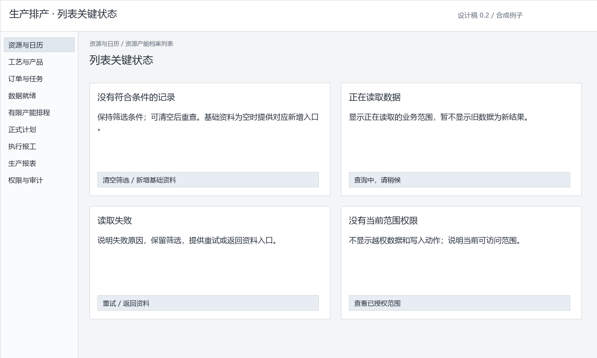

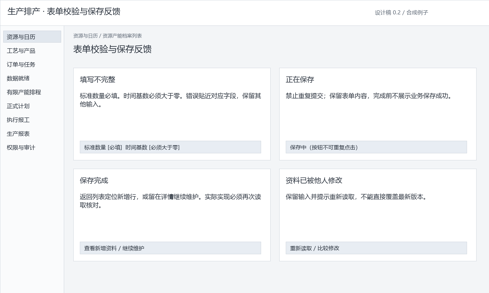

### 3.4 文档决定与产品状态分开

本文定义应有行为和后续验收方法。新增字段、查询目录、产能档案等方案在对应位置注明待定。契约存在仅证明已定义接口；实现、运行、业务通过和用户接受继续由[Feature控制页](../功能/FEAT-APS-001-生产排程核心闭环/README.md)及其记录维护，不在本文复制结果计数。

## 4. 资源、产能与日历

### 4.1 模块用途与业务流程

资源维护人员先维护车间和工作中心，再登记唯一的人员、设备、工位与工具，为它们维护资格和真实可用窗口。计划员从工艺要求中筛选合格候选，再使用净日历与占用计算合法安排。

当前组织为车间→工作中心→具体资源，资源有一个主要中心。独立产线、多中心长期资格和借调有效期模型为待定扩展；不能先通过备注创造未定义的归属关系。

### 4.2 业务规则与计算

人员的技能等级和证书必须在执行时点有效，空闲但不合格不能入选。不同必需席位要求不同人员时，同一个人不得重复充数。多技能不增加一天的可用工时，跨车间汇总按稳定人员身份去重。

设备的同时装载容量描述可容纳多少，生产速率描述每单位需要多长时间，两者分别使用。纯人工任务无需虚构设备；设备责任人不自动形成全程人工占用。工艺阶段决定准备、运行、卸料分别是否需要人机。

| 计算场景 | 当前规则及可复算例子 |
|---|---|
| 按件加工 | 阶段时长=固定准备+数量×阶段标准单件时间；100件、60件/小时、准备20分钟，共120分钟 |
| 固定周期批 | 数量300、每批最多200、周期4小时且允许尾批，需要两批；周期是否包含装卸必须由工艺定义 |
| 上午或全天产能 | 从具体资源净窗口扣已有占用、准备与必要协作条件后计算；净8小时、已排2小时，剩余6小时 |
| 连续窗口 | 不可中断4小时任务面对两个各3小时窗口仍排不上，不能把日总6小时当连续6小时 |
| 多人协作 | 按阶段预约不同席位，采用获批标准时长；两个人不能默认让速度翻倍 |

**专属产能待定扩展：** 候选档案按资源、产品规格、工序、阶段、有效版本维护小时速率或批周期。一个阶段采用一个明确速率驱动角色，其他必需资源只参与资格与占用；多人组合另定义。缺档案是否回退到工艺标准、谁能生效、有效期冲突怎样处置须确认后才可接入求解，当前不得暗加效率系数。

日历以已批准的逐资源绝对可用/不可用窗口为事实。对可用窗求并集、扣不可用窗；车间关闭必须物化到资源不可用窗口。请假、培训、维修和加班都有来源；加班不能由排不上自动开启。已排计划与真实占用还要参加最终资源竞争，不能只看净日历。

### 4.3 页面与交互设计

资源页面按组织、人员、设备、资格和日历组织子页。人员详情连续展示身份、技能、可用时间、任务与占用；产能候选入口明确标为待定。每个对象的列表、新增、编辑、详情在下面同一小节定义。

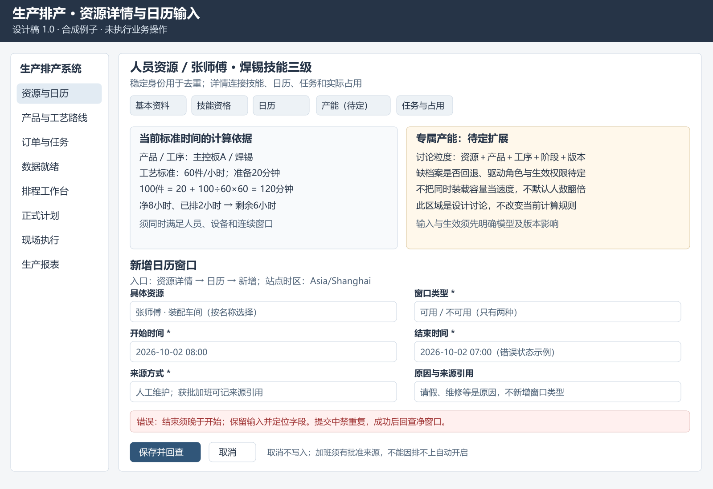

这张图明确当前标准工时与待定专属速率的区别，并修正旧日历控件的类型分类。下列沿用0.2版的图用于布局讨论，输入定义以本文对应表格为准；该图稿沿用不批准候选新增字段。


#### 4.3.1 车间

说明这是哪个车间、在哪里、能做哪些产品和工序，查看所属产线和资源规模。

使用角色：生产负责人、资源维护员。筛选：编码或名称、状态、工序能力。业务动作：新增车间、编辑基本信息、查看产线与资源。

**列表与查询结果**

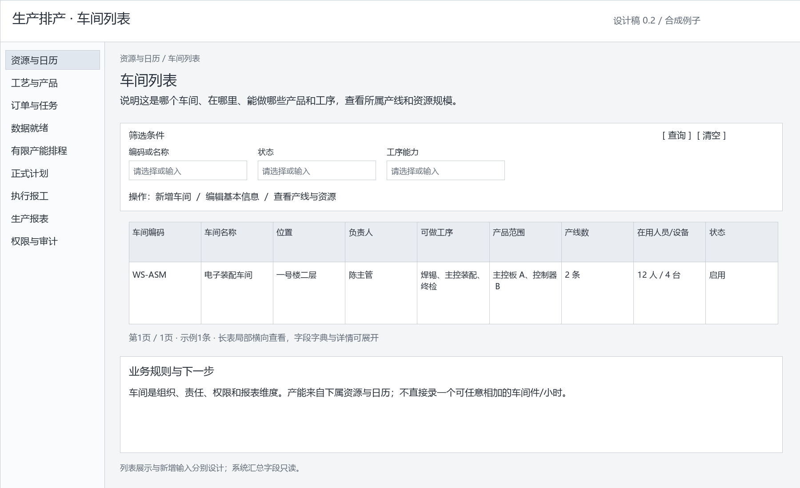

| 展示字段 | 业务例子 | 来源或方案边界 | 展示规则 |
|---|---|---|---|
| 车间编码 | WS-ASM | 已有业务资料 | 唯一、稳定；停用后保留历史 |
| 车间名称 | 电子装配车间 | 已有业务资料 | 只读展示已保存值；未提供可选值显示为空 |
| 位置 | 一号楼二层 | 拟补新增 | 楼栋/楼层/区域，不记录工厂实体 |
| 负责人 | 陈主管 | 已有业务资料 | 从平台用户选择，页面显示姓名 |
| 可做工序 | 焊锡、主控装配、终检 | 拟补关联汇总 | 由中心、合格资源和已生效工艺汇总；说明性标签不能代替排程资格 |
| 产品范围 | 主控板 A、控制器 B | 拟补新增 | 维护产品族/许可范围，与具体资源资格分开 |
| 产线数 | 2 条 | 拟补派生 | 由有效产线记录统计，不手填一个孤立数字 |
| 在用人员/设备 | 12 人 / 4 台 | 派生汇总 | 人员按稳定资源去重；不同设备单位不相加 |
| 状态 | 启用 | 已有业务资料 | 启用/停用；停用影响新的排程 |

**新增车间**

入口：资源与日历→车间→新增车间。已有输入契约，页面交互待补齐

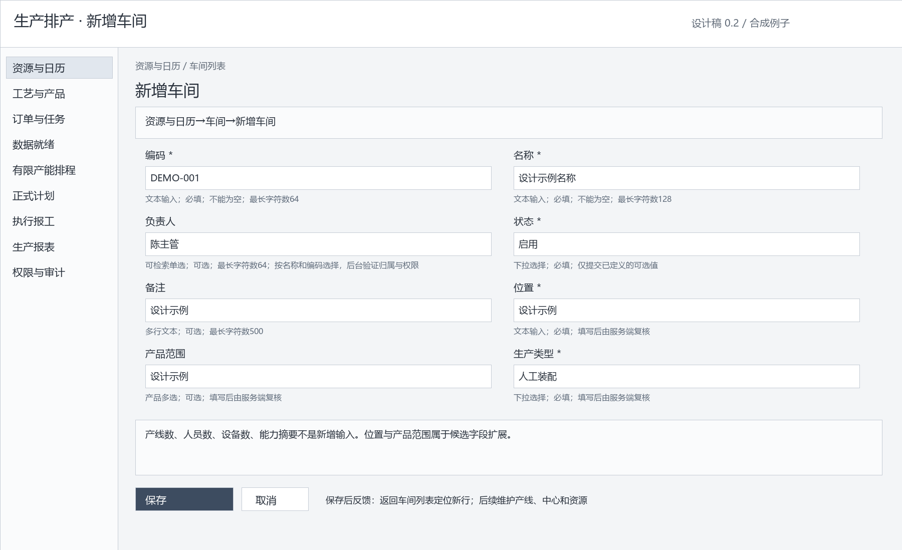

| 输入字段 | 控件 | 必填与联动 | 默认值 | 输入来源 | 校验与反馈 |
|---|---|---|---|---|---|
| 编码 | 文本输入 | 必填 | 空 | 人工填写 | 不能为空；最长字符数64 |
| 名称 | 文本输入 | 必填 | 空 | 人工填写 | 不能为空；最长字符数128 |
| 负责人 | 可检索单选 | 可选 | 空 | 若依已有用户选择器 | 最长字符数64；按名称和编码选择，后台验证归属与权限 |
| 状态 | 下拉选择 | 必填 | 启用 | 启用、停用 | 仅提交已定义的可选值：启用、停用 |
| 备注 | 多行文本 | 可选 | 空 | 人工填写 | 最长字符数500 |
| 位置（待定） | 文本输入 | 必填 | 空 | 人工填写 | 待定字段，实施前明确格式、范围及拒绝条件 |
| 产品范围（待定） | 产品多选 | 可选 | 空 | 启用产品目录 | 待定字段，实施前明确格式、范围及拒绝条件 |
| 生产类型（待定） | 下拉选择 | 必填 | 空 | 人工装配、设备加工、批处理、混合 | 待定字段，实施前明确格式、范围及拒绝条件 |

业务限制：产线数、人员数、设备数、能力摘要不是新增输入。位置与产品范围属于候选字段扩展。

提交与成功返回：校验编码唯一、负责人可选范围；保存基本资料，数量与能力摘要由关联记录计算；返回车间列表定位新行；后续维护产线、中心和资源。

**编辑、详情与回查**

基础资料在允许的状态下复用专用表单并带当前版本。已使用编码、单位及归属变更先检查引用；停用保留历史。工艺生效版本复制新草稿，订单可编辑状态及迁移按第5、6章处理。

详情补充：生产类型：装配 / 加工 / 批处理 / 混合（候选）；职责说明（候选）；工作中心数量、备注、负责人关联和修改记录。

<!-- 原页面关联：P01；REQ-04；AC-08～11；UAT-04 -->

#### 4.3.2 产线（待定扩展）

说明一个车间有哪几条生产线，以及每条线覆盖哪些工作中心和工序。

使用角色：生产负责人、资源维护员。筛选：车间、名称、类型、状态。业务动作：新增产线、编辑、查看工作中心。

**列表与查询结果**

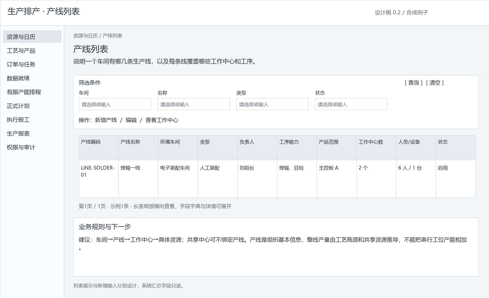

| 展示字段 | 业务例子 | 来源或方案边界 | 展示规则 |
|---|---|---|---|
| 产线编码 | LINE-SOLDER-01 | 拟补新增 | 车间内唯一 |
| 产线名称 | 焊锡一线 | 拟补新增 | 只读展示已保存值；未提供可选值显示为空 |
| 所属车间 | 电子装配车间 | 拟补关联 | 选择已启用车间 |
| 类型 | 人工装配 | 拟补新增 | 人工/设备/混合/批处理 |
| 负责人 | 刘组长 | 拟补关联 | 选择平台用户 |
| 工序能力 | 焊锡、目检 | 拟补新增 | 关联工序/技能许可，不用备注作为求解约束 |
| 产品范围 | 主控板 A | 拟补新增 | 只读展示已保存值；未提供可选值显示为空 |
| 工作中心数 | 2 个 | 拟补派生 | 按关联记录统计 |
| 人员/设备 | 6 人 / 1 台 | 拟补派生 | 共享人员不重复累计；资源占用仍按具名身份 |
| 状态 | 启用 | 拟补新增 | 只读展示已保存值；未提供可选值显示为空 |

**新增产线**

入口：资源与日历→产线→新增产线。候选新增数据及接口

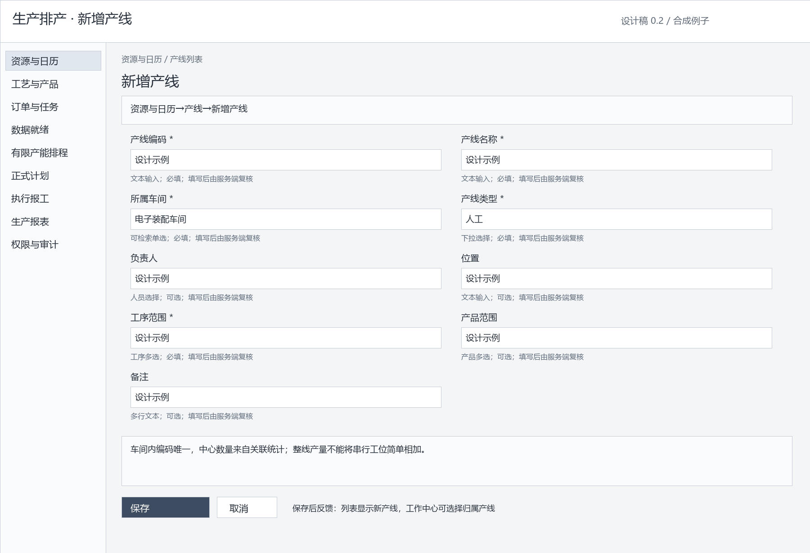

| 输入字段 | 控件 | 必填与联动 | 默认值 | 输入来源 | 校验与反馈 |
|---|---|---|---|---|---|
| 产线编码（待定） | 文本输入 | 必填 | 空 | 人工填写 | 待定字段，实施前明确格式、范围及拒绝条件 |
| 产线名称（待定） | 文本输入 | 必填 | 空 | 人工填写 | 待定字段，实施前明确格式、范围及拒绝条件 |
| 所属车间（关联选择交互） | 可检索单选 | 必填 | 空 | 已启用且有权限的车间 | 待定字段，实施前明确格式、范围及拒绝条件 |
| 产线类型（待定） | 下拉选择 | 必填 | 空 | 人工、设备、混合、批处理 | 待定字段，实施前明确格式、范围及拒绝条件 |
| 负责人（待定） | 人员选择 | 可选 | 空 | 已有用户 | 待定字段，实施前明确格式、范围及拒绝条件 |
| 位置（待定） | 文本输入 | 可选 | 空 | 人工填写 | 待定字段，实施前明确格式、范围及拒绝条件 |
| 工序范围（待定） | 工序多选 | 必填 | 空 | 已生效工序 | 待定字段，实施前明确格式、范围及拒绝条件 |
| 产品范围（待定） | 产品多选 | 可选 | 空 | 产品目录 | 待定字段，实施前明确格式、范围及拒绝条件 |
| 备注（待定） | 多行文本 | 可选 | 空 | 人工填写 | 待定字段，实施前明确格式、范围及拒绝条件 |

业务限制：车间内编码唯一，中心数量来自关联统计；整线产量不能将串行工位简单相加。

提交与成功返回：候选接口保存产线及结构化工序/产品范围；列表显示新产线，工作中心可选择归属产线。

**编辑、详情与回查**

候选草稿可编辑；生效及被引用版本保留历史，具体版本生效、归属变更与数据迁移规则须按第4.2节决定。此小节不批准新模型。

详情补充：位置（候选）；说明与备注（候选）；所属工作中心清单；瓶颈工序及当前负荷（条件汇总）。

<!-- 原页面关联：P02；REQ-04；AC-08～11；UAT-04 -->

#### 4.3.3 工作中心

定义焊锡组、主控装配组、回流焊炉区等工作单元，组织可替代资源。

使用角色：资源维护员、工艺工程师。筛选：车间、产线、类型、工序、状态。业务动作：新增中心、编辑、查看资源。

**列表与查询结果**

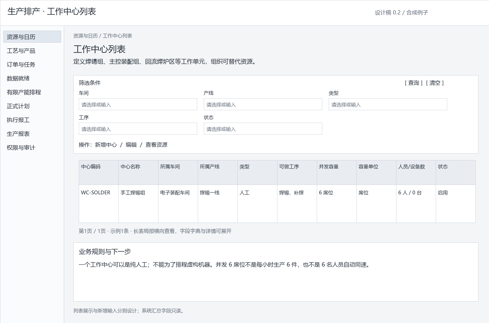

| 展示字段 | 业务例子 | 来源或方案边界 | 展示规则 |
|---|---|---|---|
| 中心编码 | WC-SOLDER | 已有业务资料 | 只读展示已保存值；未提供可选值显示为空 |
| 中心名称 | 手工焊锡组 | 已有业务资料 | 只读展示已保存值；未提供可选值显示为空 |
| 所属车间 | 电子装配车间 | 已有业务资料 | 必须与下属资源归属一致 |
| 所属产线 | 焊锡一线 | 拟补新增 | 允许共享中心留空 |
| 类型 | 人工 | 已有业务资料 | 人工/设备/混合/批处理 |
| 可做工序 | 焊锡、补焊 | 拟补新增 | 结构化工序许可，不能仅存字符串后宣称引擎支持 |
| 并发容量 | 6 席位 | 已有业务资料 | 同一时刻可容纳的占用量；独立中心限额与下属资源限额同时满足 |
| 容量单位 | 席位 | 已有业务资料 | 单一明确单位；与产量 EA/h 分开 |
| 人员/设备数 | 6 人 / 0 台 | 派生汇总 | 按具名资源统计 |
| 状态 | 启用 | 已有业务资料 | 只读展示已保存值；未提供可选值显示为空 |

**新增工作中心**

入口：资源与日历→工作中心→新增。已有输入契约，页面交互待补齐

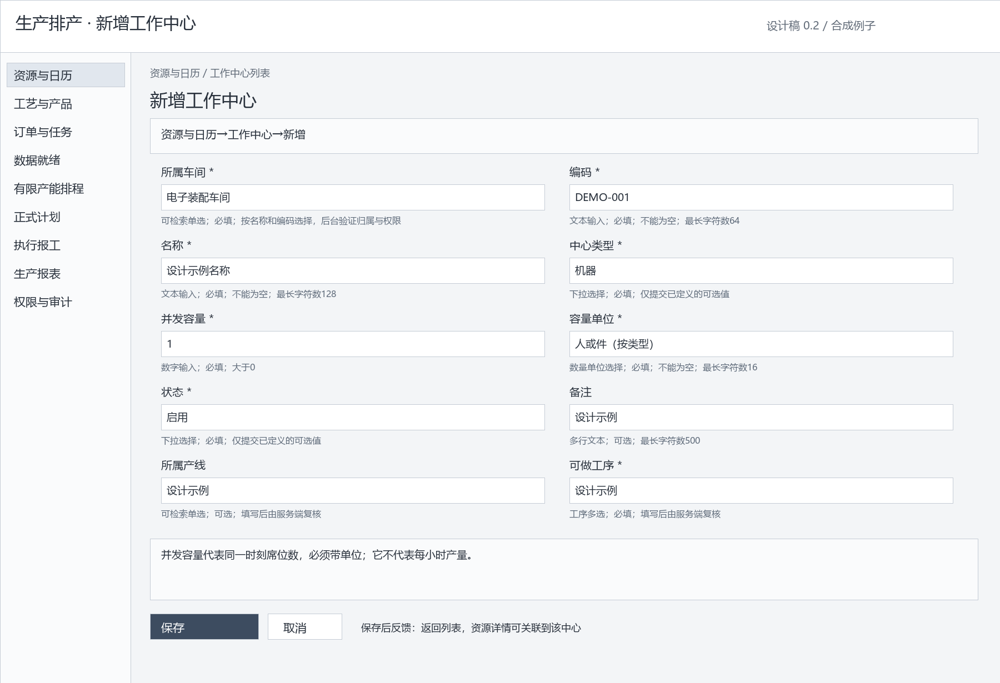

| 输入字段 | 控件 | 必填与联动 | 默认值 | 输入来源 | 校验与反馈 |
|---|---|---|---|---|---|
| 所属车间 | 可检索单选 | 必填 | 空 | 已启用且有权限的车间 | 按名称和编码选择，后台验证归属与权限 |
| 编码 | 文本输入 | 必填 | 空 | 人工填写 | 不能为空；最长字符数64 |
| 名称 | 文本输入 | 必填 | 空 | 人工填写 | 不能为空；最长字符数128 |
| 中心类型 | 下拉选择 | 必填 | 空 | 机器、人工、混合、批处理 | 仅提交已定义的可选值：机器、人工、混合、批处理 |
| 并发容量 | 数字输入 | 必填 | 空 | 人工填写 | 大于0 |
| 容量单位 | 数量单位选择 | 必填 | 空 | 固定数量单位字典；不允许无规则换算 | 不能为空；最长字符数16 |
| 状态 | 下拉选择 | 必填 | 启用 | 启用、停用 | 仅提交已定义的可选值：启用、停用 |
| 备注 | 多行文本 | 可选 | 空 | 人工填写 | 最长字符数500 |
| 所属产线（关联选择交互） | 可检索单选 | 可选 | 空 | 所选车间的产线；可留空作为共享中心 | 待定字段，实施前明确格式、范围及拒绝条件 |
| 可做工序（待定） | 工序多选 | 必填 | 空 | 已生效工序 | 待定字段，实施前明确格式、范围及拒绝条件 |

业务限制：并发容量代表同一时刻席位数，必须带单位；它不代表每小时产量。

提交与成功返回：保存归属、并发限制和工序许可；工序许可、产线字段需扩展契约；返回列表，资源详情可关联到该中心。

**编辑、详情与回查**

基础资料在允许的状态下复用专用表单并带当前版本。已使用编码、单位及归属变更先检查引用；停用保留历史。工艺生效版本复制新草稿，订单可编辑状态及迁移按第5、6章处理。

详情补充：位置与负责人（候选）；允许产品/产品族（候选）；备注、资源清单和中心日历影响。

<!-- 原页面关联：P03；REQ-04；AC-08～11；UAT-04 -->

#### 4.3.4 人员资源

管理实际可以被安排任务的人：会做什么、能做多少、何时可用、已占多少时间。

使用角色：资源维护员、车间主管。筛选：姓名或员工编码、车间/产线/中心、班组、技能、状态。业务动作：新增人员、编辑、维护技能、维护产能、查看日历与任务。

**列表与查询结果**

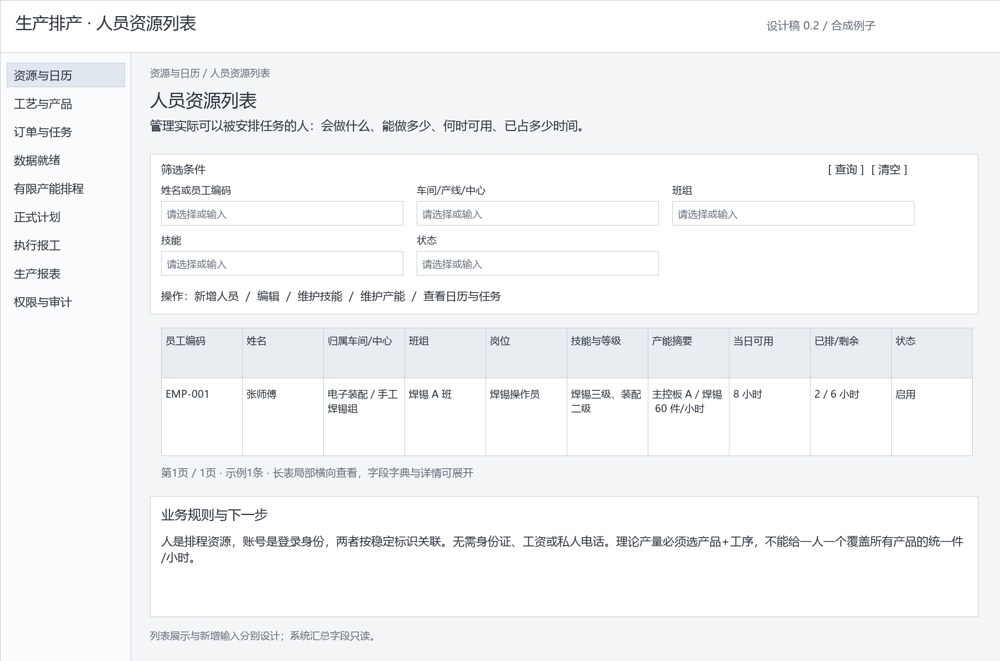

| 展示字段 | 业务例子 | 来源或方案边界 | 展示规则 |
|---|---|---|---|
| 员工编码 | EMP-001 | 已有业务资料 | 对应一名稳定人员资源；不能为每个技能重复建人 |
| 姓名 | 张师傅 | 已有业务资料 | 只读展示已保存值；未提供可选值显示为空 |
| 归属车间/中心 | 电子装配 / 手工焊锡组 | 已有字段关联展示 | workshopId、workCenterId 关联；中心可选 |
| 班组 | 焊锡 A 班 | 已有业务资料 | 只读展示已保存值；未提供可选值显示为空 |
| 岗位 | 焊锡操作员 | 拟补新增 | 岗位描述与技能资格分开 |
| 技能与等级 | 焊锡三级、装配二级 | 关联展示 | 来自有效技能记录 |
| 产能摘要 | 主控板 A / 焊锡 60 件/小时 | 拟补关联展示 | 按产品、工序、阶段查生效档案；多个档案可展开 |
| 当日可用 | 8 小时 | 派生汇总 | 净日历已扣请假等；查询日期明确 |
| 已排/剩余 | 2 / 6 小时 | 派生汇总 | 多技能不能重复产生可用时间 |
| 状态 | 启用 | 已有业务资料 | 启用/停用；请假由日历表达 |

**新增人员资源**

入口：资源与日历→人员资源→新增。已有输入契约，页面交互待补齐

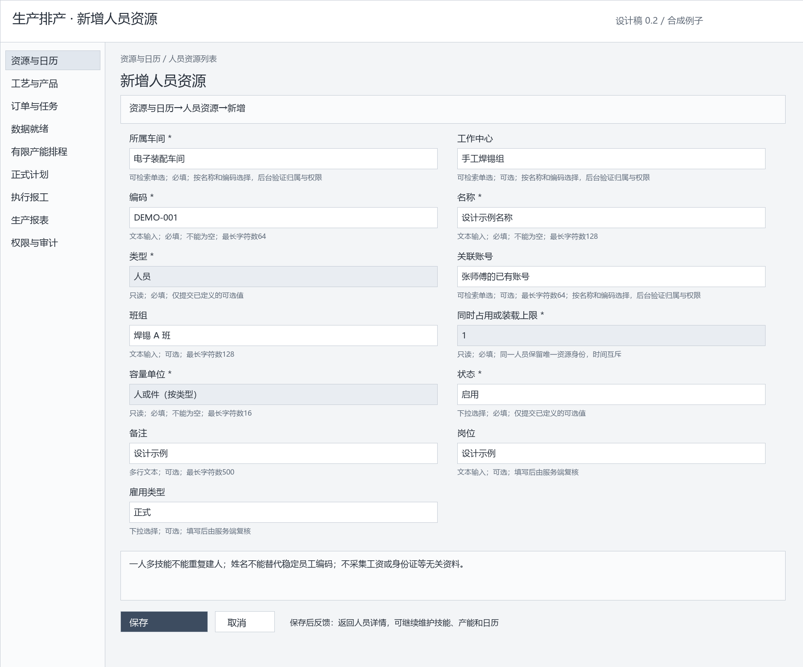

| 输入字段 | 控件 | 必填与联动 | 默认值 | 输入来源 | 校验与反馈 |
|---|---|---|---|---|---|
| 所属车间 | 可检索单选 | 必填 | 空 | 已启用且有权限的车间 | 按名称和编码选择，后台验证归属与权限 |
| 工作中心 | 可检索单选 | 可选 | 空 | 所选车间的工作中心；车间改变时清空旧选择 | 按名称和编码选择，后台验证归属与权限 |
| 编码 | 文本输入 | 必填 | 空 | 人工填写 | 不能为空；最长字符数64 |
| 名称 | 文本输入 | 必填 | 空 | 人工填写 | 不能为空；最长字符数128 |
| 类型 | 只读 | 必填 | 人员 | 由人员资源入口固定 | 仅提交已定义的可选值：人员、机器、工位、工装 |
| 关联账号 | 可检索单选 | 可选 | 空 | 若依已有用户，可不绑定登录账号 | 最长字符数64；按名称和编码选择，后台验证归属与权限 |
| 班组 | 文本输入 | 可选 | 空 | 人工填写 | 最长字符数128 |
| 同时占用或装载上限 | 只读 | 必填 | 1 | 人工填写 | 同一人员保留唯一资源身份，时间互斥 |
| 容量单位 | 只读 | 必填 | 人 | 固定数量单位字典；不允许无规则换算 | 不能为空；最长字符数16 |
| 状态 | 下拉选择 | 必填 | 启用 | 启用、停用、维修 | 仅提交已定义的可选值：启用、停用、维修 |
| 备注 | 多行文本 | 可选 | 空 | 人工填写 | 最长字符数500 |
| 岗位（待定） | 文本输入 | 可选 | 空 | 人工填写 | 待定字段，实施前明确格式、范围及拒绝条件 |
| 雇用类型（待定） | 下拉选择 | 可选 | 空 | 正式、临时、外协；不参与自动速度换算 | 待定字段，实施前明确格式、范围及拒绝条件 |

业务限制：一人多技能不能重复建人；姓名不能替代稳定员工编码；不采集工资或身份证等无关资料。

提交与成功返回：以唯一员工编码保存人员资源；可关联已有平台账号；返回人员详情，可继续维护技能、产能和日历。

**编辑、详情与回查**

基础资料在允许的状态下复用专用表单并带当前版本。已使用编码、单位及归属变更先检查引用；停用保留历史。工艺生效版本复制新草稿，订单可编辑状态及迁移按第5、6章处理。

详情补充：平台账号 ruoyiUserId：可选关联，按姓名选择；雇用类型：正式/临时/外协（候选，只作业务分类）；可借调范围与时间授权（候选）；备注、技能明细、产能明细、日历、任务历史；劳动并发容量默认 1；需要多人配合作业时分配多个不同人员。

<!-- 原页面关联：P04；REQ-04；AC-08～11/21；APS-REQ-16、APS-AC-09（专属速率原为 P1）；UAT-04/11 -->

#### 4.3.5 设备与工位

管理实际机器、炉、工位和工装的能力、装载容量、产能、维修和占用。

使用角色：设备维护员、资源维护员。筛选：编码/名称、类型、车间/中心、工序能力、状态。业务动作：新增设备/工位、编辑、维护产能、维护能力、安排维护时间窗。

**列表与查询结果**

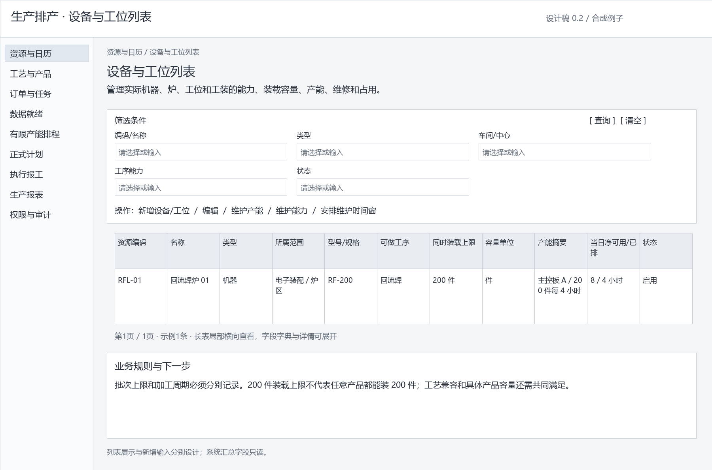

| 展示字段 | 业务例子 | 来源或方案边界 | 展示规则 |
|---|---|---|---|
| 资源编码 | RFL-01 | 已有业务资料 | 只读展示已保存值；未提供可选值显示为空 |
| 名称 | 回流焊炉 01 | 已有业务资料 | 只读展示已保存值；未提供可选值显示为空 |
| 类型 | 机器 | 已有业务资料 | 机器/工位/工装；人员另页展示 |
| 所属范围 | 电子装配 / 炉区 | 已有字段关联展示 | 车间、中心关联展示 |
| 型号/规格 | RF-200 | 拟补新增 | 能力限制与规格说明分别录入 |
| 可做工序 | 回流焊 | 关联展示 | 结构化能力/技能资格 |
| 同时装载上限 | 200 件 | 已有业务资料 | 批处理最大装载量；不是每小时产量 |
| 容量单位 | 件 | 已有业务资料 | 首版只采用一个已确认的容量单位 |
| 产能摘要 | 主控板 A / 200 件每 4 小时 | 拟补关联展示 | 关联产能档案，说明准备/卸料是否另计 |
| 当日净可用/已排 | 8 / 4 小时 | 派生汇总 | 统计所选日期；计划与实际分别显示 |
| 状态 | 启用 | 已有业务资料 | 启用/停用/维护中 |

**新增设备或工位**

入口：资源与日历→设备与工位→新增。已有输入契约，页面交互待补齐

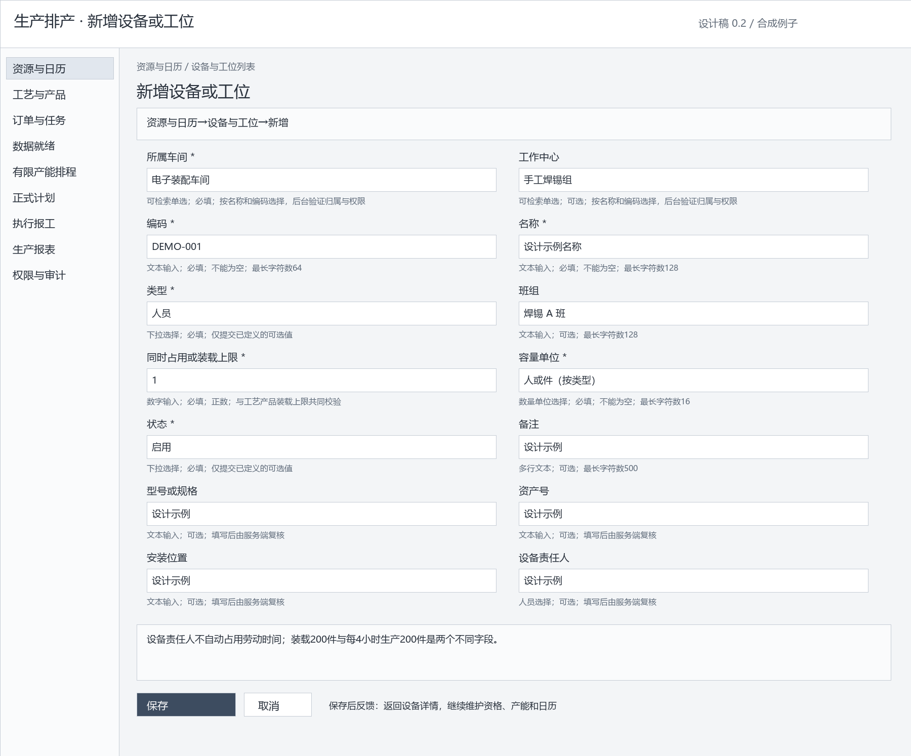

| 输入字段 | 控件 | 必填与联动 | 默认值 | 输入来源 | 校验与反馈 |
|---|---|---|---|---|---|
| 所属车间 | 可检索单选 | 必填 | 空 | 已启用且有权限的车间 | 按名称和编码选择，后台验证归属与权限 |
| 工作中心 | 可检索单选 | 可选 | 空 | 所选车间的工作中心；车间改变时清空旧选择 | 按名称和编码选择，后台验证归属与权限 |
| 编码 | 文本输入 | 必填 | 空 | 人工填写 | 不能为空；最长字符数64 |
| 名称 | 文本输入 | 必填 | 空 | 人工填写 | 不能为空；最长字符数128 |
| 类型 | 下拉选择 | 必填 | 空 | 机器、工位、工装，排除人员 | 仅提交已定义的可选值：人员、机器、工位、工装 |
| 班组 | 文本输入 | 可选 | 空 | 人工填写 | 最长字符数128 |
| 同时占用或装载上限 | 数字输入 | 必填 | 空 | 人工填写 | 正数；与工艺产品装载上限共同校验 |
| 容量单位 | 数量单位选择 | 必填 | 空 | 固定数量单位字典；不允许无规则换算 | 不能为空；最长字符数16 |
| 状态 | 下拉选择 | 必填 | 启用 | 启用、停用、维修 | 仅提交已定义的可选值：启用、停用、维修 |
| 备注 | 多行文本 | 可选 | 空 | 人工填写 | 最长字符数500 |
| 型号或规格（待定） | 文本输入 | 可选 | 空 | 人工填写 | 待定字段，实施前明确格式、范围及拒绝条件 |
| 资产号（待定） | 文本输入 | 可选 | 空 | 人工填写 | 待定字段，实施前明确格式、范围及拒绝条件 |
| 安装位置（待定） | 文本输入 | 可选 | 空 | 人工填写 | 待定字段，实施前明确格式、范围及拒绝条件 |
| 设备责任人（待定） | 人员选择 | 可选 | 空 | 已有用户 | 待定字段，实施前明确格式、范围及拒绝条件 |

业务限制：设备责任人不自动占用劳动时间；装载200件与每4小时生产200件是两个不同字段。

提交与成功返回：保存设备基础资料和同时装载容量；维修停机另外落成日历窗口；返回设备详情，继续维护资格、产能和日历。

**编辑、详情与回查**

基础资料在允许的状态下复用专用表单并带当前版本。已使用编码、单位及归属变更先检查引用；停用保留历史。工艺生效版本复制新草稿，订单可编辑状态及迁移按第5、6章处理。

详情补充：制造商、资产号、安装位置（候选，可选）；设备责任人（候选；责任人不自动占用劳动时间）；校准/维修说明（候选，停机必须落成日历时间窗）；工位/工装类型、能力清单、产能档案、日历、实际占用和历史。

<!-- 原页面关联：P05；REQ-04；AC-06/08～11；UAT-03/04 -->

#### 4.3.6 技能与资格

说明人员或设备是否有资格执行某工序，避免把空闲但不合格的资源排进去。

使用角色：资源维护员、工艺工程师。筛选：资源、技能、等级、有效状态。业务动作：新增资格、编辑有效期、停用资格。

**列表与查询结果**

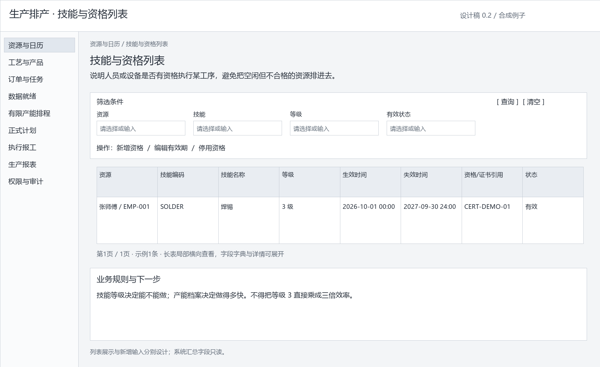

| 展示字段 | 业务例子 | 来源或方案边界 | 展示规则 |
|---|---|---|---|
| 资源 | 张师傅 / EMP-001 | 已有业务资料 | 按姓名与编码选择 |
| 技能编码 | SOLDER | 已有业务资料 | 只读展示已保存值；未提供可选值显示为空 |
| 技能名称 | 焊锡 | 已有业务资料 | 只读展示已保存值；未提供可选值显示为空 |
| 等级 | 3 级 | 已有业务资料 | 1～10；须满足工艺最低等级 |
| 生效时间 | 2026-10-01 00:00 | 已有业务资料 | 为空表示无起始限制 |
| 失效时间 | 2027-09-30 24:00 | 已有业务资料 | 页面输入采用次日 00:00，区间边界明确 |
| 资格/证书引用 | CERT-DEMO-01 | 已有业务资料 | 引用即可，避免无关私人材料 |
| 状态 | 有效 | 已有业务资料 | ACTIVE/INACTIVE/EXPIRED；资格仍须按具体任务时段判断 |

**新增技能或资格**

入口：资源详情→技能→新增，或技能列表→新增。已有输入契约，页面交互待补齐

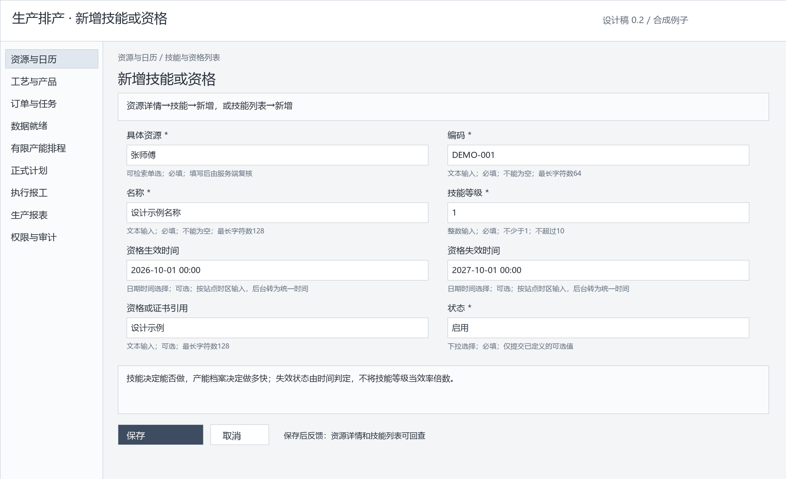

| 输入字段 | 控件 | 必填与联动 | 默认值 | 输入来源 | 校验与反馈 |
|---|---|---|---|---|---|
| 具体资源（关联选择交互） | 可检索单选 | 必填 | 空 | 同范围的具体人员或设备，显示名称与编码 | 待定字段，实施前明确格式、范围及拒绝条件 |
| 编码 | 文本输入 | 必填 | 空 | 人工填写 | 不能为空；最长字符数64 |
| 名称 | 文本输入 | 必填 | 空 | 人工填写 | 不能为空；最长字符数128 |
| 技能等级 | 整数输入 | 必填 | 空 | 人工填写 | 不少于1；不超过10 |
| 资格生效时间 | 日期时间选择 | 可选 | 空 | 人工填写 | 按站点时区输入，后台转为统一时间 |
| 资格失效时间 | 日期时间选择 | 可选 | 空 | 人工填写 | 按站点时区输入，后台转为统一时间 |
| 资格或证书引用 | 文本输入 | 可选 | 空 | 人工填写 | 最长字符数128 |
| 状态 | 下拉选择 | 必填 | 启用 | 启用、停用、已失效 | 仅提交已定义的可选值：启用、停用、已失效 |

业务限制：技能决定能否做，产能档案决定做多快；失效状态由时间判定，不将技能等级当效率倍数。

提交与成功返回：把资格关联到已存在的资源，校验等级和有效区间；资源详情和技能列表可回查。

**编辑、详情与回查**

基础资料在允许的状态下复用专用表单并带当前版本。已使用编码、单位及归属变更先检查引用；停用保留历史。工艺生效版本复制新草稿，订单可编辑状态及迁移按第5、6章处理。

详情补充：资源归属范围（关联）；技能适用工序（候选关联）；审核说明与修改历史（候选）。

<!-- 原页面关联：P06；AC-08/10；UAT-04 -->

#### 4.3.7 资源产能档案（待定扩展）

维护某个人或设备在特定产品、工序和阶段下，每小时或每批能完成多少。

使用角色：工艺工程师、资源维护员。筛选：资源、产品/产品族、工序、计算模式、有效状态。业务动作：新增产能档案、查看测定依据、复制新版本、确认生效。

**列表与查询结果**

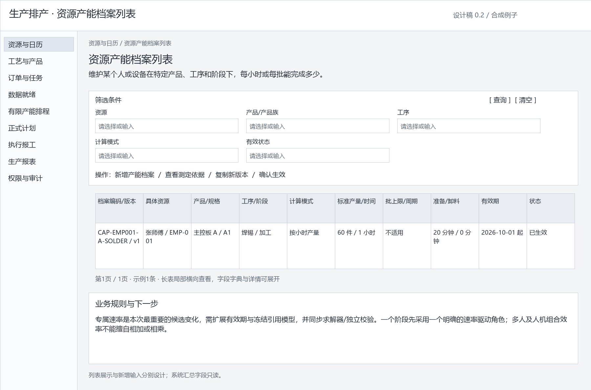

| 展示字段 | 业务例子 | 来源或方案边界 | 展示规则 |
|---|---|---|---|
| 档案编码/版本 | CAP-EMP001-A-SOLDER / v1 | 拟补新增 | 独立版本，排程冻结引用 |
| 具体资源 | 张师傅 / EMP-001 | 拟补关联 | 人员或设备，不能是泛称班组 |
| 产品/规格 | 主控板 A / A1 | 拟补关联 | 具体产品优先；产品族兜底须显式批准 |
| 工序/阶段 | 焊锡 / 加工 | 拟补关联 | 按工序及速率驱动阶段确定 |
| 计算模式 | 按小时产量 | 拟补新增 | 按小时产量/固定批周期；按天和上午由日历计算 |
| 标准产量/时间 | 60 件 / 1 小时 | 拟补新增 | 值>0，数量单位一致；标准处理产量，非质检合格量 |
| 批上限/周期 | 不适用 | 拟补新增 | 批模式必须录最大批量、固定周期和尾批规则 |
| 准备/卸料 | 20 分钟 / 0 分钟 | 拟补新增 | 与周期口径分开，避免重复计算 |
| 有效期 | 2026-10-01 起 | 拟补新增 | 同资源、产品、工序、阶段不能有冲突的生效版本 |
| 状态 | 已生效 | 拟补新增 | 草稿/已生效/停用；生效动作受权限与审计控制 |

**新增资源产能档案**

入口：资源详情→产能→新增，或产能档案列表→新增。候选新增模型及接口

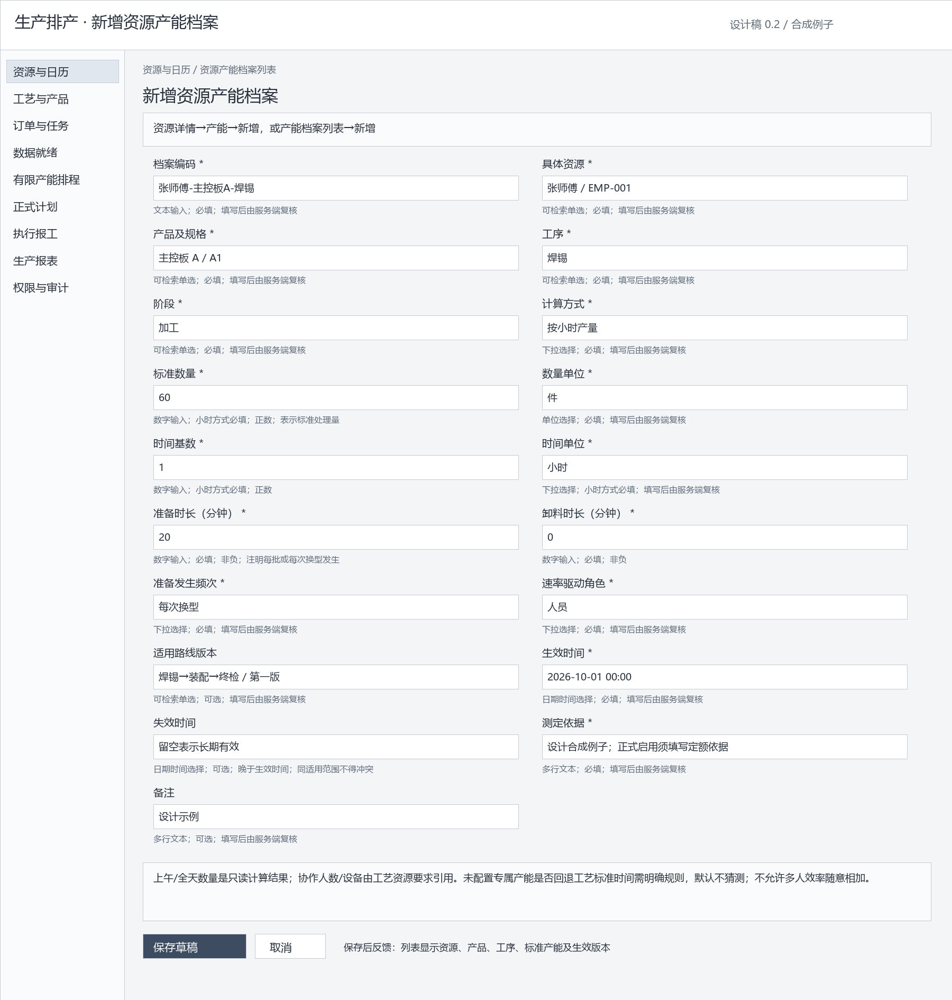

| 输入字段 | 控件 | 必填与联动 | 默认值 | 输入来源 | 校验与反馈 |
|---|---|---|---|---|---|
| 档案编码（待定） | 文本输入 | 必填 | 空 | 人工填写 | 待定字段，实施前明确格式、范围及拒绝条件 |
| 具体资源（关联选择交互） | 可检索单选 | 必填 | 空 | 同范围的具体人员或设备，显示名称与编码 | 待定字段，实施前明确格式、范围及拒绝条件 |
| 产品及规格（关联选择交互） | 可检索单选 | 必填 | 空 | 具体产品及规格 | 待定字段，实施前明确格式、范围及拒绝条件 |
| 工序（关联选择交互） | 可检索单选 | 必填 | 空 | 适用工序 | 待定字段，实施前明确格式、范围及拒绝条件 |
| 阶段（关联选择交互） | 可检索单选 | 必填 | 空 | 所选工序的阶段 | 待定字段，实施前明确格式、范围及拒绝条件 |
| 计算方式（待定） | 下拉选择 | 必填 | 按小时产量 | 按小时产量、固定批周期 | 待定字段，实施前明确格式、范围及拒绝条件 |
| 标准数量（待定） | 数字输入 | 小时方式必填；显示条件：hour | 空 | 人工填写 | 正数；表示标准处理量 |
| 数量单位（待定） | 单位选择 | 必填 | 件 | 产品单位，禁止未经批准换算 | 待定字段，实施前明确格式、范围及拒绝条件 |
| 时间基数（待定） | 数字输入 | 小时方式必填；显示条件：hour | 1 | 人工填写 | 正数 |
| 时间单位（待定） | 下拉选择 | 小时方式必填；显示条件：hour | 小时 | 分钟、小时 | 待定字段，实施前明确格式、范围及拒绝条件 |
| 最小批量（待定） | 数字输入 | 批次方式必填；显示条件：batch | 1 | 人工填写 | 正数且不大于最大批量 |
| 最大批量（待定） | 数字输入 | 批次方式必填；显示条件：batch | 空 | 人工填写 | 不超过设备及工艺容量上限 |
| 固定批周期（小时）（待定） | 数字输入 | 批次方式必填；显示条件：batch | 空 | 人工填写 | 正数；不可中断时必须落在连续合法窗口 |
| 允许尾批（待定） | 开关 | 批次方式必填；显示条件：batch | 是 | 人工填写 | 待定字段，实施前明确格式、范围及拒绝条件 |
| 准备时长（分钟）（待定） | 数字输入 | 必填 | 0 | 人工填写 | 非负；注明每批或每次换型发生 |
| 卸料时长（分钟）（待定） | 数字输入 | 必填 | 0 | 人工填写 | 非负 |
| 准备及卸料已包含在周期（待定） | 开关 | 批次方式必填；显示条件：batch | 否 | 人工填写 | 包含时不重复加时长；小时方式不显示 |
| 准备发生频次（待定） | 下拉选择 | 必填 | 空 | 每次换型、每批；两种口径不能混用 | 待定字段，实施前明确格式、范围及拒绝条件 |
| 速率驱动角色（待定） | 下拉选择 | 必填 | 空 | 人员、设备；一个阶段只有一个明确驱动角色 | 待定字段，实施前明确格式、范围及拒绝条件 |
| 适用路线版本（关联选择交互） | 可检索单选 | 可选 | 空 | 该产品路线版本 | 待定字段，实施前明确格式、范围及拒绝条件 |
| 批兼容条件（待定） | 文本输入 | 批次方式条件必填；显示条件：batch | 空 | 人工填写 | 同配方、规格及条件才可合批 |
| 生效时间（待定） | 日期时间选择 | 必填 | 空 | 人工填写 | 待定字段，实施前明确格式、范围及拒绝条件 |
| 失效时间（待定） | 日期时间选择 | 可选 | 空 | 人工填写 | 晚于生效时间；同适用范围不得冲突 |
| 测定依据（待定） | 多行文本 | 必填 | 空 | 人工填写 | 待定字段，实施前明确格式、范围及拒绝条件 |
| 备注（待定） | 多行文本 | 可选 | 空 | 人工填写 | 待定字段，实施前明确格式、范围及拒绝条件 |

业务限制：上午/全天数量是只读计算结果；协作人数/设备由工艺资源要求引用。未配置专属产能是否回退工艺标准时间需明确规则，默认不猜测；不允许多人效率随意相加。

提交与成功返回：先保存草稿，权限允许时检查适用范围、资格、重叠有效版本后生效；列表显示资源、产品、工序、标准产能及生效版本。

**编辑、详情与回查**

候选草稿可编辑；生效及被引用版本保留历史，具体版本生效、归属变更与数据迁移规则须按第4.2节决定。此小节不批准新模型。

详情补充：时间基数值与单位：如 1 小时、4 小时；标准数量单位；适用工艺版本、速率驱动角色（人员或设备）；批最小量、最大量、尾批可否加工、是否允许混批、兼容键；周期是否包含准备/装载/卸料；准备是否每次换型或每批发生；必要协作人数/设备/工位/工装：引用工艺资源需求，不能默认为无限可用；测定依据/样本说明、批准人/时间、生效/失效时间、备注（均为候选）；所选日期上午/下午/全天理论产量、剩余可安排产量（派生，附计算条件）。

<!-- 原页面关联：P07；APS-REQ-16；APS-DG-02；APS-AC-09（现行 P1）；AC-08/09/11/21；UAT-04/11 -->

#### 4.3.8 资源日历

说明具体日期什么时候能生产，扣除午休、请假、维修及已有占用后计算可安排窗口。

使用角色：资源维护员、设备维护员、车间主管。筛选：日期范围、车间/产线/中心、人员/设备、窗口类型。业务动作：添加时间窗、查看净日历、批量物化示例、查看受影响计划。

**列表与查询结果**

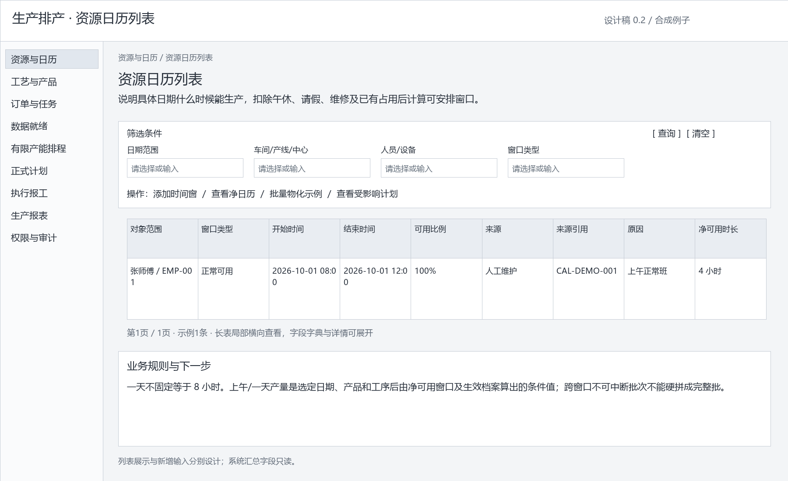

| 展示字段 | 业务例子 | 来源或方案边界 | 展示规则 |
|---|---|---|---|
| 对象范围 | 张师傅 / EMP-001 | 已有字段及拟补入口 | 现有资源级；车间/中心批量物化入口为候选 |
| 窗口类型 | 正常可用 | 已有业务资料 | 可用/不可用/加班/请假/维修 |
| 开始时间 | 2026-10-01 08:00 | 已有业务资料 | 界面显示站点时区 Asia/Shanghai，接口保存 UTC |
| 结束时间 | 2026-10-01 12:00 | 已有业务资料 | 开始<结束，半开区间 |
| 可用比例 | 100% | 已有业务资料 | 0～100%；不能用比例绕过具体人员互斥 |
| 来源 | 人工维护 | 已有业务资料 | 来源可追，导入应保留来源标识 |
| 来源引用 | CAL-DEMO-001 | 已有业务资料 | 只读展示已保存值；未提供可选值显示为空 |
| 原因 | 上午正常班 | 已有业务资料 | 请假/维修/不可用/加班须说明 |
| 净可用时长 | 4 小时 | 派生汇总 | 扣减后派生，不直接覆盖原窗 |

**新增可用或不可用时间窗**

入口：资源详情→日历→添加时间窗。已有输入契约，页面交互待补齐


| 输入字段 | 控件 | 必填与联动 | 默认值 | 输入来源 | 校验与反馈 |
|---|---|---|---|---|---|
| 具体资源（关联选择交互） | 可检索单选 | 必填 | 空 | 同范围的具体人员或设备，显示名称与编码 | 待定字段，实施前明确格式、范围及拒绝条件 |
| 窗口类型 | 下拉选择 | 必填 | 空 | 可用、不可用 | 仅提交可用或不可用；请假、维修记录为不可用的原因，加班记录为获批可用的来源 |
| 开始时间 | 日期时间选择 | 必填 | 空 | 人工填写 | 按站点时区输入，后台转为统一时间 |
| 结束时间 | 日期时间选择 | 必填 | 空 | 人工填写 | 按站点时区输入，后台转为统一时间 |
| 可用比例 | 数字输入 | 必填 | 1 | 人工填写 | 不超过1；大于0 |
| 来源方式 | 文本输入 | 必填 | 人工维护 | 人工填写 | 不能为空；最长字符数24 |
| 来源引用 | 文本输入 | 可选 | 空 | 人工填写 | 最长字符数128 |
| 原因 | 多行文本 | 可选 | 空 | 人工填写 | 最长字符数500 |

业务限制：开始早于结束；请假/维修用不可用窗口及原因表达；一天不固定等于8小时。日周重复模板属于后续扩展。

提交与成功返回：验证区间、比例及来源，保存绝对窗口；后台合并并计算净日历；日历显示原窗口、扣减后的净窗口和受影响计划。

**编辑、详情与回查**

基础资料在允许的状态下复用专用表单并带当前版本。已使用编码、单位及归属变更先检查引用；停用保留历史。工艺生效版本复制新草稿，订单可编辑状态及迁移按第5、6章处理。

详情补充：日/周日历视图、有效窗口与冲突提示；上午/下午/全天摘要，所属车间关闭窗口影响；批量生成人员/设备绝对时间窗（候选；模板与 HR 同步不在当前实现）；已排和实际占用叠加、修改原因与来源版本。

<!-- 原页面关联：P08；AC-08～11/20/21；UAT-04/11 -->

### 4.4 后台处理与数据变化

保存前检查身份、范围、编码唯一性、组织一致性及时间边界。资源与平台账号只做逻辑关联；技能和日历分别属于具体资源。原5张资源表继续承载当前事实；产线和专属产能未批准前不增加持久化模型。

日历编译输出净窗口及解释来源，资源资格由中心、类型、技能、有效期和状态共同决定。资料更新递增相应修订，不回写已执行记录和历史计划解释版本。批量维护须先定义原子或逐项成功语义，不能部分成功却显示全成功。

| 用例 | 现有或候选接口定位 | 边界 | 读写事实 |
|---|---|---|---|
| 新增资料 | `POST /api/aps/v1/resources/workshops` | 精确契约已有定义；运行事实另记 | 车间 |
| 读取列表 | `GET /api/aps/v1/resources/workshops` | 精确契约已有定义；运行事实另记 | 车间 |
| 编辑资料 | `PUT /api/aps/v1/resources/workshops/{id}` | 精确契约已有定义；运行事实另记 | 车间 |
| 产线列表及新增 | `POST /api/aps/v1/resources/production-lines` | 待定补充；实施前定义精确契约 | 拟新增产线及关系 |
| 查询产线 | `GET /api/aps/v1/resources/production-lines` | 待定补充；实施前定义精确契约 | 拟新增产线及关系 |
| 新增资料 | `POST /api/aps/v1/resources/centers` | 精确契约已有定义；运行事实另记 | 工作中心 |
| 读取列表 | `GET /api/aps/v1/resources/workshops/{workshopId}/centers` | 精确契约引用OpenAPI；按车间权限读取 | 工作中心 |
| 编辑资料 | `PUT /api/aps/v1/resources/centers/{id}` | 精确契约已有定义；运行事实另记 | 工作中心 |
| 新增资料 | `POST /api/aps/v1/resources` | 精确契约已有定义；运行事实另记 | 具体资源 |
| 读取列表 | `GET /api/aps/v1/resources` | 精确契约已有定义；运行事实另记 | 具体资源 |
| 编辑资料 | `PUT /api/aps/v1/resources/{id}` | 精确契约已有定义；运行事实另记 | 具体资源 |
| 保存技能 | `POST /api/aps/v1/resources/{resourceId}/skills` | 精确契约已有定义；运行事实另记 | 资源技能 |
| 维护产能档案 | `POST /api/aps/v1/resources/capacity-profiles` | 待定补充；实施前定义精确契约 | 拟新增有效期化产能档案 |
| 查询产能档案 | `GET /api/aps/v1/resources/capacity-profiles` | 待定补充；实施前定义精确契约 | 拟新增产能档案 |
| 使草稿生效 | `POST /api/aps/v1/resources/capacity-profiles/{id}/activate` | 待定补充；实施前定义精确契约 | 产能档案版本 |
| 保存日历窗口 | `POST /api/aps/v1/resources/{resourceId}/availability` | 精确契约已有定义；运行事实另记 | 资源日历 |
| 读取净可用窗口 | `GET /api/aps/v1/resources/{resourceId}/net-availability` | 精确契约已有定义；运行事实另记 | 资源日历查询 |

精确字段与错误协议引用第13.3节机器契约；此表只定位用例，不建立另一套字段定义。

### 4.5 与其他模块的衔接

工艺阶段引用中心、资源类型及技能要求；就绪检查定位缺资格与日历；排程冻结资源条件；执行在当前事实再次核验；报表用同一资源身份去重。资格、维修或窗口变化会使相关候选需要重新检查，现有正式计划只提示现实冲突，不自动改写。

### 4.6 业务验收方法

准备同一人员的两项技能和净8小时窗口，查看两个技能视角，总可用仍为8小时；加入请假后核对净窗口和受影响候选。准备技能不足、证书过期与合格在岗三个人，只有合法人能入选。专属产能样例在相关决定批准后再检验，不以当前工艺标准样例代替。

## 5. 产品与工艺路线

### 5.1 模块用途与业务流程

工艺人员建立产品和物料，定义每道工序的阶段、标准时间、资源角色、质量和批规则，再在产品路线中排列节点与依赖。保存草稿后校验完整性；发布生效版本供订单采用，修改已有生效工艺先复制新版本。

### 5.2 业务规则与状态变化

工序定义是可复用知识，路线节点是该知识在某条产品路线中的位置。阶段说明固定准备、按件加工、卸料、自然等待以及必要人机；不可中断和允许中断分别定义，中断还需最大分段、最小工作量、恢复准备、跨段资源策略及保留占用角色。

路线是有向无环图：禁止自依赖、循环、丢失节点和没有必要末端。独立分支可并行，汇合等待全部必需分支。产品列表显示顺序和相同工序名称都不自动产生依赖或合批。

| 关系 | 明确输入 | 业务结果 |
|---|---|---|
| 完成后开始 | 前后节点、释放条件、等待时间及自然/工作时间口径 | 后序不早于必要前序释放与等待 |
| 合格数量门槛 | 指定前序、数量或冻结比例、单位、是否消耗 | 101件的50%门槛为51件；50件合格仍不能开始 |
| 连续转移批 | 首批、后续批量、尾批、转运及质量条件 | 下序分批使用已释放有限量，首批达到不等于无限供给 |
| 共享加工批 | 兼容键、配方、容量、共同周期和成员数量 | 同批预约一次资源，各成员保持数量归属 |
| 同起同步来源 | 原始同步关系 | 当前只保留来源并阻断就绪与发布，不伪装成普通前后置或共享批 |

技术等待的自然时间与工作时间分开；需要运输人员或设备的转运必须形成有限占用。批次开始后不能任意增删成员。已展开订单冻结路线及工艺解释，发布新路线不悄悄更新它们。

### 5.3 页面与交互设计

产品详情进入路线版本；路线详情把节点图、阶段表和依赖放在一起。新增节点先选可用工序，阶段明细再维护时间与角色。依赖表单按关系类型显示门槛和批量字段，不向无关关系提交残留字段。

#### 5.3.1 产品与物料

定义要生产什么以及半成品、物料的编码、规格和数量单位。

使用角色：工艺工程师。筛选：编码或名称、类型、状态。业务动作：新增产品/物料、编辑、查看路线。

**列表与查询结果**

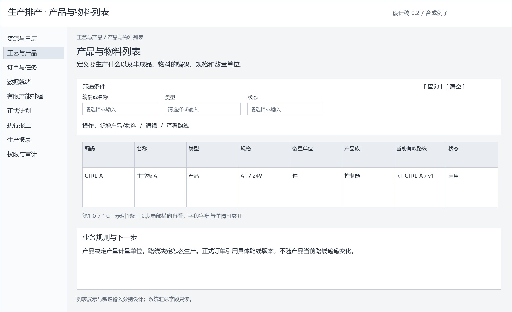

| 展示字段 | 业务例子 | 来源或方案边界 | 展示规则 |
|---|---|---|---|
| 编码 | CTRL-A | 已有业务资料 | 只读展示已保存值；未提供可选值显示为空 |
| 名称 | 主控板 A | 已有业务资料 | 只读展示已保存值；未提供可选值显示为空 |
| 类型 | 产品 | 已有业务资料 | 产品/半成品/物料 |
| 规格 | A1 / 24V | 已有业务资料 | 只读展示已保存值；未提供可选值显示为空 |
| 数量单位 | 件 | 已有业务资料 | 同一数量账必须使用可确认单位 |
| 产品族 | 控制器 | 拟补新增 | 用于能力与产能兜底范围，禁止隐式单位换算 |
| 当前有效路线 | RT-CTRL-A / v1 | 关联展示 | 允许多条路线时需显式选择 |
| 状态 | 启用 | 已有业务资料 | 只读展示已保存值；未提供可选值显示为空 |

**新增产品或物料**

入口：工艺与产品→产品物料→新增。已有输入契约，页面交互待补齐

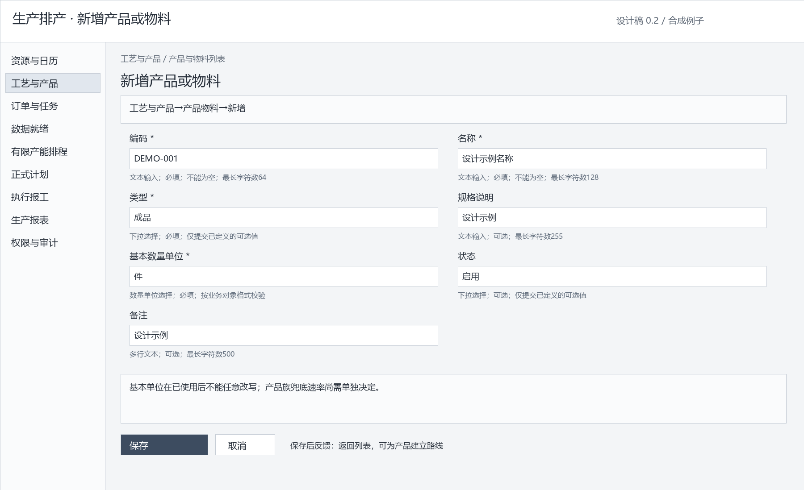

| 输入字段 | 控件 | 必填与联动 | 默认值 | 输入来源 | 校验与反馈 |
|---|---|---|---|---|---|
| 编码 | 文本输入 | 必填 | 空 | 人工填写 | 不能为空；最长字符数64 |
| 名称 | 文本输入 | 必填 | 空 | 人工填写 | 不能为空；最长字符数128 |
| 类型 | 下拉选择 | 必填 | 空 | 成品、半成品、物料 | 仅提交已定义的可选值：成品、半成品、物料 |
| 规格说明 | 文本输入 | 可选 | 空 | 人工填写 | 最长字符数255 |
| 基本数量单位 | 数量单位选择 | 必填 | 空 | 固定数量单位字典；不允许无规则换算 | 按业务对象格式校验 |
| 状态 | 下拉选择 | 可选 | 启用 | 启用、停用 | 仅提交已定义的可选值：启用、停用 |
| 备注 | 多行文本 | 可选 | 空 | 人工填写 | 最长字符数500 |

业务限制：基本单位在已使用后不能任意改写；产品族兜底速率尚需单独决定。

提交与成功返回：校验编码、分类与数量单位后保存；返回列表，可为产品建立路线。

**编辑、详情与回查**

基础资料在允许的状态下复用专用表单并带当前版本。已使用编码、单位及归属变更先检查引用；停用保留历史。工艺生效版本复制新草稿，订单可编辑状态及迁移按第5、6章处理。

详情补充：备注、路线列表、关联产能档案；重量/体积等规格说明可选；多维混装同时约束仍为扩展项。

<!-- 原页面关联：P09；AC-01/02；UAT-01 -->

#### 5.3.2 工序定义

定义焊锡、主控装配、终检等可复用工序，说明模式、标准工时和人员设备需求。

使用角色：工艺工程师。筛选：编码/名称、模式、状态。业务动作：新增工序、编辑草稿、配置阶段与资源、生效。

**列表与查询结果**

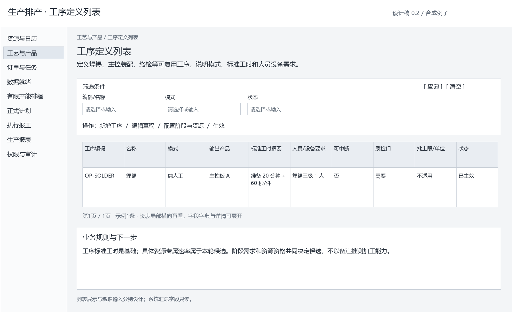

| 展示字段 | 业务例子 | 来源或方案边界 | 展示规则 |
|---|---|---|---|
| 工序编码 | OP-SOLDER | 已有业务资料 | 只读展示已保存值；未提供可选值显示为空 |
| 名称 | 焊锡 | 已有业务资料 | 只读展示已保存值；未提供可选值显示为空 |
| 模式 | 纯人工 | 已有业务资料 | 人工/人机协同/自动/批处理/等待/运输 |
| 输出产品 | 主控板 A | 已有业务资料 | 只读展示已保存值；未提供可选值显示为空 |
| 标准工时摘要 | 准备 20 分钟 + 60 秒/件 | 关联展示 | 源自阶段标准工时；专属产能生效后注明使用哪个版本 |
| 人员/设备要求 | 焊锡三级 1 人 | 关联展示 | 来自阶段需求，不能只写一个负责人 |
| 可中断 | 否 | 已有业务资料 | 不允许中断时必须找到完整连续窗口 |
| 质检门 | 需要 | 已有业务资料 | 需要质检的数量放行由实际质量事件决定 |
| 批上限/单位 | 不适用 | 已有业务资料 | 批模式条件必填 |
| 状态 | 已生效 | 已有业务资料 | 草稿/生效/停用 |

**新增工序定义**

入口：工艺与产品→工序→新增。已有输入契约，页面交互待补齐

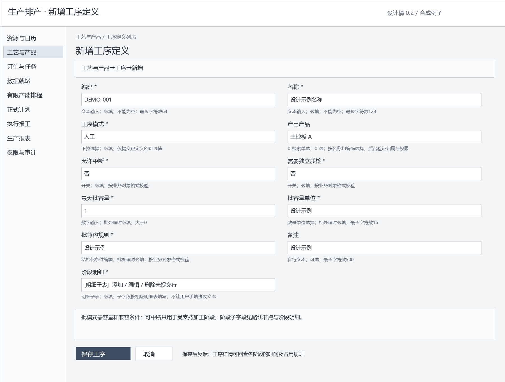

| 输入字段 | 控件 | 必填与联动 | 默认值 | 输入来源 | 校验与反馈 |
|---|---|---|---|---|---|
| 编码 | 文本输入 | 必填 | 空 | 人工填写 | 不能为空；最长字符数64 |
| 名称 | 文本输入 | 必填 | 空 | 人工填写 | 不能为空；最长字符数128 |
| 工序模式 | 下拉选择 | 必填 | 空 | 人工、人机协作、自动加工、批处理、等待、转运 | 仅提交已定义的可选值：人工、人机协作、自动加工、批处理、等待、转运 |
| 产出产品 | 可检索单选 | 可选 | 空 | 启用的产品目录 | 按名称和编码选择，后台验证归属与权限 |
| 允许中断 | 开关 | 必填 | 否 | 人工填写 | 按业务对象格式校验 |
| 需要独立质检 | 开关 | 必填 | 否 | 人工填写 | 按业务对象格式校验 |
| 最大批容量 | 数字输入 | 批处理时必填；显示条件：operation-batch | 空 | 人工填写 | 大于0 |
| 批容量单位 | 数量单位选择 | 批处理时必填；显示条件：operation-batch | 空 | 固定数量单位字典；不允许无规则换算 | 最长字符数16 |
| 批兼容规则 | 结构化条件编辑 | 批处理时必填；显示条件：operation-batch | 空 | 人工填写 | 按业务对象格式校验 |
| 备注 | 多行文本 | 可选 | 空 | 人工填写 | 最长字符数500 |
| 阶段明细 | 明细子表 | 必填 | 空 | 人工填写 | 子字段按相应明细表填写，不让用户手填协议文本 |

业务限制：批模式需容量和兼容条件；可中断只用于受支持加工阶段；阶段子字段见路线节点与阶段明细。

提交与成功返回：基本属性、阶段和资源要求作为同一完整工序保存，校验后单独生效；工序详情可回查各阶段的时间及占用规则。

**编辑、详情与回查**

基础资料在允许的状态下复用专用表单并带当前版本。已使用编码、单位及归属变更先检查引用；停用保留历史。工艺生效版本复制新草稿，订单可编辑状态及迁移按第5、6章处理。

详情补充：阶段列表、固定时间/单位时间、资源占用策略、最低技能等级；批单位、尾批/兼容规则、备注；生效前检查缺工时、无必需资源和单位冲突。

<!-- 原页面关联：P10；AC-01/06/08～11；UAT-01/03/04 -->

#### 5.3.3 工艺路线版本

把产品的多道工序串成有先后与并行关系的生产路线，管理可追溯版本。

使用角色：工艺工程师。筛选：产品、路线、版本状态。业务动作：新增路线、复制版本、编辑草稿图、校验并生效。

**列表与查询结果**

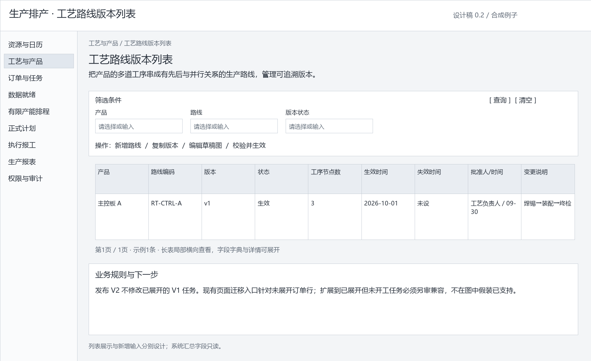

| 展示字段 | 业务例子 | 来源或方案边界 | 展示规则 |
|---|---|---|---|
| 产品 | 主控板 A | 已有业务资料 | 只读展示已保存值；未提供可选值显示为空 |
| 路线编码 | RT-CTRL-A | 已有业务资料 | 只读展示已保存值；未提供可选值显示为空 |
| 版本 | v1 | 已有业务资料 | 只读展示已保存值；未提供可选值显示为空 |
| 状态 | 生效 | 已有业务资料 | 草稿/生效/退役 |
| 工序节点数 | 3 | 派生汇总 | 由节点统计 |
| 生效时间 | 2026-10-01 | 已有业务资料 | 只读展示已保存值；未提供可选值显示为空 |
| 失效时间 | 未设 | 已有业务资料 | 只读展示已保存值；未提供可选值显示为空 |
| 批准人/时间 | 工艺负责人 / 09-30 | 已有字段关联展示 | 批准字段关联展示 |
| 变更说明 | 焊锡→装配→终检 | 已有业务资料 | 只读展示已保存值；未提供可选值显示为空 |

**新增工艺路线版本**

入口：工艺与产品→路线版本→新增。已有输入契约，页面交互待补齐

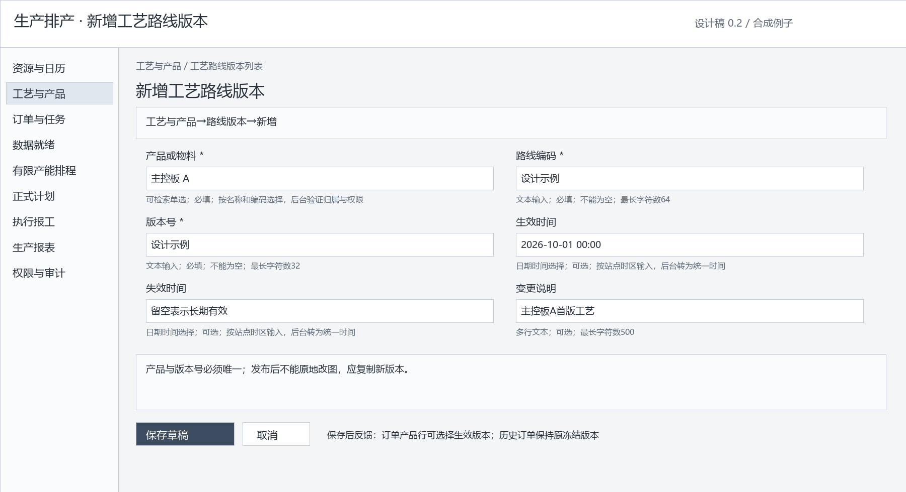

| 输入字段 | 控件 | 必填与联动 | 默认值 | 输入来源 | 校验与反馈 |
|---|---|---|---|---|---|
| 产品或物料 | 可检索单选 | 必填 | 空 | 产品或物料目录 | 按名称和编码选择，后台验证归属与权限 |
| 路线编码 | 文本输入 | 必填 | 空 | 人工填写 | 不能为空；最长字符数64 |
| 版本号 | 文本输入 | 必填 | 空 | 人工填写 | 不能为空；最长字符数32 |
| 生效时间 | 日期时间选择 | 可选 | 空 | 人工填写 | 按站点时区输入，后台转为统一时间 |
| 失效时间 | 日期时间选择 | 可选 | 空 | 人工填写 | 按站点时区输入，后台转为统一时间 |
| 变更说明 | 多行文本 | 可选 | 空 | 人工填写 | 最长字符数500 |

业务限制：产品与版本号必须唯一；发布后不能原地改图，应复制新版本。

提交与成功返回：保存草稿版本，编辑节点依赖后检查并发布；订单产品行可选择生效版本；历史订单保持原冻结版本。

**编辑、详情与回查**

基础资料在允许的状态下复用专用表单并带当前版本。已使用编码、单位及归属变更先检查引用；停用保留历史。工艺生效版本复制新草稿，订单可编辑状态及迁移按第5、6章处理。

详情补充：节点与阶段明细、依赖、资源要求、路线验证结果；复制版本、V1/V2 差异及未展开订单行的迁移确认。

<!-- 原页面关联：P11；AC-01/02/03；UAT-01/02 -->

#### 5.3.4 路线节点与阶段明细

查看每一步要做什么、用哪些人机资源以及怎样计算所需时间。

使用角色：工艺工程师。筛选：路线版本、节点、阶段类型。业务动作：添加节点、编辑阶段、配置资源需求、查看占用示意。

**列表与查询结果**

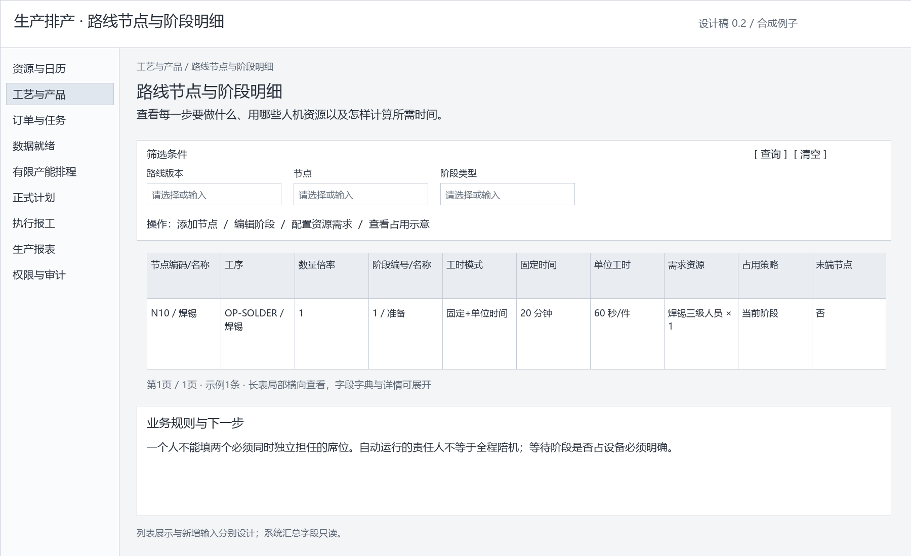

| 展示字段 | 业务例子 | 来源或方案边界 | 展示规则 |
|---|---|---|---|
| 节点编码/名称 | N10 / 焊锡 | 已有业务资料 | nodeCode、nodeName |
| 工序 | OP-SOLDER / 焊锡 | 已有业务资料 | 只读展示已保存值；未提供可选值显示为空 |
| 数量倍率 | 1 | 已有业务资料 | 任务量相对产品行需求倍率 |
| 阶段编号/名称 | 1 / 准备 | 已有业务资料 | phaseNo、phaseType、name |
| 工时模式 | 固定+单位时间 | 已有业务资料 | 固定/按单位/固定+单位 |
| 固定时间 | 20 分钟 | 已有业务资料 | 界面按分钟编辑，服务端秒 |
| 单位工时 | 60 秒/件 | 已有业务资料 | 数量单位必须匹配 |
| 需求资源 | 焊锡三级人员 ×1 | 已有业务资料 | 类型、中心、固定资源、席位、技能和最低等级 |
| 占用策略 | 当前阶段 | 已有业务资料 | 阶段/直到下一阶段/整个作业 |
| 末端节点 | 否 | 已有业务资料 | 决定最终可交付产出 |

**新增路线节点**

入口：草稿路线详情→节点→新增。已有输入契约，页面交互待补齐

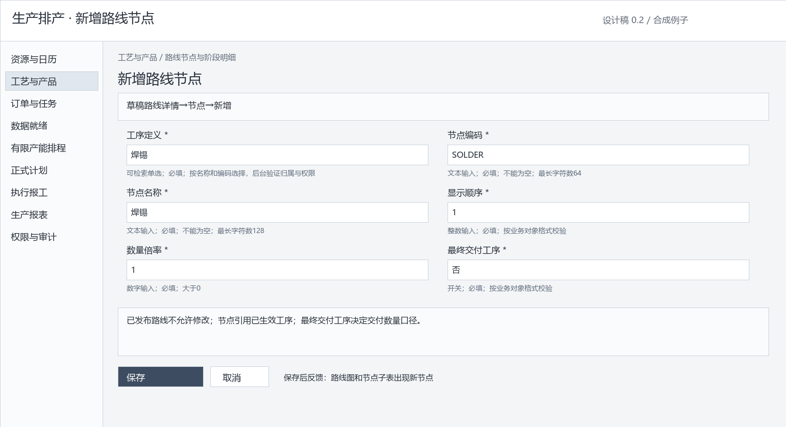

| 输入字段 | 控件 | 必填与联动 | 默认值 | 输入来源 | 校验与反馈 |
|---|---|---|---|---|---|
| 工序定义 | 可检索单选 | 必填 | 空 | 已生效工序定义 | 按名称和编码选择，后台验证归属与权限 |
| 节点编码 | 文本输入 | 必填 | 空 | 人工填写 | 不能为空；最长字符数64 |
| 节点名称 | 文本输入 | 必填 | 空 | 人工填写 | 不能为空；最长字符数128 |
| 显示顺序 | 整数输入 | 必填 | 1 | 人工填写 | 按业务对象格式校验 |
| 数量倍率 | 数字输入 | 必填 | 1 | 人工填写 | 大于0 |
| 最终交付工序 | 开关 | 必填 | 否 | 人工填写 | 按业务对象格式校验 |

业务限制：已发布路线不允许修改；节点引用已生效工序；最终交付工序决定交付数量口径。

提交与成功返回：通过路线图保存接口提交完整节点和依赖，校验引用与数量倍率；路线图和节点子表出现新节点。

**维护工序阶段**

入口：草稿工序详情→阶段→新增或编辑。已有输入契约，页面交互待补齐

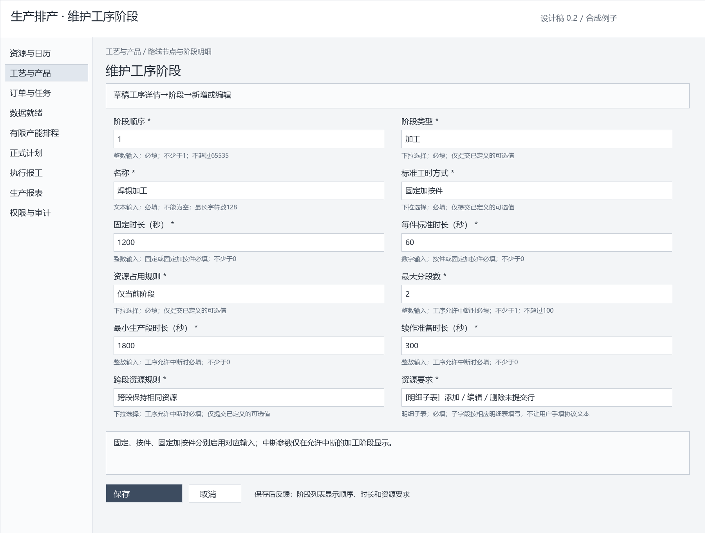

| 输入字段 | 控件 | 必填与联动 | 默认值 | 输入来源 | 校验与反馈 |
|---|---|---|---|---|---|
| 阶段顺序 | 整数输入 | 必填 | 空 | 人工填写 | 不少于1；不超过65535 |
| 阶段类型 | 下拉选择 | 必填 | 空 | 准备、加工、卸料、等待、转运 | 仅提交已定义的可选值：准备、加工、卸料、等待、转运 |
| 名称 | 文本输入 | 必填 | 空 | 人工填写 | 不能为空；最长字符数128 |
| 标准工时方式 | 下拉选择 | 必填 | 空 | 固定时长、按件时长、固定加按件 | 仅提交已定义的可选值：固定时长、按件时长、固定加按件 |
| 固定时长（秒） | 整数输入 | 固定或固定加按件必填；显示条件：duration-fixed | 空 | 人工填写 | 不少于0 |
| 每件标准时长（秒） | 数字输入 | 按件或固定加按件必填；显示条件：duration-unit | 空 | 人工填写 | 不少于0 |
| 资源占用规则 | 下拉选择 | 必填 | 空 | 仅当前阶段、保留至下一阶段、整个作业 | 仅提交已定义的可选值：仅当前阶段、保留至下一阶段、整个作业 |
| 最大分段数 | 整数输入 | 工序允许中断时必填；显示条件：interruptible | 空 | 人工填写 | 不少于1；不超过100 |
| 最小生产段时长（秒） | 整数输入 | 工序允许中断时必填；显示条件：interruptible | 空 | 人工填写 | 不少于0 |
| 续作准备时长（秒） | 整数输入 | 工序允许中断时必填；显示条件：interruptible | 空 | 人工填写 | 不少于0 |
| 跨段资源规则 | 下拉选择 | 工序允许中断时必填；显示条件：interruptible | 空 | 跨段保持相同资源、允许跨段重选 | 仅提交已定义的可选值：跨段保持相同资源、允许跨段重选 |
| 资源要求 | 明细子表 | 必填 | 空 | 人工填写 | 子字段按相应明细表填写，不让用户手填协议文本 |

业务限制：固定、按件、固定加按件分别启用对应输入；中断参数仅在允许中断的加工阶段显示。

提交与成功返回：随完整工序提交阶段，不创建与工序脱离的时间定义；阶段列表显示顺序、时长和资源要求。

**维护阶段资源要求**

入口：工序阶段→资源要求→新增。已有输入契约，页面交互待补齐

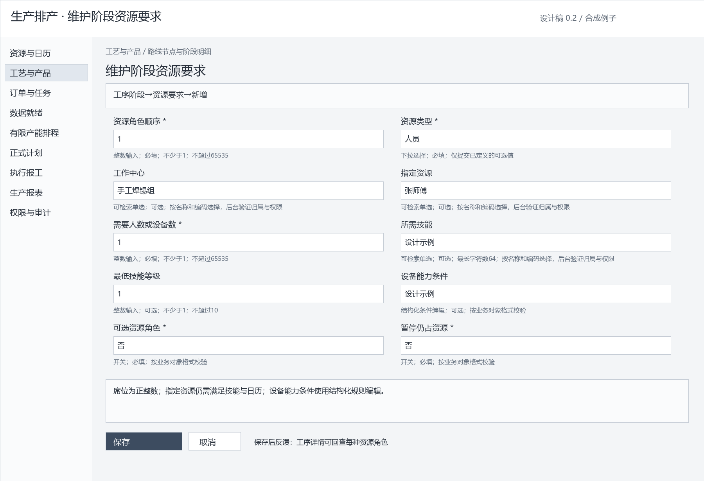

| 输入字段 | 控件 | 必填与联动 | 默认值 | 输入来源 | 校验与反馈 |
|---|---|---|---|---|---|
| 资源角色顺序 | 整数输入 | 必填 | 空 | 人工填写 | 不少于1；不超过65535 |
| 资源类型 | 下拉选择 | 必填 | 空 | 人员、机器、工位、工装 | 仅提交已定义的可选值：人员、机器、工位、工装 |
| 工作中心 | 可检索单选 | 可选 | 空 | 所选车间的工作中心；车间改变时清空旧选择 | 按名称和编码选择，后台验证归属与权限 |
| 指定资源 | 可检索单选 | 可选 | 空 | 满足类型、中心及资格条件的资源 | 按名称和编码选择，后台验证归属与权限 |
| 需要人数或设备数 | 整数输入 | 必填 | 空 | 人工填写 | 不少于1；不超过65535 |
| 所需技能 | 可检索单选 | 可选 | 空 | 既有技能编码及名称 | 最长字符数64；按名称和编码选择，后台验证归属与权限 |
| 最低技能等级 | 整数输入 | 可选 | 空 | 人工填写 | 不少于1；不超过10 |
| 设备能力条件 | 结构化条件编辑 | 可选 | 空 | 人工填写 | 按业务对象格式校验 |
| 可选资源角色 | 开关 | 必填 | 否 | 人工填写 | 按业务对象格式校验 |
| 暂停仍占资源 | 开关 | 必填 | 否 | 人工填写 | 按业务对象格式校验 |

业务限制：席位为正整数；指定资源仍需满足技能与日历；设备能力条件使用结构化规则编辑。

提交与成功返回：随工序保存类型、席位、资格和暂停保留条件；工序详情可回查每种资源角色。

**编辑、详情与回查**

基础资料在允许的状态下复用专用表单并带当前版本。已使用编码、单位及归属变更先检查引用；停用保留历史。工艺生效版本复制新草稿，订单可编辑状态及迁移按第5、6章处理。

详情补充：节点显示顺序与路线版本；阶段资源需求逐行：requirementNo、resourceType、workCenterId、fixedResourceId、seatCount、requiredSkillCode、minimumSkillLevel、optional；准备/运行/卸料/等待/运输的时间与资源分别配置；示意图：焊锡人员占全程；自动炉运行段设备持续占用，人员只占装卸段。

<!-- 原页面关联：P12；AC-08～11；UAT-04 -->

#### 5.3.5 工序依赖

说明下道工序何时能开始，是否要等待全部完成、达到数量门槛或转移批。

使用角色：工艺工程师。筛选：路线、节点、依赖类型。业务动作：添加关系、校验关系、查看释放例子。

**列表与查询结果**

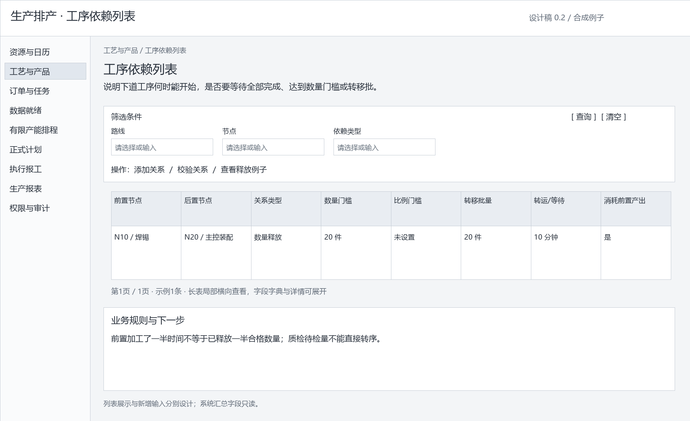

| 展示字段 | 业务例子 | 来源或方案边界 | 展示规则 |
|---|---|---|---|
| 前置节点 | N10 / 焊锡 | 已有业务资料 | 只读展示已保存值；未提供可选值显示为空 |
| 后置节点 | N20 / 主控装配 | 已有业务资料 | 只读展示已保存值；未提供可选值显示为空 |
| 关系类型 | 数量释放 | 已有业务资料 | FINISH/QUANTITY；SAME_START 来源保留但当前 P0 阻断 |
| 数量门槛 | 20 件 | 已有业务资料 | 数量与比例条件不能含糊叠用 |
| 比例门槛 | 未设置 | 已有业务资料 | 101 件×50%向上取整为51件 |
| 转移批量 | 20 件 | 已有业务资料 | 只读展示已保存值；未提供可选值显示为空 |
| 转运/等待 | 10 分钟 | 已有业务资料 | 自然时间口径；有限转运资源另建任务 |
| 消耗前置产出 | 是 | 已有业务资料 | 预约/消耗必须守恒 |

**新增工序依赖**

入口：草稿路线→依赖→新增。已有输入契约，页面交互待补齐

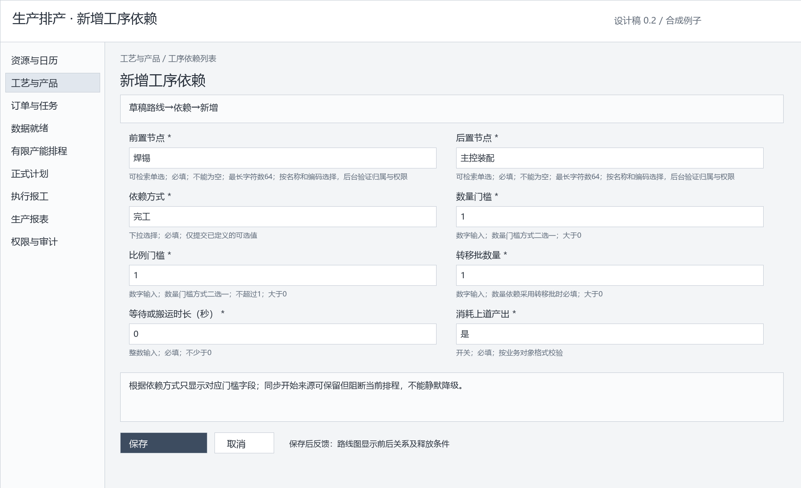

| 输入字段 | 控件 | 必填与联动 | 默认值 | 输入来源 | 校验与反馈 |
|---|---|---|---|---|---|
| 前置节点 | 可检索单选 | 必填 | 空 | 人工填写 | 不能为空；最长字符数64；按名称和编码选择，后台验证归属与权限 |
| 后置节点 | 可检索单选 | 必填 | 空 | 人工填写 | 不能为空；最长字符数64；按名称和编码选择，后台验证归属与权限 |
| 依赖方式 | 下拉选择 | 必填 | 空 | 完工、数量门槛、同步开始（首版不支持） | 仅提交已定义的可选值：完工、数量门槛、同步开始（首版不支持） |
| 数量门槛 | 数字输入 | 数量门槛方式二选一；显示条件：threshold | 空 | 人工填写 | 大于0 |
| 比例门槛 | 数字输入 | 数量门槛方式二选一；显示条件：threshold | 空 | 人工填写 | 不超过1；大于0 |
| 转移批数量 | 数字输入 | 数量依赖采用转移批时必填；显示条件：transfer | 空 | 人工填写 | 大于0 |
| 等待或搬运时长（秒） | 整数输入 | 必填 | 0 | 人工填写 | 不少于0 |
| 消耗上道产出 | 开关 | 必填 | 是 | 人工填写 | 按业务对象格式校验 |

业务限制：根据依赖方式只显示对应门槛字段；同步开始来源可保留但阻断当前排程，不能静默降级。

提交与成功返回：随完整路线图保存，检查循环、数量条件及支持边界；路线图显示前后关系及释放条件。

**编辑、详情与回查**

基础资料在允许的状态下复用专用表单并带当前版本。已使用编码、单位及归属变更先检查引用；停用保留历史。工艺生效版本复制新草稿，订单可编辑状态及迁移按第5、6章处理。

详情补充：路线版本、依赖校验、来源跨产品行/节点；关系图与当前释放数量；禁止循环和消费未来产量。

<!-- 原页面关联：P13；AC-03～07；UAT-02/03 -->

### 5.4 后台处理与数据变化

后台校验产品单位、工序参数、阶段顺序、资源要求、关系支持边界和路线DAG。完整路线图按一个受控保存动作提交；错误不留下半套节点依赖。工序与路线各有版本及使用限制，发布校验失败仍保留草稿。

| 用例 | 现有或候选接口定位 | 边界 | 读写事实 |
|---|---|---|---|
| 新增资料 | `POST /api/aps/v1/routings/items` | 精确契约已有定义；运行事实另记 | 产品物料 |
| 读取列表 | `GET /api/aps/v1/routings/items` | 精确契约已有定义；运行事实另记 | 产品物料 |
| 编辑资料 | `PUT /api/aps/v1/routings/items/{id}` | 精确契约已有定义；运行事实另记 | 产品物料 |
| 新增资料 | `POST /api/aps/v1/routings/operations` | 精确契约已有定义；运行事实另记 | 工序、阶段和资源要求 |
| 读取列表 | `GET /api/aps/v1/routings/operations` | 精确契约已有定义；运行事实另记 | 工序、阶段和资源要求 |
| 编辑资料 | `PUT /api/aps/v1/routings/operations/{id}` | 精确契约已有定义；运行事实另记 | 工序、阶段和资源要求 |
| 新增资料 | `POST /api/aps/v1/routings/routes` | 精确契约已有定义；运行事实另记 | 路线版本 |
| 读取列表 | `GET /api/aps/v1/routings/routes` | 精确契约已有定义；运行事实另记 | 路线版本 |
| 编辑资料 | `PUT /api/aps/v1/routings/routes/{id}` | 待定补充；实施前定义精确契约 | 路线版本 |
| 复制草稿版本 | `POST /api/aps/v1/routings/routes/{id}/copy` | 精确契约已有定义；运行事实另记 | 路线版本及完整图 |
| 发布路线版本 | `POST /api/aps/v1/routings/routes/{id}/publish` | 精确契约已有定义；运行事实另记 | 路线版本及校验结果 |
| 保存路线节点和依赖 | `PUT /api/aps/v1/routings/routes/{id}/graph` | 精确契约已有定义；运行事实另记 | 路线节点和路线依赖 |

精确字段与错误协议引用第13.3节机器契约；此表只定位用例，不建立另一套字段定义。

### 5.5 与其他模块的衔接

订单选择明确生效路线版本，展开冻结工时、要求和依赖。就绪检查引用原工艺问题入口；排程及独立校验采用同一阶段定义；现场说明应显示任务冻结工艺，不能直接取今天最新路线。路线迁移只作用于允许变更的未执行部分，并先展示差异。

### 5.6 业务验收方法

创建分支并行与汇合路线，核对并行和最晚前序释放；插入循环应拒绝。订单按旧版本展开后发布新版本，旧任务保持原解释。准备自动运行2小时、装卸各0.5小时的工序，核对设备3小时、人员1小时。

## 6. 生产订单与任务

### 6.1 模块用途与业务流程

计划员录入订单头和一个或多个产品行，选择每行的生效路线、数量、单位、生产承诺与最早开始。保存后查看展开预览，生成生产批、任务、依赖及物料需求，经检查释放为可排范围。

### 6.2 业务规则与状态变化

订单是需求容器，产品行有自己的数量和可选独立交期。同订单多个产品不自动互相消耗或串行；有真实组件比例或跨产品前置时显式配置。生产批区分正常、拆批、返工和补产，并保留父批与来源。

展开用明确路线及快照，重复相同展开不能生成第二套任务。数量或路线变更不能覆盖已发生的门槛、投入和分配；只评估可变未执行部分。未释放草稿编辑是候选补充用例，必须明确状态、版本和保存契约后实施。

订单完成须所有必需产品行满足合格需求，末端必要工序及质量处置完成，没有阻断返工或隔离。某个产品完成、某个作业完工和整张订单完成分别显示。

### 6.3 页面与交互设计

订单列表进入一个订单详情。详情内顺序组织基本信息、产品行、路线版本、展开任务、物料依赖、计划与实际进度。展开、释放、迁移、拆批都是业务动作，按钮按状态展示；任务与物料需求主要由来源动作产生，不另给任意行新增入口。

#### 6.3.1 生产订单

说明客户要哪些产品、多少数量、何时交付，选择需要安排的订单。

使用角色：计划员。筛选：订单号/客户、交期范围、状态、产品、优先级。业务动作：新增订单、编辑草稿、结构释放、展开任务、查看就绪、加入排程。

**列表与查询结果**

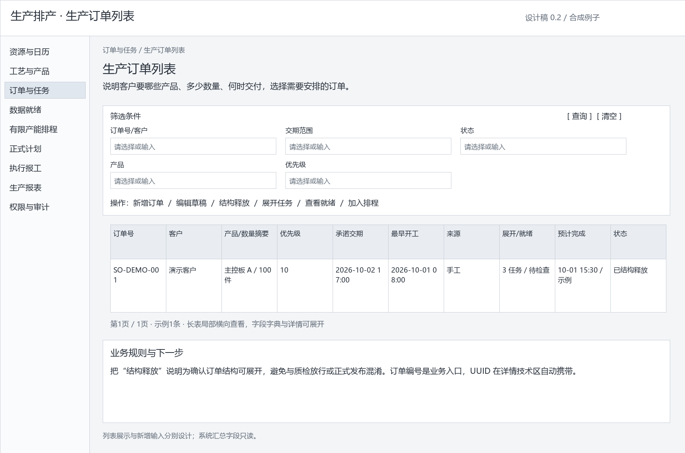

| 展示字段 | 业务例子 | 来源或方案边界 | 展示规则 |
|---|---|---|---|
| 订单号 | SO-DEMO-001 | 已有业务资料 | 来源+外部标识用于防重复 |
| 客户 | 演示客户 | 已有业务资料 | 只读展示已保存值；未提供可选值显示为空 |
| 产品/数量摘要 | 主控板 A / 100 件 | 关联展示 | 多产品行展开查看 |
| 优先级 | 10 | 已有业务资料 | 沿用既有方向定义，界面明确越大/越小的排序含义，不擅自改求解目标 |
| 承诺交期 | 2026-10-02 17:00 | 已有业务资料 | 只读展示已保存值；未提供可选值显示为空 |
| 最早开工 | 2026-10-01 08:00 | 已有业务资料 | 只读展示已保存值；未提供可选值显示为空 |
| 来源 | 手工 | 已有业务资料 | 只读展示已保存值；未提供可选值显示为空 |
| 展开/就绪 | 3 任务 / 待检查 | 关联展示 | 分别显示结构展开与数据就绪 |
| 预计完成 | 10-01 15:30 / 示例 | 派生汇总 | 缺事实显示 UNKNOWN，不伪造交期 |
| 状态 | 已结构释放 | 已有业务资料 | 只读展示已保存值；未提供可选值显示为空 |

**新增生产订单**

入口：订单与任务→生产订单→新增。已有输入契约，页面交互待补齐

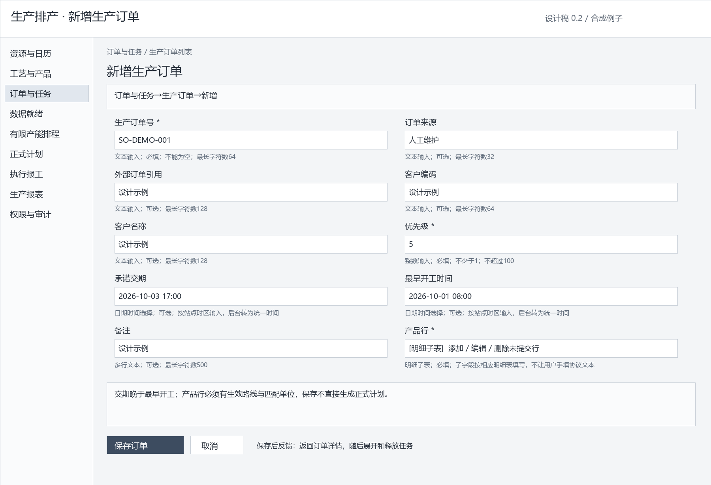

| 输入字段 | 控件 | 必填与联动 | 默认值 | 输入来源 | 校验与反馈 |
|---|---|---|---|---|---|
| 生产订单号 | 文本输入 | 必填 | 空 | 人工填写 | 不能为空；最长字符数64 |
| 订单来源 | 文本输入 | 可选 | 人工维护 | 人工填写 | 最长字符数32 |
| 外部订单引用 | 文本输入 | 可选 | 空 | 人工填写 | 最长字符数128 |
| 客户编码 | 文本输入 | 可选 | 空 | 人工填写 | 最长字符数64 |
| 客户名称 | 文本输入 | 可选 | 空 | 人工填写 | 最长字符数128 |
| 优先级 | 整数输入 | 必填 | 5 | 人工填写 | 不少于1；不超过100 |
| 承诺交期 | 日期时间选择 | 可选 | 空 | 人工填写 | 按站点时区输入，后台转为统一时间 |
| 最早开工时间 | 日期时间选择 | 可选 | 空 | 人工填写 | 按站点时区输入，后台转为统一时间 |
| 备注 | 多行文本 | 可选 | 空 | 人工填写 | 最长字符数500 |
| 产品行 | 明细子表 | 必填 | 空 | 人工填写 | 子字段按相应明细表填写，不让用户手填协议文本 |

业务限制：交期晚于最早开工；产品行必须有生效路线与匹配单位，保存不直接生成正式计划。

提交与成功返回：订单头与至少一个完整产品行同事务保存；返回订单详情，随后展开和释放任务。

**编辑、详情与回查**

基础资料在允许的状态下复用专用表单并带当前版本。已使用编码、单位及归属变更先检查引用；停用保留历史。工艺生效版本复制新草稿，订单可编辑状态及迁移按第5、6章处理。

详情补充：customerCode、externalId、备注、产品行、来源记录；产品行自己的交期/最早开工时间优先规则须在编辑帮助明确；仅对可排范围选择订单；订单结构释放不等于正式计划发布。

<!-- 原页面关联：P14；AC-01/02/12/19/22；UAT-01/05/10 -->

#### 6.3.2 订单产品行

逐行确定产品、数量、单位、路线版本和跨产品依赖。

使用角色：计划员、工艺工程师。筛选：订单、产品、路线版本、状态。业务动作：添加产品行、查看依赖与物料、预览路线迁移。

**列表与查询结果**

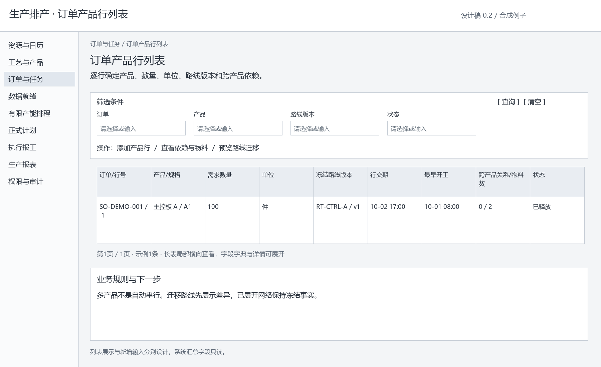

| 展示字段 | 业务例子 | 来源或方案边界 | 展示规则 |
|---|---|---|---|
| 订单/行号 | SO-DEMO-001 / 1 | 已有业务资料 | 只读展示已保存值；未提供可选值显示为空 |
| 产品/规格 | 主控板 A / A1 | 已有业务资料 | 只读展示已保存值；未提供可选值显示为空 |
| 需求数量 | 100 | 已有业务资料 | >0，按产品单位 |
| 单位 | 件 | 已有业务资料 | 只读展示已保存值；未提供可选值显示为空 |
| 冻结路线版本 | RT-CTRL-A / v1 | 已有业务资料 | 只读展示已保存值；未提供可选值显示为空 |
| 行交期 | 10-02 17:00 | 已有业务资料 | 只读展示已保存值；未提供可选值显示为空 |
| 最早开工 | 10-01 08:00 | 已有业务资料 | 只读展示已保存值；未提供可选值显示为空 |
| 跨产品关系/物料数 | 0 / 2 | 关联展示 | dependencies、components 展开详情 |
| 状态 | 已释放 | 已有业务资料 | 只读展示已保存值；未提供可选值显示为空 |

**新增订单产品行**

入口：新增订单表单→产品行→添加行。已有输入契约，页面交互待补齐

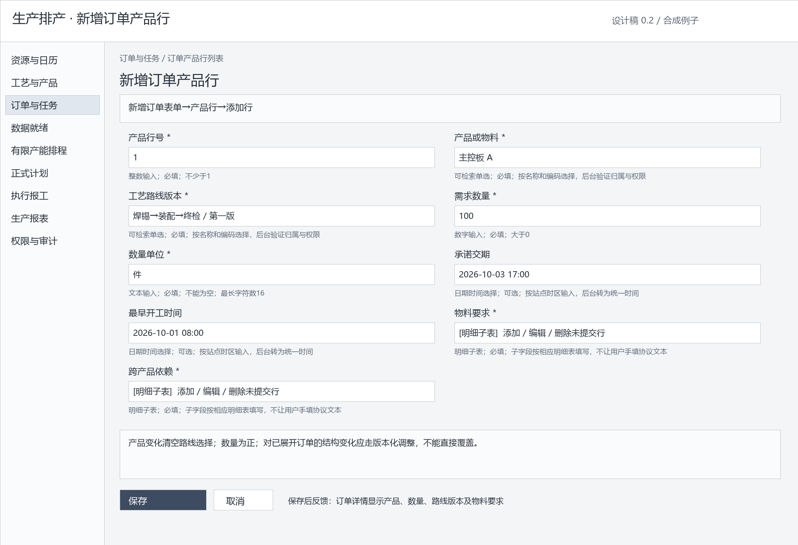

| 输入字段 | 控件 | 必填与联动 | 默认值 | 输入来源 | 校验与反馈 |
|---|---|---|---|---|---|
| 产品行号 | 整数输入 | 必填 | 空 | 人工填写 | 不少于1 |
| 产品或物料 | 可检索单选 | 必填 | 空 | 产品或物料目录 | 按名称和编码选择，后台验证归属与权限 |
| 工艺路线版本 | 可检索单选 | 必填 | 空 | 所选产品的已生效路线版本，产品改变时重新选择 | 按名称和编码选择，后台验证归属与权限 |
| 需求数量 | 数字输入 | 必填 | 空 | 人工填写 | 大于0 |
| 数量单位 | 文本输入 | 必填 | 空 | 人工填写 | 不能为空；最长字符数16 |
| 承诺交期 | 日期时间选择 | 可选 | 空 | 人工填写 | 按站点时区输入，后台转为统一时间 |
| 最早开工时间 | 日期时间选择 | 可选 | 空 | 人工填写 | 按站点时区输入，后台转为统一时间 |
| 物料要求 | 明细子表 | 必填 | 空 | 人工填写 | 子字段按相应明细表填写，不让用户手填协议文本 |
| 跨产品依赖 | 明细子表 | 必填 | 空 | 人工填写 | 子字段按相应明细表填写，不让用户手填协议文本 |

业务限制：产品变化清空路线选择；数量为正；对已展开订单的结构变化应走版本化调整，不能直接覆盖。

提交与成功返回：随订单头一起提交；独立行编辑接口属于待补候选；订单详情显示产品、数量、路线版本及物料要求。

**维护物料要求**

入口：订单产品行→物料要求→添加。已有输入契约，页面交互待补齐

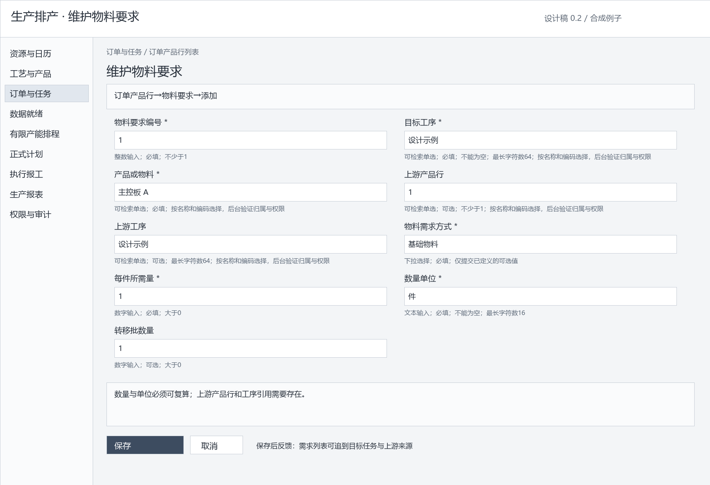

| 输入字段 | 控件 | 必填与联动 | 默认值 | 输入来源 | 校验与反馈 |
|---|---|---|---|---|---|
| 物料要求编号 | 整数输入 | 必填 | 空 | 人工填写 | 不少于1 |
| 目标工序 | 可检索单选 | 必填 | 空 | 人工填写 | 不能为空；最长字符数64；按名称和编码选择，后台验证归属与权限 |
| 产品或物料 | 可检索单选 | 必填 | 空 | 产品或物料目录 | 按名称和编码选择，后台验证归属与权限 |
| 上游产品行 | 可检索单选 | 可选 | 空 | 人工填写 | 不少于1；按名称和编码选择，后台验证归属与权限 |
| 上游工序 | 可检索单选 | 可选 | 空 | 人工填写 | 最长字符数64；按名称和编码选择，后台验证归属与权限 |
| 物料需求方式 | 下拉选择 | 必填 | 空 | 基础物料、转运、外部提供 | 仅提交已定义的可选值：基础物料、转运、外部提供 |
| 每件所需量 | 数字输入 | 必填 | 空 | 人工填写 | 大于0 |
| 数量单位 | 文本输入 | 必填 | 空 | 人工填写 | 不能为空；最长字符数16 |
| 转移批数量 | 数字输入 | 可选 | 空 | 人工填写 | 大于0 |

业务限制：数量与单位必须可复算；上游产品行和工序引用需要存在。

提交与成功返回：作为订单行快照提交，展开后形成物料需求；需求列表可追到目标任务与上游来源。

**维护跨产品依赖**

入口：订单产品行→跨产品依赖→添加。已有输入契约，页面交互待补齐

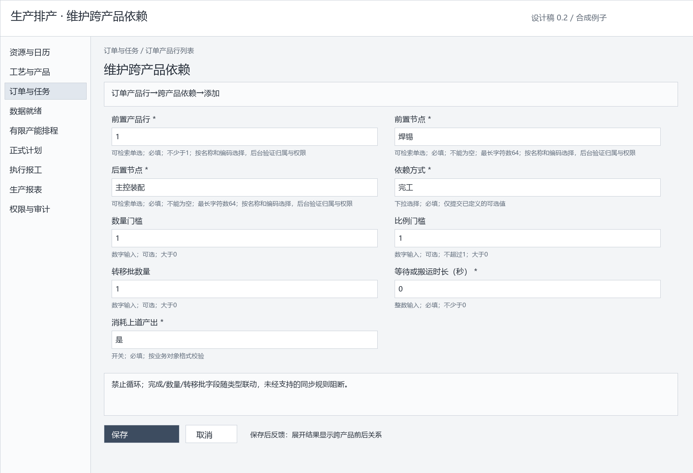

| 输入字段 | 控件 | 必填与联动 | 默认值 | 输入来源 | 校验与反馈 |
|---|---|---|---|---|---|
| 前置产品行 | 可检索单选 | 必填 | 空 | 人工填写 | 不少于1；按名称和编码选择，后台验证归属与权限 |
| 前置节点 | 可检索单选 | 必填 | 空 | 人工填写 | 不能为空；最长字符数64；按名称和编码选择，后台验证归属与权限 |
| 后置节点 | 可检索单选 | 必填 | 空 | 人工填写 | 不能为空；最长字符数64；按名称和编码选择，后台验证归属与权限 |
| 依赖方式 | 下拉选择 | 必填 | 空 | 完工、数量门槛、同步开始（首版不支持） | 仅提交已定义的可选值：完工、数量门槛、同步开始（首版不支持） |
| 数量门槛 | 数字输入 | 可选 | 空 | 人工填写 | 大于0 |
| 比例门槛 | 数字输入 | 可选 | 空 | 人工填写 | 不超过1；大于0 |
| 转移批数量 | 数字输入 | 可选 | 空 | 人工填写 | 大于0 |
| 等待或搬运时长（秒） | 整数输入 | 必填 | 0 | 人工填写 | 不少于0 |
| 消耗上道产出 | 开关 | 必填 | 是 | 人工填写 | 按业务对象格式校验 |

业务限制：禁止循环；完成/数量/转移批字段随类型联动，未经支持的同步规则阻断。

提交与成功返回：随订单行保存并冻结到任务依赖；展开结果显示跨产品前后关系。

**编辑、详情与回查**

基础资料在允许的状态下复用专用表单并带当前版本。已使用编码、单位及归属变更先检查引用；停用保留历史。工艺生效版本复制新草稿，订单可编辑状态及迁移按第5、6章处理。

详情补充：每条组件/转移输入：demandNo、targetNodeCode、itemId、sourceLineNo、sourceNodeCode、demandType、requiredQtyPerUnit、uomCode、transferBatchQty；跨产品关系：predecessorLineNo、predecessorNodeCode、successorNodeCode、dependencyType、thresholdQty、thresholdRatio、transferBatchQty、lagSeconds、consumesOutput；未展开行路线迁移预览与人工确认。

<!-- 原页面关联：P15；AC-01～05；UAT-01/02 -->

#### 6.3.3 批次与工序任务

把订单变成可安排的任务，追踪每个批次的来源、数量和工序状态。

使用角色：计划员、车间主管。筛选：订单、批次、工序、中心、任务状态。业务动作：查看网络图、查看血缘、加入排程、定位正式计划。

**列表与查询结果**

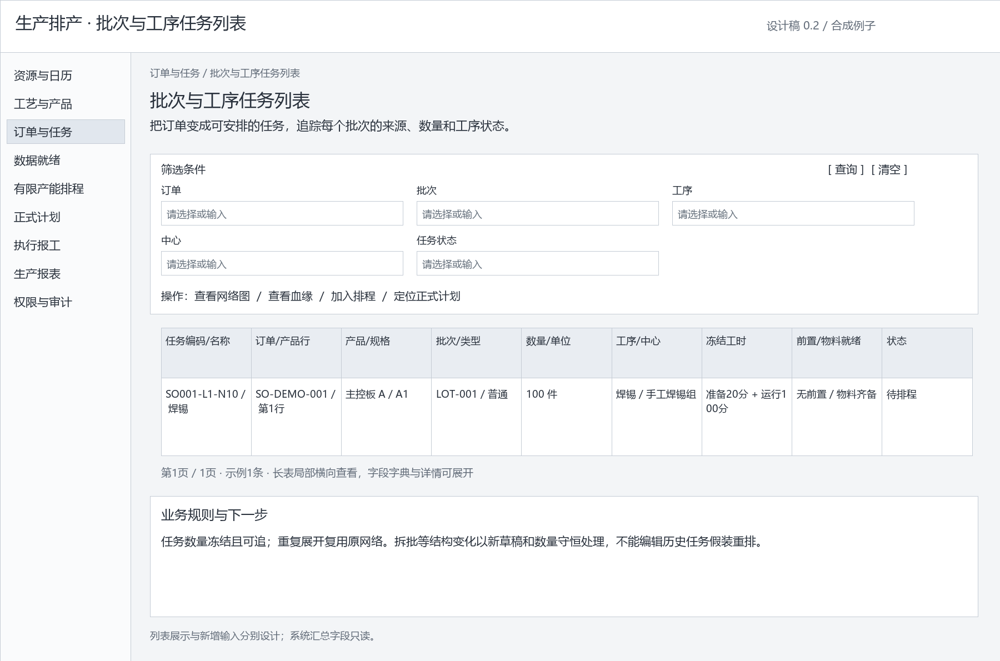

| 展示字段 | 业务例子 | 来源或方案边界 | 展示规则 |
|---|---|---|---|
| 任务编码/名称 | SO001-L1-N10 / 焊锡 | 已有业务资料 | 只读展示已保存值；未提供可选值显示为空 |
| 订单/产品行 | SO-DEMO-001 / 第1行 | 关联展示 | 关联展示 |
| 产品/规格 | 主控板 A / A1 | 关联展示 | 关联展示 |
| 批次/类型 | LOT-001 / 普通 | 关联展示 | 普通/拆批/返工/补产；父批可追 |
| 数量/单位 | 100 件 | 已有业务资料 | 只读展示已保存值；未提供可选值显示为空 |
| 工序/中心 | 焊锡 / 手工焊锡组 | 关联展示 | 关联展示 |
| 冻结工时 | 准备20分 + 运行100分 | 已有字段汇总 | setupSeconds、runSeconds、unloadSeconds、waitSeconds、transportSeconds |
| 前置/物料就绪 | 无前置 / 物料齐备 | 派生汇总 | 不能据页面排序判断 |
| 状态 | 待排程 | 已有业务资料 | 只读展示已保存值；未提供可选值显示为空 |

**派生生产批**

入口：生产批详情→拆分或恢复。已有输入契约，页面交互待补齐

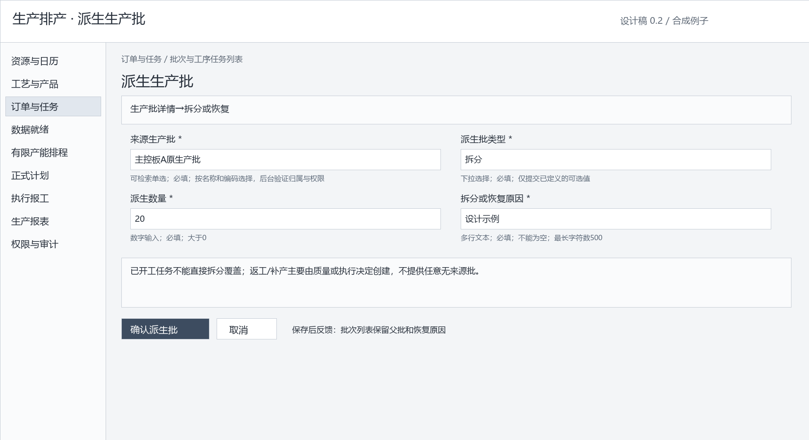

| 输入字段 | 控件 | 必填与联动 | 默认值 | 输入来源 | 校验与反馈 |
|---|---|---|---|---|---|
| 来源生产批 | 可检索单选 | 必填 | 空 | 未结束且允许调整的生产批 | 按名称和编码选择，后台验证归属与权限 |
| 派生批类型 | 下拉选择 | 必填 | 空 | 拆分、返工、补产 | 仅提交已定义的可选值：拆分、返工、补产 |
| 派生数量 | 数字输入 | 必填 | 空 | 人工填写 | 大于0 |
| 拆分或恢复原因 | 多行文本 | 必填 | 空 | 人工填写 | 不能为空；最长字符数500 |

业务限制：已开工任务不能直接拆分覆盖；返工/补产主要由质量或执行决定创建，不提供任意无来源批。

提交与成功返回：从允许调整的来源批生成有血缘的派生批和任务；批次列表保留父批和恢复原因。

**编辑、详情与回查**

该对象由来源动作或查询产生。详情展示来源、关联身份、当前状态与记录；仅显示本模块状态允许且有权限的专用动作。报工与数量更正追加历史链，不提供任意删改生成结果的普通编辑。

详情补充：批次：lotNo、lotType、parentLotId、plannedQty、uomCode、status；任务：productionLotId、routeVersionId、routeNodeId、operationSpecId、workCenterId、taskName；依赖：前置/后置、类型、数量/比例门槛、转移批、lag、消耗标识；锁定、执行、拆批/返工/补产来源与数量血缘。

<!-- 原页面关联：P16；AC-02/06/13/17/18；UAT-01/03/06/08/09 -->

#### 6.3.4 物料与转序需求

检查每个任务需要多少物料或上道半成品，以及是否已经到位和被预约。

使用角色：计划员、现场主管。筛选：订单、任务、物料、状态。业务动作：查看来源、查看数量账、查看缺口。

**列表与查询结果**

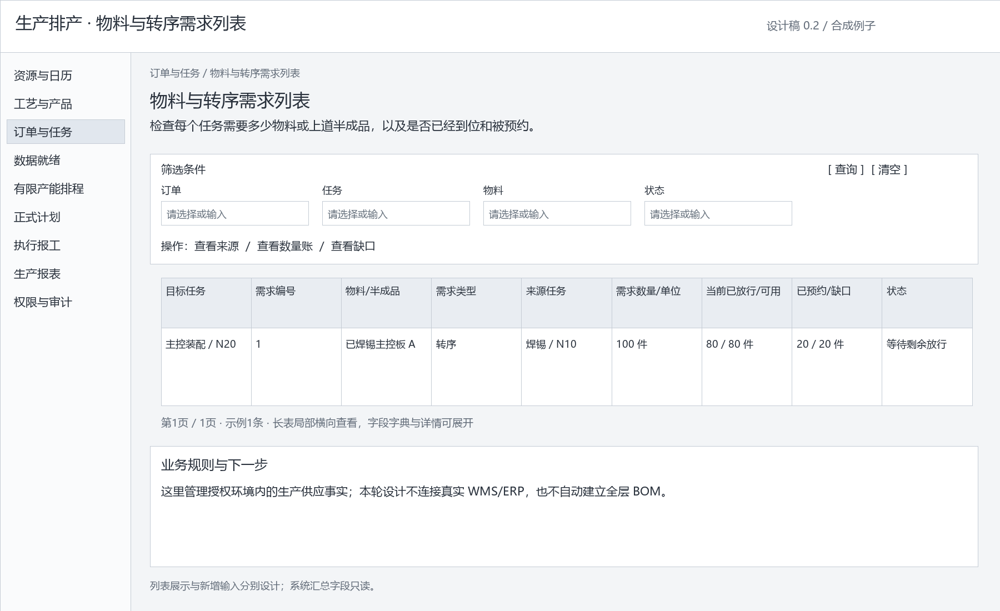

| 展示字段 | 业务例子 | 来源或方案边界 | 展示规则 |
|---|---|---|---|
| 目标任务 | 主控装配 / N20 | 已有业务资料 | 只读展示已保存值；未提供可选值显示为空 |
| 需求编号 | 1 | 已有业务资料 | 只读展示已保存值；未提供可选值显示为空 |
| 物料/半成品 | 已焊锡主控板 A | 已有业务资料 | 只读展示已保存值；未提供可选值显示为空 |
| 需求类型 | 转序 | 已有业务资料 | 组件/转移/外部 |
| 来源任务 | 焊锡 / N10 | 已有业务资料 | 只读展示已保存值；未提供可选值显示为空 |
| 需求数量/单位 | 100 件 | 已有业务资料 | 只读展示已保存值；未提供可选值显示为空 |
| 当前已放行/可用 | 80 / 80 件 | 派生汇总 | 来自产出批及不可变数量账 |
| 已预约/缺口 | 20 / 20 件 | 派生汇总 | 互斥预约且避免重复消耗 |
| 状态 | 等待剩余放行 | 已有业务资料 | 只读展示已保存值；未提供可选值显示为空 |

**产生与维护方式**

物料需求由订单行组件和任务展开产生；从对应订单行维护，不提供脱离来源的新建需求。

**编辑、详情与回查**

该对象由来源动作或查询产生。详情展示来源、关联身份、当前状态与记录；仅显示本模块状态允许且有权限的专用动作。报工与数量更正追加历史链，不提供任意删改生成结果的普通编辑。

详情补充：来源产品行/任务、预约目标、转移批与数量事件；外部到料事实来源与时间；缺少事实时明确待料。

<!-- 原页面关联：P17；AC-04/05/17/18；UAT-02/08/09 -->

### 6.4 后台处理与数据变化

先验证完整订单、单位、路线和权限，再在受控事务生成冻结生产身份及任务网络；发生错误整体回滚。展开和结构变更使用幂等请求与版本控制。迁移、拆批、返工补产分别保持原批血缘，不把任务数量平均分配当作合法拆批。

| 用例 | 现有或候选接口定位 | 边界 | 读写事实 |
|---|---|---|---|
| 新增资料 | `POST /api/aps/v1/orders` | 精确契约已有定义；运行事实另记 | 订单头与产品行 |
| 读取列表 | `GET /api/aps/v1/orders` | 精确契约已有定义；运行事实另记 | 订单头与产品行 |
| 释放订单结构 | `POST /api/aps/v1/orders/{id}/release` | 精确契约已有定义；运行事实另记 | 订单及展开结构 |
| 调整未展开草稿订单 | `PUT /api/aps/v1/orders/{id}` | 请求包含rowVersion及完整订单；拒绝已展开、非草稿、过期版本或范围不符，精确结构见OpenAPI | 订单及产品行，同事务保存 |
| 迁移未执行路线 | `POST /api/aps/v1/orders/lines/{lineId}/route-migration` | 精确契约已有定义；运行事实另记 | 产品行和冻结任务 |
| 展开订单任务 | `POST /api/aps/v1/orders/{id}/expand` | 精确契约已有定义；运行事实另记 | 生产批、任务、任务依赖和物料需求 |
| 建立派生批 | `POST /api/aps/v1/orders/lots` | 精确契约已有定义；运行事实另记 | 生产批及任务 |
| 读取物料需求 | `GET /api/aps/v1/orders/{id}/expansion` | 精确契约已有定义；运行事实另记 | 展开后的只读需求 |

精确字段与错误协议引用第13.3节机器契约；此表只定位用例，不建立另一套字段定义。

### 6.5 与其他模块的衔接

释放任务进入数据就绪和排程选择；候选中的任务成员引用稳定任务身份。执行产出回到该产品行与批次，报表通过这条链解释交期。订单变更影响候选输入修订，但不删除已有执行单和数量事件。

### 6.6 业务验收方法

准备一单A100、B60及各自路线，核对实例、任务、单位和来源；重复展开不增加任务。尝试迁移已有执行部分或让不同单位相加，应拒绝并指出对象；合法未执行迁移展示前后差异。

## 7. 排程数据就绪

### 7.1 模块用途与业务流程

计划员在选定订单、车间和时间范围内发起检查，读取分组问题，进入对应资料修正，再重检。检查结果解释可排条件，不是替代正式求解的第二套计划。

### 7.2 业务规则与问题处理

检查生效工艺、有效时长、候选资格、日历交集、物料数量、依赖循环、单位、锁定和开放实际占用。必要但不支持的约束必须阻断，不能减小标准换取就绪。没有可靠释放时间的实际占用按保守边界处理，参见附录A。

每个问题包括业务对象、具体缺口、影响、责任角色、修正入口和是否阻断。查看权限不自动包含修改权限。就绪结果记录所检查的修订；资料变化后旧结果不能继续表示当前就绪。

### 7.3 页面与交互设计

就绪页先选范围，后显示问题；按订单、问题类型和责任范围过滤。点击问题定位工艺节点、资源窗口或物料需求。无问题与尚未检查的空态分别显示，检查失败保留选择并提供重试。

#### 7.3.1 排程数据检查

排程前指出缺什么：技能、日历、工时、路线、物料或不支持的规则，并跳到可修复位置。

使用角色：计划员、工艺/资源维护员。筛选：订单范围、车间、检查日期、严重级别。业务动作：重新检查、定位修复、查看输入依据。

**列表与查询结果**

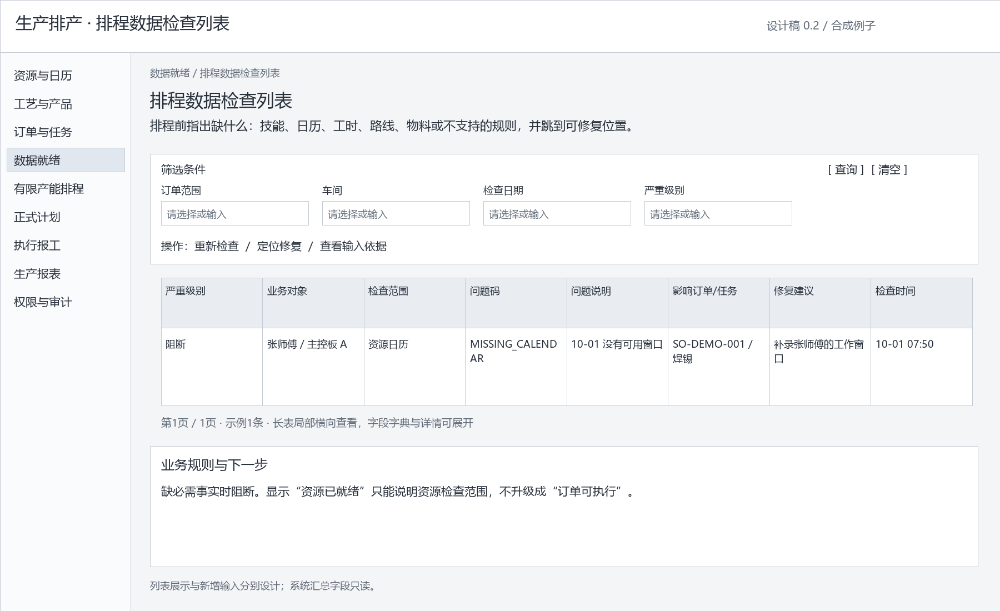

| 展示字段 | 业务例子 | 来源或方案边界 | 展示规则 |
|---|---|---|---|
| 严重级别 | 阻断 | 拟补展示 | 信息/提醒/阻断 |
| 业务对象 | 张师傅 / 主控板 A | 拟补关联展示 | 编码名称显示，ID 收入详情 |
| 检查范围 | 资源日历 | 拟补扩充 | 资源/工艺/任务/物料/同步约束 |
| 问题码 | MISSING_CALENDAR | 已有业务资料 | 只读展示已保存值；未提供可选值显示为空 |
| 问题说明 | 10-01 没有可用窗口 | 已有业务资料 | 只读展示已保存值；未提供可选值显示为空 |
| 影响订单/任务 | SO-DEMO-001 / 焊锡 | 拟补关联展示 | 从编译问题回溯 |
| 修复建议 | 补录张师傅的工作窗口 | 拟补新增 | 直接定位维护页面 |
| 检查时间 | 10-01 07:50 | 拟补展示 | 绑定输入与时间版本 |

**检查排程数据**

入口：数据就绪→选择范围→检查。已有输入契约，页面交互待补齐

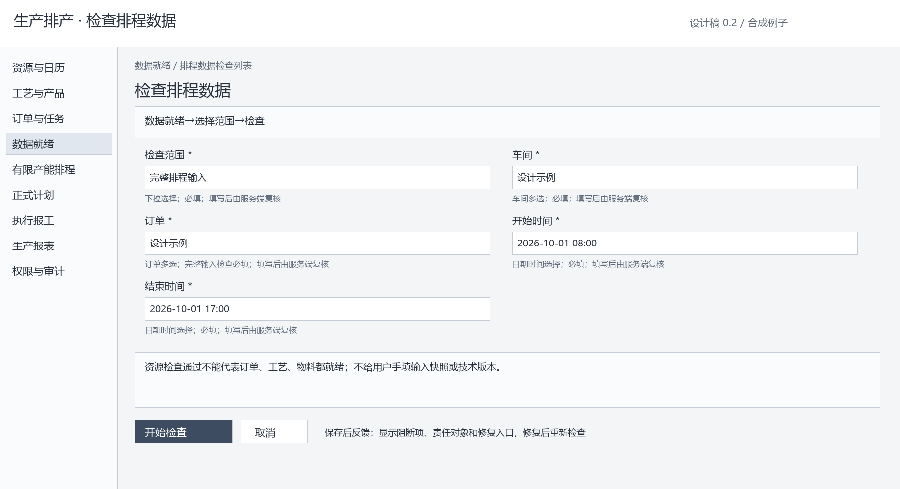

| 输入字段 | 控件 | 必填与联动 | 默认值 | 输入来源 | 校验与反馈 |
|---|---|---|---|---|---|
| 检查范围 | 页签 | 必选 | 完整排程输入 | 完整排程预检、资源资料检查 | 两类结果独立；资源检查不代表完整输入通过 |
| 车间 | 可检索多选 | 必填 | 空 | 当前授权且启用的车间名称与编码 | 传稳定标识；空范围或含不可见车间拒绝 |
| 订单 | 可检索多选 | 完整输入检查必填 | 空 | 有权限的已释放或生产中订单 | 传稳定标识；不可见订单不泄漏名称，未展开或资料不足由完整预检定位 |
| 开始时间 | 日期时间选择 | 必填 | 默认当前站点时刻后一小时 | 站点时区输入 | 转为UTC；非法日期、不存在或重复的夏令时时刻拒绝 |
| 结束时间 | 日期时间选择 | 必填 | 默认当前站点时刻后九小时 | 站点时区输入 | 严格晚于开始且不能全在过去，转换为UTC |

业务限制：资源检查通过不能代表订单、工艺、物料都就绪；不给用户手填输入快照或技术版本。

提交与成功返回：资源检查复用现有入口；完整输入由后台可信编译并检查；显示阻断项、责任对象和修复入口，修复后重新检查。

**编辑、详情与回查**

该对象由来源动作或查询产生。详情展示来源、关联身份、当前状态与记录；仅显示本模块状态允许且有权限的专用动作。报工与数量更正追加历史链，不提供任意删改生成结果的普通编辑。

详情补充：objectType、objectId、field、具体时间窗和检查版本；资源就绪、订单输入就绪、候选可发布须分开显示。

<!-- 原页面关联：P18；AC-01/07/08～12/22/23；UAT-01/03/04/05/10/12 -->

### 7.4 后台处理与数据变化

后台从有权限的权威事实编译检查输入，使用与求解前一致的规则返回问题列表和修订。只读检查不生成正式计划，也不偷偷补缺省工时。完整选择式检查共用排程请求的订单、车间、站点及时间范围输入，检查时刻由服务端抓取；返回ready、checkedAt、inputHash及对象问题。范围改变后原检查结果失效，迟到回执不得覆盖新范围。

| 用例 | 现有或候选接口定位 | 边界 | 读写事实 |
|---|---|---|---|
| 资源数据检查 | `GET /api/aps/v1/resources/workshops/{workshopId}/readiness` | 精确契约已有定义；运行事实另记 | 资源和日历读取 |
| 选择式完整输入检查 | `POST /api/aps/v1/readiness` | 沿用排程业务选择输入；要求就绪查看与订单读取权限，精确结构见OpenAPI | 可信输入编译与独立检查，只读不创建计划 |

精确字段与错误协议引用第13.3节机器契约；此表只定位用例，不建立另一套字段定义。

### 7.5 与其他模块的衔接

问题指向第4至6章维护对象；修正后再检查。排程请求仍会重新校验并抓快照，不能仅相信浏览器显示“就绪”。发布和实际开工各自在相应时点检查最新条件。

### 7.6 业务验收方法

分别删除有效工时、使人员证书过期、加入循环和未支持同步来源，检查必须定位并阻断。补齐合法输入再检，旧问题消失且检查修订更新；只读检查前后不改变正式版本和实际生产。

## 8. 排程工作台与候选方案

### 8.1 模块用途与业务流程

计划员按业务名称选择车间与已释放订单，填写排程时间窗和策略，发起计算。系统创建快照和请求，页面跟踪等待或求解状态；有候选后查看甘特、未排、预计完成与原因，再调整、锁定、比较或发布。

### 8.2 业务规则与状态变化

详细计划范围的必需任务须全部合法安排才允许发布，远期结转明确单列。交期默认软目标；只有明确“绝不晚于”的业务要求才能转为硬约束。先满足硬约束，再按策略优化交期、稳定性、等待和负荷，不承诺各项同时最优。

正排解释最早可行安排；倒排是交期候选与搜索提示，最终仍受统一有限产能模型和独立校验约束，不允许排入过去。局部调整包含上下游、数量供给、共享批和同资源竞争的影响范围；范围外计划固定。需要扩大影响范围时显式说明，不能静默改动全局。

三类甘特共用版本与任务身份：设备看真实设备段，人员看需要到场的段，车间工序看队列与衔接。图形相交不直接等于冲突，底层资源容量决定合法性。

| 页面结果 | 判断与下一步 |
|---|---|
| 等待、计算中 | 展示请求与进度；可以取消；重复提交同一意图返回原请求 |
| 可行候选 | 有独立校验通过的安排；仍须审阅和发布，不显示为已正式生效 |
| 超时有候选 | 标明未证明最优，可审阅合法候选 |
| 已证明无解 | 显示硬约束与问题对象；修正条件后重新发起 |
| 超时无候选 | 表示搜索尚无结论，不标记为已证明无解 |
| 输入非法、系统失败、取消 | 分开提示原因与恢复入口；当前正式计划保持 |

时间锁、资源锁和全锁各锁定相应维度，锁仍要校验维修与现实变化。拖动或编辑只提交意图，服务端拒绝后恢复确认位置并保留尝试内容。拆批须符合工艺和数量，合批须兼容且总容量合法，不能因工序同名自动合批。

### 8.3 页面与交互设计

工作台顶部提供新建排程和计划选择；范围内名称选择器自动携带ID。主体保留甘特、筛选、任务详情、问题和版本比较。候选选择显示名称、版本、状态和时间，正式状态与详情同步。

状态查询在终态、离开页面、连接失败或等待期限后停止；失败保留请求可手动恢复，不能把浏览器没收到消息当作求解失败。完整计划历史分页是候选补充；现有最近200项目录按冻结范围过滤，不等于完整历史检索。

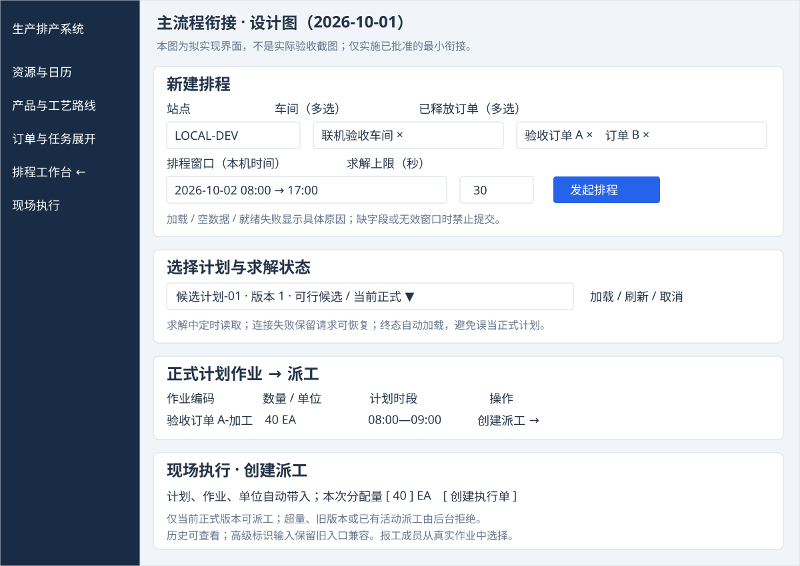

#### 8.3.1 排程请求

选订单和时间范围，让单 Worker 根据具体人机能力、日历、依赖及已有占用生成可选方案。

使用角色：计划员。筛选：日期、请求状态、订单、请求人。业务动作：新增排程、查看输入检查、取消在途请求、打开候选。

**列表与查询结果**

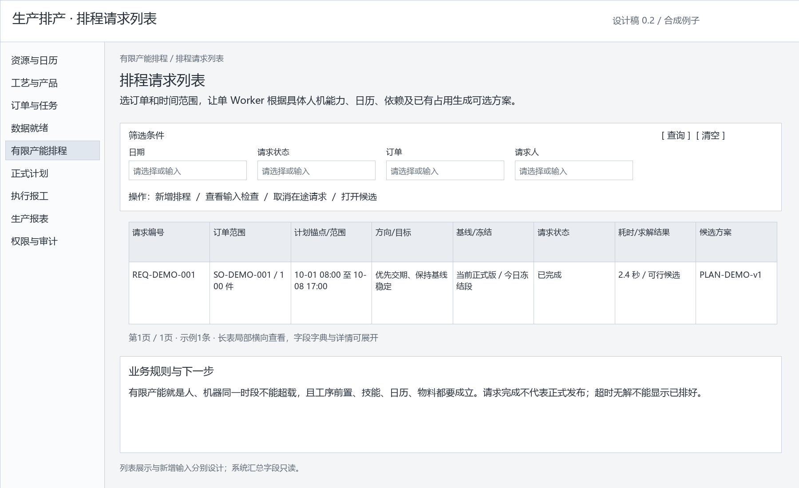

| 展示字段 | 业务例子 | 来源或方案边界 | 展示规则 |
|---|---|---|---|
| 请求编号 | REQ-DEMO-001 | 拟补展示 | UUID 自动携带，新增业务编号展示为候选 |
| 订单范围 | SO-DEMO-001 / 100 件 | 拟补页面映射 | 只选已结构释放且可编译任务 |
| 计划锚点/范围 | 10-01 08:00 至 10-08 17:00 | 已有后端能力页面映射 | 时区明确，不安排过去时间 |
| 方向/目标 | 优先交期、保持基线稳定 | 已有后端能力页面映射 | 按已支持策略展示；不承诺全局最优 |
| 基线/冻结 | 当前正式版 / 今日冻结段 | 已有后端能力页面映射 | 首次排程无基线，重排引用具体版本 |
| 请求状态 | 已完成 | 已有业务资料 | 草稿/排队/求解/可行/失败/取消等按实际协议 |
| 耗时/求解结果 | 2.4 秒 / 可行候选 | 已有后端能力页面映射 | 可行与最优分开，不推断未验证性能 |
| 候选方案 | PLAN-DEMO-v1 | 拟补关联展示 | 可点开候选，不复制 UUID |

**新增排程请求**

入口：有限产能排程→排程请求→新增。已有输入契约，页面交互待补齐

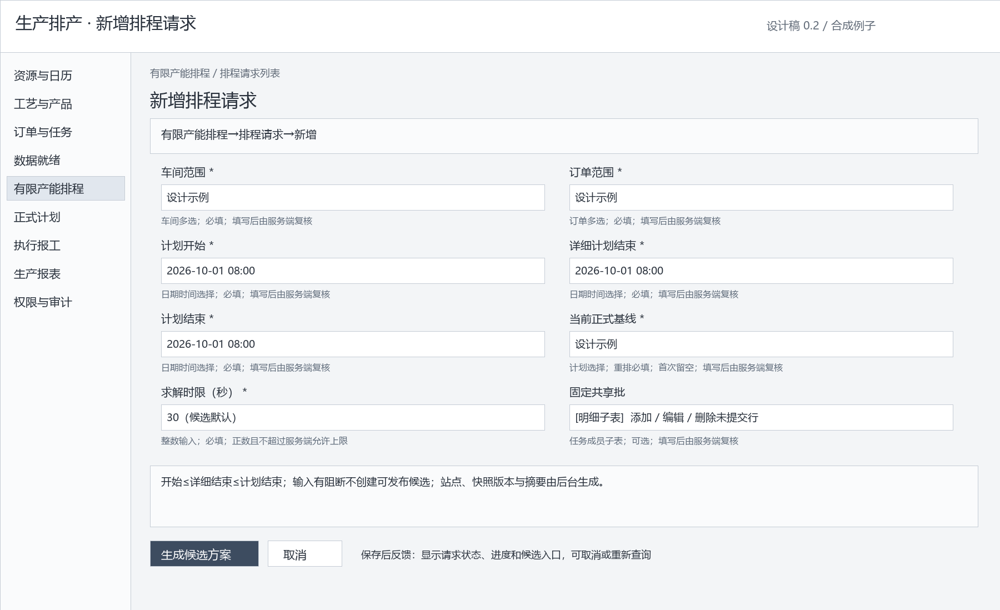

| 输入字段 | 控件 | 必填与联动 | 默认值 | 输入来源 | 校验与反馈 |
|---|---|---|---|---|---|
| 车间范围（待定） | 车间多选 | 必填 | 空 | 当前授权车间 | 待定字段，实施前明确格式、范围及拒绝条件 |
| 订单范围（待定） | 订单多选 | 必填 | 空 | 所选车间已释放订单 | 待定字段，实施前明确格式、范围及拒绝条件 |
| 计划开始（待定） | 日期时间选择 | 必填 | 空 | 人工填写 | 待定字段，实施前明确格式、范围及拒绝条件 |
| 详细计划结束（待定） | 日期时间选择 | 必填 | 空 | 人工填写 | 待定字段，实施前明确格式、范围及拒绝条件 |
| 计划结束（待定） | 日期时间选择 | 必填 | 空 | 人工填写 | 待定字段，实施前明确格式、范围及拒绝条件 |
| 当前正式基线（待定） | 计划选择 | 重排必填；首次留空 | 空 | 当前正式计划，名称和版本可读 | 待定字段，实施前明确格式、范围及拒绝条件 |
| 求解时限（秒）（待定） | 整数输入 | 必填 | 30（候选默认） | 人工填写 | 正数且不超过服务端允许上限 |
| 固定共享批（待定） | 任务成员子表 | 可选 | 空 | 兼容任务及数量；引用工艺批规则 | 待定字段，实施前明确格式、范围及拒绝条件 |

业务限制：开始≤详细结束≤计划结束；输入有阻断不创建可发布候选；站点、快照版本与摘要由后台生成。

提交与成功返回：后台编译快照和版本，单实例任务状态流转；前端只提交业务选择；显示请求状态、进度和候选入口，可取消或重新查询。

**编辑、详情与回查**

该对象由来源动作或查询产生。详情展示来源、关联身份、当前状态与记录；仅显示本模块状态允许且有权限的专用动作。报工与数量更正追加历史链，不提供任意删改生成结果的普通编辑。

详情补充：请求人/时间、取消原因、失败原因、超时是否有可行解、未排任务；输入事实版本/摘要、规划目标及冻结区说明；高级诊断显示模型状态；业务默认用清晰中文。

<!-- 原页面关联：P19；AC-12/15/23；UAT-05/07；LIVE-04/10 -->

#### 8.3.2 候选方案

查看求解出来的备选安排，比较交期、冲突和未排任务后决定采用哪个。

使用角色：计划员、生产负责人。筛选：方案名称、状态、日期、来源订单。业务动作：查看三视图、比较方案、独立复验、发布为正式计划、废弃候选。

**列表与查询结果**

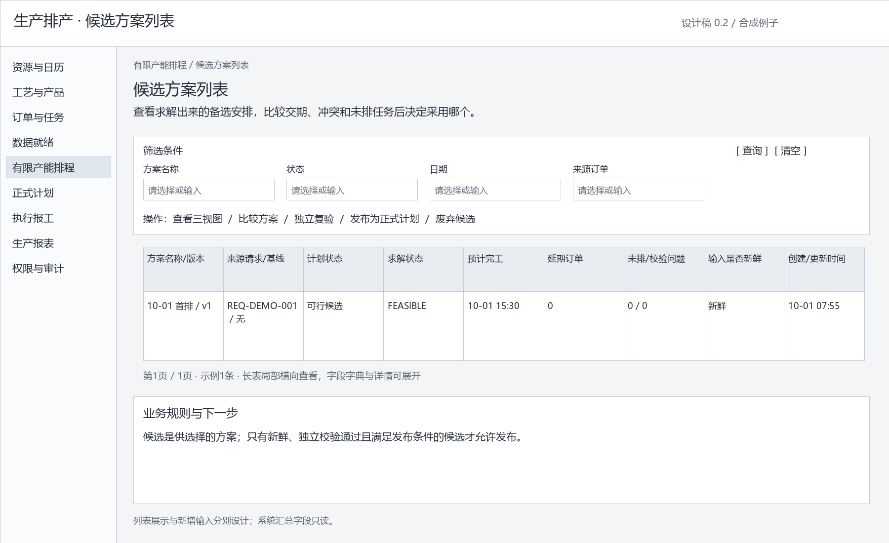

| 展示字段 | 业务例子 | 来源或方案边界 | 展示规则 |
|---|---|---|---|
| 方案名称/版本 | 10-01 首排 / v1 | 已有业务资料 | 只读展示已保存值；未提供可选值显示为空 |
| 来源请求/基线 | REQ-DEMO-001 / 无 | 已有业务资料 | 首次排程基线为空 |
| 计划状态 | 可行候选 | 已有业务资料 | 只读展示已保存值；未提供可选值显示为空 |
| 求解状态 | FEASIBLE | 已有业务资料 | 与计划生命周期分开 |
| 预计完工 | 10-01 15:30 | 派生汇总 | 缺必需任务时不显示可靠 ETA |
| 延期订单 | 0 | 派生汇总 | 按承诺交期计算 |
| 未排/校验问题 | 0 / 0 | 关联展示 | 解释未排及硬约束冲突 |
| 输入是否新鲜 | 新鲜 | 已有业务资料 | 事实水位已变必须阻断发布 |
| 创建/更新时间 | 10-01 07:55 | 已有业务资料 | 站点时区展示 |

**废弃候选方案**

入口：候选详情→废弃。已有输入契约，页面交互待补齐

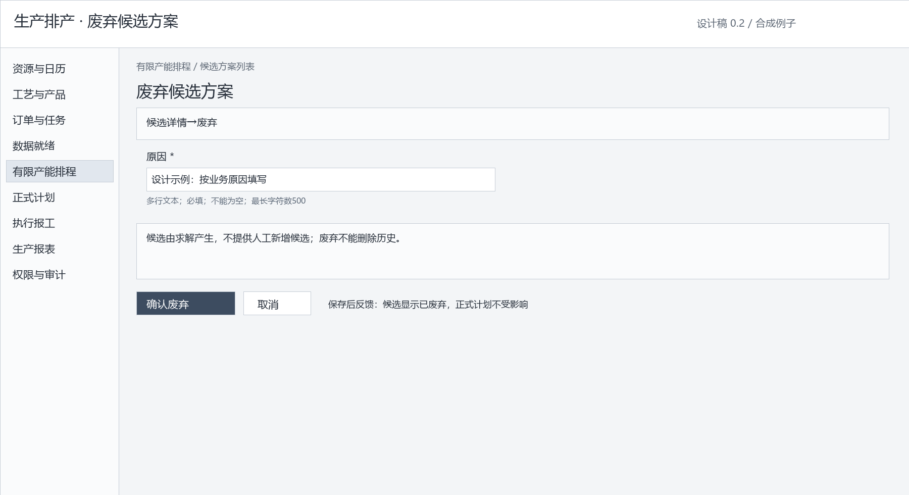

| 输入字段 | 控件 | 必填与联动 | 默认值 | 输入来源 | 校验与反馈 |
|---|---|---|---|---|---|
| 原因 | 多行文本 | 必填 | 空 | 人工填写 | 不能为空；最长字符数500 |

业务限制：候选由求解产生，不提供人工新增候选；废弃不能删除历史。

提交与成功返回：校验候选状态和版本，保留原记录及原因；候选显示已废弃，正式计划不受影响。

**编辑、详情与回查**

该对象由来源动作或查询产生。详情展示来源、关联身份、当前状态与记录；仅显示本模块状态允许且有权限的专用动作。报工与数量更正追加历史链，不提供任意删改生成结果的普通编辑。

详情补充：候选哈希、resultKind、inputCapturedAt、latestFactUpdatedAt、definitionRevision、executionRevision、rowVersion（诊断区）；任务、分段、资源分配、锁、冲突及独立校验详情。

<!-- 原页面关联：P20；AC-12～16/23；UAT-05/06/07；LIVE-05/10 -->

#### 8.3.3 方案任务与资源分配

用表格和三类甘特回答谁在什么时候用哪台设备做什么数量。

使用角色：计划员、车间主管。筛选：订单、产品、工序、人员/设备、时间范围、锁定状态。业务动作：切换工序/设备/人员甘特、定位任务、创建调整草稿、查看影响闭包。

**列表与查询结果**

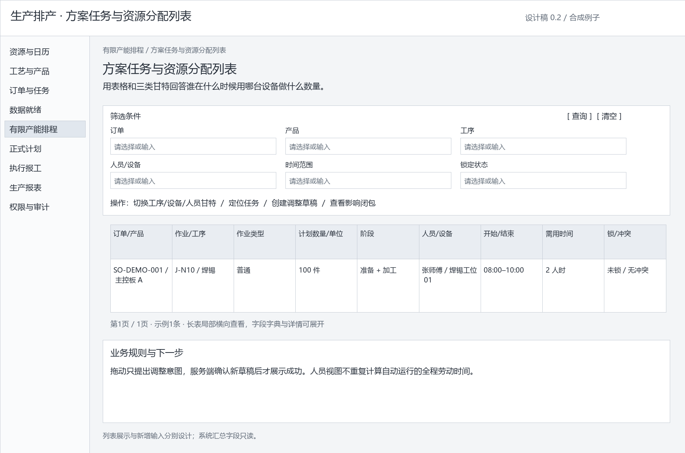

| 展示字段 | 业务例子 | 来源或方案边界 | 展示规则 |
|---|---|---|---|
| 订单/产品 | SO-DEMO-001 / 主控板 A | 关联展示 | 从稳定成员任务回溯 |
| 作业/工序 | J-N10 / 焊锡 | 已有业务资料 | 只读展示已保存值；未提供可选值显示为空 |
| 作业类型 | 普通 | 已有业务资料 | 普通/拆批/共享批/活动续作 |
| 计划数量/单位 | 100 件 | 已有业务资料 | 只读展示已保存值；未提供可选值显示为空 |
| 阶段 | 准备 + 加工 | 已有业务资料 | 只读展示已保存值；未提供可选值显示为空 |
| 人员/设备 | 张师傅 / 焊锡工位 01 | 关联展示 | 分配资源按实际阶段展示 |
| 开始/结束 | 08:00–10:00 | 已有业务资料 | startAt、endAt |
| 需用时间 | 2 人时 | 派生汇总 | 人员只统计到场分段；设备按设备占用 |
| 锁/冲突 | 未锁 / 无冲突 | 关联展示 | 关联版本锁与校验问题 |

**调整任务时间或资源**

入口：候选或正式计划详情→选择任务/阶段/分配→调整。已有输入契约，页面交互待补齐

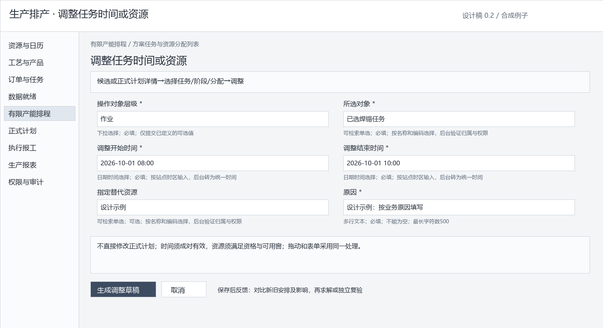

| 输入字段 | 控件 | 必填与联动 | 默认值 | 输入来源 | 校验与反馈 |
|---|---|---|---|---|---|
| 操作对象层级 | 下拉选择 | 必填 | 空 | 作业、阶段分段、资源分配 | 仅提交已定义的可选值：作业、阶段分段、资源分配 |
| 所选对象 | 可检索单选 | 必填 | 空 | 人工填写 | 按名称和编码选择，后台验证归属与权限 |
| 调整开始时间 | 日期时间选择 | 必填 | 空 | 人工填写 | 按站点时区输入，后台转为统一时间 |
| 调整结束时间 | 日期时间选择 | 必填 | 空 | 人工填写 | 按站点时区输入，后台转为统一时间 |
| 指定替代资源 | 可检索单选 | 可选 | 空 | 满足工艺资格与日历的替代资源 | 按名称和编码选择，后台验证归属与权限 |
| 原因 | 多行文本 | 必填 | 空 | 人工填写 | 不能为空；最长字符数500 |

业务限制：不直接修改正式计划；时间须成对有效，资源须满足资格与可用窗；拖动和表单采用同一处理。

提交与成功返回：发送调整意图，后台产生新草稿并计算影响；失败恢复原画面；对比新旧安排及影响，再求解或独立复验。

**编辑、详情与回查**

该对象由来源动作或查询产生。详情展示来源、关联身份、当前状态与记录；仅显示本模块状态允许且有权限的专用动作。报工与数量更正追加历史链，不提供任意删改生成结果的普通编辑。

详情补充：作业成员 memberNo、taskId、plannedQty、uomCode；批兼容键、容量值/单位、carryRunId、workCenterId；分段 segmentNo、phaseId、plannedQty、releaseAt、releaseQty；分配 requirementId、resourceId、allocationRole、seatNo、capacityUsed。

<!-- 原页面关联：P21；AC-09/13/14/16；UAT-04/06 -->

#### 8.3.4 人工计划锁

记录哪些时间和资源必须保留，防止重排覆盖已经确认的安排。

使用角色：计划员、授权车间主管。筛选：版本、对象、锁类型。业务动作：创建锁、查看锁冲突、解除候选锁。

**列表与查询结果**

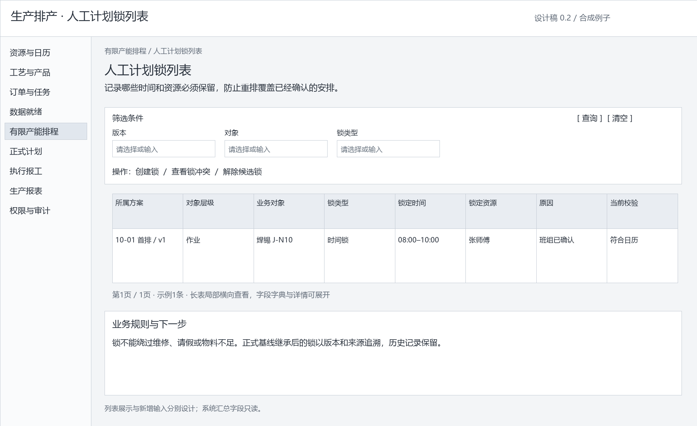

| 展示字段 | 业务例子 | 来源或方案边界 | 展示规则 |
|---|---|---|---|
| 所属方案 | 10-01 首排 / v1 | 关联展示 | 关联展示 |
| 对象层级 | 作业 | 已有业务资料 | 作业/分段/分配 |
| 业务对象 | 焊锡 J-N10 | 已有业务资料 | 以名称选择，不手填 ID |
| 锁类型 | 时间锁 | 已有业务资料 | 时间/资源/全锁 |
| 锁定时间 | 08:00–10:00 | 已有字段汇总 | 时间锁/全锁条件必填 |
| 锁定资源 | 张师傅 | 已有业务资料 | 资源锁/全锁条件必填 |
| 原因 | 班组已确认 | 已有业务资料 | 只读展示已保存值；未提供可选值显示为空 |
| 当前校验 | 符合日历 | 关联展示 | 由独立校验判断，不手工勾选成功 |

**新增人工计划锁**

入口：方案详情→选中对象→锁定。已有输入契约，页面交互待补齐

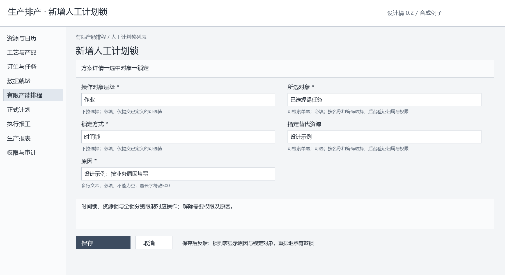

| 输入字段 | 控件 | 必填与联动 | 默认值 | 输入来源 | 校验与反馈 |
|---|---|---|---|---|---|
| 操作对象层级 | 下拉选择 | 必填 | 空 | 作业、阶段分段、资源分配 | 仅提交已定义的可选值：作业、阶段分段、资源分配 |
| 所选对象 | 可检索单选 | 必填 | 空 | 人工填写 | 按名称和编码选择，后台验证归属与权限 |
| 锁定方式 | 下拉选择 | 必填 | 空 | 时间锁、资源锁、时间与资源锁 | 仅提交已定义的可选值：时间锁、资源锁、时间与资源锁 |
| 指定替代资源 | 可检索单选 | 可选 | 空 | 满足工艺资格与日历的替代资源 | 按名称和编码选择，后台验证归属与权限 |
| 原因 | 多行文本 | 必填 | 空 | 人工填写 | 不能为空；最长字符数500 |

业务限制：时间锁、资源锁与全锁分别限制对应操作；解除需要权限及原因。

提交与成功返回：服务端记录所选层级和锁定范围，带当前版本检查；锁列表显示原因与锁定对象，重排继承有效锁。

**编辑、详情与回查**

该对象由来源动作或查询产生。详情展示来源、关联身份、当前状态与记录；仅显示本模块状态允许且有权限的专用动作。报工与数量更正追加历史链，不提供任意删改生成结果的普通编辑。

详情补充：具体 jobId、segmentId、allocationId、rowVersion（诊断区）；现实变更冲突与原锁来源版本。

<!-- 原页面关联：P22；AC-13/14；UAT-06 -->

#### 8.3.5 方案比较

看新方案比原方案改了哪些任务、人员、设备、数量和完工时间。

使用角色：计划员、生产负责人。筛选：基准方案、目标方案、只看变化、变化维度。业务动作：选择两个方案、定位变化任务、返回候选。

**列表与查询结果**


| 展示字段 | 业务例子 | 来源或方案边界 | 展示规则 |
|---|---|---|---|
| 业务任务 | SO001 / 焊锡 | 关联展示 | 成员 taskId 稳定匹配 |
| 变化类型 | 调整 | 已有业务资料 | 新增/移除/变化/未变 |
| 变化维度 | 时间、人员 | 已有业务资料 | 只读展示已保存值；未提供可选值显示为空 |
| 原开始/结束 | 08:00–10:00 | 已有业务资料 | baseStartAt、baseEndAt |
| 新开始/结束 | 09:00–11:00 | 已有业务资料 | targetStartAt、targetEndAt |
| 原资源 | 张师傅 | 关联展示 | 关联展示 |
| 新资源 | 李师傅 | 关联展示 | 关联展示 |
| 数量/交期影响 | 100 件 / 延后1小时 | 拟补关联展示 | 数量变化及交期解释需额外展示 |

**选择比较方案**

入口：有限产能排程→方案比较。已有输入契约，页面交互待补齐


| 输入字段 | 控件 | 必填与联动 | 默认值 | 输入来源 | 校验与反馈 |
|---|---|---|---|---|---|
| 原方案（待定） | 计划选择 | 必填 | 空 | 有权限的历史或正式方案 | 待定字段，实施前明确格式、范围及拒绝条件 |
| 目标方案（待定） | 计划选择 | 必填 | 空 | 有权限的候选或正式方案 | 待定字段，实施前明确格式、范围及拒绝条件 |

业务限制：相同版本禁止无意义比较；缺失可比事实说明原因，不编造改善比例。

提交与成功返回：读取版本差异，不写入计划；展示新增、取消、时间与资源变化及交期影响。

**编辑、详情与回查**

该对象由来源动作或查询产生。详情展示来源、关联身份、当前状态与记录；仅显示本模块状态允许且有权限的专用动作。报工与数量更正追加历史链，不提供任意删改生成结果的普通编辑。

详情补充：baseVersionId、targetVersionId、baseJobId、targetJobId、memberTaskIds；新增/移除/改变/未变统计和跨订单影响说明。

<!-- 原页面关联：P23；AC-13～16；UAT-06/07 -->

### 8.4 后台处理与数据变化

API校验权限、范围与参数，从一致性事实形成不可变输入快照和请求。单实例Worker在事务外求解，完整候选短事务保存；独立校验器复算硬约束，候选不得部分暴露。具体时间刻度、模型与状态映射见附录A。

计划目录先对冻结快照中的全部车间做范围校验，再排序限制结果量；非管理员空范围直接返回空，不通过先截取再过滤泄露范围或漏查。相同幂等键与相同载荷返回原结果，相同键不同载荷拒绝。候选废弃保留历史。

| 用例 | 现有或候选接口定位 | 边界 | 读写事实 |
|---|---|---|---|
| 提交排程请求 | `POST /api/aps/v1/plan-requests` | 精确契约已有定义；运行事实另记 | 计划版本和输入快照 |
| 请求目录 | `GET /api/aps/v1/plan-requests` | 待定补充；实施前定义精确契约 | 计划版本目录（拟补查询） |
| 读取进度 | `GET /api/aps/v1/plan-requests/{requestId}` | 精确契约已有定义；运行事实另记 | 请求与计划版本 |
| 取消求解 | `POST /api/aps/v1/plan-requests/{requestId}/cancel` | 精确契约已有定义；运行事实另记 | 计划请求状态 |
| 查询候选目录 | `GET /api/aps/v1/plan-versions` | 精确契约已有定义；运行事实另记 | 计划版本目录（拟补查询） |
| 废弃候选 | `POST /api/aps/v1/plan-versions/{planVersionId}/discard` | 精确契约已有定义；运行事实另记 | 候选版本及审计 |
| 读取方案明细 | `GET /api/aps/v1/plan-versions/{planVersionId}` | 精确契约已有定义；运行事实另记 | 计划作业/成员/阶段/分配 |
| 调整计划 | `POST /api/aps/v1/plan-versions/{planVersionId}/adjustments` | 精确契约已有定义；运行事实另记 | 新计划版本及调整锁 |
| 创建锁 | `POST /api/aps/v1/plan-versions/{planVersionId}/locks` | 精确契约已有定义；运行事实另记 | 人工计划锁 |
| 解除人工计划锁 | `DELETE /api/aps/v1/plan-versions/{planVersionId}/locks/{lockId}` | 精确契约已有定义；运行事实另记 | 人工计划锁及审计 |
| 读取比较 | `GET /api/aps/v1/plan-versions/{planVersionId}/comparison` | 精确契约已有定义；运行事实另记 | 计划版本及明细只读 |

精确字段与错误协议引用第13.3节机器契约；此表只定位用例，不建立另一套字段定义。

### 8.5 与其他模块的衔接

请求读取第4至7章的权威输入与现有正式计划、实际事实；候选进入第9章发布，未排原因回到维护对象。执行或资料变化使候选过期，计划员决定重新计算；Worker不改写订单承诺、现场报工和实际结束时间。

### 8.6 业务验收方法

用两任务争用同一人机检查无重叠；自动运行段允许人员做其他合法任务，但装卸段冲突应拒绝。分别测试取消、超时有候选、超时无候选和无解，文案及正式基线行为不同。拖动影响跨订单下游与共享批时，比较须显示完整影响且取消不改变正式计划。

## 9. 正式计划与发布

### 9.1 模块用途与业务流程

计划员选择候选，查看相对当前正式计划的变化、未解决风险和输入新鲜度，填写发布理由并确认。系统复验通过后切换当前正式版本，现场据此查看待派工作业。

### 9.2 业务规则与状态变化

候选必须独立校验通过，详细范围必需任务完整，当前基线、资料修订、执行修订、输入hash、日历与实际占用均与发布条件一致。事实变化应提示具体来源并拒绝过期发布，不能覆盖新请假或新报工。

发布用一个事务替换唯一当前正式指针，失败时旧正式版保持当前；并发发布根据基线及版本拒绝冲突。旧正式计划成为只读历史，发布后安排不可原地编辑。恢复历史方案应基于当前实际重新生成、校验和发布新候选，不能回滚生产事实。

首版“发布完成”只表示系统内生效。没有外部接收方、ACK和可靠外发设计时，不显示“MES已接收”或“全部外发完成”。

### 9.3 页面与交互设计

发布确认展示目标、基线、理由、受影响订单、完工变化、人机调整及阻断。正式计划详情显示当前标识、来源候选、发布时间与正式作业。作业行直接进入派工并带入计划和作业，历史版本保留来源查询，新派工入口仅提供合法当前作业。

#### 9.3.1 正式计划与历史

展示当前已经决定采用的安排，作为派工、开工和日报的依据，保留被替代版本。

使用角色：生产负责人、计划员、车间主管。筛选：日期、车间、当前/历史、状态。业务动作：查看当前计划、查看历史、从作业创建派工、以当前版重排。

**列表与查询结果**


| 展示字段 | 业务例子 | 来源或方案边界 | 展示规则 |
|---|---|---|---|
| 计划名称/版本 | 10-01 正式计划 / v1 | 已有业务资料 | 只读展示已保存值；未提供可选值显示为空 |
| 生效范围 | 电子装配 / 10-01 | 关联展示 | 从计划任务和范围派生 |
| 当前正式 | 是 | 后台已有事实 | 同一站点计划边界唯一 current |
| 状态 | 已发布 | 已有业务资料 | PUBLISHED / SUPERSEDED 等实际状态 |
| 发布人/时间 | 陈主管 / 07:58 | 拟补展示 | 发布审计关联 |
| 发布原因 | 交期和资源已确认 | 已有业务资料 | 只读展示已保存值；未提供可选值显示为空 |
| 任务/人员/设备数 | 3 / 2 / 1 | 派生汇总 | 按物理资源去重 |
| 执行进度 | 未开工 | 派生汇总 | 从执行事实聚合，发布不伪造完工 |
| 输入复验 | 发布时通过 | 关联展示 | 当前事实变化可提示需重排 |

**发布为正式计划**

入口：候选详情→查看复验及未排任务→发布。已有输入契约，页面交互待补齐


| 输入字段 | 控件 | 必填与联动 | 默认值 | 输入来源 | 校验与反馈 |
|---|---|---|---|---|---|
| 原因 | 多行文本 | 必填 | 空 | 人工填写 | 不能为空；最长字符数500 |

业务限制：正式计划由候选发布产生，不提供普通新增和直接编辑；过期、冲突或必要任务未排时拒绝。

提交与成功返回：后台重新检查输入新鲜度和硬约束，短事务原子切换唯一当前正式版；当前正式目录出现新版本，旧正式版保留为历史。

**编辑、详情与回查**

该对象由来源动作或查询产生。详情展示来源、关联身份、当前状态与记录；仅显示本模块状态允许且有权限的专用动作。报工与数量更正追加历史链，不提供任意删改生成结果的普通编辑。

详情补充：被替代版本、发布时间、候选来源、计划明细和发布审计；当日日冻结基线与当前方案分别显示；P0 系统内发布；外部 ERP/MES 下达状态为不适用。

<!-- 原页面关联：P24；AC-15/17/20/23；UAT-07/08/11；LIVE-05/10 -->

### 9.4 后台处理与数据变化

事务内锁定目标与当前正式记录，重编译可信事实、核对修订与候选内容，先替代旧版再设新版当前，唯一键约束最多一个当前。重复同一意图不得产生第二份正式发布；任何失败整体回滚。发布权限与普通查看分别检查。

| 用例 | 现有或候选接口定位 | 边界 | 读写事实 |
|---|---|---|---|
| 发布正式计划 | `POST /api/aps/v1/plan-versions/{planVersionId}/publish` | 精确契约已有定义；运行事实另记 | 计划版本原子切换 |
| 正式计划目录 | `GET /api/aps/v1/plan-versions` | 精确契约已有定义；运行事实另记 | 计划版本目录（拟补查询） |

精确字段与错误协议引用第13.3节机器契约；此表只定位用例，不建立另一套字段定义。

### 9.5 与其他模块的衔接

新派工读取当前正式作业，已有执行单保留来源计划，不把实际占用改绑新版本。报表同时可追原日冻结与最新正式计划。派工、开工和反馈会改变执行事实，候选需要复核，但当前计划不会因这类提醒自动失效删除。

### 9.6 业务验收方法

两人基于同一正式版产生候选，一人先发布，另一人旧基线发布应拒绝。发布中注入失败，旧版仍唯一当前。新增请假或报工后，旧候选显示过期与原因。历史方案恢复生成新候选，不修改已执行记录。

## 10. 派工、执行、报工与质量数量

### 10.1 模块用途与业务流程

主管从正式作业创建执行单，核对成员数量、单位与实际资源。操作人员按授权开工、暂停、恢复、换资源与推进阶段，从实际作业成员提交部分或完工报工。质量人员处理待检与隔离；可转序量进入预约、投入和流转，异常形成可追溯返工或补产。

### 10.2 业务规则与状态变化

#### 派工与执行状态

新执行单必须来源当前正式作业。计划数量、已有分配、可派剩余及单位由服务端读取；不允许超量或重复活动派工。共享成员量必须可唯一确定；不能由总派工量猜测成员比例。运行状态与数量余额共同控制按钮。

| 当前状态 | 允许的业务动作 | 条件与结果 |
|---|---|---|
| 待开工 | 开工、取消 | 开工复核资格、日历、前置释放和真实占用；取消不留下活动资源段 |
| 运行中 | 暂停、加工结束 | 暂停按批准规则结束当前实际段；加工结束只能在最后必要阶段及数量条件满足后执行 |
| 已暂停 | 恢复、受控取消 | 恢复复验当前条件；已有产出时取消前须明确剩余处置 |
| 待质量处置 | 质量完结 | 全部必要待检与隔离处置完成才能转完成 |
| 已完成、已取消 | 查询与合法更正链 | 终态不直接恢复或改写；新增处置保持原历史 |

开工只打开首个实际阶段所需分配，阶段推进原子关闭当前、打开相邻下一阶段。换资源保留原角色、席位与来源分配，关闭旧实际段并打开新段。已执行事实不能通过解锁或重排改写；开放占用不因计划时间到了自动结束。

#### 报工、质量与数量守恒

每次报工记录运行、成员、任务、实际数量和单位，禁止负量与超过剩余可报范围。成员选择带入任务与单位，不手工复制内部ID。部分产出与最终完工分别处理，不能把提前结束一个阶段当作全部工序完工。

待检、隔离不增加下游可用量。无需独立检验的工序按授权报工规则放行；需要检验的先有质量决定。纯时间门槛不扣前序产出；消耗型关系按比例扣减。

在每一时点，下游投入×单位用量不得超过已释放且分配给该下游的上游数量。同一供给不能重复分配给不同下游；首批20件到位不意味着后续无限供给。更正追加替代报工和精确反向事件，检查已被下游消耗的依赖，不删除原记录。

返工产生带来源的新任务及处置分支，不能往正常路线添加循环回边；补产与报废分别记账，返工合格不重复增加总交付量。人工时从真实人员段计算，机时从设备段计算；两人工作2小时是4人时，不是2人时。

### 10.3 页面与交互设计

执行入口先选正式计划、作业或已有执行单。详情连续显示来源、成员、状态、阶段、实际占用、报工、产出及处置；每种动作使用独立输入表单。开工被拒时展示缺失条件与修正入口，执行单保持原状态。提交处理中防重复，成功读取最新状态与余额。

#### 10.3.1 待派工任务

从当前正式计划选择具体作业、人员设备和数量，创建现场执行单。

使用角色：车间主管、计划员。筛选：车间/中心、日期、订单、工序、待派状态。业务动作：创建派工、查看计划作业、查看开工条件。

**列表与查询结果**


| 展示字段 | 业务例子 | 来源或方案边界 | 展示规则 |
|---|---|---|---|
| 正式计划 | 10-01 正式 / v1 | 拟补页面映射 | 从当前正式版进入，自动携带版本 |
| 订单/产品 | SO-DEMO-001 / 主控板 A | 关联展示 | 关联展示 |
| 作业/工序 | J-N10 / 焊锡 | 已有业务资料 | 从计划作业选择 |
| 计划数量 | 100 件 | 已有业务资料 | 只读展示已保存值；未提供可选值显示为空 |
| 已派/剩余 | 0 / 100 件 | 拟补派生 | 按活动和历史有效派工事实判断 |
| 计划时段 | 08:00–10:00 | 关联展示 | 关联展示 |
| 计划人员/设备 | 张师傅 / 焊锡工位 | 关联展示 | 分段资源关联 |
| 前置/物料/质量 | 齐备 | 拟补关联展示 | 开工还需服务端复验 |

**创建现场执行单**

入口：正式计划→待派工任务→选择作业→创建执行单。已有输入契约，页面交互待补齐


| 输入字段 | 控件 | 必填与联动 | 默认值 | 输入来源 | 校验与反馈 |
|---|---|---|---|---|---|
| 正式计划 | 可检索单选 | 必填 | 空 | 当前正式计划 | 按名称和编码选择，后台验证归属与权限 |
| 计划作业 | 可检索单选 | 必填 | 空 | 该正式计划的可派工作业 | 按名称和编码选择，后台验证归属与权限 |
| 派工数量 | 数字输入 | 必填 | 空 | 人工填写 | 大于0 |
| 数量单位 | 文本输入 | 必填 | 空 | 人工填写 | 按业务对象格式校验 |

业务限制：不能手填任意计划标识；派工量不能超过可执行剩余量。

提交与成功返回：校验当前正式版、作业可执行及数量，幂等创建；执行列表显示待开工执行单。

**编辑、详情与回查**

该对象由来源动作或查询产生。详情展示来源、关联身份、当前状态与记录；仅显示本模块状态允许且有权限的专用动作。报工与数量更正追加历史链，不提供任意删改生成结果的普通编辑。

详情补充：本次 assignedQty、uomCode、自动 planVersionId/planJobId；批次成员选择、已开工占用与不可重复派发说明。

<!-- 原页面关联：P25；AC-17/24；UAT-08/12；LIVE-06/10 -->

#### 10.3.2 现场执行单

记录实际开工、暂停、恢复、换人换机、推进阶段和完工状态。

使用角色：操作人员、车间主管。筛选：日期、车间、人员、状态、订单。业务动作：开工、暂停/恢复、换人/换机、推进阶段、提交报工。

**列表与查询结果**


| 展示字段 | 业务例子 | 来源或方案边界 | 展示规则 |
|---|---|---|---|
| 执行单号 | RUN-DEMO-001 | 拟补展示 | 现有 runNo 是作业内序号；全局可读编号为候选展示 |
| 订单/作业 | SO001 / 焊锡 J-N10 | 关联展示 | 关联展示 |
| 人员/设备 | 张师傅 / 焊锡工位 | 关联展示 | 当前实际分配而非只读计划 |
| 分配数量/单位 | 100 件 | 已有业务资料 | 只读展示已保存值；未提供可选值显示为空 |
| 当前阶段 | 加工 | 关联展示 | 按实际活动阶段 |
| 状态 | 运行中 | 已有业务资料 | READY/RUNNING/PAUSED/WAIT_QUALITY/COMPLETED/CANCELLED |
| 实际开/完工 | 08:05 / 未结束 | 已有业务资料 | actualStartAt、actualEndAt；开放段不编假结束 |
| 已报加工/合格/待检 | 100 / 80 / 20 件 | 派生汇总 | 有效报工聚合，不能重复累计更正前后 |
| 暂停/异常原因 | 未暂停 | 已有业务资料 | 只读展示已保存值；未提供可选值显示为空 |

**开工、暂停或恢复**

入口：执行单详情→选择允许动作。已有输入契约，页面交互待补齐


| 输入字段 | 控件 | 必填与联动 | 默认值 | 输入来源 | 校验与反馈 |
|---|---|---|---|---|---|
| 执行动作 | 下拉选择 | 必填 | 空 | 开工、暂停、恢复、取消 | 仅提交已定义的可选值：开工、暂停、恢复、取消 |
| 实际发生时间 | 日期时间选择 | 必填 | 当前站点时间（可按权限调整） | 人工填写 | 按站点时区输入，后台转为统一时间 |
| 原因 | 多行文本 | 可选 | 空 | 人工填写 | 最长字符数500 |

业务限制：未开工不能暂停；已运行需先暂停再取消；已完工不能继续普通报工。

提交与成功返回：按执行状态校验动作，写入实际占用及执行版本；状态、时间线和实际占用一起更新。

**换人或换设备**

入口：执行单详情→资源→更换。已有输入契约，页面交互待补齐


| 输入字段 | 控件 | 必填与联动 | 默认值 | 输入来源 | 校验与反馈 |
|---|---|---|---|---|---|
| 来源计划阶段 | 可检索单选 | 可选 | 空 | 人工填写 | 按名称和编码选择，后台验证归属与权限 |
| 被替换资源 | 可检索单选 | 必填 | 空 | 人工填写 | 按名称和编码选择，后台验证归属与权限 |
| 具体资源 | 可检索单选 | 必填 | 空 | 同范围的具体人员或设备，显示名称与编码 | 按名称和编码选择，后台验证归属与权限 |
| 占用活动类型 | 下拉选择 | 必填 | 空 | 准备、加工、卸料、等待并保留、暂停并保留、转运 | 仅提交已定义的可选值：准备、加工、卸料、等待并保留、暂停并保留、转运 |
| 实际发生时间 | 日期时间选择 | 必填 | 当前站点时间（可按权限调整） | 人工填写 | 按站点时区输入，后台转为统一时间 |
| 原因 | 多行文本 | 可选 | 空 | 人工填写 | 最长字符数500 |

业务限制：替代资源仍须满足资格和时间约束，不能覆盖已发生占用。

提交与成功返回：结束旧占用并创建新占用，保留来源计划分配及原因；实际占用列表出现前后资源段。

**推进执行阶段**

入口：执行单详情→阶段→推进。已有输入契约，页面交互待补齐


| 输入字段 | 控件 | 必填与联动 | 默认值 | 输入来源 | 校验与反馈 |
|---|---|---|---|---|---|
| 实际发生时间 | 日期时间选择 | 必填 | 当前站点时间（可按权限调整） | 人工填写 | 按站点时区输入，后台转为统一时间 |
| 原因 | 多行文本 | 可选 | 空 | 人工填写 | 最长字符数500 |

业务限制：缺少可信来源分配时拒绝，不能由页面猜测阶段资源。

提交与成功返回：验证当前阶段完成条件，关闭当前占用并开始下一阶段；现场阶段、实际占用和执行水位更新。

**编辑、详情与回查**

该对象由来源动作或查询产生。详情展示来源、关联身份、当前状态与记录；仅显示本模块状态允许且有权限的专用动作。报工与数量更正追加历史链，不提供任意删改生成结果的普通编辑。

详情补充：正式版本、planJobId、requestId、rowVersion、executionRevision（诊断区）；阶段推进、替换资源、发生时间及原因；任务成员/产出批/报工/实际占用明细。

<!-- 原页面关联：P26；AC-17/18/23/24；UAT-08/09/12 -->

#### 10.3.3 实际资源占用

查看人和机器实际被占用了多久，解释超时、暂停和现场资源冲突。

使用角色：车间主管、计划员。筛选：资源、日期、执行单、开放占用、状态。业务动作：查看来源计划段、定位冲突、查看更正链。

**列表与查询结果**


| 展示字段 | 业务例子 | 来源或方案边界 | 展示规则 |
|---|---|---|---|
| 资源 | 张师傅 / EMP-001 | 已有业务资料 | 只读展示已保存值；未提供可选值显示为空 |
| 执行单/作业 | RUN-DEMO-001 / 焊锡 | 关联展示 | 关联展示 |
| 活动类型 | 加工 | 已有业务资料 | 准备/加工/卸料/等待保留/暂停保留/运输 |
| 实际开始 | 08:05 | 已有业务资料 | 只读展示已保存值；未提供可选值显示为空 |
| 实际结束 | 10:05 | 已有业务资料 | 未结束保留为空并显示开放占用 |
| 实际时长 | 2 小时 | 派生汇总 | 开放段截至查询时刻，说明估算口径 |
| 状态 | 已完成 | 已有业务资料 | ACTIVE/COMPLETED/CORRECTION/VOID |
| 原因 | 实际开工晚5分钟 | 已有业务资料 | 只读展示已保存值；未提供可选值显示为空 |

**产生与维护方式**

实际占用由开工、暂停、恢复、换资源及阶段推进产生；只读查看，不提供手工覆盖历史的新增表单。

**编辑、详情与回查**

该对象由来源动作或查询产生。详情展示来源、关联身份、当前状态与记录；仅显示本模块状态允许且有权限的专用动作。报工与数量更正追加历史链，不提供任意删改生成结果的普通编辑。

详情补充：sourcePlanAllocationId、planSegmentId、correctionOfId、rowVersion；可信预计释放/未知释放原因和共享批物理占用身份。

<!-- 原页面关联：P27；AC-09/17/20/23；UAT-04/08/11/12 -->

#### 10.3.4 生产报工记录

记录本次实际加工多少、合格多少、待检多少、不良报废多少，并保留更正链。

使用角色：操作人员、车间主管。筛选：日期、执行单、订单/工序、类型、操作者。业务动作：提交报工、查看产出批、追加更正。

**列表与查询结果**


| 展示字段 | 业务例子 | 来源或方案边界 | 展示规则 |
|---|---|---|---|
| 报工记录 | REP-DEMO-001 | 拟补展示 | 可读编号为候选；底层 ID 自动携带 |
| 执行单/任务成员 | RUN001 / 焊锡 / 主控板 A | 关联展示 | 共享批按成员回报 |
| 类型 | 进度报工 | 已有业务资料 | PROGRESS/COMPLETE/CORRECTION |
| 报工时间 | 10-01 10:05 | 已有业务资料 | 只读展示已保存值；未提供可选值显示为空 |
| 加工数量 | 100 件 | 已有业务资料 | 只读展示已保存值；未提供可选值显示为空 |
| 合格/待检 | 80 / 20 件 | 已有字段汇总 | goodQty、pendingQty；待检不自动放行 |
| 不良/报废 | 0 / 0 件 | 已有字段汇总 | rejectedQty、scrapQty；分类口径须互斥 |
| 转出数量 | 0 件 | 已有业务资料 | 与数量事件对账，不能重复新增产出 |
| 操作者 | 张师傅 | 已有业务资料 | 当前授权身份优先，按实际代理权限处理 |

**提交生产报工**

入口：执行单详情→报工→新增。已有输入契约，页面交互待补齐


| 输入字段 | 控件 | 必填与联动 | 默认值 | 输入来源 | 校验与反馈 |
|---|---|---|---|---|---|
| 共享批成员 | 可检索单选 | 必填 | 空 | 共享批的任务成员 | 按名称和编码选择，后台验证归属与权限 |
| 工序任务 | 可检索单选 | 必填 | 空 | 所选执行单的任务成员 | 按名称和编码选择，后台验证归属与权限 |
| 报工类型 | 下拉选择 | 必填 | 进度报工 | 进度报工、最终报工 | 仅提交已定义的可选值：进度报工、最终报工 |
| 报工发生时间 | 日期时间选择 | 必填 | 当前站点时间（可按权限调整） | 人工填写 | 按站点时区输入，后台转为统一时间 |
| 本次加工数量 | 数字输入 | 必填 | 空 | 人工填写 | 不少于0 |
| 合格数量 | 数字输入 | 必填 | 空 | 人工填写 | 不少于0 |
| 待检数量 | 数字输入 | 必填 | 0 | 人工填写 | 不少于0 |
| 不良数量 | 数字输入 | 必填 | 0 | 人工填写 | 不少于0 |
| 报废数量 | 数字输入 | 必填 | 0 | 人工填写 | 不少于0 |
| 本次转出数量 | 数字输入 | 必填 | 0 | 人工填写 | 不少于0 |
| 数量单位 | 文本输入 | 必填 | 空 | 人工填写 | 按业务对象格式校验 |
| 不良或报废原因 | 多行文本 | 不良或报废量大于零时必填 | 空 | 人工填写 | 最长字符数500 |
| 报工人员 | 只读 | 可选 | 当前用户 | 当前用户，代理报工须另有权限 | 当前授权身份；代理报工按已有权限选择 |

业务限制：加工量=合格+待检+不良+报废；转出另记，不能加到加工量。最终报工与状态一致。

提交与成功返回：数量、质量产出批及数量事件同事务写入；重复提交返回原结果；报工列表与产出批可重新查看，更新进度和日表。

**更正已有报工**

入口：报工详情→追加更正。已有输入契约，页面交互待补齐


| 输入字段 | 控件 | 必填与联动 | 默认值 | 输入来源 | 校验与反馈 |
|---|---|---|---|---|---|
| 报工发生时间 | 日期时间选择 | 必填 | 当前站点时间（可按权限调整） | 人工填写 | 按站点时区输入，后台转为统一时间 |
| 本次加工数量 | 数字输入 | 必填 | 空 | 人工填写 | 不少于0 |
| 合格数量 | 数字输入 | 必填 | 空 | 人工填写 | 不少于0 |
| 待检数量 | 数字输入 | 必填 | 0 | 人工填写 | 不少于0 |
| 不良数量 | 数字输入 | 必填 | 0 | 人工填写 | 不少于0 |
| 报废数量 | 数字输入 | 必填 | 0 | 人工填写 | 不少于0 |
| 本次转出数量 | 数字输入 | 必填 | 0 | 人工填写 | 不少于0 |
| 原因 | 多行文本 | 可选 | 空 | 人工填写 | 不能为空；最长字符数500 |

业务限制：不能直接编辑或删除原报工；原因必填，并发版本变化须重新读取。

提交与成功返回：追加替代快照及精确反向数量事件；已下游使用的量先检查依赖；原记录与更正链同时保留，聚合按有效记录复算。

**编辑、详情与回查**

该对象由来源动作或查询产生。详情展示来源、关联身份、当前状态与记录；仅显示本模块状态允许且有权限的专用动作。报工与数量更正追加历史链，不提供任意删改生成结果的普通编辑。

详情补充：uomCode、defectReason、correctionOfId、requestId、rowVersion；所属 planJobMemberId、taskId、发生时间与操作时间；更正必须录原因和前后数量，不覆盖原事件。

<!-- 原页面关联：P28；AC-17/24；UAT-08/12；LIVE-06/09 -->

#### 10.3.5 产出批与质量处置

把可流转的合格量与待检、隔离量分开，记录放行、返工和报废决定。

使用角色：质量人员、车间主管。筛选：批号、产品、订单、质量状态。业务动作：检验放行、隔离、返工/报废处置、查看血缘。

**列表与查询结果**


| 展示字段 | 业务例子 | 来源或方案边界 | 展示规则 |
|---|---|---|---|
| 产出批号 | OUT-DEMO-001-G | 已有业务资料 | 只读展示已保存值；未提供可选值显示为空 |
| 来源订单/任务/报工 | SO001 / 焊锡 / REP001 | 关联展示 | sourceTaskId、sourceReportId 关联 |
| 产品 | 主控板 A | 已有业务资料 | 只读展示已保存值；未提供可选值显示为空 |
| 质量状态 | 已放行 | 已有业务资料 | 待检/放行/隔离/拒收/关闭 |
| 批总量 | 80 件 | 已有业务资料 | 只读展示已保存值；未提供可选值显示为空 |
| 可用/预约/消耗 | 80 / 0 / 0 件 | 已有业务资料 | availableQty、reservedQty、consumedQty |
| 报废量 | 0 件 | 已有业务资料 | 只读展示已保存值；未提供可选值显示为空 |
| 处置 | 无 | 已有业务资料 | 无/返工/报废/让步 |
| 批准人/时间 | 质量员 / 10:10 | 已有业务资料 | approvedBy、approvedAt |

**检验放行或质量处置**

入口：产出批详情→选择质量动作。已有输入契约，页面交互待补齐


| 输入字段 | 控件 | 必填与联动 | 默认值 | 输入来源 | 校验与反馈 |
|---|---|---|---|---|---|
| 质量处置 | 下拉选择 | 必填 | 空 | 保留、放行、拒收、返工、报废、让步使用 | 仅提交已定义的可选值：保留、放行、拒收、返工、报废、让步使用 |
| 处置或流转数量 | 数字输入 | 必填 | 空 | 人工填写 | 大于0 |
| 实际发生时间 | 日期时间选择 | 必填 | 当前站点时间（可按权限调整） | 人工填写 | 按站点时区输入，后台转为统一时间 |
| 原因 | 多行文本 | 可选 | 空 | 人工填写 | 最长字符数500 |
| 创建补产任务 | 开关 | 可选 | 否 | 人工填写 | 按业务对象格式校验 |

业务限制：待检和隔离不可直接供应下游；处置数量正数且不超过适用桶余额。

提交与成功返回：锁定批余额与执行版本，按决定追加事件，返工补产创建血缘任务；待检量、可用量及返工任务更新，可追原产出批。

**编辑、详情与回查**

该对象由来源动作或查询产生。详情展示来源、关联身份、当前状态与记录；仅显示本模块状态允许且有权限的专用动作。报工与数量更正追加历史链，不提供任意删改生成结果的普通编辑。

详情补充：sourceOutputLotId、productionLotId、dispositionReason、rowVersion；待检20件另批：OUT-DEMO-001-P / PENDING，不能混成一批80件已放行再算20件可用；质量决定：quantity、occurredAt、reason、createReplenishment；返工/补产任务血缘和后续 ETA 影响。

<!-- 原页面关联：P29；AC-18；UAT-09；LIVE-07 -->

#### 10.3.6 数量流转与冲正

追踪数量产生、预约、释放预约、投入、转序、报废和精确冲正，支持对账。

使用角色：计划员、质量人员、授权现场人员。筛选：产出批、订单/任务、事件类型、日期。业务动作：查看事件链、查看余额、执行授权转序。

**列表与查询结果**


| 展示字段 | 业务例子 | 来源或方案边界 | 展示规则 |
|---|---|---|---|
| 事件编号 | QTY-DEMO-001 | 拟补展示 | 底层事件不可变，可读展示编号候选 |
| 来源产出批 | OUT-DEMO-001-G | 关联展示 | 关联展示 |
| 来源/目标任务 | 焊锡 → 主控装配 | 关联展示 | targetTaskId 等关联 |
| 事件类型 | 预约 | 后台已有事实 | 使用现有事件枚举，不另造覆盖式库存改写 |
| 数量/单位 | 20 件 | 已有业务资料 | 同批单位保持一致 |
| 发生时间 | 10-01 10:20 | 已有业务资料 | 保留发生时间与审计时间 |
| 原事件引用 | 无 | 后台已有事实 | 冲正必须关联原事件 |
| 原因/操作者 | 首批装配预约 / 班组长 | 后台已有事实 | 授权范围内可回溯 |

**数量预约、投入或转序**

入口：产出批详情→数量流转。已有输入契约，页面交互待补齐


| 输入字段 | 控件 | 必填与联动 | 默认值 | 输入来源 | 校验与反馈 |
|---|---|---|---|---|---|
| 对应物料要求 | 可检索单选 | 必填 | 空 | 目标任务的未满足物料需求 | 按名称和编码选择，后台验证归属与权限 |
| 目标工序任务 | 可检索单选 | 必填 | 空 | 可接收该产出批的任务 | 按名称和编码选择，后台验证归属与权限 |
| 目标执行单 | 可检索单选 | 可选 | 空 | 目标任务对应执行单 | 按名称和编码选择，后台验证归属与权限 |
| 数量动作 | 下拉选择 | 必填 | 空 | 预约、释放预约、投入、转运 | 仅提交已定义的可选值：预约、释放预约、投入、转运 |
| 处置或流转数量 | 数字输入 | 必填 | 空 | 人工填写 | 大于0 |
| 实际发生时间 | 日期时间选择 | 必填 | 当前站点时间（可按权限调整） | 人工填写 | 按站点时区输入，后台转为统一时间 |
| 原因 | 多行文本 | 可选 | 空 | 人工填写 | 最长字符数500 |

业务限制：数量不能为负；已预约或已消耗数量不能重复使用；更正需指向原事件。

提交与成功返回：检查余额、目标需求及版本，同事务追加不可变数量事件并更新投影；事件链和余额可重新查看。

**编辑、详情与回查**

该对象由来源动作或查询产生。详情展示来源、关联身份、当前状态与记录；仅显示本模块状态允许且有权限的专用动作。报工与数量更正追加历史链，不提供任意删改生成结果的普通编辑。

详情补充：物料需求、目标执行单、幂等来源、原事件及冲正链；产生/消耗/库存余额对账；只读账不能物理删除。

<!-- 原页面关联：P30；AC-17/18/24；UAT-08/09/12；LIVE-09 -->

### 10.4 后台处理与数据变化

执行服务校验状态、来源、范围、数量和资源事实，在受控事务变更执行单、实际占用与执行修订。报工、产出批、数量事件及余额同事务写入，幂等返回既有处理。实际分配保留来源身份；历史无法安全还原的角色映射按未知阻断，不按当前资源猜测。

质量与数量服务分别检查处置权限、来源余额、并发版本及下游依赖。失败不留下半个事件或错误余额。更正不是删除业务历史，审计必须可追原值、原因、操作者与关联逆向事件。

| 用例 | 现有或候选接口定位 | 边界 | 读写事实 |
|---|---|---|---|
| 执行单目录 | `GET /api/aps/v1/execution-runs` | 订单/工序/作业关键字、状态、资源；范围内最近200项，查看权限 | 执行单、作业及关联业务名称 |
| 派工用途目录 | `GET /api/aps/v1/execution-runs/dispatch-plans`及`/api/aps/v1/execution-runs/dispatch-plans/{id}` | 仅当前正式计划，按完整计划车间范围过滤；复用开工权限 | 计划名称、作业及剩余可分配量 |
| 报工成员 | `GET /api/aps/v1/execution-runs/{executionRunId}/report-members` | 报工权限及执行范围；只返回真实作业成员及可报余额 | 成员计划量、任务名称、有效报工与执行分配量 |
| 换资源候选 | `GET /api/aps/v1/execution-runs/{executionRunId}/resource-candidates` | 复用资源更换的资格、有效日历和实际占用校验；写入时再次复验 | 来源角色、可见资源与当前占用 |
| 数量流转目标及流水 | `GET /api/aps/v1/execution-runs/{id}/output-lots/{lotId}/movement-targets`及`/api/aps/v1/execution-runs/{id}/output-lots/{lotId}/quantity-events` | 产出批必须属于执行单；目标须同物料/单位及合法来源，按权限过滤 | 未满足需求、当前预留、目标执行单及不可变事件 |
| 创建执行单 | `POST /api/aps/v1/execution-runs` | 精确契约已有定义；运行事实另记 | 现场执行单 |
| 执行状态动作 | `POST /api/aps/v1/execution-runs/{executionRunId}/transitions` | 精确契约已有定义；运行事实另记 | 执行单和实际占用 |
| 更换资源 | `POST /api/aps/v1/execution-runs/{executionRunId}/resource-changes` | 精确契约已有定义；运行事实另记 | 执行单和实际占用 |
| 推进阶段 | `POST /api/aps/v1/execution-runs/{executionRunId}/phase-advances` | 精确契约已有定义；运行事实另记 | 执行单和实际占用 |
| 读取执行详情 | `GET /api/aps/v1/execution-runs/{executionRunId}` | 精确契约已有定义；运行事实另记 | 现场执行单及关联事实 |
| 提交报工 | `POST /api/aps/v1/execution-runs/{executionRunId}/reports` | 精确契约已有定义；运行事实另记 | 报工、产出批及数量事件同事务 |
| 追加更正 | `POST /api/aps/v1/production-reports/{reportId}/corrections` | 精确契约已有定义；运行事实另记 | 追加报工与反向数量事件 |
| 质量处置 | `POST /api/aps/v1/output-lots/{outputLotId}/quality-decisions` | 精确契约已有定义；运行事实另记 | 产出批、数量事件、返工补产任务 |
| 数量流转 | `POST /api/aps/v1/output-lots/{outputLotId}/quantity-movements` | 精确契约已有定义；运行事实另记 | 不可变数量事件和当前投影 |

精确字段与错误协议引用第13.3节机器契约；此表只定位用例，不建立另一套字段定义。

### 10.5 与其他模块的衔接

实际反馈回到订单行与任务剩余、物料供给、计划输入修订和报表。计划员可据此重新评估未来工作；现场操作不会直接改写正式计划。订单完整关闭使用所有产品行及末端放行条件，不只看最后一次按钮成功。

### 10.6 业务验收方法

从正式作业带入20件派工，超计划量、旧正式来源与重复活动分配应拒绝。开工人机条件缺失应保持待开工。提交80件合格、20件待检，下游只能得到80件合法供给；重复报工不增加数量。隔离10件，返工6、报废4且需补产时核对任务血缘、负荷与余额。

## 11. 生产报表与交期分析

### 11.1 模块用途与业务流程

负责人按车间、日期、人员、技能或订单查看计划与实际，沿任务下钻原因，再决定是否补资料、处置异常或发起模拟。报表读取事实，不自己制造另一份计划或补写生产完成。

### 11.2 指标口径与计算

| 指标 | 定义与限制 |
|---|---|
| 每日计划与实际 | 日期按站点时区；跨日工时按分段，数量按释放归属，不能每天重复整单数量 |
| 日计划达成 | 使用冻结日基线作为分母；最新计划另列，不允许下午重排抬高当日达成 |
| 日历可用工时 | 员工有效可用窗并集扣不可用窗，一人一份；按技能看的潜力不可相加 |
| 已排、待排、剩余 | 分别是正式占用、未分配需求、净可用减占用；总工时、峰值人数、连续窗口分别检查 |
| 人力累计与技能缺口 | 累计不能掩盖某日下午同时到岗缺口或前日逾期；按员工去重并保留技能条件 |
| 可完成数量 | 仅对明确产品、工艺、标准时间、准备与窗口假设计算，不跨不同单位合计 |
| 产品行与订单预计完成 | 产品行取满足需求的必要末端释放，订单取必需产品行最大值；关键任务未可靠排出则未知 |
| 延期与进度 | 自然时间延期与工作时间差分列；末端合格量进度与加权工作量进度分列，返工负荷单列 |
| 人机负荷率 | 合法占用/同期间可用容量；分母0显示无可用能力；共享设备段只计一次 |
| 计划变化与瓶颈 | 对比同一基线，列任务、时间、人机变化及前置、供给、资源、日历限制链 |

所有查询展示范围、站点时区、计划或日基线版本、实际截止时间和生成时间；CSV及打印使用相同过滤、权限与口径。生产完成没有入库物流数据时，不混称客户到货。

### 11.3 页面与交互设计

报表按车间每日生产、人员负荷及技能缺口、订单交期组织。选择条件→显示口径和截止→查询→下钻任务→导出或打印；汇总与明细能相互解释。未知交期显示缺失对象及最早已知下界，不能填0或取已排部分最大结束冒充整单日期。

#### 11.3.1 车间每日生产表

对比某天冻结的计划、当前重排和实际产量人机工时，找未完成与结转。

使用角色：生产负责人、车间主管。筛选：业务日期、车间、工作中心、订单/工序。业务动作：查询、查看任务与数量账、导出 CSV、打印。

**列表与查询结果**


| 展示字段 | 业务例子 | 来源或方案边界 | 展示规则 |
|---|---|---|---|
| 日期/车间/中心 | 10-01 / 电子装配 / 焊锡 | 已有业务资料 | businessDate、workshop、workCenter |
| 订单/产品/工序 | SO001 / 主控板 A / 焊锡 | 已有业务资料 | 只读展示已保存值；未提供可选值显示为空 |
| 冻结计划量 | 100 件 | 已有业务资料 | 只读展示已保存值；未提供可选值显示为空 |
| 当前计划量 | 100 件 | 已有业务资料 | 只读展示已保存值；未提供可选值显示为空 |
| 加工/合格/待检 | 100 / 80 / 20 件 | 已有及拟补聚合 | 待检显示由质量批聚合，为候选增加；现有加工/合格已有 |
| 不良/报废/转出 | 0 / 0 / 0 件 | 已有业务资料 | 只读展示已保存值；未提供可选值显示为空 |
| 计划/实际人时 | 2 / 2 小时 | 已有业务资料 | 只读展示已保存值；未提供可选值显示为空 |
| 计划/实际机时 | 0 / 0 小时 | 已有业务资料 | 只读展示已保存值；未提供可选值显示为空 |
| 达成/结转 | 80% / 20 件 | 已有字段汇总 | 按已批准报表口径，冻结分母不可随重排改变 |
| 原因 | 20件待检 | 已有业务资料 | 只读展示已保存值；未提供可选值显示为空 |

**查询车间每日生产**

入口：生产报表→对应报表→设置条件。已有输入契约，页面交互待补齐


| 输入字段 | 控件 | 必填与联动 | 默认值 | 输入来源 | 校验与反馈 |
|---|---|---|---|---|---|
| 业务日期 | 日期选择 | 必填 | 当前站点业务日期 | yyyy-MM-dd，不随浏览器时区偏移 | 使用部署的IANA时区；非法日期拒绝 |
| 车间 | 可检索单选 | 可选 | 全部可见范围 | 有权限的车间名称与编码 | 传workshopId；服务端范围过滤，空选择不扩大授权 |
| 工作中心 | 可检索单选 | 可选 | 全部可见范围 | 所选车间的中心名称与编码 | 传workCenterId；车间切换清除旧中心，服务端校验归属 |

业务限制：报表没有新增记录表单；只读结果不能由用户手填。

提交与成功返回：读取权威事实与数据截止，导出复用同样条件及权限；页面显示计算口径、范围和查询截止，可导出或打印。

**编辑、详情与回查**

该对象由来源动作或查询产生。详情展示来源、关联身份、当前状态与记录；仅显示本模块状态允许且有权限的专用动作。报工与数量更正追加历史链，不提供任意删改生成结果的普通编辑。

详情补充：订单行、批次、任务状态、承诺交期、冻结/当前开始结束时间；冻结/当前人时和机时、计划/实际人员设备、delayed；报表 metadata：站点、时区、冻结/当前版本、数据截止、生成时间。

<!-- 原页面关联：P31；AC-20；UAT-11；LIVE-08 -->

#### 11.3.2 人员产能与负荷表

回答哪位人员还有多少可用时间、哪项技能在什么时段缺人，补充按产品工序的条件产量。

使用角色：生产负责人、计划员、车间主管。筛选：日期范围、车间/中心、技能、产品/工序。业务动作：查看人员明细、切换技能峰值、查看剩余窗口、导出/打印。

**列表与查询结果**


| 展示字段 | 业务例子 | 来源或方案边界 | 展示规则 |
|---|---|---|---|
| 人员/归属 | 张师傅 / 焊锡组 | 已有业务资料 | 只读展示已保存值；未提供可选值显示为空 |
| 有效技能 | 焊锡三级、装配二级 | 已有业务资料 | 只读展示已保存值；未提供可选值显示为空 |
| 净可用人时 | 8 小时 | 已有业务资料 | 只读展示已保存值；未提供可选值显示为空 |
| 已排人时 | 2 小时 | 已有业务资料 | 只读展示已保存值；未提供可选值显示为空 |
| 剩余人时 | 6 小时 | 已有业务资料 | 只读展示已保存值；未提供可选值显示为空 |
| 所选产品/工序 | 主控板 A / 焊锡 | 拟补新增 | 查看产量必须选择，避免混合单位 |
| 全天理论产量 | 480 件 | 拟补派生 | 60件/小时×8净小时，未扣新作业准备；附假设 |
| 剩余加工量上界 | 360 件 | 拟补派生 | 60×6；安排可行性仍看窗口/准备/物料 |
| 峰值缺口 | 14:00 需2人、合格1人、缺1人 | 已有报表关联展示 | 技能页按实际时点校验有效期与并发 |

**查询人员负荷和技能缺口**

入口：生产报表→对应报表→设置条件。已有输入契约，页面交互待补齐


| 输入字段 | 控件 | 必填与联动 | 默认值 | 输入来源 | 校验与反馈 |
|---|---|---|---|---|---|
| 业务日期 | 日期选择 | 必填 | 当前站点业务日期 | yyyy-MM-dd，不随浏览器时区偏移 | 使用部署的IANA时区；非法日期拒绝 |
| 车间 | 可检索单选 | 可选 | 全部可见范围 | 有权限的车间名称与编码 | 传workshopId；服务端范围过滤，空选择不扩大授权 |
| 工作中心 | 可检索单选 | 可选 | 全部可见范围 | 所选车间的中心名称与编码 | 传workCenterId；车间切换清除旧中心，服务端校验归属 |

业务限制：报表没有新增记录表单；只读结果不能由用户手填。

提交与成功返回：读取权威事实与数据截止，导出复用同样条件及权限；页面显示计算口径、范围和查询截止，可导出或打印。

**编辑、详情与回查**

该对象由来源动作或查询产生。详情展示来源、关联身份、当前状态与记录；仅显示本模块状态允许且有权限的专用动作。报工与数量更正追加历史链，不提供任意删改生成结果的普通编辑。

详情补充：people：resourceCode、resourceName、workshop、workCenter、teamName、overloaded；skills：availablePotentialHours、scheduledHours、unplannedRequiredHours、peakRequiredPeople、peakQualifiedPeople、peakShortagePeople、peakAt、reasonCodes；累计日期区间、归属/执行车间、aggregationNotice、数据截止和产能版本。

<!-- 原页面关联：P32；AC-10/21；APS-AC-09（候选）；UAT-04/11；LIVE-08 -->

#### 11.3.3 订单交期与完成表

查看各产品预计什么时候完成、是否延期、还差多少最终放行量以及为什么估不出来。

使用角色：生产负责人、计划员。筛选：订单、客户、ETA状态、是否延期。业务动作：查看阻断任务、定位计划、查看最终放行批、导出/打印。

**列表与查询结果**


| 展示字段 | 业务例子 | 来源或方案边界 | 展示规则 |
|---|---|---|---|
| 订单/产品行 | SO-DEMO-001 / 1 / 主控板 A | 已有业务资料 | 只读展示已保存值；未提供可选值显示为空 |
| 需求数量 | 100 件 | 已有业务资料 | 只读展示已保存值；未提供可选值显示为空 |
| 末端已放行 | 80 件 | 已有业务资料 | 只统计末端交付，不重复累计中间工序或返工 |
| 承诺交期 | 10-02 17:00 | 已有业务资料 | 只读展示已保存值；未提供可选值显示为空 |
| 预计完成 | 10-01 15:30 / 示例 | 已有业务资料 | KNOWN 才给可靠时间 |
| 估算状态 | UNKNOWN | 已有业务资料 | 缺必需事实时给原因和已知下界 |
| 延期 | 待估算 | 已有业务资料 | delaySeconds 按已知 ETA 计算 |
| 生产完成 | 否 | 已有业务资料 | 只读展示已保存值；未提供可选值显示为空 |
| 订单关闭 | 否 | 已有业务资料 | 生产完成与业务关闭分开 |
| 原因 | 20件终检待放行 | 已有业务资料 | 只读展示已保存值；未提供可选值显示为空 |

**查询订单交期**

入口：生产报表→对应报表→设置条件。已有输入契约，页面交互待补齐


| 输入字段 | 控件 | 必填与联动 | 默认值 | 输入来源 | 校验与反馈 |
|---|---|---|---|---|---|
| 业务日期 | 日期选择 | 必填 | 当前站点业务日期 | yyyy-MM-dd，不随浏览器时区偏移 | 使用部署的IANA时区；非法日期拒绝 |
| 车间 | 可检索单选 | 可选 | 全部可见范围 | 有权限的车间名称与编码 | 传workshopId；服务端范围过滤，空选择不扩大授权 |
| 工作中心 | 可检索单选 | 可选 | 全部可见范围 | 所选车间的中心名称与编码 | 传workCenterId；车间切换清除旧中心，服务端校验归属 |
| 订单 | 可检索单选 | 可选 | 全部可见范围 | 报表用途的订单编码与名称 | 传orderId；仅返回范围内候选，查询和导出沿用相同范围 |

业务限制：报表没有新增记录表单；只读结果不能由用户手填。

提交与成功返回：读取权威事实与数据截止，导出复用同样条件及权限；页面显示计算口径、范围和查询截止，可导出或打印。

**编辑、详情与回查**

该对象由来源动作或查询产生。详情展示来源、关联身份、当前状态与记录；仅显示本模块状态允许且有权限的专用动作。报工与数量更正追加历史链，不提供任意删改生成结果的普通编辑。

详情补充：orderStatus、lineStatus、knownLowerBoundAt、各产品行理由及来源任务；数据截止、当前计划版本；完整样例与局部事实明确区分。

<!-- 原页面关联：P33；AC-19/22；UAT-10；LIVE-08 -->

### 11.4 后台处理与数据变化

只读报表从权限过滤后的计划、日历、执行及数量事实聚合；在同一查询口径内冻结截止与范围。按物理占用ID去重，跨日计算按站点边界切段，数量追溯有效事件。导出不绕过范围，不在查询中反写状态或余额。

| 用例 | 现有或候选接口定位 | 边界 | 读写事实 |
|---|---|---|---|
| 读取报表 | `GET /api/aps/v1/reports/daily-production` | 精确契约已有定义；运行事实另记 | 权威事实的查询投影 |
| 读取报表 | `GET /api/aps/v1/reports/labor-capacity` | 精确契约已有定义；运行事实另记 | 权威事实的查询投影 |
| 读取报表 | `GET /api/aps/v1/reports/order-delivery` | 精确契约已有定义；运行事实另记 | 权威事实的查询投影 |

精确字段与错误协议引用第13.3节机器契约；此表只定位用例，不建立另一套字段定义。

### 11.5 与其他模块的衔接

每个指标可定位来源订单、任务、分段、日历、报工或数量事件。点击风险进入有权限的详情或调整入口。报表提出重排依据，正式版本变更仍由第8、9章处理。

### 11.6 业务验收方法

用一人两技能、跨日任务和共享批复算去重工时与每日数量。重排后原日分母不变。必需任务缺工时或未排，整单预计完成显示未知。用第15章完整样例核对车间量、人机时和订单预计生产完成。

## 12. 权限与操作审计

### 12.1 模块用途与业务流程

管理员按职责配置已有若依角色和车间范围；用户查看或操作时，客户端提供可用入口，后台按动作与对象再次裁决。重要操作和拒绝记录可以按权限查询，供问题追溯。

### 12.2 权限与审计规则

查看、维护工艺、改日历、排程、锁定、发布、派工、报工、质量处置和导出分别授权。一个跨车间计划只有全部冻结范围均可见时才可读取；空范围不放宽为全部。普通人员只操作授权任务，主管不能绕过跨车间依赖和统一校验。

审计保留操作者、对象、时间、来源、理由、版本及必要前后值，秘密和无关个人信息不进入日志。人员数据只包含业务必要身份、技能及可用性，不复制薪资或身份证。保留期限和敏感审计范围待真实部署责任明确后确定。

### 12.3 页面与交互设计

无权限显示原因与申请入口，隐藏或禁用写入动作；数据不存在与无可见范围分别显示，不能泄露范围外名称。版本冲突保留用户输入供比对。审计详情显示业务名称及来源链，不要求用户读原生求解日志。

#### 12.3.1 操作审计与数据范围

回看谁在什么范围维护数据、发布计划、报工、更正或导出，以及是否被拒绝。

使用角色：授权管理员、生产负责人。筛选：时间、操作者、车间、动作、结果。业务动作：查看审计详情、跳转业务对象、查看数据范围。

**列表与查询结果**


| 展示字段 | 业务例子 | 来源或方案边界 | 展示规则 |
|---|---|---|---|
| 发生时间 | 10-01 07:58 | 后台已有事实 | 服务端记录，站点时区展示 |
| 操作者/角色 | 陈主管 / 计划发布角色 | 已有平台关联展示 | 稳定平台标识关联 |
| 范围 | 电子装配车间 | 已有权限关联展示 | 车间/必要中心数据范围 |
| 动作 | 发布正式计划 | 后台已有事实 | 维护/发布/报工/更正/导出等 |
| 业务对象 | 10-01 正式计划 v1 | 拟补关联展示 | 业务编码与名称 |
| 结果 | 成功 | 后台已有事实 | 成功/拒绝/失败，不用颜色独自表达 |
| 原因/关联请求 | 输入复验通过 / REQ001 | 后台已有事实 | 只展示安全诊断标识，不输出令牌或密码 |

**查询业务操作记录**

入口：权限与审计→操作记录。已有输入契约，页面交互待补齐


| 输入字段 | 控件 | 必填与联动 | 默认值 | 输入来源 | 校验与反馈 |
|---|---|---|---|---|---|
| 时间范围（待定） | 日期范围选择 | 必填 | 空 | 人工填写 | 待定字段，实施前明确格式、范围及拒绝条件 |
| 操作人（待定） | 人员选择 | 可选 | 空 | 平台用户 | 待定字段，实施前明确格式、范围及拒绝条件 |
| 业务范围（待定） | 车间选择 | 可选 | 空 | 授权范围 | 待定字段，实施前明确格式、范围及拒绝条件 |
| 动作（待定） | 下拉选择 | 可选 | 空 | 维护、发布、执行、报工、更正、导出 | 待定字段，实施前明确格式、范围及拒绝条件 |
| 结果（待定） | 下拉选择 | 可选 | 空 | 成功、拒绝、失败 | 待定字段，实施前明确格式、范围及拒绝条件 |

业务限制：审计由后台操作产生；不能新增或改写审计。角色管理沿用平台入口。

提交与成功返回：复用若依审计与数据权限；APS业务关联跳转属于候选补齐；可追到业务对象与发生时间。

**编辑、详情与回查**

该对象由来源动作或查询产生。详情展示来源、关联身份、当前状态与记录；仅显示本模块状态允许且有权限的专用动作。报工与数量更正追加历史链，不提供任意删改生成结果的普通编辑。

详情补充：前后版本、失败问题号、修改原因和更正来源；角色与车间范围沿用若依管理入口；权限赋予不在本轮操作范围。

<!-- 原页面关联：P34；AC-24；UAT-12 -->

### 12.4 后台处理与数据变化

身份来自若依会话，范围由服务端解析。查询先过滤再分页或限制；写入先验动作及对象范围，再验版本与状态。导出采用相同权限。Worker仅操作指定请求和候选，不获得发布权限；页面隐藏不能代替服务端拒绝。

| 用例 | 现有或候选接口定位 | 边界 | 读写事实 |
|---|---|---|---|
| 业务审计关联查询 | `GET /api/aps/v1/audit/operations` | 待定补充；实施前定义精确契约 | 复用平台审计，关联查询候选 |

精确字段与错误协议引用第13.3节机器契约；此表只定位用例，不建立另一套字段定义。

### 12.5 与其他模块的衔接

权限作用于第4至11章所有查询与动作；各章的数据源不复制第二份权限规则。实际运行账号授权和用户接受由既有记录维护，本文的角色建议不自动新增真实角色或菜单授权。

### 12.6 业务验收方法

准备不同车间的真实授权角色，在具备前提时分别核对查看、发布、改派、报工和导出；越权应拒绝且业务数据不变。跨车间候选只有完整范围可见才返回。审计能追到合法动作及拒绝原因，不含凭据。

## 13. 后台整体设计与数据关系

### 13.1 职责和数据所有权

| 部分 | 职责 | 边界 |
|---|---|---|
| Vue管理端 | 业务选择、表单、甘特、状态和结果解释 | 只访问Java API，不直接读数据库或调用Worker |
| API及应用服务 | 权限、业务用例、状态、范围、快照、事务及发布 | 不把复杂求解放在长HTTP事务中 |
| APS MySQL | 资源、工艺、订单、计划、执行、数量的唯一权威事实 | 沿用项目原数据库；独立运行通道不新建或克隆另一套业务库 |
| 单实例Worker | 根据不可变快照构建有限产能模型、受控求解、完整保存候选 | 不维护第二套订单或执行真相，不改承诺与实际事实 |
| 独立约束校验器 | 从候选及输入独立复算资源、日历、依赖、数量和锁 | 不依赖求解器宣称合法；发布必须再次使用可信事实 |
| 若依平台 | 身份、角色、菜单和操作授权基础 | 平台身份只以稳定ID逻辑关联，不跨库外键、JOIN或事务 |

Java分层沿用领域、应用、API、MySQL适配、Solver契约、OR-Tools适配、独立校验、Worker八模块。领域不依赖前端图形或求解器；组件原生对象不进入业务数据库。Windows是既有目标，Java编译基线与各次实际运行JDK分别记录在实际记录中，本文不据某次运行修改整个共享平台基线。

### 13.2 从请求到正式计划的处理顺序

1. 校验身份、选择范围和请求指纹，在短事务中形成不可变快照、hash、输入修订、基线与请求身份。
2. 单实例Worker用状态和行版本领取，事务外计算；状态CAS只防重复领取，不是多Worker租约。
3. 整套作业、成员、分段、分配和锁在受控短事务保存，不向用户暴露半套候选。
4. 独立校验保存候选内容hash与解释；求解状态、停止原因和候选合法性分别表达。
5. 发布时核对当前正式基线与最新事实，在一个事务内切换唯一当前。失败不影响旧正式计划。

### 13.3 数据关系和契约位置

29表关系见附录B；精确字段、类型、必填、枚举和错误信封以[OpenAPI](../../../../contracts/aps/openapi/aps-api-v1.yaml)及[Solver契约入口](../../../../contracts/aps/README.md)为机器事实源。当前迁移以[Flyway目录](../../../../ruoyi-backend/aps/aps-infrastructure-mysql/src/main/resources/db/migration/aps/)为准，架构目录内SQL是设计来源，不用它重建业务库。

时间刻度、时长、候选选择、容量及carry模型见附录A。模板、产线与专属产能属于新增模型候选，确认后先改本章和对应业务章、契约及向前迁移，不修改不可变历史迁移。


业务关联选择统一读取已有用途目录：站点与时区由`GET /api/aps/v1/site`提供；资源、工作中心及车间名称由`GET /api/aps/v1/resources/directory`按服务端范围过滤；负责人候选由`GET /api/aps/v1/resources/user-candidates`只返回用户标识、账号和显示名称，普通身份只返回本人，范围管理者仍遵守平台用户数据范围；报表订单选择使用`GET /api/aps/v1/reports/order-candidates`。这些目录不授予平台用户管理或其他业务写入权限。执行用途目录避免现场人员为读取报工成员而额外取得完整排程或报表权限，完整路径与授权在OpenAPI维护。

### 13.4 并发、失败和恢复

相同幂等键与相同指纹返回原动作；不同载荷拒绝。可变资料使用行版本，发布采用短事务和唯一当前约束，数量事件与余额同事务。连接失败先查询原请求结果，不用新键盲目重复业务写入。

Worker退出或候选保存失败只影响未正式版本；受控恢复检查遗留求解，标记失败或按原快照创建新候选，旧进程不得继续补写。正式版本、执行段和数量账保留。恢复服务与恢复生产事实分别设计，重试不等于回滚。

秘密由配置管理，不进入文档、快照示例、截图或日志。外部集成新增信任边界时明确输入版本、来源责任、超时、去重、部分成功及补偿，首版不因有URL就声称真实联机。

### 13.5 性能与运行要求

长计算有进度、取消和可恢复结果；甘特按范围筛选，真实规模应包含依赖、批次、日历例外与高竞争。既有性能提案为全量120秒内候选或准确无候选状态、局部预览P95五秒、视图切换筛选P95两秒，须在用户确认的硬件和业务数据上衡量，不能作为已达标承诺。

记录输入、模型、Solver版本、配置、首解及总时长、目标与bound、状态、资源消耗和校验依据。依赖升级保持业务样例回归；备份恢复按真实部署损失确定目标，具体运行检查和证据留在既有记录。

## 14. 实施顺序与改造范围

### 14.1 按业务依赖交付

| 顺序 | 可交付能力 | 依赖与停止条件 |
|---|---|---|
| 1. 明确基础规则 | 资源、工艺时间、专属产能回退及产线范围有清晰决定 | 未定模型只形成候选，不先建表 |
| 2. 准备资料闭环 | 资源与工艺从录入到回查可连续使用 | 不用只有名称的资料冒充可排输入 |
| 3. 订单到任务 | 多行订单、冻结展开、释放、变更与就绪检查衔接 | 已执行部分或不支持关系阻断不合法变更 |
| 4. 任务到候选 | 选择、快照、求解、状态、甘特、解释和比较衔接 | 未独立校验或详细任务遗漏不得发布 |
| 5. 候选到现场 | 正式切换、作业派工、成员、实际阶段与数量链衔接 | 过期、越权、超量及非法开工保持原事实 |
| 6. 结果到管理 | 日冻结、去重负荷、未知交期和来源下钻一致 | 汇总无法解释来源时保留问题，不以导出成功收口 |

该表定义依赖，实际任务、批准与进展只在[既有任务清单](../功能/FEAT-APS-001-生产排程核心闭环/任务清单.md)维护。本次实施承接已批准的六批范围，正式业务验收继续暂停；不将整份Draft视为全部待定规则的开工授权。

### 14.2 工程定位与必要变化

| 模块或路径 | 支撑的业务处理 | 实施时怎样调整 |
|---|---|---|
| `frontend/admin-web/src/views/aps/resources`、`routes`、`orders` | 资料和订单的连续维护 | 沿用页面组织子页、详情与表单，接业务选择及状态，不建另一套管理端 |
| `src/views/aps/readiness`、`workbench`、`execution`、`reports` | 检查、计划、现场及结果 | 按本文章节完善入口、操作、解释与恢复；共享字段语义保持一致 |
| `src/types/aps`、`src/api/aps` | 输入、显示与契约映射 | 区分输入、派生展示、业务动作和详情，兼容旧消费者 |
| `aps-domain`、`aps-application`、`aps-api` | 规则、用例、权限、状态与接口 | 复用既有边界，新增候选批准后集中维护，不在客户端复制业务裁决 |
| `aps-infrastructure-mysql` | 持久化、目录查询、版本及事务 | 查询先范围过滤；结构变化只追加向前迁移，保存旧数据及恢复方案 |
| `aps-solver-contract`、`aps-solver-ortools`、`aps-constraint-validator`、`aps-worker` | 快照、求解、独立复算及单实例任务 | 同时接入获批模型与校验，必要约束未支持则阻断 |
| `contracts/aps` | 精确输入输出与跨组件兼容 | 在已有OpenAPI和Schema维护，不新增并行契约正文 |

构建、同步和运行对象按项目已有启动指南确认，只更新受影响分发组件。运行通道隔离不意味着数据库隔离，不能按旧演练方案新建数据源。生产数据库迁移、真实外部写入、费用、发布及Git动作仍按各自明确授权执行。

## 15. 业务验收方法

### 15.1 准备与判断方法

每项按具体角色、资料版本、订单与资源日历建立前提，先列可执行步骤和独立预期，再操作页面、核对状态及实际数据。界面图是设计，不作为产品截图。技术结果、业务结果和用户接受分开，实际执行与证据继续保存在既有验收、验证记录。

本章定义未来怎样验收，本次不执行。未定扩展在批准及模型明确后才增加对应检查；不能用现有标准工时样例证明专属产能已可用。

### 15.2 完整订单的可复算样例

这是固定日期的独立业务规则样例，用于复算正确结果，不表示真实生产已发生。所有资源初始无其他任务，人员技能合格，物料已到位；日期为 2026-09-14 / 15，工作时间 08:00–12:00、13:00–17:00。

订单 O-100 包含独立交付产品 A、B 各 100 件。A10 加工 25 件/小时，使用 M1 和张工；B10 加工 50 件/小时，使用 M2 和李工。B10 必须等 A10 合格 50 件方可开始，这是业务时序门槛，B 不消耗 A。A、B 的第二道均为兼容的批处理，合批 200 件；炉 F1 容量 200 件，装载 0.5 小时、自动运行 2 小时、卸载 0.5 小时。王工负责装卸；运行期间不需持续看护。最后检验由赵工按 100 件/小时完成，允许分 A、B 两批检验，无额外转运时间。

| 时间 | 任务与产出 | 资源占用 | 依赖结果 |
| --- | --- | --- | --- |
| 9/14 08:00–10:00 | A10 前 50 件完成并当即放行 | M1、张工 2 小时 | 10:00 释放 B10 开工门槛 |
| 9/14 10:00–12:00 | A10 后 50 件，B10 100 件 | M1+张工、M2+李工各 2 小时 | 12:00 两产品各 100 件可进入同批 |
| 9/14 13:00–13:30 | 批 H1 装载 A100+B100 | F1、王工 0.5 小时 | 午休期间不安排人工装载 |
| 9/14 13:30–15:30 | H1 自动加工 | F1 2 小时，王工不占用 | 此时无可转序批产出 |
| 9/14 15:30–16:00 | H1 卸载并放行 | F1、王工 0.5 小时 | A、B 各 100 件可检验 |
| 9/14 16:00–17:00 | A 检验 100 件 | 赵工 1 小时 | A 行生产完成 |
| 9/15 08:00–09:00 | B 检验 100 件 | 赵工 1 小时 | 订单所有产品生产完成 |

预期：订单预计生产完成为 **9/15 09:00**。F1 占用 3 机时，王工占用 1 人时，不能算为 3 人时；批 H1 在设备甘特只占用一次，成员数量各自回记。9/14 赵工日表合格产出 100 件，9/15 为另 100 件；不能两个日期都登记 200 件。

若生产承诺为 9/14 17:00，预计延期为 16 个自然小时；按上述班次计算所需额外生产时间为 1 小时，两者分别展示。提出赵工加班方案可推演 9/14 18:00 完成，但未经批准不得把加班自动纳入正式可用时间。

### 15.3 按业务点核对

下面保留原产品24项核心场景的业务含义，内部编号对应不重分配。每项操作来自相应模块的页面与动作；除表内量化条件外，还要核对对应页面、来源数据及拒绝时不变的事实。

按下面条件安排未来页面操作和独立数据核对。原型演示不能代替真实产品验收。

| 顺序 | 输入与动作 | 必须观察到的结果 |
| --- | --- | --- |
| 1 | 一订单含 A100、B60，A 三工序，B 两工序；展开 | 各实例及任务数量、单位、来源可回查；两个独立产品不自动形成组件消耗或顺序 ；依据：[第6章](#6-生产订单与任务) |
| 2 | 订单已按路线 V1 展开，再发布 V2；缺工时或循环路线再尝试展开 | 原实例不变；迁移未开工订单有差异确认；缺项/循环给出对象，不能生成可发布假计划 ；依据：[第5章](#5-产品与工艺路线) |
| 3 | A 的两条并行支路分别 10:00、11:00 放行，汇合搬运 30 分钟 | 汇合最早 11:30，资源另满足；人为改到 10:30 被拒绝 ；依据：[第5章](#5-产品与工艺路线) |
| 4 | 前置 101 件，比例 50%，仅 50 件合格，其他待检；再放行 1 件 | 门槛显示 51 件；50 件不释放，51 件释放；运行到计划时长一半不产生释放 ；依据：[第5章](#5-产品与工艺路线) |
| 5 | 同产品上序每小时释放一批 20 件，下序 40 件/小时，首批 20 件 | 下序最多消耗已分配释放量；首批做完后等待后续或拆段，不提前消费第二批；尾批也守恒 ；依据：[第10章](#10-派工执行报工与质量数量) |
| 6 | A60、B40 同配方同炉、容量 100、固定周期 2 小时；再加入不兼容 C 或超量 | 合法批占设备 2 小时且成员量可追；不兼容/超量拒绝。时长只指周期，装卸另占；拆批不重复归属数量 ；依据：[第8章](#8-排程工作台与候选方案) |
| 7 | 导入两个独立工序的 `SAME_START` 要求；再将业务改为无需同步后重排 | 当前业务雏形明确返回 `UNSUPPORTED_SYNC_RULE` 并阻止发布，不丢失约束、不把同步误当合批；移除扩展约束后可按普通依赖和资源规则排程 ；依据：[第5章](#5-产品与工艺路线) |
| 8 | 任务要求技能三级，甲二级空闲，乙三级但请假，丙三级在岗 | 只能匹配丙；丙已占用则寻找其他合法窗口或标未排，不能降低技能要求 ；依据：[第4章](#4-资源产能与日历) |
| 9 | 按第15.2节人机分段样例排程，王工自动运行阶段另有 1 小时人工任务 | 若装卸无冲突可安排，炉仍连续占用；把另任务移到装卸时段必须拒绝 ；依据：[第4章](#4-资源产能与日历) |
| 10 | 两任务都需同一多技能员工，或两必需协作席位被填为同一人；跨中心借调 | 重叠被阻止；两个席位不能由同一人重复充数；全站点累计产能按员工去重 ；依据：[第4章](#4-资源产能与日历) |
| 11 | 3 小时不可中断任务只剩上午 2 小时与下午 2 小时；再改可中断并需恢复准备 | 前者不能跨午休冒充连续；后者生成合法段并计算恢复准备；设备保留占用按工艺规则显示 ；依据：[第4章](#4-资源产能与日历) |
| 12 | 两工序竞争同一设备和人员；正排再倒排到不可能的交期 | 无重复占用；倒排不可行明确显示，不排入过去、请假或维修；正式计划不变 ；依据：[第8章](#8-排程工作台与候选方案) |
| 13 | 跨产品前置任务延后或换人，影响跨车间下游和共享批次 | 比较中列出全部影响对象；取消后基线不变；局部重排没有遗漏关联资源冲突 ；依据：[第8章](#8-排程工作台与候选方案) |
| 14 | 分别锁时间、锁资源、全锁，重新排程；锁定期间新增故障 | 未锁维度按规则可调整；锁定维度不变；现实冲突阻止发布且不自动解锁 ；依据：[第8章](#8-排程工作台与候选方案) |
| 15 | 两人基于同一正式版本编辑，一人先发布；另一人再发布；系统内发布事务在切换前失败并重试 | 旧基线拒绝直接覆盖；失败时旧正式版本保持唯一当前且不显示全成功；同一发布意图重试不产生第二个当前正式版本 ；依据：[第9章](#9-正式计划与发布) |
| 16 | 选择一个自动运行合批任务，切换设备、人员、车间工序甘特 | 同一版本身份一致；设备全段、人员仅到场段；中心/工序汇总不重复扣减资源 ；依据：[第8章](#8-排程工作台与候选方案) |
| 17 | 重复提交同一报工；报工 80 合格+20 待检；现场变更操作人 | 数量不重复；下序仅获 80 可用；换人须重新校验且实际记录可追；错误报工更正留痕 ；依据：[第10章](#10-派工执行报工与质量数量) |
| 18 | 10 件隔离，其中 6 件返工、4 件报废，按批准处置需补产 | 新返工/补产任务及数量可追，原工艺历史不改；负荷与预计交期增加，返工合格不重复计总交付量 ；依据：[第10章](#10-派工执行报工与质量数量) |
| 19 | 执行第15.2节完整样例，A 先完成、B 未完成；随后 B 合格 | 预计 9/15 09:00；A 完成时订单不完成，B 完成且其他条件满足后才关闭生产状态 ；依据：[第6章](#6-生产订单与任务) |
| 20 | 跨日任务/批次，分别查询两个日期，再当天重排 | 日表工时按段、产出按释放归属；累计不重复；原日计划达成分母不随重排偷偷改变 ；依据：[第11章](#11-生产报表与交期分析) |
| 21 | 一多技能员工 8 小时；两任务各需下午同一 2 小时时段，合计仅 4 小时；再看累计表 | 总可用仍 8；显示下午峰值缺口，不能因日总量少于8而判可行；累计表可复算且不掩盖前日逾期 ；依据：[第11章](#11-生产报表与交期分析) |
| 22 | 必需任务没有工时/资源或未排；已知其他产品完成时间 | 订单显示无法可靠估算及原因，不把已排任务最大结束时间当全单交期；全部就绪后可重算 ；依据：[第11章](#11-生产报表与交期分析) |
| 23 | 求解时新增请假，或求解被取消/超时 | 取消保留正式计划；过期结果发布前阻断；超时可行候选明确标状态和未排任务 ；依据：[第8章](#8-排程工作台与候选方案) |
| 24 | 非本车间用户改派工/导出人员明细；接口中断后重复同步同订单 | 无权限动作被拒且无变更；接口错误可追，重复来源记录不生成重复任务；导出范围与页面一致 ；依据：[第12章](#12-权限与操作审计) |

### 15.4 引擎与可靠性的专项方法

以下是第13章及附录A的专项方法，用于核对计算、状态、重复请求、过期与恢复边界。标明后续范围的场景在扩展方案获批后再执行。

| 顺序 | 输入 / 动作 | 必须结果 |
| --- | --- | --- |
| 1 | A、B 多产品订单，各自路线，无跨产品依赖 | 只因真实资源冲突产生等待；不按产品显示顺序串行 |
| 2 | 技能三级任务；甲二级空闲、乙三级请假、丙三级在岗 | 只能选择丙；丙无窗口则返回未排原因，不降低技能 |
| 3 | 车间关闭已物化为所属资源不可用窗口、个人原班次仍显示在岗；随后批准车间加班并物化新窗口 | 关闭时不可排；加班审批并写入绝对窗口后才出现合法窗口 |
| 4 | 两个任务同时需要同一多技能员工 | 不重叠；单站点可用工时只计一次 |
| 5 | 设备自动运行2小时，装卸各0.5小时需王工 | 设备占3小时、王工占1小时；王工可在自动运行段做其他合法任务 |
| 6 | 三小时不可中断任务只有上午2小时、下午2小时 | 判无连续窗口；改为可中断后按规则分段并增加恢复准备 |
| 7 | 上游20件/小时，下游40件/小时，每20件转序 | 下游每段只消费已释放20件，中间正确等待，数量守恒 |
| 8 | A60+B40共享100容量炉；再加不兼容或超量成员 | 合法批设备只占一次；不兼容 / 超量阻断 |
| 9 | P1：相同技能两名人员具有不同获批速率 | 速率影响时长、候选选择和交期；依据可查。数据模型未确定时不纳入首版验收 |
| 10 | 不可能交期但资源计划可行 | 给出最早可行正排、延期时长和瓶颈；不因交期软目标使全模型无解 |
| 11 | 分别设置时间锁、资源锁、全锁后重排 | 只有未锁维度变化；锁定撞维修时发布被阻止 |
| 12 | 从甘特拖动任务，跨订单下游和共享批受影响 | 返回完整影响闭包及新候选；取消后正式基线不变 |
| 13 | 求解中新增报工或请假 | 发布复验返回 reasonCode=`STALE_INPUT`，不能直接发布；M19 不新增同名业务状态，实际事实不被覆盖 |
| 14 | 时限内有候选但未证明最优 | M19 为 `FEASIBLE`，`solver_summary.resultKind=TIMEOUT_WITH_SOLUTION`，显示目标与 bound，不显示“最优” |
| 15 | 时限内无候选且未证明无解 | M19 为 `CONFLICT`，`solver_summary.resultKind=TIMEOUT_NO_SOLUTION`，与 `INFEASIBLE_PROVEN` 明确区分 |
| 16 | 同幂等键重复提交相同 / 不同参数 | 相同参数返回原任务；不同参数拒绝且不重复求解 |
| 17 | 单 Worker 在求解或候选写入中退出，随后运行受控恢复 | 正式计划不变；候选写入全部回滚且审查端看不到半套结果；遗留版本标失败或从原快照创建新候选，过程可审计 |
| 18 | 30日 horizon 之外仍有未来任务 | 近端详细计划可发布，未来任务显示结转；近端必需任务未排仍阻断 |
| 19 | 独立校验器注入一个重叠资源预约 | 即使求解状态为 FEASIBLE / OPTIMAL 也拒绝发布并定位冲突 |
| 20 | 复算 第15.2节订单样例 | 订单预计完成 2026-09-15 09:00；F1 3机时、王工1人时，数量不重复 |
| 21 | M26 `aps_actual_occupancy` 存在 `end_at=NULL` 的人员和设备占用，分别提供可信 / 不可信的剩余工时 | 可信时生成固定资源的 carry 候选；不可信时阻塞至 horizon 并报原因；两者都不回写实际结束 |
| 22 | P1：旧 Worker 租约过期后暂停，新 Worker 重新领取；随后旧 Worker 恢复并尝试写候选 | 待新增命令、attempt、租约和 fencing 模型后验证；不属于本首版验收范围，P0 环境禁止启动第二 Worker |
| 23 | 对可满足与不可满足交期分别执行倒排提示和统一求解 | 可满足方案通过有限产能校验；不可满足方案不排入过去，返回最早可行正排、延期和瓶颈 |

专项计算、接口故障和恢复检查不能代替真实角色的完整业务使用。容量形态、客户行业、真实授权、外部源系统、保留期限及可接受收益目标仍须在对应实施前明确。

## 附录A：时间、资源与求解模型

本附录维护实现本文章节所需的计算细节；业务允许与拒绝条件仍由相应模块唯一维护。模型不能暗改前述规则。

### 时间与资源计算

#### 时间坐标

MySQL 使用 UTC `datetime(3)`；IANA 时区由单站点部署配置 `aps.timezone` 提供。输入编译器把时间转换为相对于 `horizon_start` 的非负整数，但不同边界必须采用保守方向，不能一律向下取整：

```text
earliest / start lower bound = ceil(offsetSeconds / timeUnitSeconds)
latest / availability end    = floor(offsetSeconds / timeUnitSeconds)
duration / positive lag      = ceil(seconds / timeUnitSeconds)
actual blocked start         = floor(offsetSeconds / timeUnitSeconds)
actual blocked end           = ceil(offsetSeconds / timeUnitSeconds)
```

这样不会把最早开工向前放宽、把可用窗口向后扩张，也不会提前释放实际占用。所有区间转换后裁剪到 horizon，`end <= start` 的可用窗口丢弃并记录数据问题。首版默认 `timeUnitSeconds = 60`。实际阻塞允许保守地向外扩张；需要原样显示和复算的已执行 / 锁定时点若不能无损对齐，则必须把整次求解切换到更细刻度或拒绝输入，不能移动事实来迎合时间格。取整方向和误差写入 `calculation_basis_json`。若某工艺的合法最小单位小于一分钟，则整次求解改用秒级，不能只让一部分任务使用秒。

#### 阶段时长

标准模式：

```text
durationSeconds = fixedSeconds
                + ceil(workQty × secondsPerUnit)
                + resumeSetupSeconds × resumeCount
```

P1 在引入具名资源速率后，若某个具名资源是速率驱动角色：

```text
effectiveSecondsPerUnit = approvedResourceSecondsPerUnit
durationSeconds = fixedSeconds
                + ceil(workQty × effectiveSecondsPerUnit)
                + resumeSetupSeconds × resumeCount
```

一个阶段只能指定一个速率驱动角色。其他人员、设备和工装只影响资格与占用，不擅自相乘或相加效率。多人协作、特定人机组合速率属于 P1，必须有单独批准的数据模型。

当前29表基线只有 `aps_operation_phase.seconds_per_unit` 的标准工时，尚无具名人员 / 设备的有效期化速率表。因此 P0 按主 PRD 已确认的标准工时计算：个人可完成数量由其真实可用窗口、被占用时段和阶段标准速率共同得到；“相同工艺因具体人员不同而速度不同”属于 APS-REQ-16，补齐 APS-DG-02 后再进入 P1 验收。

#### 日历合并

求解器读取的是每个具体资源最终可用窗口，不直接理解“白班”“午休”“请假”这些业务名词。日历编译器按优先级处理：

```text
人工维护 / 授权导入 / 后续 HR-MES 适配器
  把站点关闭、车间班制、个人班次、休息、请假、培训、维修和已批加班
  物化为每个具体资源的 AVAILABLE / UNAVAILABLE 绝对窗口
→ 日历编译器求净可用区间
→ 最终净可用窗口
```

所有窗口采用 `[start,end)`，相邻窗口可以合并，重叠冲突必须在求解前处理。车间关闭影响必须先物化到所属资源的不可用窗口；即使个人原班次显示在岗也不可排。加班只有批准后才产生可用窗口。P0 不在备注或 JSON 中暗藏循环班制模板。

独占资源把可用窗口之外的间隙编译为固定阻塞区间，与候选作业共同进入 `NoOverlap`。容量资源先把整个 horizon 分割成容量恒定的连续片段，包括容量为零的空档；以全范围最大容量为 `Cumulative` 上限，在每个片段加入“最大容量减当前容量”的固定占用。这样业务任务与固定占用之和不超过最大值，就等价于该片段不超过实际容量。容量单位、边界或片段覆盖不完整时必须在输入校验阶段拒绝，不能取全天平均值。

当前29表用 `aps_resource_availability` 保存展开后的绝对窗口并作为 P0 求解输入，没有本地班制模板和车间日历层级。IMP-01 已选择“人工/导入/适配器物化绝对窗口”的收窄模式，APS-DG-01 对 P0 关闭；若未来要求本系统维护循环班制，须先新增经评审的数据模型。

#### 最早可排时点

对阶段 `p`：

```text
readyAt(p) = max(
  planningAnchorAt,
  order.earliestStartAt,
  task.earliestStartAt,
  everyPredecessor.releaseAt + lag,
  everyRequiredSupply.expectedAvailableAt
)
```

`planningAnchorAt` 是输入快照内冻结的计划基准时点，通常等于 `input_captured_at`，不是求解过程中不断变化的系统当前时间。重放同一快照时必须使用相同基准；发布前由修订水位复验判断新实际是否已使候选过期。

从 `readyAt` 开始，在必需资源窗口交集中寻找能容纳阶段的区间。一个“日总工时有富余”的员工，若没有满足同时到岗和连续时长的窗口，仍然不可行。

#### 开放中的实际占用

`aps_actual_occupancy.end_at IS NULL` 不是缺失数据，而是“截至输入快照仍在占用”的事实。输入编译器必须按以下顺序处理：

1. 将 `start_at` 至 `planningAnchorAt` 编译为不可移动的实际区间，并按本附录时间坐标的保守方向取整和裁剪。
2. 若执行状态、剩余数量 / 工时、当前阶段和继续占用的资源角色都可信，则从 `planningAnchorAt` 建立在制任务的 `carry` 计划段；仍被占用的具名资源固定给该段，预计完成只写入候选计划。
3. 若无法可靠计算剩余工作或判断哪些资源仍被占用，则把对应资源从 `planningAnchorAt` 保守阻塞到 `horizon_end`，同时返回 `OPEN_OCCUPANCY_UNKNOWN_RELEASE` 数据问题；不得用原计划结束时间猜测释放。
4. 候选中的预计完成、人工预计释放和求解结果都不能回写 M26 `aps_actual_occupancy.end_at`。只有真实停工 / 完工事件或受控冲正可以结束实际占用。

在制 `carry` 段与普通未来任务一起参加资源竞争、前后置和数量校验；实际段保持事实身份，两者不能合并成一条“看似全部实际”的甘特记录。

同一 M26 物理记录无论对应普通作业还是多成员共享作业，都只能以一个 `occupancyId` 进入输入。共享作业的任务成员及各自剩余派工量放在该占用的 `members` 投影中，不能复制人员或设备区间；若 M25 的总派工量不足以唯一还原成员分配，则释放置信度必须为 `UNKNOWN` 并按 horizon 保守阻塞，不能按成员计划量比例猜测。

执行侧按计划阶段维护事实：开工只打开最小 `segmentNo` 的来源分配；暂停/恢复只处理当前活动阶段；换资源关闭旧 M26 并打开新 M26，但以 `sourcePlanAllocationId` 保留原 requirement/seat/capacity；幂等阶段推进原子关闭当前阶段并打开紧邻下一阶段；只有最后计划阶段允许完工报工。历史换资源记录若没有可安全还原的来源分配仍按 `UNKNOWN` 处理，不能猜测。

求解侧对可信活动 run 形成唯一固定 `CARRY` 作业：候选通过 `carryRunId` 唯一关联 M25，当前阶段从 `planningAnchorAt` 到预计释放保持不可移动事实段并沿用来源计划的 requirement/seat；成员在制剩余量从未来待排量扣除，未分配余量另形成 `SPLIT`。当前阶段之后的连续和受控可中断阶段按原工艺顺序进入同一 CP-SAT 作业，重新参加资源、容量、净日历和暂停保留竞争；可中断阶段保留最小分段、最大段数、恢复准备与跨段资源策略。最终阶段统一释放 carry 数量，完成依赖、数量依赖和物料需求等待完整 carry 或所需未来余量，不把当前阶段预计释放误报为整批完成。

#### 倒排启发式与有限产能确认

第8章的倒排规则 的“倒排”不是另一套可发布算法。引擎先从订单 `promised_at` 沿路线 DAG 反向计算各阶段的 latest finish / latest start，扣除标准时长、正 lag 和已知工作日历，得到交期导向的候选窗口；反向贪心结果可以作为候选裁剪依据和 `addHint` warm-start。

倒排窗口早于 `readyAt`、`planningAnchorAt` 或合法资源窗口时，立即记录交期不可行线索，但仍将任务交给统一 CP-SAT 有限产能模型。最终是否满足交期，只以人机、日历、物料、锁定、实际占用和任务间竞争全部生效后的候选及独立校验为准：能满足则输出合法交期方案；不能满足则最小化延期，并给出最早可行正排结果或明确未排原因。倒排启发式绝不允许任务排入过去，也不单独写计划表。

#### 资源选择

对每个阶段的资源角色：

1. 候选生成器先筛出合法资源。
2. 每个候选建立 presence 布尔变量和可选区间。
3. 每个必须席位满足 `ExactlyOne(candidatePresence)`。
4. 具有相同 `continuity_key` 的阶段约束为同一资源。
5. 属于相同 `distinct_group` 且时间重叠的席位不能选择同一独占资源。
6. 独占资源的所有 present 区间进入 `NoOverlap`。
7. 非独占容量资源的区间和需求进入 `Cumulative`。

#### 工序依赖与数量

标准版领域语义：

| 业务关系 | 约束逻辑 |
| --- | --- |
| 完成后开始 | `start(B) >= release(A) + lag` |
| 合格数量门槛 | 只有 A 的实际或计划合格释放累计达到门槛，B 才可启动 |
| 转移批 | A 的每个释放批产生有限供给，B 对应分段不能消费尚未释放数量 |
| 共享加工批 | 多个任务成员链接同一批作业区间，设备占用一次，成员输出分别产生 |
| 独立并行 | 无依赖且资源不冲突时可同时安排，不创建虚假同步关系 |

DHTMLX 能画 FS / SS / FF / SF 不代表本产品全部支持这些语义。P0 只执行领域模型已定义的完成、数量和转移关系；M12/M17 允许保存 `SAME_START` 来源关系以满足“不丢失”，但数据就绪与发布必须返回 `UNSUPPORTED_SYNC_RULE`。P0 不执行该关系，也不把它降级为普通依赖或共享批；其他同步类型仍不在当前契约中。

`lag_basis=ELAPSED` 时可以直接使用线性时间差。`lag_basis=WORKING` 时，日历编译器必须按指定 CAPACITY 日历预计算“从每个可能结束 tick 累加 N 个工作 tick 后的结果”，再通过查找约束连接前置结束与后序就绪时间；午休、周末和停工段不计入工作 lag。该映射应按日历与 lag 值复用并进入性能基准，不能把工作时间等待静默近似成自然时间等待。

#### 共享批候选

首版按第1、8章的首版和后续边界处理：P0 支持人工计划或上游规则已经形成的共享批，以及有限的规则候选；“在全部任务子集中自动证明最佳合批组合”属于 P1。候选生成器先按工序规格、兼容键、单位、批容量、最早就绪和交期窗口分桶，再用最早交期、相同属性和容量装箱等确定性规则生成数量受限的候选批。CP-SAT 在候选批之间选择开始时间和资源，不枚举所有 `2^n` 成员组合。

每个任务待排量必须恰好由一个或多个被选作业成员覆盖；同一数量不能同时进入单任务作业和共享批。人工计划固定的批成员仍须通过兼容、容量、共同周期、数量和资源校验。

### CP-SAT 模型

#### 核心变量

| 变量 | 类型 | 含义 |
| --- | --- | --- |
| `start[p]`、`end[p]` | `IntVar` | 不可中断阶段的开始和结束 tick |
| `duration[p]` | 常量或受控 `IntVar` | 不可中断阶段的持续时间 |
| `interval[p]` | `IntervalVar` | 不可中断阶段主时间区间 |
| `present[p,k]` | `BoolVar` | 可中断阶段第 k 个候选分段是否存在 |
| `start[p,k]`、`end[p,k]`、`work[p,k]` | `IntVar` | 可中断阶段各分段的位置和有效工作量 |
| `interval[p,k]` | `OptionalIntervalVar` | 可中断阶段的有限候选分段；按 k 排序且总工作量精确覆盖需求 |
| `assign[p,k,r,s]` | `BoolVar` | 阶段 / 分段角色席位 s 是否选择资源 r；不可中断阶段省略 k |
| `resourceInterval[p,k,r,s]` | `OptionalIntervalVar` | 选择资源且分段存在时才存在的占用区间 |
| `orderCompletion[o]` | `IntVar` | 订单所有必要产品行完成最大值 |
| `tardiness[o]` | `IntVar` | 订单延期 tick，最小为 0 |
| `changedTime[p]` | `IntVar / BoolVar` | 相对基线的时间偏移与是否变化 |
| `changedResource[p]` | `BoolVar` | 人员或设备是否改变 |
| `scheduled[t]` | `BoolVar` | 远期可选任务是否排入；详细范围必需任务固定为 1 |

变量名必须带稳定业务 ID 映射，诊断层不能只得到数组下标。

可中断阶段不是把一个 `interval[p]` 跨过午休。模型按业务允许的最大分段数预建有限 `k`，约束分段按时间排序、每段达到最小工作量、总工作量等于阶段需求，并在第二段起增加恢复准备。资源连续性规则决定各段必须沿用同一人机还是允许重新选择；未定义这组规则的数据不得标为可中断。

当 `hold_on_pause=true` 时，指定设备或工装虽然停止加工，仍须从前一工作段结束到后一工作段开始保持预约。模型为该资源额外建立连接两段的 HOLD 区间，或建立覆盖首次开始至最终结束的连续保留区间；人员只有在工艺明确要求时才进入 HOLD。若无法明确“保留哪些角色”，输入校验必须拒绝，而不是默认释放全部资源。

#### 硬约束编译顺序

1. 输入范围、时间域和任务必排标记。
2. 阶段时长、阶段内部先后与允许分段。
3. 路线、数量门槛、计划供给和物料可用。
4. 候选选择、席位、连续性与不同资源组。
5. 独占和累计资源容量。
6. 最终可用窗口、固定不可用区间与实际占用。
7. 已执行事实、人工锁定和冻结策略。
8. 共享批、输出释放和订单完成。
9. 目标变量和目标函数。

每类约束都带 `constraintCode` 和相关业务对象。重要锁定、供给和日历约束可以使用 assumption literal 辅助无解定位，但最终原因由业务诊断层确认。

#### 分层求解

推荐顺序：

| 层级 | 目标 | 约束处理 |
| --- | --- | --- |
| L0 | 找到硬约束可行解，详细范围任务覆盖 100% | 无解不进入后续层 |
| L1 | 最小化延期订单数和加权延期时长 | 保存最优值或当前可行上界 |
| L2 | 最小化对正式计划的时间、人员和设备扰动 | 加约束不允许 L1 指标恶化 |
| L3 | 最小化换型、加班、借调、等待和 WIP | 不允许 L1 / L2 恶化 |
| L4 | 改善 makespan 与负荷均衡 | 仅使用剩余时间预算 |

总时限按策略配置分配给各层。若 L1 未证明最优但已有可行解，后续层只能在已记录的 L1 上界内搜索，结果状态仍为 `FEASIBLE` 或 `TIMEOUT_WITH_SOLUTION`，不能写成 `OPTIMAL`。

## 附录B：业务数据关系与迁移边界

以下说明29表分别承载什么事实和关系。它们不是29个页面，也不是本轮建库指令。精确DDL、约束和迁移继续在机器文件维护。

### 组织、人员和资源（5 张）

| 编号 | 表 | 保留理由 | 关键关系 |
| --- | --- | --- | --- |
| M01 | `aps_workshop` | 车间是责任、权限、日报和任务归属维度 | 作为工作中心与资源的组织根 |
| M02 | `aps_work_center` | 表达 CNC、抛光、检验、纯人工组等可替代产能单元 | 属于车间；被工艺要求、资源和计划作业引用 |
| M03 | `aps_resource` | 人员、设备、工位、工具统一参与时间冲突与容量校验 | 归属车间和一个首选中心；RuoYi 用户仅逻辑关联 |
| M04 | `aps_resource_skill` | 一人多技能、等级、证书和有效期是人员有限排程硬约束 | 多行属于资源；工艺以稳定 `skill_code` 匹配 |
| M05 | `aps_resource_availability` | 班次、请假、维修和加班最终都要变成绝对时间窗 | 多行属于资源 |

首版限制一项资源只有一个主要工作中心；长期借调、多中心资格和生效期确认后，再恢复独立资源—中心关系表。

### 产品、工艺与路线（7 张）

| 编号 | 表 | 保留理由 | 关键关系 |
| --- | --- | --- | --- |
| M06 | `aps_item` | 统一产品、半成品和基础物料标识及单位 | 被路线、订单、物料需求和产出批引用 |
| M07 | `aps_operation_spec` | 工序是可复用工艺知识，不属于某张订单 | 定义模式、是否可中断、质量门槛和批规则 |
| M08 | `aps_operation_phase` | 装载、自动运行、卸载的人机占用时长不同 | 多阶段属于工序定义 |
| M09 | `aps_resource_requirement` | 每个阶段需要几人/几台、哪个中心、什么技能 | 属于阶段，可指定中心、固定资源和核心技能 |
| M10 | `aps_route_version` | 工艺变更不能改变已展开订单的历史解释 | 属于产品，可有多个版本 |
| M11 | `aps_route_node` | 路线中的具体工序节点 | 属于路线版本，引用工序定义 |
| M12 | `aps_route_edge` | 表达完成型、数量型、并行和汇合关系，并保留未执行同步来源 | 连接同一路线中的前后节点；`SAME_START` 只保存并阻断发布 |

`aps_uom` 不保留。首版数量直接保存 `uom_code`，由应用固定字典校验，并禁止无规则换算。完整多层 BOM 是 P1；P0 使用订单行的组件快照、已展开任务和 `aps_material_demand`，不在本轮新增尚无维护流程的 BOM 主从表。

### 订单、生产实例与任务（6 张）

| 编号 | 表 | 保留理由 | 关键关系 |
| --- | --- | --- | --- |
| M13 | `aps_order` | 订单号、来源、客户、优先级与总交期 | 一对多订单行 |
| M14 | `aps_order_line` | 一张订单可有多个产品、数量和独立交期 | 引用产品和冻结采用的路线版本 |
| M15 | `aps_production_lot` | 区分正常、拆批、返工和补产身份，避免修改原任务 | 属于订单行，可通过父批追溯恢复链 |
| M16 | `aps_task` | 路线展开后的稳定执行需求 | 属于生产实例，冻结工时、资源摘要和状态 |
| M17 | `aps_task_dependency` | 订单内及跨产品任务的完成/数量关系，并冻结未执行同步来源 | 连接前后任务；`SAME_START` 原样展开但不参与 P0 求解 |
| M18 | `aps_material_demand` | P0 需要基础物料/半成品可用门槛 | 目标任务需要某物料，可指定上游来源任务 |

生产批在既有首版中保留，用来追溯拆批、返工和补产。重新缩减表或改变生产身份需独立业务决定，不由本文整合执行。

经十阶段开工基线批准，M12/M17 的 `dependency_type` 增加 `SAME_START` 仅用于持久保留来源约束，相关阈值、转移批、单位、消耗和 lag 必须为空或为零。数据就绪和发布必须返回 `UNSUPPORTED_SYNC_RULE`；P0 不执行同步、不静默丢弃，也不把它降级为普通完成依赖或共享批。

### 排程、共享批与发布（6 张）

| 编号 | 表 | 保留理由 | 关键关系 |
| --- | --- | --- | --- |
| M19 | `aps_plan_version` | 草稿、候选、发布与历史版本必须隔离 | 保存输入快照/hash、基线版本、正式指针、日报基线日期；V003 另存不可变请求指纹，避免发布/废弃原因覆盖技术幂等身份 |
| M20 | `aps_plan_job` | 一次排程中的普通、拆分或共享批作业 | 属于计划版本，保存总体时间和批容量 |
| M21 | `aps_plan_job_member` | 共享加工批可包含多个任务且资源只占用一次 | 连接计划作业与任务，保留成员数量归属 |
| M22 | `aps_plan_segment` | 准备、运行、卸料和跨班中断需要不同时间段 | 属于计划作业；吸收计划释放时点和数量 |
| M23 | `aps_plan_allocation` | 同一阶段可能需要多个人员/设备席位 | 把计划分段分配到具体资源和需求席位 |
| M24 | `aps_plan_lock` | 时间锁、资源锁和全锁对象及理由不同 | 可锚定作业、分段或资源分配 |

不再保留只有一行的 `aps_plan_scope`。当前正式版本由 `aps_plan_version.current_published_marker` 的可空唯一键保证最多一个；发布事务仍须先将旧版转为 `SUPERSEDED`，再设置新版为当前。

原型的 `batches` 作为发布前配置，可保存为 DRAFT 计划版本内的 `plan_job + plan_job_member`；发布后版本不可变。这样不再建第二套结构相同的“批配置表”。

### 执行、数量与质量（5 张）

| 编号 | 表 | 保留理由 | 关键关系 |
| --- | --- | --- | --- |
| M25 | `aps_execution_run` | 已发布计划作业的一次真实开停过程 | 引用正式版本和作业，保存状态及实际起止 |
| M26 | `aps_actual_occupancy` | 人员/设备真实占用不能由计划时间冒充 | 引用运行、资源、计划分段和可空来源计划分配；换资源后仍可追溯 requirement/seat/capacity，可用更正行纠错 |
| M27 | `aps_production_report` | 支持部分报工、合格/待检/不良和冲正 | 引用运行、成员和任务；本地报工不依赖 inbox |
| M28 | `aps_output_lot` | 保留可追溯产出批及当前数量投影 | 引用生产实例、任务、报工和产品；吸收简化质量处置 |
| M29 | `aps_quantity_event` | 数量释放、预留、投入、报废和冲正必须不可变留痕 | 可引用产出批、物料需求、运行、报工和目标任务 |

质量处置不再强制依赖外部 `inbox_id`。完整 QMS 审批、缺陷码、CAPA 不进入首版；M28 只保留质量状态、处置类型、依据和批准人。数量流水与当前余额必须同事务更新，更正使用 `REVERSE` 事件而不是删除历史。

V006 为 M26 增加 `source_plan_allocation_id`，并以 `(plan_segment_id, source_plan_allocation_id)` 复合外键约束该分配属于同一计划分段。新开工、恢复、换资源和阶段推进必须写入这一身份；换资源只改变实际 `resource_id`，不改变来源分配。历史 M26 只在“同一分段、同一资源”可唯一匹配时回填，无法安全判断的记录保持 `NULL`，输入编译按 `UNKNOWN` 失败关闭，不以当前资源猜测原 requirement/seat/capacity。

## 附录C：决定、来源与历史对应

### 待定决定放在业务发生处

| 决定 | 唯一讨论位置 | 实施前需明确 |
|---|---|---|
| 产线及共享中心关系 | 第4章 | 组织关系、数据所有权、已有中心迁移与恢复 |
| 专属产能与缺失回退 | 第4章 | 产品规格/工序/阶段粒度、驱动角色、生效权限、有效期及回退依据 |
| 组合效率 | 第4、5章 | 已有标准工时不自动变更；多人、人机组合须单独有测定及模型 |
| 冻结窗口与策略权重 | 第8章 | 适用范围、例外动作、交期及稳定性目标次序 |
| 首个行业、规模及系统事实源 | 第1、13章 | 真实资源形态、输入责任、性能条件及集成边界 |
| 审计与数据保留 | 第12、13章 | 责任人、必要范围、期限与恢复要求 |


### 既有技术收窄决定

| 条件 | 继续采用的首版决定 |
|---|---|
| 日历模板与资格 | 逐资源绝对窗口；工艺先确定一个中心，再选其中资源，多中心OR资格属于后续范围 |
| 专属速率 | 阶段标准工时；具名速率及有效期模型待定，不暗加个人倍率 |
| 锁与计划范围 | 单锁单目标、继承后重验；详细任务必排，远期明确结转 |
| 交付与容量 | 只解释生产完成；独占与累计容量分别校验，不能混作生产速度 |
| 求解摘要与历史 | 状态、停止原因、目标、bound、输入修订按现有Schema；多attempt历史属于后续范围 |

### 来源与唯一入口

原始需求保留在[原始Word](../原始需求/生产排产系统原始需求-第一版.docx)。业务和技术调研分别见[工序与资源调研](../调研/工序与资源调研.md)、[市场调研](../调研/市场与竞品调研.md)、[引擎技术调研](../调研/APS排程引擎技术调研.md)；它们是来源，不维护另一套产品规则。甘特许可及选型决定继续在[既有决定](../决策/甘特图组件选型决策.md)维护。

旧四份文档停止维护现行正文，原路径只保留替代入口和历史章节定位。旧版本、原批准与原失败不由本文重写。精确原文、章节映射和恢复办法由[整合与恢复说明](../归档/2026-10-01-产品设计整合前原文/README.md)维护；页面图[浏览入口](../功能/FEAT-APS-001-生产排程核心闭环/线框图/页面与字段确认线框.html)仅展示本文章节引用的图像。

<!-- 内部对应，保持历史标识；页面与验收正文使用普通顺序号。
REQ-01 -> 第6章；原AC继续对应第15.3节同号业务点。
REQ-02 -> 第5章；原AC继续对应第15.3节同号业务点。
REQ-03 -> 第8章；原AC继续对应第15.3节同号业务点。
REQ-04 -> 第4章；原AC继续对应第15.3节同号业务点。
REQ-05 -> 第8章；原AC继续对应第15.3节同号业务点。
REQ-06 -> 第8章；原AC继续对应第15.3节同号业务点。
REQ-07 -> 第10章；原AC继续对应第15.3节同号业务点。
REQ-08 -> 第11章；原AC继续对应第15.3节同号业务点。
REQ-09 -> 第11章；原AC继续对应第15.3节同号业务点。
REQ-10 -> 第12章；原AC继续对应第15.3节同号业务点。
BR-01 -> 第5章对应业务规则。
BR-02 -> 第5章对应业务规则。
BR-03 -> 第5章对应业务规则。
BR-04 -> 第5章对应业务规则。
BR-05 -> 第5章对应业务规则。
BR-06 -> 第5章对应业务规则。
BR-07 -> 第5章对应业务规则。
BR-08 -> 第10章对应业务规则。
BR-09 -> 第10章对应业务规则。
BR-10 -> 第10章对应业务规则。
BR-11 -> 第10章对应业务规则。
BR-12 -> 第10章对应业务规则。
BR-13 -> 第8章对应业务规则。
BR-14 -> 第8章对应业务规则。
BR-15 -> 第8章对应业务规则。
BR-16 -> 第8章对应业务规则。
BR-17 -> 第10章对应业务规则。
BR-18 -> 第7章对应业务规则。
BR-19 -> 第4章对应业务规则。
BR-20 -> 第4章对应业务规则。
BR-21 -> 第4章对应业务规则。
BR-22 -> 第4章对应业务规则。
BR-23 -> 第4章对应业务规则。
BR-24 -> 第4章对应业务规则。
BR-25 -> 第4章对应业务规则。
BR-26 -> 第4章对应业务规则。
BR-27 -> 第4章对应业务规则。
BR-28 -> 第8章对应业务规则。
BR-29 -> 第8章对应业务规则。
BR-30 -> 第8章对应业务规则。
BR-31 -> 第8章对应业务规则。
BR-32 -> 第8章对应业务规则。
BR-33 -> 第8章对应业务规则。
BR-34 -> 第8章对应业务规则。
BR-35 -> 第8章对应业务规则。
BR-36 -> 第9章对应业务规则。
BR-37 -> 第9章对应业务规则。
BR-38 -> 第9章对应业务规则。
BR-39 -> 第10章对应业务规则。
BR-40 -> 第10章对应业务规则。
BR-41 -> 第10章对应业务规则。
BR-42 -> 第10章对应业务规则。
BR-43 -> 第10章对应业务规则。
BR-44 -> 第10章对应业务规则。
BR-45 -> 第11章对应业务规则。
BR-46 -> 第11章对应业务规则。
BR-47 -> 第11章对应业务规则。
BR-48 -> 第11章对应业务规则。
AC-01 -> 第15.3节业务点1；APS-AC-01 -> 第15.4节专项点1。
AC-02 -> 第15.3节业务点2；APS-AC-02 -> 第15.4节专项点2。
AC-03 -> 第15.3节业务点3；APS-AC-03 -> 第15.4节专项点3。
AC-04 -> 第15.3节业务点4；APS-AC-04 -> 第15.4节专项点4。
AC-05 -> 第15.3节业务点5；APS-AC-05 -> 第15.4节专项点5。
AC-06 -> 第15.3节业务点6；APS-AC-06 -> 第15.4节专项点6。
AC-07 -> 第15.3节业务点7；APS-AC-07 -> 第15.4节专项点7。
AC-08 -> 第15.3节业务点8；APS-AC-08 -> 第15.4节专项点8。
AC-09 -> 第15.3节业务点9；APS-AC-09 -> 第15.4节专项点9。
AC-10 -> 第15.3节业务点10；APS-AC-10 -> 第15.4节专项点10。
AC-11 -> 第15.3节业务点11；APS-AC-11 -> 第15.4节专项点11。
AC-12 -> 第15.3节业务点12；APS-AC-12 -> 第15.4节专项点12。
AC-13 -> 第15.3节业务点13；APS-AC-13 -> 第15.4节专项点13。
AC-14 -> 第15.3节业务点14；APS-AC-14 -> 第15.4节专项点14。
AC-15 -> 第15.3节业务点15；APS-AC-15 -> 第15.4节专项点15。
AC-16 -> 第15.3节业务点16；APS-AC-16 -> 第15.4节专项点16。
AC-17 -> 第15.3节业务点17；APS-AC-17 -> 第15.4节专项点17。
AC-18 -> 第15.3节业务点18；APS-AC-18 -> 第15.4节专项点18。
AC-19 -> 第15.3节业务点19；APS-AC-19 -> 第15.4节专项点19。
AC-20 -> 第15.3节业务点20；APS-AC-20 -> 第15.4节专项点20。
AC-21 -> 第15.3节业务点21；APS-AC-21 -> 第15.4节专项点21。
AC-22 -> 第15.3节业务点22；APS-AC-22 -> 第15.4节专项点22。
AC-23 -> 第15.3节业务点23；APS-AC-23 -> 第15.4节专项点23。
AC-24 -> 第15.3节业务点24。
APS-REQ-01 -> 第4至13章及附录A；APS-REQ-16专属产能继续是待定扩展。
APS-REQ-02 -> 第4至13章及附录A；APS-REQ-16专属产能继续是待定扩展。
APS-REQ-03 -> 第4至13章及附录A；APS-REQ-16专属产能继续是待定扩展。
APS-REQ-04 -> 第4至13章及附录A；APS-REQ-16专属产能继续是待定扩展。
APS-REQ-05 -> 第4至13章及附录A；APS-REQ-16专属产能继续是待定扩展。
APS-REQ-06 -> 第4至13章及附录A；APS-REQ-16专属产能继续是待定扩展。
APS-REQ-07 -> 第4至13章及附录A；APS-REQ-16专属产能继续是待定扩展。
APS-REQ-08 -> 第4至13章及附录A；APS-REQ-16专属产能继续是待定扩展。
APS-REQ-09 -> 第4至13章及附录A；APS-REQ-16专属产能继续是待定扩展。
APS-REQ-10 -> 第4至13章及附录A；APS-REQ-16专属产能继续是待定扩展。
APS-REQ-11 -> 第4至13章及附录A；APS-REQ-16专属产能继续是待定扩展。
APS-REQ-12 -> 第4至13章及附录A；APS-REQ-16专属产能继续是待定扩展。
APS-REQ-13 -> 第4至13章及附录A；APS-REQ-16专属产能继续是待定扩展。
APS-REQ-14 -> 第4至13章及附录A；APS-REQ-16专属产能继续是待定扩展。
APS-REQ-15 -> 第4至13章及附录A；APS-REQ-16专属产能继续是待定扩展。
APS-REQ-16 -> 第4至13章及附录A；APS-REQ-16专属产能继续是待定扩展。
APS-BR-01 -> 第4至13章及附录A，技术映射不改变原业务约束。
APS-BR-02 -> 第4至13章及附录A，技术映射不改变原业务约束。
APS-BR-03 -> 第4至13章及附录A，技术映射不改变原业务约束。
APS-BR-04 -> 第4至13章及附录A，技术映射不改变原业务约束。
APS-BR-05 -> 第4至13章及附录A，技术映射不改变原业务约束。
APS-BR-06 -> 第4至13章及附录A，技术映射不改变原业务约束。
APS-BR-07 -> 第4至13章及附录A，技术映射不改变原业务约束。
APS-BR-08 -> 第4至13章及附录A，技术映射不改变原业务约束。
APS-BR-09 -> 第4至13章及附录A，技术映射不改变原业务约束。
APS-BR-10 -> 第4至13章及附录A，技术映射不改变原业务约束。
APS-BR-11 -> 第4至13章及附录A，技术映射不改变原业务约束。
APS-BR-12 -> 第4至13章及附录A，技术映射不改变原业务约束。
APS-BR-13 -> 第4至13章及附录A，技术映射不改变原业务约束。
APS-BR-14 -> 第4至13章及附录A，技术映射不改变原业务约束。
APS-BR-15 -> 第4至13章及附录A，技术映射不改变原业务约束。
APS-BR-16 -> 第4至13章及附录A，技术映射不改变原业务约束。
APS-BR-17 -> 第4至13章及附录A，技术映射不改变原业务约束。
APS-BR-18 -> 第4至13章及附录A，技术映射不改变原业务约束。
APS-BR-19 -> 第4至13章及附录A，技术映射不改变原业务约束。
APS-BR-20 -> 第4至13章及附录A，技术映射不改变原业务约束。
APS-BR-21 -> 第4至13章及附录A，技术映射不改变原业务约束。
APS-BR-22 -> 第4至13章及附录A，技术映射不改变原业务约束。
APS-BR-23 -> 第4至13章及附录A，技术映射不改变原业务约束。
APS-BR-24 -> 第4至13章及附录A，技术映射不改变原业务约束。
APS-BR-25 -> 第4至13章及附录A，技术映射不改变原业务约束。
APS-BR-26 -> 第4至13章及附录A，技术映射不改变原业务约束。
APS-BR-27 -> 第4至13章及附录A，技术映射不改变原业务约束。
APS-BR-28 -> 第4至13章及附录A，技术映射不改变原业务约束。
APS-BR-29 -> 第4至13章及附录A，技术映射不改变原业务约束。
APS-BR-30 -> 第4至13章及附录A，技术映射不改变原业务约束。
APS-BR-31 -> 第4至13章及附录A，技术映射不改变原业务约束。
APS-BR-32 -> 第4至13章及附录A，技术映射不改变原业务约束。
APS-BR-33 -> 第4至13章及附录A，技术映射不改变原业务约束。
APS-BR-34 -> 第4至13章及附录A，技术映射不改变原业务约束。
APS-BR-35 -> 第4至13章及附录A，技术映射不改变原业务约束。
APS-BR-36 -> 第4至13章及附录A，技术映射不改变原业务约束。
APS-BR-37 -> 第4至13章及附录A，技术映射不改变原业务约束。
APS-BR-38 -> 第4至13章及附录A，技术映射不改变原业务约束。
APS-BR-39 -> 第4至13章及附录A，技术映射不改变原业务约束。
APS-DG-01 -> 附录C既有技术收窄决定。
APS-DG-02 -> 附录C既有技术收窄决定。
APS-DG-03 -> 附录C既有技术收窄决定。
APS-DG-04 -> 附录C既有技术收窄决定。
APS-DG-05 -> 附录C既有技术收窄决定。
APS-DG-06 -> 附录C既有技术收窄决定。
APS-DG-07 -> 附录C既有技术收窄决定。
APS-DG-08 -> 附录C既有技术收窄决定。
P01 -> 4.3.1 车间。
P02 -> 4.3.2 产线。
P03 -> 4.3.3 工作中心。
P04 -> 4.3.4 人员资源。
P05 -> 4.3.5 设备与工位。
P06 -> 4.3.6 技能与资格。
P07 -> 4.3.7 资源产能档案。
P08 -> 4.3.8 资源日历。
P09 -> 5.3.1 产品与物料。
P10 -> 5.3.2 工序定义。
P11 -> 5.3.3 工艺路线版本。
P12 -> 5.3.4 路线节点与阶段明细。
P13 -> 5.3.5 工序依赖。
P14 -> 6.3.1 生产订单。
P15 -> 6.3.2 订单产品行。
P16 -> 6.3.3 批次与工序任务。
P17 -> 6.3.4 物料与转序需求。
P18 -> 7.3.1 排程数据检查。
P19 -> 8.3.1 排程请求。
P20 -> 8.3.2 候选方案。
P21 -> 8.3.3 方案任务与资源分配。
P22 -> 8.3.4 人工计划锁。
P23 -> 8.3.5 方案比较。
P24 -> 9.3.1 正式计划与历史。
P25 -> 10.3.1 待派工任务。
P26 -> 10.3.2 现场执行单。
P27 -> 10.3.3 实际资源占用。
P28 -> 10.3.4 生产报工记录。
P29 -> 10.3.5 产出批与质量处置。
P30 -> 10.3.6 数量流转与冲正。
P31 -> 11.3.1 车间每日生产表。
P32 -> 11.3.2 人员产能与负荷表。
P33 -> 11.3.3 订单交期与完成表。
P34 -> 12.3.1 操作审计与数据范围。
-->
