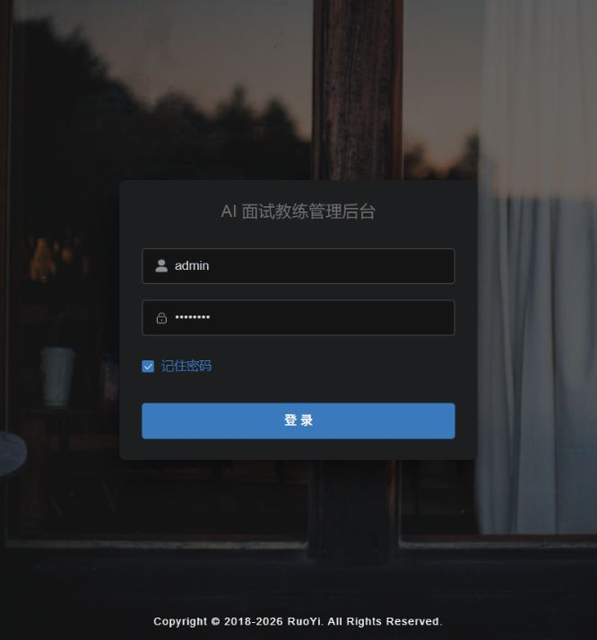

# 2026-10-01 生产排产入口核对

> 技术检查：EV-APS-ENTRY-01；功能：FEAT-APS-001；本轮不执行业务 UAT。
> 规范：evidence.md 2026.10-r3；入口范围依据：Feature 控制页第4节。
> 原始记录：[逐项记录](逐项记录.json)；报告：[HTML](verification-report.html)。

产品关联工艺路线，工序提出人员设备与资格要求；订单提供数量和交期；有限产能排程生成候选，正式计划供派工和执行报工。当前仅核对进入这一流程的登录入口。

| 项目 | 内容 |
|---|---|
| 前提 | 主协调对话已恢复独立本地测试环境。Java 18094、前端15175、Redis16394、Worker独立进程。 |
| 页面字段 | 账号、密码（不记录内容）、记住密码、登录按钮、共享后台标题 |
| 操作 | 1. 打开 http://127.0.0.1:15175/；核对实际登录页 URL 和页面内容。 2. 只读查询前端与前后端 captchaImage HTTP 状态及应用 code，不记录验证码、令牌或密码。 3. 核对进程登记、监听 PID 和运行包 SHA-256。 4. 截图后回读，保留当前标签页。 |
| 正确结果 | 实际 admin-web 登录入口显示；前端 HTTP 200，前后端入口探针 HTTP 200 且应用 code 200；登记的 APS 进程身份及监听一致。此条件只证明入口可访问。 |
| 实际情况 | 登录页真实显示共享标题；前端 HTTP 200，后端和代理 captchaImage HTTP 200/code 200。四个 APS 进程存在且命令匹配，三个有监听端口的服务 PID 匹配。截图已保存并回读；标签页已标记保留。 |
| 结果 | 技术 Pass；截图已保存并回读 |
| 不足与影响 | 未提交登录，未读取业务列表、执行排程或测试报工。共享标题容易混淆项目，应按端口与实际服务辨认。 |

健康诊断：HTTP 200，但应用 code 401（未认证），没有得到 UP 结论。
后端制品 SHA-256：`a6d07cf3aa1b406c4490e42e8afe4d0b6e19e5f7a7f41d9b1dd9426f0b91231a`。

本轮业务 UAT 执行0项，新增业务通过0项；用户接受待确认。既有 UAT/LIVE 结果保留原位置和版本，不作为本轮重新执行。

未执行：本对话上一轮浏览器安全审查已拒绝 file://；本轮不再次尝试该地址。报告做静态内容、链接与图片检查。
