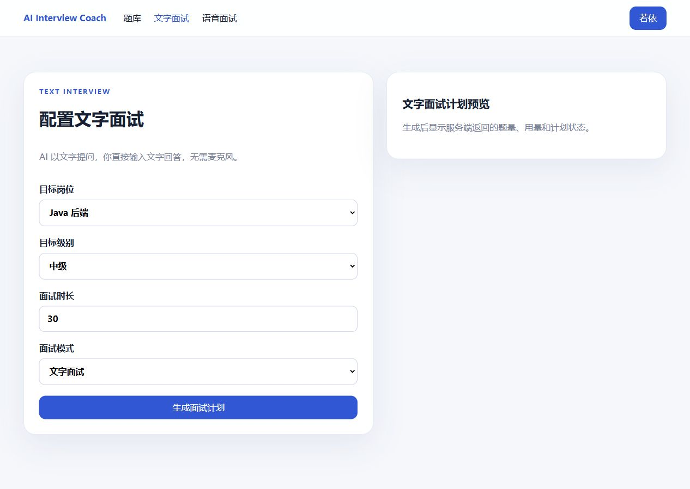
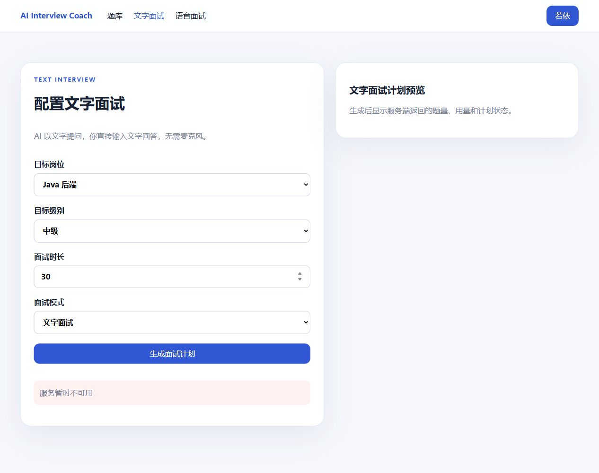
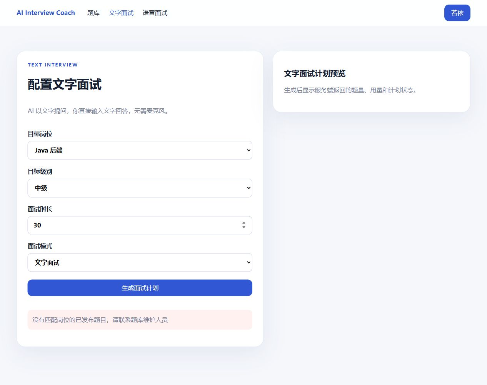
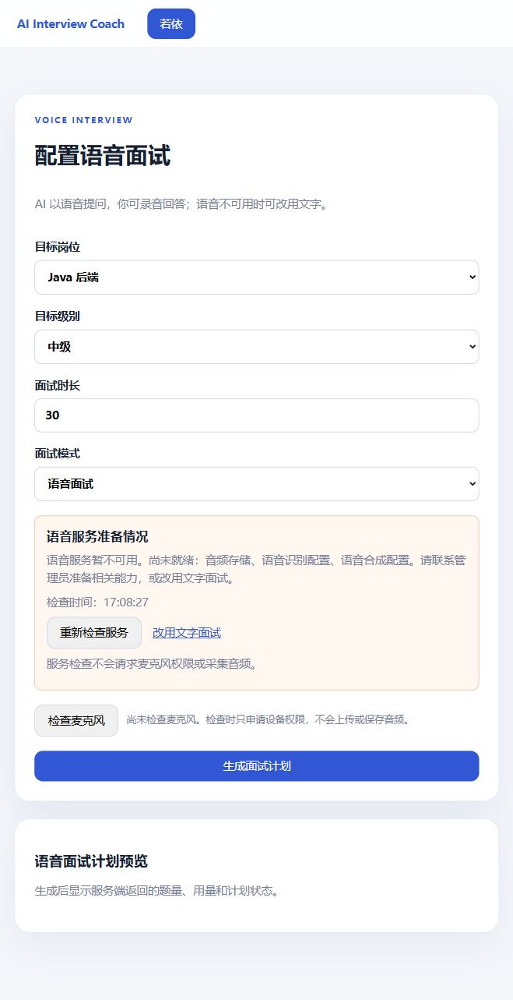
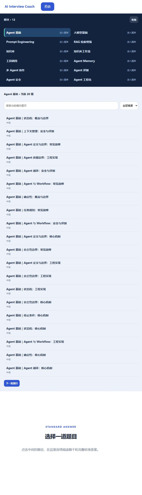
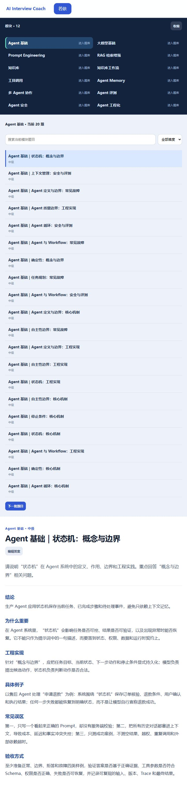
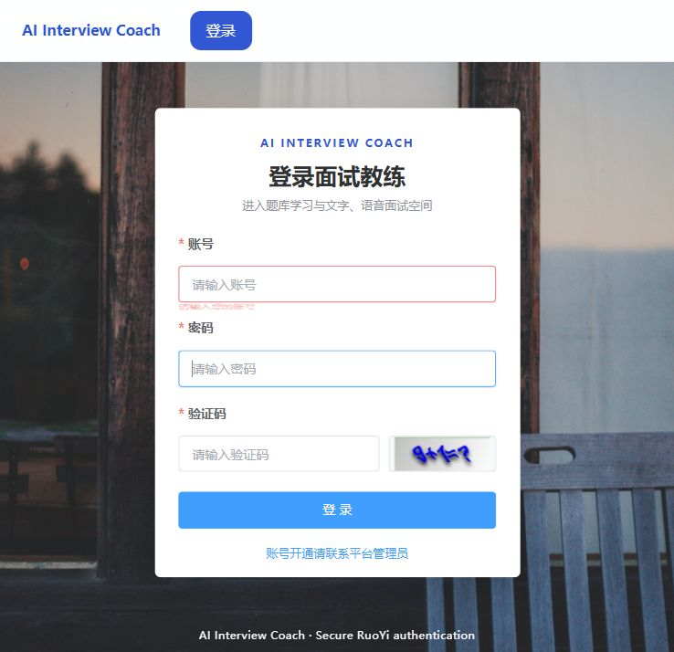

# FEAT-INTERVIEW-002 验收记录

> 最新定向执行：2026-10-01 已按用户纠正接回原数据库，题库正文读取及原登录前提已核对；结果见下方记录与[本轮 HTML 报告](证据/2026-10-01-独立启动/verification-report.html)。最初误用隔离库的结果保留为历史，正常文字训练和真实语音未据此通过。2026-09-26 的原失败保留在[跨功能页面验收清单](../../验收/2026-09-26-题库文字语音验收清单.md)与[原 HTML 报告](../../验收/verification-report.html)。下方 2026-09-11 表格是当时工程检查的历史事实，不代表当前运行环境已通过。

> 文档状态：Draft；更新：2026-09-11  
> 本页记录工程验收候选，不代替用户或业务负责人签署 UAT。

| 场景 | 实际 | 工程结果 | 用户验收 |
| --- | --- | --- | --- |
| AT-001 题库浏览 | Playwright 验证列表、详情和已发布答案 | Pass | 待确认 |
| AT-002 文字面试 | 默认自动化验证回答、追问、结束、反馈；真实本地链路另完成一次 DeepSeek 追问和反馈生成 | Pass | 待确认 |
| AT-003 语音失败降级 | ASR 不可用时保留文字输入；错误原因可见 | Pass | 待确认 |
| AT-004 真实语音 | Chromium 测试麦克风、WebSocket、WAV 分片、存储和 ASR 外呼已发生；ASR 握手 HTTP 403 | Blocked | 未开始 |
| AT-005 TTS 播放 | 因 ASR 前置失败未触发真实 TTS | NotRun | 未开始 |
| AT-006 PostgreSQL 迁移 | PostgreSQL 16.13 随机空库应用 V1–V14，持久化往返成功 | Pass | 不适用 |
| AT-007 窄屏操作 | 375px 视口可见“跳过”和“结束并查看反馈” | Pass | 待确认 |

详细命令、数量和失败记录见 [验证记录.md](验证记录.md)。当前产品规格与本验收记录均为 Draft；独立安全/隐私复核、真实语音闭环、物理麦克风和正式用户验收尚未完成，不能据此声称上线就绪。

用户决定：待确认。

本机验收登录恢复统一见[共用操作说明](../../../../若依框架/多项目并行开发启动指南.md#本机验收登录恢复)。全部本机验收通道启用辅助能力；先复用有效会话，失效时仅用已授权账号凭据辅助填写当前验证码并正常登录。浏览器无法控制或账号凭据未获授权时单独报告所需条件；恢复登录后回到待验步骤，既有业务结果与证据保持原判定。

## 2026-10-01：独立启动与文字计划定向复验

本轮执行者为 Codex，规范采用用户级入口 2026.10-r5、验收正文 2026.10-r4。环境为隔离测试后端 `18091`、门户 `15173`、Redis `16391`、PostgreSQL `interview_dev_20260930` 和平台 MySQL `dev_interview`。复用已有服务；外部供应商调用与对象存储写入关闭。浏览器为本对话新建的可见 Codex 内置浏览器标签，浏览器版本未知；标签隔离不能证明 Cookie 隔离。用户决定仍待确认。

沿用上述历史记录和跨功能记录的稳定对应；本轮不把旧通过算成新执行，不覆盖 2026-09-26 的计划失败与会话失败。测试数据只使用本机隔离库及现有合成账号；本轮没有新增或发布题目，不复制旧库私有资料，不调用收费模型。最初只读回读为档案 1、发布题目 0、评分规则 0、计划 0、会话 0。首次业务操作前已展示并保存以下清单。

### 1. 登录并进入文字配置

<!-- 内部对应：T-01；本轮只覆盖现有账号登录及配置入口，不代替完整登录安全矩阵。 -->
- 验收前提：本地已启用的测试账号；初始化配置已关闭验证码，不计作验证码通过。依据现有门户登录规格与文字流程规格 v0.1 第 1 节。
- 操作步骤：从文字面试入口进入登录页，使用现有预填测试账号登录，核对返回配置页。截取配置页，不保存凭据画面。
- 预期结果：目标岗位、级别、时长和文字模式可见，说明无需麦克风。
- 实际情况：现有账号登录后回到文字配置，显示 Java 后端、中级、30 分钟和文字模式，说明无需麦克风。更换后端后重新登录，并将本对话入口改为 `interview.localhost:15173`，减少其他项目使用同一主机 Cookie 的干扰；不据此声称完整会话隔离已验证。
- 结果：通过；仅覆盖现有账号登录与文字配置入口。截图情况：已保存并回读。
- 页面证据：[文字配置原图](证据/2026-10-01-独立启动/文字配置.jpg)。

### 2. 没有可用题目时给出明确提示

<!-- 内部对应：T-07（新增空题前提分支）；关联原 T-02，原正常计划条件不降低。 -->
- 验收前提：已登录、有本人档案，当前隔离库没有发布题目。依据文字流程规格 v0.1 第 2、3 节的失败与恢复要求，以及本轮修复范围。
- 操作步骤：选择 Java 后端、中级、30 分钟，点击生成计划；保留修复前和修复后截图，再回读计划、会话数量。
- 预期结果：界面说明没有匹配岗位的已发布题目及联系题库维护人员的下一步；返回可识别、不可直接重试的业务拒绝，不保存计划或会话。
- 实际情况：修复前只显示“服务暂时不可用”；原因是空题前提抛出通用异常。修复后同样的岗位、级别和时长显示“没有匹配岗位的已发布题目，请联系题库维护人员”。修复后数据库回读计划、会话仍为 0。业务异常的 HTTP 409、不可重试属性及安全文案另由定向 Java 测试验证，页面截图本身不能证明 HTTP 状态码。
- 结果：通过；只证明空题分支，原正常计划生成条件仍未满足。原失败保留，修复后截图已保存并回读。
- 页面证据：[修复前原失败](证据/2026-10-01-独立启动/计划失败-修复前.jpg)、[修复后提示](证据/2026-10-01-独立启动/无题提示-修复后.jpg)。

### 3. 正常文字训练

<!-- 内部对应：T-02..T-06；本轮范围内原始条件继续保留，按步骤分别记录，不合并判为通过。 -->
- 验收前提：已有本人档案、匹配岗位的发布题目和评分规则；模型反馈另需已授权且就绪的模型。
- 操作步骤：生成并确认计划，进入房间后明确开始，提交合成回答、刷新回读、跳过或结束。保存计划、首题、回答后、刷新后及结束截图；反馈需另外核对原话证据。
- 预期结果：计划、题目和服务端状态清楚；正式回答保存且刷新可回读；未提交草稿不冒充答案；无模型时明确反馈不可用，不伪造反馈。
- 实际情况：当前发布题目和评分规则均为 0，无法进入正常文字训练。本轮没有生成可用计划、进入训练房间、提交回答、刷新答案或结束训练，也没有生成模型反馈。已有题库来源治理要求不能仅靠打开种子开关满足，未绕过发布前提写入题目。
- 结果：受阻；影响：正常开场、回答、刷新及反馈均不能判定。恢复条件为按已批准的题库来源与发布流程准备可用于本隔离库的合成题目和评分规则；模型反馈还需就绪且已授权的模型。
- 证据与缺口：空题前提画面沿用上项修复后截图；计划、首题、回答、刷新及结束的必需截图未取得，对应业务步骤保留受阻，不计通过。

### 4. 语音未就绪的真实状态

<!-- 内部对应：V-02、V-15 的前提核查；完整 V-03..V-14 不纳入本轮通过。 -->
- 验收前提：外部供应商调用与对象存储写入关闭。
- 操作步骤：查看语音入口及只读能力信息，保存实际配置画面并与能力数据核对；不申请麦克风、不录音、不外呼。
- 预期结果：显示语音模式并提供文字入口；能力数据不冒充真实链路可用。完整录音、确认转写和语音反馈保留受阻原因。
- 追加定向步骤（操作前）：修复配置页未展示缺项后，刷新语音配置，核对音频存储、语音识别和语音合成三项缺失提示；点击重新检查服务，再明确改用文字并返回语音；核对请求状态恢复及窄屏按钮可操作。配置就绪、请求错误的其他环境分支仅记录技术审查边界，不冒充现场已执行。
- 实际情况：原配置页只有麦克风检查，没有服务缺项说明。修复后显示音频存储、语音识别配置和语音合成配置三项未就绪；与只读能力数据一致。重新检查后时间更新，明确改用文字和返回语音均可操作，Java 后端、中级、30 分钟保留。窄屏实际 CSS 视口为 376×812，文档可视宽与滚动宽均为 363，两个入口换行后可见，键盘 Enter 能进入文字模式。
- 结果：通过；范围仅为未就绪提示、重新检查、明确文字入口及本次窄屏入口操作。真实录音、存储、转写、播报与语音反馈仍受阻；配置就绪、接口故障、读屏和其他浏览器未现场执行。截图已保存并逐张回读。
- 页面证据：[原配置页](证据/2026-10-01-独立启动/语音配置-修复前.jpg)、[修复后缺项](证据/2026-10-01-独立启动/语音服务缺项-修复后.jpg)、[明确文字模式](证据/2026-10-01-独立启动/明确改用文字.jpg)、[窄屏原始视口截图](证据/2026-10-01-独立启动/语音缺项-376视口-原始截图.png)、[窄屏文字入口](证据/2026-10-01-独立启动/文字入口-376视口-原始截图.png)、[能力数据](证据/2026-10-01-独立启动/语音能力.json)。
- 采证限制：内置浏览器的全页 JPEG 在视口模拟下出现裁切和页头错位，保留原文件但不作为窄屏布局通过依据；改用同一标签 CDP 原始视口截图，截图像素与 CSS 视口受浏览器缩放影响，文件名中的“375”不能证明精确 375 CSS 像素。临时视口已恢复。后期画面出现“麦克风权限已授予”，其触发动作未核实，不记作本轮麦克风验收通过，也不能仅凭该提示证明实际收音或真实语音成功。

本轮报告保存到 [逐项报告](证据/2026-10-01-独立启动/verification-report.html)。技术命令、版本和测试结果另写既有验证记录；页面结果不以技术检查替代。

本轮按上述四个业务点统计：本轮执行通过 3 项、受阻 1 项；沿用历史通过 0 项。此数量不代表商业邀测全部要求或真实语音通过。技术检查为 6 条定向 Java 测试及门户类型检查/生产构建通过，详见[验证记录本轮段落](验证记录.md#2026-10-01定向修复技术检查)。用户接受：待确认；上线与发布未判定。

### 数据库核对更正

用户指出之前数据库与题目已经就绪后，补做两套库只读对照。仓库既有 `.env` 和历史启动脚本使用 `localhost:5432/ai_interview_coach`，当前四项目隔离启动配置使用 `127.0.0.1:5432/interview_dev_20260930`。当前空题判断只适用于后者，不能外推为原库无题或数据损坏；先前说明未充分核对既有环境，现补正。

| 数据 | 当前隔离库 `interview_dev_20260930` | 既有库 `ai_interview_coach` |
| --- | --- | --- |
| 题目 / 已发布题目 | 0 / 0 | 2173 / 2173 |
| 评分规则 | 0 | 2173 |
| 面试计划 / 会话 | 0 / 0 | 36 / 26 |

既有库按目标岗位字段统计：Java 后端 218 道、AI 应用 128 道，其余 1827 道覆盖 Agent、RAG、记忆、工具调用、工作流、安全等专题。已使用既有加密规则解密只读抽查，标题包括“Java 线程池如何设计与排查？”、“如何稳定获得 LLM 结构化输出？”和“Agent Memory 应该如何分层？”。[数量、分类与标题样本证据](证据/2026-10-01-独立启动/已有题库只读核对.json)于 17:19 回读；未修改两套数据库，也未将旧库内容自动复制到隔离库。随后用户明确纠正为通道隔离、数据库沿用原环境；原隔离环境的第三项受阻保留为历史，不作为原环境的当前判定，接回后的结果见下一段。

## 2026-10-01：通道保留、接回既有数据库

用户明确要求“隔离通道，数据库不要隔离”。保留面试后端 `18091`、门户 `15173`、Redis `16391`、独立运行包与日志目录，接回 `.env` 已有 PostgreSQL `localhost:5432/ai_interview_coach` 和 MySQL `localhost:3306/ry-vue`；同步沿用原公共题库标识与平台密钥。只重启面试 Java，未清理错误隔离库，未复制、导入、发布题目，未启动其他项目或执行 Git。

执行者为同一 Codex；以下清单在首个接回后页面操作前保存。最初误用数据库的原结果保留，既有历史通过不计作本轮新执行。用户对环境规则的纠正不表示业务验收接受。

### 1. 既有题库重新可见

- 验收前提：原库有 2173 道已发布题和 2173 条评分规则；后台连接、公共题库标识及原加密配置一致。沿用公开题库读取行为与已只读核对的题目样本。
- 操作步骤：通过本通道打开题库，查看模块、题目列表及一条题目详情；保存实际页面截图并逐张回读，与原库标题核对。
- 预期结果：公开题库能读取已有内容，标题和正文可见；不把默认分页、模块筛选的数量冒称数据库总数。
- 实际情况：新 Java PID 5348 已就绪，公开题库 API 返回本模块前 20 道题；门户显示 12 个模块，选择 Agent 基础后显示当前批次 20 道题。实际打开“Agent 基础｜状态机：概念与边界”，题干与结论、为什么重要、工程实现、具体例子、常见误区、验收方式均可读。API 与页面标题一致，原加密配置可读取正文。
- 结果：通过；只覆盖已有题库的模块、当前批次与该题详情读取，不代表 2173 道题全部内容质量通过。截图已保存并逐张回读。
- 页面证据：[题目列表](证据/2026-10-01-独立启动/接回原库-题目列表.jpg)、[题目详情](证据/2026-10-01-独立启动/接回原库-题目详情.jpg)、[只读接口](证据/2026-10-01-独立启动/接回原库-题库只读接口.json)。
- 查看图：[正常视口正文](证据/2026-10-01-独立启动/接回原库-正文查看图.jpg)，已回读。补取宽屏截图时出现浏览器采证拼接异常，原文件留存但排除出通过依据；临时视口已恢复。此补图不新增业务通过项。

### 2. 文字入口保留原登录前提

- 验收前提：原若依库开启验证码；原登录与权限配置维持，不通过修改库设置绕过验证码。
- 操作步骤：从题库进入文字面试入口，查看配置或原登录页，记录验证码要求和页面实际状态；不新增计划、会话、答案或模型调用。
- 预期结果：原登录规则正常呈现，通道地址仍为 `interview.localhost:15173`；原会话令牌失效时要求重新登录。只证明入口状态，不记正常训练通过。
- 实际情况：原账号库 `ry-vue` 的验证码配置为 true，接口返回 captchaEnabled=true。进入文字入口后旧隔离库令牌失效并回到登录页，验证码输入和刷新入口可见；账号、密码字段清空后保存截图。没有求解或提交验证码，没有重新完成登录或新增面试记录。
- 结果：通过；范围仅为旧令牌失效后的原登录前提呈现。登录成功、计划创建、回答、刷新及结束未执行，不能记作训练通过；后续需要完成原验证码登录。
- 页面证据：[保留验证码的原登录页](证据/2026-10-01-独立启动/接回原库-验证码前提.jpg)。截图已保存并回读。

本次接回后两项页面断言通过，沿用历史通过 0 项；最初误用隔离库的四项结果另段保存，不与接回后的结果合并成整项功能通过。原库题目不缺失，正常文字训练的下一前提是原环境登录；真实语音仍需另行验证。用户业务接受：待确认。

## 2026-10-01：日常语音启用后的页面复验

用户明确要求日常开启语音功能。本次已完成启用与重启的技术检查，见[验证记录](验证记录.md#2026-10-01日常语音启用检查)。原缺项提示的历史截图保留，不继续用作当前关闭状态的证据。以下清单在本次首个页面操作前保存；不改变既有通过基线，不把开启参数当作真实语音验收。

### 1. 服务配置状态

- 前提与依据：原库托管语音密钥可解密，两项开关 true，原音频目录与资源/音色齐备；沿用完整设计第 6.6 节只读能力检查与本次用户启用决定。
- 步骤：在当前门户使用原账号登录，进入语音配置页，核对服务提示和能力接口；保存实际截图并回读。
- 预期：六项本地能力均已配置，页面显示“语音配置已就绪，实际语音链路仍需在本场验证”；缺项或错误保留真实原因，不冒称云端连通。
- 当前结果：受阻；内置浏览器未完成原环境登录，无 Token 的接口返回 401。配置与启动技术检查已通过，受保护接口和页面尚未判定，截图待采集。

### 2. 重新检查与录音边界

- 前提：第一项完成且页面可访问；沿用只读 GET 与用户主动录音规则。
- 步骤：点击“重新检查服务”，核对时间更新、配置状态与页面麦克风提示；保存截图，不点击麦克风或朗读。
- 预期：重新检查不请求设备权限、不上传音频、不自动发起供应商收费调用；真实录音和朗读仍由用户主动操作。
- 当前结果：未执行；依赖原环境登录。不会以源码或启动成功代替页面通过。

本段页面通过 0 项、受阻 1 项、未执行 1 项；技术启动与配置核对单列，不加入页面通过数。真实语音未执行；用户业务接受待确认。
