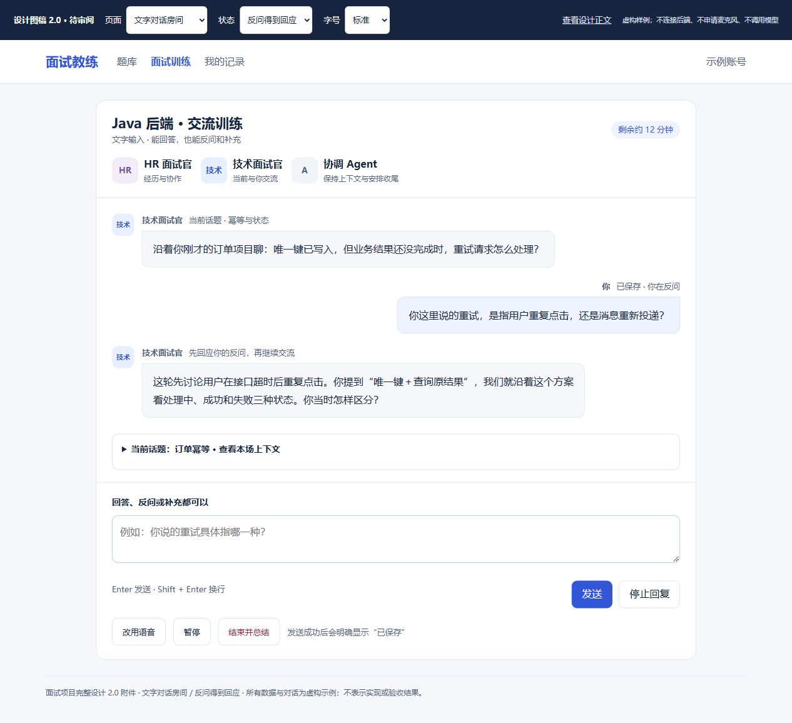
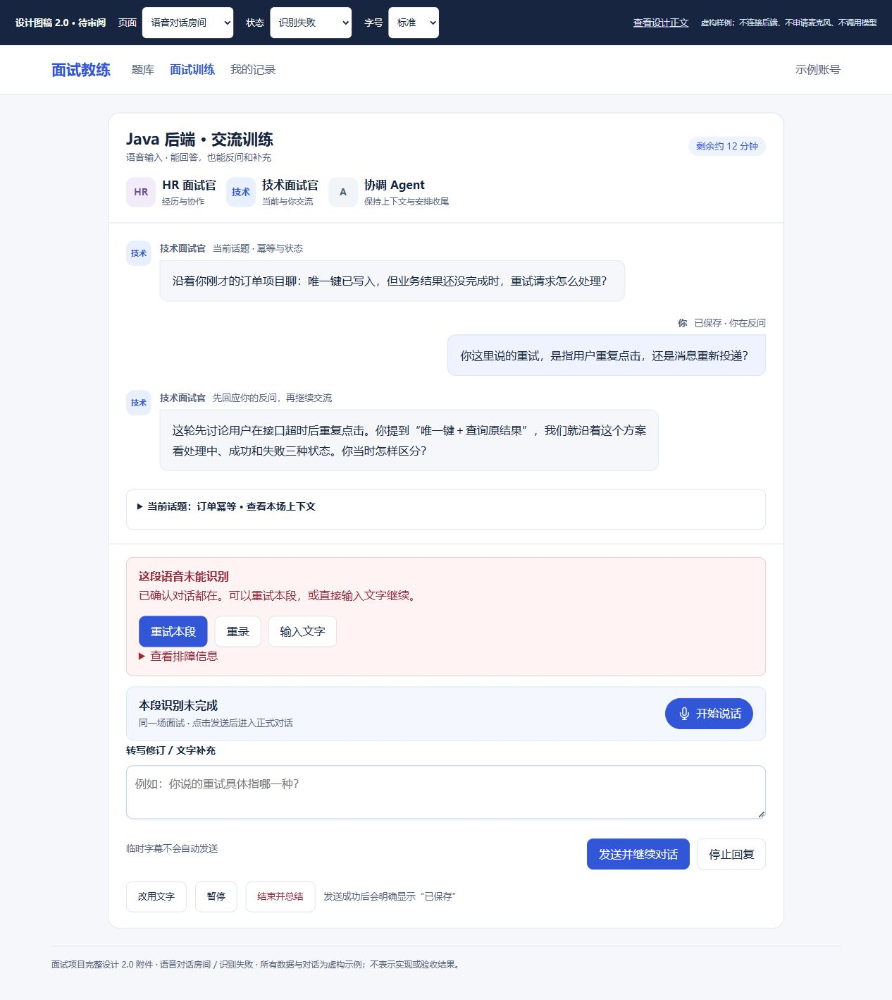
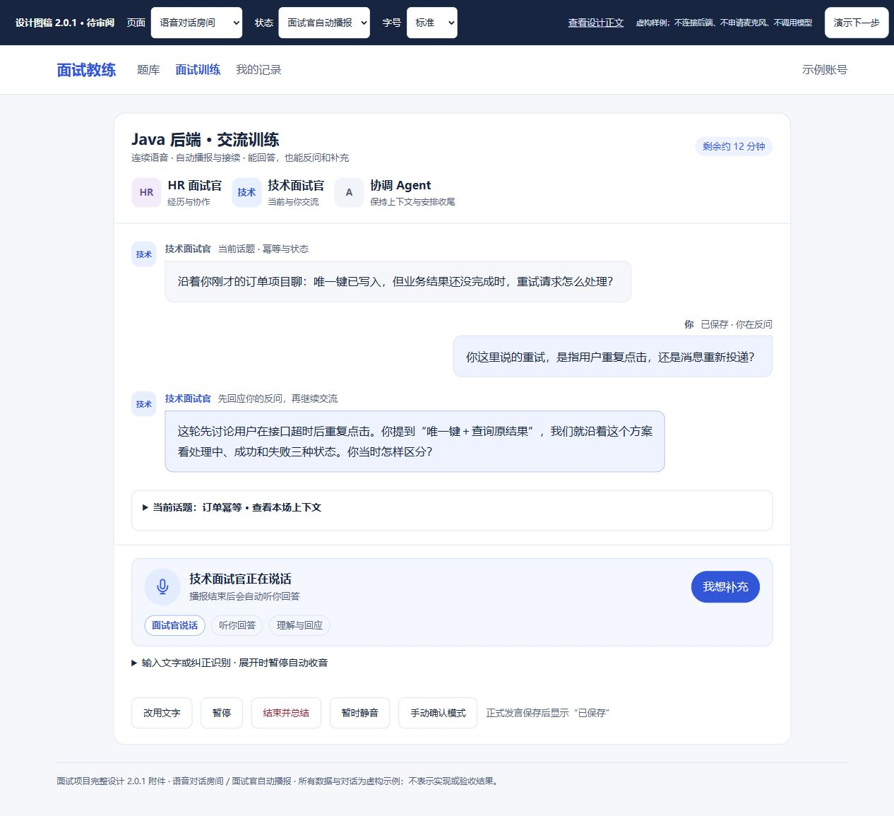
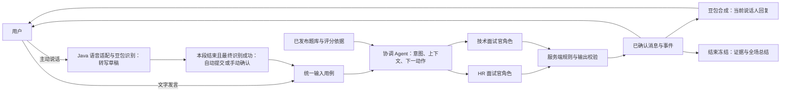
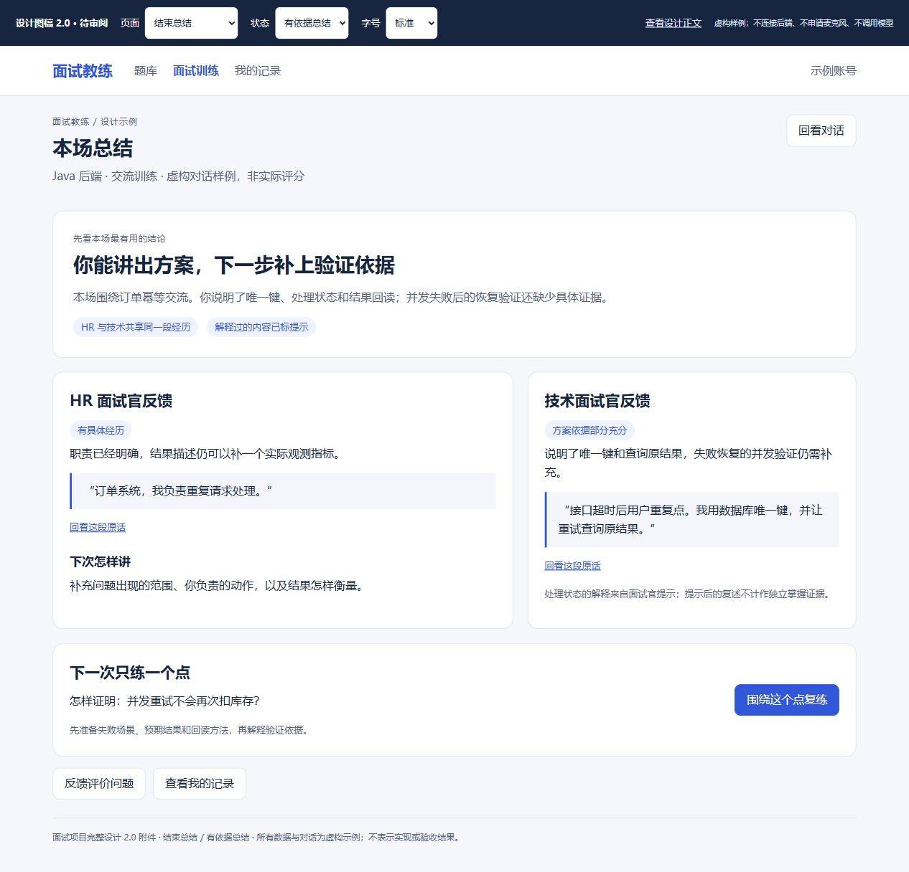

# 面试项目完整设计

> 文档类型：项目唯一设计正文  
> 版本：2.0.1；文档状态：Draft，待用户审阅  
> 创建及更新时间：2026-10-01  
> owner：用户决定产品方向与接受结果；Codex 维护设计与工程对应  
> 需求依据：2026-10-01 用户要求重写设计、调研市场、使用已有豆包识别和合成，由两个面试官与一个 Agent 完成上下文交流和结束总结；同日明确只保留一份设计，并要求面试官自动朗读、用户回答后自动接续交流。  
> 阅读边界：本文描述拟实现行为。已有代码、运行故障及历史验收另有事实记录；图稿和文档完成不表示功能已实现、通过或发布。

产品的中心是一场能交流的面试：用户可以回答，也可以反问、要求解释、纠正前文和打断；HR 面试官与技术面试官围绕同一份经历继续交流；协调 Agent 维护上下文、选择回应方式、安排交接和收尾。题库为对话提供考察目标、知识依据和评分标准。

[打开可交互界面图稿](界面图稿/面试项目界面图稿.html#text-room)。图稿使用虚构对话，标为设计示例；可以查看准备、文字、语音、识别失败、结束总结和管理后台等页面，不连接业务服务、不采集音频。

## 目录与审阅重点

| 章节 | 先看什么 |
|---|---|
| 1. [目标、范围与现状](#scope) | 要解决的体验问题、保留的环境和本次边界 |
| 2. [市场调研与采用决定](#research) | 竞品公开能力、可借鉴点和调研限制 |
| 3. [两个面试官与协调 Agent 的对话规则](#business) | 用户说一句之后如何理解、回应、追问、交接和结束 |
| 4. [用户界面设计](#user-pages) | 对话为中心的房间、输入、关键失败恢复和总结 |
| 5. [管理界面与题库治理](#admin-pages) | 内容、策略、真实能力、故障与报告复核 |
| 6. [前端状态和交互设计](#frontend) | 同一房间的文字与语音、流式显示、打断和恢复 |
| 7. [后端 Agent、豆包语音和总结处理](#backend) | 一次用户发言的完整处理顺序与工程变更 |
| 8. [数据、接口、权限和运行边界](#data) | 多轮消息模型、兼容、原数据库、隐私和成本 |
| 9. [实施顺序](#implementation) | 先完成真实文字对话，再接语音，逐步验证 |
| 10. [业务验收方法](#acceptance) | 怎样证明能理解反问、连续交流、恢复和总结 |

## 1. 目标、范围与现状

### 1.1 用户完成后得到什么

用户选择 Java 后端、AI 应用或 Agent 岗位及训练时长，简要描述自己的经历，与 HR 和技术面试官进行一场连贯对话。默认是“交流训练”：询问问题含义会得到解释，反问技术概念会得到有限说明，再回到当前话题。结束后获得对话总结、自己的优势、证据不足或欠缺的地方、具体改进动作和复练入口。

首个可交付版本包含两个面试官角色和协调 Agent、文字闭环、豆包语音识别及合成、暂停/打断/恢复、结束总结。沿用已有题库、若依登录和业务工程。先使中文中级 Java 场景完整可用；其他岗位只有策略、内容和评测准备就绪才开放。支付、企业招聘、自动投递、视频数字人、声音克隆、自动简历解析和小程序扩展不插入这条主链路。

### 1.2 已知问题与设计回应

| 当前事实或用户反馈 | 本设计必须解决的事情 |
|---|---|
| 用户报告文字面试也无法完成；现有决策代码主要输出 `FOLLOW_UP` 或 `NEXT`，失败会回退为下一题 | 新模型具有回应用户问题等动作；模型失败保留当前话题并显示恢复入口，不能假装理解后跳题 |
| 用户截图显示识别失败 `PROVIDER_BAD_RESPONSE`，同时有自动播放拦截 | 识别、对话和播放分别定位；保留已确认记录和本地草稿；分别提供重试识别、编辑文字、点击播放 |
| 房间以“第几题、已确认几题”组织体验 | 以说话人、对话、当前话题和考察覆盖组织；用户反问不被当作该题答案 |
| 先前误把通道隔离扩展到数据库，题库变空 | 通道可独立，沿用原 PostgreSQL 业务库和 MySQL 身份库，不再新建隔离空库 |
| 用户已确认拥有豆包识别与合成，未开通端到端语音大模型 | 使用识别→面试对话模型→合成的级联链路，不把额外开通服务作为首版前提 |

现有 2173 条发布题及配对评分规则的回读事实见[接回原库记录](../功能/FEAT-INTERVIEW-002-商业邀测/验收记录.md#2026-10-01通道保留接回既有数据库)。数量不能证明所有岗位内容合格，也不能证明对话和语音可用。截图只证明发生识别失败，具体供应商协议、音频格式或响应解析原因仍需定向排查。

### 1.3 与已有要求的关系

本次用户明确要求上下文交流，替代旧草案中“逐题正式提交→下一题”作为训练主流程。公共题库治理、本人数据隔离、明确语音授权和报告引用依据继续保留。历史商业邀测的“模拟场内不辅导”只作用于严格模拟模式，不限制默认交流训练回答用户的问题；有提示的内容在报告中注明，不能算作独立掌握证据。

本文是唯一设计源。产品范围、任务和真实结果分别沿用[产品入口](../产品/README.md)、[功能入口](../功能/README.md)和既有验证/验收记录；旧设计原文只在[清理恢复记录](../开发记录/2026-10-01-设计文档统一与清理.md)指定的备份中追溯。本文 2.0 的新细节仍待审阅，不自动改写原用户接受结论。

## 2. 市场调研与采用决定

资料核验日期：2026-10-01。以下依据产品官网及官方帮助文档，未登录试用、购买、测量中文质量或验证实际延迟；公开功能说明不等于独立效果评测。比较对象均取模拟训练部分。

| 产品与官方依据 | 可核实的公开能力 | 对本产品的采用决定 |
|---|---|---|
| [Yoodli：Practice with Yoodli](https://support.yoodli.ai/en/articles/9550465-practice-with-yoodli) | 岗位和面试官风格设置；预设问题结合按回答动态追问；结束看分析；可关闭自动回应、改手动触发 | 面试官有稳定风格但能顺着回答走；语音提供明确手动收尾方式，防止噪声导致抢话 |
| [FinalRound：Starting a practice interview](https://docs.finalroundai.com/docs/mock-interviews/starting-a-mock) | 场景影响开场方向，追问可随用户内容变化；已有训练目标记忆可引导后续；结束生成复盘，内容不足给出原因 | 训练目标是方向而不是固定问题脚本；同一对话记录支撑总结和下一次训练；内容不足不填假报告 |
| [Huru：Mock interview](https://huru.ai/mock-interview/) | 按岗位练习，反馈对应具体回答，给改进建议和重练机会；官方也提醒 AI 可能误听 | 每个结论可回看用户原话；总结后立即复练一个薄弱点。保留语音修订，不采用无法解释的总分展示 |

我们的重点是中文 Java/AI 岗位的两位面试官共享上下文、候选人可主动提问、全场总结有引用，以及已有豆包语音可稳定接入。这是本项目的设计取舍，不是宣称竞品缺少上述能力。现有调研的价格和历史版本只按原访问日期解释。

豆包官方提供流式识别和流式合成接口；单向合成需要先给文本，双向合成支持文本持续输入。首版先复用现有接口完成完整语音轮换，达到业务闭环后再评估双向合成的延迟收益。[流式识别官方说明](https://docs.volcengine.com/docs/DoubaoVoice/LargemodelstreamingautomaticspeechrecognitionAPI?lang=zh)、[合成接口类型](https://docs.volcengine.com/docs/DoubaoVoice/WebSocketUnidirectionalStreaming-V3?lang=zh)。

## 3. 两个面试官与协调 Agent 的对话规则

### 3.1 三个角色怎样合作

| 角色 | 对话职责 | 不能做什么 |
|---|---|---|
| HR 面试官 | 开场，理解求职目标、用户经历、职责、协作和结果；回答训练安排等反问 | 不能虚构真实公司待遇、招聘计划，不能从语气推断人格或心理健康 |
| 技术面试官 | 围绕已说过的项目，交流技术原理、工程取舍、验证方法和风险；回答相关概念反问 | 不能假装知道用户未提供的项目；不能只复述题库序列或跳过用户问题 |
| 协调 Agent | 识别本轮意图，维护上下文和证据，选择说话人/回应动作，调用受控知识，安排时间、交接和总结 | 不能自行改权限、使用次数、真实数据或供应商设置；不能让三个角色同时向用户发问 |

每轮只有一个主说话人。两位面试官共享经历和已确认事实，交接时引用用户原话，不重新重复问自我介绍。Agent 是对话组织者；房间显示“协调 Agent · 保持上下文”，只在暂停、交接和结束等需要说明的地方发出系统消息，不给用户增加第三份答题任务。三个角色是同一后端会话中的职责，不要求启动三个服务或每轮调用三次模型。

### 3.2 用户说一句之后怎样决定回应

| 用户意图与例子 | 正确回应 | 对话和评价影响 |
|---|---|---|
| 回答：“我负责订单幂等，用唯一键处理重复请求” | 先承接这一事实，再问一次具体取舍或验证：“超时后重试怎样确认最终结果？” | 增加回答证据；是否换话题由覆盖和内容决定 |
| 反问：“你这里的重复请求是消息重投还是用户重复点击？” | 先说明本轮指的是哪种情境，再邀请回答 | 保持当前话题；不占内容追问名额，不标记已答题 |
| 技术提问：“为什么唯一键还不够？” | 交流训练给简短解释及边界，再联系用户方案；严格模拟只澄清题意并提供结束后讲解入口 | 训练提示打标；受提示后的复述与独立回答分开 |
| 纠正：“刚才说错了，是 MySQL，不是 Redis” | 确认更正，更新事实摘要，后续按 MySQL 交流 | 保留原话和更正关联；总结使用更正后事实 |
| 表达不清：“那个服务就是那样处理的” | 针对缺失对象问一个澄清问题 | 不把模糊内容编成完整经历；连续无法澄清时给换话题/结束选择 |
| 说不知道或跳过 | 接受，训练模式可解释后换话题；严格模拟记缺少证据 | 不填空答案或直接判零分；保留用户选择 |
| 偏离岗位或试图改系统规则 | 简短回应边界，询问是否回到训练；拒绝越权工具请求 | 不执行用户文本中的 SQL、Shell、密钥读取或角色授权 |
| 请求暂停、改文字、结束 | 先停止输出/采集，再按确定性命令改变状态；结束前处理待发送内容 | 不把操作指令当作技术答案 |
| 一句话同时回答和提问 | 保存回答部分的证据，优先回答反问，再决定是否追问 | 同一发言可有多个语义片段；不简单按问号或关键词分类 |

用户明确提问尚未回应时，禁止直接换主话题。若意图不确定，问一个短澄清问题。不能把网络、模型或格式错误降级成“下一题”。每次最多一个主要追问；同话题默认最多两次内容追问作为候选预算，用户反问和必要澄清单独管理。连续沟通受阻时征询用户选择，不能为了用完题数不断发问。

### 3.3 一段应当发生的对话

以下为虚构设计样例，不是模型实测结果。

1. HR：“先聊一个你最熟悉的项目。你主要负责什么？”
2. 用户：“订单系统，我负责重复请求处理，后来把问题压下来了。”
3. HR：“你提到重复请求，主要来自用户操作还是系统重试？”
4. 用户：“你是想问业务幂等，还是消息消费？”
5. HR：“先说业务幂等。请讲你承担的部分，我会把背景交给技术面试官。”
6. 用户：“接口超时后用户重复点。我用数据库唯一键，并让重试查询原结果。”
7. 技术面试官：“沿着你刚才的方案聊：唯一键已写入，但业务结果还没完成时，重试请求怎么处理？”
8. 用户：“为什么不能直接返回成功？”
9. 技术面试官：“因为占位记录存在不代表业务已完成。交流训练里我们可以先分清处理中、成功和失败，再看你的接口怎样返回。你当时怎样区分？”
10. 用户：“刚才不准确，我们还有处理中状态，失败会允许受控重试。”
11. 技术面试官：“明白，已补充处理中状态。你们怎样验证重复执行不会再次扣库存？”
12. 用户：“今天先到这里，帮我总结。”
13. Agent 组织收尾：“本次围绕订单幂等交流。你已说明唯一键、状态和结果回读；并发失败恢复仍缺少验证证据。下面分别看两位面试官的反馈和一次复练建议。”

这里第 4、8 句都是用户提问，必须得到回答。第 10 句修订上下文，第 7、11 句引用前文；总结不把面试官给出的概念当用户自己的证据。

### 3.4 开场、时间和结束

准备页推荐 15 分钟短训练，另有 30 分钟；这是待审阅的默认方案，商业原版本的最长 30 分钟规则不变。页面显示预计覆盖“经历表达、技术原理、工程取舍”，不预告固定题目列表。开场检查必须包括对话模型、内容和用途授权；只有 ASR/TTS 配置存在不能称面试 Agent 就绪。

确认开始才进入运行状态；模型或媒体失败时系统等待不算有效训练时间。用户主动思考、听回复和编辑计入，暂停不计入；服务端维护时间段。接近预算时给收尾提示，用户可提前结束。HR/技术交接由话题和覆盖决定，不强制把整场拆成两份互不知情的题单。

结束有草稿时提供“发送后结束、舍弃草稿并结束、返回”。冻结已确认对话后生成全场总结；报告可异步完成。自然语言“今天先到这里”触发结束确认，Agent 不能凭含糊句子丢弃草稿或结算费用。

## 4. 用户界面设计

### 4.1 房间布局与重点变化

桌面采用顶部参与者条、中央对话、底部输入、可展开的话题摘要。房间主内容最大宽度约 1120px；正文 16px，白底与现有蓝色按钮。去掉挤压对话的固定三栏、大头像占位和“第一题/第二题”主进度。两位面试官以角色名和紧凑头像区分，当前说话人有文字标记。角色形象不表示真人视频。

对话气泡完整显示提问、回应和解释，用户消息可展开查看发送/更正状态；中途能反问，不需要先选“这是问题还是答案”。输入栏写“回答、反问或补充都可以”，主按钮为“发送”。HR 与技术的交接在对话中说明，协调 Agent 不用思维链或内部工具日志填满屏幕。

上图及[文字房间交互图](界面图稿/面试项目界面图稿.html#text-room)重点展示“用户反问→先回应→接着交流”。图像仅为 2.0 设计样例。

### 4.2 页面与入口

| 页面与图稿 | 用户看见什么 | 关键操作与结果 |
|---|---|---|
| [首页](界面图稿/面试项目界面图稿.html#home) | 开始面试训练、继续本人会话、题库入口 | 首要按钮进入准备；未完成场次提供继续 |
| [登录](界面图稿/面试项目界面图稿.html#login) | 若依账号、密码、验证码、返回原页面 | 沿用若依登录；登录过期停止采集并保留服务端已确认对话 |
| [准备](界面图稿/面试项目界面图稿.html#setup)及[确认](界面图稿/面试项目界面图稿.html#plan) | 岗位、级别、经历简述、15/30 分钟、交流训练/严格模拟、文字/语音、两位面试官说明、能力状态 | 检查前提后进入同一房间；无对话模型不能伪装为智能面试 |
| [文字房间](界面图稿/面试项目界面图稿.html#text-room) | 连贯对话、当前话题、参与者、输入、保存/回复状态 | 发送、停止回复、更正前文、暂停、改语音、结束 |
| [语音房间](界面图稿/面试项目界面图稿.html#voice-room) | 同一对话，听说状态、实时转写草稿、文字输入入口 | 首次开始并授权后自动播报、轮换听说；检测说完后提交最终转写；可补充、纠正、静音、切文字 |
| [结束总结](界面图稿/面试项目界面图稿.html#report) | 全场摘要、HR 与技术反馈、证据引用、薄弱点与一项复练建议 | 回看原话、反馈评价问题、复练；生成失败保留对话并重试总结 |
| [历史](界面图稿/面试项目界面图稿.html#history) | 本人会话、模式、状态、总结和继续入口 | 继续原场，或从反馈建新场；不覆盖旧结果 |
| [题库](界面图稿/面试项目界面图稿.html#questions)及[详情](界面图稿/面试项目界面图稿.html#question) | 已发布知识、来源、练习参考、本人的独立练习答案 | 与面试房间分开；公开参考答案不混入候选人对话证据 |

### 4.3 对话和语音的关键状态

| 状态 | 页面文案/反馈 | 可执行恢复 |
|---|---|---|
| 已发送，正在理解 | 用户消息“已保存”；面试官“正在回应” | 停止回复；已保存消息不再次发送 |
| 请求结果未知 | “正在核对是否发送成功”并保留草稿 | 查询原请求结果；同键重试，不创建第二轮 |
| 模型失败 | “这次回复未完成，当前话题已保留” | 重试回复、暂停、结束；不自动下一题 |
| 正在播报 | 当前说话人和完整文字同时可见 | 停止播报/我想补充；旧语音队列立即失效 |
| 播放被阻止 | “点击播放这段回复，或直接阅读文字” | 用户点击播放；不清空会话，不要求重新加载整个房间 |
| 正在听你说 | 麦克风标识、实时字幕、“正在听你说” | 自动判断本段结束；可点“我说完了”或取消；临时字幕不显示已保存 |
| 检测说完/识别中 | “等你说完”→“正在整理你的话”；临时字幕与正式消息分开 | 短暂停顿期间继续说可延长本段；最终识别成功才提交，空结果不创建消息 |
| 手动确认/识别不清 | “这段还未发送，请确认或修改” | 可选手动确认模式及异常恢复使用；不制造可靠置信度 |
| 识别失败 | “这段语音未能识别。对话已保留，你可以重试本段或输入文字” | 重试识别、重录、文字输入；关联编号放详情 |
| 网络断开/暂停 | 媒体停止，保留最后确认消息及待发送草稿提示 | 回读后继续；未上传本地录音不能承诺刷新后恢复 |
| 总结生成中/部分完成/失败 | 对话可回看；明确哪个部分未完成 | 重试失败阶段；内容不足显示不足，不填零分 |

错误显示在输入区附近，采用中文原因和动作，技术错误码折叠供排障。识别失败和播放失败是独立状态，不能用“重新加载”同时重启整场。功能入口保持开启；当前依赖不可用时说明具体原因并保留已在场用户的恢复路径，不用永久隐藏或全局关掉语音来处理故障。

### 4.4 小屏、键盘与可访问性

小屏将参与者压缩为一行，当前话题折叠，对话和输入保留首要位置；页面使用一个主滚动区。按钮至少 44px，有可见标签和焦点；文字与语音入口都可键盘操作。正文与说明保证可读对比，不以颜色单独表示已保存/失败；动态字幕不逐字抢读屏焦点。尊重减少动效设置。首版设计浅色主题；没有把暗色、小程序或视频能力当作已经交付。

[查看小屏对话房间图](界面图稿/小屏对话房间.jpg)。

### 4.5 连续语音房间怎样看与操作

房间保留对话产品的消息时间线，但主操作是听与说。顶部用紧凑角色条显示 HR、技术面试官、协调 Agent、剩余时间和暂停/结束；当前发言者明确标“正在说话”。中央完整显示双方原话，当前播报消息突出显示，用户向上回看时不强行滚回底部，并提供“回到最新”。上下文摘要默认折叠，用户不需要一边读题单一边操作语音面板。

底部固定在房间内的听说控制区只呈现当前需要的动作：开场前“开始语音面试”；播报中“我想补充”；听用户说时“我说完了”；等待时说明正在整理或回应。始终能暂停、暂时静音、改用文字和结束总结。语音期间实时字幕在控制区可读；文字输入默认折叠，展开输入即暂停自动收音与自动提交，发送或取消后由用户选择返回语音。小屏把角色条压缩为当前角色，次要操作收进更多，对话和控制区保留，不采用三个固定栏。

| 当前阶段 | 界面表现 | 自动进入下一阶段的条件 |
|---|---|---|
| 开场前 | 明确语音用途与开始按钮；未授权不收音 | 用户开始、授权和依赖就绪后生成 HR 开场 |
| 面试官说话 | 角色、完整回复、播报状态；可“我想补充” | 当前有效音频播放结束后听用户说；合成/播放失败等待恢复 |
| 听用户说 | 麦克风状态与临时字幕；可“我说完了” | 有效说话后检测本段结束；临时字幕不提前提交 |
| 等你说完 | 保留字幕、短暂停顿提示 | 继续说回到同一段；可靠终态后整理并提交 |
| 整理/回应 | “正在整理你的话”→“面试官正在回应”；正式消息显示保存状态 | 本段只提交一次；有效回复和合成就绪后自动播报 |
| 暂时静音/暂停 | 明确停止收音与自动提交；保留上下文 | 用户明确继续；未提交内容不因恢复自动发出 |
| 结束 | 停止采集与播报，处理未提交内容，显示总结 | 冻结本场对话，异步生成有原话依据的反馈 |

[在统一图稿查看各个听说状态](界面图稿/面试项目界面图稿.html#voice-room)。图稿工具栏“演示下一步”只用于观察拟实现的自动轮换，不是产品每轮要点的按钮；样例不申请麦克风、不实际播音。自动播放与权限边界依据 [MDN 自动播放说明](https://developer.mozilla.org/en-US/docs/Web/Media/Guides/Autoplay)、[麦克风访问说明](https://developer.mozilla.org/en-US/docs/Web/API/MediaDevices/getUserMedia)。

## 5. 管理界面与题库治理

管理端继续位于若依“面试管理”。账号、角色、菜单、密钥托管沿用若依；不能建立第二套账号或把密钥展示到图稿。

| 管理页面与图稿 | 业务内容与操作 | 规则和反馈 |
|---|---|---|
| [工作台](界面图稿/面试项目界面图稿.html#admin-home) | 待审内容、对话失败、识别/合成失败、总结任务、能力状态 | 显示统计时段和实际来源；不填样例成功率到运行系统 |
| [题库列表](界面图稿/面试项目界面图稿.html#admin-catalog)、[编辑](界面图稿/面试项目界面图稿.html#admin-editor)、[审核](界面图稿/面试项目界面图稿.html#admin-review) | 岗位/能力、考察目标、正文、参考依据、评分锚点、来源许可、版本 | 编辑→审核→发布；已发布版修订另建草稿，下线只影响新选题 |
| [对话策略](界面图稿/面试项目界面图稿.html#admin-strategy) | HR/技术风格、开场、意图动作、知识范围、交接、预算、提示及 Schema 版本 | 预演“用户反问/更正/不知道”等样例，再发布；在途场次保持旧版 |
| [会话运行](界面图稿/面试项目界面图稿.html#admin-sessions) | 当前话题、最后确认消息、任务阶段、代次、脱敏错误、供应商关联编号 | 仅提供允许恢复动作，不能修改用户原话或重激活已结束场次 |
| [总结与复核](界面图稿/面试项目界面图稿.html#admin-reports) | 冻结输入、证据覆盖、失败阶段、用户反馈 | 原输入重试；修订产生新版结论并保留旧版；私人正文需独立授权 |
| [模型与语音能力](界面图稿/面试项目界面图稿.html#admin-capabilities) | 对话模型、ASR、TTS、存储分别显示配置、最近实调、当前故障、时间 | 配置检查和会产生费用的实调分开；模型缺失不能显示“面试可用” |
| [数据与权限](界面图稿/面试项目界面图稿.html#admin-governance) | 用途授权、撤回、删除、访问审计 | 后台权限不自动允许阅读所有私人对话；处理有目的、对象和审计 |

题库发布时固定题目与评分规则版本；稳定标识、分类映射和公共租户沿用当前事实源。并发更新校验版本，冲突保留编辑草稿；编辑者不能凭前端按钮越过后端审核权限。Agent 检索的是获准发布内容，不直接检索草稿、他人答案或任意数据库。题目来源及许可进入审核，不能把竞品题库整批复制。

## 6. 前端状态和交互设计

### 6.1 一套房间，两种输入

文字和语音是同一会话的输入方式。切换只改变媒体状态，不换模型、不创建新面试、不丢失上下文。服务端保存已确认消息、话题、策略、允许动作、结束和报告状态；浏览器保存未发送输入、设备、临时字幕及播放队列。

用户消息发送成功后取得消息 ID 和版本；“已保存”与“面试官已回应”分开。回复可先显示等待，再显示已校验内容，文本流和音频绑定同一输出代次。中途取消时保留已经实际呈现的内容并标注“已打断”；没有呈现的草稿不能假装用户已经听见。

语音默认连续交流。用户点击一次“开始语音面试”，在用途说明后授权本场麦克风，并在同一次手势中准备播放能力；就绪后面试官主动开场，正文与自动播报同时呈现。当前播报结束，自动进入“正在听你说”；检测到有效语音结束且收到最终识别结果后，按本段幂等键提交正式发言。面试官根据上下文回应，再自动播报并轮换到听用户说。正常每轮不要求点播放、点录音、确认转写或下一题。点击页面、刷新和重新连接本身不算本场开始授权。

默认先采用自动轮换的听说模式：面试官播报期间不把其声音提交成用户输入。用户点“我想补充”立即停止播报并进入自己的发言；噪声下可靠的直接语音抢话可后续优化，但不能以此延后自动播报和自动接续的主流程。连续语音要覆盖耳机/扬声器回声、短暂停顿、长思考、空识别和重连，实测后才开放给真实用户。

端点检测结合语音活动、安静间隔与识别终态；短停顿不是立即发送，显示“等你说完”，用户重新说话则延长同一段。静音、背景噪声或没有最终结果不能凭定时器编造发言或自动换题。检测参数按真实音频验证，用户可点“我说完了”主动收尾。提供“手动确认后发送”作为可选方式和恢复入口，保留已发送消息的纠正入口。浏览器拒绝播放时就地显示“启用声音”，点击后重试该段；不能承诺一次手势在所有浏览器永久允许播放。

### 6.2 打断、重连和草稿

用户点击“停止回复/我想补充”先停止播放，再发送取消命令；服务端更新输出代次。当前代次之外的文本、字幕和音频丢弃。开始新语音输入之前停止旧播报；推荐耳机，媒体约束启用可用的回声消除，不能把面试官播报识别为候选人回答。

断线后先取快照及最后事件游标，按消息 ID 去重并恢复同一房间；恢复连接不自动发送草稿或打开麦克风。登录失效停止采集/输出并回登录，重新验证身份后再回读。私有录音、转写和报告不写入 localStorage；本地未上传录音离开时说明可能丢失。

### 6.3 前端变更落点

| 新增或修改的文件/目录 | 为什么改 | 关键逻辑 |
|---|---|---|
| `frontend/portal-web/src/features/interview/InterviewSetupPage.vue` | 准备真实对话，不准备固定题单 | 岗位/经历/模式、双面试官、模型及语音前提，分开设备与后台状态 |
| 同目录 `InterviewRoomPage.vue` | 房间要接受回答和反问 | 消息时间线、参与者、当前话题、统一输入、取消/更正/暂停/结束 |
| 同目录拟新增的对话与媒体组件/composables | 隔离媒体复杂度，复用已有 API/媒体设施 | 一个会话状态源；播放队列、转写草稿、消息请求和事件游标按代次管理 |
| 同目录 `InterviewFeedbackPage.vue` | 由逐题结果转为全场总结 | HR/技术分项、原话跳转、提示标记、不足和阶段重试 |
| `frontend/portal-web/src/shared/api/client.ts`、`src/router/index.ts` | 兼容现有链接和本人历史 | 沿用认证、错误映射；增消息版本/恢复接口和本人历史路由 |
| `frontend/admin-web/src/views/interview/` | 运营要分清模型、识别、合成和总结问题 | 复用现有 dashboard/catalog/voice，新增策略、会话、复核/治理视图及若依权限 |

页面外观和后台调用不会在浏览器复制 Agent 决策；路由保留现有 `/interviews/new`、`/interviews/{id}`、`/feedback`，新增能力按会话版本返回。小程序未来调用同一业务 API，本文图稿不等于小程序实现。

## 7. 后端 Agent、豆包语音和总结处理

### 7.1 整体处理职责

业务继续运行在 `ruoyi-admin` 装配的 `ruoyi-interview`，若依负责身份和 RBAC。应用用例组织短事务，领域规则控制状态和预算，适配器连接模型、豆包与存储。沿用既有 Job、Outbox 和 Provider 端口，不另起一个持有第二套会话事实的 Python/Agent 服务。

图中角色选择是逻辑职责：推荐一次结构化模型调用同时提出意图、说话人、动作和回复草稿，由程序校验，不固定执行“协调模型→HR 模型→技术模型”三次串行调用。报告独立异步处理，避免阻塞对话。

### 7.2 一次发言的处理顺序

1. Controller 从若依主体取得用户，校验本人会话、用途、状态、版本、幂等键、内容大小及输入来源；语音必须引用已完成且本人所属的转写版本。
2. 短事务追加用户消息，记录客户端请求 ID 和输入摘要，创建当前回复任务/Outbox；同键同内容返回原消息，不重复调用模型。空输入拒绝；用户反问也存为消息，不能先强制变成题目答案。
3. Worker 读取固定消息版本、会话策略、当前话题、最近对话和带来源的摘要。用户原话作为数据；工具只允许读取本会话事实和已发布知识。
4. 模型提出意图、说话人、回应动作及引用。程序校验可用动作、事实来源、引用归属、内容长度、话题预算和终态；用户问题尚未回答时拒绝直接换话题。坏输出最多一次格式修复，共享期限。
5. 通过校验后，以输入版本和代次作比较更新：保存面试官回复、事实更正/话题变化及事件，发给前端。取消、撤回或结束后迟到结果禁止写回。
6. 语音模式只为当前有效回复安排 TTS；文本成功但 TTS 失败仍可阅读正文，不能回滚已经保存的消息。模型失败保留用户输入和当前话题，创建可核对的失败状态。

建议动作包括：回应用户问题、澄清、追问、引入新话题、交接、解释训练安排、建议收尾。暂停/结束/权限/扣费由确定性用例执行；模型只提出建议。内部动作字段和 JSON Schema 在实施时收敛进现有机器契约，不在多个设计中复制。

### 7.3 上下文怎样保留

上下文分为会话配置、最近原话、带消息引用的经历事实、当前话题/尚未回应的问题、覆盖情况和策略版本。每个摘要事实要有来源及“用户自述/修订/模型推断”标记；修订旧事实不删原话。不能把模型摘要作为唯一记录，也不能把 HR 的推断当技术面试官的事实。

输入超过模型窗口时保留当前话题、待回应问题和最近原话，再压缩已结束话题；摘要可由消息重建并校验引用。跨会话记忆首版只由用户确认的薄弱项带入；不自动共享所有历史私人内容。用户“记错了”“我指的是前一段”要能定位原消息，不仅依赖上一题答案。

Prompt 分为共同规则、角色风格、岗位目标、获准知识和当前消息；版本随会话固定。模型输出先结构校验，再校验引用与权限。工具白名单包括本会话事实读取、公开知识检索、策略允许动作读取；不给 SQL、Shell、任意 URL 或管理写入。拒绝“忽略之前规则/读取别人的答案”等提示注入。

### 7.4 已有豆包服务怎样用起来

**采用现有识别＋对话模型＋合成。** 用户已确认只有 ASR/TTS，本版不要求开通端到端实时语音大模型。豆包 ASR 负责把音频变成文字，TTS 负责把面试官回复变成音频；理解上下文、选择面试官和总结由对话 Agent 完成。现有文本模型配置仍须核对可用性，语音密钥不自动提供文本对话模型权限。

| 环节 | 首版接入与业务规则 | 定向检查 |
|---|---|---|
| 凭据和资源 | 服务端从既有若依密钥托管解密；核对 ASR 资源、TTS 资源/音色与开通权限；密钥不下发浏览器 | 鉴权失败与资源无权限分别识别；配置存在不是实调成功 |
| 音频采集 | 用户主动开麦；拟采用 AudioWorklet 采样、重采样为约定的单声道 PCM16，发送带序号的受控帧 | 不能把浏览器 WebM 数据只改 MIME 后当 PCM/WAV；核对真实字节、采样率、声道、分包和终止帧 |
| 豆包识别 | 复用 `bigmodel_async` 流式接口；临时结果只显示字幕，最终结果按当前模式进入自动提交或待确认草稿 | 正确处理二进制协议、压缩、错误帧和终态；不把任意 JSON 响应当识别成功 |
| 对话生成 | 本段结束且最终结果成功后自动提交；手动模式确认后提交，均进入第 7.2 节同一用例 | 识别用户反问/纠正，与文字输入保持一致 |
| 豆包合成 | 先复用现有 HTTP 单向流式合成；发送已校验完整短回复，流式解码音频。默认可共用现有可用音色，用角色名区分面试官 | 核对资源、音色、音频格式和返回分块；第二音色通过试听/权限验证才启用 |
| 播放与打断 | 回复文字先可见；首次开始手势准备播放；后续有效回复自动播报，结束后自动听下一段；停止时取消上游并清空旧代次 | 自动播放阻止只要求点击播放；取消后迟到音频不能再次响起 |

协议事实：官方流式 ASR 支持的容器列为 PCM/WAV/OGG/MP3，PCM/WAV 要求 PCM16，当前说明采样率为 16kHz；本项目采用 PCM 是降低跨浏览器容器兼容风险的设计选择。[官方 ASR 文档](https://docs.volcengine.com/docs/DoubaoVoice/LargemodelstreamingautomaticspeechrecognitionAPI?lang=zh)。新版 API Key 鉴权在请求头传 `X-Api-Key`，具体接口还要核对资源和请求头，旧/新凭据不能混用。[官方 API Key 使用说明](https://docs.volcengine.com/docs/DoubaoVoice/APIKeyUsage?lang=zh)。

单向 HTTP 合成先输入文本、返回音频分块；服务器必须解析供应商状态及音频数据，不能把 HTTP 200 或首个空分块作为成功。[官方 HTTP 合成接口](https://docs.volcengine.com/docs/DoubaoVoice/unidirectional-streaming-text-to-speech-http?lang=zh)。未来若需更早首音，可评估双向合成按句输入；其鉴权、事件和取消协议另按官方接口定向接入。延迟收益尚未测量，不提前承诺实时指标。

识别失败需区分格式不支持、协议/解析异常、资源鉴权、限流、超时和网络中断；TTS 同样按阶段分类。对截图中的 `PROVIDER_BAD_RESPONSE`，实施先保留脱敏请求/供应商编号与协议片段元信息，再判断根因；禁止无依据更换资源或无限重试。可重试失败最多一次受控重试；不可重试错误提示处理办法。

### 7.5 结束总结与评测

结束事务冻结正式消息、修订关系、实际呈现的面试官内容、提示标记、话题/知识/策略版本和结束原因，创建报告任务。报告按“全场摘要→HR反馈→技术反馈→待加强项→下一次练习”组织，可点击引用回到本人原话。初步收尾来自固定对话，完整报告异步完善；二者不能相互矛盾。

评价只使用候选人自己的有效发言。面试官解释、ASR 临时草稿、被用户舍弃内容及未呈现回复不作为候选人证据；受提示内容标“在提示后完成”。维度采用描述性等级与证据覆盖，缺少证据写不足，不输出录用概率、排名或综合百分制分数。不给人格诊断或真实招聘结论。

证据提取、分项判断、建议分别记录任务阶段；失败仅重试原冻结输入和受影响后续阶段。重新复核产生新报告版本，保留原结论和用户反馈。只有对话太短时也能保存会话事实和结束原因，不用样例填充评价。

### 7.6 后端变更落点

| 新增或修改的模块/文件 | 为什么改 | 关键处理 |
|---|---|---|
| `application/interview/internal/DefaultStartInterview.java` | 开场要确认对话模型而非只确认有题 | 固定会话版本/角色/策略和前提，失败不生成可用假会话 |
| 同目录 `DefaultInterviewAgentCandidate.java`、`DefaultProgressInterview.java` | 现有追问/下一题不足以处理反问 | 迁移为统一消息决策；保持旧版读取，新版不能失败即 NEXT |
| 同目录 `InterviewAnswerCommitter.java` 与拟新增消息用例 | 一题一答案不足以表达多轮交流 | 保留旧答案事务供旧版；新增消息追加、修订、幂等及回复任务，不用空答案塞反问 |
| `application/agent`、`infrastructure/agent`、`infrastructure/provider` | 上下文与角色需受控模型执行 | 结构化动作、受控正文检索、引用验证、提示版本、预算和取消 |
| `controller/rest/interview`、`domain/interview`、`infrastructure/persistence` | 消息快照和状态需要可靠恢复 | 会话版本、话题/消息/回复代次、本人分页与事件游标 |
| `controller/rest/voice`、`controller/websocket`、`application/voice` | 本段识别与回复播报需连续关联 | 复用票据、预检/能力；将题次关联适配为消息/输出关联，拒绝过期媒体 |
| `infrastructure/provider/VolcengineSpeechToTextAdapter.java`、`VolcengineTextToSpeechAdapter.java` | 格式、协议、资源和错误边界要真实可用 | 音频协商、分包解析、最终转写、TTS分块、取消与脱敏定位 |
| `application/evaluation`、`infrastructure/job`、现有治理用例 | 总结须引用整段对话且能恢复 | 冻结输入、提示标记、阶段重试、原文回读、撤回/删除阻断 |

Java 表内路径均相对于 `ruoyi-backend/ruoyi-interview/src/main/java/com/ruoyi/interview/`。拟新增类名和迁移号在实施时按实际目录分配，不把此表视为已存在实现。

## 8. 数据、接口、权限和运行边界

### 8.1 原数据库与新的对话事实

本机日常运行沿用 PostgreSQL `ai_interview_coach` 承载业务，MySQL `ry-vue` 承载若依身份/权限/托管配置；隔离的是服务端口、进程、Redis 和日志通道。不得因新通道复制空题库或失去原密钥。生产数据归属仍按工作区规范，不把本机库名写成所有部署的硬编码。

MySQL 与 PostgreSQL 以稳定若依用户 ID 关联，不建立跨库外键/JOIN/事务。租户与本人隔离在查询和命令校验，不能用“数据库共用”作为跨用户读取理由。音频对象存储只保存受控对象，PostgreSQL 持有元数据和引用。

| 事实/逻辑对象 | 主要字段和来源 | 一致性与生命周期 |
|---|---|---|
| 会话 | owner、岗位、训练模式、输入方式、conversationVersion、策略/Prompt/Schema/模型版本、状态、预算 | owner 从若依主体取；一场一版本，开始后策略固定 |
| 对话消息 | messageId、sessionId、单调序号、speaker、正文、输入来源、状态、客户端请求ID、时间、修订关联 | 消息追加；同请求唯一；用户反问和回答均记录，不能每句话强绑唯一题次 |
| 回复任务 | 输入消息/版本、生成代次、动作、说话人、状态、错误、用量 | 取消/终态代次失效；旧结果不能写入新进度 |
| 话题和摘要 | 当前话题、未回应问题、覆盖维度、事实及来源消息 | 可从原话重建，引用校验；模型摘要不替代原文 |
| 语音元数据 | captureId、transcriptId/版本、原转写/修订、输入消息/输出关联、codec、对象引用、用途 | 草稿不自动成为正式消息；权限和保留期限随用途 |
| 报告 | 冻结输入摘要、证据引用、提示标记、分项、阶段、版本 | 只能引用本人有效输入，修订结论另版本 |
| 题库/治理/任务 | 发布版本、评分规则、同意、审计、Job/Outbox/幂等 | 复用既有结构；同库事务提交业务消息和任务 |

以上为目标逻辑模型，物理表优先复用现有表族并新增必要结构。唯一约束至少覆盖主体/会话/请求、会话/消息序号；索引覆盖本人历史和会话消息游标。现有“一题一个正式答案”约束保留供旧会话，新版消息不能强套该约束。新增迁移先兼容扩展，不重写已执行脚本。

### 8.2 接口、事件与兼容

现有 v1 题库、登录、计划、会话和语音接口继续可读；新对话接口推荐用 v2 显式版本，避免把新版多消息伪装成旧版答案提交。根[公共契约](../../../../contracts/README.md)和现有[商业契约](../功能/FEAT-INTERVIEW-002-商业邀测/契约/openapi.json)按消费者演进；当前候选 JSON 不等于已部署接口。本次文档不直接替换运行契约。

| 拟调整用途 | 目标协议与业务结果 | 错误/恢复 |
|---|---|---|
| 准备和开始 | 返回岗位/模式/角色/能力、版本和允许动作，确认后创建/开始原场 | 内容不足、模型未就绪、授权不足分别返回；不空计划开场 |
| 会话读取 | 返回本人消息分页、当前话题、任务、代次、时间和允许动作 | 旧会话标旧版本；跨用户拒绝；前端按版本渲染 |
| 发送消息 | 拟 `POST /api/v2/interviews/{id}/messages`；文字或确认转写，幂等键+版本 | 同键回读；同键改内容拒绝；结果未知查询原请求 |
| 修改事实/取消/暂停/结束 | 在会话 commands 下复用确定性命令；更正追加关联消息 | 版本冲突先回读；终态不能再发送；取消有代次 |
| 对话事件 | SSE：消息保存、回复准备/内容、完成/失败、话题、状态/报告变化，含事件序号和代次 | 游标重连；事件去重；无法续传回快照，不重复模型任务 |
| 语音流 | WS：协商codec、序号/ACK、转写草稿/最终、当前输出音频、取消 | 有界缓冲/帧长/时长；不播旧代次；最终确认绑定本人原场 |
| 总结和历史 | 本人报告状态、证据跳转、反馈和本人列表 | 分页；阶段失败可重试原输入；不重算新题库版本 |

消息提交和生成回复分别报告状态。超时不等于未保存；幂等键绑定主体、会话、操作及内容摘要，重放时仍鉴权。`If-Match` 或等价版本字段控制并发；HTTP 409/412 的具体映射在契约中统一。错误响应给稳定分类、中文说明、是否可重试和关联编号，不返回密钥、连接串或堆栈。

### 8.3 隐私、同意与权限

模型处理、识别、合成和可选回放分别说明用途、供应商与数据范围；明确同意前不把用户音频/经历发到外部。设备检查只本地观察，不上传。政策及供应商变化核对是否需要重新同意。真实保留天数、供应商处理地域和删除政策需要在真实邀测前确认；这些未决项不阻止先实现合成测试数据的文字闭环。

撤回用途后停止新调用及在途写回；删除先封禁再按范围删除对话、音频、派生报告、缓存和索引，记录部分失败及恢复，不允许旧Worker或备份恢复复活数据。私人正文读取需限定用途、对象和审计，普通运营默认只读元信息。

若依认证与现有 Token 机制沿用，不声称已改用 HttpOnly Cookie。后端从已验证主体取身份；客户端、模型和工具输出都不能指定任意 owner/tenant 或授予角色。反馈复核、内容审核、能力实调和治理写入分别设权限。

### 8.4 运行、成本与质量目标

语音功能按用户要求保持日常开启。运行能力分为“配置存在、最近实调成功/失败、当前状态未知”，附时间；轻量只读检查不收费，真实调用明确用途和用量。对话模型、识别、合成、存储分别检查，不以总开关或 HTTP 健康返回宣称全场可用。

交互单轮推荐一个主模型调用、最多一次格式修复和两次只读工具；总期限候选 8 秒，失败保留话题。ASR/TTS 和总结单独设时长、大小、并发、费用及重试上限。指标分开记录文本首个有效回复、最终识别、首个可播音频、全场成功和报告完成；日志只留 ID、版本、错误、供应商脱敏编号、耗时和用量，不留秘密或完整私人内容。

首轮建议以固定对话集核对反问先回应、修订后不引用旧事实、追问有依据和总结引用正确。原候选目标“全场语音成功率≥95%、相关非重复追问≥90%、专家等级差不超过一级≥90%、回复首音 P95≤3秒、总结 P95≤60秒、30分钟变量成本 P95≤3元”仅为待测目标；先固定样本、专家、网络条件和成本口径，不能把页面样例或少量成功当作达标。预算未明或持续失败时阻断新的供应商任务，保留用户可回看的对话及恢复入口。

## 9. 实施顺序

| 顺序 | 可交付业务切片 | 涉及内容与进入下一步的条件 |
|---|---|---|
| 1. 收敛唯一规则 | 按本文审阅对话、角色、图稿和默认方式，更新已有规格的差异 | 用既有控制页/任务记录承接，不另开第二份设计；默认时长等候选有清晰决定 |
| 2. 核实当前运行前提 | 原数据库、账号权限、发布内容、对话模型和豆包资源逐项核对 | 定位文字无法完成及ASR响应错误；不换空库，不全局关语音；真实调用按已有授权和预算范围 |
| 3. 实现完整文字交流 | HR+技术+协调Agent，共享消息、反问/澄清/修订/交接/结束 | 一段固定多轮样例能真实运行，失败不跳题，回复和总结有引用；这是语音接入的共同内核 |
| 4. 补可靠恢复与总结 | 幂等、取消代次、刷新、暂停、冻结报告、阶段失败 | 重复/迟到请求不重复消息，不丢已确认内容；总结不计面试官提示为用户独立能力 |
| 5. 接通现有豆包 | 正确音频格式、ASR最终转写、同一Agent、回复TTS、自动播报/端点检测/轮换、播放手势与打断 | 当前实例真实连续多轮及失败恢复有证据；文字/语音切换保持原场 |
| 6. 完成受影响管理页 | 对话策略、模型/语音能力、运行故障与复核；沿用题库治理 | 配置与实调分清，运营可定位而不越权读取正文 |
| 7. 定向验收与交付 | 从第10章形成清单，实际操作、截图、核对数据和供应商阶段 | 技术/业务/用户接受分开；旧失败保留，复验本次影响项，不重置旧结果 |

实施新增结构先兼容旧版读取，再部署后端，最后启用新前端/新建对话版本。停止新版本入口时保留原会话和报告读取；应用回退不删除新增列或清空数据。迁移、真实配置及供应商检查在已有功能任务中记录对象、备份和停止条件。本次交付是设计，不修改服务或执行迁移。

## 10. 业务验收方法

以下写后续验收方法，不填写实际结果。执行前在既有功能证据目录展示并保存清单，沿用历史稳定编号，新增对话场景追加对应；技术结果、页面结果和用户接受分别记录，页面截图逐张回读并形成中文 HTML 报告。设计图稿不作为产品通过证据。

| 业务点及规则出处 | 准备条件与可执行步骤 | 独立预期与核对办法 |
|---|---|---|
| 1. 两位面试官共同交流（3.1/3.3） | 中级Java、交流训练、有效模型；按样例介绍幂等项目，经历阶段后继续技术交流 | HR澄清职责，技术接着已有项目提问，不重问背景；每轮一个说话人。截图交接和上下文，核对消息/角色/策略版本 |
| 2. 反问得到回复（3.2） | 当前话题为接口重试；发送“是用户重复点还是消息重投？” | 明确答题语境再邀请交流，不直接换题、不记为该题答案。截用户问题和面试官回应，核对动作与话题 |
| 3. 技术提问与提示标记（3.2/7.5） | 交流训练和严格模拟各一场；问“为什么唯一键不够？” | 训练给有限解释，模拟澄清范围并提供后讲入口；有提示内容打标，不算独立回答。截图两模式及报告证据 |
| 4. 修订上下文（3.2/7.3） | 先说Redis，随后更正为MySQL；再讨论一致性 | 明确接受更正，后续追问和总结按MySQL；原话和更正关系可回看。截图修订/后续/报告，核对引用 |
| 5. 回答和反问同时出现（3.2） | 发送“我用了唯一键，你是想问失败重试吗？” | 保留已述事实并先回应问题，最多一个主要追问；不把整段归为空答。截图同轮对话与引用 |
| 6. 不知道、模糊与跑题（3.2） | 分别说不知道、使用指代不清、提出无关请求 | 接受或短澄清，必要时给换话题选择；不编经历、不无限追问，不执行越权工具。截图结果；工具拒绝用脱敏记录核对 |
| 7. 模型失败保留当前话题（4.3/7.2） | 专用故障场景，用户发言已持久化后使模型失败；重试 | 显示未完成，可重试同输入，用户消息仅一份，话题未被NEXT推进。截图失败/恢复；核对消息和任务代次 |
| 8. 重复请求与结果未知（6.2/8.2） | 发言提交后中断响应，再同键重试/查询；另测不同内容同键 | 原消息仅一份、回复不重复；改内容拒绝，草稿不丢。截图发送状态和最终时间线，技术证据核对唯一约束 |
| 9. 语音连续交流（6.1/7.4） | 真实授权、可用ASR/TTS及模型、耳机；说介绍、反问、修订三轮 | 开始一次后，三轮自动播报和听说轮换；临时字幕不发送，最终发言仅一份。短暂停顿可续说，长思考/噪声不触发下一题；纠正后上下文正确。另测手动模式及播放拒绝；截图状态/字幕/回应，核对音频、端点及消息关联 |
| 10. 识别与播放失败分开恢复（4.3） | 识别失败和播放被阻止分别复现，保留前面已确认对话 | 本段重试/输入文字可继续原场；播放只需点击，不能重新加载丢对话。截图独立错误与恢复，核对未新建会话 |
| 11. 打断与迟到音频（6.2/7.4） | 面试官播报中停止并补充；延迟送回旧音频 | 立即停止，旧代次不再次播报；补充进入原话题。截图打断和新回应；媒体/事件日志核对代次，实际听辨另记录 |
| 12. 暂停、刷新、换输入（3.4/6.2） | 完成两轮后暂停/刷新，语音改文字再继续 | 原确认记录和话题仍在，暂停不计有效时间，恢复不自动开麦/发送草稿。截图前后快照；核对原会话、时钟段 |
| 13. 结束草稿处理（3.4） | 待发转写/文字；分别选择发送后结束、舍弃后结束、返回 | 前两种冻结输入不同且明确，返回保持草稿；终态不再收发。截确认框/总结引用，核对冻结摘要 |
| 14. 全场总结与不足（7.5） | 完整样例、内容很少样例、一个报告阶段失败样例 | 有HR/技术反馈、原话和改进动作；不足不当零分，失败可按原输入重试；无虚构总分/录用概率。截图报告和引用跳转，人工逐条核对 |
| 15. 本人隔离与撤回（8.3） | 两个账号、专用测试数据及在途任务；换号读取，撤回/删除 | 越权拒绝，新处理停止，旧任务不复活已删除内容。截图可见状态；技术核对权限/任务/对象删除另记录 |
| 16. 题库治理与历史（5/8.1） | 编辑/审核两角色，新旧发布版及历史会话；修订发布/下线 | 未审版不公开；新检索不选下线版；旧对话/报告仍引用原版。截图审核/公开/历史，核对版本和审计 |
| 17. 管理故障和能力（5/8.4） | 分别配置缺模型、ASR资源失败、TTS失败；以运营账号查看 | 阶段与时间正确，配置检查不当实调；无正文权限不显示私人内容。截图能力和运行页，核对脱敏关联编号 |
| 18. 小屏与键盘（4.4） | 375px及横屏、正文放大、减少动效；完成发送/打断/结束 | 核心对话和输入可读，无页面横向溢出；按钮/焦点可操作，错误动作可见。逐场截图并记录支持范围 |

审阅本文时优先确认：HR+技术的角色组合、默认交流训练的解释范围、15分钟默认；连续语音作为默认交互，手动确认为可选方式。供应商地域、数据保留、真实用量预算和质量评估样本在真实邀测前收敛到已有事实源；不为未决项另建并行设计，也不因此把现有失败记为通过。

<!-- 内部追溯：原1.0业务/界面/后台/数据锚点全部保留；scope/business/interview-flow/user-pages/admin-pages/catalog/frontend/backend/voice/data/api/security/implementation/acceptance映射到本2.0相应章节。旧DES/AC/UAT编号、旧原型比较和原失败结果只按清理记录/恢复原文追溯，本2.0不替代旧要求版本。 -->
